## 1. 이번 주 요약

**경기 진단**: 국면이 바뀌었다. 직전 주까지의 "금리 인하 기대"는 소멸하고, 지금은 **4단계 과열 국면의 후반 — 재긴축 초입**이다. 이란 전면전·호르무즈 리스크로 WTI가 98.93달러(+8.1%)로 뛰며 물가를 다시 밀어올렸고(ISM 가격지수 71.1, PPI +5.4%), 미 10년물은 4.92%(1주 +14bp)까지 올랐다. 연준은 9/16 회의에서 25bp **인상** 확률이 69.3%다.

**한국은행**: 기준금리 3.00%(7·8월 2연속 인상) 후 "속도 조절"을 말했지만, 8월 근원물가 3.4%가 한은 자체 전망 2.5%를 크게 웃돌아 **전망이 상방으로 이탈 중**이다. 10월 금통위를 "라이브 미팅"으로 규정한 것은 수사가 아니다. 가계대출 증가폭은 3개월 연속 둔화했으나 주담대는 재확대됐고, 기타대출 감소를 한은이 "개인 주식투자 둔화"로 설명한 것은 국내 증시 수급의 경고 신호다.

**기술 신호**: 15개 ETF 중 일봉 약세 13개, 주봉 정배열 **단 1개**(은행고배당Top10). 월봉은 강세 5개로 장기 상승추세가 살아 있어, 전형적인 **상승추세 내 중기 조정**이다. 결정적으로 주식이 빠질 때 방어해야 할 미국채10년이 일·주·월봉 전부 약세(주봉 52주 신저)로 가장 약했다 — **분산이 작동하지 않은 동시 하락**이었다.

**포트폴리오**: 전체 누적 +4.73%(직전 +7.69%에서 △2.96%p). 2주간 미국 자산은 전부 마이너스, 한국 자산은 전부 플러스라는 깨끗한 로테이션이 나타났다. 원인은 종목이 아니라 **원화 강세 12.6%(6월 1,533원 → 1,339원)가 미국·글로벌 자산 74%에 일괄 적용된 것**이다. 금 ETF △6.7%도 국제 금값은 올랐는데 환율이 삼킨 결과다. 안전마진 관점의 경고는 더 분명하다: S&P500 후행 이익수익률 3.77%가 미 10년물 4.92%를 **1.15%p 밑돈다** — 주식을 보유할 초과수익 대가가 현재 가격에는 없다.

**한 줄 선언**: 무위험 4.9%가 후행 이익수익률 3.8%를 앞지른 지금, 가치투자자가 할 일은 종목을 고르는 것이 아니라 **현금을 쥐고 금리 고점을 기다리는 것**이다.

---

## 2. 한국은행 보도자료 분석

### 이번 주 주요 발표 (2026년 37주차, 09.05 ~ 09.11)

| 발표일 | 제목 | 핵심수치 | 시사점 |
|---|---|---|---|
| 2026.09.10 | 통화신용정책보고서(2026년 9월) | 기준금리 3.00%, 물가 목표(2%) 상회 기간 장기화 전망 | 7·8월 연속 인상의 파급효과 점검 단계. 추가 인상 "시기·속도" 판단 유보 — 10월 금통위는 완전 개방(라이브 미팅) |
| 2026.09.10 | 통화신용정책보고서 기자설명회(일문일답) | 중동 리스크를 "글로벌 최대 위험요인"으로 지목 | 연속 인상은 "선제적 조치"라는 해석 제시. 인상 종료 선언은 아님 |
| 2026.09.09 | 2026년 8월중 금융시장 동향 | 은행 가계대출 +3.4조원(잔액 1,198.3조원), 주담대 +4.0조원, 기타대출 0.6조원 감소 | 가계대출 증가폭 3개월 연속 둔화. 단 주담대는 재확대 → 금융안정 명분 미해소 |
| 2026.09.11 | 한은-한국통계학회 공동포럼 "AI, 데이터, 그리고 경제통계" | 정책 수치 없음 | 통계 인프라 관련 행사. 시장 영향 없음 |
| (미확인) | 2026년 8월 이후 국제금융·외환시장 동향 | 수집 불가 | 통상 매월 중순 발표 항목이나 이번 주 발표 여부 확인 불가 |
| 2026.09.15 (예정) | 금융통화위원회 의사록(08.27 회의분) | 미공개 | "회의일로부터 2주 경과 후 첫 화요일" 규정상 차주 공개. 소수의견 논거 확인은 다음 주 과제 |

> **수집 방법 고지**: 한국은행 보도자료 목록 페이지(`newsData/list.do`)는 JS 렌더링으로 WebFetch·fetch MCP 모두에서 게시물 0건으로 반환되어 **목록 직접 수집에 실패**했다. 위 표는 BOK 주간보도계획·개별 view 페이지(nttId) 및 WebSearch 교차확인으로 재구성한 것으로, **일부 발표 항목이 누락됐을 수 있다**. 개별 수치의 출처 등급은 아래 상세 분석에 표기했다.

### 2-1. 통화신용정책보고서(2026년 9월) — 이번 주 최우선 자료

9월 10일 발표된 통화신용정책보고서는 7월(2.50% → 2.75%)과 8월(2.75% → 3.00%) 두 차례 연속 인상의 배경과 향후 경로를 정리한 문서다. 한국은행은 연속 인상의 사유로 중동 정세 불안, 반도체 경기 호조로 인한 성장·물가의 예상 상회, 그리고 해소되지 않은 금융안정 리스크를 들었다. 향후 방향에 대해서는 "연속 인상의 영향을 면밀히 점검하면서 추가 인상의 시기와 속도를 판단"한다는 표현을 사용해, 인상 사이클의 종료가 아닌 **속도 조절** 국면임을 시사했다. 물가에 대해서는 "상당 기간 2% 목표 수준을 웃돌 것"이라는 기존 판단을 유지했다. 보고서 본문의 세부 수치표(가계부채 비율, 주택가격 상승률 등)는 원문 PDF 접근에 실패해 **미확인**이며, 위 내용은 BOK 보도자료 view 페이지 및 언론 교차확인 기준이다.

### 2-2. 기자설명회 일문일답 — "10월은 라이브 미팅"

같은 날 기자설명회에서 한국은행 측(박종우 부총재, 최창호 통화정책국장 — WebSearch 교차확인, 직위 표기 정확성 미검증)은 중동전 리스크를 글로벌 시장의 최대 위험요인으로 지목하며, 장기화 시 성장보다 **물가에 미치는 충격이 더 클 수 있다**고 경고했다. 근원물가는 "당분간 높은 수준을 유지"할 것으로 봤다. 10월 금통위에 대해서는 "회의 직전까지 입수되는 데이터를 종합 점검하는 라이브 미팅"이라고 규정하면서도, 이를 인상 예고로 해석하지 말라고 선을 그었고 기존 두 차례 인상이 "선제적 조치"였다는 점을 강조했다. 정부의 부동산·대출 규제 완화가 가계대출 증가세를 자극할 수 있다는 우려도 표명했다. 설명회에서 인용된 명목소득 증가율 수치(1분기·2분기)는 교차확인 과정에서 값이 일관되지 않아 **인용하지 않는다(미확인)**.

### 2-3. 2026년 8월중 금융시장 동향 (09.09)

은행 가계대출은 8월 중 3.4조원 증가해 잔액 1,198.3조원을 기록했다. 증가폭은 6월 7.6조원 → 7월 5.5조원 → 8월 3.4조원으로 **3개월 연속 둔화**했다. 다만 내역은 엇갈렸다. 주택담보대출은 7월 3.5조원에서 8월 4.0조원으로 증가폭이 **오히려 확대**됐는데, 5월 이후 늘어난 수도권 주택거래와 입주물량이 시차를 두고 대출 실행으로 이어진 결과다. 반면 신용대출을 포함한 기타대출은 7월 2.0조원 증가에서 8월에는 0.6조원 감소로 전환해 4월 이후 첫 감소를 기록했으며, 한국은행은 개인의 주식투자 둔화와 은행권 신용대출 관리 강화를 원인으로 들었다. 기업대출은 7월 7.7조원에서 8월 9.7조원으로 확대됐고(대기업 4.9조원, 중소기업 4.8조원), 예금은 정기예금 20.3조원 증가와 기업 법인세 납부에 따른 요구불예금 14조원 감소가 상쇄되며 전월 감소에서 소폭 증가로 돌아섰다.

### 2-4. 직전 발표 자료 — 이번 주 해석의 전제

이번 주 자료를 읽기 위한 전제로 직전 발표 두 건을 병기한다. 첫째, 8월 27일 통화정책방향에서 금통위는 기준금리를 2.75% → 3.00%로 인상했고, **황건일 위원이 동결(2.75% 유지) 소수의견**을 냈다(6 대 1). 동반 발표된 경제전망에서 2026년 성장률은 3.3%(종전 2.6%에서 상향), 2027년 2.9%로, 소비자물가는 2026년 2.7%·2027년 2.3%, 근원물가는 2026·2027년 각 2.5%로 제시됐다(BOK view 페이지 기준). 둘째, 9월 4일 발표된 7월 국제수지(잠정)에서 경상수지는 420.8억달러 흑자로 39개월 연속 흑자·역대 2위 규모를 기록했다(WebSearch 교차확인).

여기서 이번 주 자료의 **긴장점**이 드러난다. 한국은행의 2026년 물가 전망은 2.7%인데, 9월 2일 발표된 8월 소비자물가는 전년동월대비 3.1%(7월 2.8%), 식료품·에너지 제외 근원물가는 3.4%로 3년 3개월 만의 최고치였다(통계청 자료, WebSearch 교차확인). 통신요금 기저효과가 전체 상승률에 0.63%p 기여한 일시적 요인이 있으나, 근원물가 3.4%는 한국은행 전망치 2.5%를 크게 웃돈다. 즉 **한국은행 스스로의 전망이 상방으로 이탈하고 있는 국면**이며, 10월을 "라이브 미팅"으로 규정한 것은 수사가 아니라 실제 데이터 압력의 반영으로 읽어야 한다. 원/달러 환율은 8월 중 1,400원대에서 8월 말 1,360원대로의 하락 흐름이 언급됐으나 교차확인 소스 간 값의 편차가 커 **미확인**으로 둔다.

### 종합 평가

**한 줄 요약**: 기준금리 3.00%에서 한국은행은 "속도 조절"을 말했지만 근원물가 3.4%가 자체 전망 2.5%를 크게 웃돌고 주담대는 재확대되고 있어, 인상 사이클은 종료가 아니라 **연장 가능성이 열린 채 보류**된 상태다.

**투자 시사점 (안전마진 관점)**

1. **요구수익률 상향을 전제로 밸류에이션을 다시 깎아라.** 무위험 수익률이 3%대에 고착되고 추가 인상 옵션이 살아 있다면 할인율의 상방 리스크가 비대칭적이다. 이번 주 자료는 "인상 종료"를 사주지 않았다. 현재 멀티플을 정당화하려면 이전보다 **더 두꺼운 안전마진**이 필요하며, 장기 성장 스토리에 기댄 고멀티플 자산은 이 국면에서 가장 먼저 재평가 대상이 된다.
2. **금리 방향에 베팅하는 듀레이션 확대는 근거가 약하다.** 물가가 목표를 상당 기간 웃돌고 10월이 열려 있는 상황에서 국내 장기채 듀레이션을 늘리는 것은 아직 확률이 기울지 않은 거래다. 채권 비중은 단기·중기 중심이 방어적이다.
3. **기타대출 감소 전환은 국내 증시 수급의 경고 신호다.** 신용대출 감소를 한국은행이 "개인 주식투자 둔화"로 설명했다는 것은 레버리지 기반 개인 매수 동력이 꺾였다는 공식 확인이다. 유동성이 밀어올린 국내 지수 구간에서는 이 신호를 수급 측 역풍으로 계산에 넣어야 한다.
4. **이익 사이클 자체는 여전히 양호하나 편중 리스크를 할인하라.** 성장률 3.3% 상향과 역대급 경상수지 흑자는 기업 이익의 실체적 개선을 뜻한다. 다만 그 동력이 반도체·AI 수출에 집중돼 있어, 포트폴리오가 동일 팩터에 중복 노출됐는지 점검이 필요하다. 지수 전체의 호조로 읽으면 개별 종목 안전마진을 과대평가하게 된다.
5. **다음 주 확인 포인트**: 9월 15일 공개 예정인 8월 27일 금통위 의사록. 황건일 위원 동결 소수의견의 논거와, 인상에 찬성한 위원들이 추가 인상 조건을 어떻게 규정했는지가 10월 회의 확률을 판단할 가장 직접적인 단서다.

### 출처

- 통화정책방향(2026.8.27) — https://www.bok.or.kr/portal/bbs/P0000559/view.do?nttId=11064191&menuNo=200690&programType=newsData&relate=Y&depth=200690
- 통화정책방향(2026.7.16) — https://www.bok.or.kr/portal/bbs/P0000559/view.do?nttId=11062942&menuNo=200690&programType=newsData
- 2026년 금융통화위원회 정기회의 개최 및 의사록 공개 예정일정 — https://www.bok.or.kr/portal/bbs/B0000502/view.do?menuNo=201265&nttId=10094300
- 통화신용정책보고서 목록(간행물) — https://www.bok.or.kr/portal/singl/newsData/list.do?menuNo=200067
- 한국은행 기준금리 추이 — https://www.bok.or.kr/portal/singl/baseRate/list.do?dataSeCd=01&menuNo=200643
- 금융통화위원회 의사록 및 의결사항 — https://www.bok.or.kr/portal/singl/newsData/list.do?menuNo=201154
- 주간보도계획 목록 — https://www.bok.or.kr/portal/bbs/P0001726/list.do?menuNo=200039
- 보도자료 목록(수집 실패, JS 렌더링) — https://www.bok.or.kr/portal/singl/newsData/list.do?menuNo=201263
- (교차확인) 통화신용정책보고서 09.10 보도 — https://www.etoday.co.kr/news/view/2623828
- (교차확인) 기자설명회 일문일답 09.10 — https://www.etoday.co.kr/news/view/2624081
- (교차확인) 10월 금통위 관련 보도 — https://www.edaily.co.kr/News/Read?newsId=03476806645578808
- (교차확인) 8월중 금융시장 동향 09.09 — https://www.mt.co.kr/economy/2026/09/09/2026090911241823166
- (교차확인) 8월 소비자물가·근원물가 09.02 — https://view.asiae.co.kr/article/2026090210003726507
- (교차확인) 7월 국제수지 09.04 — https://www.mt.co.kr/economy/2026/09/04/2026090407133498810
- (교차확인) 한은-한국통계학회 공동포럼 09.11 — https://www.edaily.co.kr/News/Read?newsId=03020886645579136

---

## 3. 거시지표 분석

### 3-1. 지표 현황 (2026년 37주차)

| 지표 | 최신값 | 이전값 | 변화 | 발표일 |
|---|---|---|---|---|
| 미국 LEI 선행지수 | 99.5 | 99.3 | +0.2% | 08-20 |
| 한국 선행 / 동행 순환변동치 | 104.2 / 101.2 | 103.8 / 100.4 | +0.4p / +0.8p | 08-31 |
| ISM 제조업 PMI | 54.6 | 55.6 | △1.0p | 09-01 |
| ISM 신규주문 / 수주잔고 | 53.7 / 51.8 | 56.7 / 55.0 | △3.0p / △3.2p | 09-01 |
| ISM 가격 / 고용 / 생산 | 71.1 / 51.2 / 58.3 | 71.1 / 52.8 / 58.5 | 0p / △1.6p / △0.2p | 09-01 |
| ISM 서비스업 / 수입지수 | 55.4 / 수집 불가 | 수집 불가 | — | 09-03 |
| NAHB 지수 (현재/기대/방문객) | 35 (39/43/23) | 34 (37/43/23) | +1p | 08-18 |
| 신규 / 연속 실업수당 청구 | 20.6만 / 177.4만건 | 20.7만 / 177.5만건 | 각 △1천건 | 09-10 |
| CPI 헤드라인 / 코어 (YoY) | 3.4% / 2.4% | 3.4% / 2.5% | 0.0 / △0.1%p | 09-11 |
| PCE 헤드라인 / 코어 (YoY) | 3.7% / 3.3% | 3.7% / 3.3% | 코어 MoM +0.2% | 08-26 |
| 미국 PPI (YoY) | 5.4% | 수집 불가 | — | 09-10 |
| 소비자신뢰 (현재 / 기대) | 89.4 (121.2 / 68.2) | 90.2 (114.4 / 74.0) | △0.8p | 08-25 |
| 미국 10년 / 2년 / 3개월 | 4.92% / 4.40% / 3.88% | 4.78% / 4.20% / 3.76% | +14 / +20 / +12bp | 09-11 |
| 10년-2년 / 10년-3개월 | +52bp / +104bp | +58bp / +103bp | △6bp / +1bp | 09-11 |
| 한국 국고채 10년 (3개월물) | 4.54% (수집 불가) | 연중 최고 | — | 09-11 |
| 정책금리 (미 / 한) | 3.50~3.75% / 3.00% | 동일 / 2.75% | 동결 / +25bp | 07-29 / 08-27 |
| 마진데빗 (GDP 대비) | 1조 4,172억달러 (4.36%) | 1조 5,021억달러 | △5.7%, YoY +38.6% | 08-20 |
| WTI 유가 | 98.93달러 | 91.48달러 | +8.1% | 09-11 |
| 미국 원유생산 (26년 전망) | 1,350만b/d | 1,360만b/d | △10만 | EIA STEO |
| SCFI 컨테이너 운임 | 3,590.05 | 3,509.53 | +2.3% | 09-04 |
| 미국 재고/매출 비율 | 1.32 (3월) | — | 최근월 수집 불가 | Census |
| 한국 생산 / 수출 (YoY) | +3.1% / +68.7% | 수집 불가 | 반도체 +209% | 08-31, 09-01 |

출처: Conference Board, 국가데이터처, ISM, NAHB, DOL, BLS, BEA, FINRA, EIA, 상하이해운거래소, 산업통상부, 한국은행, Yahoo Finance(시세 09-11 조회).

### 3-2. 주요 지표 심층 해석

**① 미국 LEI 99.5 — 🟡 중립**
1~7월 6개월 성장률이 +0.2%로 4년여 만에 처음 플러스 전환했다. 이 지표가 △4% 이하로 내려가면 12개월 내 침체가 왔는데 지금은 0선 위다. 침체 신호는 소멸했으나 절대 수준이 기준(2016년=100) 아래여서 "완만한 성장"에 그친다.

**② 한국 선행지수 순환변동치 104.2 — 🟢 양호**
기준선 100을 4.2p 상회하고 동행지수도 +0.8p 올라 교과서적 확장 신호다. 그러나 7월 내역은 광공업 +0.2%, 서비스업 △1.3%, 건설업 △1.1%, 소매판매 △2.4%, 설비투자 +7.5%다. 지수를 올린 연료는 수출·투자 단독이고 내수는 역행 중이다.

**③ ISM 제조업 54.6 — 🟡 중립 / 가격 🔴 위험**
8개월 연속 50 초과지만 신규주문 53.7(△3.0p)·수주잔고 51.8(△3.2p)로 수요 모멘텀이 꺾였다. 문제는 가격지수 71.1로, 장기 중립선(55~60)을 11~16p 상회하는 2021~22년 급등기 수준이다. ISM 가격은 2~4개월 시차로 PPI에 전이되는데 8월 PPI +5.4%가 이를 확인해준다. 고용 51.2(△1.6p)는 확장 하한에 근접해 "고물가 + 고용 둔화" 조합이 형성되는 중이다.

**④ NAHB 35 — 🔴 위험**
16개월 연속 40 미만, 중립 50 대비 15p 낮다. 특히 방문객 23은 실수요 유입이 사실상 끊긴 수준(△27p)이다. 건설사 35%가 평균 6% 가격을 인하 중이고, 모기지 기준인 10년물이 4.92%로 연중 최고를 찍어 9월 개선 여지도 좁다.

**⑤ Core PCE 3.3% (MoM +0.2%) — 🟠 경고**
전년비가 3개월째 3.3%에 고착됐다. 연준 목표 2.0%를 1.3%p 초과한 채 내려오지 않는 sticky형이다. 9/11 발표된 8월 CPI는 코어 2.4%로 0.1%p 내렸으나, 에너지지수가 MoM +2.1%·YoY +16.3% 급등해 헤드라인을 3.4%에 붙잡았다. 소비자 1년 기대인플레도 5.6% → 5.8%로 올랐다. 코어는 식고 헤드라인은 뜨거운, 중앙은행이 가장 다루기 힘든 형태다.

**⑥ 10년-3개월 스프레드 +104bp — 💚 매우 양호**
역전이 아니라 100bp 이상 벌어졌다. 이 스프레드 역전은 역사적으로 3~6개월 내 침체를 예고했으니 침체 신호는 없다. 단 확대 원인이 장기금리 주도 상승(베어 스팁)이다. 1주간 10년 +14bp, 2년 +20bp 동반 상승은 성장 기대가 아니라 인플레·재긴축 프리미엄이다.

**⑦ 신규 실업수당 20.6만건 — 💚 매우 양호**
4주 평균 20.6만건은 침체 경계선 27~30만건보다 6~9만건 낮고, 연속 청구 177.4만건·보험실업률 1.2%도 저점권이다. 해고는 없다. 다만 ISM 고용 51.2와 묶으면 "해고도 채용도 없는" 정체형 고용이다.

**⑧ WTI 98.93달러 — 🔴 위험**
9/10 종가 102.48달러, 브렌트 107.63달러로 100달러선을 돌파했다. 8월 초 저점 대비 30% 이상 급등했고 분기 평균은 26-Q2 87.31달러 → 26-Q3 92.95달러다. 원인은 순수 공급 충격이다(이란 전면전 재개, 호르무즈 통항 제약, 예멘 모카항 장악, 유조선 운임 사상 최고). EIA는 26년 미국 생산을 전년 대비 10만b/d 줄어든 1,350만b/d로 전망했고 9/4 주 재고도 30만배럴 감소해, 공급 완충장치가 없다.

**⑨ SCFI 3,590.05 — 🟠 경고**
8월 평균 3,387.64에서 한 주에 2.3% 올랐다. 미주서안 +5.0%, 페르시아만·홍해 +4.6%인 반면 유럽 △4.9%, 지중해 △5.0%다. 고른 수요가 아니라 홍해 우회·전쟁 리스크 프리미엄이 운임을 밀어올린 구조이며, 2~4분기 시차로 수입물가에 얹힌다.

**⑩ 소비자신뢰 89.4 — 🔴 위험**
7개월 최저이며 핵심은 괴리다. 현재상황은 +6.8p 올라 121.2인데 기대는 △5.8p 떨어진 68.2로 격차가 53.0p다. 기대지수 80 미만은 1년 내 침체와 연결돼 온 신호로, 68.2는 이를 11.8p 밑돈다. 유가 100달러와 기대인플레 5.8%가 직접 원인인 전형적 경기 정점 인식 패턴이다.

**⑪ 마진데빗 1조 4,172억달러 — 🟠 경고**
6월 사상 최고 1조 5,021억달러에서 7월 △5.7% 감소했으나 전년 대비로는 여전히 +38.6%다. GDP 대비 4.36%는 역사 평균 3.06%를 1.30%p 상회해 2000년·2021년 고점권과 같은 영역이다. 고점에서 꺾인 마진데빗은 통상 디레버리징의 출발점이었고, 실제로 코스피는 6월 고점 9,052p 대비 23.7% 조정됐다.

### 3-3. 경기 온도계 종합

| 🇺🇸 분야 | 강도 | 핵심 수치 | 🇰🇷 분야 | 강도 | 핵심 수치 |
|---|---|---|---|---|---|
| 제조업 | 🟡 | PMI 54.6 / 신규주문 53.7 | 선행지수 | 🟢 | 순환변동치 104.2 |
| 고용 | 💚 | 청구 20.6만 / ISM고용 51.2 | 산업생산 | 🟡 | MoM 보합, YoY +3.1% |
| 물가 | 🔴 | ISM가격 71.1 / PPI 5.4% | 수출 모멘텀 | 💚 | 8월 +68.7%, 반도체 +209% |
| 주택 | 🔴 | NAHB 35 / 방문객 23 | 내수 | 🔴 | 소매 △2.4%, 서비스 △1.3% |
| 소비심리 | 🔴 | 기대지수 68.2 | 금융여건 | 🔴 | 10년 4.54%, 기준 3.00% |
| 금융·레버리지 | 🟠 | 10년 4.92% / 마진 GDP 4.36% | 시장 | 🟠 | 코스피 고점 대비 23.7% 하락 |
| 에너지·공급망 | 🔴 | WTI 98.93 / SCFI 3,590 | 환율 | 🟢 | 원/달러 1,339.44 (강세) |

### 3-4. 경기 사이클 4단계 위치 진단

**판정: 4단계 「과열 국면」 후반 — 재긴축 초입 (1단계로 전환 진행 중)**

'2단계 금리 인하기'는 명확히 종료됐다. 근거 3가지.

1. **양국 중앙은행이 동시에 인상 방향이다.** 한국은행은 7/16에 2.50% → 2.75%, 8/27에 2.75% → 3.00%로 2연속 인상했고, 미 연준은 3.50~3.75%를 유지 중이나 9/16 회의에서 25bp 인상 확률이 CME FedWatch 기준 69.3%다.
2. **물가가 되돌아왔다.** ISM 가격 71.1, PPI +5.4%, 에너지 CPI +16.3%, Core PCE 3.3% 고착 — 인하기의 전제인 디스인플레가 역전됐다.
3. **레버리지·쏠림이 정점을 찍고 꺾였다.** 마진데빗 GDP 대비 4.36%에서 △5.7%, 코스피 △23.7%, 한국 3분기 신규 상장 8곳 평균 공모가 대비 △25%(2분기 첫날 +133%에서 급반전).

자산가격·레버리지는 정점을 통과했고 정책은 긴축으로 돌아섰으나 실물(고용·PMI·선행지수)은 아직 무너지지 않았다. 전형적인 과열 → 긴축 전환점이다.

**다음 단계 전환 조건**: ① 신규 실업수당 4주 평균 25만건 상회 또는 ISM 고용 50 미만 2개월 연속 ② 10년-3개월 스프레드가 +104bp에서 30bp 이하로 급축소. 역으로 WTI가 80달러 아래로 되돌고 ISM 가격이 60 밑으로 내려오면 긴축이 조기 종료되며 3단계 확장으로 복귀한다.

### 3-5. 미국 vs 한국 비교

| 구분 | 미국 | 한국 |
|---|---|---|
| 국면 | 확장 후반 + 물가 재가열 | 수출 호황 + 내수 위축(양극화) |
| 근거 | PMI 54.6, 청구 20.6만, Core PCE 3.3% | 수출 +68.7%, 선행 104.2 / 소매 △2.4% |
| 정책 | 3.50~3.75%, 인상 확률 69.3% (9/16) | 3.00%로 2연속 인상, 차기 10/22 |
| 시장 | S&P500 7,664.65 / VIX 15.75 | 코스피 6,909.91 (고점 대비 △23.7%) |

**디커플링**: 실물은 디커플링(미국 완만한 성장 vs 한국 수출 단독 호황), 금융은 커플링이다. 원/달러가 6월 1,533원에서 1,339.44원으로 12.6% 절상된 배경은 반도체 수출 급증(8월 467억달러, 비중 47.5%)과 무역흑자 347억달러다. 다만 삼성전자·SK하이닉스 합산 코스피 비중이 52%를 넘어(S&P500 반도체 약 18%와 대비) 반도체 사이클 하나에 지수 전체가 걸려 있다.

> **자산배분 시사점 한 줄**: 양국 동시 긴축 + 유가 공급 충격 국면이므로 위험자산 신규 비중은 동결하고 단기채·현금·실물(금·에너지) 방어 비중을 늘리되, 남기는 주식 익스포저는 쏠림이 덜한 미국 쪽에 둔다.

### 3-6. 인플레이션 및 실질금리

**인플레 국면: 「재가열」** — 코어는 식고(2.5% → 2.4%) 헤드라인은 3.4%로 굳은 혼합형이지만 원인 지표가 모두 상방이다(ISM 가격 71.1, PPI +5.4%, 에너지 CPI +16.3%, SCFI +2.3%, 기대인플레 5.8%). 유가발 2차 전이(운송비·서비스)가 향후 2~4분기에 코어로 옮겨붙을 위험이 크다.

**실질금리**
- 장기: 10년 4.92% − Core PCE 3.3% = **+1.62%p**
- 단기: 3개월 3.88% − Core PCE 3.3% = **+0.58%p**
- 소비자 기대인플레 기준: 4.92% − 5.8% = **△0.88%p**

공식 물가 기준으로는 플러스지만 가계 체감(기대인플레) 기준으로는 여전히 마이너스다. 이 괴리가 지금의 금값을 설명한다. 자산별로는 장기채 불리(10년 1주 +14bp), 현금·단기채 유리, 실물자산 유리, 고밸류 성장주 불리(할인율 상승)다.

**금 매력도: 🌟🌟🌟🌟 (4/5)**
금 4,436.7달러/oz. 분기 평균은 26-Q1 4,713.9달러 정점 → 26-Q3 4,320.28달러로 조정 후, 7월 저점 4,012.7달러 대비 +10.6% 재상승 중이다. 3축 중 2축이 우호적이다. ① 실질금리: 명목금리 상승은 역풍이나 기대인플레 상승이 상쇄 → 중립 ② 지정학: 이란 전면전·호르무즈·홍해 → 강한 순풍 ③ 달러: DXY 99.0 완만한 약세 → 순풍. 은 65.56달러(Q1 대비 △16%), 구리 6.559달러/lb는 3년 최고권이다. 금·구리 동반 강세는 경기 약세형이 아닌 인플레형 강세다.

### 3-7. 레버리지 및 시장 과열 진단

**7-1. 마진데빗 & 스프레드**: 마진데빗 GDP 대비 4.36%(평균 대비 +1.30%p)는 과열권이나 사상 최고에서 △5.7% 꺾여 디레버리징이 시작됐다. 반면 10년-3개월 +104bp로 역전 신호는 전무하다. **레버리지는 과열 해소 중, 침체 신호는 부재**라는 상충 조합이다.

**7-2. 과열 지표 축약 시계열** (분기=월말 종가 평균, 월=월말 종가, 주=주간 종가 / Yahoo Finance 09-11 조회)

| 기간 | 금(USD/oz) | 구리(USD/lb) | WTI(USD) | 미10Y-3M(bp) | S&P500 / 코스피 |
|---|---|---|---|---|---|
| 2025-Q4 | 4,175 | 5.29 | 58.98 | +44 | 6,845 / 4,455 |
| 2026-Q1 | 4,714 | 5.90 | 65.21 | +59 | 6,782 / 5,965 |
| 2026-Q2 | 4,399 | 6.16 | 87.31 | +78 | 7,429 / 7,849 |
| 2026-Q3 | 4,320 | 6.51 | 92.95 | +106 | 7,608 / 6,921 |
| 26년 7월 | 4,049 | 6.44 | 84.67 | +106 | 7,490 / 6,595 |
| 26년 8월 | 4,431 | 6.59 | 85.76 | +103 | 7,686 / 6,687 |
| 9월 1주 | 4,364 | 6.47 | 102.48 | +110 | 7,592 / 7,034 |
| 9월 2주 | 4,437 | 6.56 | 98.93 | +104 | 7,665 / 6,910 |

| 과열 지표 | 한국 | 미국 | 신호 |
|---|---|---|---|
| 대장주 비중 | 삼전+하이닉스 52%+ | Mag7 34.03%(7월) | 🔴 한국 극단 쏠림 |
| 마진·레버리지 | 수집 불가 | GDP 대비 4.36% | 🟠 고점 후 감소 |
| 펀드·외국인 순유입 | 수집 불가 | 수집 불가 | — |
| 10년-3개월 | 수집 불가(3개월물) | +104bp | 💚 역전 없음 |
| IPO 심리 | 3Q 8곳 평균 △25% | 2Q 48건 1,050억달러 최대 | 🔴 한국 급랭 / 🟠 미국 과열 |

**7-3. 종합 판정: 🟡 중립 (한국 🔴 / 미국 🟠)**
과열 3조건(대장주 비중 80% 초과, 스프레드 역전, IPO 소멸) 동시 충족은 없다. 스프레드는 정상이고 미국 IPO는 사상 최대 호황이다. 다만 한국은 대장주 비중 52%, IPO 평균 △25%, 지수 △23.7%가 겹쳐 이미 과열 해소 국면에 들어갔고, 미국은 레버리지·집중도가 높은 상태에서 유가·금리 충격을 맞는 중이다.

### 3-8. 리스크 시나리오

**🟡 베이스케이스 — 「인플레 재가열 속 완만한 성장」 (확률 우위)**
- 전제: WTI 90~105달러 박스, 연준 9/16 25bp 인상, ISM 50 이상 유지, 청구 25만건 미만.
- 전개: Core PCE가 3.3~3.5%에 머물고 10년물이 4.9~5.2%에 고착. 고밸류 성장주는 멀티플 압축, 에너지·소재·금이 상대 우위. 코스피는 반도체 실적이 지수를 지지하나 국고채 4.54%가 밸류에이션을 누른다.
- 주목지표: ISM 가격(60 미만 복귀 여부), WTI, 미 10년물 5.0% 돌파. 자산영향은 장기채 부정, 단기채·현금·금·에너지 긍정, 성장주 부정, 가치·배당주 중립 이상.

**🔴 리스크케이스 — 「유가 120달러 + 스태그플레이션 진입」**
- 전제(트리거): 호르무즈 해협 실질 봉쇄 또는 주요 생산시설 타격으로 WTI 120달러 돌파.
- 전개: 헤드라인 CPI 5% 재진입 → 연준 추가 인상 강제 → 기대지수 68.2가 60 아래로 붕괴 → 실질소비 감소 → ISM 신규주문 50 이탈, 청구 25만건 상회. 마진 추가 청산이 겹치며 주식 급락. 한국은 원유 전량 수입에 내수가 이미 △2.4%여서 타격이 더 크다.
- 주목지표: NAHB 방문객 추가 하락, 연속 청구 200만건 돌파, VIX 25 상회. 자산영향은 주식 급락·금 급등, 장기채는 인플레와 침체가 상충해 방향 불명확, 현금·단기채가 최선.

### 이번 주 발표일정

| 발표일 | 지표 | 이전값 | 예상값 |
|---|---|---|---|
| 09-16(수) | 미 FOMC 금리 결정 | 3.50~3.75% | 25bp 인상 확률 69.3% |
| 09-17(목) | 신규 실업수당 청구 | 20.6만건 | 미발표 |
| 09-17(목) | 8월 주택착공·건축허가 | 미발표 | 미발표 |

- **FOMC**: 25bp 인상은 연준이 물가 재가열을 공식 인정한 것 — 장기금리 5% 돌파와 고밸류 주식 추가 조정을 각오해야 한다. 동결은 "유가발 물가는 일시적"이라는 판단이어서 단기 안도랠리 요인이다. 점도표와 기자회견 톤이 실제 변수다. ([CME FedWatch](https://www.cmegroup.com/markets/interest-rates/cme-fedwatch-tool.html), [FOMC 일정](https://www.federalreserve.gov/monetarypolicy/fomccalendars.htm))
- **실업수당**: 22만건 이하면 고용이 긴축을 흡수 중이므로 베이스케이스 유지. 25만건 상회는 긴축 말기 전환 신호이고, 연속 청구 185만건 돌파는 재취업 지체의 시작이다. ([DOL 주간 청구](https://www.dol.gov/ui/data.pdf))
- **주택착공**: 방문객 23에도 착공이 유지되면 재고 누적으로 내년 주택가격 하락 압력, 착공 급감이면 건설고용이 다음 약한 고리다. ([Census 신규주택건설](https://www.census.gov/construction/nrc/index.html))
- 참고: 한국은행 금통위 차기 회의는 **10월 22일**이다. 국고채 10년 4.54%(3년 최고)와 8월 인상 효과를 함께 봐야 한다.

### 한 줄 선언

> "현재는 **4단계 과열 국면의 후반 — 재긴축 초입**이며, 핵심 변수는 **유가(WTI 98.93달러)와 그것이 밀어올리는 장기금리(미 10년 4.92%, 한국 10년 4.54%)**다. 이 국면이 바뀌는 신호는 **① WTI가 80달러 아래로 되돌고 ISM 가격지수 71.1이 60 밑으로 내려오는 것(→ 3단계 확장 복귀)** 또는 **② 신규 실업수당 4주 평균이 25만건을 넘고 ISM 신규주문 53.7이 50을 이탈하는 것(→ 둔화·침체 진입)**이다."

### 참고문헌

- Conference Board, [US LEI 7월](https://www.prnewswire.com/news-releases/the-conference-board-leading-economic-index-lei-for-the-us-edged-up-in-july-302856410.html) · [소비자신뢰 8월](http://www.prnewswire.com/news-releases/us-consumer-confidence-edged-down-slightly-in-august-302859371.html)
- ISM, [8월 제조업 PMI](https://www.prnewswire.com/news-releases/manufacturing-pmi-at-54-6-august-2026-ism-manufacturing-pmi-report-302865127.html) · [8월 서비스업 PMI](https://www.prnewswire.com/news-releases/services-pmi-at-55-4-august-2026-ism-services-pmi-report-302868046.html)
- NAHB, [8월 주택시장지수](https://www.nahb.org/news-and-economics/press-releases/2026/08/affordability-pressures-keep-builder-confidence-low) · DOL, [주간 실업수당](https://www.dol.gov/ui/data.pdf)
- BEA, [Personal Income and Outlays 7월](https://www.bea.gov/news/2026/personal-income-and-outlays-july-2026) · CNBC, [8월 CPI](https://www.cnbc.com/2026/09/11/cpi-inflation-report-august-2026.html)
- FINRA/Advisor Perspectives, [7월 마진데빗](https://www.advisorperspectives.com/dshort/updates/2026/08/20/margin-debt-finra-july-2026)
- 국가데이터처, [7월 산업활동동향](https://www.ajunews.com/view/20260831101318192) · 산업통상부, [8월 수출입동향](https://www.motir.go.kr/kor/article/ATCL3f49a5a8c/172145/view)
- 한국은행, [통화정책방향 8월](https://www.bok.or.kr/portal/bbs/P0000559/view.do?nttId=11064191&menuNo=200690&programType=newsData)
- Seoul Economic Daily, [국채금리 3년 최고](https://en.sedaily.com/finance/2026/09/11/korea-bond-yields-hit-three-year-high-ahead-of-fed-boj) · [3분기 IPO △25%](https://en.sedaily.com/finance/2026/08/23/korean-ipo-debuts-fall-25-percent-on-average-in-third)
- Rigzone, [브렌트 100달러 돌파](https://www.rigzone.com/news/brent_oil_price_breaks_100_per_barrel-09-sep-2026-184570-article/) · Xinde Marine, [SCFI](https://www.xindemarinenews.com/news/2096856324009897986)
- EIA, [미국 원유생산 전망](https://www.eia.gov/todayinenergy/detail.php?id=66844) · EY, [US IPO trends](https://www.ey.com/en_us/insights/ipo/ipo-market-trends)
- 시세: Yahoo Finance chart API (GC=F, SI=F, HG=F, CL=F, ^TNX, ^IRX, 2YY=F, ^VIX, ^GSPC, ^KS11, KRW=X, DX-Y.NYB), 09-11 조회

---

## 4. 차트·추세 분석

> 기준일 2026-09-11(금) 종가 · 대상 ETF 15개 · 일봉(3개월·MA5/20/60)·주봉(2년·MA5/10/20)·월봉(5년·MA3/6/12) 3중 시간프레임
> 데이터 출처: Yahoo Finance 일별 시세. 15개 전 종목 수집 성공(수집 실패 없음).

### [0] 차트 분석 용어 안내 — 처음 보는 독자용

#### 이동평균선(MA)이란
최근 N개 봉의 종가를 평균한 선이다. MA5는 최근 5봉 평균, MA20은 최근 20봉 평균이다.
기간이 짧은 선(단기)은 가격을 빠르게 따라가고, 긴 선(장기)은 천천히 움직인다.
**세 선의 위아래 순서**가 추세의 방향을 알려준다.

```
정배열 (상승추세)            역배열 (하락추세)            혼조 (방향 불명)
  단기 MA5  ────────           장기 MA20 ────────           서로 엉켜 교차
  중기 MA10 ────────           중기 MA10 ────────           ─╳─╳─╳─╳─
  장기 MA20 ────────           단기 MA5  ────────
  위에서부터 단→중→장          위에서부터 장→중→단          순서 없음
  = 최근 가격이 과거보다 높다   = 최근 가격이 과거보다 낮다   = 추세 전환 구간
```

| 용어 | 정의 | 읽는 법 |
|------|------|---------|
| 정배열 | 단기 MA > 중기 MA > 장기 MA | 상승추세 진행 중. 추세추종 매수 구간 |
| 역배열 | 단기 MA < 중기 MA < 장기 MA | 하락추세 진행 중. 추세추종 회피 구간 |
| 혼조 | 위 두 조건 모두 아님 | 추세 전환 또는 횡보. 방향 확인 대기 |

#### 골든크로스 / 데드크로스

```
골든크로스(GC)                       데드크로스(DC)
 단기선이 중기선을 아래→위로 통과       단기선이 중기선을 위→아래로 통과
      MA5 ↗                              MA5 ↘
   ──────╳────── MA10                  ──────╳────── MA10
   = 상승 전환 신호                     = 하락 전환 신호
```

| 용어 | 정의 | 해석 |
|------|------|------|
| 골든크로스 | 단기 MA가 중기 MA를 상향 돌파 | 매수 신호. 단 이미 많이 오른 뒤면 신뢰도 하락 |
| 데드크로스 | 단기 MA가 중기 MA를 하향 돌파 | 매도·관망 신호. 조정 시작을 알림 |

#### 고저위치·모멘텀·추세강도

| 지표 | 계산 | 해석 |
|------|------|------|
| 고저위치 | (현재가 - 구간최저) / (구간최고 - 구간최저) × 100 | 0%는 구간 최저가, 100%는 구간 최고가. 30% 미만은 하단권, 70% 초과는 상단권 |
| 모멘텀 | 구간 마지막 1/4 평균가 대비 그 직전 1/4 평균가 변화율 | 플러스는 가속, 마이너스는 감속 |
| 추세강도 | MA배열·장기MA 상하·모멘텀·고저위치 4개 항목을 각 +1/0/-1로 채점(-4 ~ +4) | +2 이상 강세, -2 이하 약세, 그 사이 중립 |

### [1] 전체 시장 스냅샷

| 봉 단위 | 🟢 강세 | 🟡 중립 | 🔴 약세 | 장기MA 위 종목 |
|---------|--------|--------|--------|---------------|
| 일봉 (3개월) | 1개 | 1개 | 13개 | 1 / 15 |
| 주봉 (2년) | 1개 | 9개 | 5개 | 1 / 15 |
| 월봉 (5년) | 5개 | 8개 | 2개 | 5 / 14 |

**한 줄 요약**: 월봉은 여전히 강세·중립 우위(13개/15개)인데 일봉은 13개가 약세로 뒤집혔다.
장기 상승추세는 훼손되지 않았지만 **단기 조정이 전 자산에 동시에 걸린 국면**이다.

- 3개월 수익률이 플러스인 종목은 은행고배당Top10(+1.5%) **단 하나**다. 나머지 14개는 전부 마이너스.
- 일봉 기준 S&P500·미국나스닥100·미국채10년·US리츠는 고저위치 0%대 = 3개월 최저가권에 있다.
- 주봉 고저위치는 평균 51.6%로 중간대. 즉 2년 상승폭의 절반은 아직 지키고 있다.
- 주봉 데드크로스가 10종목에서 이미 발생했고, 그중 8~9주 전 발생 종목이 7개다. 조정이 두 달째 진행 중이라는 뜻이다.

### [2] 종목별 추세 종합 스코어카드

정합성 판정: ✅ 3개 시간프레임 강도 일치 / ⚠️ 부분 일치(중립 혼재) / ❌ 상충(강세와 약세 동시 존재)

| 종목명 | 티커 | 현재가(원) | 일봉 | 주봉 | 월봉 | 정합성 |
|--------|------|-----------|------|------|------|--------|
| S&P500 | 360750.KS | 25,440 | 🔴 약세 | 🟡 중립 | 🟡 중립 | ⚠️ |
| 미국배당다우존스 | 446720.KS | 13,290 | 🔴 약세 | 🟡 중립 | 🟢 강세 | ❌ |
| 미국나스닥100 | 133690.KS | 174,005 | 🔴 약세 | 🟡 중립 | 🟡 중립 | ⚠️ |
| 키움200TR | 294400.KS | 143,780 | 🟡 중립 | 🟡 중립 | 🟢 강세 | ⚠️ |
| 은행고배당Top10 | 466940.KS | 27,390 | 🟢 강세 | 🟢 강세 | 🟢 강세 | ✅ |
| KODEX200미국채혼합 | 284430.KS | 20,595 | 🔴 약세 | 🟡 중립 | 🟢 강세 | ❌ |
| 미국채10년 | 305080.KS | 11,785 | 🔴 약세 | 🔴 약세 | 🔴 약세 | ✅ |
| US리츠 | 352560.KS | 11,950 | 🔴 약세 | 🟡 중립 | 🟡 중립 | ⚠️ |
| 금현물 | 411060.KS | 26,490 | 🔴 약세 | 🔴 약세 | 🟡 중립 | ⚠️ |
| 미국달러SOFR | 456610.KS | 58,500 | 🔴 약세 | 🟡 중립 | 🟡 중립 | ⚠️ |
| 글로벌반도체Top4 | 446770.KS | 76,460 | 🔴 약세 | 🟡 중립 | 🟢 강세 | ❌ |
| 미국AI전력인프라 | 487230.KS | 18,910 | 🔴 약세 | 🟡 중립 | 🟡 중립 | ⚠️ |
| 미국AI데이터센터 | 0142D0.KS | 10,575 | 🔴 약세 | 🔴 약세 | 🟡 중립 | ⚠️ |
| 바이오헬스케어 | 462900.KS | 13,050 | 🔴 약세 | 🔴 약세 | 🔴 약세 | ✅ |
| 조선Top3 | 466920.KS | 28,700 | 🔴 약세 | 🔴 약세 | 🟡 중립 | ⚠️ |

- ✅ 일치 3개: 은행고배당Top10(강세 일치), 미국채10년·바이오헬스케어(약세 일치)
- ❌ 상충 3개: 미국배당다우존스·KODEX200미국채혼합·글로벌반도체Top4 — 월봉은 강세인데 일봉은 약세, 즉 **장기 상승추세 안의 단기 조정** 형태
- ⚠️ 부분 일치 9개: 방향성 재확인 대기

### [3] 봉단위별 상세 지표

#### 3-1. 일봉 (최근 3개월, MA5 / MA20 / MA60)

| 종목명 | MA5 / MA20 / MA60 | MA배열 | 크로스(최근 10일) | 고저위치 | 3개월 수익률 | 강도 |
|--------|-------------------|--------|------------------|---------|------------|------|
| S&P500 | 25,529 / 26,158 / 27,203 | 역배열 | 없음 | 0.4% | -9.9% | 🔴 약세 |
| 미국배당다우존스 | 13,347 / 13,822 / 14,052 | 역배열 | 데드크로스 (9일 전) | 3.6% | -8.2% | 🔴 약세 |
| 미국나스닥100 | 175,094 / 178,664 / 188,045 | 역배열 | 없음 | 0.4% | -14.0% | 🔴 약세 |
| 키움200TR | 145,674 / 141,683 / 148,826 | 혼조 | 없음 | 36.4% | -19.5% | 🟡 중립 |
| 은행고배당Top10 | 27,137 / 26,495 / 26,073 | 정배열 | 없음 | 94.2% | +1.5% | 🟢 강세 |
| KODEX200미국채혼합 | 20,789 / 20,800 / 21,771 | 역배열 | 데드크로스 (7일 전) | 24.8% | -15.2% | 🔴 약세 |
| 미국채10년 | 11,829 / 12,177 / 12,924 | 역배열 | 없음 | 0.0% | -13.4% | 🔴 약세 |
| US리츠 | 12,060 / 12,320 / 12,455 | 역배열 | 없음 | 0.0% | -6.3% | 🔴 약세 |
| 금현물 | 26,649 / 27,648 / 27,355 | 혼조 | 데드크로스 (7일 전) | 22.3% | -8.7% | 🔴 약세 |
| 미국달러SOFR | 58,301 / 59,550 / 62,605 | 역배열 | 없음 | 4.5% | -10.0% | 🔴 약세 |
| 글로벌반도체Top4 | 77,418 / 76,782 / 83,556 | 혼조 | 골든크로스 (1일 전) | 21.7% | -19.3% | 🔴 약세 |
| 미국AI전력인프라 | 19,414 / 19,480 / 22,278 | 역배열 | 없음 | 8.1% | -26.8% | 🔴 약세 |
| 미국AI데이터센터 | 10,736 / 10,499 / 11,125 | 혼조 | 골든크로스 (1일 전) | 35.3% | -26.2% | 🔴 약세 |
| 바이오헬스케어 | 13,328 / 14,131 / 14,548 | 역배열 | 데드크로스 (9일 전) | 26.2% | -19.1% | 🔴 약세 |
| 조선Top3 | 28,042 / 27,997 / 29,321 | 혼조 | 골든크로스 (금일) | 23.3% | -25.3% | 🔴 약세 |

읽는 포인트: 15개 중 9개가 일봉 역배열이고, 장기선(MA60) 위에 남은 종목은 은행고배당Top10 하나뿐이다.
조선Top3·글로벌반도체Top4·미국AI데이터센터에서 나온 골든크로스는 **급락 후 초단기 반등**에서 나온 신호여서 MA60이 여전히 위에 있는 한 추세 전환으로 보기 어렵다.

#### 3-2. 주봉 (최근 2년, MA5 / MA10 / MA20)

| 종목명 | MA5 / MA10 / MA20 | MA배열 | 크로스(최근 10주) | 고저위치 | 구간 수익률 | 강도 |
|--------|-------------------|--------|------------------|---------|-----------|------|
| S&P500 | 25,884 / 26,528 / 27,296 | 역배열 | 데드크로스 (9주 전) | 66.0% | +34.4% | 🟡 중립 |
| 미국배당다우존스 | 13,631 / 13,808 / 13,994 | 역배열 | 데드크로스 (9주 전) | 69.4% | +20.8% | 🟡 중립 |
| 미국나스닥100 | 176,948 / 181,579 / 190,022 | 역배열 | 데드크로스 (9주 전) | 64.7% | +48.3% | 🟡 중립 |
| 키움200TR | 142,901 / 141,265 / 154,931 | 혼조 | 골든크로스 (1주 전) | 68.0% | +227.9% | 🟡 중립 |
| 은행고배당Top10 | 26,666 / 26,588 / 26,115 | 정배열 | 골든크로스 (금주) | 85.1% | +93.8% | 🟢 강세 |
| KODEX200미국채혼합 | 20,750 / 20,918 / 22,300 | 역배열 | 데드크로스 (8주 전) | 64.2% | +61.2% | 🟡 중립 |
| 미국채10년 | 12,029 / 12,443 / 13,029 | 역배열 | 데드크로스 (8주 전) | 0.0% | -2.7% | 🔴 약세 |
| US리츠 | 12,222 / 12,398 / 12,386 | 혼조 | 데드크로스 (2주 전) | 40.9% | -8.6% | 🟡 중립 |
| 금현물 | 27,482 / 27,122 / 28,146 | 혼조 | 골든크로스 (3주 전) | 54.3% | +67.1% | 🔴 약세 |
| 미국달러SOFR | 59,027 / 60,686 / 62,920 | 역배열 | 데드크로스 (8주 전) | 41.5% | +9.8% | 🟡 중립 |
| 글로벌반도체Top4 | 76,642 / 78,616 / 84,741 | 역배열 | 데드크로스 (8주 전) | 68.0% | +230.4% | 🟡 중립 |
| 미국AI전력인프라 | 19,204 / 20,498 / 23,349 | 역배열 | 없음 | 50.9% | +82.9% | 🟡 중립 |
| 미국AI데이터센터 | 10,445 / 10,526 / 11,915 | 역배열 | 데드크로스 (금주) | 38.1% | +9.0% | 🔴 약세 |
| 바이오헬스케어 | 13,786 / 13,846 / 15,614 | 역배열 | 데드크로스 (금주) | 6.7% | -12.1% | 🔴 약세 |
| 조선Top3 | 27,882 / 28,497 / 31,930 | 역배열 | 없음 | 55.6% | +125.4% | 🔴 약세 |

읽는 포인트: 주봉 정배열은 은행고배당Top10 단 하나다. 나머지 14개는 역배열(11개) 또는 혼조(3개)로,
2년 상승장을 이끌었던 정배열 구조가 지난 두 달 사이 대부분 풀렸다.
다만 구간 수익률은 12개가 플러스이고 고저위치도 중간대여서 **추세 붕괴가 아니라 추세 둔화** 단계로 읽는 것이 맞다.
미국AI데이터센터(상장 후 41주)는 구간이 2년보다 짧아 다른 종목과 직접 비교 시 주의가 필요하다.

#### 3-3. 월봉 (최근 5년, MA3 / MA6 / MA12)

| 종목명 | MA3 / MA6 / MA12 | MA배열 | 크로스(최근 10개월) | 고저위치 | 구간 수익률 | 강도 |
|--------|------------------|--------|--------------------|---------|-----------|------|
| S&P500 | 25,665 / 26,747 / 25,828 | 혼조 | 데드크로스 (1개월 전) | 80.7% | +89.2% | 🟡 중립 |
| 미국배당다우존스 | 13,460 / 13,822 / 13,236 | 혼조 | 데드크로스 (1개월 전) | 79.4% | +41.1% | 🟢 강세 |
| 미국나스닥100 | 175,695 / 185,655 / 174,961 | 혼조 | 데드크로스 (1개월 전) | 78.5% | +112.4% | 🟡 중립 |
| 키움200TR | 144,007 / 155,428 / 128,158 | 혼조 | 데드크로스 (1개월 전) | 74.4% | +210.0% | 🟢 강세 |
| 은행고배당Top10 | 26,980 / 25,926 / 24,872 | 정배열 | 골든크로스 (2개월 전) | 100.0% | +172.3% | 🟢 강세 |
| KODEX200미국채혼합 | 20,742 / 22,088 / 20,463 | 혼조 | 데드크로스 (1개월 전) | 68.2% | +58.4% | 🟢 강세 |
| 미국채10년 | 11,923 / 12,673 / 13,014 | 역배열 | 데드크로스 (3개월 전) | 25.6% | -0.6% | 🔴 약세 |
| US리츠 | 12,057 / 12,308 / 12,063 | 혼조 | 데드크로스 (1개월 전) | 32.6% | -3.0% | 🟡 중립 |
| 금현물 | 26,905 / 27,368 / 29,328 | 역배열 | 데드크로스 (5개월 전) | 64.5% | +158.8% | 🟡 중립 |
| 미국달러SOFR | 58,707 / 61,539 / 61,972 | 역배열 | 데드크로스 (2개월 전) | 55.4% | +17.7% | 🟡 중립 |
| 글로벌반도체Top4 | 76,578 / 83,644 / 69,552 | 혼조 | 데드크로스 (1개월 전) | 74.0% | +759.6% | 🟢 강세 |
| 미국AI전력인프라 | 18,892 / 21,715 / 20,558 | 혼조 | 데드크로스 (2개월 전) | 53.6% | +99.4% | 🟡 중립 |
| 미국AI데이터센터 | 10,407 / 11,423 / N/A | N/A | 데드크로스 (2개월 전) | 41.6% | +3.8% | 🟡 중립 |
| 바이오헬스케어 | 13,545 / 14,805 / 18,918 | 역배열 | 데드크로스 (6개월 전) | 26.7% | +26.0% | 🔴 약세 |
| 조선Top3 | 28,138 / 30,367 / 32,973 | 역배열 | 데드크로스 (3개월 전) | 61.0% | +201.8% | 🟡 중립 |

읽는 포인트: 월봉에서는 7종목이 한 달 전 데드크로스(MA3가 MA6 하향 돌파)를 찍었지만,
장기선 MA12 위에 가격이 남은 종목이 5개이고 고저위치 70% 이상이 6개다.
5년 누적 수익률은 글로벌반도체Top4 +759.6%, 키움200TR +210.0%, 조선Top3 +201.8% 등 대형 상승이 이미 반영된 상태이며,
지금 조정은 그 상승폭의 첫 되돌림 구간에 해당한다.
미국AI데이터센터는 월봉 10개(상장 10개월)로 MA12를 아직 계산할 수 없어 MA배열을 N/A로 처리했다.

### [4] 종목별 주봉 차트 (2년)

차트 읽기: 검정=종가, 빨강=MA5, 파랑점선=MA10, 초록점선=MA20.
초록 음영 구간은 정배열(상승추세), 빨강 음영 구간은 역배열(하락추세).
금색 수직선 GC는 골든크로스, 빨강 수직선 DC는 데드크로스.
배경색은 종합 추세강도(연초록=강세, 연노랑=중립, 연빨강=약세)를 뜻한다.

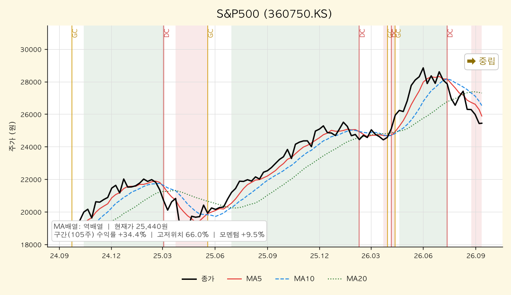

*S&P500(360750.KS) — 주봉 역배열, 2년 +34.4%, 고저위치 66.0%. 9주 전 데드크로스 이후 MA5·MA10·MA20을 차례로 이탈했으나 2년 상승폭 상단권은 유지.*

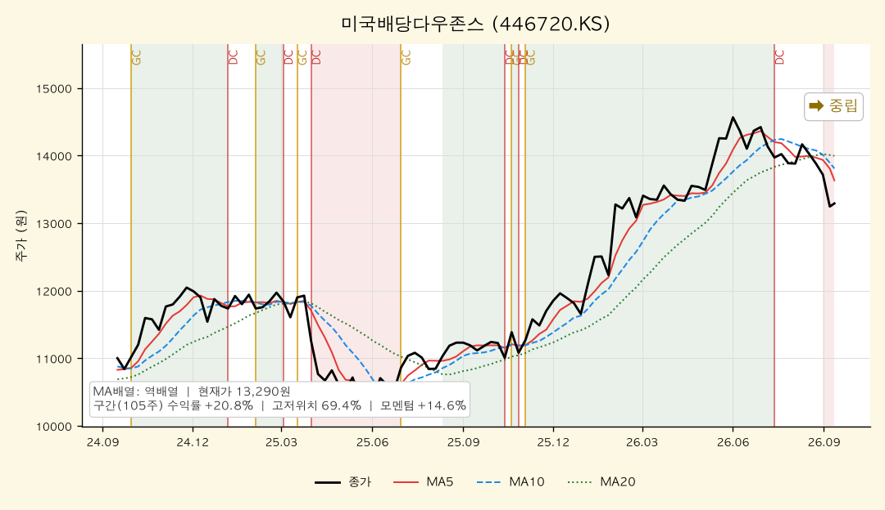

*미국배당다우존스(446720.KS) — 주봉 역배열, 2년 +20.8%, 고저위치 69.4%. 세 MA가 좁게 모여 있어 반등 시 정배열 복귀가 가장 빠를 수 있는 형태.*

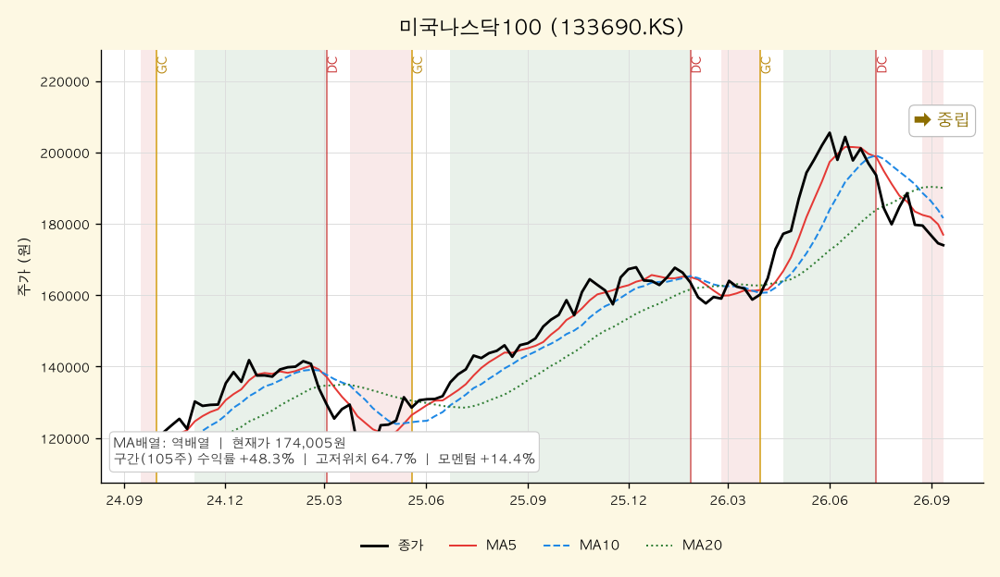

*미국나스닥100(133690.KS) — 주봉 역배열, 2년 +48.3%, 고저위치 64.7%. MA5와 MA20 간격이 7.4% 벌어져 조정 각도가 S&P500보다 급하다.*

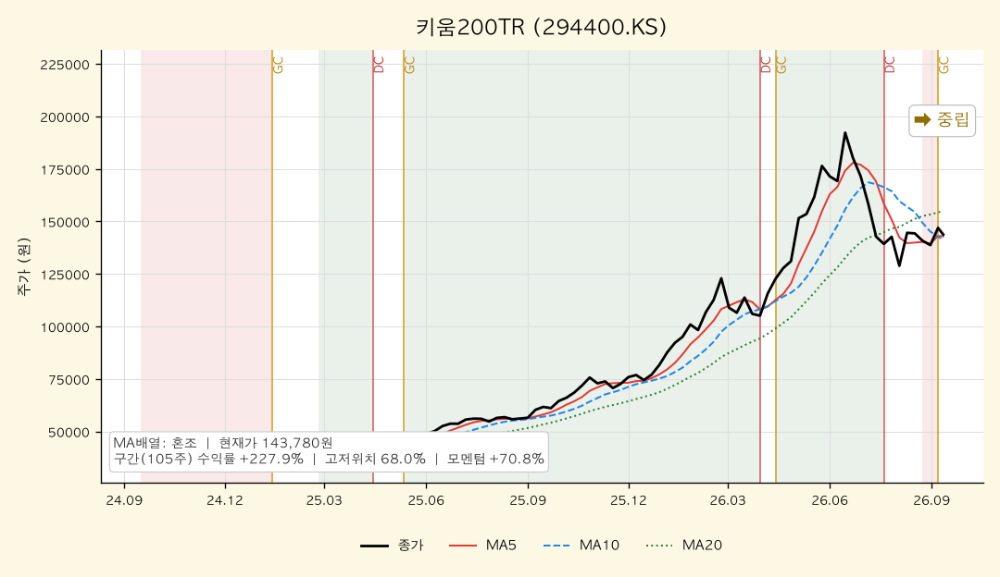

*키움200TR(294400.KS) — 주봉 혼조, 2년 +227.9%, 고저위치 68.0%. 1주 전 골든크로스로 MA5가 MA10을 재돌파. 국내 주식 중 회복력이 가장 빠른 축.*

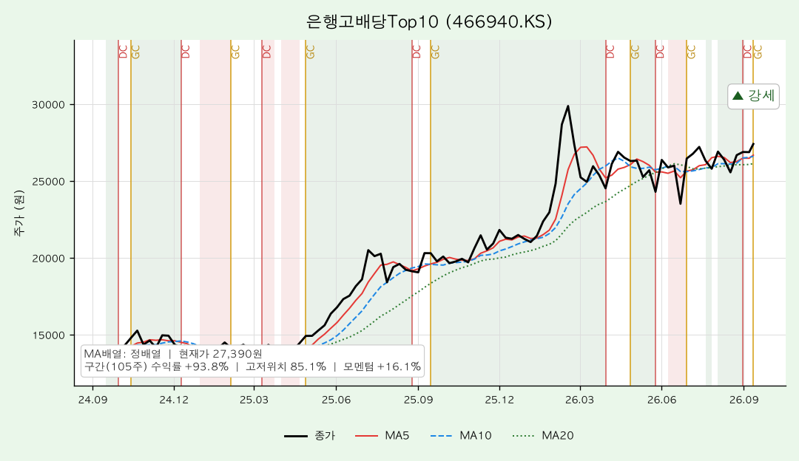

*은행고배당Top10(466940.KS) — 주봉 정배열, 2년 +93.8%, 고저위치 85.1%. 15개 중 유일한 일·주·월봉 동시 강세. 금주 골든크로스 추가 발생.*

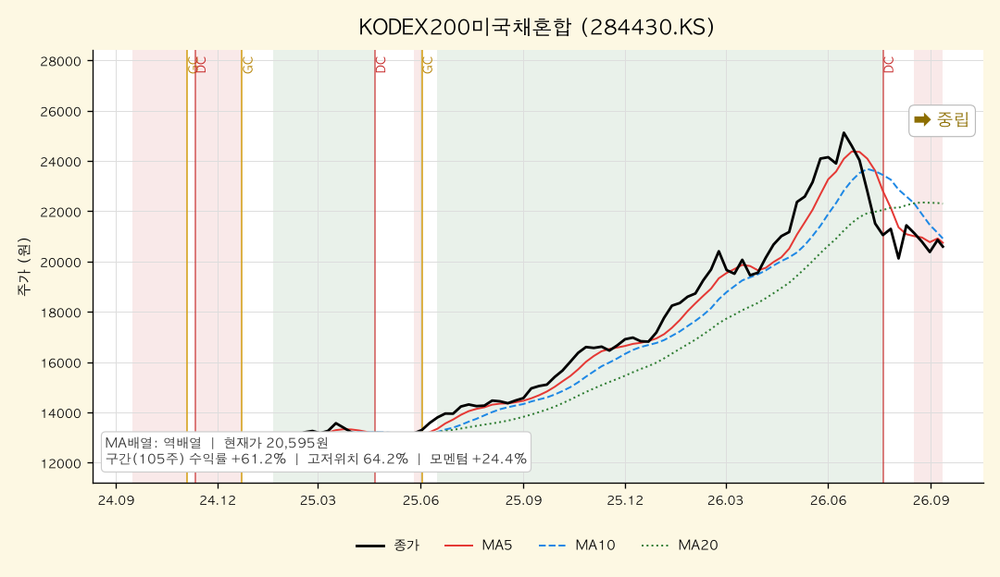

*KODEX200미국채혼합(284430.KS) — 주봉 역배열, 2년 +61.2%, 고저위치 64.2%. 주식·채권 혼합 구조 덕에 하락폭은 완만하나 채권 쪽 약세가 발목.*

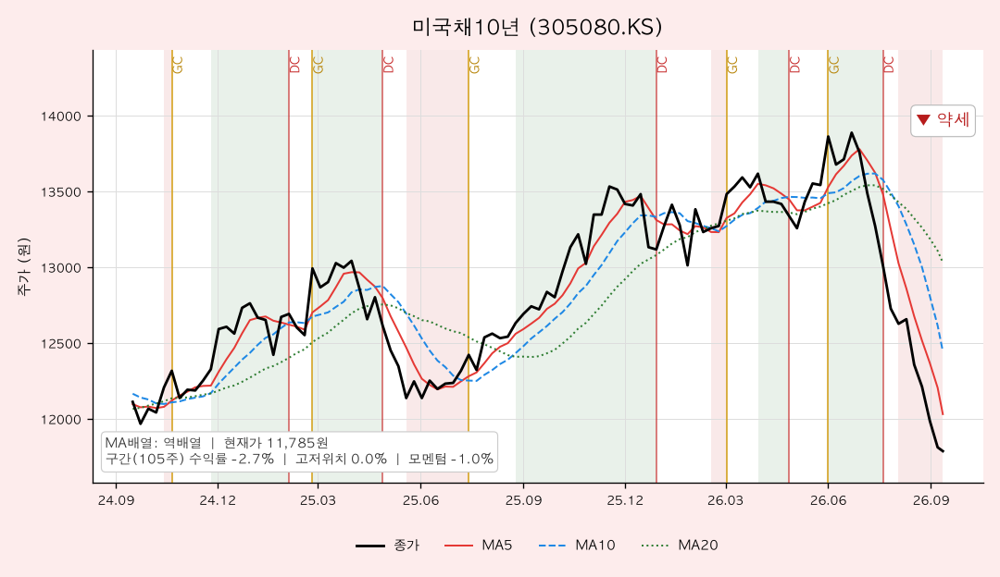

*미국채10년(305080.KS) — 주봉 역배열, 2년 -2.7%, 고저위치 0.0%. 15개 중 유일하게 2년 신저가. 일·주·월봉 모두 약세로 가장 명확한 하락추세.*

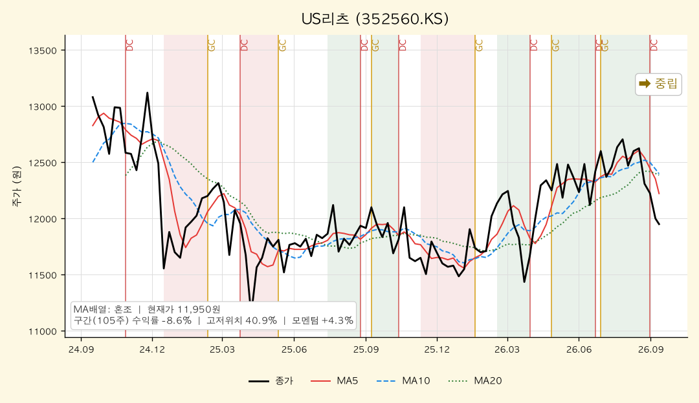

*US리츠(352560.KS) — 주봉 혼조, 2년 -8.6%, 고저위치 40.9%. MA10과 MA20이 거의 겹친 장기 횡보. 금리 방향이 정해질 때까지 방향성 부재.*

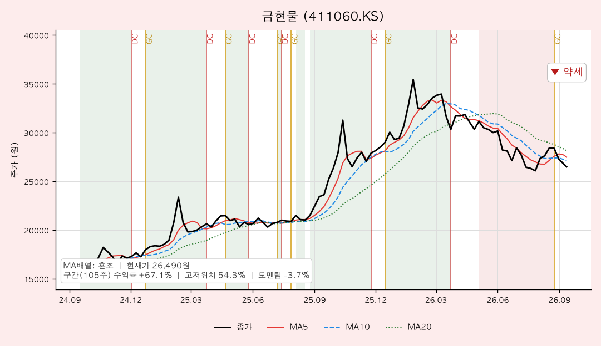

*금현물(411060.KS) — 주봉 혼조, 2년 +67.1%, 고저위치 54.3%. 3주 전 골든크로스가 나왔지만 모멘텀은 -3.7%로 감속. 신호와 속도가 엇갈린 상태.*

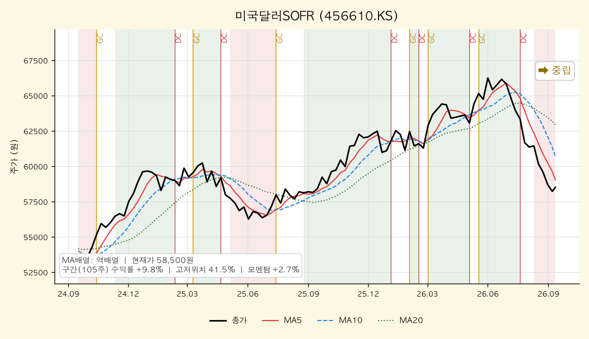

*미국달러SOFR(456610.KS) — 주봉 역배열, 2년 +9.8%, 고저위치 41.5%. 원/달러 하락과 함께 완만한 우하향. 현금성 자산이라 변동폭 자체는 작다.*

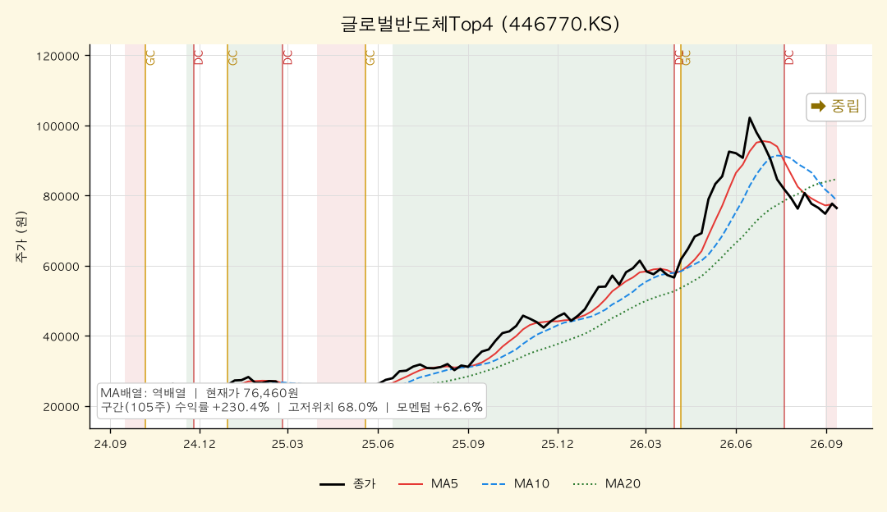

*글로벌반도체Top4(446770.KS) — 주봉 역배열, 2년 +230.4%, 고저위치 68.0%. 상승 각도가 가팔랐던 만큼 조정도 급하다. 월봉은 여전히 강세.*

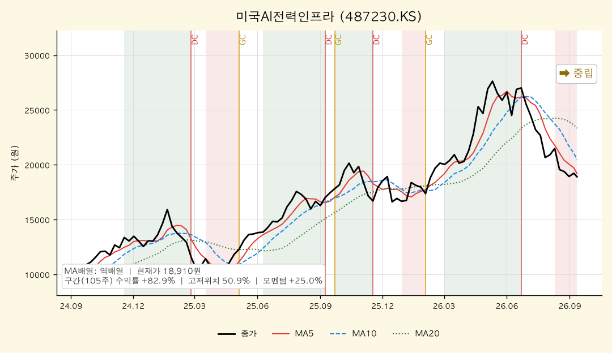

*미국AI전력인프라(487230.KS) — 주봉 역배열, 2년 +82.9%, 고저위치 50.9%. 일봉 3개월 -26.8%로 15개 중 낙폭 1위. MA20까지 되돌림 진행.*

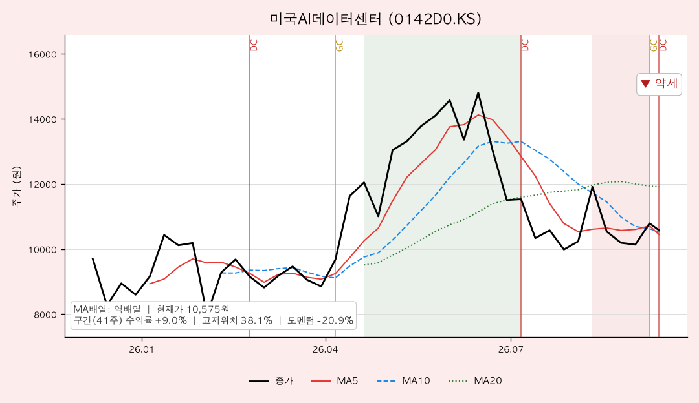

*미국AI데이터센터(0142D0.KS) — 주봉 역배열, 41주 +9.0%, 고저위치 38.1%. 금주 데드크로스, 주봉 모멘텀 -20.9%로 가장 빠른 감속.*

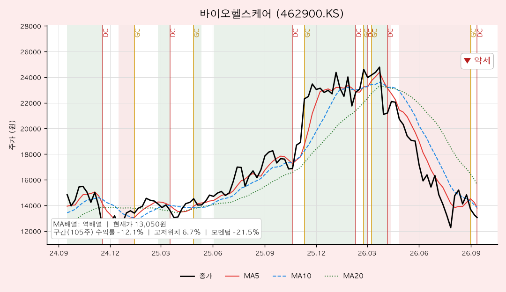

*바이오헬스케어(462900.KS) — 주봉 역배열, 2년 -12.1%, 고저위치 6.7%. 일·주·월봉 모두 약세이며 2년 최저가 부근. 추세추종 관점 최약체.*

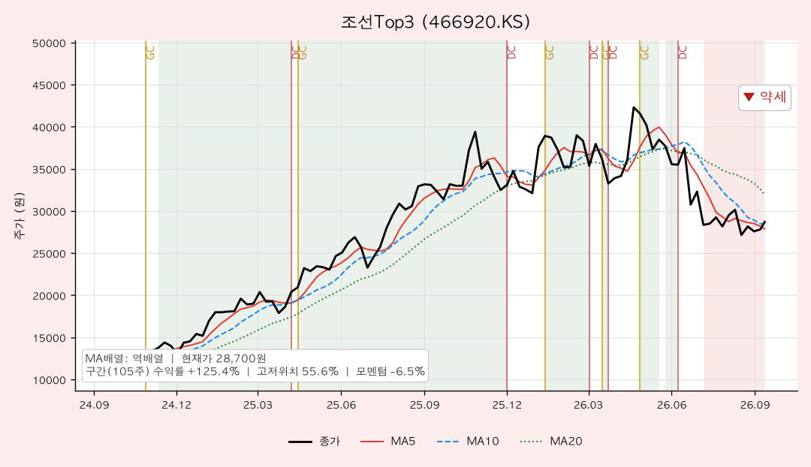

*조선Top3(466920.KS) — 주봉 역배열, 2년 +125.4%, 고저위치 55.6%. MA20(31,930원)이 현재가보다 11.3% 높아 되돌림 여력이 남아 있다.*

### [5] 추세추종 관점 주목 종목

#### 🚀 멀티타임 정배열 (추세 편승 구간)
| 종목명 | 근거 |
|--------|------|
| 은행고배당Top10 | 일·주·월봉 전부 정배열 + 강도 만점(+4). 월봉 고저위치 100.0%(5년 신고가), 일봉 94.2%. 금주 주봉 골든크로스 추가. 시장 전체가 조정인데 홀로 신고가 = 자금이 집중되는 유일한 구간 |

#### 📌 눌림목 후보 (장기 상승추세 + 단기 과매도)
| 종목명 | 월봉 고저위치 | 일봉 고저위치 | 판단 |
|--------|-------------|-------------|------|
| S&P500 | 80.7% | 0.4% | 장기 상단권인데 단기 3개월 최저. 전형적 눌림목 형태 |
| 미국나스닥100 | 78.5% | 0.4% | 동일. 단 조정 각도가 더 급해 1차 반등 확인 후 접근 |
| 미국배당다우존스 | 79.4% | 3.6% | 월봉 강세 유지 + MA 수렴. 눌림목 중 가장 안정적 |
| 글로벌반도체Top4 | 74.0% | 21.7% | 월봉 강세지만 주봉 MA20까지 10.8% 이격. 되돌림 여지 |
| 키움200TR | 74.4% | 36.4% | 주봉 골든크로스 발생 + 일봉 낙폭 축소. 회복 선행 그룹 |

#### 눌림목은 어떻게 판정하나 — S&P500 사례 분해

위 표의 "월봉 80.7% / 일봉 0.4%"가 무슨 뜻인지, 왜 그것이 눌림목 후보의 조건이 되는지를 S&P500 하나로 분해했다.

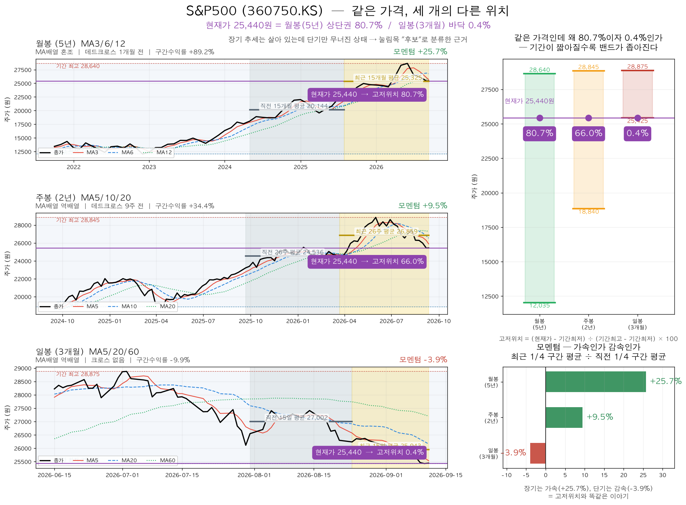

**① 같은 가격이 왜 80.7%이자 0.4%인가**

세 패널의 보라색 가로선은 전부 같은 값(25,440원)이다. 그런데 밴드(기간 최고~최저) 안에서의 높이가 다르다.

| 봉 단위 | 밴드 범위 | 밴드 폭 | 현재가 위치 |
|---|---|---|---|
| 월봉 (5년) | 12,035 ~ 28,640 | 16,605원 | **80.7%** (상단권) |
| 주봉 (2년) | 18,840 ~ 28,845 | 10,005원 | 66.0% (중간 위) |
| 일봉 (3개월) | 25,425 ~ 28,875 | 3,450원 | **0.4%** (바닥) |

**기간이 짧아질수록 밴드가 좁아지기 때문**이다. 5년 자로 재면 위쪽에 걸리는 가격이, 3개월 자로 재면 바닥에 붙는다. 모순이 아니라 자를 바꿔 잰 결과다.

**② 모멘텀도 같은 말을 한다**

차트의 회색 음영이 직전 ¼ 구간, 노란 음영이 최근 ¼ 구간이고, 그 안의 굵은 가로선이 각 구간의 평균이다. 두 평균을 나눈 값이 모멘텀이다.

| 봉 단위 | 직전 ¼ 평균 | 최근 ¼ 평균 | 모멘텀 |
|---|---|---|---|
| 월봉 (15개월씩) | 20,144 | 25,325 | **+25.7%** 가속 |
| 주봉 (26주씩) | 24,536 | 26,859 | +9.5% 가속 |
| 일봉 (15일씩) | 27,002 | 25,943 | **-3.9%** 감속 |

고저위치와 모멘텀은 계산 방식이 전혀 다른 지표인데 **같은 진단**을 내놓는다 — 장기는 가속 중, 단기만 꺾였다. 서로 다른 두 지표가 일치하면 "단기 조정"이라는 해석의 신뢰도가 올라간다.

**③ 그래도 "후보"인 이유 — 불리한 신호**

- **월봉 MA배열이 정배열이 아니라 혼조**이고, 데드크로스가 1개월 전에 났다. 맨 위 패널 오른쪽 끝에서 MA3가 MA6을 아래로 뚫는다. 즉 "장기 추세 건재"의 근거는 고저위치 80.7%와 5년 수익률 +89.2%이지, **이동평균 구조가 아니다**.
- **주봉은 역배열**이고 데드크로스 9주 전이다. 진입 신호(주봉 MA5가 MA10 상향 돌파)가 아직 나오지 않았다.

눌림목과 하락 전환은 진행 중에는 생김새가 같다. 둘 다 "월봉 상단 + 일봉 바닥"으로 보이고, 다시 올라가야만 사후에 눌림목으로 확정된다. 그래서 이 5종목을 "눌림목"이 아니라 **"눌림목 후보"**로만 분류하고, 진입 조건을 *주봉 골든크로스 확인 후*로 건다. **자격은 갖췄지만 신호는 아직**인 상태다.

#### ⚠️ 혼조 관망 (신호 불일치)
| 종목명 | 불일치 내용 |
|--------|-----------|
| 미국달러SOFR | 주봉 역배열이나 고저위치 41.5%로 중간대. 환율 방향 확정 전 |
| US리츠 | MA10·MA20 겹침 상태의 장기 횡보. 추세 자체가 없음 |
| 금현물 | 주봉 골든크로스(3주 전) vs 모멘텀 -3.7%. 신호와 속도 상충 |
| 미국AI전력인프라 | 주봉 구간 수익률 +82.9%인데 일봉 3개월 -26.8%. 변동성 과대 |
| KODEX200미국채혼합 | 월봉 강세 vs 일봉 약세. 내부 채권 비중이 발목을 잡는 구조 |

#### 🔻 멀티타임 역배열 (회피·축소 구간)
| 종목명 | 근거 |
|--------|------|
| 미국채10년 | 일·주·월봉 모두 약세. 주봉 고저위치 0.0%(2년 신저가), 월봉도 역배열. 하락추세가 가장 견고 |
| 바이오헬스케어 | 일·주·월봉 모두 약세. 주봉 고저위치 6.7%, 주봉 모멘텀 -21.5%. 반등 시도조차 없음 |
| 미국AI데이터센터 | 일·주봉 약세 + 금주 데드크로스. 상장 후 최단기 급락 구간 |
| 조선Top3 | 주봉 역배열 + 월봉 데드크로스(3개월 전). 일봉 3개월 -25.3%로 낙폭 3위 |

### [6] 자산군별 추세 비교

추세강도 평균(-4 ~ +4 척도)으로 자산군을 묶어 비교했다.

| 자산군 | 구성 종목 | 일봉 평균 | 주봉 평균 | 월봉 평균 |
|--------|----------|----------|----------|----------|
| 주식 — 선진국 | S&P500, 나스닥100, 배당다우존스, 글로벌반도체Top4, AI전력인프라, AI데이터센터 | -3.5 | -1.0 | +1.5 |
| 주식 — 국내 | 키움200TR, 은행고배당Top10, 조선Top3, 바이오헬스케어 | -0.8 | -0.5 | +0.5 |
| 혼합 | KODEX200미국채혼합 | -3.0 | -1.0 | +3.0 |
| 채권 | 미국채10년 | -4.0 | -4.0 | -2.0 |
| 대안자산 | 금현물, 미국달러SOFR, US리츠 | -3.3 | -1.0 | -1.0 |
| 배당·인컴 | 미국배당다우존스, 은행고배당Top10, US리츠 | -1.3 | +1.3 | +2.0 |

**자산군 간 관계 해석**

첫째, 이번 조정은 **분산이 작동하지 않은 동시 하락**이다. 일봉 평균이 모든 자산군에서 마이너스이고,
주식이 빠질 때 방어해야 할 채권(미국채10년)이 오히려 -4.0으로 가장 약하다.
금리가 떨어지지 않는 환경에서는 주식·채권·리츠가 같은 방향으로 움직인다는 사실이 그대로 확인됐다.

둘째, 유일한 피난처는 **국내 배당·인컴**이다. 배당·인컴 자산군만 주봉·월봉 평균이 플러스이고,
그 대부분은 은행고배당Top10이 끌어올린 결과다. 금리 고착 국면에서 이익이 늘어나는 은행 섹터가
채권의 역할을 대신 맡고 있는 셈이다.

셋째, **선진국 주식과 대안자산의 시간축 괴리**가 크다. 선진국 주식은 월봉 +1.5 / 일봉 -3.5로 장·단기가 정반대인데,
대안자산(금·달러·리츠)은 월봉도 -1.0으로 장기 추세 자체가 꺾여 있다.
즉 선진국 주식은 되돌림으로, 대안자산은 추세 이탈로 구분해서 봐야 한다.

### [7] 종합 코멘트

**전체 추세 방향성**
15개 ETF의 시간축별 강세 비중은 월봉 33.3%(5개), 주봉 6.7%(1개), 일봉 6.7%(1개)다.
짧은 시간축으로 내려갈수록 강세가 사라지는 전형적인 **상승추세 내 조정(중기 조정)** 구조다.
장기선 기준으로 보면 월봉 MA12 위에 5종목이 남아 있고, 주봉·일봉 장기선 위에는 은행고배당Top10 하나만 남았다.
추세추종 전략에서 이 배치는 "포지션을 늘릴 때가 아니라 지킬 때"로 읽힌다.

**강세·약세 자산군 교차 신호**
- 강세 쪽: 국내 은행·고배당(신고가), 국내 대형주(키움200TR 주봉 골든크로스)
- 약세 쪽: 미국채 장기물(2년 신저가), 바이오헬스케어(2년 최저권), AI 인프라·데이터센터(3개월 -26%대)
- 주목할 교차: 채권이 방어 자산 역할을 못 하는 동안 **고배당 주식이 그 자리를 대체**하고 있다.
  반대로 성장·테마(AI, 조선, 반도체) 쪽은 월봉 강세가 남았더라도 단기 낙폭이 커 변동성 비용이 급격히 올라갔다.
- 위험 신호: 주봉 데드크로스 10종목 중 7종목이 8~9주 전 발생 = 조정이 2개월째 이어지는 중이며,
  금주에도 바이오헬스케어·미국AI데이터센터에서 신규 데드크로스가 나와 아직 저점 확인 신호는 없다.

**추세추종 대응 방향**
1. **신규 진입은 정배열 확인 종목에 한정.** 현재 조건을 충족하는 것은 은행고배당Top10뿐이며,
   이미 월봉 고저위치 100.0%이므로 추격보다 분할 접근이 적절하다.
2. **눌림목 후보는 반등 신호를 먼저 요구한다.** S&P500·나스닥100·배당다우존스·글로벌반도체Top4는
   월봉 상단권 + 일봉 최저권이라는 눌림목 조건을 갖췄지만, 주봉 MA5가 MA10을 되돌파(골든크로스)하기 전까지는
   "저가 매수"가 아니라 "하락 도중"이다. 키움200TR은 이미 주봉 골든크로스가 나온 만큼 회복 순서상 앞선다.
3. **멀티타임 역배열은 추세추종 원칙대로 비중을 줄인다.** 미국채10년·바이오헬스케어는 세 시간축 모두 약세로,
   반등 근거가 가격 지표에는 없다. 미국AI데이터센터·조선Top3는 급락 직후 일봉 골든크로스가 나왔지만
   MA60 아래에서 나온 신호이므로 되돌림 반등으로 취급한다.
4. **점검 기준(다음 주 확인 항목)**: ① 주봉 정배열 종목 수가 1개에서 늘어나는지 ② 미국채10년이 2년 저점(고저위치 0.0%)을 지키는지
   ③ S&P500 주봉 MA5(25,884원) 회복 여부 ④ 은행고배당Top10이 주봉 MA5(26,666원)를 지키는지.

---

## 5. 내 ETF 평가 & 대응

> 이 섹션은 개인 포트폴리오를 다루므로 **절대금액을 쓰지 않는다.** 모든 수치는 비중(%)·수익률(%)·정성 평가다.
> 앞의 세 분석(한국은행·거시·차트)을 입력으로 받은 최종 종합이며, 관점은 **안전마진 기반 가치투자자**다.

### 5-0. 이번 주 가장 중요한 변화 — 전제가 뒤집혔다

직전 주(35주차) 리포트는 "미국 금리 **인하** 예상"을 전제로 미국 자산을 평가했다. 이번 주 데이터는 그 전제를 정면으로 뒤집었다.

| 항목 | 35주차 전제 | 37주차 실제 | 포트폴리오 영향 |
|---|---|---|---|
| 미 연준 | 9월 인하 예상 | 9/16 **25bp 인상** 확률 69.3% | 미국 채권·성장주 할인율 상방 |
| 미 10년물 | 상승압력 | **4.92%** (1주 +14bp) | 장기채 추가 손실, 고멀티플 압축 |
| WTI 유가 | 논외 | **98.93달러** (+8.1%, 이란·호르무즈) | 물가 재가열 → 인상 압력 연장 |
| 원/달러 | 논외 | **1,339원** (6월 1,533원 대비 △12.6%) | 미국 자산 74% 보유 → 환손실 직격 |
| 경기 국면 | 조정 국면 | **과열 후반 — 재긴축 초입** | 위험자산 신규 비중 동결 논리 |

즉 이번 주 내 포트폴리오의 손익을 가른 것은 주가가 아니라 **환율과 금리**였다. 이것이 아래 모든 평가의 출발점이다.

### 5-1. 포트폴리오 성과 (비중·수익률만)

#### 전체

| 항목 | 값 | 직전 주(08-29) | 변화 |
|---|---|---|---|
| 전체 누적 수익률 | **+4.73%** | +7.69% | △2.96%p |
| 주식성 자산 비중 | 60.7% | — | — |
| 금 비중 | 15.6% | — | — |
| 혼합(주식+채권) 비중 | 14.7% | — | — |
| 채권·달러 비중 | 7.2% | — | — |
| 현금 비중 | 1.9% | — | — |

2주 사이 누적 수익률이 3%p 가까이 깎였다. 추가 납입이 있었음에도 전체 평가액이 줄었으므로, **순수 가격 요인으로 약 △2.7%의 2주 드로다운**이 발생한 것이다.

#### 계좌별

| 계좌 | 전체 대비 비중 | 누적 수익률 | 직전 주 | 성격 |
|---|---|---|---|---|
| 퇴직연금 | 39.1% | **+10.11%** | +13.59% | 종합형(5분법) — 여전히 최우수 |
| 연금저축펀드 | 26.7% | **+5.24%** | +7.94% | 구조적 안정성(금·달러 헤지) |
| 개인IRP | 17.6% | **+4.04%** | +8.56% | 성장+배당 — 낙폭 가장 큼(△4.5%p) |
| ISA | 16.6% | **△6.11%** | △6.41% | 단중기 테마 — 유일하게 소폭 개선 |

역전 현상에 주목할 필요가 있다. 3주 연속 최하위였던 ISA가 이번엔 **유일하게 개선**됐고(테마 반등 + 추가 매수), 반대로 "안전한" 배당·혼합 중심의 IRP가 가장 크게 깎였다. 방어 자산이 방어하지 못한 주였다.

#### 자산군별 (전체 대비 비중 / 누적 수익률)

| 자산군 | 비중 | 누적 수익률 | 평가 |
|---|---|---|---|
| 미국주식(지수) | 23.9% | +10.98% | 여전히 최대 수익원 |
| 금 | 15.6% | +5.03% | 환율에 이익 대부분 반납 |
| 혼합(주식+채권) | 14.7% | +13.42% | 수익률 1위 |
| 미국주식(배당) | 11.1% | +8.92% | 금리 상승에 눌림 |
| 글로벌주식(테마·반도체) | 6.6% | +1.35% | 월봉 강세, 단기 정체 |
| 미국주식(테마·AI) | 5.6% | **△12.57%** | 최대 손실원 |
| 한국주식(배당) | 4.7% | +10.03% | **이번 주 유일한 강세** |
| 미국주식(성장·나스닥) | 4.4% | +0.34% | 사실상 원금 |
| 달러/단기채 | 4.0% | **△11.10%** | 환율 손실 직격 |
| 미국채권(10년) | 3.2% | **△8.14%** | 금리 상승 직격 |
| 한국주식(테마·조선) | 3.2% | △5.63% | 추세 이탈 |
| 한국주식(지수) | 0.6% | +7.58% | 주봉 골든크로스 |

#### 2주간(08-29 → 09-11) 평가 변화 — 로테이션이 보인다

| 방향 | 종목 | 2주 변화 |
|---|---|---|
| 🔻 하락 | 금현물 | △6.7% |
| 🔻 | S&P500 헬스케어 | △5.0% |
| 🔻 | 미국배당다우존스 | △4.0~4.6% |
| 🔻 | 미국배당미국채혼합50 | △4.0% |
| 🔻 | 미국채10년 | △3.5% |
| 🔻 | S&P500 | △3.2% |
| 🔻 | 미국나스닥100 | △2.8% |
| 🔺 상승 | KODEX200미국채혼합 | +1.2% |
| 🔺 | 키움200TR | +2.1% |
| 🔺 | 은행고배당TOP10 | +2.7% |
| 🔺 | 조선TOP3 | +2.8%* |
| 🔺 | 미국AI데이터센터 | +3.9%* |

\* 추가 매수분을 제외한 순가격 변동

**패턴이 명확하다: 미국 자산은 전부 마이너스, 한국 자산은 전부 플러스.** 이것은 종목 선택의 문제가 아니라 **원화 강세 12.6%라는 단일 변수**가 미국 자산 74%에 일괄 적용된 결과다. 내 포트폴리오의 지역 편중이 이번 주에 비용으로 청구된 것이다.

### 5-2. 금 비중 15.6%의 정체 — 환율이 삼킨 수익

가장 중요한 진단이다. 금 ETF는 2주간 △6.7%였는데, 같은 기간 **국제 금값은 오히려 올랐다**(4,364 → 4,437달러/oz). 거시 분석의 금 매력도는 🌟🌟🌟🌟(4/5)다. 모순이 아니다.

- KRX 금현물 ETF 가격 ≈ **국제 금값(USD) × 원/달러 환율**
- 국제 금값: Q1 고점 4,714달러 → 현재 4,437달러 = **△5.9%**
- 원/달러: 6월 1,533원 → 현재 1,339원 = **△12.6%**
- 결과: 금현물 ETF는 52주 최고(35,440원) 대비 **△25.3%**, 52주 위치 **12.4%**(사실상 1년 최저권)

즉 **△25%의 하락 중 3분의 2 이상이 환율 때문**이다. 가치투자자 관점에서 이것은 악재가 아니라 기회 신호에 가깝다. 금을 보유하는 이유(지정학 리스크, 인플레 방어, 실질금리)는 세 축 모두 살아 있거나 강해졌는데(이란 전면전·호르무즈, 기대인플레 5.8% 기준 실질금리 △0.88%p), 가격만 환율 때문에 1년 최저권으로 밀렸다.

**단, 착각하지 말아야 할 점**: 원화 강세의 원인은 반도체 수출 급증(8월 +209%)이라는 **펀더멘털**이다. 일시적 되돌림이 아닐 수 있으므로 "환율은 반드시 회귀한다"는 전제로 베팅하면 안 된다. 금 비중 15.6%는 유지가 적절하고, 확대는 52주 최저(25,225원) 이탈 확인 후 소량 분할이 원칙이다.

### 5-3. 안전마진 재계산 — 기준선이 올라갔다

`agents/etf-analysis.md`의 안전마진 기준은 "한국 예금금리 약 3.5%"였다. **이 기준은 이번 주 데이터로 상향해야 한다.**

| 비교 대상 | 수익률 | 의미 |
|---|---|---|
| 한국 정책금리 | 3.00% | 8월 2연속 인상 후, 10월 "라이브 미팅" |
| 한국 국고채 10년 | **4.54%** | 3년 최고 — 국내 무위험 대안의 실제 수준 |
| 미국 10년물 | **4.92%** | 1주 +14bp, 5.0% 돌파 시야 |
| S&P500 이익수익률(후행 PER 26.5배) | **3.77%** | 미 10년물보다 **1.15%p 낮다** |
| S&P500 이익수익률(선행 PER 19.5배) | **5.13%** | 미 10년물보다 겨우 0.21%p 높다 |

**가치투자자에게 이 표가 뜻하는 바**: 후행 이익 기준으로 미국 주식의 초과수익 기대(주식 리스크 프리미엄)는 **마이너스**다. 국채를 사면 확실하게 4.92%를 받는데, 주식은 3.77%를 받으면서 변동성을 감당한다는 뜻이다. 선행 이익(향후 12개월 추정)이 실현된다고 가정해도 프리미엄은 0.21%p로, 사실상 "주식을 보유할 대가가 없는" 구간이다.

S&P500 후행 PER 25.9~26.5배를 50년 역사에 놓으면 **50년 평균 16배의 약 1.6배**다. 닷컴버블(44배)에는 못 미치지만, 금융위기 직전(20배)을 넘어 코로나 이후(37배)와 평균 사이에 있다. 5년 평균 24.4배·10년 평균 23.5배도 모두 상회한다.

**결론: 지금 미국 지수에 신규 자금을 넣는 행위는 안전마진 없이 사는 것이다.** 보유분을 던질 이유는 아니지만(멀티플 압축은 이미 진행 중이고 선행 PER은 Q2 20.4배에서 19.5배로 내려왔다), **신규 매수의 요구 할인율은 크게 올라갔다.**

#### 마진데빗의 역사적 맥락 — "감소가 오히려 경보"인 이유

마진데빗(투자자가 증권사에서 빌려 주식을 산 돈)은 1조 4,172억달러, GDP 대비 4.36%로 역사 평균을 1.30%p 상회하는 과열권이다. 그런데 사상 최고에서 **△5.7% 꺾였다**(전년비로는 아직 +38.6%).

직관적으로는 "빚이 줄었으니 좋은 일"로 보인다. 실제로는 반대다. 빌려서 산 사람은 가격이 내리면 증권사로부터 추가 담보를 요구받고(마진콜), 못 내면 **강제로 팔린다**. 팔리면 가격이 더 내리고, 다음 사람이 또 마진콜을 받는다. 마진데빗의 감소는 보통 "투자자가 자발적으로 빚을 줄인 것"이 아니라 **이 연쇄 청산이 시작됐다는 흔적**이다. 2000년과 2008년 모두 마진데빗 고점 통과 직후 급락이 왔다.

내 포트폴리오는 레버리지를 쓰지 않으므로 직접 강제청산 위험은 없다. 그러나 시장 전체의 강제 매도 물량은 내 보유 종목 가격을 끌어내린다. **그래서 현금 1.9%는 너무 얇다.**

### 5-4. 세 가지 투자자 관점

| 관점 | 판단 기준 | 현재 시장 평가 | 내 포트폴리오에 대한 행동 |
|---|---|---|---|
| **가치투자자(버핏)** | 이익수익률 > 무위험수익률, 안전마진 | 🔴 **부적합** — 후행 이익수익률 3.77% < 미 10년 4.92%. 프리미엄 마이너스 | 미국 지수·성장주 **신규 매수 중단**. 한국 은행고배당(이익수익률·배당이 금리와 동행), 금(1년 최저권) 유지. 현금 비중 확대 |
| **성장주 투자자(ARK)** | EPS 성장률, 테마 점유율 | 🟠 **혼조** — 선행 EPS 추정은 6월 말 대비 +7.9%로 견고하나 할인율이 더 빨리 오름 | 반도체TOP4(월봉 강세 유지)는 보유, AI데이터센터·AI전력인프라(3개월 △26%대)는 **추가 매수 금지**. 비중 축소는 반등 시 |
| **단기 트레이더(모멘텀)** | 이동평균, VIX, 레버리지 추세 | 🔴 **매도 우위** — 15개 중 일봉 약세 13개, 주봉 정배열 1개. VIX 15.75로 아직 공포 없음 | 추세추종 원칙대로 멀티타임 역배열(미국채10년·조선·AI데이터센터) 축소. VIX 15.75는 "아직 바닥 아님"을 뜻함 |

세 관점이 **드물게 같은 방향**을 가리킨다. 가치·모멘텀 모두 "신규 매수 중단, 방어 강화"이고, 성장 관점만 부분 보유를 지지한다. 관점이 일치할 때는 그 신호를 존중하는 것이 맞다.

### 5-5. 한국 vs 미국 금리 환경 분리 평가

이번 주는 **양국이 동시에 긴축 방향**이라는 점이 직전 주와 결정적으로 다르다. 그래서 "한국 인상 / 미국 인하"라는 종전의 분리 구도는 더 이상 유효하지 않고, **"양국 인상 + 환율 비대칭"** 구도로 바뀌었다.

#### 🇰🇷 한국 자산 (금리 인상 환경 — 비중 8.5%)

| ETF | 비중 | 수익률 | 금리 환경 평가 |
|---|---|---|---|
| 타이거 은행고배당플러스TOP10 (466940) | 4.7% | +10.03% | **💚 최대 수혜.** 기준금리 3.00% + 국고채 10년 4.54%(3년 최고) → 은행 순이자마진 확대. 일·주·월봉 전부 정배열, 5년 신고가. 15개 중 유일한 멀티타임 강세 → **보유, 눌림목 분할 확대** |
| KIWOOM 200TR (294400) | 0.6% | +7.58% | **🟢 양호.** 주봉 골든크로스 발생, 회복 선행 그룹. 다만 코스피가 고점 대비 △23.7%이고 삼전+하이닉스 비중 52%로 반도체 단일 리스크 → 지수 매수는 소량 |
| SOL 조선TOP3플러스 (466920) | 3.2% | △5.63% | **🔴 경계.** 주봉 역배열 + 월봉 데드크로스, 52주 위치 10.3%. 금리 인상은 수주 산업 금융비용에 역풍 → **신규 매수 금지, 반등 시 축소** |

한국 자산은 **금리 인상 수혜가 실제로 확인된 유일한 영역**이다. 다만 비중이 8.5%뿐이어서 포트폴리오 전체를 방어하기엔 절대적으로 부족하다. 한국은행 기타대출 감소 전환(개인 주식투자 둔화)은 국내 지수 수급의 역풍이므로, 확대는 **은행·배당에 한정**하고 지수·테마로 넓히지 않는 것이 안전마진에 맞다.

#### 🇺🇸 미국 자산 (금리 **인상** 환경으로 전환 — 비중 74.0%)

| ETF | 비중 | 수익률 | 금리 환경 평가 |
|---|---|---|---|
| 타이거 미국 S&P500 (360750) | 23.9% | +10.98% | **🟠 보유·신규 중단.** 후행 PER 26.5배, 이익수익률 3.77% < 4.92%. 52주 위치 39.5%, 일봉 3개월 최저권 = 눌림목 형태이나 주봉 MA5(25,884원) 회복 전엔 "하락 도중" |
| SOL·TIGER 미국배당다우존스 (446720) | 11.1% | +8.92% | **🟠 보유.** 배당주는 금리 상승 시 채권과 경쟁해 밀린다(2주 △4%대). 월봉은 강세 유지 → 눌림목 중 가장 안정적. 배당수익률 상승 구간이므로 **소량 분할은 허용** |
| 타이거 미국 나스닥100 (133690) | 4.4% | +0.34% | **🔴 신규 금지.** 할인율 상승이 고멀티플에 직격. 52주 위치 39.8%, 2년 수익 +48%를 거의 반납 중. 조정 각도가 급해 1차 반등 확인 필수 |
| 삼성 KODEX200 미국채혼합 (284430) | 14.7%* | +13.42% | **🟢 유지.** 수익률 1위이고 2주간 +1.2%로 **유일하게 오른 혼합형**. 한국주식+미국채 조합이 환율·금리를 부분 헤지. 다만 채권 파트가 금리 상방에 노출 |
| SOL 미국배당미국채혼합50 (490490) | 14.7%* | +0.73% | **🟠 재검토.** 주식·채권 양쪽이 동시에 눌리는 구조적 약점 노출(52주 위치 27.1%). 분산이 작동하지 않는 국면의 전형적 피해자 |
| 타이거 미국채 10년선물 (305080) | 3.2% | △8.14% | **🔴 신규 중단.** 일·주·월봉 전부 약세, **주봉 52주 최저 갱신 중(위치 0.0%)**. 미 10년 4.92%에서 5.0% 돌파 시야 → "싸 보이지만 더 싸질 수 있는" 구간 |
| TIGER 미국달러단기채권액티브 (329750) | 4.0% | △11.10% | **🟡 보유(보험료).** 손실은 금리가 아니라 원화 강세 12.6% 때문. 52주 위치 3.6% = **환헤지 보험료가 1년 중 가장 싼 구간**. 위기 시 리밸런싱 재원 |
| ACE 글로벌반도체TOP4 plus (446770) | 6.6% | +1.35% | **🟠 보유.** 월봉 강세 유지 + 2년 +230%. 그러나 주봉 MA20까지 10.8% 이격, 섹터형은 사이클 하강 시 △40~60% 사례 흔함 → 신규는 깊은 할인에서만 |
| 타이거 미국AI데이터센터Top4Plus (0142D0) | 5.6%* | △16.43% | **🔴 최대 손실원.** 금주 신규 데드크로스, 일·주봉 약세. 2주간 순가격 +3.9% 반등은 MA60 아래 신호이므로 되돌림으로 취급 → **추가 매수 중단** |
| KODEX 미국AI전력핵심인프라 (487230) | 5.6%* | △6.59% | **🔴 신규 금지.** 주봉 +82.9%인데 일봉 3개월 △26.8% = 변동성 과대. 52주 위치 20.8% |
| KODEX 미국S&P500 헬스케어 | 0.6% | △7.65% | **🟡 비중 미미.** 2주 △5.0%. 규모가 작아 전체 영향 제한적 |

\* 자산군 합산 비중

미국 금리 환경 평가를 한 줄로 요약하면: **"인하 기대에 기반한 보유 논리는 소멸했다."** 9/16 FOMC에서 25bp 인상(확률 69.3%)이 현실화되면 연준이 물가 재가열을 공식 인정하는 것이고, 장기금리 5% 돌파와 고멀티플 추가 조정을 각오해야 한다. 미국 자산 74%는 이 시나리오에 그대로 노출돼 있다.

### 5-6. 종합 평가 및 대응 (안전마진 우선)

#### 진단 3줄

1. **지역 편중(미국·글로벌 74%)이 이번 주 손실의 단일 최대 원인**이다. 종목을 잘못 고른 것이 아니라, 원화 강세 12.6%가 포트폴리오 4분의 3에 동시 적용됐다.
2. **분산이 작동하지 않았다.** 주식이 빠질 때 방어해야 할 채권이 가장 약했다(미국채10년 일·주·월봉 전부 약세, 주봉 52주 최저). 금리가 내려오지 않는 환경에서는 주식·채권·리츠·금이 같은 방향으로 움직인다.
3. **안전마진이 사라졌다.** 미국 후행 이익수익률 3.77%가 미 10년물 4.92%를 밑돈다. 주식을 보유할 초과수익 대가가 현재 가격에는 없다.

#### 대응 원칙 — 우선순위 순

| 순위 | 행동 | 구체적 실행 | 근거 |
|---|---|---|---|
| 1 | **현금·단기물 비중 확대** | 현재 현금 1.9% → 목표 8~12%. 신규 납입금은 당분간 전액 대기, 미국 지수 자동매수분 일시 중단 검토 | 금리 5% 시대엔 기다리는 것 자체가 연 4~5% 수익. 마진데빗 디레버리징 진행 중이고 VIX 15.75로 공포 국면조차 오지 않았다 |
| 2 | **장기채 듀레이션 동결** | 미국채10년(305080) 신규 매수 **중단**. 기존 보유분은 미 10년 5.0% 도달 또는 ISM 가격지수 60 하회 확인 전까지 추가 매수 보류 | 주봉 52주 최저 갱신 중 + 유가발 물가가 금리 하방을 막는 구조 |
| 3 | **ISA 테마 편중 해소(진행)** | AI데이터센터·AI전력인프라 추가 매수 중단. 반등(주봉 MA20 회복) 시 두 종목 합산 비중을 현재 5.6%에서 3%대로 축소 | 월봉 강세가 남아도 일봉 △26%대 = 변동성 비용이 기대수익을 초과 |
| 4 | **한국 배당·은행 비중 확대** | 은행고배당TOP10(466940)을 주봉 MA20(26,115원) 부근 눌림목에서 분할 확대. 목표 4.7% → 7~8% | 15개 중 유일한 멀티타임 정배열·5년 신고가. 금리 인상이 이익에 직결되는 유일한 보유 자산. 채권이 못 하는 방어 역할을 대체 |
| 5 | **금 비중 유지** | 15.6% 유지. 확대는 52주 최저(25,225원) 부근 소량 분할까지만 | 하락의 3분의 2가 환율 요인이고 보유 사유(지정학·인플레·실질금리) 3축 중 2축이 강화됨. 단 원화 강세는 펀더멘털 기반이라 회귀 베팅 금지 |
| 6 | **미국 지수 눌림목은 신호를 요구** | S&P500·나스닥100·배당다우존스는 **주봉 MA5가 MA10을 되돌파(골든크로스)한 뒤**에만 분할 재개 | 월봉 상단권 + 일봉 최저권은 눌림목 조건이지만, 신호 없는 진입은 "저가 매수"가 아니라 "하락 도중 매수" |
| 7 | **혼합형 재점검** | 미국배당미국채혼합50(490490)은 주식·채권 동시 하락 국면의 구조적 피해자 → 신규 납입은 KODEX200미국채혼합(284430) 쪽으로 | 284430은 한국주식+미국채 조합으로 환·금리를 부분 헤지해 2주간 유일하게 상승 |

#### 강조 / 경계

- **강조(비중 확대 후보)**: 은행고배당TOP10(유일한 멀티타임 정배열), KODEX200미국채혼합(유일하게 오른 혼합형), 현금·단기물
- **경계(신규 금지)**: 미국채10년(52주 최저 갱신), AI데이터센터(신규 데드크로스), AI전력인프라(변동성 과대), 조선TOP3(월봉 데드크로스), 나스닥100(할인율 직격)
- **유지(손대지 않음)**: S&P500·배당다우존스(월봉 강세 유지, 신규만 중단), 금현물(환율 요인), 반도체TOP4(월봉 강세)

#### 가치투자자에게 지금이 뜻하는 것

지금 국면의 핵심은 "무엇을 살까"가 아니라 **"왜 지금 사야 하는가에 답할 수 없다"**는 점이다. 무위험 4.5~4.9%를 확정적으로 받을 수 있는데 후행 이익수익률 3.77%의 지수를 신규로 담을 이유는 없다. 안전마진은 좋은 자산을 고르는 데서 오지 않고 **싸게 사는 데서만** 온다.

동시에 이것이 "다 팔아라"는 뜻도 아니다. 월봉 기준 5개 종목이 여전히 장기 상승추세를 유지하고 있고, 선행 EPS 추정은 6월 말 대비 +7.9%로 이익 자체는 늘고 있다. 문제는 이익이 아니라 **가격과 할인율**이다.

따라서 순서가 중요하다. **① 현금 확보 → ② 금리 고점 확인(WTI 80달러 하회 또는 ISM 가격 60 하회 또는 FOMC 동결) → ③ 장기채 → ④ 미국 지수 → ⑤ 성장·테마.** 지금은 ①에 있다. ②를 건너뛰고 ④⑤로 가는 것이 지난 2주간 손실의 구조적 원인이었다.

### 5-7. ETF별 매수·매도 적정가

#### 산출 방법 (직전 주와 동일 기준, 수치만 갱신)

야후 파이낸스 **주봉 데이터(2026-09-11 종가)** 기준으로 ETF별 5개 값을 뽑는다.

| 항목 | 공식 | 의미 |
|---|---|---|
| 현재가 | 최근 주봉 종가 | 출발점 |
| 20주 이동평균(MA20) | 최근 20주 종가 평균 | 약 5개월 평균 매수단가 = 중기 추세의 무게중심 |
| 52주 최고/최저 | 최근 52주 종가의 최대·최소 | 저항선·지지선 |
| 52주 위치(%) | (현재가 − 최저) ÷ (최고 − 최저) × 100 | 1년 밴드 내 현재 위치. 0%면 바닥 |

국면별로 다른 공식을 적용한다.

| 국면 | 판별 | 매수 적정가 | 매도 적정가 |
|---|---|---|---|
| **상승추세** | 현재가 > MA20 + 정배열 | MA20 부근 눌림목 | 52주 최고 부근 |
| **박스/조정** | 현재가 < MA20, 52주 위치 40~70% | 52주 최고 − 할인율(지수형 13~20%, 섹터형 30~40%) | 52주 최고 저항 |
| **하락추세** | 현재가 < MA20, 52주 위치 30% 이하 | 52주 최저 +0~10% **분할만** (MA20 회복 확인이 조건) | 내려오는 MA20(저항) |

섹터·테마형에 지수형보다 깊은 할인(30~40%)을 요구하는 이유는, 사이클 하강 시 △40~60%까지 빠진 사례가 흔하기 때문이다. **변동성이 큰 자산일수록 더 싸게 사야 같은 안전마진이 확보된다.**

#### 적정가 표 (내가 보유한 ETF만)

| ETF (티커) | 현재가 | MA20 | 52주 위치 | 매수 적정가 | 매도 적정가 | 국면·근거 |
|---|---|---|---|---|---|---|
| 미국 S&P500 (360750) | 25,440 | 27,296 | 39.5% | 24,500~25,100 | 28,000~28,800 | 박스/조정. 52주 최고(28,845) 대비 △13~15% 할인 = 현재가 바로 아래. 매도는 전고점 저항 |
| 미국배당다우존스 (446720) | 13,290 | 13,994 | 64.2% | 12,400~12,700 | 14,300~14,565 | 박스/조정. 최고(14,565) 대비 △13~15%. 눌림목 중 가장 안정적(월봉 강세 유지) |
| 미국나스닥100 (133690) | 174,005 | 190,022 | 39.8% | 164,000~168,000 | 200,000~205,500 | 박스/조정, 성장주 할인 △18~20% 적용. 조정 각도 급해 1차 반등 확인 후 |
| 키움200TR (294400) | 143,780 | 154,931 | 63.0% | 128,000~140,000 | 175,000~190,000 | 혼조·주봉 골든크로스. 급등(2년 +228%) 되돌림 구간. 매도는 MA20 회복 후 전고점 △5~10% |
| 은행고배당Top10 (466940) | 27,390 | 26,115 | 75.8% | 26,100~26,700 | 29,000~29,900 | **상승추세(유일).** 매수는 MA20·MA5(26,666) 지지 눌림목. 매도는 52주 최고(29,860) 부근 일부 차익 |
| KODEX200미국채혼합 (284430) | 20,595 | 22,300 | 54.8% | 19,500~20,600 | 23,500~25,100 | 박스/조정. 최고(25,125) 대비 이미 △18%. 매도는 MA20 회복 후 |
| 미국배당미국채혼합50 (490490) | 10,685 | 11,513 | 27.1% | 10,150~10,700 | 11,500~12,100 | 하락추세 경계. 52주 최저(10,150) 근접. MA20 회복 전 신규 최소화 |
| 미국채10년 (305080) | 11,785 | 13,029 | **0.0%** | 11,300~11,800 **분할만** | 12,900~13,100 | **하락추세.** 52주 최저 갱신 중. 가격 도달만으로 매수 금지 — 미 10년 5.0% 도달 또는 MA20 회복이 조건 |
| 미국달러단기채 (329750) | 12,730 | 13,723 | 3.6% | 12,665~12,900 | 14,000 이상 | 원금보존형. 52주 최저권 = 환헤지 보험료 최저가 구간. 매도는 환율 급등 시 리밸런싱 재원 |
| 금현물 (411060) | 26,490 | 28,146 | 12.4% | 25,200~26,500 | 28,100~30,000 | 하락추세이나 **원인이 환율**. 52주 최저(25,225) +0~5% 소량 분할. 매도는 MA20 회복 후 |
| 글로벌반도체Top4 (446770) | 76,460 | 84,741 | 61.0% | 61,000~71,500 | 95,000~102,000 | 박스/조정, 섹터형 △30~40% 할인. 월봉 강세 유지이나 MA20까지 10.8% 이격 |
| 미국AI전력인프라 (487230) | 18,910 | 23,349 | 20.8% | 16,600~18,300 | 22,500~23,400 | 하락추세. 52주 최저(16,615) +0~10%. 매도는 내려오는 MA20 저항 |
| 미국AI데이터센터 (0142D0) | 10,575 | 11,915 | 38.1% | 8,800~9,500 | 11,500~11,900 | 하락추세 + 금주 신규 데드크로스. 상장 41주로 이력 짧음 → 비중 축소 라인 재설정용 |
| 조선Top3 (466920) | 28,700 | 31,930 | 10.3% | 27,100~28,500 **분할만** | 31,000~32,000 | 하락추세(월봉 데드크로스). 52주 최저(27,145) 근접. 반등 시 MA20 저항에서 축소 |
| KODEX 미국S&P500 헬스케어 | — | — | — | 산출 제외 | 산출 제외 | 티커 **미확인**으로 주봉 데이터 수집 불가. 비중 0.6%로 영향 제한적 |

**읽는 법**: 매수 적정가는 예측이 아니라 **"이 가격에 오면 그때의 거시 상황을 다시 확인하고 판단하는 알림선"**이다. 하락추세 종목(미국채10년·조선·AI 계열·금)은 적정가에 도달해도 **주봉 MA20 회복이라는 추세 전환 확인 후** 진입하는 것이 원칙이며, 상승추세 종목(은행고배당Top10)만 눌림목 매수가 곧바로 유효하다.

**이 방식의 한계**: 이 적정가는 기업 이익 기반 밸류에이션(PER·PBR)이 아니라 **가격 구조(지지·저항·추세)** 기준이다. ETF별 PER·PBR·ROE·ROIC는 FactSet 미연결로 이번 주 개별 검증이 불가해 산출하지 않았고, 대신 5-3에서 S&P500 지수 레벨의 이익수익률로 안전마진을 판정했다. 금리가 급변하거나 실적 쇼크가 오면 지지선은 깨질 수 있다.

---

## 6. 종합 코멘트 & 다음 주 관전 포인트

### 이번 주를 한 문장으로

**"방어 자산이 방어하지 못한 주."** 주식이 빠지는데 채권이 더 빠지고, 금은 국제 가격이 올랐는데 환율에 깎였다. 분산의 전제(자산군이 서로 다르게 움직인다)가 무너지는 국면이 실제로 어떤 모습인지를 내 포트폴리오가 그대로 보여줬다.

원인은 하나로 수렴한다. **금리가 내려오지 않는다.** 유가 99달러가 물가를 밀어올리고(ISM 가격 71.1), 물가가 중앙은행을 긴축으로 묶고, 긴축이 장기금리를 4.92%에 고정시킨다. 이 사슬이 유지되는 동안 채권 가격은 회복하지 못하고, 고멀티플 주식은 할인율 압력을 받고, 달러 자산은 원화 강세에 한 번 더 깎인다.

### 네 분석의 교차 확인

| 분석 | 핵심 신호 | 서로 어떻게 맞물리는가 |
|---|---|---|
| 한국은행 | 기준금리 3.00%, 근원물가 3.4% > 전망 2.5%, 10월 라이브 | 한국도 인상 여지 → 국고채 10년 4.54%(3년 최고)가 국내 주식 밸류에이션을 누름 |
| 거시 | WTI 98.93, 미 10년 4.92%, FOMC 인상 확률 69.3% | 양국 동시 긴축 확정 → "인하 기대" 기반 보유 논리 전면 소멸 |
| 차트 | 주봉 정배열 1개, 미국채10년 52주 신저 | 거시의 금리 상방이 가격에 이미 반영 — 채권의 방어 실패가 기술적으로 확인 |
| ETF | 미국 74% 전부 마이너스 / 한국 8.5% 전부 플러스 | 환율·금리 두 변수가 지역 편중을 비용으로 청구 |

네 분석이 **서로를 반박하지 않고 같은 결론을 가리킨다**. 이럴 때는 개별 종목 판단보다 국면 판단을 앞세우는 것이 맞다.

### 안전마진 기반 가치투자자의 현재 입장

- **유지(손대지 않음)**: S&P500·미국배당다우존스(월봉 강세 유지), 금현물(하락 원인이 환율), 글로벌반도체Top4(월봉 강세), KODEX200미국채혼합(2주간 유일하게 상승)
- **확대**: 현금·단기물(1.9% → 8~12%), 은행고배당Top10(4.7% → 7~8%, 15개 중 유일한 멀티타임 정배열)
- **신규 중단**: 미국채10년(52주 최저 갱신), 나스닥100(할인율 직격), AI데이터센터·AI전력인프라(변동성 과대), 조선Top3(월봉 데드크로스)
- **순서 원칙**: ① 현금 확보 → ② 금리 고점 확인 → ③ 장기채 → ④ 미국 지수 → ⑤ 성장·테마. **지금은 ①이다.**

### 다음 주 관전 포인트

1. **9/16(수) 미 FOMC — 이번 주 최대 변수.** 25bp 인상(확률 69.3%)은 연준이 물가 재가열을 공식 인정하는 것으로, 미 10년 5% 돌파와 고멀티플 추가 조정을 뜻한다. 동결이면 "유가발 물가는 일시적"이라는 판단이어서 단기 안도랠리 요인이다. **점도표와 기자회견 톤이 실제 변수**다.
2. **9/15(화) 한국은행 8월 27일 금통위 의사록 공개.** 황건일 위원 동결 소수의견(6 대 1)의 논거와, 인상에 찬성한 위원들이 추가 인상 조건을 어떻게 규정했는지가 10월 22일 회의 확률을 판단할 가장 직접적인 단서다.
3. **WTI 80달러 / ISM 가격지수 60 — 국면 전환의 두 문턱.** 이 둘이 아래로 뚫리면 긴축이 조기 종료되고 3단계 확장으로 복귀한다. 반대로 호르무즈 실질 봉쇄로 WTI 120달러를 넘으면 스태그플레이션 시나리오(헤드라인 CPI 5% 재진입)로 넘어간다.
4. **원/달러 1,339원의 방향.** 미국 자산 74%를 보유한 내 포트폴리오에서 이것이 단일 최대 변수다. 다만 강세 원인이 반도체 수출(8월 +209%)이라는 펀더멘털이므로 **회귀를 전제로 베팅하지 않는다**.
5. **기술적 확인 4개**: ① 주봉 정배열 종목이 1개에서 늘어나는지 ② 미국채10년이 52주 저점(11,785원)을 지키는지 ③ S&P500 주봉 MA5(25,884원) 회복 여부 ④ 은행고배당Top10이 주봉 MA5(26,666원)를 지키는지.
6. **신규 실업수당(9/17)**: 22만건 이하면 고용이 긴축을 흡수 중(베이스케이스 유지), 25만건 상회면 긴축 말기 전환 신호다.

### 투자 원칙 재확인

> "안전마진은 좋은 자산을 고르는 데서 오지 않고, 싸게 사는 데서만 온다."
>
> 무위험 수익률 4.9%를 확정적으로 받을 수 있는데 후행 이익수익률 3.8%의 지수를 신규로 담을 이유는 없다.
> 이익이 문제가 아니라 **가격과 할인율**이 문제인 국면에서, 기다림은 소극적 선택이 아니라 연 4~5%를 받는 적극적 포지션이다.

---

## 면책 문구

본 글은 정보 제공 및 개인 기록 목적이며 투자 자문이 아닙니다. 모든 투자 판단과 그 책임은 본인에게 있습니다. 개인 포트폴리오의 비중(%)·수익률(%)만 공개하며, 절대금액은 공개하지 않습니다.
