## 1. 이번 주 요약

**경기 진단**: 예고된 인상이 현실이 됐다. 연준은 9/16 12:0 만장일치로 기준금리를 **3.75~4.00%로 25bp 인상**했고(3년 만의 첫 인상), 점도표는 연내 추가 인상을 가리킨다(10/28 인상 확률 59.7%). 국면은 **4단계 과열 후반 — 재긴축 확정**이다. 새 변수는 단기금리가 끌어올린 **금리곡선 평탄화(10년-2년 +25bp)**이고, 호르무즈 재개방 협상으로 WTI는 91달러대로 △8.7% 내렸다.

**한국은행**: 기준금리 3.00%. 9/15 공개된 8월 의사록에서 동결 소수의견의 두 전제(4분기 물가 둔화, 원화 강세)가 유가 재급등·연준 인상·원화 되돌림으로 함께 흔들렸다. 8월 생산자물가 전년비 +7.9%, 9월 금리수준전망CSI 128(약 3년 만의 최고)로 **10월 22일 금통위 인상 가능성이 2주 전보다 커졌다.** 금융안정 보고서는 금리 인상의 충격이 취약차주 연체율에 약 9개월 시차로 온다고 경고했다.

**기술 신호**: 일봉 약세가 13개 → 10개로 줄고, 9종목에서 **일봉 골든크로스가 동시에** 나왔다. 반등은 나스닥100(+6.3%)·반도체(+6.0%) 같은 성장주가 이끌었다. 그러나 주봉 정배열은 여전히 **은행고배당Top10 단 1개**이고, 주봉 역배열은 11개 → 13개로 오히려 늘었다. 반등이지 추세 복귀가 아니다.

**포트폴리오**: 전체 누적 **+5.76%**(직전 +4.73%, +1.03%p). 원/달러가 1,339원 → 1,368원으로 되돌면서 2주 전 "미국 전부 마이너스, 한국 전부 플러스"였던 패턴이 정확히 뒤집혔다. 현금은 1.9% → 4.8%로 늘었다(목표 8~12%의 절반). 안전마진은 더 얇아졌다: 미 10년 약 5.0% 대비 S&P500 후행 이익수익률 약 3.7%로 **주식 프리미엄이 약 -1.3%p**다.

**한 줄 선언**: 인상은 실행됐고 시장은 안도했지만, 무위험 5%가 이익수익률 3.7%를 앞지른 구조는 그대로다 — **오르는 날 현금을 늘리는 것이 이번 주 가치투자자의 일**이다.

---

## 2. 한국은행 보도자료 분석

### 이번 주 주요 발표 (2026년 39주차, 09.12 ~ 09.23)

> 직전 리포트(37주차, 09.11) 이후 발표분을 모두 포함한다. 38주차 리포트가 없었으므로 09.12 ~ 09.16 발표분도 함께 다룬다.

| 발표일 | 제목 | 핵심수치 | 시사점 |
|---|---|---|---|
| 2026.09.15 | 금융통화위원회 의사록(08.27 회의분) | 6 대 1 인상(2.75% → 3.00%), 황건일 위원 동결 소수의견 | 다수는 "근원물가 2% 중반 상회 지속"을 근거로 선제 인상. 추가 인상은 열어두되 "경제주체별 영향 확인하며 신중히" — 속도 조절 공식화 |
| 2026.09.15 | 2026년 8월 수출입물가지수(잠정) | 수출물가 전월비 -3.7%(3년 8개월 만의 최대 낙폭), 수입물가 전월비 -2.4%·전년비 +15.6% | 원화 강세(월평균 환율 -6.1%)가 수입물가를 눌렀지만, 9월엔 유가 급등으로 상방 압력 재개 예고 |
| 2026.09.17 | 시장상황 점검회의(미 FOMC 결과) | 미 연준 정책금리 3.75~4.00%로 25bp 인상 | 한은 "연준 기조 긴축적일 것" 평가. 한·미 금리차 확대 → 원화 강세 흐름의 변수 |
| 2026.09.17 | 2026년 8월 이후 국제금융·외환시장 동향 | 원/달러 1,424.0원(7월 말) → 1,359.4원(9.15), 4.8% 하락. 8월 외국인 증권자금 -45억달러 | 원화 강세 지속, 외국인 채권자금 순유출(-45.3억달러)은 금리 상승 부담 반영 |
| 2026.09.18 | 2026년 8월 생산자물가지수(잠정) | 전월비 +0.2%(한 달 만에 반등), 전년비 +7.9%, 지수 129.64 | 폭염(농림수산품 +3.8%)과 유가가 견인. 9월은 유가 +29%·산업용 도시가스 인상으로 추가 상방 |
| 2026.09.21 | 2024년 산업연관표(연장표), 2025년 공공부문계정(잠정), 한국은행원화국제결제망 시범운영 개시 | 세부 수치 미확인 | 구조 통계·인프라 성격. 단기 시장 영향 제한적 |
| 2026.09.22 | 금융안정 상황(2026년 9월) — 금융안정회의 | 가계부채/GDP 약 81%(2분기), FVI 46.5(9분기 연속 상승) | 비율 하락은 "분모(명목GDP) 효과". 취약차주·중소기업에서 금리 충격이 먼저 현실화될 위험 경고 |
| 2026.09.23 | 2026년 9월 소비자동향조사 | CCSI 106.6(+2.1p), 금리수준전망CSI 128(약 3년 만의 최고), 주택가격전망CSI 125, 기대인플레 2.7% | 심리는 낙관, 가계는 추가 인상을 이미 예상. 집값 기대는 꺾이지 않음 |

> **수집 방법 고지**: 한국은행 보도자료 목록 페이지(`newsData/list.do`)는 이번 주에도 JS 렌더링으로 fetch MCP에서 게시물 0건(푸터만 반환)으로 **목록 직접 수집에 실패**했다. 위 표는 WebSearch 결과와 언론 보도(이투데이·이데일리·머니투데이·헤럴드경제·뉴스핌 등) 교차확인으로 재구성했으며, **일부 발표 항목이 누락됐을 수 있다**. 발표일은 보도 시점 기준이며 엠바고 시각에 따라 하루 차이가 있을 수 있다. 원문 PDF의 세부 표는 확인하지 못했다.

### 2-1. 8월 금통위 의사록(09.15) — 지난주 "확인 과제"의 답

37주차 리포트에서 다음 확인 포인트로 꼽았던 의사록이 공개됐다. 핵심은 세 가지다.

**① 다수(인상 6인)의 논거.** 반도체 호황에 따른 잠재성장률 상회 성장, 근원물가의 지속적 상방 압력, 수도권 주택가격 상승과 가계부채 누증에 대한 선제 대응이다. 다수 위원은 근원물가가 "2% 중반을 상회하는 오름세"를 당분간 이어갈 것으로 봤고, 헤드라인 물가가 목표를 크게 웃도는 상황에서 물가기대 관리가 필요하다고 판단했다. 한 위원은 "물가 상방 압력에 선제 대응하되 취약차주는 재정으로 선별 지원"해야 한다는 역할 분담론을 폈다(언론 인용 기준).

**② 추가 인상의 조건.** 위원들은 추가 인상 가능성을 닫지 않으면서도 "경제주체별 영향을 확인하며 신중히 결정할 필요"를 언급했다. 즉 **방향은 긴축, 속도는 데이터 의존**이다. 이는 신현송 총재가 8월 기자간담회에서 10월 판단 변수로 8·9월 물가와 2분기 명목GDP를 지목하고 "향후 인상은 완만하게"라고 한 발언과 일관된다.

**③ 황건일 위원 동결 소수의견의 논거.** (a) 물가는 당분간 목표를 웃돌겠지만 **4분기부터 점차 둔화**할 것, (b) 원화의 상당 폭 절상으로 "고환율 대응을 위한 제약적 통화정책 필요성"이 완화됐다는 점, (c) 수요측 물가 압력이 기조적인지 더 확인이 필요하다는 점, (d) 시장금리가 이미 높은 수준이고 자영업 연체율 상승 등 취약 부문 부담이 크다는 점이다. 회의 전반에서 'K자형 양극화'와 자영업 연체 문제가 언급됐다는 보도도 있다.

**해석.** 의사록은 "인상 종료"도 "10월 인상 예고"도 아니다. 다만 소수의견의 핵심 전제 두 가지 — **물가 4분기 피크아웃**과 **원화 강세 지속** — 가 이후 2주간의 데이터로 어떻게 검증되는지가 10월 회의의 무게중심을 결정한다. 아래 2-2~2-4의 자료는 이 두 전제를 모두 흔드는 방향으로 나왔다.

### 2-2. 물가 파이프라인 — 생산자물가(09.18)·수출입물가(09.15)

**8월 생산자물가**는 전월비 0.2% 상승(지수 129.64, 7월 -0.4%에서 반등)했고 전년동월비로는 7.9% 올랐다. 폭염으로 농림수산품이 3.8%(농산물 +4.9%, 축산물 +2.8%; 시금치 +51.9%, 돼지고기 +5.4%) 뛰었고, 산업용 도시가스가 11.0% 상승했다. 공산품은 전월비 보합이었다. 석유제품은 전년비 54.3% 상승으로 보도됐다. 국내공급물가 -1.3%는 보도에 기준(전월비/전년비)이 명확하지 않아 **해석 유보(미확인)**.

**8월 수출입물가**는 월평균 원/달러 환율이 7월 1,497.43원에서 8월 1,406.30원으로 6.1% 떨어지면서 원화 환산 가격이 일제히 하락했다. 수출물가는 전월비 3.7% 하락(3년 8개월 만의 최대 낙폭), 수입물가는 전월비 2.4% 하락했다. 그러나 수입물가는 **전년비로는 여전히 +15.6%**이고, 교역조건은 역대 최고 수준이라는 보도가 있다(세부 수치 미확인).

**핵심은 9월 전망이다.** 한국은행 물가통계팀은 "중동지역 충돌 재개로 9월 1~16일 국제유가가 8월 평균 대비 29% 상승했고 산업용 도시가스 도매요금도 6.6% 인상됐다"며 생산자물가의 상방 요인을 명시했다. 수입물가도 9월에 두 자릿수 전년비 상승률이 이어질 것으로 전망됐다. 즉 8월에 환율이 흡수해준 물가 완충이 **9월에는 유가 충격에 압도될 가능성**이 크다. 이는 황건일 위원의 "4분기 피크아웃" 전제에 대한 직접적 반증 재료다.

### 2-3. 대외 — 미 FOMC 인상과 한은 대응(09.17), 국제금융·외환시장 동향(09.17)

미 연준은 9월 15~16일 FOMC에서 정책금리를 3.75~4.00%로 25bp 인상했다(2023년 7월 이후 약 3년 만의 인상). 한국은행은 17일 오전 권민수 부총재 주재 시장상황 점검회의를 열고 "워시 의장의 물가안정 의지 강조와 추가 인상 가능성 시사 등을 감안할 때 연준의 통화정책 기조가 긴축적일 것"이라고 평가했다. 대외 리스크로 중동전쟁·국제유가, 주요국 재정건전성 우려, **AI 산업 관련 불확실성**을 함께 꼽았다. 기준금리 3.00%와 미 정책금리 상단 4.00% 사이 **한·미 금리차는 상단 기준 1.00%p로 확대**됐다(단순 계산).

같은 날 발표된 **8월 이후 국제금융·외환시장 동향**에 따르면 원/달러 환율은 7월 말 1,424.0원에서 9월 15일 1,359.4원으로 4.8% 하락(원화 절상)했다. 경상수지 흑자 확대에 따른 수급 개선과 견조한 성장 전망이 배경이다. 8월 중 환율 일중 변동폭은 4.4원으로 7월(8.0원)의 절반 수준으로 안정됐다. 외국인 증권투자자금은 8월 45억달러 순유출로 7월(-216.5억달러)보다 크게 줄었는데, 주식은 0.4억달러 순유입으로 전환된 반면 **채권은 45.3억달러 순유출**(시장금리 상승·단기 차익거래 유인 축소)이었다. 같은 기간 미 10년물 금리는 4.73% → 5.00%, WTI는 배럴당 84.7달러 → 105.8달러(+25.0%)로 보도됐다. 외평채 CDS 프리미엄은 22bp로 안정적이다. (원/엔·원/위안 변동률은 보도 표기상 방향이 모호해 인용하지 않는다 — 미확인.)

**해석.** 원화 강세는 황 위원 소수의견의 두 번째 전제다. 그러나 미 연준의 재인상과 추가 인상 시사로 금리차가 벌어진 만큼, 원화 강세의 동력이 "경상수지 흑자"라는 펀더멘털에서 "금리차에 따른 자본 유출"과 줄다리기하는 국면으로 넘어갔다. 한은이 이를 "각별한 경계감"으로 표현한 것은 원화 강세를 더는 당연한 완충으로 보지 않는다는 뜻으로 읽힌다.

### 2-4. 금융안정 상황(09.22) — 금리 인상의 "청구서"는 약한 고리부터

9월 22일 금융안정회의 이후 공개된 「금융안정 상황」은 금융시스템이 금융기관 복원력과 대외지급능력을 바탕으로 **대체로 안정적**이라고 평가하면서도 경고 신호를 여럿 담았다.

- **가계부채/GDP**: 1분기 85% → 2분기 약 81%, 연말 70%대 중후반 전망. 다만 장정수 부총재보는 "분모인 명목GDP 확대 영향이 더 크다"며 실질 상환능력 개선이 아니라고 선을 그었다.
- **금융취약성지수(FVI)**: 2분기 46.5로 장기평균 수준, **9분기 연속 상승**, 3분기에도 상승세 지속 추정. 가계신용과 주택가격 상승이 주 요인.
- **금융스트레스지수(FSI)**: 19.5, '주의 단계'로 보도(단일 보도 기준, 교차확인 미흡).
- **한계기업**(3년 연속 이자보상배율 1 미만): 약 19%. 기업 부문이 가계보다 금리 인상에 더 취약하다는 진단.
- **금리 인상의 시차 분석**: 은행 대출금리는 인상 약 5개월 후, 전체 연체율은 약 15개월 후 최대 반응. **취약차주·중소기업 연체율은 약 9개월 후**로 더 빠르게 정점에 도달.
- 원화 강세는 은행 자본비율 개선을 통해 중소기업 대출 여력을 넓히는 긍정 요인으로 평가됐다.

**해석.** 7·8월 인상의 효과가 가계부채 증가를 누르는 데는 시간이 걸리지만, 부작용(취약차주·중소기업 연체)은 **2027년 4~5월경**(7월 인상 + 9개월)부터 먼저 나타날 수 있다는 한은 스스로의 분석이다. 10월 추가 인상을 할 경우 이 청구서가 더 커진다는 점에서, 금융안정 보고서는 인상론과 신중론 양쪽의 근거를 동시에 제공한다.

### 2-5. 9월 소비자동향조사(09.23) — 가계는 이미 추가 인상을 가격에 넣었다

소비자심리지수(CCSI)는 106.6으로 전월(104.5) 대비 2.1p 반등했다. 가계수입전망CSI 102(+2p, 7개월 만의 최고), 현재경기판단CSI 83(+4p), 향후경기전망CSI 90(+1p)으로 반도체 수출 호조가 설비투자·소비·소득 기대로 번지는 모습이다. 눈에 띄는 것은 **금리수준전망CSI 128 — 2023년 10월 이후 약 3년 만의 최고**라는 점이다. 주택가격전망CSI는 125로 보합(장기평균 107을 크게 상회), 기대인플레이션율은 2.7%로 제자리였다.

**해석.** 두 차례 인상에도 집값 기대가 꺾이지 않았고, 가계는 금리가 더 오를 것으로 본다. 기대인플레가 2.7%에서 안정된 것은 한은에 다행이지만, 주택가격 기대가 125에 머무는 한 금융안정 측면의 인상 명분은 해소되지 않는다.

### 종합 평가

**한 줄 요약**: 기준금리 3.00%에서 의사록은 "속도 조절"을 확인했지만, 소수의견의 두 전제(물가 4분기 피크아웃·원화 강세)가 **유가 +29% 재급등과 연준의 재인상**으로 동시에 흔들리면서 10월 금통위(라이브 미팅)의 인상 확률은 지난주보다 오히려 높아졌다.

**투자 시사점 (안전마진 관점)**

1. **할인율 상방 리스크가 국내·해외 양쪽에서 확인됐다.** 한은은 추가 인상을 열어뒀고, 연준은 인상과 함께 추가 인상을 시사했으며, 미 10년물은 5%대에 올라섰다. 할인율이 오르는 국면에서 현재 가격을 정당화하려면 **더 보수적인 이익 가정과 더 두꺼운 안전마진**이 필요하다. 장기 성장 기대에 의존하는 고멀티플 자산이 가장 먼저 재평가 압력을 받는다.
2. **채권 듀레이션 확대는 여전히 기다릴 구간이다.** 외국인 채권자금 순유출(-45.3억달러), 9월 수입·생산자물가 상방 예고, 금리수준전망CSI 3년 만의 최고치는 모두 금리 하락 베팅에 불리한 신호다. 채권은 단기·중기 중심의 방어적 운용이 합리적이며, 장기물은 인상 사이클 종료 신호(물가의 실제 피크아웃)를 확인한 뒤 분할 접근하는 편이 안전마진에 부합한다.
3. **원화 강세라는 "공짜 완충"을 가정하지 마라.** 원화 강세는 8월 수입물가를 끌어내렸고 소수의견의 근거였지만, 한·미 금리차 확대로 방향성이 불확실해졌다. 해외자산의 환차손·환차익을 기대수익에 넣기보다는 **환율 변동을 리스크로만 계산**하는 보수적 가정이 필요하다.
4. **금리 인상의 부작용은 약한 고리부터 온다.** 한은 분석상 취약차주·중소기업 연체는 인상 후 약 9개월에 정점에 이르고, 한계기업 비중은 약 19%다. 재무구조가 약한 중소형 기업, 변동금리 차입 의존도가 높은 업종은 이익 추정의 하방 시나리오를 더 무겁게 반영해야 한다. 반대로 순현금·낮은 부채비율 기업은 이 국면에서 상대적 안전마진이 커진다.
5. **다음 확인 포인트**: ① 10월 초 발표될 9월 소비자물가(신현송 총재가 지목한 10월 판단 변수) — 근원물가가 3%대를 유지하는지, ② 9월 국제유가가 수입물가에 반영되는 폭, ③ 10월 금통위 결과와 소수의견 수. 9월 물가가 유가발 상방으로 나오면 10월 인상(3.00% → 3.25%) 가능성을 기본 시나리오 중 하나로 두고 대응하는 것이 보수적이다.

### 출처

- 금융통화위원회 의사록 및 의결사항(목록) — https://www.bok.or.kr/portal/singl/newsData/list.do?menuNo=201154
- 통화신용정책보고서(2026년 9월) view — https://www.bok.or.kr/portal/bbs/P0000559/view.do?nttId=11064612&menuNo=200690&programType=newsData&relate=Y&depth=200690
- 월간통계 공표일정 — https://www.bok.or.kr/portal/stats/statsPublictSchdul/listCldr.do?menuNo=200775
- 보도자료 목록(수집 실패, JS 렌더링) — https://www.bok.or.kr/portal/singl/newsData/list.do?pageIndex=1&menuNo=201150&pageUnit=100
- (교차확인) 8월 금통위 의사록 09.15 — https://www.etoday.co.kr/news/view/2625848
- (교차확인) 8월 금통위 의사록 소수의견 09.15 — https://www.edaily.co.kr/News/Read?newsId=04368966645580448
- (교차확인) 8월 금통위 의사록 인상·동결 논거 — https://biz.heraldcorp.com/article/10874490
- (교차확인) 신현송 총재 10월 판단 변수(08.27) — https://biz.heraldcorp.com/article/10854144
- (교차확인) 8월 수출입물가 09.15 — https://www.g-enews.com/article/Finance/2026/09/202609150855436817bb91c46fcd_1
- (교차확인) 8월 수출입물가 — https://biz.heraldcorp.com/article/10873919
- (교차확인) 미 FOMC 후 한은 시장상황 점검회의 09.17 — https://www.etoday.co.kr/news/view/2626602
- (교차확인) 한은 "연준 긴축적일 것" 09.17 — https://www.mt.co.kr/economy/2026/09/17/2026091709432541811
- (교차확인) 8월 이후 국제금융·외환시장 동향 09.17 — https://www.leadeconomy.co.kr/news/articleView.html?idxno=9802
- (교차확인) 8월 생산자물가 — https://www.newspim.com/news/view/20260917001158
- (교차확인) 8월 생산자물가 — https://biz.heraldcorp.com/article/10877515
- (교차확인) 금융안정 상황(2026년 9월) 09.22 — https://www.etoday.co.kr/news/view/2628560
- (교차확인) 금융안정보고서 금리 인상 시차 분석 09.22 — https://www.g-enews.com/article/Finance/2026/09/202609220923137550bb91c46fcd_1
- (교차확인) 금융안정 상황 설명회 09.22 — https://www.newspim.com/news/view/20260922000791
- (교차확인) 9월 소비자동향조사 09.23 — https://www.etnews.com/20260923000012
- (교차확인) 9월 소비자동향조사 09.23 — https://www.mt.co.kr/economy/2026/09/23/2026092217321423880

---

## 3. 거시지표 분석

### 3-1. 지표 현황 (2026년 39주차)

| 지표 | 최신값 | 이전값 | 변화 | 발표일 |
|---|---|---|---|---|
| 미국 LEI 선행지수 | 99.5 | 99.6 (7월 수정) | △0.1%, 6개월 △0.1% | 09-18 |
| 한국 선행 / 동행 순환변동치 | 104.2 / 101.2 (7월) | 103.8 / 100.4 | 8월분 미발표 (09-30 예정) | 08-31 |
| ISM 제조업 PMI | 54.6 | 55.6 | △1.0p (9월분 10-01 예정) | 09-01 |
| ISM 신규주문 / 가격 / 고용 | 53.7 / 71.1 / 51.2 | 56.7 / 71.1 / 52.8 | 변동 없음(차기 대기) | 09-01 |
| 필라델피아 연은 제조업 | 37.8 (신규주문 29.2 / 고용 11.8) | 47.4 (30.1 / 27.9) | △9.6p | 09-17 |
| 뉴욕 엠파이어 제조업 | 7.6 (지불가격 63.1) | 20.6 (58.1) | △13.0p / 가격 +5p | 09-15 |
| NAHB 지수 (현재/기대/방문객) | 32 (35/37/23) | 35 (39/43/23) | △3p | 09-16 |
| 주택착공 / 건축허가 (연율) | 127.5만 / 139.4만호 | 130.9만 / 143.3만호 | △2.6% / △2.7% | 09-17 |
| 신규 / 연속 실업수당 청구 | 19.6만 / 173.0만건 | 20.6만 / 176.9만건 | △1.0만 / △3.9만 | 09-17 |
| CPI 헤드라인 / 코어 (YoY) | 3.4% / 2.4% | 3.4% / 2.5% | 변동 없음(9월분 10월 중순) | 09-11 |
| PCE 헤드라인 / 코어 (YoY) | 3.7% / 3.3% | 3.7% / 3.3% | 8월분 09-30 예정 | 08-26 |
| 소비자신뢰 (현재 / 기대) | 89.4 (121.2 / 68.2) | 90.2 | 9월분 09-29 예정 | 08-25 |
| 미 정책금리 | **3.75~4.00%** | 3.50~3.75% | **+25bp 인상 (12:0 만장일치)** | 09-16 |
| 미국 10년 / 2년 / 3개월 | 4.96% / 4.71% / 4.16% | 4.96% / 4.63% / 4.07% | 0 / +8 / +9bp | 09-22 |
| 10년-2년 / 10년-3개월 | +25bp / +80bp | +33bp / +89bp | △8bp / △9bp | 09-22 |
| 한국 국고채 10년 / 3년 | 4.461% / 4.040% | 4.54% (10년) | △8bp | 09-22 |
| 한국 기준금리 | 3.00% | 2.75% | 차기 10-22 | 08-27 |
| 마진데빗 (GDP 대비, 추정) | 약 1조 4,500억달러 (약 4.47%) | 1조 4,172억달러 (4.36%) | +2.6%, YoY +37.2% | 09-17 |
| WTI / 브렌트 | 91.33 / 96.71달러 | 100.05 / 104.61달러 | △8.7% / △7.6% | 09-23 조회 |
| 미국 원유생산 (26년 전망) | 1,350만b/d | — | 주간 생산량 수집 불가 | EIA STEO |
| 미 상업용 원유재고 | 4억 2,410만배럴 | — | △40만배럴 (5년 평균 수준) | 09-16 (9/11주) |
| SCFI 컨테이너 운임 | 3,687.83 | 3,662.18 | +0.7% (2주 +2.7%) | 09-18 |
| 미국 재고/매출 비율 | 수집 불가 | — | — | Census |
| 한국 수출 9월 1~20일 (YoY) | 714억달러 (+78.3%) | 8월 월간 +68.7% | 반도체 341억달러 +259.4% | 09-21 |

출처: Conference Board, 국가데이터처, ISM, 필라델피아·뉴욕 연은, NAHB, Census, DOL, BLS, BEA, 연준, 미 재무부, FINRA, EIA, 상하이해운거래소, 관세청, 한국은행, Yahoo Finance(시세 09-23 조회).

> **표기 변경**: 지난 호 미국 2년물(4.40%)은 2년 금리선물(2YY=F) 기준이었다. 이번 호부터 미국 국채금리는 **미 재무부 고시 수익률**로 바꾼다. 재무부 기준 9/11 값은 10년 4.96%, 2년 4.63%, 3개월 4.07%였다. 따라서 지난 호의 10년-2년 +52bp는 +33bp로, 10년-3개월 +104bp는 +89bp로 정정한다.

### 3-2. 주요 지표 심층 해석

**⓪ FOMC 9/16 — 25bp 인상, 3년 만의 첫 인상 (이번 주 최대 이벤트)**
연준은 12:0 만장일치로 기준금리를 3.75~4.00%로 올렸다. 지난 호에서 CME가 제시한 인상 확률 69.3%대로 결과가 나왔다. 기자회견은 케빈 워시 의장이 맡았고 톤은 매파적이었다. 워시 의장은 "inflation is too high and has been for too long"(물가가 너무 높고, 너무 오래 그랬다)을 여러 번 되풀이했다. 이번 인상을 긴축 시작이 아니라 "완화 기조의 일부를 거둬들이는 것"이라고 표현했는데, 시장은 이를 추가 인상 여지로 읽었다. 점도표 중앙값은 2026년 말 4.1%(6월 3.8%), 2027년 4.1%(6월 3.6%), 2028년 3.9%, 장기 3.2%다. 18명 중 16명이 연내 추가 인상을 예상했고 4명은 2회를 봤다. 경제전망(SEP)은 2026년 Core PCE 3.4%(6월 3.3%), PCE 3.7%, 실업률 4.1%(6월 4.3%), GDP 2.3%다. 연준 스스로 "성장은 견조, 고용은 더 탄탄, 물가는 더 끈적"하다고 인정한 셈이다. CME FedWatch 기준 10/28 추가 인상 확률은 59.7%(9/22)다.

**① 미국 LEI 99.5 — 🟡 중립 (약화 전환)**
8월 △0.1%로 3월 이후 첫 하락이다. 6개월 성장률도 7월 +0.2%에서 △0.1%로 다시 마이너스가 됐다. 10개 구성요소 중 4개가 내렸고, 주범은 소비자 기대와 건축허가다. 침체 경보선인 6개월 △4%와는 거리가 멀지만, 지난 호에서 확인한 "4년 만의 플러스 전환"이 한 달 만에 무효가 됐다. Conference Board는 2027년 GDP 전망을 1.9%에서 1.8%로 내렸다. 동행지수가 +0.1%(114.9), 후행지수가 +0.2%(120.6)로 오른 것은 "현재는 괜찮고 앞은 둔화"라는 뜻이다.

**② 한국 선행지수 순환변동치 104.2 (7월) — 🟢 양호**
8월분은 9/30에 나온다. 선행 지표인 9월 1~20일 수출은 714억달러로 전년 대비 +78.3% 늘어 같은 기간 기준 역대 최대다. 반도체가 341억달러(+259.4%)로 수출의 47.8%를 차지했다. 1년 전보다 비중이 24.1%p 높다. 무역흑자는 230억달러다. 선행지수가 105선을 넘을 가능성은 높다. 다만 지표를 끌어올리는 힘이 반도체 한 품목이라는 편중은 더 심해졌다.

**③ 제조업 (ISM 54.6 + 지역 연은) — 🟡 중립 / 가격 🔴 위험**
ISM 9월분은 10/1에 나온다. 그 전에 나온 9월 지역 지표는 모두 "확장은 이어지나 속도는 둔화"였다. 필라델피아는 47.4에서 37.8로 9.6p 내렸지만 예상치 30.5는 7.3p 웃돌았다. 신규주문은 29.2로 거의 그대로였고, 고용은 16.1p 급락해 11.8이 됐다. 뉴욕 엠파이어는 20.6에서 7.6으로 13p 떨어졌는데, 지불가격지수는 63.1로 5p 올라 5월의 4년 최고치를 넘었다. 활동은 식는데 원가는 오르는 조합이다. ISM 가격지수 71.1이 9월에 60대로 내려오기는 어렵다는 증거다.

**④ NAHB 32 — 🔴 위험**
35에서 32로 3p 내려 예상치 34를 밑돌았고, 17개월 연속 40 미만이다. 현재 판매가 △4p(35), 향후 6개월 기대가 △6p(37)로 떨어졌다. 방문객은 23으로 바닥에 붙어 있다. 가격을 내린 건설사 비중은 35%에서 38%로, 인센티브를 쓴 비중은 63%에서 66%로 늘었다. 8월 착공은 연율 127.5만호로 △2.6%, 허가는 139.4만호로 △2.7%다. 선행 성격인 허가가 줄어든 점이 LEI 하락과 겹친다. 10년물이 9/16 5.01%를 찍어 모기지 금리 하락 여지도 막혔다. 주택은 이번 긴축의 첫 피해 부문이다.

**⑤ Core PCE 3.3% (8월분 9/30) — 🟠 경고**
새 PCE는 아직 없다. 하지만 연준이 SEP에서 2026년 Core PCE 전망을 3.3%에서 3.4%로 올렸고, 목표 2% 도달 시점을 2029년으로 미뤘다. 목표를 1.3~1.4%p 웃도는 상태가 2년 넘게 간다는 뜻이다. 엠파이어 지불가격 63.1과 ISM 가격 71.1은 상품물가 상방 압력이 여전하다는 신호다. 반면 WTI가 1주에 8.7% 내린 것은 9~10월 헤드라인 에너지 물가를 누르는 요인이다. 이 공방은 9/30 PCE와 10월 중순 CPI로 판가름 난다.

**⑥ 금리 스프레드 10년-2년 +25bp / 10년-3개월 +80bp — 🟡 중립 (평탄화 진행)**
재무부 기준으로 1주간 2년물은 +8bp(4.63%→4.71%), 3개월물은 +9bp(4.07%→4.16%) 올랐고 10년물은 4.96%로 제자리였다. 단기금리가 끌어올리는 **베어 플래트닝**이다. 교과서적인 금리 인상기의 모양이다. 10년-2년은 25년 4분기 평균 +59bp에서 26년 3분기 평균 +38bp로 좁혀졌고, 현재 +25bp다. 역전(0bp)까지 25bp만 남았다. 10년-3개월 +80bp는 아직 안전하지만, 연준이 두 번 더 올리면 3개월물이 약 4.6%까지 올라 이 스프레드도 30bp대로 줄어든다. 지난 호의 💚를 🟡로 낮춘다.

**⑦ 신규 실업수당 19.6만건 — 💚 매우 양호**
예상치 20.7만건을 1.1만건 밑돌았다. 4주 평균은 20.33만건으로 침체 경계선 27~30만건보다 7~10만건 낮다. 연속 청구는 173.0만건으로 3.9만건 줄어 2024년 1월 이후 최저다. 올해 주간 청구가 이 정도로 낮았던 것은 1969년 이후 네 번뿐이다. 워시 의장이 노동시장이 강해졌다고 평가한 근거가 이것이고, 연준이 인상을 서두를 수 있는 이유이기도 하다. 필라델피아 고용 11.8(△16.1p)처럼 채용 둔화 신호가 섞여 있지만 해고는 없다.

**⑧ WTI 91.33달러 — 🟠 경고 (🔴에서 한 단계 완화)**
9/15 장중 고점권 105.83달러에서 4거래일 만에 △13.7% 내렸다. 9/11 종가 대비 △8.7%다. 10월물은 9/22 만기일에 93.30달러로 마감했다. 하락 원인은 공급 완화 기대다. 이란은 미국이 해상봉쇄를 풀면 7일 안에 호르무즈를 다시 열 수 있다는 입장을 냈고, 사우디는 동서 송유관과 얀부항 수출을 재개하고 있으며, 미·이란이 유엔에서 3시간 회담을 가졌다. 그러나 트럼프 대통령의 강경 발언이 남아 있고 협상은 조건부다. 브렌트는 여전히 96.71달러로, 25년 4분기 평균(63.04달러)보다 53% 높다. EIA 상업용 재고 4억 2,410만배럴은 5년 평균 수준이다. 완충 여력은 "부족"에서 "보통"으로 나아졌다.

**⑨ SCFI 3,687.83 — 🟠 경고**
9/11 3,662.18에서 +0.7%, 2주 전 3,590.05에서 +2.7%다. 오름폭은 주당 2.3%에서 0.7%로 줄었다. Drewry WCI도 40피트당 4,500달러로 +1%에 그쳤다. 선사들이 39~43주차 720항차 중 77항차를 결항시켜 공급을 조절하고 있다. 수요가 강해서가 아니라 공급을 줄여 운임을 떠받치는 구조다. 유가 하락으로 연료할증이 빠지면 10월에는 운임이 꺾일 수 있다.

**⑩ 소비자신뢰 89.4 (9월분 9/29) — 🔴 위험**
새 수치는 없다. LEI에서 "소비자 기대"가 가장 큰 하방 요인이었다는 점은, 기대지수 68.2(침체 신호선 80보다 11.8p 낮음)가 9월에도 회복되지 않았을 가능성을 보여준다. 9월 조사 기간에 유가가 고점을 찍고 연준이 인상했다. 반대로 주가(S&P500 7,740)와 고용은 견조했다. 현재지수와 기대지수의 괴리 53.0p가 더 벌어지는지가 관전 포인트다.

**⑪ 마진데빗 약 1조 4,500억달러 — 🟠 경고 (재상승)**
7월 △5.7%로 줄었다가 8월 +2.6% 다시 늘었다. 전년 대비로는 +37.2%, 실질 기준 +33.1%다. GDP 대비 비율은 지난 호 4.36%를 기준으로 추정하면 약 4.47%다. 역사 평균 3.06%보다 약 1.4%p 높다. 지난 호의 "디레버리징 시작" 판단은 한 달 만에 흔들렸다. 투자자 현금 대기자금(Free Credit)이 1조 287억달러로 늘어난 점은 완충 요인이다. 금리 인상기에 레버리지가 다시 늘어난다는 것은 조정 때 반대매매 규모가 커질 수 있다는 뜻이다.

### 3-3. 경기 온도계 종합

| 🇺🇸 분야 | 강도 | 핵심 수치 | 🇰🇷 분야 | 강도 | 핵심 수치 |
|---|---|---|---|---|---|
| 제조업 | 🟡 | ISM 54.6 / 필리 37.8 / 엠파이어 7.6 | 선행지수 | 🟢 | 순환변동치 104.2 (7월) |
| 고용 | 💚 | 청구 19.6만 / 연속 173.0만 | 산업생산 | 🟡 | 8월분 9/30 발표 |
| 물가 | 🔴 | ISM 가격 71.1 / 엠파이어 가격 63.1 | 수출 모멘텀 | 💚 | 9/1~20 +78.3%, 반도체 +259.4% |
| 주택 | 🔴 | NAHB 32 / 허가 △2.7% | 내수 | 🔴 | 7월 소매 △2.4% (최신 미발표) |
| 소비심리 | 🔴 | 기대지수 68.2 / LEI 소비자기대 하락 | 금융여건 | 🟠 | 국고 10년 4.461% (△8bp) |
| 통화정책 | 🔴 | 3.75~4.00%, 10월 인상 59.7% | 시장 | 🟡 | 코스피 7,080.92 (주간 +2.5%) |
| 금융·레버리지 | 🟠 | 10년 4.96% / 마진 +2.6% | 환율 | 🟡 | 원/달러 1,367.78 (원화 1.5% 약세) |
| 에너지·공급망 | 🟠 | WTI 91.33 / SCFI 3,688 | — | — | — |

### 3-4. 경기 사이클 4단계 위치 진단

**판정: 4단계 「과열 국면」 후반 — 재긴축 확정 (금리 인상기 본격 진입)**

지난 호의 "재긴축 초입"이 이번 주 **확정**됐다. 근거 4가지.

1. **정책이 행동으로 옮겨졌다.** 연준이 3.50~3.75%에서 3.75~4.00%로 3년 만에 첫 인상을 했다. 점도표 연말 중앙값 4.1%는 연내 1회 추가 인상을 뜻한다. 한국은행도 7·8월 두 차례 올려 3.00%다. 양국이 동시에 인상 사이클에 있다.
2. **금리 곡선이 인상기 모양으로 바뀌었다.** 1주간 2년물 +8bp, 10년물 0bp로 10년-2년이 +33bp에서 +25bp로 좁혀졌다. 25년 4분기 평균은 +59bp였다. 인하기 특유의 스티프닝은 끝나고 과열기 말 특유의 베어 플래트닝이 시작됐다.
3. **실물은 아직 과열 쪽이다.** 청구 19.6만건(1969년 이후 최저권), 연속 청구 173.0만건(2년 8개월 최저), 필라델피아 37.8, 한국 수출 +78.3%. 연준이 "견조한 성장"을 이유로 인상한 것은 경기가 식어서가 아니라 뜨거워서 누르는 단계라는 뜻이다.
4. **레버리지가 다시 쌓인다.** 마진데빗이 +2.6%(YoY +37.2%) 늘었고 VIX는 14.18로 1년 평균 18.1보다 3.9p 낮다. 과열 말기에 흔한 "인상에도 위험선호 유지" 패턴이다.

반면 선행 신호는 약해지고 있다. LEI 6개월 △0.1%, NAHB 32, 허가 △2.7%다. 과열에서 1단계(긴축 말기·둔화)로 넘어가는 경로가 시작됐지만 아직 넘어가지는 않았다.

**다음 단계 전환 조건**
- **→ 1단계(긴축 말기·둔화) 진입**: ① 10년-2년 스프레드 역전(현재 +25bp → 0bp 미만) 또는 10년-3개월 +30bp 이하, ② 신규 청구 4주 평균 25만건 상회, ③ ISM 신규주문 50 미만. 이 중 2개가 동시에 나타나면 전환으로 본다.
- **→ 긴축 조기 종료(3단계 확장 복귀)**: 호르무즈 재개방이 확정돼 WTI가 80달러 아래로 내려오고, 9/30 Core PCE가 전월비 0.1% 이하로 나와 10월 인상 확률이 30% 아래로 떨어지는 경우.

### 3-5. 미국 vs 한국 비교

| 구분 | 미국 | 한국 |
|---|---|---|
| 국면 | 견조한 성장 + 끈적한 물가 → 재긴축 | 수출 초호황 + 내수 위축(양극화) |
| 근거 | 청구 19.6만, 필리 37.8, SEP Core PCE 3.4% | 9/1~20 수출 +78.3%, 반도체 비중 47.8% |
| 정책 | 3.75~4.00%(+25bp), 10/28 인상 59.7% | 3.00% 동결 중, 차기 10/22 |
| 시장 | S&P500 7,740.94 / VIX 14.18 | 코스피 7,080.92 (6월 고점 9,114.55 대비 △22.3%) |
| 장기금리 | 10년 4.96% (주간 0bp) | 10년 4.461% (주간 △8bp) |

**디커플링**: 실물은 여전히 디커플링이다. 미국은 고용 주도의 내수 성장이고, 한국은 반도체 수출 단독 성장이다. 금융에서는 이번 주 작은 균열이 생겼다. 미국 2년물이 +8bp 오를 때 한국 10년물은 △8bp 내려 한·미 10년 금리차가 약 50bp로 벌어졌다. 이 금리차와 연준의 매파 톤 때문에 달러지수는 99.12에서 100.86으로 +1.8% 올랐고, 원/달러는 1,348원에서 1,368원으로 원화가 1.5% 약해졌다(9/21 장중 1,384.86원). 수출 호황이 원화를 떠받치는 힘보다 금리차가 원화를 누르는 힘이 이번 주에는 더 컸다.

> **자산배분 시사점 한 줄**: 미국은 성장 속 긴축, 한국은 수출 편중 성장이다. 위험자산 비중은 늘리지 말고 유지하되, 금리 인상기의 승자인 단기채·현금 비중을 먼저 채운다. 장기채는 10년-2년 역전이 가까워질 때 분할로 늘린다.

### 3-6. 인플레이션 및 실질금리

**인플레 국면: 「고착」 (지난 호 「재가열」에서 한 단계 완화)** — 이번 주 새 물가 지표는 없다. 원인 지표는 엇갈린다. 유가(△8.7%)와 운임 오름폭 둔화(+2.3% → +0.7%)는 재가열 속도를 늦추는 쪽이다. 엠파이어 지불가격 63.1(4년 최고)과 연준의 Core PCE 전망 상향(3.4%)은 물가가 내려오지 않는 쪽이다. 결론은 "더 오르지는 않지만 목표 2%로 내려올 경로도 없다"는 고착형이다. 연준도 목표 도달 시점을 2029년으로 미뤘다.

**실질금리** (재무부 9/22 기준)
- 장기: 10년 4.96% − Core PCE 3.3% = **+1.66%p** (지난 호 정정치 +1.66%p, 보합)
- 단기: 3개월 4.16% − 3.3% = **+0.86%p** (+0.09%p)
- 정책금리: 중간값 3.875% − 3.3% = **+0.575%p** (인상 전 +0.325%p)
- 소비자 기대인플레(8월 5.8%) 기준: 4.96% − 5.8% = **△0.84%p**

실질 정책금리가 플러스 폭을 넓힌 것이 이번 인상의 실질적 의미다. 자산별로 보면 현금·단기채가 가장 유리하다(3개월 실질 +0.86%p). 장기채는 중립으로, 10년 5%선에서 두 번 막혔다(9/16·9/18 5.01%). 고밸류 성장주는 불리하고 금은 역풍이다.

**금 매력도: 🌟🌟🌟 (3/5, 지난 호 4에서 하향)**
금은 4,340.7달러/oz로 9/11 4,408.9달러 대비 △1.5%다. 분기 평균은 26년 1분기 4,880달러, 2분기 4,420달러, 3분기 4,310달러로 3분기째 내리고 있다. 3축 중 우호적인 것은 1축뿐이다. ① 실질금리: 정책 실질금리 +0.25%p 상승 → 역풍. ② 지정학: 호르무즈 재개방 협상 → 순풍이 약해짐. ③ 달러: DXY 99.12 → 100.86(+1.8%) → 역풍으로 돌아섬. 기대인플레 기준 실질금리가 여전히 마이너스(△0.84%p)라는 점만 하단을 받친다. 은은 65.59달러로 +1.6%, 7월 말 57.59달러 대비 +13.9%다.

**금·구리·유가 조합 재해석 — 「인플레형」에서 「성장형 + 긴축형」으로 이동**
지난 호에서는 세 원자재가 함께 올라 인플레형 강세로 해석했다. 이번 주에는 방향이 갈렸다.

| 원자재 | 9/11 | 9/23 | 주간 | 해석 |
|---|---|---|---|---|
| 금 (USD/oz) | 4,408.9 | 4,340.7 | △1.5% | 지정학 프리미엄 축소 + 달러·실질금리 역풍 |
| 구리 (USD/lb) | 6.470 | 6.784 | **+4.9%** | 실수요 강세 (9/9 6.80 최고권 재접근) |
| WTI (USD) | 100.05 | 91.33 | **△8.7%** | 공급 충격 프리미엄 해소 |

- **유가 하락 + 구리 상승 = 공급 충격이 빠지고 실물 수요가 남은 조합이다.** 유가 상승이 "전쟁 프리미엄"이었다면 구리 상승은 AI 데이터센터·전력망 투자라는 실수요다. 구리/금 비율은 1주에 약 +6.5% 올랐다. 이 비율은 보통 미국 10년 금리와 같은 방향으로 움직이는데, 10년물 5%선 고착과 맞아떨어진다.
- **금 약세 + 달러 강세 = 긴축 신호가 가격에 반영됐다는 뜻이다.** 연준 인상으로 실질 정책금리와 달러가 오르자 금의 비용(이자 기회비용)이 커졌다.
- **종합**: 세 원자재가 말하는 이야기는 "물가 충격은 정점을 지나는 중, 성장은 견조, 정책은 더 조인다"이다. 과열 후반 재긴축이라는 사이클 판정과 같은 방향이다. 단, 호르무즈 협상이 깨지면 유가와 금이 동시에 되돌아오면서 다시 인플레형으로 돌아갈 수 있다.

### 3-7. 레버리지 및 시장 과열 진단

**7-1. 마진데빗 & 스프레드**: 마진데빗은 약 1조 4,500억달러(+2.6%, GDP 대비 약 4.47%)로 다시 늘었다. 10년-2년은 +25bp로 좁혀졌다. 지난 호의 "과열 해소 중 + 침체 신호 없음"은 이번 주 **"레버리지 재확대 + 곡선 평탄화"**로 바뀌었다. 과열 말기의 전형적인 조합이다. 역전은 아직 없지만 여유는 25bp뿐이다.

**7-2. 과열 지표 축약 시계열** (분기 = 월말 종가 평균, 월 = 월말 종가, 주 = 주간 마지막 거래일 종가 / 원자재·지수는 Yahoo Finance 09-23 조회, 스프레드는 미 재무부. 선물 롤오버와 데이터 재조회로 모든 구간을 다시 계산해 지난 호 수치와 일부 다르다.)

| 기간 | 금(USD/oz) | 구리(USD/lb) | WTI(USD) | 미10Y-3M(bp) | S&P500 / 코스피 |
|---|---|---|---|---|---|
| 2025-Q4 | 4,198 | 5.29 | 58.98 | +29 | 6,845 / 4,083 |
| 2026-Q1 | 4,880 | 5.83 | 77.87 | +50 | 6,782 / 5,507 |
| 2026-Q2 | 4,420 | 6.16 | 87.31 | +68 | 7,429 / 7,851 |
| 2026-Q3 (9/23까지) | 4,310 | 6.60 | 87.25 | +85 | 7,639 / 6,832 |
| 26년 7월 | 4,107 | 6.44 | 84.67 | +92 | 7,490 / 6,595 |
| 26년 8월 | 4,482 | 6.59 | 85.76 | +84 | 7,686 / 6,820 |
| 9월 1주 (9/4) | 4,477 | 6.60 | 91.48 | +87 | 7,719 / 6,687 |
| 9월 2주 (9/11) | 4,409 | 6.47 | 100.05 | +89 | 7,657 / 6,910 |
| 9월 3주 (9/18) | 4,425 | 6.62 | 100.30 | +87 | 7,651 / 6,894 |
| 9월 4주 (9/23, 진행 중) | 4,341 | 6.78 | 91.33 | +80 (9/22) | 7,741 / 7,081 |

| 과열 지표 | 한국 | 미국 | 신호 |
|---|---|---|---|
| 대장주 비중 | 삼전+하이닉스 52%+ (지난 호, 최신 수집 불가) | Mag7 34.03% (7월, 최신 수집 불가) | 🔴 한국 극단 쏠림 |
| 마진·레버리지 | 수집 불가 | GDP 대비 약 4.47%, +2.6% | 🟠 재확대 |
| 펀드·외국인 순유입 | 수집 불가 | 수집 불가 | — |
| 금리 스프레드 | 수집 불가 (3개월물) | 10Y-3M +80bp / 10Y-2Y +25bp | 🟡 평탄화, 역전 없음 |
| IPO 심리 | 3분기 8곳 평균 △25% (지난 호) | 2분기 48건 1,050억달러 (지난 호) | 🔴 한국 급랭 / 🟠 미국 과열 (신규 수집 불가) |

**7-3. 종합 판정: 🟡 중립 (한국 🔴 / 미국 🟠 → 🔴 방향)**
과열 3조건(대장주 비중 80% 초과, 스프레드 역전, IPO 소멸)을 동시에 충족하지는 않는다. 다만 미국은 방향이 나빠지고 있다. 긴축 속에서 레버리지는 다시 늘고(+2.6%), 변동성은 1년 하위권(VIX 14.18, 1년 최저 13.47)이며, 곡선은 역전에 25bp까지 다가갔다. "위험을 가격에 반영하지 않은 낙관"의 모습이다. 한국은 코스피가 9/15 6,627에서 7,081로 +6.8% 반등했지만 6월 고점 대비로는 여전히 △22.3%다. 과열이 해소되는 과정 속 기술적 반등으로 본다.

### 3-8. 리스크 시나리오

**🟡 베이스케이스 — 「견조한 성장 속 점진적 재긴축」 (확률 우위)**
- 전제: 호르무즈 협상이 조건부로 진전돼 WTI가 85~100달러 박스에 머물고, 연준은 10/28 또는 12월에 1회 추가 인상(4.00~4.25%). 청구는 22만건 이하를 유지한다.
- 전개: 10년물은 4.8~5.1%에 갇히고 2년물이 따라 올라 10년-2년이 0~+20bp로 좁혀진다. Core PCE는 3.3~3.4%에 고착된다. 주식은 이익 성장이 멀티플 압축을 상쇄하며 박스권이다. 한국은 반도체 수출이 지수를 떠받치고 금리차 탓에 원화는 1,350~1,400원대에서 약세 압력을 받는다.
- 주목지표: 9/30 Core PCE 전월비, 10/2 고용, 10년-2년 스프레드. 자산영향: 단기채·현금 긍정, 장기채 중립(5%선 저항), 가치·배당주 중립 이상, 고밸류 성장주·금 중립 이하.

**🔴 리스크케이스 — 「협상 결렬 + 연쇄 인상 → 곡선 역전과 스태그플레이션」**
- 전제(트리거): 미·이란 협상이 결렬되거나 사우디 송유관이 다시 공격받아 WTI가 105달러를 넘고, 9/30 Core PCE가 전월비 0.3% 이상으로 나와 연준이 10월·12월 연속 인상(4.25~4.50%)에 나서는 경우.
- 전개: 2년물이 5%를 넘어 10년-2년이 역전된다. 모기지 금리 상승 → NAHB 30 붕괴·착공 급감 → 건설 고용 감소 순으로 번진다. 기대지수 68.2가 60 아래로 무너지고, 재확대된 마진데빗(약 1조 4,500억달러)이 반대매매로 청산되며 주가가 급락한다. 한국은 원유를 전량 수입하는 데다 원화 약세까지 겹쳐 수입물가 충격이 두 배가 된다.
- 주목지표: WTI 105달러, 미 2년물 5.0%, VIX 25, 연속 청구 185만건. 자산영향: 주식 급락, 유가·금 동반 급등, 장기채는 처음에 약세(인플레)였다가 뒤에 강세(침체)로 방향이 바뀐다. 현금·초단기채가 최선이다.

### 이번 주 발표일정

| 발표일 | 지표 | 이전값 | 예상값 | 왜 중요한가 |
|---|---|---|---|---|
| **09-30(수)** | **미 8월 PCE·Core PCE** | 헤드 3.7% / 코어 3.3%, MoM +0.2% | 수집 불가 | 10/28 추가 인상 여부를 가를 1순위 지표 |
| **10-01(목)** | **ISM 제조업 9월** | 54.6 (가격 71.1 / 고용 51.2) | 수집 불가 | 인상 후 첫 제조업 체온, 가격지수의 60대 복귀 여부 |
| **10-02(금)** | **미 9월 고용보고서** | 수집 불가 (8월분) | 수집 불가 | 워시 의장의 "노동시장 강화" 판단 검증 |
| 09-24(목) | 신규 실업수당 청구 | 19.6만 / 연속 173.0만 | 수집 불가 | 1969년 이후 최저권 유지 여부 |
| 09-29(화) | 소비자신뢰 9월 | 89.4 (기대 68.2) | 수집 불가 | LEI 하락의 주범인 기대지수 |
| 09-30(수) | 한국 8월 산업활동동향 | 선행 104.2 / 소매 △2.4% | 미발표 | 내수 역행이 계속되는지 |
| 10-01(목) | 한국 9월 수출입동향 | 8월 +68.7% | 1~20일 +78.3% | 반도체 편중 심화 여부 |
| 10-22(목) | 한국은행 금통위 | 3.00% | 미발표 | 한·미 금리차 대응 |
| 10-28(수) | 미 FOMC | 3.75~4.00% | 25bp 인상 확률 59.7% | 연쇄 인상 확정 여부 |

- **8월 PCE (9/30)**: Core PCE 전월비가 0.1% 이하면 인상 확률 59.7%가 30%대로 급락해 단기 안도 랠리와 장기채 반등이 나올 수 있다. 0.2%는 현 경로(12월 1회 인상) 유지다. 0.3% 이상이면 10월 인상이 사실상 확정되고 2년물 5% 시도, 리스크케이스로 넘어간다. ([BEA 개인소득·지출](https://www.bea.gov/data/personal-consumption-expenditures-price-index), [CME FedWatch](https://www.cmegroup.com/markets/interest-rates/cme-fedwatch-tool.html))
- **ISM 제조업 9월 (10/1)**: 지역 연은(필라 37.8, 엠파이어 7.6)을 보면 헤드라인은 52~54 사이로 예상된다. 핵심은 가격지수다. 70대가 유지되면 유가 하락이 아직 원가에 반영되지 않았다는 뜻이다. 신규주문이 50 밑으로 가면 사이클 전환 조건 ③이 충족된다. ([ISM 발표 일정](https://www.ismworld.org/supply-management-news-and-reports/reports/rob-report-calendar/))
- **9월 고용보고서 (10/2)**: 청구가 19.6만인 상황에서 고용이 강하게 나오면 연준의 연쇄 인상 논리가 굳는다. 실업률이 SEP 전망 4.1%를 밑돌면 12월 추가 인상이 기본 경로가 된다. 반대로 필라델피아 고용 급락(△16.1p) 같은 채용 둔화가 전국 수치에 나타나면 "정점 통과" 신호다. ([BLS 고용상황](https://www.bls.gov/news.release/empsit.toc.htm), [DOL 주간 청구](https://www.dol.gov/ui/data.pdf))
- 참고: 한국은행 금통위는 **10월 22일**이다. 이번 주 한·미 10년 금리차가 약 50bp로 벌어졌고 원화가 1.5% 약해져 동결과 인상 사이의 고민이 커졌다. 미 FOMC는 **10월 28일**이다. ([연준 FOMC 일정](https://www.federalreserve.gov/monetarypolicy/fomccalendars.htm))

### 한 줄 선언

> "현재는 **4단계 과열 국면의 후반 — 연준 첫 인상(3.75~4.00%)으로 재긴축이 확정된 금리 인상기**이며, 핵심 변수는 **추가 인상의 속도(10월 인상 확률 59.7%)와 그것이 좁히는 장단기 금리차(10년-2년 +25bp)**다. 이 국면이 바뀌는 신호는 **① 10년-2년 스프레드가 역전되고 신규 실업수당 4주 평균이 25만건을 넘는 것(→ 1단계 둔화·긴축 말기 진입)** 또는 **② 호르무즈 재개방으로 WTI가 80달러 아래로 내려오고 Core PCE 전월비가 0.1% 이하로 둔화하는 것(→ 긴축 조기 종료, 3단계 확장 복귀)**이다."

### 참고문헌

- 연준, [FOMC 성명 9/16](https://www.federalreserve.gov/newsevents/pressreleases/monetary20260916a.htm) · [경제전망(SEP) 9/16](https://www.federalreserve.gov/monetarypolicy/fomcprojtabl20260916.htm) · [워시 의장 기자회견(예비)](https://www.federalreserve.gov/mediacenter/files/FOMCpresconf20260916.pdf)
- CNBC, [9월 금리 결정](https://www.cnbc.com/2026/09/16/fed-rate-decision-september-2026.html) · [워시 발언의 해석](https://www.cnbc.com/2026/09/18/three-words-from-kevin-warsh-have-wall-street-wondering-how-far-the-fed-will-go-with-rate-hikes.html) · Texas Capital Bank, [Fed Resumes Rate Hikes](https://texascapitalbank.com/insights/fed-resumes-rate-hikes-fed-meeting-september-16-2026) · Seeking Alpha, [9월 점도표](https://seekingalpha.com/news/4643464-fed-sees-one-more-rate-hike-in-2026-according-to-hawkish-september-dot-plot)
- Motley Fool, [10/28 인상 확률](https://www.fool.com/investing/2026/09/23/odds-of-oct-28-fed-rate-hike-soaring-president-donald-trump-is-in-part-to-blame/) · Forbes, [Markets Signal a Series of Hikes](https://www.forbes.com/sites/simonmoore/2026/09/22/markets-signal-fed-may-have-started-on-a-series-of-hikes/)
- Conference Board, [US LEI 8월](https://www.prnewswire.com/news-releases/the-conference-board-leading-economic-index-lei-for-the-us-edged-down-in-august-302883352.html) · [소비자신뢰 8월](http://www.prnewswire.com/news-releases/us-consumer-confidence-edged-down-slightly-in-august-302859371.html)
- ISM, [8월 제조업 PMI](https://www.prnewswire.com/news-releases/manufacturing-pmi-at-54-6-august-2026-ism-manufacturing-pmi-report-302865127.html) · FXStreet, [필라델피아 연은 9월](https://www.fxstreet.com/news/united-states-philadelphia-fed-manufacturing-survey-came-in-at-378-above-forecasts-305-in-september-202609171230) · NAM, [필라델피아 가격 압력](https://nam.org/philadelphia-fed-survey-shows-regional-manufacturing-expanding-at-slower-pace-in-september/) · Trading Economics, [엠파이어 9월](https://tradingeconomics.com/united-states/ny-empire-state-manufacturing-index)
- NAHB, [9월 주택시장지수](https://www.nahb.org/news-and-economics/press-releases/2026/09/builder-sentiment-falls-on-higher-interest-rates-and-costs) · Census, [8월 신규주택건설](https://www.census.gov/construction/nrc/current/index.html)
- DOL, [주간 실업수당](https://www.dol.gov/ui/data.pdf) · Verified Investing, [9/12주 청구 19.6만](https://verifiedinvesting.com/blogs/us-economic-metrics/jobless-claims-week-ending-september-12-2026)
- BEA, [Personal Income and Outlays 7월](https://www.bea.gov/news/2026/personal-income-and-outlays-july-2026) · CNBC, [8월 CPI](https://www.cnbc.com/2026/09/11/cpi-inflation-report-august-2026.html)
- 미 재무부, [Daily Treasury Par Yield Curve Rates](https://home.treasury.gov/resource-center/data-chart-center/interest-rates/TextView?type=daily_treasury_yield_curve&field_tdr_date_value=2026)
- Advisor Perspectives, [8월 마진데빗](https://www.advisorperspectives.com/dshort/updates/2026/09/17/margin-debt-finra-august-2026) · FINRA, [Margin Statistics](https://www.finra.org/rules-guidance/key-topics/margin-accounts/margin-statistics)
- Yahoo Finance, [유가 2주 최저](https://finance.yahoo.com/energy/articles/oil-rises-slightly-ahead-potential-003404571.html) · CNBC, [사우디 송유관·호르무즈](https://www.cnbc.com/2026/09/17/oil-prices-today-wti-brent-hormuz-iran-war.html) · [미·이란 유엔 회담](https://www.cnbc.com/2026/09/23/iran-us-talks-crude-oil-un-wti.html) · OilPrice, [호르무즈 7일 내 재개방 제안](https://oilprice.com/Latest-Energy-News/World-News/Oil-Tumbles-3-as-Iran-Floats-Hormuz-Reopening-Within-a-Week.html)
- EIA, [주간 석유 현황 요약](https://ir.eia.gov/wpsr/wpsrsummary.pdf) · [미국 원유생산 전망](https://www.eia.gov/todayinenergy/detail.php?id=66844)
- forwarder.kr, [SCFI 9/18](https://www.forwarder.kr/freight/index/scfi) · Drewry, [World Container Index 9/17](https://www.drewry.co.uk/trackers-and-indices/latest-trackers-and-indices/world-container-index-assessed-by-drewry)
- 관세청(머니투데이), [9월 1~20일 수출 714억달러](https://www.mt.co.kr/economy/2026/09/21/2026092108492711766) · 데일리안, [반도체 비중 47.8%](https://www.dailian.co.kr/news/view/1692836/9%EC%9B%94-120%EC%9D%BC-%EC%88%98%EC%B6%9C-714%EC%96%B5-%EB%8B%AC%EB%9F%AC%EB%A1%9C-2026)
- SBS Biz, [국고채 금리 9/22](https://biz.sbs.co.kr/article/20000336315) · 한국은행, [통화정책방향 8월](https://www.bok.or.kr/portal/bbs/P0000559/view.do?nttId=11064191&menuNo=200690&programType=newsData)
- Seoul Economic Daily, [3분기 IPO △25%](https://en.sedaily.com/finance/2026/08/23/korean-ipo-debuts-fall-25-percent-on-average-in-third) · EY, [US IPO trends](https://www.ey.com/en_us/insights/ipo/ipo-market-trends)
- 시세: Yahoo Finance chart API (GC=F, SI=F, HG=F, CL=F, BZ=F, ^TNX, ^IRX, ^VIX, ^GSPC, ^KS11, KRW=X, DX-Y.NYB), 09-23 조회

---

## 4. 차트·추세 분석

> 기준일 2026-09-23(수) 종가 · 대상 ETF 15개 · 일봉(3개월·MA5/20/60)·주봉(2년·MA5/10/20)·월봉(5년·MA3/6/12) 3중 시간프레임
> 데이터 출처: Yahoo Finance chart API. 15개 × 3개 봉단위 = 45개 시계열 전부 수집 성공(수집 실패 없음).
> 참고: 9/24~9/26은 추석 연휴로 국내 증시 휴장. 이번 주 주봉은 월~수 3거래일 기준이다.

### [0] 차트 분석 용어 안내 — 처음 보는 독자용

#### 이동평균선(MA)이란
최근 N개 봉의 종가를 평균한 선이다. MA5는 최근 5봉 평균, MA20은 최근 20봉 평균이다.
기간이 짧은 선(단기)은 가격을 빠르게 따라가고, 긴 선(장기)은 천천히 움직인다.
**세 선의 위아래 순서**가 추세의 방향을 알려준다.

```
정배열 (상승추세)            역배열 (하락추세)            혼조 (방향 불명)
  단기 MA5  ────────           장기 MA20 ────────           서로 엉켜 교차
  중기 MA10 ────────           중기 MA10 ────────           ─╳─╳─╳─╳─
  장기 MA20 ────────           단기 MA5  ────────
  위에서부터 단→중→장          위에서부터 장→중→단          순서 없음
  = 최근 가격이 과거보다 높다   = 최근 가격이 과거보다 낮다   = 추세 전환 구간
```

| 용어 | 정의 | 읽는 법 |
|------|------|---------|
| 정배열 | 단기 MA > 중기 MA > 장기 MA | 상승추세 진행 중. 추세추종 매수 구간 |
| 역배열 | 단기 MA < 중기 MA < 장기 MA | 하락추세 진행 중. 추세추종 회피 구간 |
| 혼조 | 위 두 조건 모두 아님 | 추세 전환 또는 횡보. 방향 확인 대기 |

#### 골든크로스 / 데드크로스

```
골든크로스(GC)                       데드크로스(DC)
 단기선이 중기선을 아래→위로 통과       단기선이 중기선을 위→아래로 통과
      MA5 ↗                              MA5 ↘
   ──────╳────── MA10                  ──────╳────── MA10
   = 상승 전환 신호                     = 하락 전환 신호
```

| 용어 | 정의 | 해석 |
|------|------|------|
| 골든크로스 | 단기 MA가 중기 MA를 상향 돌파 | 매수 신호. 단 장기선(MA60 등) 아래에서 나오면 신뢰도 하락 |
| 데드크로스 | 단기 MA가 중기 MA를 하향 돌파 | 매도·관망 신호. 조정 시작을 알림 |

#### 고저위치·모멘텀·추세강도

| 지표 | 계산 | 해석 |
|------|------|------|
| 고저위치 | (현재가 - 구간최저) / (구간최고 - 구간최저) × 100 | 0%는 구간 최저가, 100%는 구간 최고가. 30% 미만은 하단권, 70% 초과는 상단권 |
| 모멘텀 | 구간 마지막 1/4 평균가 대비 그 직전 1/4 평균가 변화율 | 플러스는 가속, 마이너스는 감속 |
| 추세강도 | MA배열·장기MA 상하·모멘텀·고저위치 4개 항목을 각 +1/0/-1로 채점(-4 ~ +4) | +2 이상 강세, -2 이하 약세, 그 사이 중립 |

### [1] 전체 시장 스냅샷

| 봉 단위 | 🟢 강세 | 🟡 중립 | 🔴 약세 | 장기MA 위 종목 | 직전(09-11) 약세 |
|---------|--------|--------|--------|---------------|---------------|
| 일봉 (3개월) | 2개 | 3개 | 10개 | 5 / 15 | 13개 |
| 주봉 (2년) | 1개 | 9개 | 5개 | 1 / 15 | 5개 |
| 월봉 (5년) | 7개 | 6개 | 2개 | 7 / 14 | 2개 |

**한 줄 요약**: 일봉 약세가 13개 → 10개로 줄고, 장기선(MA60) 위 종목이 1개 → 5개로 늘었다. **단기 바닥 반등이 시작됐지만 주봉 구조는 아직 그대로**인 국면이다.

- 최근 1~3일 사이 **일봉 골든크로스가 9종목에서 동시에** 나왔다(S&P500·나스닥100·키움200TR·미국채혼합·미국채10년·SOFR·반도체·AI전력·AI데이터센터). 시장 전체가 같은 날 반등했다는 뜻이다.
- 2주 수익률 상위는 미국나스닥100 +6.3%, 글로벌반도체Top4 +6.0%, AI전력인프라 +4.5%로 **직전 조정에서 가장 많이 빠졌던 성장·테마가 가장 강하게 되돌렸다.**
- 반대로 조선Top3 -7.0%, 바이오헬스케어 -4.0%, 은행고배당Top10 -1.9%는 반등장에서도 밀렸다.
- 주봉 정배열은 여전히 은행고배당Top10 **단 1개**. 주봉 강세·약세 분포(1/9/5)는 2주 전과 똑같다. 즉 일봉의 반등이 아직 주봉 구조를 바꾸지 못했다.

### [2] 종목별 추세 종합 스코어카드

정합성 판정: ✅ 3개 시간프레임 강도 일치 / ⚠️ 부분 일치(중립 혼재) / ❌ 상충(강세와 약세 동시 존재)

| 종목명 | 티커 | 현재가(원) | 2주 변화 | 일봉 | 주봉 | 월봉 | 정합성 |
|--------|------|-----------|---------|------|------|------|--------|
| S&P500 | 360750.KS | 26,200 | +3.0% | 🔴 약세 | 🟡 중립 | 🟢 강세 | ❌ |
| 미국배당다우존스 | 446720.KS | 13,300 | +0.1% | 🔴 약세 | 🟡 중립 | 🟢 강세 | ❌ |
| 미국나스닥100 | 133690.KS | 184,985 | +6.3% | 🟡 중립 | 🟡 중립 | 🟢 강세 | ⚠️ |
| 키움200TR | 294400.KS | 148,580 | +3.3% | 🟢 강세 | 🟡 중립 | 🟢 강세 | ⚠️ |
| 은행고배당Top10 | 466940.KS | 26,880 | -1.9% | 🟢 강세 | 🟢 강세 | 🟢 강세 | ✅ |
| KODEX200미국채혼합 | 284430.KS | 21,005 | +2.0% | 🔴 약세 | 🟡 중립 | 🟢 강세 | ❌ |
| 미국채10년 | 305080.KS | 11,885 | +0.8% | 🔴 약세 | 🔴 약세 | 🔴 약세 | ✅ |
| US리츠 | 352560.KS | 11,890 | -0.5% | 🔴 약세 | 🟡 중립 | 🟡 중립 | ⚠️ |
| 금현물 | 411060.KS | 26,550 | +0.2% | 🔴 약세 | 🔴 약세 | 🟡 중립 | ⚠️ |
| 미국달러SOFR | 456610.KS | 59,120 | +1.1% | 🔴 약세 | 🟡 중립 | 🟡 중립 | ⚠️ |
| 글로벌반도체Top4 | 446770.KS | 81,045 | +6.0% | 🟡 중립 | 🟡 중립 | 🟢 강세 | ⚠️ |
| 미국AI전력인프라 | 487230.KS | 19,755 | +4.5% | 🔴 약세 | 🟡 중립 | 🟡 중립 | ⚠️ |
| 미국AI데이터센터 | 0142D0.KS | 10,855 | +2.6% | 🟡 중립 | 🔴 약세 | 🟡 중립 | ⚠️ |
| 바이오헬스케어 | 462900.KS | 12,530 | -4.0% | 🔴 약세 | 🔴 약세 | 🔴 약세 | ✅ |
| 조선Top3 | 466920.KS | 26,690 | -7.0% | 🔴 약세 | 🔴 약세 | 🟡 중립 | ⚠️ |

- ✅ 일치 3개: 은행고배당Top10(강세 일치), 미국채10년·바이오헬스케어(약세 일치) — 2주 전과 같은 3종목이다.
- ❌ 상충 3개: S&P500·미국배당다우존스·KODEX200미국채혼합 — 월봉 강세 / 일봉 약세, **장기 상승추세 안의 단기 조정** 형태. S&P500은 월봉이 중립 → 강세로 올라서면서 상충 그룹에 새로 들어왔다.
- 변화: 미국나스닥100·글로벌반도체Top4는 일봉 약세 → 중립, 키움200TR은 일봉 중립 → 강세로 개선됐다.

### [3] 봉단위별 상세 지표

#### 3-1. 일봉 (최근 3개월, MA5 / MA20 / MA60)

| 종목명 | MA5 / MA20 / MA60 | MA배열 | 크로스(최근 10일) | 고저위치 | 3개월 수익률 | 강도 |
|--------|-------------------|--------|------------------|---------|------------|------|
| S&P500 | 26,220 / 25,910 / 26,896 | 혼조 | 골든크로스 (2일 전) | 22.5% | -7.7% | 🔴 약세 |
| 미국배당다우존스 | 13,460 / 13,567 / 13,945 | 역배열 | 없음 | 4.5% | -7.2% | 🔴 약세 |
| 미국나스닥100 | 182,070 / 177,696 / 184,924 | 혼조 | 골든크로스 (2일 전) | 34.4% | -9.2% | 🟡 중립 |
| 키움200TR | 145,078 / 142,344 / 143,138 | 혼조 | 골든크로스 (1일 전) | 44.2% | -22.1% | 🟢 강세 |
| 은행고배당Top10 | 27,170 / 27,116 / 26,409 | 정배열 | 없음 | 76.8% | +10.3% | 🟢 강세 |
| KODEX200미국채혼합 | 20,873 / 20,672 / 21,202 | 혼조 | 골든크로스 (1일 전) | 31.2% | -17.4% | 🔴 약세 |
| 미국채10년 | 12,003 / 11,984 / 12,673 | 혼조 | 골든크로스 (1일 전) | 4.7% | -14.6% | 🔴 약세 |
| US리츠 | 11,843 / 12,046 / 12,387 | 역배열 | 없음 | 10.6% | -5.2% | 🔴 약세 |
| 금현물 | 26,835 / 26,981 / 27,195 | 역배열 | 없음 | 24.2% | -2.1% | 🔴 약세 |
| 미국달러SOFR | 59,716 / 59,146 / 61,710 | 혼조 | 골든크로스 (3일 전) | 11.4% | -11.0% | 🔴 약세 |
| 글로벌반도체Top4 | 78,887 / 76,604 / 80,420 | 혼조 | 골든크로스 (2일 전) | 35.5% | -21.9% | 🟡 중립 |
| 미국AI전력인프라 | 19,761 / 19,185 / 21,247 | 혼조 | 골든크로스 (3일 전) | 16.4% | -29.4% | 🔴 약세 |
| 미국AI데이터센터 | 10,633 / 10,333 / 10,624 | 혼조 | 골든크로스 (2일 전) | 46.5% | -22.5% | 🟡 중립 |
| 바이오헬스케어 | 12,662 / 13,367 / 14,062 | 역배열 | 없음 | 18.2% | -23.6% | 🔴 약세 |
| 조선Top3 | 27,380 / 27,695 / 28,445 | 역배열 | 데드크로스 (3일 전) | 16.4% | -17.8% | 🔴 약세 |

읽는 포인트: 9종목에서 1~3일 전 골든크로스가 몰려 나왔다. 그러나 이 중 **MA60(3개월 장기선) 위에서 나온 것은 키움200TR·나스닥100·반도체·AI데이터센터 4개**뿐이다.
나머지 5개(S&P500·미국채혼합·미국채10년·SOFR·AI전력)는 장기선 아래에서 나온 신호라 "하락 중 반등"과 구분되지 않는다.
은행고배당Top10은 여전히 유일한 일봉 정배열이지만 MA5·MA20 간격이 0.2%까지 좁혀져, 다음 주 데드크로스 여부가 관건이다.

#### 3-2. 주봉 (최근 2년, MA5 / MA10 / MA20)

| 종목명 | MA5 / MA10 / MA20 | MA배열 | 크로스(최근 10주) | 고저위치 | 구간 수익률 | 강도 |
|--------|-------------------|--------|------------------|---------|-----------|------|
| S&P500 | 26,025 / 26,373 / 27,231 | 역배열 | 없음 | 73.6% | +34.6% | 🟡 중립 |
| 미국배당다우존스 | 13,437 / 13,702 / 13,973 | 역배열 | 없음 | 69.6% | +18.8% | 🟡 중립 |
| 미국나스닥100 | 180,109 / 181,284 / 189,710 | 역배열 | 없음 | 77.0% | +52.0% | 🟡 중립 |
| 키움200TR | 144,327 / 142,283 / 154,287 | 혼조 | 골든크로스 (3주 전) | 71.2% | +236.7% | 🟡 중립 |
| 은행고배당Top10 | 27,070 / 26,660 / 26,249 | 정배열 | 골든크로스 (2주 전) | 82.0% | +88.0% | 🟢 강세 |
| KODEX200미국채혼합 | 20,743 / 20,850 / 22,146 | 역배열 | 없음 | 67.5% | +64.7% | 🟡 중립 |
| 미국채10년 | 11,927 / 12,220 / 12,897 | 역배열 | 없음 | 4.8% | -1.3% | 🔴 약세 |
| US리츠 | 11,953 / 12,248 / 12,332 | 역배열 | 데드크로스 (4주 전) | 37.9% | -5.4% | 🟡 중립 |
| 금현물 | 26,814 / 27,194 / 27,739 | 역배열 | 데드크로스 (금주) | 53.6% | +63.0% | 🔴 약세 |
| 미국달러SOFR | 59,115 / 59,974 / 62,555 | 역배열 | 없음 | 40.6% | +9.0% | 🟡 중립 |
| 글로벌반도체Top4 | 78,066 / 78,096 / 84,690 | 역배열 | 없음 | 73.7% | +222.6% | 🟡 중립 |
| 미국AI전력인프라 | 19,394 / 19,898 / 22,616 | 역배열 | 없음 | 55.7% | +70.8% | 🟡 중립 |
| 미국AI데이터센터 | 10,520 / 10,546 / 11,653 | 역배열 | 데드크로스 (2주 전) | 42.2% | +11.9% | 🔴 약세 |
| 바이오헬스케어 | 12,888 / 13,558 / 14,851 | 역배열 | 데드크로스 (2주 전) | 2.5% | -18.8% | 🔴 약세 |
| 조선Top3 | 27,580 / 28,103 / 30,744 | 역배열 | 없음 | 49.0% | +120.7% | 🔴 약세 |

읽는 포인트: 주봉 역배열이 13개로 2주 전(11개)보다 오히려 늘었다. 일봉이 반등해도 주봉 MA는 지난 두 달의 하락분을 아직 평균에 담고 있기 때문이다.
**가장 가까운 전환 후보는 글로벌반도체Top4**(MA5 78,066 vs MA10 78,096, 격차 0.04%)와 **미국나스닥100**(격차 0.6%)이다. 다음 주 주봉 골든크로스가 나올 확률이 가장 높은 두 종목이다.
금현물은 금주 주봉 데드크로스가 새로 나와 주봉 강도가 -3으로 떨어졌다. 3주 전 골든크로스가 한 달을 못 버티고 뒤집힌 셈이다.
미국AI데이터센터(상장 43주)는 구간이 2년보다 짧아 직접 비교 시 주의가 필요하다.

#### 3-3. 월봉 (최근 5년, MA3 / MA6 / MA12)

| 종목명 | MA3 / MA6 / MA12 | MA배열 | 크로스(최근 10개월) | 고저위치 | 구간 수익률 | 강도 |
|--------|------------------|--------|--------------------|---------|-----------|------|
| S&P500 | 26,185 / 27,007 / 25,958 | 혼조 | 데드크로스 (1개월 전) | 85.3% | +90.1% | 🟢 강세 |
| 미국배당다우존스 | 13,483 / 13,834 / 13,242 | 혼조 | 데드크로스 (1개월 전) | 79.6% | +41.2% | 🟢 강세 |
| 미국나스닥100 | 182,288 / 188,952 / 176,610 | 혼조 | 데드크로스 (1개월 전) | 86.1% | +112.9% | 🟢 강세 |
| 키움200TR | 145,600 / 156,225 / 128,556 | 혼조 | 데드크로스 (1개월 전) | 77.7% | +232.8% | 🟢 강세 |
| 은행고배당Top10 | 26,902 / 25,887 / 24,853 | 정배열 | 골든크로스 (2개월 전) | 97.4% | +167.2% | 🟢 강세 |
| KODEX200미국채혼합 | 20,887 / 22,161 / 20,499 | 혼조 | 데드크로스 (1개월 전) | 71.3% | +62.3% | 🟢 강세 |
| 미국채10년 | 11,973 / 12,698 / 13,027 | 역배열 | 데드크로스 (3개월 전) | 29.0% | -2.5% | 🔴 약세 |
| US리츠 | 11,985 / 12,272 / 12,045 | 혼조 | 데드크로스 (1개월 전) | 29.1% | -3.5% | 🟡 중립 |
| 금현물 | 26,807 / 27,318 / 29,304 | 역배열 | 데드크로스 (5개월 전) | 64.7% | +159.4% | 🟡 중립 |
| 미국달러SOFR | 59,205 / 61,788 / 62,097 | 역배열 | 데드크로스 (2개월 전) | 58.7% | +19.0% | 🟡 중립 |
| 글로벌반도체Top4 | 78,743 / 84,727 / 70,093 | 혼조 | 데드크로스 (1개월 전) | 79.1% | +811.1% | 🟢 강세 |
| 미국AI전력인프라 | 19,267 / 21,902 / 20,652 | 혼조 | 데드크로스 (2개월 전) | 58.4% | +108.3% | 🟡 중립 |
| 미국AI데이터센터 | 10,427 / 11,433 / N/A | N/A | 데드크로스 (2개월 전) | 46.3% | +6.6% | 🟡 중립 |
| 바이오헬스케어 | 13,102 / 14,583 / 18,808 | 역배열 | 데드크로스 (6개월 전) | 23.4% | +20.9% | 🔴 약세 |
| 조선Top3 | 27,268 / 29,932 / 32,756 | 역배열 | 데드크로스 (3개월 전) | 54.9% | +180.7% | 🟡 중립 |

읽는 포인트: 월봉 강세가 5개 → 7개로 늘었다(S&P500·나스닥100 합류). 월봉 MA12(1년 장기선) 위 종목도 7개로, **1년 단위 상승추세는 여전히 과반이 살아 있다.**
다만 강세 7개 중 6개가 "혼조 + 1개월 전 데드크로스"다. 강세 판정의 근거가 이동평균 구조가 아니라 고저위치·모멘텀이라는 점은 2주 전과 같다.
상장 기간이 5년보다 짧은 종목(미국배당다우존스 47개월, 반도체 47개월, 은행고배당 36개월, 조선 36개월, US리츠 28개월, AI전력 27개월, AI데이터센터 10개월)은 가용 구간 전체로 계산했다. AI데이터센터는 MA12를 계산할 수 없어 N/A로 처리했다.

### [4] 종목별 주봉 차트 (2년)

차트 읽기: 검정=종가, 빨강=MA5, 파랑점선=MA10, 초록점선=MA20.
초록 음영 구간은 정배열(상승추세), 빨강 음영 구간은 역배열(하락추세).
금색 수직선 GC는 골든크로스, 빨강 수직선 DC는 데드크로스.
배경색은 종합 추세강도(연초록=강세, 연노랑=중립, 연빨강=약세)를 뜻한다.

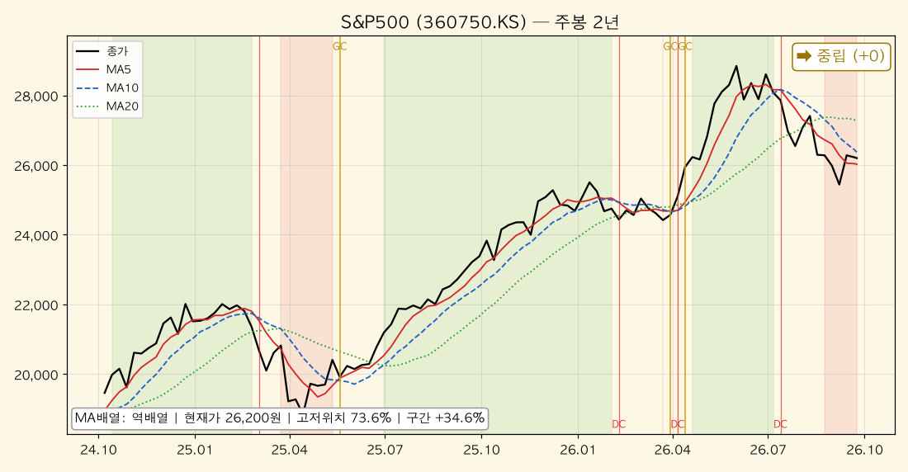

*S&P500(360750.KS) — 주봉 역배열, 2년 +34.6%, 고저위치 73.6%. 2주간 +3.0% 반등했으나 주봉 MA10(26,373원) 바로 아래에서 멈췄다. MA5가 MA10을 넘으면 골든크로스.*

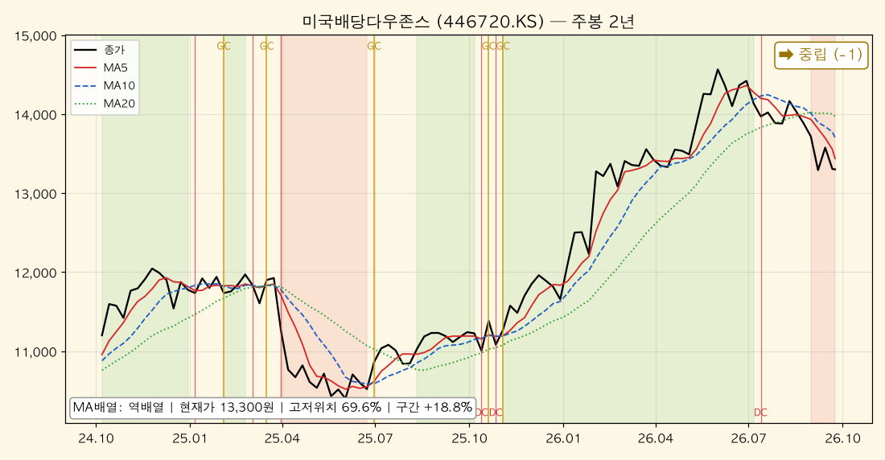

*미국배당다우존스(446720.KS) — 주봉 역배열, 2년 +18.8%, 고저위치 69.6%. 시장 반등에서 소외(+0.1%). 일봉은 3개월 최저권(4.5%)으로 이번 주 눌림목 분해 대상.*

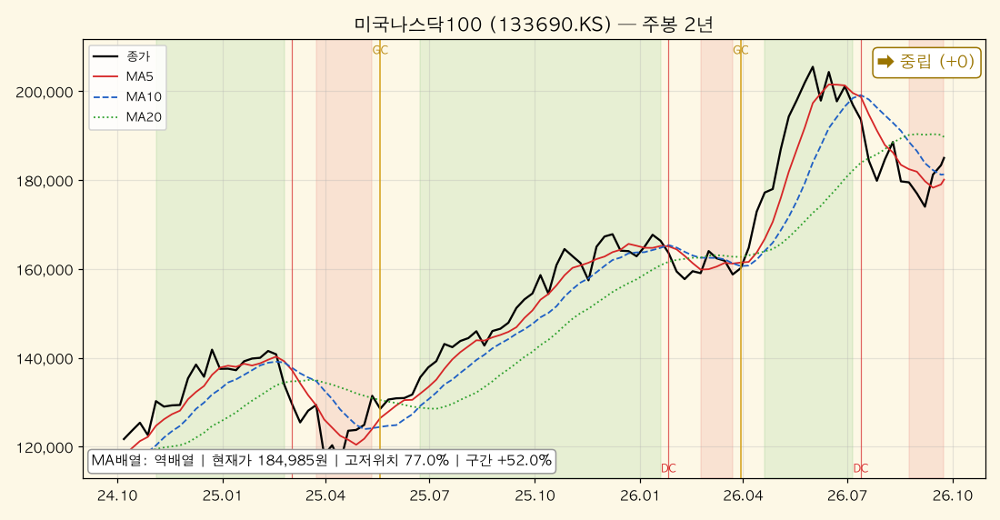

*미국나스닥100(133690.KS) — 주봉 역배열, 2년 +52.0%, 고저위치 77.0%. 2주 +6.3%로 반등 1위. MA5·MA10 격차 0.6%로 주봉 골든크로스 임박.*

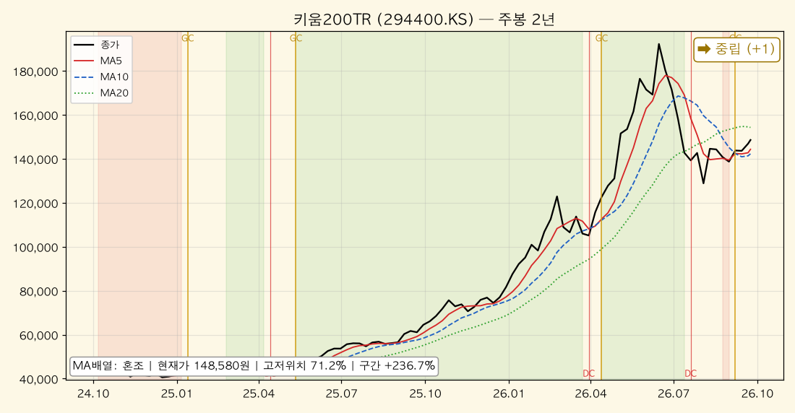

*키움200TR(294400.KS) — 주봉 혼조, 2년 +236.7%, 고저위치 71.2%. 3주 전 골든크로스 이후 MA5가 MA10 위를 유지. 국내 대형주의 회복이 가장 앞서 있다.*

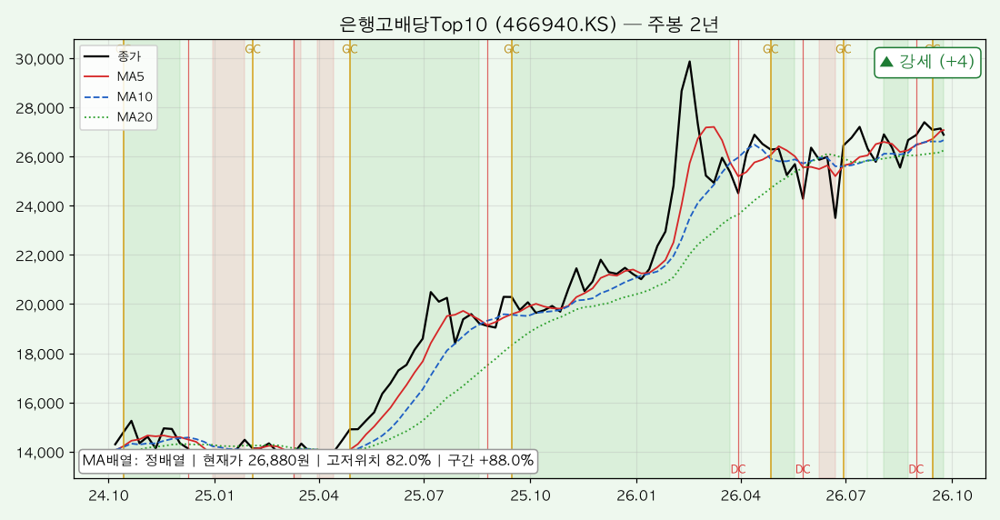

*은행고배당Top10(466940.KS) — 주봉 정배열, 2년 +88.0%, 고저위치 82.0%. 15개 중 유일한 주봉 정배열이지만 2주간 -1.9%로 반등장에서 오히려 쉬었다. 자금이 방어주에서 성장주로 일부 이동한 흔적.*

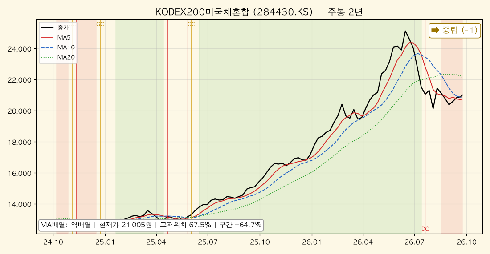

*KODEX200미국채혼합(284430.KS) — 주봉 역배열, 2년 +64.7%, 고저위치 67.5%. 국내 주식 반등 덕에 +2.0%. 채권 쪽이 회복되지 않아 속도는 제한적.*

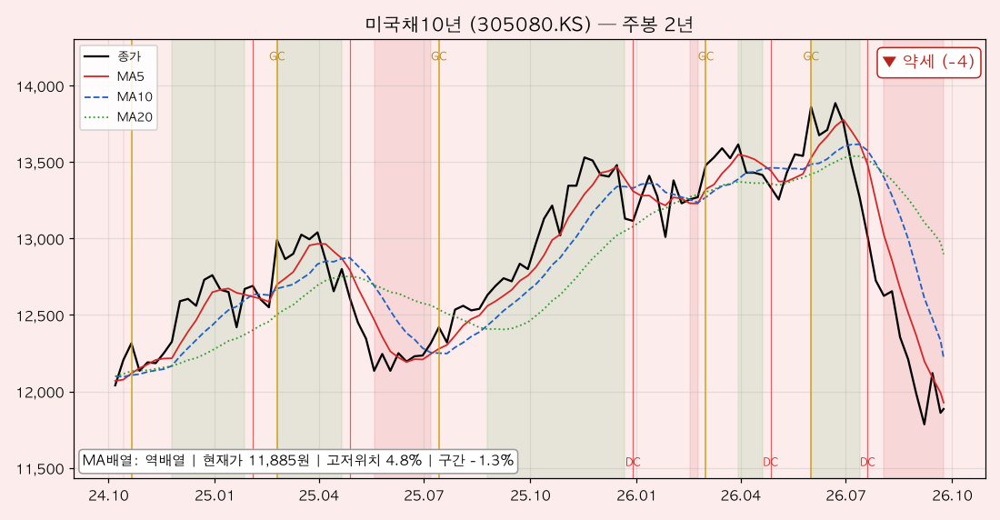

*미국채10년(305080.KS) — 주봉 역배열, 2년 -1.3%, 고저위치 4.8%. 2주 전 기록한 2년 신저가(0.0%)에서 +0.8% 떨어져 나왔을 뿐. 세 시간축 모두 약세 지속.*

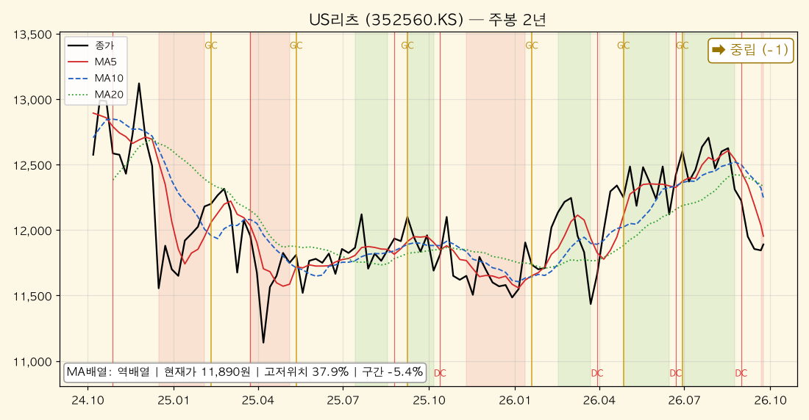

*US리츠(352560.KS) — 주봉 역배열, 2년 -5.4%, 고저위치 37.9%. 혼조에서 역배열로 한 단계 악화. 금리 고착 국면에서 방향성 부재.*

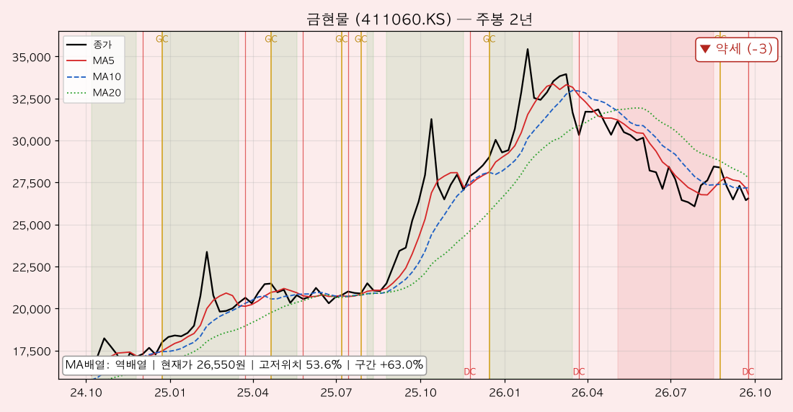

*금현물(411060.KS) — 주봉 역배열, 2년 +63.0%, 고저위치 53.6%. 금주 주봉 데드크로스 신규 발생. 국제 금값보다 원화 강세의 영향이 더 크게 반영되는 구간.*

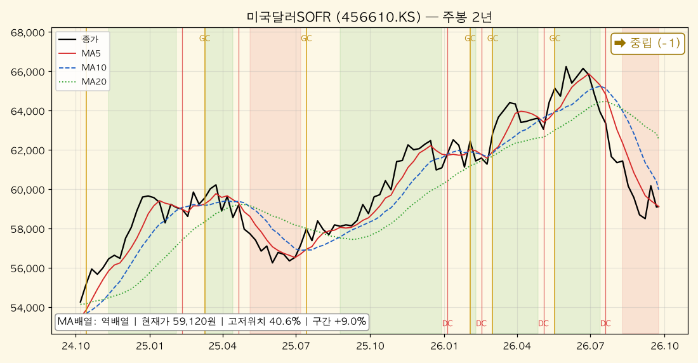

*미국달러SOFR(456610.KS) — 주봉 역배열, 2년 +9.0%, 고저위치 40.6%. 2주 +1.1%로 원/달러 소폭 반등을 반영. 현금성 자산이라 변동폭은 작다.*

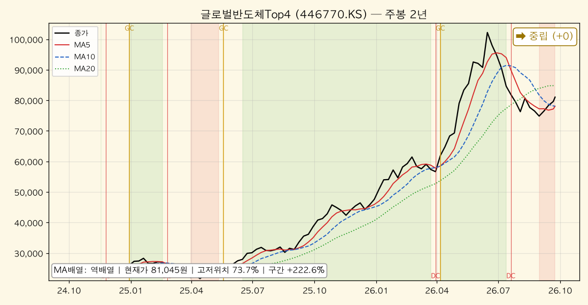

*글로벌반도체Top4(446770.KS) — 주봉 역배열, 2년 +222.6%, 고저위치 73.7%. 2주 +6.0%. MA5와 MA10이 사실상 같은 값(격차 0.04%)이어서 주봉 골든크로스 1순위.*

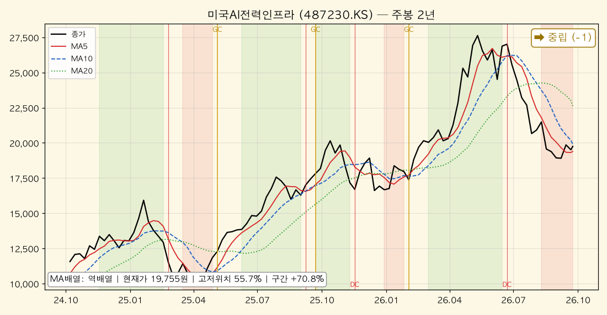

*미국AI전력인프라(487230.KS) — 주봉 역배열, 2년 +70.8%, 고저위치 55.7%. 2주 +4.5% 반등했지만 일봉 3개월 -29.4%로 낙폭은 여전히 15개 중 1위.*

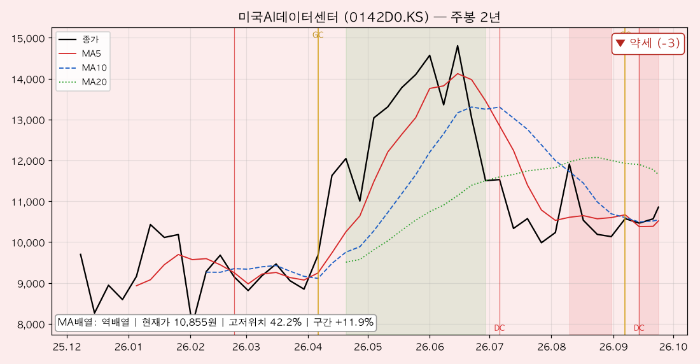

*미국AI데이터센터(0142D0.KS) — 주봉 역배열, 43주 +11.9%, 고저위치 42.2%. 2주 전 데드크로스 이후 MA5·MA10 격차 0.2%로 좁혀짐. 일봉은 MA60 위로 복귀.*

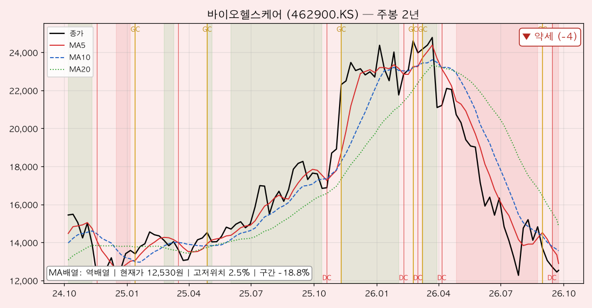

*바이오헬스케어(462900.KS) — 주봉 역배열, 2년 -18.8%, 고저위치 2.5%. 시장 반등에도 -4.0%, 2년 최저가 부근. 주봉 모멘텀 -26.7%로 15개 중 최약체.*

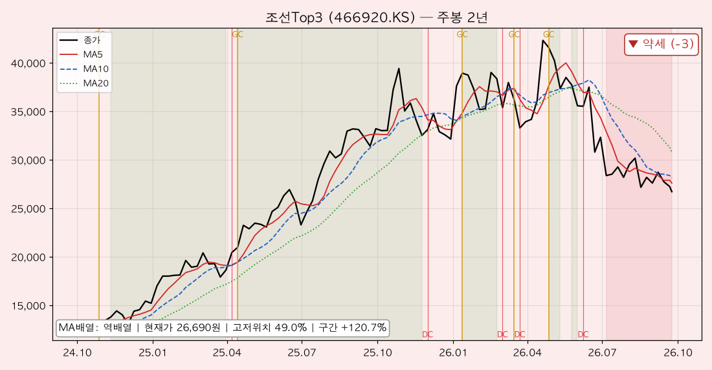

*조선Top3(466920.KS) — 주봉 역배열, 2년 +120.7%, 고저위치 49.0%. 2주 -7.0%로 15개 중 하락 1위. 일봉 데드크로스(3일 전)까지 겹쳐 반등 대열에서 이탈.*

### [5] 추세추종 관점 주목 종목

#### 🚀 멀티타임 정배열 (추세 편승 구간)
| 종목명 | 근거 |
|--------|------|
| 은행고배당Top10 | 일·주·월봉 전부 정배열 + 강도 만점(+4) 3주 연속. 월봉 고저위치 97.4%. 단 2주간 -1.9%로 탄력이 둔해졌고 일봉 MA5·MA20 격차가 0.2%로 좁아졌다. **추세는 유지, 속도는 둔화** |

#### 📌 눌림목 후보 (장기 상승추세 + 단기 과매도)
| 종목명 | 월봉 고저위치 | 일봉 고저위치 | 판단 |
|--------|-------------|-------------|------|
| 미국배당다우존스 | 79.6% | 4.5% | 괴리 75.1%p로 최대. 반등장에서 소외돼 일봉은 여전히 3개월 바닥 |
| S&P500 | 85.3% | 22.5% | 2주 전(0.4%)보다 일봉 위치 회복. 일봉 골든크로스는 MA60 아래 |
| 미국나스닥100 | 86.1% | 34.4% | 일봉 MA60 회복 + 주봉 골든크로스 임박. 후보 중 회복이 가장 앞섬 |
| 글로벌반도체Top4 | 79.1% | 35.5% | 주봉 MA5≒MA10. 다음 주 골든크로스 시 후보 → 확인 단계로 승격 |
| 키움200TR | 77.7% | 44.2% | 주봉 골든크로스 3주째 유지 + 일봉 강세. 사실상 회복 확인 단계 |

#### 눌림목은 어떻게 판정하나 — 미국배당다우존스 사례 분해

2주 전에는 S&P500으로 분해했다. 이번 주 S&P500은 일봉 고저위치가 22.5%까지 올라와 괴리가 줄었고, **보유 비중이 크면서 월봉·일봉 괴리가 가장 큰 종목**은 미국배당다우존스(79.6% vs 4.5%)다.

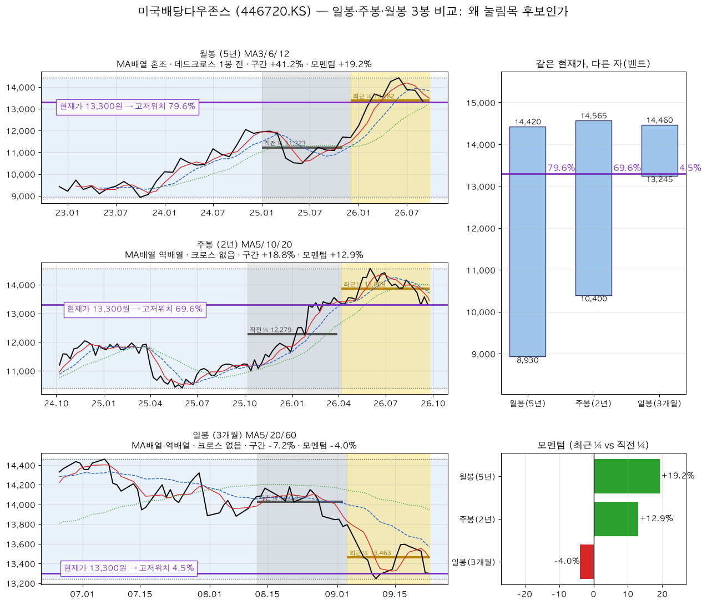

**① 같은 가격이 왜 79.6%이자 4.5%인가**

세 패널의 보라색 가로선은 전부 같은 값(13,300원)이다. 밴드(기간 최고~최저) 안에서의 높이만 다르다.

| 봉 단위 | 밴드 범위 | 밴드 폭 | 현재가 위치 |
|---|---|---|---|
| 월봉 (상장 후 47개월) | 8,930 ~ 14,420 | 5,490원 | **79.6%** (상단권) |
| 주봉 (2년) | 10,400 ~ 14,565 | 4,165원 | 69.6% (중간 위) |
| 일봉 (3개월) | 13,245 ~ 14,460 | 1,215원 | **4.5%** (바닥) |

일봉 밴드 폭은 월봉의 22%에 불과하다. 3개월 동안 최고가 대비 8% 빠진 것만으로 좁은 자의 바닥에 닿은 것이다. 긴 자로 재면 여전히 상단권이다.

**② 모멘텀도 같은 말을 한다**

| 봉 단위 | 직전 ¼ 평균 | 최근 ¼ 평균 | 모멘텀 |
|---|---|---|---|
| 월봉 (11개월씩) | 11,223 | 13,382 | **+19.2%** 가속 |
| 주봉 (26주씩) | 12,279 | 13,869 | +12.9% 가속 |
| 일봉 (15일씩) | 14,025 | 13,463 | **-4.0%** 감속 |

장기는 가속, 단기만 감속. 고저위치와 모멘텀이라는 서로 다른 두 지표가 같은 진단을 내놓는다.

**③ 그래도 "후보"인 이유 — 불리한 신호**

- **반등장에서 소외됐다.** 같은 2주 동안 S&P500 +3.0%, 나스닥100 +6.3%인데 배당다우존스는 +0.1%다. 시장이 되돌릴 때 따라 오르지 못한 것은 "과매도"가 아니라 **자금이 이 스타일(배당·가치)을 떠나 성장주로 이동**했다는 신호일 수 있다.
- **일봉은 여전히 역배열**이고 골든크로스도 나오지 않았다. 9종목에 동시에 나온 일봉 골든크로스 대열에 끼지 못했다.
- **월봉 MA배열은 혼조**(1개월 전 데드크로스), 주봉은 역배열에 크로스 없음. 장기 강세 판정은 고저위치 79.6%·모멘텀 +19.2%에 기대고 있지 이동평균 구조가 아니다.

유리한 근거(장기 상단 + 단기 바닥 + 장기 가속)와 불리한 근거(상대 소외 + 일·주봉 신호 부재)가 팽팽하다. 그래서 **"후보"로만 분류하고, 진입 조건은 일봉 MA5가 MA20(13,567원)을 상향 돌파하는 것**으로 건다.

#### ⚠️ 혼조 관망 (신호 불일치)
| 종목명 | 불일치 내용 |
|--------|-----------|
| KODEX200미국채혼합 | 월봉 강세 vs 일봉 약세. 주식 쪽 반등, 채권 쪽 부진이 상쇄 |
| 미국AI전력인프라 | 2주 +4.5% 반등 vs 일봉 MA60(21,247원)까지 7.5% 이격. 반등이 추세인지 미확인 |
| 미국AI데이터센터 | 일봉 MA60 회복(중립) vs 주봉 역배열·2주 전 데드크로스 |
| 미국달러SOFR | 일봉 골든크로스 vs 주·월봉 역배열. 환율 방향 확정 전 |
| US리츠 | 주봉 혼조 → 역배열 악화. 추세 자체가 약함 |

#### 🔻 멀티타임 역배열 (회피·축소 구간)
| 종목명 | 근거 |
|--------|------|
| 미국채10년 | 일·주·월봉 모두 약세 3주 연속. 주봉 고저위치 4.8%. 일봉 골든크로스는 MA60 아래에서 나온 기술적 반등 |
| 바이오헬스케어 | 일·주·월봉 모두 약세, 강도 -4 / -4 / -4. 반등장에서도 -4.0%, 주봉 고저위치 2.5% |
| 조선Top3 | 일·주봉 약세 + 3일 전 일봉 데드크로스. 2주 -7.0%로 하락 1위 |
| 금현물 | 일·주봉 약세 + 금주 주봉 데드크로스. 월봉 MA12(29,304원)가 현재가보다 10.4% 높다 |

### [6] 자산군별 추세 비교

추세강도 평균(-4 ~ +4 척도)으로 자산군을 묶어 비교했다. 괄호는 2주 전 값.

| 자산군 | 구성 종목 | 일봉 평균 | 주봉 평균 | 월봉 평균 |
|--------|----------|----------|----------|----------|
| 주식 — 선진국 | S&P500, 나스닥100, 배당다우존스, 글로벌반도체Top4, AI전력인프라, AI데이터센터 | -1.5 (-3.5) | -0.8 (-1.0) | +2.2 (+1.5) |
| 주식 — 국내 | 키움200TR, 은행고배당Top10, 조선Top3, 바이오헬스케어 | -0.5 (-0.8) | -0.5 (-0.5) | +0.5 (+0.5) |
| 혼합 | KODEX200미국채혼합 | -2.0 (-3.0) | -1.0 (-1.0) | +3.0 (+3.0) |
| 채권 | 미국채10년 | -3.0 (-4.0) | -4.0 (-4.0) | -2.0 (-2.0) |
| 대안자산 | 금현물, 미국달러SOFR, US리츠 | -3.7 (-3.3) | -1.7 (-1.0) | -1.0 (-1.0) |
| 배당·인컴 | 미국배당다우존스, 은행고배당Top10, US리츠 | -1.3 (-1.3) | +0.7 (+1.3) | +2.0 (+2.0) |

**자산군 간 관계 해석**

첫째, **반등의 주인공은 선진국 성장주**였다. 선진국 주식의 일봉 평균이 -3.5 → -1.5로 2.0점 올라 가장 크게 개선됐고, 월봉도 +2.2로 자산군 중 두 번째로 높다. 2주 전 "조정 각도가 가장 급했던" 나스닥·반도체·AI전력이 가장 강하게 되돌린 것이다.

둘째, **대안자산만 거꾸로 갔다.** 금·달러·리츠 묶음은 일봉 -3.3 → -3.7, 주봉 -1.0 → -1.7로 오히려 악화됐다. 위험선호가 돌아오는 날 방어자산이 쉬는 것은 자연스럽지만, 금의 주봉 데드크로스는 단순 휴식 이상으로 봐야 한다.

셋째, **배당·인컴의 주봉 우위가 줄었다**(+1.3 → +0.7). 2주 전 "채권 대신 방어 역할을 맡았다"고 평가한 은행고배당·배당다우존스가 반등장에서 상대적으로 소외되며, 자금이 방어 → 성장으로 순환하는 초기 흔적이 보인다. 다만 채권(미국채10년)은 여전히 -3.0 / -4.0 / -2.0으로 방어 역할을 전혀 못 하고 있다.

### [7] 종합 코멘트

**전체 추세 방향성**
시간축별 강세 비중은 월봉 46.7%(7개), 주봉 6.7%(1개), 일봉 13.3%(2개)다. 2주 전(33.3% / 6.7% / 6.7%)과 비교하면 **월봉과 일봉은 개선, 주봉은 그대로**다.
구조로 말하면 "장기 상승추세 안의 중기 조정"에서 **"중기 조정의 막바지 반등 시도"**로 한 칸 이동했다. 다만 주봉이 바뀌지 않는 한 이것은 반등이지 추세 복귀가 아니다.

**강세·약세 자산군 교차 신호**
- 강세 쪽: 선진국 성장주(나스닥100 +6.3%, 반도체 +6.0%)의 급반등, 국내 대형주(키움200TR 일봉 강세 전환)
- 약세 쪽: 조선Top3(-7.0%), 바이오헬스케어(2년 최저권), 금현물(주봉 데드크로스), 미국채10년(3주 연속 멀티타임 약세)
- 주목할 교차: 반등장에서 **은행고배당·배당다우존스가 소외**됐다. 성장주 반등이 방어주 매도 자금으로 이뤄진 순환인지, 전체 유동성 유입인지는 다음 주 주봉에서 판가름난다.
- 위험 신호: 9종목 동시 일봉 골든크로스 중 5개가 MA60 아래에서 나왔다. 같은 날 한꺼번에 나온 신호는 개별 종목의 힘이 아니라 **시장 전체의 단기 반발**일 가능성이 높다.

**추세추종 대응 방향**
1. **신규 진입은 여전히 정배열 확인 종목에 한정.** 조건 충족은 은행고배당Top10뿐이지만 탄력 둔화 중이므로 추격하지 않는다. 주봉 MA5(27,070원) 이탈 시 비중 유지 여부를 재점검한다.
2. **주봉 골든크로스 임박 종목을 1순위 관찰 대상으로.** 글로벌반도체Top4(격차 0.04%)·미국나스닥100(격차 0.6%)은 다음 주 주봉 확인이 곧 진입 신호다. 확인 전 선매수는 추세추종 원칙에 맞지 않는다.
3. **멀티타임 역배열은 원칙대로 비중 축소.** 미국채10년·바이오헬스케어는 반등 근거가 가격 지표에 없고, 금현물은 금주 주봉 데드크로스로 이 그룹에 새로 들어왔다. 조선Top3는 반등장에서 이탈해 가장 약한 테마가 됐다.
4. **점검 기준(다음 주 확인 항목)**: ① 글로벌반도체Top4·나스닥100 주봉 골든크로스 발생 여부 ② 은행고배당Top10 일봉 MA5·MA20 데드크로스 여부 ③ 미국배당다우존스 일봉 MA20(13,567원) 회복 여부 ④ 금현물 주봉 MA20(27,739원) 회복 여부 ⑤ 추석 연휴(9/24~26) 중 미국 시장 변동이 연휴 후 첫 거래일에 한꺼번에 반영되는 갭 리스크.

---

## 5. 내 ETF 평가 & 대응

> 이 섹션은 개인 포트폴리오를 다루므로 **절대금액을 쓰지 않는다.** 모든 수치는 비중(%)·수익률(%)·정성 평가다.
> 앞의 세 분석(한국은행·거시·차트)을 입력으로 받은 최종 종합이며, 관점은 **안전마진 기반 가치투자자**다.
> 기준: 포트폴리오 시트 09-23, 시세 Yahoo Finance 09-23 종가.

### 5-0. 이번 주 가장 중요한 변화 — 예고된 인상이 현실이 됐다

2주 전 리포트는 "9/16 FOMC 25bp 인상 확률 69.3%"를 최대 변수로 꼽았다. 결과는 **인상**이었다(3.50~3.75% → 3.75~4.00%). 그런데 시장의 반응은 예상과 달랐다.

| 항목 | 37주차(09-11) | 39주차(09-23) | 포트폴리오 영향 |
|---|---|---|---|
| 미 연준 정책금리 | 3.50~3.75% (인상 확률 69.3%) | **3.75~4.00%** (25bp 인상 확정) | 불확실성 해소 → 오히려 주식 반등 |
| 미 10년물 | 4.92% | **5.00%** | 장기채는 여전히 약세, 5% 문턱 도달 |
| 원/달러 | 1,339원 | **1,368원** (+2.1%, 원화 약세 전환) | 미국 자산 75%에 순풍 |
| WTI | 98.93달러 | **91.72달러** (△7.3%) | 물가 압력 일부 완화 |
| 국제 금값 | 4,437달러 | 4,323달러 (△2.6%) | 환율 상승이 상쇄 → 금 ETF 보합 |
| S&P500 | 7,665 | 7,738 (+1.0%) | 원화 환산 ETF는 +3.0% |

(미 10년물은 Yahoo ^TNX 기준 09-23 값. 3장의 미 재무부 고시 기준으로는 09-22 4.96%다. 어느 기준이든 **5% 문턱에 닿았다**는 해석은 같다.)

**2주 전과 정반대의 주였다.** 2주 전엔 원화 강세가 미국 자산을 일괄 깎았고, 이번 주엔 원화가 2.1% 되돌면서 같은 자산을 일괄 올렸다. "종목이 아니라 환율과 금리가 손익을 가른다"는 진단은 그대로 유효하다 — 방향만 바뀌었을 뿐이다.

### 5-1. 포트폴리오 성과 (비중·수익률만)

#### 전체

| 항목 | 값 | 직전(09-11) | 변화 |
|---|---|---|---|
| 전체 누적 수익률 | **+5.76%** | +4.73% | **+1.03%p** |
| 미국·글로벌 자산 비중(금·현금 제외) | 74.8% | 74.0% | +0.8%p |
| 금 비중 | 15.3% | 15.6% | △0.3%p |
| 한국 자산 비중 | 5.1% | 8.5% | **△3.4%p** |
| 현금 비중 | **4.8%** | 1.9% | **+2.9%p** |

2주 전 대응 원칙 1번(현금 1.9% → 8~12%)은 **절반쯤 진행**됐다. 반면 원칙 4번(은행고배당 확대)과는 반대로 한국 자산 비중이 3.4%p 줄었다. 비중 변화에는 매매·신규 납입·가격 변동이 섞여 있으므로 아래에서 항목별로 나눠 본다.

#### 계좌별

| 계좌 | 전체 대비 비중 | 누적 수익률 | 직전(09-11) | 변화 | 성격 |
|---|---|---|---|---|---|
| 퇴직연금 | 39.5% | **+11.40%** | +10.11% | +1.29%p | 종합형 — 최우수 유지 |
| 연금저축펀드 | 26.4% | **+5.44%** | +5.24% | +0.20%p | 구조적 안정성, 현금 13.2% 보유 |
| 개인IRP | 17.5% | **+5.11%** | +4.04% | +1.07%p | 성장+배당, 키움200TR·SOFR 비중 0 |
| ISA | 16.6% | **△4.61%** | △6.11% | +1.50%p | 단중기 테마 — 개선폭 1위 |

네 계좌 모두 개선됐다. 개선폭은 ISA(+1.50%p)가 가장 컸는데, 성장·테마(반도체 +6.0%, AI전력 +4.5%) 반등 덕이다. 연금저축은 현금 13.2%가 완충재 역할을 하면서 가장 덜 움직였다(+0.20%p). **반등장에서 덜 오르는 것은 현금을 들고 있는 비용이며, 동시에 하락장에서 덜 빠지는 대가**다.

#### 자산군별 (전체 대비 비중 / 누적 수익률)

| 자산군 | 비중 | 직전 비중 | 누적 수익률 | 직전 수익률 | 평가 |
|---|---|---|---|---|---|
| 미국주식(지수) | 25.4% | 23.9% | +13.58% | +10.98% | 최대 수익원, 비중 확대됨 |
| 금 | 15.3% | 15.6% | +4.69% | +5.03% | 금값 하락을 환율이 상쇄 |
| 혼합(주식+채권) | 14.3% | 14.7% | +13.71% | +13.42% | 수익률 1위 유지 |
| 미국주식(배당) | 11.3% | 11.1% | +8.90% | +8.92% | 반등장 소외 — 보합 |
| 미국주식(테마·AI) | 5.0% | 5.6% | △10.44% | △12.57% | 여전히 최대 손실원 |
| 현금 | 4.8% | 1.9% | — | — | **2.5배 확대** |
| 미국주식(성장·나스닥) | 4.5% | 4.4% | +5.40% | +0.34% | 2주 +6.3%로 반등 1위 |
| 글로벌주식(테마·반도체) | 4.5% | 6.6% | +7.43% | +1.35% | 가격 +6.0%에도 비중 축소 → 일부 차익 |
| 미국채권(10년) | 4.2% | 3.2% | △5.89% | △8.14% | 비중 **확대**됨(원칙 2번과 상충) |
| 달러/단기채 | 4.0% | 4.0% | △9.71% | △11.10% | 원화 약세로 소폭 회복 |
| 한국주식(배당) | 2.6% | 4.7% | +7.98% | +10.03% | 비중 **축소**됨(원칙 4번과 상충) |
| 한국주식(테마·조선) | 2.4% | 3.2% | △13.72% | △5.63% | 52주 신저가, 손실 확대 |
| 미국채권(30년) — 신규 | 1.6% | — | △0.77% | — | ISA에 신규 편입(ACE 미국30년국채액티브) |
| 미국주식(헬스케어) | 0.6% | 0.6% | △4.23% | △7.65% | 비중 미미 |
| 한국주식(지수) | 0.1% | 0.6% | +11.17% | +7.58% | IRP 보유분 정리 |

**포트폴리오 구조 변화 요약**

- 늘어난 것: 현금(+2.9%p), 미국 지수(+1.5%p), 미국 장기채(10년 +1.0%p, 30년 신규 1.6%p)
- 줄어든 것: 한국 은행고배당(△2.1%p), 반도체(△2.1%p), 조선(△0.8%p), 키움200TR(△0.5%p)

현금 확대와 테마 차익은 2주 전 원칙에 부합한다. 그러나 **장기채 합산 비중이 3.2% → 5.8%로 늘어난 것**은 "듀레이션 동결" 원칙과 정면으로 어긋나고, 유일한 멀티타임 정배열 자산(은행고배당) 비중이 줄어든 것도 원칙과 반대다. 이 판단이 옳았는지는 5-3과 5-5에서 따진다.

### 5-2. 이번 주 가격 변화 — 환율이 방향을 바꿨다

| 방향 | 종목 | 2주 변화 | 주 원인 |
|---|---|---|---|
| 🔺 상승 | 미국나스닥100 | +6.3% | 연준 불확실성 해소 + 원화 약세 |
| 🔺 | 글로벌반도체Top4 | +6.0% | 성장주 반등 |
| 🔺 | 미국AI전력인프라 | +4.5% | 낙폭과대 되돌림 |
| 🔺 | 키움200TR | +3.3% | 국내 대형주 회복 |
| 🔺 | S&P500 | +3.0% | 지수 +1.0% + 환율 +2.1% |
| 🔺 | 미국AI데이터센터 | +2.6% | 되돌림 |
| 🔺 | KODEX200미국채혼합 | +2.0% | 국내 주식 반등 |
| 🔺 | 미국달러단기채 | +0.9% | 원화 약세 |
| 🔺 | 미국채10년 | +0.8% | 환율 효과가 금리 상승을 상쇄 |
| ➡ 보합 | 금현물 | +0.2% | 금값 △2.6%를 환율 +2.1%가 상쇄 |
| ➡ | 미국배당다우존스 | +0.1% | 성장주로 자금 이동, 소외 |
| ➡ | 미국배당미국채혼합50 | +0.2% | 주식·채권 모두 정체 |
| 🔻 하락 | 은행고배당Top10 | △1.9% | 방어주 차익 실현 |
| 🔻 | 조선Top3 | △7.0% | 추세 이탈 가속, 52주 신저가 |

2주 전 "미국 자산은 전부 마이너스, 한국 자산은 전부 플러스"였던 패턴이 **정확히 뒤집혔다.** 미국 자산은 대부분 플러스, 한국 자산은 키움200TR을 빼고 마이너스. 원/달러가 1,339원 → 1,368원으로 2.1% 움직인 것만으로 로테이션 방향이 바뀐 것이다.

**교훈**: 포트폴리오 75%가 달러 자산인 한, 원/달러는 개별 종목보다 큰 변수다. 2주 전 "환율 회귀를 전제로 베팅하지 말라"고 했고, 실제로 환율은 일부 되돌았다. 되돌았다고 해서 그 판단이 틀린 것은 아니다 — **방향을 맞히려 하지 않고 양쪽을 견딜 구조를 갖추는 것**이 요점이었다.

### 5-3. 안전마진 재계산 — 미 10년물 5.00%의 의미

| 비교 대상 | 수익률 | 직전(09-11) | 의미 |
|---|---|---|---|
| 한국 정책금리 | 3.00% | 3.00% | 10월 22일 금통위 인상 가능성 확대(2장) |
| 미 연준 정책금리 | 3.75~4.00% | 3.50~3.75% | 9/16 25bp 인상 |
| 미국 10년물 | **5.00%** | 4.92% | 2007년·2023년 고점과 같은 수준, 심리적 문턱 |
| S&P500 이익수익률(후행 PER 약 26.8배) | **약 3.73%** | 3.77% | 미 10년물보다 **약 1.27%p 낮다** |
| S&P500 이익수익률(선행 PER 약 19.2배) | **약 5.21%** | 5.13% | 미 10년물보다 겨우 0.21%p 높다 |

(후행 PER은 직전 주 후행 이익 기준에 이번 주 지수 7,738을 적용한 추정치, 선행 PER은 FactSet 9/18 기준 19.26배.)

**가치투자자 관점의 결론은 2주 전과 같고, 조금 더 나빠졌다.** 무위험 5.00%를 확정적으로 받을 수 있는데 후행 이익수익률 약 3.7%의 지수를 산다는 것은 **주식 리스크 프리미엄이 마이너스 1.3%p**인 거래다. 선행 이익이 전부 실현된다는 낙관적 가정에서도 프리미엄은 0.2%p에 불과하다.

S&P500 후행 PER 약 26.8배는 **50년 평균 16배의 약 1.7배**다. 닷컴버블(44배)보다는 낮지만 금융위기 직전(20배)을 크게 넘고, 코로나 이후 고점(37배)과 50년 평균 사이의 상단에 있다. 선행 PER 19.2배는 5년 평균(19.8배) 수준까지 내려왔는데, 이는 가격이 싸진 것이 아니라 **이익 추정치가 올라간 결과**다.

**그렇다면 이번 주 미국 지수 비중이 늘어난 것(+1.5%p)은?** 보유분의 가격 상승(+3.0%)과 신규 납입이 섞인 결과로 보이며, 매도할 이유는 아니다. 다만 **신규 자금을 미국 지수에 추가로 배정할 안전마진은 여전히 없다.**

#### 장기채 확대의 판단 — 5.00%는 매수 신호인가

이번 주 장기채 합산 비중이 3.2% → 5.8%로 늘었다. 2주 전 원칙 2번은 "미 10년 **5.0% 도달** 또는 ISM 가격지수 60 하회 확인 전까지 추가 매수 보류"였다. 이번 주 미 10년물이 정확히 5.00%에 닿았으므로, **조건의 절반은 충족된 셈**이다.

- **찬성 논리**: 10년물 5.00%는 2007년·2023년 고점과 같은 수준이다. 연준이 인상을 단행하면서 시장이 반등했다는 것은 추가 인상의 여지가 크지 않다는 신호일 수 있다. 채권은 금리 고점 부근에서 분할로 사는 것이 원칙이고, 듀레이션이 긴 30년물은 금리가 1%p 내리면 가격이 약 15~18% 오른다.
- **반대 논리**: 미국채10년 ETF는 일·주·월봉 모두 약세 3주 연속, 주봉 고저위치 4.8%다(4장). 30년물 ETF도 52주 위치 10.1%로 바닥권이다. 가격 추세는 아직 전환 신호를 주지 않았다. WTI가 91달러로 내렸지만 ISM 가격지수 60 하회는 확인되지 않았다.

**판정**: 5.00% 도달 자체는 **분할 매수 개시 조건으로 인정할 수 있다.** 다만 합산 5.8%에서 멈추고, 추가 확대는 ① ISM 가격지수 60 하회 또는 ② 미국채10년 ETF 주봉 MA20(12,897원) 회복 중 하나를 확인한 뒤로 미룬다. 30년물은 10년물보다 변동성이 약 1.8배이므로 **같은 비중이면 두 배 가까운 위험**이라는 점을 기억한다.

#### 마진데빗의 역사적 맥락 — "감소가 오히려 경보"인 이유

마진데빗(투자자가 증권사에서 빌려 주식을 산 돈)은 8월 약 1조 4,500억달러(추정)로 7월 대비 **+2.6% 다시 늘었다.** GDP 대비 약 4.47%로 50년 평균(약 3%)을 1.4%p 넘게 웃도는 과열권이다(3장).

2주 전에는 "사상 최고에서 꺾인 감소가 오히려 경보"라고 썼다. 원리는 이렇다. 빌려서 산 사람은 가격이 내리면 추가 담보를 요구받고(마진콜), 못 내면 **강제로 팔린다**. 그 매도가 가격을 더 내리고 다음 사람의 마진콜로 이어진다. 그래서 고점 이후의 감소는 대개 자발적 빚 상환이 아니라 연쇄 청산의 흔적이고, 2000년과 2008년 모두 마진데빗 고점 통과 직후 급락이 왔다.

이번 달의 재증가는 그 연쇄가 한 달 만에 멈추고 **빚을 다시 늘려 반등에 올라탄 것**이다. 단기적으로는 청산 위험이 줄었다는 뜻이지만, 과열권에서 레버리지를 다시 쌓는 것은 다음 조정의 낙폭을 키우는 연료가 된다. 금리 5% 환경에서 빌린 돈으로 이익수익률 3.7%의 주식을 사는 구조는 오래 버티기 어렵다. 내 포트폴리오는 레버리지를 쓰지 않아 직접 강제청산 위험은 없지만, **시장 전체의 강제 매도가 재개되면 현금 4.8%로는 여전히 얇다.** 목표(8~12%)까지는 아직 절반이다.

### 5-4. 세 가지 투자자 관점

| 관점 | 판단 기준 | 현재 시장 평가 | 내 포트폴리오에 대한 행동 |
|---|---|---|---|
| **가치투자자(버핏)** | 이익수익률 > 무위험수익률, 안전마진 | 🔴 **부적합** — 후행 이익수익률 약 3.73% < 미 10년 5.00% | 미국 지수·성장주 신규 매수 중단 유지. 장기채는 5.00% 도달로 **소량 분할만 허용**. 현금 목표 8~12% 계속 |
| **성장주 투자자(ARK)** | EPS 성장률, 테마 점유율 | 🟡 **개선** — 반도체·나스닥 2주 +6%대, 선행 EPS 추정 상향 지속 | 반도체TOP4·나스닥100은 **주봉 골든크로스 확인 시** 보유분 유지 근거 강화. AI데이터센터·AI전력은 반등 시 축소 원칙 유지 |
| **단기 트레이더(모멘텀)** | 이동평균, VIX, 레버리지 추세 | 🟡 **중립 전환** — 일봉 약세 13 → 10개, 9종목 동시 골든크로스. VIX 14.19 | 주봉 정배열은 여전히 1개. 일봉 반등을 추세 복귀로 보지 않음. 멀티타임 역배열(미국채10년·조선·바이오·금) 축소 원칙 유지 |

2주 전엔 세 관점이 모두 "방어"를 가리켰다. 이번 주엔 **성장·모멘텀 관점이 한 단계 개선됐고, 가치 관점만 그대로(오히려 악화)**다. 관점이 갈릴 때 안전마진 투자자는 가장 보수적인 관점을 기준으로 신규 자금을 배정하고, 나머지 관점은 **보유분을 팔지 않을 근거**로만 쓴다.

### 5-5. 한국 vs 미국 금리 환경 분리 평가

양국 모두 긴축 방향이라는 구도는 2주 전과 같다. 달라진 것은 **미국은 인상을 실행했고, 한국은 10월에 실행할 가능성이 커졌다**는 점이다(2장: 의사록에서 소수의견의 두 전제가 흔들림).

#### 🇰🇷 한국 자산 (금리 인상 환경 — 비중 5.1%)

| ETF | 비중 | 수익률 | 금리 환경 평가 |
|---|---|---|---|
| 타이거 은행고배당플러스TOP10 (466940) | 2.6% | +7.98% | **💚 최대 수혜 유지.** 기준금리 3.00% + 10월 인상 가능성 → 순이자마진 확대. 일·주·월봉 강도 +4 3주 연속. 2주 △1.9%는 추세 내 휴식. **비중 축소는 원칙과 반대 — 주봉 MA20(26,249원) 부근 재확대 검토** |
| SOL 조선TOP3플러스 (466920) | 2.4% | △13.72% | **🔴 경계 강화.** 52주 위치 0.0%(신저가), 일봉 데드크로스. 금리 인상은 수주 산업 금융비용에 역풍. **반등 시 축소, 신규 금지** |
| KIWOOM 200TR (294400) | 0.1% | +11.17% | **🟢 양호.** 일봉 강세 전환·주봉 골든크로스 3주 유지. 비중은 사실상 0 |

한국 자산은 금리 인상 수혜가 확인되는 유일한 영역인데 비중은 오히려 8.5% → 5.1%로 줄었다. 줄어든 분의 상당 부분이 조선(추세 이탈)이 아니라 **은행고배당(추세 유지)**이었다는 점이 아쉽다. 추세추종과 안전마진 모두 "강한 것을 남기고 약한 것을 줄이라"고 말한다.

#### 🇺🇸 미국 자산 (금리 인상 실행 — 비중 74.8%)

| ETF | 비중 | 수익률 | 금리 환경 평가 |
|---|---|---|---|
| 타이거 미국 S&P500 (360750) | 24.8% | +14.07% | **🟠 보유·신규 중단.** 이익수익률 약 3.73% < 5.00%. 월봉 강세 복귀, 주봉 MA10(26,373원) 바로 아래. 주봉 골든크로스 전엔 신규 없음 |
| SOL·TIGER 미국배당다우존스 (446720) | 11.3% | +8.90% | **🟠 보유.** 반등장 소외(+0.1%). 금리 5%에서 배당주는 채권과 직접 경쟁한다. 이번 주 눌림목 분해 대상(4장) — 일봉 MA20(13,567원) 회복 시 소량 분할 허용 |
| 삼성 KODEX200 미국채혼합 (284430) | 8.6% | +24.28% | **🟢 유지.** 보유 ETF 중 수익률 1위. 한국주식+미국채 조합이 환율·금리를 부분 헤지 |
| SOL 미국배당미국채혼합50 (490490) | 5.8% | +0.92% | **🟠 재검토.** 52주 위치 25.3%. 배당주·채권 양쪽이 금리 5%에 동시에 눌리는 구조 |
| 타이거 미국 나스닥100 (133690) | 4.5% | +5.40% | **🟡 개선.** 2주 +6.3%, 일봉 MA60 회복, 주봉 골든크로스 임박(격차 0.6%). 할인율 부담은 그대로 → 확인 후에도 신규는 소량 |
| ACE 글로벌반도체TOP4 plus (446770) | 4.5% | +7.43% | **🟡 개선.** 주봉 MA5≒MA10(격차 0.04%). 가격 반등 중 일부 차익 실현은 원칙에 부합 |
| 타이거 미국채 10년선물 (305080) | 4.2% | △5.89% | **🟠 분할 개시 조건 절반 충족.** 미 10년 5.00% 도달. 그러나 ETF는 일·주·월봉 약세. 현 비중에서 동결 |
| TIGER 미국달러단기채권액티브 (329750) | 4.0% | △9.71% | **🟡 보험료.** 원화 약세로 2주 +0.9%. 52주 위치 6.3%. 위기 시 리밸런싱 재원 |
| 타이거 미국AI데이터센터Top4Plus (0142D0) | 3.3% | △14.22% | **🔴 최대 손실원.** 일봉 중립 복귀했지만 주봉 역배열. 주봉 MA20(11,653원) 회복 시 축소 기회로 활용 |
| KODEX 미국AI전력핵심인프라 (487230) | 1.8% | △2.42% | **🟠 반등 중.** 2주 +4.5%. 일봉 MA60까지 7.5% 이격. 비중이 이미 작아 추가 조치 불필요 |
| ACE 미국30년국채액티브 (476760) — 신규 | 1.6% | △0.77% | **🟠 신중.** 52주 위치 10.1%, 주봉 MA20(9,534원) 아래. 듀레이션 최장 — 금리 +0.5%p면 약 △8~9% |
| KODEX 미국S&P500 헬스케어 (453640) | 0.6% | △4.23% | **🟡 비중 미미.** 52주 위치 58.4% |

미국 금리 환경을 한 줄로 요약하면: **"인상은 실행됐고, 시장은 그것을 불확실성 해소로 받아들였다."** 이것이 추가 인상이 없다는 뜻인지, 아니면 5% 금리가 뉴노멀이 된다는 뜻인지는 아직 가려지지 않았다. 어느 쪽이든 할인율 5%는 미국 자산 75%의 밸류에이션 상단을 누른다.

### 5-6. 종합 평가 및 대응 (안전마진 우선)

#### 진단 3줄

1. **환율이 방향을 바꾸자 성과도 뒤집혔다.** 원/달러 +2.1%만으로 전체 수익률이 +1.03%p 회복됐다. 포트폴리오의 단일 최대 변수는 여전히 환율이다.
2. **반등은 성장주가 이끌었고, 방어주는 쉬었다.** 나스닥·반도체 +6%대, 은행고배당 △1.9%. 그러나 주봉 정배열은 여전히 1개로 추세 복귀는 아니다.
3. **안전마진은 더 얇아졌다.** 미 10년 5.00% 대비 후행 이익수익률 약 3.73%, 프리미엄 약 -1.27%p. 가격이 오른 만큼 안전마진은 줄었다.

#### 대응 원칙 — 우선순위 순 (2주 전 대비 진척 표시)

| 순위 | 행동 | 구체적 실행 | 진척 | 근거 |
|---|---|---|---|---|
| 1 | **현금·단기물 비중 확대** | 현금 4.8% → 목표 8~12%. 반등 구간을 현금 확보 기회로 활용 | 🟡 절반 진행 (1.9% → 4.8%) | 무위험 5%. 반등 중 VIX 14.19 = 공포 없는 반등, 바닥 확인 신호 아님 |
| 2 | **장기채 — 동결에서 "제한적 분할"로 조정** | 합산 5.8%에서 멈춤. 추가는 ISM 가격 60 하회 또는 미국채10년 ETF 주봉 MA20 회복 확인 후 | 🟠 원칙보다 먼저 확대됨 | 미 10년 5.00% 도달로 조건 절반 충족. 가격 추세는 미전환 |
| 3 | **ISA 테마 편중 해소** | AI데이터센터·AI전력 추가 매수 중단, 주봉 MA20 회복 시 축소. 조선TOP3는 반등 시 축소 | 🟢 진행 (AI 5.6% → 5.0%, 반도체 차익) | 조선 52주 신저가, AI데이터센터 여전히 주봉 역배열 |
| 4 | **한국 은행고배당 재확대** | 466940을 주봉 MA20(26,249원) 부근에서 분할. 목표 2.6% → 5~7% | 🔴 역행 (4.7% → 2.6%) | 유일한 멀티타임 정배열, 10월 금통위 인상 시 직접 수혜 |
| 5 | **금 비중 유지** | 15.3% 유지. 52주 위치 5.0%로 바닥권 — 52주 최저(26,080원) 부근 소량 분할까지만 | 🟢 유지 | 금주 주봉 데드크로스 → 확대는 주봉 MA20(27,739원) 회복 후 |
| 6 | **미국 지수 눌림목은 신호를 요구** | S&P500·나스닥100·배당다우존스는 **주봉 골든크로스 확인 후**에만 분할 재개 | 🟢 대기 중 (나스닥 임박) | 가치 관점 안전마진 부재 — 신호 확인이 최소 조건 |
| 7 | **혼합형 재점검** | 490490(52주 위치 25.3%) 신규 납입은 284430 쪽으로 | 🟡 유지 | 284430 누적 +24.28%로 구조적 우위 확인 |

#### 강조 / 경계

- **강조(비중 확대 후보)**: 현금·단기물, 은행고배당TOP10(줄어든 비중 회복), KODEX200미국채혼합
- **경계(신규 금지)**: 조선TOP3(52주 신저가), AI데이터센터(주봉 역배열), 바이오·헬스케어 계열, 30년국채 추가분(듀레이션 과대)
- **관찰(신호 대기)**: 나스닥100·반도체TOP4(주봉 골든크로스 임박), 미국채10년(5.00% 도달, 가격 추세 미전환)
- **유지(손대지 않음)**: S&P500·배당다우존스(월봉 강세), 금현물(바닥권, 환율 요인)

#### 가치투자자에게 지금이 뜻하는 것

2주 전 "지금은 ① 현금 확보 단계"라고 했다. 이번 주에도 순서는 같다: **① 현금 확보 → ② 금리 고점 확인 → ③ 장기채 → ④ 미국 지수 → ⑤ 성장·테마.**

변한 것은 ②의 조건 일부가 충족되기 시작했다는 점이다. 미 10년 5.00% 도달, FOMC 인상 실행 후 시장 안정, WTI 99 → 92달러. 그러나 ISM 가격지수 60 하회, 채권 ETF의 가격 추세 전환은 아직이다. 그래서 ③(장기채)에 **발을 살짝 들여놓는 것까지는 허용**되지만, ④⑤로 건너뛰는 것은 여전히 금지다.

반등장은 가치투자자에게 가장 어려운 시간이다. 가격이 오를수록 "놓치는 것 아닌가"라는 압박이 커지지만, 안전마진은 오히려 줄어든다. **오르는 날 현금을 늘리는 것이 떨어지는 날 사는 것보다 어렵고, 그래서 더 중요하다.**

### 5-7. ETF별 매수·매도 적정가

#### 산출 방법 (직전 주와 동일 기준, 수치만 갱신)

야후 파이낸스 **주봉 데이터(2026-09-23 종가)** 기준으로 현재가·20주 이동평균(MA20)·52주 최고/최저·52주 위치를 뽑고, 국면별로 다른 공식을 적용한다.

| 국면 | 판별 | 매수 적정가 | 매도 적정가 |
|---|---|---|---|
| **상승추세** | 현재가 > MA20 + 정배열 | MA20 부근 눌림목 | 52주 최고 부근 |
| **박스/조정** | 현재가 < MA20, 52주 위치 40~70% | 52주 최고 − 할인율(지수형 13~20%, 섹터형 30~40%) | 52주 최고 저항 |
| **하락추세** | 현재가 < MA20, 52주 위치 30% 이하 | 52주 최저 +0~10% **분할만** (MA20 회복 확인이 조건) | 내려오는 MA20(저항) |

섹터·테마형에 더 깊은 할인을 요구하는 이유는 사이클 하강 시 △40~60% 사례가 흔하기 때문이다. **변동성이 큰 자산일수록 더 싸게 사야 같은 안전마진이 확보된다.**

#### 적정가 표 (내가 보유한 ETF만)

| ETF (티커) | 현재가 | MA20 | 52주 범위 | 52주 위치 | 매수 적정가 | 매도 적정가 | 국면·근거 |
|---|---|---|---|---|---|---|---|
| 미국 S&P500 (360750) | 26,200 | 27,231 | 23,275~28,845 | 52.5% | 24,500~25,100 | 28,000~28,800 | 박스/조정. 최고 대비 △13~15%. 2주 전 적정가 상단(25,100) 근처까지 내려왔다가 반등 |
| 미국배당다우존스 (446720) | 13,300 | 13,973 | 11,005~14,565 | 64.5% | 12,400~12,700 | 14,300~14,565 | 박스/조정. 최고 대비 △13~15%. 일봉 MA20 회복이 선행 조건 |
| 미국나스닥100 (133690) | 184,985 | 189,710 | 154,390~205,500 | 59.9% | 164,000~168,000 | 200,000~205,500 | 박스/조정, 성장주 할인 △18~20%. 주봉 골든크로스 임박이나 적정가와 거리 멂 |
| 키움200TR (294400) | 148,580 | 154,287 | 66,060~192,240 | 65.4% | 128,000~140,000 | 175,000~190,000 | 혼조·주봉 골든크로스 유지. 급등 되돌림 구간 |
| 은행고배당Top10 (466940) | 26,880 | 26,249 | 19,640~29,860 | 70.8% | **26,000~26,500** | 29,000~29,900 | **상승추세(유일).** MA20·주봉 MA10(26,660) 지지 눌림목. 현재가가 매수 적정가 상단에 근접 |
| KODEX200미국채혼합 (284430) | 21,005 | 22,146 | 15,665~25,125 | 56.4% | 19,500~20,600 | 23,500~25,100 | 박스/조정. 매도는 MA20 회복 후 |
| 미국배당미국채혼합50 (490490) | 10,705 | 11,445 | 10,225~12,125 | 25.3% | 10,200~10,700 | 11,400~12,100 | 하락추세 경계. 52주 최저 근접. 신규 최소화 |
| 미국채10년 (305080) | 11,885 | 12,897 | 11,785~13,885 | 4.8% | 11,300~11,900 **분할만** | 12,900~13,100 | **하락추세.** 미 10년 5.00% 도달로 조건 절반 충족 — 현 비중 동결, MA20 회복 시 추가 |
| 미국30년국채액티브 (476760) | 8,780 | 9,534 | 8,580~10,570 | 10.1% | 8,500~8,800 **분할만** | 9,500~9,700 | **하락추세.** 신규 편입분. 듀레이션 최장 → 10년물보다 더 엄격하게 MA20 회복 확인 |
| 미국달러단기채 (329750) | 12,840 | 13,636 | 12,730~14,470 | 6.3% | 12,700~12,900 | 14,000 이상 | 원금보존형. 52주 최저권 = 환헤지 보험료 최저가 구간 |
| 금현물 (411060) | 26,550 | 27,739 | 26,080~35,440 | 5.0% | 26,000~26,600 | 27,700~30,000 | 하락추세, 금주 주봉 데드크로스. 52주 최저 +0~2% 소량 분할. 매도는 MA20 회복 후 |
| 글로벌반도체Top4 (446770) | 81,045 | 84,690 | 40,800~102,210 | 65.5% | 61,000~71,500 | 95,000~102,000 | 박스/조정, 섹터형 △30~40% 할인. 주봉 골든크로스 1순위 |
| 미국AI전력인프라 (487230) | 19,755 | 22,616 | 16,615~27,630 | 28.5% | 16,600~18,300 | 22,500~23,400 | 하락추세. 매도는 내려오는 MA20 저항 |
| 미국AI데이터센터 (0142D0) | 10,855 | 11,653 | 7,970~14,805 | 42.2% | 8,800~9,500 | 11,500~11,900 | 하락추세(주봉 역배열). 반등 시 MA20 부근이 축소 라인 |
| 조선Top3 (466920) | 26,690 | 30,744 | 26,690~42,295 | **0.0%** | 산출 보류 | 30,000~31,000 | **52주 신저가 갱신 중.** 지지선이 없어 매수 적정가 산출 불가 — 반등 시 MA20 저항에서 축소 |
| 미국S&P500 헬스케어 (453640) | 14,000 | 14,144 | 12,240~15,255 | 58.4% | 12,200~13,000 | 15,000~15,255 | 박스/조정(티커 확인 완료, 이번 주부터 산출). 비중 0.6% |

**읽는 법**: 매수 적정가는 예측이 아니라 **"이 가격에 오면 그때의 거시 상황을 다시 확인하고 판단하는 알림선"**이다. 하락추세 종목은 적정가에 도달해도 **주봉 MA20 회복이라는 추세 전환 확인 후** 진입하는 것이 원칙이며, 상승추세 종목(은행고배당Top10)만 눌림목 매수가 곧바로 유효하다.

**이 방식의 한계**: 이 적정가는 기업 이익 기반 밸류에이션(PER·PBR)이 아니라 **가격 구조(지지·저항·추세)** 기준이다. ETF별 PER·PBR·ROE·ROIC는 FactSet 미연결로 개별 검증이 불가해 산출하지 않았고, 대신 5-3에서 S&P500 지수 레벨의 이익수익률로 안전마진을 판정했다.

---

## 6. 종합 코멘트 & 다음 주 관전 포인트

### 이번 주를 한 문장으로

**"악재가 실현되자 시장이 안도한 주."** 2주 전 최대 리스크로 꼽은 연준 인상이 그대로 나왔는데, 주식은 올랐다. 불확실성이 사라진 데다, 원화가 2.1% 되돌고 유가가 8% 넘게 빠지면서 2주 전의 손실 요인 세 가지(환율·유가·연준)가 한꺼번에 느슨해졌기 때문이다.

그러나 구조는 바뀌지 않았다. 연준은 추가 인상을 예고했고, 한국은행도 10월 인상 쪽으로 기울었으며, 미 10년물은 5% 문턱에 있다. **가격은 반등했지만 할인율은 오히려 올랐다.** 가치투자자 입장에서 이것은 안전마진이 늘어난 것이 아니라 줄어든 것이다.

### 네 분석의 교차 확인

| 분석 | 핵심 신호 | 서로 어떻게 맞물리는가 |
|---|---|---|
| 한국은행 | 3.00% 유지, 의사록 소수의견 전제 약화, PPI +7.9%, 금리전망CSI 128 | 10월 인상 가능성 확대 → 국내 은행주 수혜 논리 강화, 취약 부문(조선 등 수주·금융비용) 부담 |
| 거시 | FOMC 3.75~4.00% 인상, 점도표 추가 인상, 10년-2년 +25bp, WTI 91달러 | 긴축 확정 + 유가 완화 = "물가 정점 통과 중, 정책은 더 조인다" |
| 차트 | 일봉 9종목 동시 골든크로스, 주봉 정배열 1개, 주봉 역배열 13개 | 거시의 안도가 단기 가격에만 반영 — 중기 구조는 아직 긴축을 반영 중 |
| ETF | 누적 +5.76%(+1.03%p), 현금 4.8%, 장기채 5.8%로 확대, 한국 자산 5.1%로 축소 | 환율 되돌림이 성과를 되살렸지만, 원칙과 반대로 움직인 비중(은행고배당↓·장기채↑)이 있다 |

2주 전엔 네 분석이 한 방향이었다. 이번 주엔 **단기(차트 일봉·환율)는 완화, 중기(주봉·금리·중앙은행)는 긴축**으로 시간축에 따라 신호가 갈렸다. 이럴 때는 긴 시간축을 기준으로 삼는다.

### 안전마진 기반 가치투자자의 현재 입장

- **유지(손대지 않음)**: S&P500·미국배당다우존스(월봉 강세), KODEX200미국채혼합(수익률 1위), 금현물(52주 바닥권, 환율 요인), 반도체TOP4(주봉 골든크로스 1순위)
- **확대**: 현금·단기물(4.8% → 8~12%), 은행고배당Top10(2.6% → 5~7%, 유일한 멀티타임 정배열 + 10월 인상 수혜)
- **동결**: 장기채(10년+30년 합산 5.8% — 미 10년 5% 도달로 개시 조건 절반 충족, 추가는 ISM 가격 60 하회 또는 ETF 주봉 MA20 회복 후)
- **신규 중단·축소**: 조선TOP3(52주 신저가), AI데이터센터(주봉 역배열), AI전력인프라(반등 시 축소)
- **순서 원칙**: ① 현금 확보 → ② 금리 고점 확인 → ③ 장기채 → ④ 미국 지수 → ⑤ 성장·테마. **지금은 ①에서 ③으로 발을 살짝 들인 상태이며, ④⑤는 여전히 금지다.**

### 다음 주 관전 포인트

1. **9/30(수) 미 8월 PCE·Core PCE — 10월 추가 인상의 1순위 변수.** Core PCE 전월비가 +0.2%를 넘으면 10/28 인상 확률(59.7%)이 더 오르고 미 10년이 5%를 확실히 돌파한다. 전월비 0.1% 이하 둔화는 긴축 조기 종료 신호다.
2. **10/1(목) ISM 제조업 9월 — 가격지수 60 하회 여부.** 71.1에서 60 밑으로 내려오면 장기채 추가 분할의 조건이 충족된다. 필라델피아(37.8)·뉴욕(7.6) 연은 지수는 9월 둔화를 예고했다.
3. **10/2(금) 미 9월 고용보고서.** 워시 의장의 "노동시장은 더 탄탄하다"는 판단을 검증한다. 신규 실업수당 19.6만건은 긴축을 흡수하고 있다는 뜻이다.
4. **10년-2년 스프레드 +25bp — 역전 여부.** 단기금리 주도 평탄화가 역전으로 넘어가면 1단계(긴축 말기·둔화) 진입 신호다. 3장 한 줄 선언의 첫 번째 전환 조건이다.
5. **한국은행 10월 22일 금통위를 향한 데이터.** 9월 소비자물가(10월 초), 가계대출 동향. 인상 시 은행고배당 수혜와 조선 등 금융비용 민감 업종 부담이 동시에 커진다.
6. **추석 연휴(9/24~26) 갭 리스크.** 국내 휴장 동안 미국 PCE 전 흐름·유가·환율 변동이 연휴 뒤 첫 거래일에 한꺼번에 반영된다.
7. **기술적 확인 5개**: ① 글로벌반도체Top4·나스닥100 주봉 골든크로스 ② 은행고배당Top10 일봉 MA5·MA20 데드크로스 여부 ③ 미국배당다우존스 일봉 MA20(13,567원) 회복 ④ 금현물 주봉 MA20(27,739원) 회복 ⑤ 미국채10년 ETF가 52주 저점(11,785원)을 지키는지.

### 투자 원칙 재확인

> "안전마진은 좋은 자산을 고르는 데서 오지 않고, 싸게 사는 데서만 온다."
>
> 가격이 오르는 날에는 안전마진이 줄어든다. 반등장에서 현금을 늘리는 것은 기회를 놓치는 일이 아니라,
> 다음 하락에서 **싸게 살 권리를 미리 사두는 일**이다.

---

## 면책 문구

본 글은 정보 제공 및 개인 기록 목적이며 투자 자문이 아닙니다. 모든 투자 판단과 그 책임은 본인에게 있습니다. 개인 포트폴리오의 비중(%)·수익률(%)만 공개하며, 절대금액은 공개하지 않습니다.
