## 1. 이번 주 요약

**경기 진단**: 연준은 9/16 인상(3.75~4.00%) 후 유지 중이며 12월 인상이 우세하다. 미 10년물은 **5.10%**(재무부 고시), 9월 CPI는 헤드라인 3.7%·코어 2.6%, ISM 가격지수는 77.9로 **물가 재가열**이 확인됐다. 반면 9월 고용은 +2.9만에 그쳐 스태그플레이션 경계 구간이다(3장).

**한국은행**: 기준금리 3.00%. 9월 소비자물가는 2.9%로 둔화했지만 한은은 기저효과 착시로 본다. 10/22 금통위는 **동결 후 11월 인상**이 컨센서스다. 총재는 국감(10/12)에서 22일 인상 여부에 답하지 않았다(2장).

**기술 신호**: 한국 증시 투매(코스피 10/15 △7.57%, 6월 고점 대비 약 △39%)로 **일봉 15종목 전부가 MA60 아래**, 주봉 역배열 14개, **정배열 0개**다. 월봉 강세는 7개 → 1개(나스닥100)로 줄었다(4장).

**포트폴리오**: 전체 누적 **+0.35%**(직전 +5.76%, △5.41%p). 원화 강세(1,368 → 1,332원)가 미국 자산을, 국내 급락이 테마·한국 자산을 눌렀다. ISA(△15.84%)가 손상의 대부분을 만들었고, 현금 비중은 3.6%로 3주 전 원칙(8~12%)과 거리가 더 벌어졌다(5장).

**한 줄 선언**: 싸졌다는 것과 안전하다는 것은 다르다 — 무위험 5.10%가 이익수익률 3.7%를 앞서고 한국 급락의 바닥 확인이 없는 지금은, **하락 종목을 더 사는 것이 아니라 현금을 쌓고 확인을 기다리는 것**이 안전마진 투자다.

---

## 2. 한국은행 보도자료 분석

### 이번 주 주요 발표 (2026년 42주차, 09.24 ~ 10.16)

> 직전 리포트(39주차, 09.23) 이후 발표분을 포함한다. 이번 주(10.09 ~ 10.16)에는 한은의 정례 통계 보도자료가 적었고, 가장 큰 이벤트는 **10.12 국정감사에서의 총재 발언**이다. 10월 금융통화위원회는 **10월 22일(목)** 예정이며 아직 열리지 않았다(다음 회의는 11월 26일).

| 발표일 | 제목 | 핵심수치 | 시사점 |
|---|---|---|---|
| 2026.09.28 | 시장상황 점검회의(추석 연휴 중 국제금융시장) | 미 2년물 +10bp, 10년물 +20bp(9.23~25), 원/달러 NDF -0.1%(원화 약세) | 연준 인상 기대·중동 긴장·유가로 선진국 금리 동반 상승. 한은은 "국내 펀더멘털은 양호"로 평가 |
| 2026.10.02 | 물가 상황 점검회의(9월 소비자물가) | 소비자물가 전년비 2.9%(8월 3.1%), 근원 2.8%(8월 3.4%) | 통신요금 할인 기저효과 소멸로 둔화. 한은은 "기저효과 감안 시 오름세는 다소 확대", 10월에도 3% 내외 예상 |
| 2026.10.08 | 2026년 8월 국제수지(잠정) | 경상수지 +461.1억달러(역대 2위), 상품수지 +468.1억달러, 1~8월 누적 +2,792억달러 | 반도체 호황이 흑자를 견인. 연간 4,500억달러 달성 가능하다고 한은 설명. 4분기 대규모 배당·유가는 변수 |
| 2026.10.12 | 국회 재정경제기획위원회 국정감사(총재 발언) | 물가 "상당 기간 2% 웃돌 전망", 22일 인상·빅스텝 여부는 직접 답변 회피 | 연준보다 먼저 올려 시간을 벌었다는 평가. 추가 인상의 시기·속도는 "물가 흐름을 가장 중요하게 고려" |
| 2026.10.14 | 미국 9월 CPI 발표 | 시장 예상 전년비 3.7%(실제 결과 수집 불가) | 한은 보도자료가 아니라 외부 변수. 결과가 연준 긴축 우려·환율에 영향 |

> **수집 방법 고지**: 한국은행 보도자료 목록 페이지(`newsData/list.do`)는 이번 주에도 JS 렌더링으로 게시물 0건이 반환되어 **목록 직접 수집에 실패**했다. 위 표는 WebSearch와 언론 보도(파이낸셜뉴스·뉴스1·SBS Biz·YTN·MTN 등) 교차확인으로 재구성했으며 **누락된 발표가 있을 수 있다**. 원문 PDF는 확인하지 못했다. 발표일은 보도 시점 기준이다.

### 2-1. 기준금리와 10월 22일 금통위 — "동결 후 11월 인상" 컨센서스

기준금리는 **연 3.00%**(7월·8월 각 25bp 인상)다. 10월 22일 회의는 예정이며, 결과는 수집 불가(미발표). 언론 보도상 시장 시각은 다음과 같다.

- **10월 동결이 다수**: 9월 소비자물가(2.9%)와 근원물가(2.8%)가 8월(3.1%·3.4%)보다 둔화했고, 두 차례 인상의 파급효과를 점검할 시간이 필요하다는 논리다.
- **11월 26일 3.25% 인상 전망**이 우세하다. 최종금리는 3.50% 안팎으로 보는 시각이 많고, 일부(메리츠증권)는 3.75%까지 점검해야 한다고 보도됐다. 3.75%까지 간다는 우려는 과도하다는 반론도 있다.
- **위원 조건부 금리전망**(8월 회의 이후 공개분, 보도 기준): 21개 점 중 3.25%가 10개, 3.50%가 6개, 3.00%가 5개 — 다수가 추가 인상을 염두에 뒀다. 9월 통화신용정책보고서는 3.00%를 기존 추정 중립금리 범위의 상단 수준으로 평가했다.
- 반대 논거: 뉴스1은 국내 물가가 3%에 육박해 추가 긴축 압력이 남아 있다고 짚었다. 미 10년물이 5.3% 안팎(10.07 장중 5.36%)까지 오르고 한·미 금리차가 상단 기준 1.00%p로 벌어진 점도 인상 압력이다.

**해석.** 39주차에 "10월 인상 확률이 지난주보다 높아졌다"고 적었으나, 9월 물가가 예상보다 둔화하면서 시장의 중심 시나리오는 **10월 동결·11월 인상**으로 이동했다. 다만 이는 증권가 전망이며 한은의 공식 신호가 아니다. 총재는 국감에서 10월 결정에 대해 답을 피했다.

### 2-2. 신현송 총재 국감 발언(10.12)

- 연준보다 먼저 기준금리를 올려 시간을 벌었고, 7·8월 연속 인상이 **환율 안정에 큰 역할**을 했다고 평가했다.
- 물가는 **상당 기간 목표 2%를 웃돌 것**으로 전망하고, 추가 인상의 시기·속도 결정에서 **물가 흐름을 가장 중요하게 고려**하겠다고 했다.
- 22일 금통위에서 추가 인상 또는 빅스텝 여부는 직접 답변하지 않았다.
- 단일종목 레버리지 ETF에 대한 대응이 미흡했다고 인정하고 사과했다.

**해석.** "방향은 긴축, 속도는 물가 데이터 의존"이라는 8월 이후의 프레임이 유지됐다. 연준 후행 인상이 아니라 선제 인상이었다는 자기 평가는, 연준이 추가로 움직여도 한은이 기계적으로 따라가지 않겠다는 신호로 읽힌다(8월 잭슨홀 발언과 일관).

### 2-3. 물가 — 9월 소비자물가(10.02 점검회의)

9월 소비자물가는 전년비 2.9%로 8월(3.1%)보다 낮아졌고, 근원은 2.8%(8월 3.4%)였다. 한은은 **통신요금 할인 기저효과 소멸에 따른 착시**라며, 이를 감안하면 오름세는 다소 확대됐다고 평가했다. 석유류는 최고가격제 유지로 전월과 비슷했고, 개인서비스·내구재 상승폭은 확대됐다. 10월에도 3% 내외의 높은 수준을 예상했으며, 위험 요인으로 중동 불확실성, 비용 충격 전이, 수요 압력을 꼽았다. 기대인플레이션은 2%를 크게 웃돌며 안정되지 않았다는 보도가 있다. 9월 수출입물가·생산자물가는 이번 수집에서 **수집 불가**.

**해석.** 헤드라인 둔화는 기술적 요인이 크고, 한은은 이를 금리 인상 중단 근거로 삼지 않으려는 태도다. 10월 동결이 나오더라도 "인상 사이클 종료"가 아니라 "휴식"으로 해석될 여지가 크다.

### 2-4. 대외·경상수지 — 반도체가 만든 흑자(10.08)

8월 경상수지는 461.1억달러 흑자로 월간 역대 2위(1위 6월 497.3억달러)다. 3개월 연속 400억달러 이상, 2023년 5월 이후 40개월 연속 흑자다. 상품수지 흑자 468.1억달러, 수출은 전년비 82.1% 증가(SSD +366.8%, 반도체 +206.1%, 석유제품 +64.9%)했다. 서비스수지는 -16.8억달러(여행수지 적자 -7.7억달러). 외국인은 8월 국내 주식을 4.7억달러 순매도(국제수지 기준)했다. 한은은 9월 무역수지가 예상보다 큰 흑자라 올해 경상수지 4,500억달러 전망 달성이 가능하다고 봤고, 4분기 배당과 유가 변동성, 반도체 업황 지속성을 변수로 꼽았다. 참고로 산업부·관세청 기준 9월 수출은 1,209.4억달러(전년비 +83.5%), 무역수지 +498.5억달러로 보도됐다(한은 자료 아님).

한편 연준은 9월에 3.75~4.00%로 인상했고 미 10년물이 5%를 넘어선 가운데, 이번 주 시장상황 점검 결과와 최신 원/달러 환율 수준은 **수집 불가**.

**해석.** 경상흑자는 원화 지지 요인이지만, 흑자의 원천이 반도체 한 업종에 집중됐다는 한은의 단서(업황 의존)를 함께 읽어야 한다. 한·미 금리차 1.00%p 확대와 상쇄 관계다.

### 수집 불가 항목

- 한은 보도자료 목록 직접 수집(JS 렌더링)
- 10.22 금통위 결과(미개최), 경제전망 수정(통상 11월 회의와 함께 발표, 이번 회차 일정 확인 못함)
- 8월 금통위 이후 추가 의사록(이번 기간 별도 공개분 확인 못함)
- 9월 수출입물가·생산자물가, 최신 국제금융·외환시장 동향, 10월 소비자동향조사(10월 하순 발표 예정, 미발표), 미 9월 CPI 실제치

### 종합 평가

**한 줄 요약**: 기준금리 3.00%에서 9월 물가 둔화로 시장은 **10월 동결·11월 인상**으로 기울었지만, 한은은 둔화를 "기저효과 착시"로 규정하고 총재도 답을 열어둬 22일 결정 전까지 불확실성이 남아 있다.

**투자 시사점 (안전마진 관점)**

1. **할인율은 아직 내려갈 이유가 없다.** 국내 최종금리 3.50% 안팎 전망, 미 10년물 5%대, 한·미 금리차 상단 1.00%p. 밸류에이션이 높은 자산일수록 더 보수적인 이익 가정과 두꺼운 안전마진이 필요하다.
2. **"동결"은 완화 신호가 아니다.** 동결을 인상 종료로 읽고 장기 채권 듀레이션을 늘리는 베팅은 11월 인상 가능성을 무시한 것이다. 단·중기 중심의 방어적 운용이 합리적이다.
3. **반도체 쏠림을 경계한다.** 경상수지·수출 호조는 단일 업황에 크게 의존한다는 한은 스스로의 단서가 있다. 호황을 영구 전제로 한 가정은 피하고 업황 둔화 시나리오를 함께 둔다.
4. **취약 부문의 지연된 부담.** 39주차 한은 분석(인상 후 약 9개월 시차)대로 7·8월 인상의 연체 부담은 2027년 상반기에 드러날 수 있다. 부채 비중이 높은 기업은 하방 시나리오를 무겁게 둔다.
5. **다음 확인 포인트**: ① 10.22 금통위 결과와 소수의견 수·총재 기자간담회의 11월 시사 여부, ② 10월 소비자물가(11월 초) 근원 흐름, ③ 미 9월 CPI 결과 이후 환율·시장금리, ④ 11월 26일 회의와 수정 경제전망(성장률 3.3% 상향 여부 보도 있음, 미확정).

### 출처

- 한국은행 보도자료 목록(수집 실패, JS 렌더링) — https://www.bok.or.kr/portal/singl/newsData/list.do?pageIndex=1&menuNo=201150&pageUnit=100
- (교차확인) 한은 10월 동결 전망, 총재 발언 정리 10.13 — https://www.fnnews.com/news/202610130600520544
- (교차확인) 10월 금통위 3연속 인상 여부 10.11 — https://www.fnnews.com/news/202610110645476583
- (교차확인) 총재 국정감사 발언 10.12 — https://www.fnnews.com/news/202610121902456087
- (교차확인) 9월 물가 상황 점검회의 10.02 — https://www.inews24.com/view/2011265
- (교차확인) 8월 경상수지 10.08 — https://www.fnnews.com/news/202610080735163391
- (교차확인) 8월 경상수지 10.08 — https://biz.sbs.co.kr/amp/article/20000338883
- (교차확인) 시장상황 점검회의 09.28 — https://news.mtn.co.kr/news-detail/2026092810570339586

---

## 3. 거시지표 분석

### 3-1. 지표 현황 (2026년 42주차)

| 지표 | 최신값 | 이전값 | 변화 | 발표일 |
|---|---|---|---|---|
| 미국 LEI 선행지수 | 수집 불가 (9월분 미발표) | 99.5 (8월) | 8월 △0.1%, 6개월 △0.1% | 09-18 |
| 한국 선행 / 동행 순환변동치 | 약 104.6 / 102.0 (8월, 전월비 +0.4p / +0.8p로 역산) | 104.2 / 101.2 (7월) | +0.4p / +0.8p | 09-30 |
| ISM 제조업 PMI | 54.5 | 54.6 | △0.1p (9개월 연속 확장) | 10-01 |
| ISM 신규주문 / 가격 / 고용 | 55.3 / **77.9** / 52.7 | 53.7 / 71.1 / 51.2 | +1.6 / **+6.8** / +1.5p | 10-01 |
| ISM 생산 / 수주잔고 / 공급자배송 | 56.7 / 56.4 / 59.0 | 58.3 / 51.8 / — | △1.6 / +4.6p / 둔화폭 축소 | 10-01 |
| 필라델피아·뉴욕 연은 제조업 (10월) | 수집 불가 | 37.8 / 7.6 (9월) | — | 10-15 전후 |
| NAHB 주택시장지수 (10월) | 수집 불가 | 32 (35/37/23) | — | 10월 중순 |
| 신규 / 연속 실업수당 청구 | 19.7만 (10/3주) / 171.6만 (9/26주) | 19.9만 / 169.9만 | △0.2만 / +1.7만 | 10-08 |
| 신규 청구 (10/10주) | 수집 불가 | — | — | 10-15 |
| 9월 고용 (비농업 / 실업률 / 시간당임금 YoY) | **+2.9만** / 4.2% / 3.0% | 8월 +13.3만(수정) / 4.1% | 예상 +8.4~9.0만 대비 크게 미달, 7·8월 합산 △6.0만 하향 | 10-02 |
| CPI 헤드라인 / 코어 (YoY) | 3.7% / 2.6% (전월비 +0.6% / +0.33%) | 3.4% / 2.4% | +0.3p / +0.2p | 10-14 |
| PCE 헤드라인 / 코어 (YoY, 8월, 방법론 개편 반영) | 3.4% / 3.0% (전월비 +0.3% / +0.2%) | 3.4% / 코어 수정 전 3.3% | 코어 예상 3.3% 대비 △0.3p | 09-30 |
| 소비자신뢰 (현재 / 기대) | **81.9** (109.3 / 63.6) | 88.6 (117.2 / 69.5) | △6.7 (△7.9 / △5.9) | 09-29 |
| 미 정책금리 | **3.75~4.00%** | 3.50~3.75% | 9/16 +25bp 인상, 10/28 FOMC 대기 | 09-16 |
| 미국 10년 / 2년 / 3개월 (재무부 고시) | 5.10% / 4.77% / 4.28% | 4.96% / 4.71% / 4.16% (9/22) | +14 / +6 / +12bp | 10-15 |
| 10년-2년 / 10년-3개월 | +33bp / +82bp | +25bp / +80bp (9/22) | +8bp / +2bp | 10-15 |
| 한국 국고채 10년 / 기준금리 | 수집 불가 / 3.00% (10/22 결정 예정) | 4.461% (9/22) / 3.00% | — | — |
| 마진데빗 (FINRA) | 9월분 수집 불가 | 약 1조 4,500억달러 (8월, 지난 호 추정) | 8월 +2.6%, YoY +37.2% | 10월 중 |
| WTI / 브렌트 | 95.65 / 102.58달러 (10-16 장중) | 91.33 / 96.71달러 (9/23) | +4.7% / +6.1% | 10-16 조회 |
| 미국 원유 생산 / 재고 | 수집 불가 | 1,350만b/d (EIA 전망) / 4억 2,410만배럴 | — | — |
| SCFI 컨테이너 운임 | 수집 불가 | 3,687.83 (9/18) | — | — |
| 미국 재고/매출 비율 | 수집 불가 | 수집 불가 | — | Census |
| 한국 수출 9월 (월간 확정) | 1,209.4억달러 (+83.5%) | 8월 +68.7% | 반도체 603억달러 (+262.8%, 비중 49.9%) | 10-01 |
| 한국 수출 10월 1~10일 | 261억달러 (+102%) | 9/1~10 +82.6% | 일평균 +28.5%, 반도체 122억달러 (+170.9%) | 10-12 |
| 한국 8월 산업활동 | 전산업 △1.3%, 광공업 △4.8%, 소매 △1.8%, 설비투자 △9.5% (전월비) | 7월 전산업 보합 | 전산업 YoY △1.9% (KDI 요약) | 09-30 |

출처: Conference Board, 통계(국가데이터처), ISM, DOL, BLS, BEA, 연준, 미 재무부(Daily Par Yield Curve), 산업통상부, 관세청, EIA, Yahoo Finance(시세 10-16 조회, 장중값 포함).

> **데이터 주의**: ① 9월 CPI 수치(3.7%/2.6%)는 단일 출처(InvestingLive 요약)이며 BLS 원문 확인은 못 했다. ② 8월 PCE는 BEA 연례 개편(소프트웨어·자산운용수수료·법률서비스 가격 산정 변경, 2021년까지 소급)이 반영된 수치로 지난 호의 3.7%/3.3%와 단순 비교할 수 없다. 코어는 개편 후 3.0%다. ③ 한국 8월 선행·동행지수는 전월 대비 변동폭(+0.4p, +0.8p)만 확인돼 지난 호 7월 값에 더해 역산했다.

### 3-2. 주요 지표 심층 해석

**⓪ 연준 — 10/28 인상 기대는 꺾이고, 12월로 이연되는 중**
9/16 인상(3.75~4.00%) 후 10/7 공개된 9월 의사록은 만장일치 인상이었고 "연말까지 추가 인상이 적절할 것"이라는 위원이 다수였다. 그러나 이후 지표가 갈렸다. 10/2 고용(+2.9만)과 9/30 PCE(코어 3.0%)는 인하 쪽이 아니라 "인상 속도 조절" 쪽 재료였다. 10/14 CPI가 헤드라인 3.7%(예상 3.6%), 코어 2.6%(예상 2.5%)로 다시 위로 나오자 10월 인상 확률은 사전 약 20%에서 한때 50%를 넘었다가 약 37%대로 내려왔다(출처별 상이, CME FedWatch 원자료 확인은 못 함). 12월 인상 가능성은 약 80%대로 거론된다. 지난 호의 10/28 인상 확률 59.7%는 두 지표 사이에서 20~40%대로 낮아진 셈이다. 10월은 점도표가 없는 회의다.

**① 미국 LEI — 수집 불가 (9월분 미발표)**
8월 99.5(△0.1%, 6개월 △0.1%)가 마지막 확인값이다. 9월분에서는 소비자 기대(기대지수 63.6, △5.9p)와 청구 4주 평균(약 19.8만, 개선)이 상쇄되고 주가(S&P500 월간 △0.5%)가 약간 마이너스다. 다만 구성요소 일부만으로 단정하지 않는다.

**② 한국 선행지수 약 104.6 (8월) — 🟢 양호 (수출 vs 증시 괴리)**
선행 +0.4p, 동행 +0.8p로 둘 다 올랐다. 9월 수출은 1,209.4억달러(+83.5%)로 월간 최초로 1,200억달러를 넘었고 반도체가 603억달러(49.9%)다. 10/1~10일도 261억달러(+102%)이나 조업일수가 5.5일 대 3.5일이라 일평균 증가율은 +28.5%다. 실물은 극호조인데 증시는 정반대로 움직이는 것이 이번 주의 핵심 모순이다.

**③ 제조업 (ISM 54.5) — 🟡 중립 / 가격 🔴 매우 위험**
헤드라인은 54.5로 보합이지만 내용이 달라졌다. 신규주문 55.3(+1.6p), 고용 52.7(+1.5p)이 모두 올라 수요는 약해지지 않았다. 가격지수는 71.1에서 77.9로 6.8p 뛰었다(50 초과면 가격 상승, 70 초과는 이례적 압력). 지난 호가 "70대를 유지할 것"이라 본 예측이 더 나쁜 쪽으로 틀렸다. 공급자 배송 59.0은 병목이 이어지고 있다는 뜻이다. 활동은 견조한데 원가가 폭등하는 "성장 + 원가 충격" 구도다.

**④ NAHB — 수집 불가 (10월분 미확인) / 🔴 위험 유지 추정 불가**
9월은 32(17개월 연속 40 미만)였다. 10년물이 5.10~5.31%에서 움직여 모기지 부담이 줄지 않았다는 점만 확인된다. 새 수치는 확인하지 못했다.

**⑤ 물가 — CPI 반등, PCE 둔화: 🟠 경고 (엇갈림)**
8월 PCE는 코어 전월비 +0.2%(예상 +0.3%), 전년비 3.0%(예상 3.3%)로 낮게 나왔다. 7월도 +0.1%로 하향됐다. 다만 같은 날 BEA가 산정 방법을 바꿨고, 일부는 통계 변화 영향이라는 해석이 있어 개선 폭을 액면 그대로 믿기 어렵다. 9월 CPI는 헤드라인이 3.4%에서 3.7%로, 코어가 2.4%에서 2.6%로 올랐다. 전월비 헤드라인 +0.6%는 8월(+0.4%)보다 크고 유가 영향이 크다. 코어 전월비 +0.33%는 연율 환산 약 4.0%로, 연준 목표(월 0.17%)의 약 2배다. 결론은 "코어 PCE는 목표의 1.0%p 위(3.0% 대 2.0%), 9월 PCE(10/29)에서 CPI의 상방 서프라이즈가 확인되면 12월 인상이 기정사실이 된다"이다.

**⑥ 금리 스프레드 10년-2년 +33bp / 10년-3개월 +82bp — 🟡 중립 (곡선 재가파름)**
9/22 +25bp에서 9/30 +41bp, 10/2 +45bp로 벌어졌다가 10/15 +33bp로 다시 좁혀졌다. 10년물은 10/5 5.31%(재무부 고시)까지 올랐다가 10/15 5.10%로 내려왔다(장중으로는 10/7 5.36%대가 2002년 이후 최고라는 보도가 있다). 2년물은 9/28 4.92%에서 10/15 4.77%로 15bp 내렸다. 장기금리는 "물가 불안 + 재정 프리미엄"으로 오르고 단기금리는 "인상 속도 조절 기대"로 내리는 베어 스티프닝에서 최근 주간 불스 플래트닝으로 바뀌는 중이다. 역전(0bp)까지는 33bp 여유로 지난 호(25bp)보다 8bp 넓다. 역전 위험은 한 걸음 후퇴했다.

**⑦ 신규 실업수당 19.7만건 — 💚 매우 양호, 그러나 고용 지표와 불일치**
10/3주 19.7만건, 4주 평균 19.8만건으로 침체 경계선(27~30만건)보다 7~10만건 낮다. 7월 중순 18.9만건은 1969년 이후 최저였다. 연속 청구는 171.6만건(+1.7만건)이다. 그런데 9월 비농업 고용은 +2.9만으로 예상(약 +8.4~9.0만)의 3분의 1 수준이고, 실업률은 4.1%에서 4.2%로 올랐다. 시간당임금 YoY 3.0%는 2021년 이후 최저 수준으로 보도됐다. 해고는 없는데 채용이 멈춘 "저해고·저채용" 상태로, 임금 상승이 둔화됐다는 점은 서비스 물가 압력엔 긍정적이다. 10/10주 청구는 수집하지 못했다.

**⑧ WTI 95.65달러 — 🟠 경고 (다시 🔴 쪽으로)**
9/23 91.33달러에서 +4.7%, 10/7 88.28달러 저점에서는 +8.3%다. 브렌트는 10/12 장중 종가 106.65달러까지 올랐다가 10/16 102.58달러다. 10/8 기준 보도에서는 호르무즈 통행이 평소(일 85회)보다 훨씬 적은 일 4회(IMF PortWatch, AI 요약 출처)로 확인돼 협상이 정체된 상태다. 지난 호의 "호르무즈 재개방 기대"는 약해졌다. 가격 동인은 협상 헤드라인 변화로, 이번 주 원인 기사는 날짜가 확인되는 것을 찾지 못했다. 브렌트 102.58달러는 25년 4분기 평균(63.04달러)보다 63% 높다.

**⑨ SCFI — 수집 불가**
9/18 3,687.83이 마지막 확인값이다. 이번 호 시점의 수치는 신뢰할 만한 출처에서 찾지 못했다.

**⑩ 소비자신뢰 81.9 — 🔴 위험 (2014년 이후 최저권 보도)**
8월 88.6(수정)에서 6.7p 내려 예상(89.2)을 7.3p 밑돌았다. 현재상황 109.3(△7.9p), 기대 63.6(△5.9p, 3개월 연속 하락)이다. 기대지수는 침체 신호선 80보다 16.4p 낮고, 2025년 2월 이후 계속 80 미만이다. 현재와 기대의 괴리는 45.7p로 지난 호 53.0p에서 좁혀졌는데, 기대가 회복해서가 아니라 현재 평가가 꺾여서다. 현재 기업환경 평가가 2024년 9월 이후 처음 부정으로 돌아섰고, 응답자 코멘트에서 물가·유가 언급이 새 최고였다. 소비 둔화 + 물가 고착의 조합이다. 다음 발표는 10/27이다.

**⑪ 마진데빗 — 수집 불가 (9월분) / 🟠 경고 유지 추정**
8월 약 1조 4,500억달러(+2.6%, YoY +37.2%)가 마지막 확인값이다. 9월분은 FINRA 발표 전이다. 다만 10/12~15일 코스피 급락(아래)에서 보듯 한국의 레버리지 청산이 이미 진행 중이어서, 미국 마진데빗이 9~10월에 줄지가 다음 관전 포인트다.

### 3-3. 경기 온도계 종합

| 🇺🇸 분야 | 강도 | 핵심 수치 | 🇰🇷 분야 | 강도 | 핵심 수치 |
|---|---|---|---|---|---|
| 제조업 | 🟡 | ISM 54.5 / 신규주문 55.3 | 선행지수 | 🟢 | 약 104.6 (8월 +0.4p) |
| 고용 | 🟠 | 고용 +2.9만 / 실업률 4.2% / 청구 19.7만 | 산업생산 | 🟠 | 8월 전산업 △1.3% (9월 반등 전망) |
| 물가 | 🔴 | ISM 가격 77.9 / CPI 3.7% / 코어 PCE 3.0% | 수출 모멘텀 | 💚 | 9월 +83.5%, 반도체 603억달러 |
| 주택 | 🔴 | NAHB 32 (9월, 10월 수집 불가) | 내수 | 🔴 | 8월 소매 △1.8%, 설비투자 △9.5% |
| 소비심리 | 🔴 | 81.9 / 기대 63.6 | 금융여건 | 수집 불가 | 국고 10년 수집 불가 (9/22 4.461%) |
| 통화정책 | 🟠 | 3.75~4.00% / 10월 인상 20~40%대 | 시장 | 🔴 | 코스피 5,554 (10/15, 7.57% 급락 + 서킷브레이커) |
| 금융·레버리지 | 🟠 | 10년 5.10% / 마진 9월분 수집 불가 | 환율 | 🟢 | 원/달러 1,332 (9/23 1,368 대비 원화 2.6% 강세) |
| 에너지·공급망 | 🟠 | WTI 95.65 / SCFI 수집 불가 | — | — | — |

### 3-4. 경기 사이클 4단계 위치 진단

**판정: 4단계 「과열 국면」 후반 유지 — 단, 성장 둔화가 가격 지표에 처음 반영 (스태그플레이션 경계)**

지난 호의 "재긴축 확정"에서 한 발 더 나아가, 이번 주는 **긴축 속도에 대한 의문**이 생겼다. 근거 4가지.

1. **정책은 이미 한 번 움직였지만 다음 인상은 불확실하다.** 연준 정책금리 3.75~4.00%, 12월 추가 인상 가능성은 높고 10월은 20~40%대다. 지난 호(59.7%)보다 낮다.
2. **고용은 식었는데 물가는 식지 않았다.** 비농업 +2.9만, 실업률 4.2%, 시간당임금 3.0%는 둔화다. 반면 ISM 가격 77.9, CPI 3.7%, 코어 CPI 전월비 +0.33%는 과열이다. 성장은 식고 물가는 끈적한 조합이다.
3. **소비자가 먼저 반응했다.** 소비자신뢰 81.9, 기대 63.6, 현재 기업환경 평가 부정 전환이다. 청구 19.7만건이 아직 침체를 부정하지만, 선행적으로는 약한 신호다.
4. **금융시장이 처음으로 크게 흔들렸다.** 10년물 5.10~5.31%(2002년 이후 최고권), 코스피 10/15 △7.57%(서킷브레이커), 미국 S&P500은 10/14 △1.2% 후 보합(10/15 7,744)이다. 과열 말기의 "레버리지 청산 + 금리 압박" 패턴이 한국에서 먼저 나타났다.

**다음 단계 전환 조건**
- **→ 1단계(긴축 말기·둔화) 진입**: ① 10년-2년 스프레드가 0bp 미만(현재 +33bp) 또는 10년-3개월이 +30bp 이하(현재 +82bp), ② 신규 청구 4주 평균 25만건 상회(현재 19.8만건), ③ ISM 신규주문 50 미만(현재 55.3). 현재 0개가 충족돼 전환 신호는 아직 없다. 다만 비농업 고용이 월 +2.9만이므로 두 달 연속 10만 미만이면 ②의 선행 신호로 본다.
- **→ 긴축 조기 종료(3단계 복귀)**: 코어 PCE 전월비 0.1% 이하가 이어지고 WTI가 85달러 아래로 내려오는 경우. 지금은 유가가 반대 방향이다.

### 3-5. 미국 vs 한국 비교

| 구분 | 미국 | 한국 |
|---|---|---|
| 국면 | 고용 둔화 + 물가 끈적 → 재긴축 속도 조절 | 수출 초호황 + 내수 위축 + 증시 투매 |
| 근거 | 비농업 +2.9만, 코어 CPI 2.6%, ISM 가격 77.9 | 9월 수출 +83.5%, 반도체 49.9%, 소매 △1.8% |
| 정책 | 3.75~4.00%, 10/28 동결 우세·12월 인상 | 3.00% (10/22 결정, 전망 확인 못 함) |
| 시장 | S&P500 7,744 (10/15) / VIX 16.0 | 코스피 5,554 (10/15) → 5,668 (10/16 장중) |
| 장기금리 | 10년 5.10% (지난 호 대비 +14bp) | 수집 불가 |

**디커플링**: 실물과 증시가 정반대로 움직인다. 한국 수출은 9월 1,209.4억달러로 사상 최대지만 코스피는 9/23 7,081에서 10/15 5,554로 △21.6%, 6월 고점(9,114.55) 대비로는 △39.1%다. 10/12(△3.65%, 외국인 2.0조원 순매도)와 10/15(△7.57%, 외국인 2.9조원 매도 속 사이드카 후 서킷브레이커 발동)에 급락이 집중됐다. 금융당국은 원인으로 글로벌 금리 상승 전망, AI·반도체 투자 불확실성, 국제유가 상승을 꼽았다. 반도체가 수출의 49.9%라 "수출 호황의 지속 가능성"이 증시에 먼저 반영된 모습이다. 역설적으로 원/달러는 1,332원으로 9/23(1,368원)보다 원화가 강했다(달러지수 101.8, 지난 호 100.86보다 +0.9% 높은데도). 원인은 확인하지 못했다.

> **자산배분 시사점 한 줄**: 미국은 성장 둔화 + 물가 고착, 한국은 실물 호조 + 증시 급락이므로 위험자산 확대는 보류하고 현금·단기채 비중을 유지한다. 한국 반도체 집중 구간의 반등을 추격하기보다 변동성이 가라앉는지 확인한다.

### 3-6. 인플레이션 및 실질금리

**인플레 국면: 「재가열」 (지난 호 「고착」에서 한 단계 악화)** — 9월 CPI 헤드라인이 3.4%에서 3.7%로 올랐고 코어도 2.4%에서 2.6%로 올랐다. ISM 가격이 71.1에서 77.9로 급등했으며, 유가가 저점(10/7 88달러) 대비 8% 올랐다. 반대로 8월 PCE 코어(3.0%)와 임금(3.0%)은 둔화다. 상품·에너지 쪽 가격은 재가열, 서비스·임금 쪽은 둔화라 "비용 충격형"이다.

**실질금리** (재무부 10/15 기준, 코어 PCE 3.0%, 개편 반영)
- 장기: 10년 5.10% − 3.0% = **+2.10%p** (지난 호 +1.66%p, +0.44%p 확대)
- 단기: 3개월 4.28% − 3.0% = **+1.28%p** (지난 호 +0.86%p)
- 정책금리: 중간값 3.875% − 3.0% = **+0.875%p** (지난 호 +0.575%p)
- 소비자 기대인플레(Conference Board 최신 수집 불가) 기준 계산은 생략한다.
- ※ 코어 PCE가 개편으로 3.3%에서 3.0%로 낮아져 실질금리 확대폭에는 수정 효과가 섞여 있다.

장기 실질금리가 +2%p를 넘은 것이 이번 호의 핵심이다. 성장주·부동산·금에는 부담이고 현금·단기채에는 유리하다(3개월 실질 +1.28%p).

**금 매력도: 🌟🌟 (2/5, 지난 호 3에서 하향)**
금(COMEX 선물)은 4,201달러/oz로 9/23(4,341) 대비 △3.2%다. 분기 월말종가 평균은 3분기 4,258달러로 2분기(4,420)보다 3.7% 낮다(4분기 진행 평균 4,172달러). 3축 평가는 ① 실질금리: 장기 +2.10%p로 상승 → 역풍. ② 지정학: 호르무즈 정체 + 유가 반등 → 순풍. ③ 달러: DXY 101.8(+0.9%) → 역풍. 순풍 1, 역풍 2다. 은은 57.8달러로 9/23(65.59) 대비 △11.9%로 낙폭이 더 컸다(10/14 하루 △6%대).

**금·구리·유가 조합 — 「성장형 + 긴축형」에서 「비용 충격형」으로 이동**

| 원자재 | 9/23 | 10/16 | 변화 | 해석 |
|---|---|---|---|---|
| 금 (USD/oz) | 4,340.7 | 4,201 | △3.2% | 실질금리·달러 역풍이 지정학 프리미엄을 압도 |
| 구리 (USD/lb) | 6.784 | 6.613 | △2.5% | 수요 낙관은 한풀 꺾였으나 6.5 이상 유지 |
| WTI (USD) | 91.33 | 95.65 | **+4.7%** | 호르무즈 정체, 공급 프리미엄 복귀 |

- **유가 상승 + 금·구리 하락 = 공급 충격이 다시 커지고 수요 낙관은 줄었다.** 지난 호 "공급 충격 해소 + 실물 수요 유지"의 반대 방향이다.
- **금 약세는 달러·실질금리가 주도**한다. 안전자산 수요보다 금리 부담이 크다는 뜻이다.
- **종합**: 비용 충격(유가 +4.7%)이 성장 둔화(구리 △2.5%)와 겹친 스태그플레이션형 조합이다.

### 3-7. 레버리지 및 시장 과열 진단

**7-1. 마진데빗 & 스프레드**: 마진데빗은 9월분 수집 불가(8월 약 1조 4,500억달러). 10년-2년은 +33bp, 10년-3개월은 +82bp로 역전 신호는 없다. 지난 호의 "레버리지 재확대 + 곡선 평탄화"는 이번 호에서 **"한국 레버리지 청산 개시 + 곡선 재가파름"**으로 바뀌었다. 미국 마진데빗은 9월분 확인 전이라 판단을 유보한다.

**7-2. 과열 지표 축약 시계열** (분기 = 월말 종가 평균, 월 = 월말 종가, 주 = 주간 마지막 거래일 종가. 시세는 Yahoo Finance 10-16 조회이며 10/16 값은 장중, S&P500은 10/15 종가. 스프레드는 미 재무부 고시, 10/15 기준. 3분기는 지난 호의 9/23 기준에서 9/30 종가로 확정 재계산해 일부 값이 바뀌었다.)

| 기간 | 금(USD/oz) | 구리(USD/lb) | WTI(USD) | 미10Y-3M(bp) | S&P500 / 코스피 |
|---|---|---|---|---|---|
| 2025-Q4 | 4,198 | 5.29 | 58.98 | +29 | 6,845 / 4,083 |
| 2026-Q1 | 4,880 | 5.83 | 77.87 | +50 | 6,782 / 5,507 |
| 2026-Q2 | 4,420 | 6.16 | 87.31 | +68 | 7,429 / 7,851 |
| 2026-Q3 (확정) | 4,258 | 6.53 | 86.95 | +95 | 7,609 / 6,751 |
| 26년 7월 | 4,107 | 6.44 | 84.67 | +92 | 7,490 / 6,595 |
| 26년 8월 | 4,482 | 6.59 | 85.76 | +84 | 7,686 / 6,820 |
| 26년 9월 (9/30) | 4,187 | 6.56 | 90.42 | +109 | 7,652 / 6,838 |
| 9월 4주 (9/25) | 4,321 | 6.70 | 92.41 | +93 | 7,743 / 7,081 |
| 10월 1주 (10/2) | 4,162 | 6.49 | 91.11 | +109 | 7,723 / 7,004 |
| 10월 2주 (10/9) | 4,216 | 6.64 | 91.85 | +99 | 7,812 / 6,626 |
| 10월 3주 (10/15~16, 진행 중) | 4,201 | 6.61 | 95.65 | +82 (10/15) | 7,744 / 5,668 |

| 과열 지표 | 한국 | 미국 | 신호 |
|---|---|---|---|
| 대장주 비중 | 삼전+하이닉스 52%+ (지난 호, 최신 수집 불가) | Mag7 34.03% (7월, 최신 수집 불가) | 🔴 한국 쏠림 (급락 중) |
| 마진·레버리지 | 수집 불가 (청산 진행 추정) | 9월분 수집 불가 (8월 GDP 대비 약 4.47%) | 🟠 판단 유보 |
| 펀드·외국인 순유입 | 외국인 10/12 △2.0조원, 10/15 △2.9조원 (일간) | 수집 불가 | 🔴 한국 대규모 유출 |
| 금리 스프레드 | 수집 불가 (3개월물) | 10Y-3M +82bp / 10Y-2Y +33bp | 🟡 역전 없음 |
| IPO 심리 | 3분기 8곳 평균 △25% (지난 호) | 2분기 48건 1,050억달러 (지난 호) | 🔴 한국 급랭 / 🟠 미국 (신규 수집 불가) |

**7-3. 종합 판정: 🟡 중립 (한국 🔴 급락 중 / 미국 🟠)**
과열 3조건(대장주 비중 80% 초과, 스프레드 역전, IPO 소멸)은 여전히 동시 충족하지 않는다. 한국은 코스피가 6월 고점 대비 △39.1%로 "과열 해소"를 넘어 "투매" 단계에 들어갔다. 10/16 장중 5,668은 전일 대비 +2.0% 반등이지만 3일 만의 낙폭(10/12 6,384 → 10/15 5,554, △13.0%)을 되돌린 것은 아니다. 미국은 VIX 16.0으로 지난 호(14.18)보다 1.8p 올랐고 S&P500은 7,744로 9/23(7,741)과 같은 자리에 있어 아직 여파가 번지지 않았다. 한국이 먼저 반응한 것이 미국으로 옮겨올지가 다음 확인 사항이다.

### 3-8. 리스크 시나리오

**🟡 베이스케이스 — 「10월 동결, 12월 인상, 박스권 속 변동성 확대」**
- 전제: 10/28 FOMC는 동결(확률 우위)하되 12월 인상 신호를 남긴다. 호르무즈는 정체되고 WTI는 90~100달러 박스, 청구는 22만건 이하를 유지한다.
- 전개: 10년물은 5.0~5.3%에서 움직이고, 10년-2년은 +25~50bp 범위다. 소비자신뢰는 80선 근처에 머문다. 코스피는 5,500~6,500 사이에서 외국인 수급에 따라 흔들리고, 원화는 1,330~1,370원대다.
- 주목지표: 10/22 청구, 10/27 소비자신뢰, 10/28 FOMC, 10/29 PCE. 자산영향: 단기채·현금 긍정, 장기채 중립(5%선 저항), 성장주·금 중립 이하.

**🔴 리스크케이스 — 「코스피 투매가 글로벌 위험회피로 전이 + 인플레 재확산」**
- 전제(트리거): 9월 PCE가 코어 전월비 0.3% 이상으로 나오고 WTI가 105달러를 넘어 연준이 10월·12월 연속 인상(4.25~4.50%)에 나서거나, 미국 반도체·AI주 매도가 S&P500으로 확산되는 경우.
- 전개: 10년물이 5.3%를 재돌파하고 2년물이 5%를 넘어 10년-2년이 좁혀진다. 고용이 두 달 연속 10만 미만이면 스태그플레이션 논쟁이 본격화된다. 소비자 기대지수가 60 밑으로 내려가고 마진데빗이 반대매매로 줄면서 VIX 25 이상으로 간다. 한국은 외국인 순매도가 이어져 원화 약세와 수입물가 충격이 겹친다.
- 주목지표: WTI 105달러, 10년물 5.3%, VIX 25, 연속 청구 185만건, 코스피 5,000. 자산영향: 주식 급락, 유가 동반 상승, 장기채는 인플레 국면에서 약세. 현금·초단기채가 최선이다.

### 이번 주 발표일정

| 발표일 | 지표 | 이전값 | 예상값 | 왜 중요한가 |
|---|---|---|---|---|
| **10-22(목)** | **한국은행 금통위** | 3.00% | 수집 불가 | 코스피 급락 + 원화 강세 + 한·미 금리차 대응 |
| **10-28(수)** | **미 FOMC (27~28일, 점도표 없음)** | 3.75~4.00% | 동결 우세, 인상 20~40%대(출처 상이) | 12월 인상 신호의 강도 |
| **10-29(목)** | **미 9월 PCE·Core PCE + 3분기 GDP 속보치** | 8월 3.4% / 코어 3.0% | 수집 불가 | CPI 반등이 PCE에서도 확인되는지 |
| 10-22(목) | 신규 실업수당 청구 | 19.7만 / 연속 171.6만 (10/3주) | 수집 불가 | 저해고 유지 여부 |
| 10월 3주 (정확한 일자 미확인) | 미 주택착공·10월 플래시 PMI | 수집 불가 | 수집 불가 | 주택 약세, 제조업 가격 압력 |
| 10-27(화) | 소비자신뢰 10월 | 81.9 (기대 63.6) | 수집 불가 | 기대지수 63.6의 추가 하락 여부 |
| 10월 말 (일자 미확인) | 한국 9월 산업활동동향 | 8월 전산업 △1.3% | 반등 전망 (KDI 요약) | 일시 요인(자동차 휴가) 소멸 확인 |
| 10-21 전후 (통상) | 한국 10월 1~20일 수출 | 1~10일 +102% | 수집 불가 | 반도체 편중과 증시 괴리 |

- **한국은행 금통위 (10/22)**: 3.00%에서 동결이면 한·미 정책금리차(미 3.75~4.00%)가 이미 역전돼 있어 부담은 크지 않다. 증시 급락과 환율 안정 속에 금융안정 메시지를 어떻게 내는지가 포인트다. 전망치는 확인하지 못했다. ([한국은행 금통위 일정](https://www.bok.or.kr))
- **FOMC (10/28)**: 동결이어도 성명에서 "추가 인상" 문구가 유지되면 12월 인상 확률이 90%대로 올라 2년물 반등, 문구가 완화되면 12월 확률이 50%대로 내려 증시 안도 요인이다. 점도표는 없고 워시 의장 기자회견이 핵심이다. ([연준 FOMC 일정](https://www.federalreserve.gov/monetarypolicy/fomccalendars.htm), [CME FedWatch](https://www.cmegroup.com/markets/interest-rates/cme-fedwatch-tool.html))
- **9월 PCE + 3분기 GDP (10/29)**: BEA 사이트에 "예산 집행 중단(lapse in appropriations)으로 업데이트되지 않음" 공지가 보여 일정이 바뀔 수 있다. 코어 전월비 0.2% 이하는 안도, 0.3% 이상이면 리스크케이스 조건이다. ([BEA 일정](https://www.bea.gov/news/schedule))

### 한 줄 선언

> "현재는 **4단계 과열 국면의 후반 — 연준 3.75~4.00% 인상 이후 고용 둔화(+2.9만)와 물가 재가열(CPI 3.7%, ISM 가격 77.9)이 동시에 나타나는 스태그플레이션 경계 구간**이며, 핵심 변수는 **12월 인상의 확정 여부와 한국 증시 투매(코스피 6월 고점 대비 △39%)의 미국 전이 여부**다. 이 국면이 바뀌는 신호는 **① 10년-2년 스프레드 역전(현재 +33bp)과 신규 청구 4주 평균 25만건 초과(현재 19.8만건)가 함께 나타나는 것(→ 1단계 둔화·긴축 말기 진입)** 또는 **② 코어 PCE 전월비 0.1% 이하와 WTI 85달러 하회가 이어져 12월 인상 기대가 꺼지는 것(→ 긴축 조기 종료, 3단계 복귀)**이다."

### 참고문헌

- 연준, [FOMC 성명 9/16](https://www.federalreserve.gov/newsevents/pressreleases/monetary20260916a.htm) · BabyPips, [9월 FOMC 의사록 10/8](https://www.babypips.com/news/headline-sept-fomc-minutes-support-hawkish-stance-2026-10-08) · InvestingLive, [의사록 프리뷰](https://investinglive.com/central-banks/fed-minutes-preview-one-more-hike-guidance-meets-softer-data-as-october-odds-fade/)
- ISM, [9월 제조업 PMI](https://www.ismworld.org/supply-management-news-and-reports/reports/ism-pmi-reports/pmi/september/) · Mining Stock Education, [ISM 9월 보고서 전문](https://www.miningstockeducation.com/2026/10/manufacturing-pmi-at-54-5-september-2026-ism-manufacturing-pmi-report/)
- InvestingLive, [9월 비농업 고용](https://investinglive.com/news/us-september-non-farm-payrolls-29k-vs-90k-expected/) · Wichita Liberty, [9월 고용보고서](https://wichitaliberty.org/economics/september-2026-jobs-report) · BabyPips, [고용·인상 확률](https://www.babypips.com/news/headline-us-jobs-report-september-2026-payrolls-miss-fed-hike-odds)
- InvestingLive, [9월 CPI](https://investinglive.com/news/us-september-cpi-vs-3-6-expected-0/) · XTB, [10/14 인플레 우려](https://www.xtb.com/int/market-analysis/news-and-research/us-inflation-concerns-rise) · BabyPips, [10/14 시장 요약](https://www.babypips.com/news/financial-forex-market-recap-2026-10-14)
- BabyPips, [8월 PCE](https://www.babypips.com/news/headline-us-core-pce-august-2026-results-gdp-revision-fed-outlook-2026-09-30) · Trading Economics, [Core PCE](https://tradingeconomics.com/united-states/core-pce-price-index-mom/news/588257)
- GVWire, [소비자신뢰 9월](https://gvwire.com/2026/09/29/us-consumer-confidence-dives-to-more-than-12-year-low-in-september/) · Conference Board, [9월 소비자신뢰 해설](https://www.conference-board.org/podcasts/c-suite-perspectives/State-of-the-Economy-for-September-2026-Consumer-Confidence-Takes-a-Tumble) · Conference Board, [LEI 8월](https://www.staffingindustry.com/news/global-daily-news/leading-economic-index-slips-for-first-time-since-march)
- DOL, [주간 청구](https://www.dol.gov/ui/data.pdf) · 미 재무부, [Daily Treasury Par Yield Curve Rates](https://home.treasury.gov/resource-center/data-chart-center/interest-rates/TextView?type=daily_treasury_yield_curve&field_tdr_date_value=2026)
- FINRA, [Margin Statistics](https://www.finra.org/rules-guidance/key-topics/margin-accounts/margin-statistics) · 지난 호 마진데빗 인용
- 산업통상부, [9월 수출입동향](https://www.motir.go.kr/kor/article/ATCL3f49a5a8c/172254/view) · 머니투데이, [9월 수출 1,209억달러](https://www.mt.co.kr/economy/2026/10/01/2026100109160529279) · SBS Biz, [10월 1~10일 수출](https://biz.sbs.co.kr/amp/article/20000339279) · KDI, [8월 산업활동동향](https://eiec.kdi.re.kr/policy/materialView.do?num=287579) · 경북매일, [8월 선행·동행지수](https://www.kbmaeil.com/article/20260831500040)
- 한국일보, [코스피 폭락 긴급 점검회의](https://www.hankookilbo.com/news/article/A2026101516110000918) · 뉴스핌, [검은 목요일 서킷브레이커](https://www.newspim.com/news/view/20261015000760) · 이투데이, [서킷브레이커 5500선](https://www.etoday.co.kr/news/view/2636289)
- Straits, [10/8 호르무즈 브리프](https://straits.live/briefs/2026-10-08) · OilPrice, [Iran talks stall over Hormuz](https://oilprice.com/Latest-Energy-News/World-News/Brent-Holds-Above-102-as-Iran-Talks-Stall-Over-Hormuz-Conditions.amp.html)
- BEA, [릴리스 일정](https://www.bea.gov/index.php/news/schedule/next-year) · Finance Calendar, [10월 GDP](https://www.financecalendar.com/?p=1313)
- 시세: Yahoo Finance chart API (GC=F, SI=F, HG=F, CL=F, BZ=F, ^GSPC, ^KS11, ^VIX, KRW=X, DX-Y.NYB), 10-16 조회(장중값 포함)

---

## 4. 차트·추세 분석

> 기준일 2026-10-16(금) 종가 · 대상 ETF 15개 · 일봉(3개월·MA5/20/60)·주봉(2년·MA5/10/20)·월봉(5년·MA3/6/12) 3중 시간프레임
> 데이터 출처: Yahoo Finance chart API. 15개 × 3개 봉단위 = 45개 시계열 전부 수집 성공(수집 실패 없음).
> 비교 기준: 직전 발행 리포트(09-23)와 3주 간격이다. "1주 변화"는 10-09 종가 대비, "지난 호 대비"는 09-23 종가 대비.
> 이번 주 10/12·10/15 한국 증시 급락(코스피 10/15 -7.57%)이 국내 ETF 15종목 대부분의 지표를 한꺼번에 바꿨다.

### [0] 차트 분석 용어 안내 — 처음 보는 독자용

#### 이동평균선(MA)과 배열
최근 N개 봉의 종가를 평균한 선이 MA다. MA5는 최근 5봉 평균, MA20은 최근 20봉 평균이다. 짧은 선은 가격을 빨리 따라가고 긴 선은 천천히 움직인다. **선들의 위아래 순서**가 추세 방향을 알려준다.

```
정배열 (상승추세)            역배열 (하락추세)            혼조 (방향 불명)
  단기 MA5  ────────           장기 MA20 ────────           서로 엉켜 교차
  중기 MA10 ────────           중기 MA10 ────────           ─╳─╳─╳─╳─
  장기 MA20 ────────           단기 MA5  ────────
  위에서부터 단→중→장          위에서부터 장→중→단          순서 없음
  = 최근 가격이 과거보다 높다   = 최근 가격이 과거보다 낮다   = 추세 전환 구간
```

| 용어 | 정의 | 읽는 법 |
|---|---|---|
| 정배열 / 역배열 / 혼조 | 단기>중기>장기 / 단기<중기<장기 / 그 외 | 상승추세 / 하락추세 / 전환·횡보 |
| 골든크로스(GC) / 데드크로스(DC) | 단기선이 중기선을 위로 / 아래로 통과 | 상승 전환 신호 / 하락 전환 신호. 장기선 아래에서 나온 GC는 신뢰도가 낮다 |
| 고저위치 | (현재가-구간최저)/(구간최고-구간최저)×100 | 0%는 구간 최저가, 100%는 최고가. 30% 미만 하단권, 70% 초과 상단권 |
| 모멘텀 | 구간 마지막 1/4 평균가가 직전 1/4 평균가 대비 몇 % 변했나 | 플러스는 가속, 마이너스는 감속 |
| 추세강도 | MA배열·장기MA 상하·모멘텀·고저위치를 각 +1/0/-1로 채점(-4~+4) | +2 이상 강세, -2 이하 약세, 그 사이 중립 |

### [1] 전체 시장 스냅샷

| 봉 단위 | 🟢 강세 | 🟡 중립 | 🔴 약세 | 정배열 / 역배열 | 직전(09-23) 강세·중립·약세 |
|---|---|---|---|---|---|
| 일봉 (3개월) | 0개 | 2개 | 13개 | 0 / 11 | 2 · 3 · 10 |
| 주봉 (2년) | 0개 | 9개 | 6개 | 0 / 14 | 1 · 9 · 5 |
| 월봉 (5년) | 1개 | 10개 | 4개 | 0 / 6 | 7 · 6 · 2 |

**한 줄 요약**: 3주 전엔 "일봉 반등이 시작됐지만 주봉 구조는 그대로"였다. 이번엔 **일봉 반등이 꺾였고, 월봉까지 무너졌다.** 강세 판정이 일봉 2개→0개, 월봉 7개→1개로 줄었고, 일·주·월봉 어디에도 정배열 종목이 없다.

- **일봉에서 MA60(3개월 장기선) 위에 있는 종목이 0개**다(지난 호 5개). 15종목 전부가 최근 3개월 평균보다 아래에 있다.
- 최근 10일 안에 **일봉 데드크로스가 9종목**(S&P500·나스닥100·키움200TR·미국채혼합·SOFR·반도체·AI전력·AI데이터센터·바이오)에서 나왔다. 지난 호에 9종목에서 동시에 나왔던 골든크로스가 그대로 뒤집힌 모양이다. 골든크로스는 US리츠 1종목(오늘)뿐이다.
- 1주 하락 상위는 미국AI데이터센터 -17.3%, 키움200TR -16.0%, 글로벌반도체Top4 -12.8%, 미국AI전력인프라 -12.4%. **국내 상장 ETF 중 한국 주식·반도체 노출이 큰 종목이 한꺼번에 급락**했다.
- 반대로 US리츠 +5.1%, 미국배당다우존스 +4.1%, 미국채10년 +1.0%, 금현물 +0.9%는 1주 기준 오른 4종목이다. **급락장에서 배당·금리 민감 자산이 상대적으로 버텼다.**
- 같은 미국 지수 ETF라도 S&P500(-0.8%)과 나스닥100(-4.0%)의 1주 낙폭이 다르다. 지난 호 대비로는 S&P500 -2.1%지만, 미국 S&P500 지수 자체는 3주 전(7,738)과 사실상 같은 7,744(10/15)다. **ETF 하락의 상당 부분은 원화 강세(1,368→1,332원) 효과**다.

### [2] 종목별 추세 종합 스코어카드

정합성 판정: ✅ 3개 시간프레임 강도 일치 / ⚠️ 부분 일치(중립 혼재) / ❌ 상충(강세와 약세 동시 존재)

| 종목명 | 티커 | 현재가(원) | 1주 변화 | 지난 호 대비 | 일봉 | 주봉 | 월봉 | 정합성 |
|---|---|---|---|---|---|---|---|---|
| S&P500 | 360750.KS | 25,650 | -0.8% | -2.1% | 🔴 약세 | 🟡 중립 | 🟡 중립 | ⚠️ |
| 미국배당다우존스 | 446720.KS | 13,200 | +4.1% | -0.8% | 🔴 약세 | 🟡 중립 | 🟡 중립 | ⚠️ |
| 미국나스닥100 | 133690.KS | 176,775 | -4.0% | -4.4% | 🟡 중립 | 🟡 중립 | 🟢 강세 | ⚠️ |
| 키움200TR | 294400.KS | 116,640 | -16.0% | -21.5% | 🔴 약세 | 🟡 중립 | 🟡 중립 | ⚠️ |
| 은행고배당Top10 | 466940.KS | 24,295 | -3.0% | -9.6% | 🔴 약세 | 🟡 중립 | 🟡 중립 | ⚠️ |
| KODEX200미국채혼합 | 284430.KS | 18,410 | -8.1% | -12.4% | 🔴 약세 | 🟡 중립 | 🟡 중립 | ⚠️ |
| 미국채10년 | 305080.KS | 11,625 | +1.0% | -2.2% | 🔴 약세 | 🔴 약세 | 🔴 약세 | ✅ |
| US리츠 | 352560.KS | 11,775 | +5.1% | -1.0% | 🔴 약세 | 🟡 중립 | 🟡 중립 | ⚠️ |
| 금현물 | 411060.KS | 25,000 | +0.9% | -5.8% | 🔴 약세 | 🔴 약세 | 🟡 중립 | ⚠️ |
| 미국달러SOFR | 456610.KS | 58,090 | -0.4% | -1.7% | 🔴 약세 | 🔴 약세 | 🟡 중립 | ⚠️ |
| 글로벌반도체Top4 | 446770.KS | 69,990 | -12.8% | -13.6% | 🟡 중립 | 🟡 중립 | 🟡 중립 | ✅ |
| 미국AI전력인프라 | 487230.KS | 17,475 | -12.4% | -11.5% | 🔴 약세 | 🟡 중립 | 🟡 중립 | ⚠️ |
| 미국AI데이터센터 | 0142D0.KS | 8,490 | -17.3% | -21.8% | 🔴 약세 | 🔴 약세 | 🔴 약세 | ✅ |
| 바이오헬스케어 | 462900.KS | 11,520 | -8.2% | -8.1% | 🔴 약세 | 🔴 약세 | 🔴 약세 | ✅ |
| 조선Top3 | 466920.KS | 22,360 | -6.8% | -16.2% | 🔴 약세 | 🔴 약세 | 🔴 약세 | ✅ |

- ✅ 일치 5개: 미국채10년·미국AI데이터센터·바이오헬스케어·조선Top3(**약세 일치**), 글로벌반도체Top4(중립 일치). 강세 일치는 0개다. 지난 호에 유일했던 강세 일치(은행고배당Top10)가 사라졌다.
- ❌ 상충은 0개다. 월봉 강세가 사라지면서 "장기 강세 vs 단기 약세" 형태의 상충이 없어졌고, 대부분이 **일봉 약세 + 주·월봉 중립**이라는 같은 모양으로 수렴했다.
- 월봉 강세는 **미국나스닥100 한 종목**(고저위치 80.4%, 모멘텀 +33.9%)이 남았다.
- 변화: 은행고배당Top10 일·주·월 강세→약세/중립/중립, 키움200TR 일봉 강세→약세, 미국AI데이터센터 중립→약세 일치로 한 단계씩 내려왔다.

### [3] 봉단위별 상세 지표

#### 3-1. 일봉 (최근 3개월, MA5 / MA20 / MA60)

| 종목명 | MA 5 / 20 / 60 | MA배열 | 크로스(최근 10일) | 고저위치 | 3개월 수익률 | 강도 |
|---|---|---|---|---|---|---|
| S&P500 | 25,859 / 25,961 / 26,373 | 역배열 | 데드크로스 (1봉 전) | 9.0% | -8.1% | 🔴 약세 (-3) |
| 미국배당다우존스 | 13,069 / 13,152 / 13,668 | 역배열 | 없음 | 31.7% | -6.7% | 🔴 약세 (-3) |
| 미국나스닥100 | 179,680 / 181,482 / 181,303 | 혼조 | 데드크로스 (1봉 전) | 15.9% | -9.1% | 🟡 중립 (-1) |
| 키움200TR | 122,719 / 138,423 / 138,061 | 혼조 | 데드크로스 (4봉 전) | 6.3% | -18.9% | 🔴 약세 (-3) |
| 은행고배당Top10 | 24,455 / 26,086 / 26,242 | 역배열 | 없음 | 9.3% | -9.4% | 🔴 약세 (-4) |
| KODEX200미국채혼합 | 18,886 / 20,169 / 20,526 | 역배열 | 데드크로스 (8봉 전) | 2.3% | -14.8% | 🔴 약세 (-4) |
| 미국채10년 | 11,613 / 11,747 / 12,242 | 역배열 | 없음 | 6.4% | -12.7% | 🔴 약세 (-4) |
| US리츠 | 11,633 / 11,629 / 12,182 | 혼조 | 골든크로스 (0봉 전) | 33.0% | -5.6% | 🔴 약세 (-2) |
| 금현물 | 25,056 / 25,740 / 26,713 | 역배열 | 없음 | 5.3% | -6.6% | 🔴 약세 (-4) |
| 미국달러SOFR | 58,415 / 59,007 / 60,249 | 역배열 | 데드크로스 (7봉 전) | 0.0% | -9.9% | 🔴 약세 (-3) |
| 글로벌반도체Top4 | 73,272 / 77,918 / 77,573 | 혼조 | 데드크로스 (2봉 전) | 6.8% | -18.9% | 🟡 중립 (-1) |
| 미국AI전력인프라 | 18,558 / 19,377 / 20,016 | 역배열 | 데드크로스 (1봉 전) | 0.0% | -25.5% | 🔴 약세 (-3) |
| 미국AI데이터센터 | 9,112 / 10,089 / 10,266 | 역배열 | 데드크로스 (4봉 전) | 9.8% | -22.4% | 🔴 약세 (-4) |
| 바이오헬스케어 | 11,398 / 12,434 / 13,409 | 역배열 | 데드크로스 (4봉 전) | 12.2% | -15.9% | 🔴 약세 (-4) |
| 조선Top3 | 22,678 / 25,512 / 27,328 | 역배열 | 없음 | 3.9% | -16.0% | 🔴 약세 (-4) |

읽는 포인트: 역배열 11종목, 혼조 4종목, 정배열 0종목이다. 지난 호에는 정배열이 은행고배당Top10 1개였는데 이번엔 MA5(24,455)가 MA20(26,086)보다 6% 낮은 역배열로 바뀌었다. **고저위치 10% 미만 종목이 11개**(S&P500·키움200TR·은행고배당·미국채혼합·미국채10년·금현물·SOFR·반도체·AI전력·AI데이터센터·조선)로, 3개월 구간의 바닥에 붙어 있다. SOFR과 AI전력인프라는 오늘 종가가 곧 3개월 최저(0.0%)다.

#### 3-2. 주봉 (최근 2년, MA5 / MA10 / MA20)

| 종목명 | MA 5 / 10 / 20 | MA배열 | 크로스(최근 10주) | 고저위치 | 구간 수익률 | 강도 |
|---|---|---|---|---|---|---|
| S&P500 | 25,839 / 25,947 / 26,807 | 역배열 | 없음 | 68.1% | +30.7% | 🟡 중립 (-1) |
| 미국배당다우존스 | 13,060 / 13,378 / 13,754 | 역배열 | 없음 | 67.2% | +15.6% | 🟡 중립 (-1) |
| 미국나스닥100 | 181,084 / 179,684 / 186,293 | 혼조 | 골든크로스 (1봉 전) | 67.8% | +44.2% | 🟡 중립 (+0) |
| 키움200TR | 133,081 / 137,664 / 147,309 | 역배열 | 데드크로스 (1봉 전) | 50.1% | +170.3% | 🟡 중립 (-1) |
| 은행고배당Top10 | 25,208 / 25,958 / 26,034 | 역배열 | 데드크로스 (2봉 전) | 66.4% | +69.4% | 🟡 중립 (-1) |
| KODEX200미국채혼합 | 19,696 / 20,222 / 21,406 | 역배열 | 없음 | 47.0% | +45.0% | 🟡 중립 (-1) |
| 미국채10년 | 11,679 / 11,885 / 12,582 | 역배열 | 없음 | 4.8% | -4.2% | 🔴 약세 (-4) |
| US리츠 | 11,563 / 11,878 / 12,182 | 역배열 | 데드크로스 (7봉 전) | 32.1% | -6.4% | 🟡 중립 (-1) |
| 금현물 | 25,349 / 26,466 / 26,902 | 역배열 | 데드크로스 (3봉 전) | 45.1% | +40.8% | 🔴 약세 (-3) |
| 미국달러SOFR | 58,610 / 59,014 / 61,492 | 역배열 | 없음 | 22.9% | +4.3% | 🔴 약세 (-3) |
| 글로벌반도체Top4 | 76,648 / 76,710 / 82,310 | 역배열 | 데드크로스 (0봉 전) | 60.0% | +184.3% | 🟡 중립 (-1) |
| 미국AI전력인프라 | 18,892 / 19,111 / 21,424 | 역배열 | 없음 | 42.9% | +48.4% | 🟡 중립 (-1) |
| 미국AI데이터센터 | 9,670 / 10,025 / 10,876 | 역배열 | 데드크로스 (5봉 전) | 7.6% | -12.5% | 🔴 약세 (-4) |
| 바이오헬스케어 | 12,076 / 12,878 / 13,859 | 역배열 | 데드크로스 (5봉 전) | 4.6% | -19.1% | 🔴 약세 (-4) |
| 조선Top3 | 24,241 / 26,050 / 28,522 | 역배열 | 없음 | 34.8% | +91.0% | 🔴 약세 (-3) |

읽는 포인트: 주봉 역배열이 **14개**로 지난 호(13개)보다 하나 더 늘었다. 은행고배당Top10이 15개 중 유일한 주봉 정배열이었으나 2주 전 데드크로스로 역배열이 됐다. 혼조는 미국나스닥100 하나뿐이고, 이 종목만 주봉 골든크로스(1주 전)가 살아 있다. 최근 1~2주 사이 주봉 데드크로스가 새로 나온 종목은 키움200TR(1주 전)·글로벌반도체Top4(이번 주)다. 지난 호에 "가장 가까운 전환 후보"로 짚은 반도체는 MA5-MA10 격차 0.04%에서 위가 아니라 **아래로(0.08%) 돌아섰다.**
미국AI데이터센터(상장 약 46주)는 구간이 2년보다 짧아 직접 비교에 주의가 필요하다.

#### 3-3. 월봉 (최근 5년, MA3 / MA6 / MA12)

| 종목명 | MA 3 / 6 / 12 | MA배열 | 크로스(최근 10개월) | 고저위치 | 구간 수익률 | 강도 |
|---|---|---|---|---|---|---|
| S&P500 | 25,725 / 26,415 / 25,940 | 혼조 | 데드크로스 (2봉 전) | 82.0% | +78.7% | 🟡 중립 (+1) |
| 미국배당다우존스 | 13,142 / 13,596 / 13,335 | 혼조 | 데드크로스 (2봉 전) | 77.8% | +40.1% | 🟡 중립 (+1) |
| 미국나스닥100 | 178,367 / 183,090 / 176,758 | 혼조 | 데드크로스 (2봉 전) | 80.4% | +101.3% | 🟢 강세 (+3) |
| 키움200TR | 124,947 / 140,047 / 129,115 | 혼조 | 데드크로스 (2봉 전) | 56.0% | +145.5% | 🟡 중립 (+0) |
| 은행고배당Top10 | 24,790 / 25,232 / 24,806 | 혼조 | 데드크로스 (0봉 전) | 82.4% | +141.5% | 🟡 중립 (+1) |
| KODEX200미국채혼합 | 19,083 / 20,705 / 20,390 | 혼조 | 데드크로스 (2봉 전) | 52.2% | +38.2% | 🟡 중립 (+0) |
| 미국채10년 | 11,663 / 12,316 / 12,838 | 역배열 | 데드크로스 (4봉 전) | 20.3% | -4.3% | 🔴 약세 (-2) |
| US리츠 | 11,643 / 12,078 / 11,995 | 혼조 | 데드크로스 (2봉 전) | 22.5% | -4.4% | 🟡 중립 (-1) |
| 금현물 | 25,160 / 26,065 / 28,854 | 역배열 | 데드크로스 (6봉 전) | 58.6% | +144.3% | 🟡 중립 (-1) |
| 미국달러SOFR | 58,577 / 60,587 / 61,723 | 역배열 | 데드크로스 (3봉 전) | 53.2% | +16.9% | 🟡 중립 (-1) |
| 글로벌반도체Top4 | 73,633 / 79,340 / 71,438 | 혼조 | 데드크로스 (2봉 전) | 66.9% | +686.8% | 🟡 중립 (+0) |
| 미국AI전력인프라 | 18,270 / 20,178 / 20,454 | 역배열 | 데드크로스 (3봉 전) | 45.5% | +84.2% | 🟡 중립 (-1) |
| 미국AI데이터센터 | 9,075 / 10,050 / N/A | N/A | 데드크로스 (3봉 전) | 7.1% | -16.6% | 🔴 약세 (-2) |
| 바이오헬스케어 | 11,617 / 13,061 / 17,675 | 역배열 | 데드크로스 (7봉 전) | 17.0% | +11.2% | 🔴 약세 (-4) |
| 조선Top3 | 23,547 / 26,437 / 31,442 | 역배열 | 데드크로스 (4봉 전) | 41.7% | +135.1% | 🔴 약세 (-3) |

읽는 포인트: 월봉 강세는 **7개→1개**로 가장 크게 줄었다. 지난 호 강세였던 S&P500·배당다우·키움200TR·은행고배당·미국채혼합·반도체가 모두 중립으로 내려왔다. 이유는 고저위치(80%대는 여전)가 아니라 **모멘텀이 한 달 새 꺾이거나 MA3가 MA6 아래로 내려가는(데드크로스 2봉 전) 구조**가 굳어졌기 때문이다. 월봉 MA12(1년 장기선) 위에 있는 종목은 1개뿐이다. 상장 기간이 5년보다 짧은 종목(배당다우·반도체 약 48개월, 은행고배당·조선 약 37개월, US리츠 약 29개월, AI전력 약 28개월, AI데이터센터 약 11개월)은 가용 구간 전체로 계산했고, AI데이터센터는 MA12가 없어 N/A다.

### [4] 종목별 주봉 차트 (2년)

차트 읽기: 검정=종가, 빨강=MA5, 파랑점선=MA10, 초록점선=MA20. 초록 음영은 정배열, 빨강 음영은 역배열 구간. 금색 수직선 GC는 골든크로스, 빨강 수직선 DC는 데드크로스. 배경색은 종합 추세강도(연초록=강세, 연노랑=중립, 연빨강=약세)다.

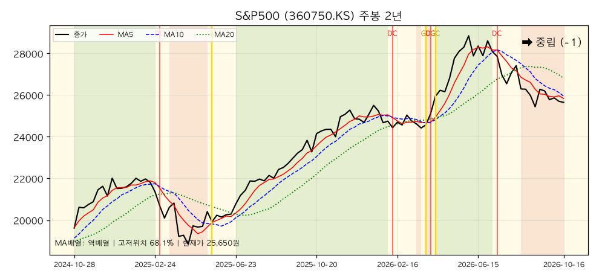

*S&P500(360750.KS) — 주봉 역배열, 2년 +30.7%, 고저위치 68.1%. 지수는 3주 전과 거의 같지만 원/달러 약 2.6% 원화 강세가 ETF를 -2.1% 눌렀다.*

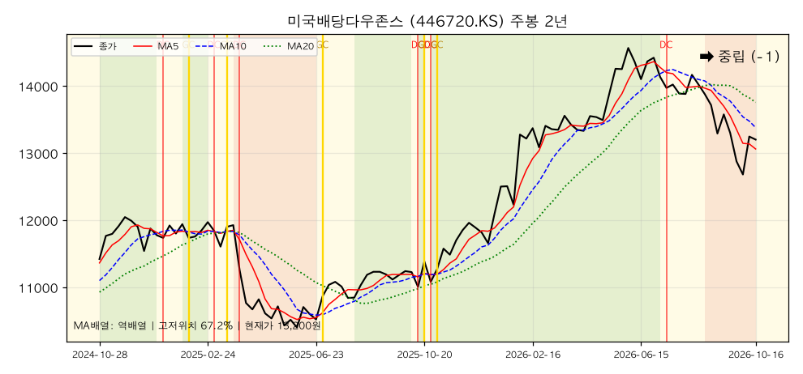

*미국배당다우존스(446720.KS) — 주봉 역배열, 2년 +15.6%, 고저위치 67.2%. 이번 주 +4.1%로 반등 2위. 방어주 선호가 돌아온 흔적.*

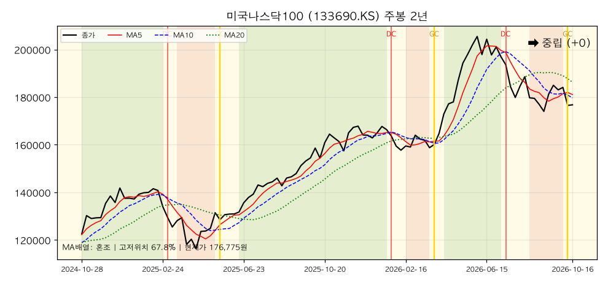

*미국나스닥100(133690.KS) — 주봉 혼조, 2년 +44.2%, 고저위치 67.8%. 15개 중 유일하게 주봉 골든크로스(1주 전)가 살아 있고 월봉도 유일한 강세.*

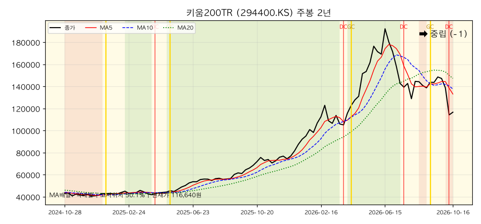

*키움200TR(294400.KS) — 주봉 역배열, 2년 +170.3%, 고저위치 50.1%. 이번 주 -16.0%, 지난 호 대비 -21.5%로 하락 2위. 주봉 데드크로스가 이번 주 새로 나왔다.*

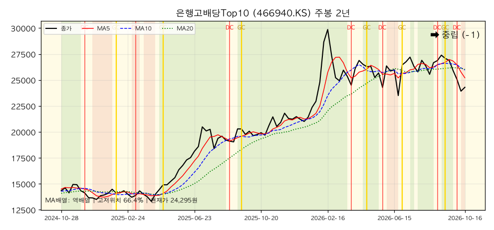

*은행고배당Top10(466940.KS) — 주봉 역배열(정배열 해제), 2년 +69.4%, 고저위치 66.4%. 지난 호의 유일한 일·주·월 정배열이 3주 만에 모두 무너졌다.*

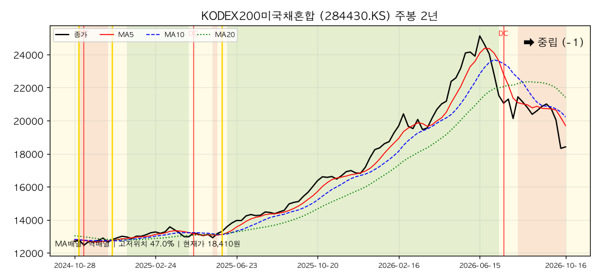

*KODEX200미국채혼합(284430.KS) — 주봉 역배열, 2년 +45.0%, 고저위치 47.0%. 국내 주식 급락이 주식 쪽 절반을 끌어내려 일봉 고저위치 2.3%.*

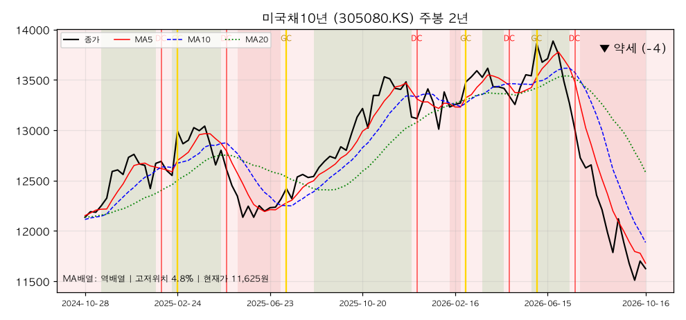

*미국채10년(305080.KS) — 주봉 역배열, 2년 -4.2%, 고저위치 4.8%. 일·주·월봉 약세 일치. 이번 주 +1.0%로 소폭 반등했지만 구조는 그대로.*

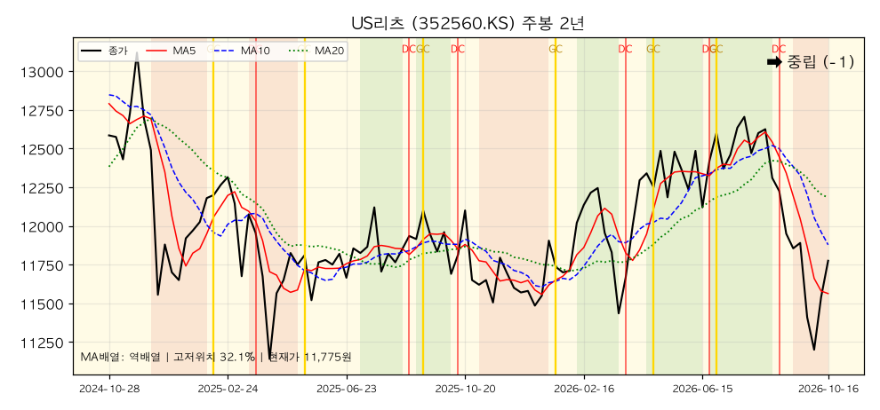

*US리츠(352560.KS) — 주봉 역배열, 2년 -6.4%, 고저위치 32.1%. 이번 주 +5.1%로 반등 1위, 일봉 골든크로스는 오늘(0봉 전) 발생.*

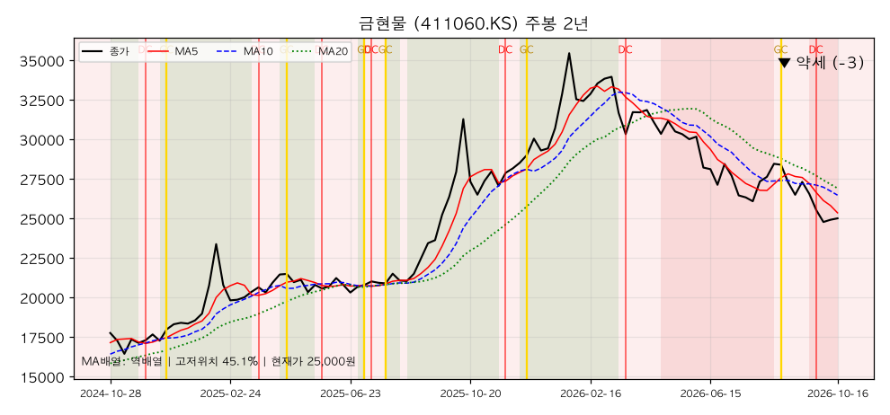

*금현물(411060.KS) — 주봉 역배열, 2년 +40.8%, 고저위치 45.1%. 일봉 고저위치 5.3%, 월봉 MA12(28,854원)가 현재가보다 15% 높다.*

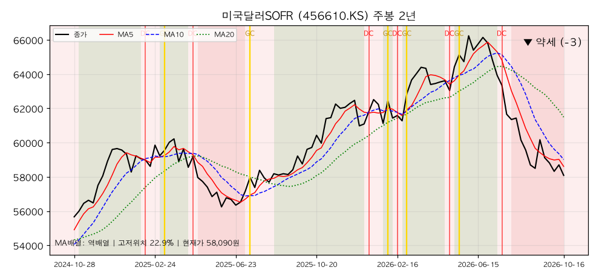

*미국달러SOFR(456610.KS) — 주봉 역배열, 2년 +4.3%, 고저위치 22.9%. 일봉 고저위치 0.0%(3개월 최저). 원화 강세가 직접 반영된다.*

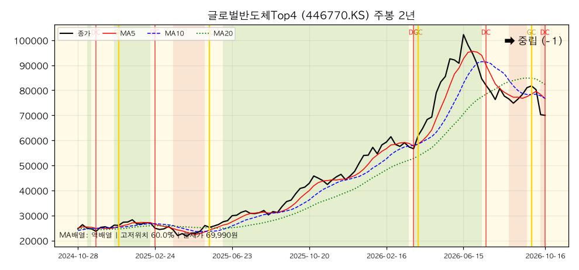

*글로벌반도체Top4(446770.KS) — 주봉 역배열, 2년 +184.3%, 고저위치 60.0%. 이번 주 -12.8%. 주봉 MA5·MA10 격차가 0.08%였다가 이번 주 데드크로스로 마감.*

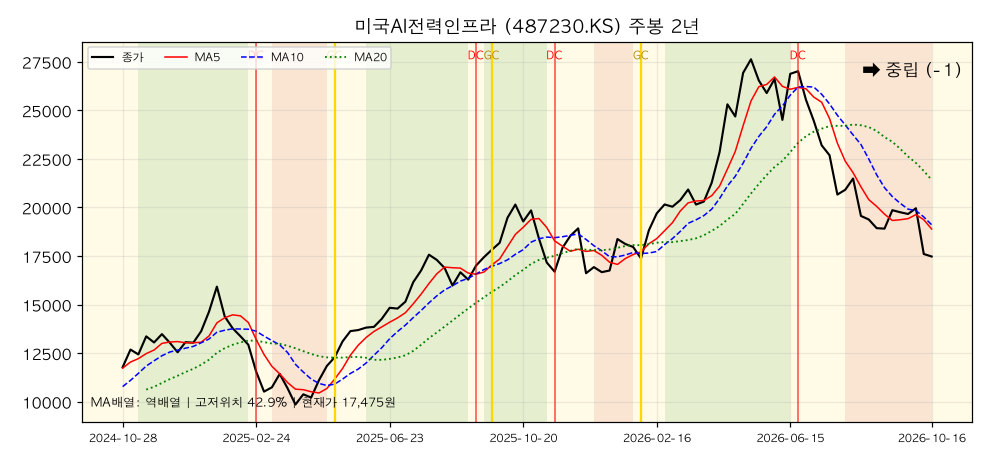

*미국AI전력인프라(487230.KS) — 주봉 역배열, 2년 +48.4%, 고저위치 42.9%. 일봉 고저위치 0.0%, 3개월 -25.5%로 15개 중 낙폭 1위.*

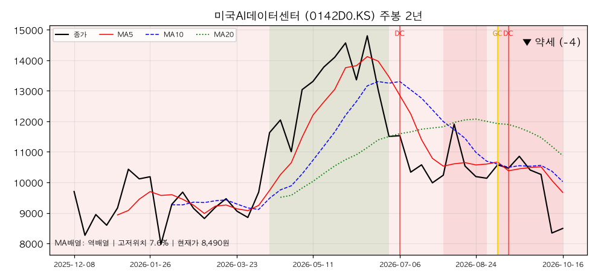

*미국AI데이터센터(0142D0.KS) — 주봉 역배열, 상장 후 -12.5%, 고저위치 7.6%. 이번 주 -17.3%로 하락 1위. 일·주·월 모두 약세 일치.*

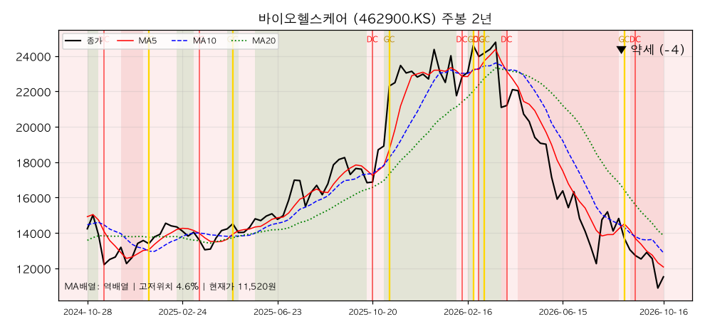

*바이오헬스케어(462900.KS) — 주봉 역배열, 2년 -19.1%, 고저위치 4.6%. 2주 전 이어 일·주·월 약세 일치. 주봉 모멘텀 -33.5%로 최약체.*

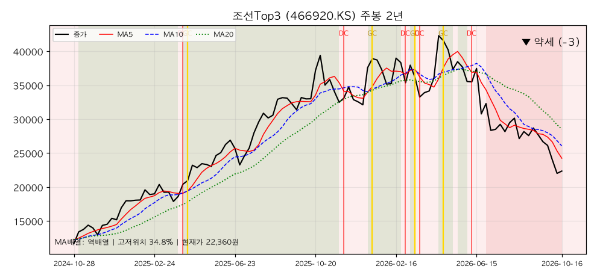

*조선Top3(466920.KS) — 주봉 역배열, 2년 +91.0%, 고저위치 34.8%. 일봉 고저위치 3.9%, 3주 전 대비 -16.2%.*

### [5] 추세추종 관점 주목 종목

#### 🚀 멀티타임 정배열 (추세 편승 구간)

**해당 종목 없음.** 지난 호의 유일한 후보였던 은행고배당Top10은 일봉(MA5<MA20)·주봉(데드크로스 2주 전) 모두 역배열이 됐고 월봉은 혼조(이번 달 데드크로스)다. 추세추종 관점에서 "추세에 편승할 종목"이 이번 주 15종목 중 하나도 없다는 것 자체가 신호다.

#### 📌 눌림목 후보 (장기 상승 + 단기 과매도) — 기준을 엄격히 적용하면 1~2개

| 종목명 | 월봉 고저위치 | 일봉 고저위치 | 괴리 | 판단 |
|---|---|---|---|---|
| 은행고배당Top10 | 82.4% | 9.3% | 73.1%p | 월봉 이번 달 데드크로스, 일·주봉 역배열. 눌림목이라기보다 **추세 훼손** 쪽 |
| S&P500 | 82.0% | 9.0% | 73.0%p | 지수는 보합, 환율 효과로 하락. 보유 비중이 가장 커 이번 주 분해 대상 |
| 미국나스닥100 | 80.4% | 15.9% | 64.5%p | 월봉 강세·주봉 골든크로스 유지. 후보 중 구조가 가장 온전 |
| 미국배당다우존스 | 77.8% | 31.7% | 46.1%p | 1주 +4.1%로 일봉 위치 회복. 후보에서 벗어나는 중 |

#### 눌림목은 어떻게 판정하나 — S&P500 사례 분해

지난 호는 미국배당다우존스로 분해했다. 이번 주는 **보유 비중이 가장 크면서 월봉·일봉 괴리가 큰 종목**인 S&P500(73.0%p)을 본다.

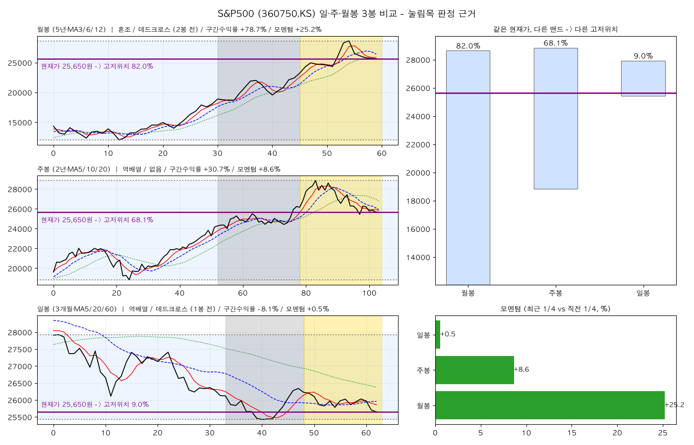

**① 같은 가격이 왜 82.0%이자 9.0%인가**

세 패널의 보라색 가로선은 전부 같은 값(25,650원)이다. 밴드(기간 최고~최저) 안에서의 높이만 다르다.

| 봉 단위 | 밴드 범위 | 밴드 폭 | 현재가 위치 |
|---|---|---|---|
| 월봉 (5년) | 12,035 ~ 28,640 | 16,605원 | **82.0%** (상단권) |
| 주봉 (2년) | 18,840 ~ 28,845 | 10,005원 | 68.1% (중간 위) |
| 일봉 (3개월) | 25,425 ~ 27,925 | 2,500원 | **9.0%** (바닥) |

일봉 밴드 폭은 월봉의 15%다. 3개월 동안 최고가 대비 8% 정도 빠진 것만으로 짧은 자의 바닥(최저 25,425원에서 0.9% 위)에 닿는다. 긴 자로 재면 여전히 상단권이다.

**② 모멘텀은 다른 이야기를 한다**

| 봉 단위 | 모멘텀(최근 ¼ vs 직전 ¼) | 해석 |
|---|---|---|
| 월봉 (15개월씩) | **+25.2%** | 장기 가속 |
| 주봉 (26주씩) | +8.6% | 가속 둔화 |
| 일봉 (15일씩) | **+0.5%** | 사실상 정지 |

지난 호 배당다우존스는 일봉 모멘텀이 -4.0%로 "단기 감속"이었다. 이번 S&P500은 **-에서 0 근처로 올라온 것이 아니라 가속이 멈춘 것**이다. 3개월 수익률은 -8.1%다.

**③ 그래도 "후보"로 두는 이유 — 그리고 불리한 신호**

- 유리: 월봉 고저위치 82.0%·모멘텀 +25.2%, 주봉 모멘텀 +8.6%. 지수(원화 환산 전)는 3주 전과 거의 같다.
- **불리 1**: 일봉 역배열에 데드크로스가 1봉 전에 나왔다. 일봉 MA60(26,373원)이 현재가보다 2.8% 위에 있어 지난 호처럼 "MA60 아래에서 나온 반등"조차 없다.
- **불리 2**: 월봉이 혼조이고 MA3(25,725원)가 MA6(26,415원) 아래로 내려간 지 2개월째다. 월봉 강세→중립으로 내려온 직접 원인이다.
- **불리 3**: 주봉 역배열(MA5 25,839 < MA10 25,947 < MA20 26,807). 크로스 신호는 없고 20주선이 4.5% 위에 있다.

유리한 근거는 모두 **고저위치·모멘텀 같은 "위치" 지표**에서 나오고, 불리한 근거는 **MA 배열·크로스 같은 "구조" 지표**에서 나온다. 지난 호와 똑같은 구도인데, 이번엔 구조 쪽 신호가 세 시간축 전부에서 나쁘다. 그래서 **"후보" 이상으로 승격하지 않고**, 진입 조건은 **일봉 MA5가 MA20(25,961원)을 상향 돌파하고 MA60(26,373원)을 회복하는 것**으로 건다.

#### ⚠️ 혼조 관망 (신호 불일치)

| 종목명 | 불일치 내용 |
|---|---|
| 미국나스닥100 | 월봉 강세·주봉 골든크로스 유지 vs 일봉 데드크로스(1봉 전)와 1주 -4.0%. 구조는 15종목 중 가장 낫다 |
| 미국배당다우존스 | 1주 +4.1% 반등 vs 일봉·주봉 역배열 지속. 방어 선호의 일시 복귀인지 미확인 |
| US리츠 | 일봉 골든크로스(오늘)·1주 +5.1% vs 주봉 역배열·월봉 고저위치 22.5% |
| 키움200TR | 주봉 중립 유지 vs 1주 -16.0%, 주봉 데드크로스 신규 발생. 월봉 모멘텀은 아직 +151%(짧은 상장 기간 왜곡 주의) |

#### 🔻 멀티타임 약세 (회피·축소 구간)

| 종목명 | 근거 |
|---|---|
| 미국AI데이터센터 | 일·주·월봉 모두 약세 일치(-4/-4/-2). 1주 -17.3%, 상장 후 -12.5%, 주봉 고저위치 7.6% |
| 바이오헬스케어 | 일·주·월봉 모두 -4. 주봉 모멘텀 -33.5%, 월봉 MA12가 현재가보다 53% 높다 |
| 조선Top3 | 일·주·월봉 약세 일치(-4/-3/-3). 지난 호 대비 -16.2%, 일봉 고저위치 3.9% |
| 미국채10년 | 일·주·월봉 약세 일치(지난 호에 이어). 주봉 고저위치 4.8% |
| 금현물 | 일·주봉 약세 + 주봉 데드크로스 3주 전. 일봉 고저위치 5.3% |
| 미국달러SOFR | 일·주봉 약세. 일봉 3개월 최저(0.0%) — 원화 강세의 직접 영향 |

### [6] 자산군별 추세 비교

추세강도 평균(-4 ~ +4 척도)으로 자산군을 묶어 비교했다. 괄호는 지난 호(09-23) 값.

| 자산군 | 구성 종목 | 일봉 평균 | 주봉 평균 | 월봉 평균 |
|---|---|---|---|---|
| 주식 — 선진국 | S&P500, 나스닥100, 배당다우존스, 반도체, AI전력, AI데이터센터 | -2.5 (-1.5) | -1.3 (-0.8) | +0.3 (+2.2) |
| 주식 — 국내 | 키움200TR, 은행고배당Top10, 조선Top3, 바이오헬스케어 | -3.8 (-0.5) | -2.2 (-0.5) | -1.5 (+0.5) |
| 혼합 | KODEX200미국채혼합 | -4.0 (-2.0) | -1.0 (-1.0) | 0.0 (+3.0) |
| 채권 | 미국채10년 | -4.0 (-3.0) | -4.0 (-4.0) | -2.0 (-2.0) |
| 대안자산 | 금현물, 미국달러SOFR, US리츠 | -3.0 (-3.7) | -2.3 (-1.7) | -1.0 (-1.0) |
| 배당·인컴 | 배당다우존스, 은행고배당Top10, US리츠 | -3.0 (-1.3) | -1.0 (+0.7) | +0.3 (+2.0) |

**자산군 간 관계 해석**

첫째, **국내 주식이 가장 크게 무너졌다.** 일봉 평균이 -0.5 → -3.8로 3.3점, 월봉이 +0.5 → -1.5로 2.0점 내려와 모든 자산군 중 낙폭이 가장 컸다. 한국 증시 급락이 지표에 그대로 찍힌 것이다.

둘째, **선진국 주식은 월봉 구조(+2.2 → +0.3)가 한 달 새 중립까지 내려왔다.** 다만 미국 지수 자체는 크게 빠지지 않았으므로(S&P500 3주 전과 거의 같은 수준) 이 하락의 상당 부분은 **원화 환산 효과와 국내 상장 테마 ETF(반도체·AI)의 동반 하락**이다.

셋째, **대안자산만 오히려 소폭 개선**(일봉 -3.7 → -3.0)됐다. US리츠 반등(+5.1%)과 금 보합(+0.9%) 덕이지만 주봉·월봉 구조는 그대로 약하다. 급락장에서 방어자산이 "덜 빠진 것"이지 "추세가 좋아진 것"은 아니다.

넷째, **채권은 방어 역할을 여전히 못 한다.** 미국채10년은 -4.0 / -4.0 / -2.0으로 3주 전과 같다. 미 10년물이 5.10%(재무부 고시)로 올라 금리 압력이 이어지고 있다.

### [7] 종합 코멘트

**전체 추세 방향성**
시간축별 강세 비중은 월봉 6.7%(1개), 주봉 0%, 일봉 0%다. 지난 호(월봉 46.7% / 주봉 6.7% / 일봉 13.3%)와 비교하면 **세 시간축 모두 악화**했다. 구조를 말로 옮기면 "중기 조정의 막바지 반등 시도"에서 **"조정이 연장되고 한국발 충격이 추세 훼손으로 번지는 단계"**로 한 칸 이동했다. 일봉 15종목이 전부 MA60 아래, 주봉 14종목이 역배열이라는 것은 반등이 와도 곧바로 추세 복귀로 보기 어렵다는 뜻이다.

**강세·약세 자산군의 교차 신호**
- 강세 일치 0개, 약세 일치 4개(미국채10년·AI데이터센터·바이오·조선). 약세 일치 종목은 3주 전과 같은 미국채10년·바이오에 AI데이터센터·조선이 더해졌다.
- 이번 주 오른 종목(US리츠·배당다우·미국채10년·금)은 모두 **배당·금리 민감 자산**이다. 성장·테마 → 방어 순환이 일어났지만, 이들의 주봉·월봉 추세는 아직 하락 쪽이라 신뢰하기 어렵다.
- **미국나스닥100**이 15종목 중 구조가 가장 온전한 유일한 종목(월봉 강세·주봉 골든크로스)이라는 점은 눈여겨볼 만하다. 지수(S&P500)가 보합인데 국내 상장 ETF만 빠진 이번 하락의 성격과 맞는다.

**추세추종 대응 방향**
1. **신규 진입 신호는 없다.** 정배열이 0개이므로 추세추종 규칙상 신규 매수는 관망한다.
2. **눌림목 매수는 "구조 회복"을 확인한 뒤로 미룬다.** 고저위치가 바닥이라는 이유만으로 사지 않고, 일봉 MA5의 MA20 상향 돌파와 MA60 회복을 확인한다.
3. **약세 일치 종목(AI데이터센터·바이오·조선·미국채10년)은 반등 시 비중 축소 우선.** 일·주·월봉이 한 방향이라 되돌림이 나와도 추세 전환이 아닐 가능성이 높다.
4. **다음 주 확인할 신호**: ① 일봉 MA5-MA20 재돌파(S&P500·나스닥100이 가장 가깝다), ② 주봉 데드크로스가 반도체 외로 번지는지, ③ 월봉 MA3·MA6 회복, ④ 10/22 한국은행 금통위·10/28 FOMC 결과 직후의 일봉 반응.

> 본 분석은 차트 데이터에 근거한 정보 제공이며 투자 자문이 아닙니다.

---

## 5. 내 ETF 평가 & 대응

> 이 섹션은 개인 포트폴리오를 다루므로 **절대금액을 쓰지 않는다.** 모든 수치는 비중(%)·수익률(%)·정성 평가다.
> 앞의 세 분석(한국은행·거시·차트)을 입력으로 받은 최종 종합이며, 관점은 **안전마진 기반 가치투자자**다.
> 기준: 포트폴리오 시트 10-16, 시세 Yahoo Finance 10-16 종가. 직전 리포트(09-23)와 3주 간격이다.

### 5-0. 이번 3주의 핵심 — 한국발 충격이 계좌 전체에 번졌다

3주 전 리포트의 최대 변수는 "인상이 현실이 됐지만 시장은 반등했다"였다. 그 반등은 오래가지 못했다. 이번엔 **한국 증시 투매**가 변수다.

| 항목 | 39주차(09-23) | 42주차(10-16) | 포트폴리오 영향 |
|---|---|---|---|
| 코스피 | 7,081 | 5,554(10/15) → 5,668(10/16 장중) | 6월 고점 대비 약 △39%. 국내 상장 ETF 전반 급락 |
| 미국 10년물(재무부 고시) | 4.96%(09-22) | **5.10%**(10-15) | 장기채·성장주 할인율 부담 지속 |
| 연준 정책금리 | 3.75~4.00% | 3.75~4.00% 유지, **12월 인상 우세** | 10/28 FOMC 점도표 없음 |
| 원/달러 | 1,368원 | 약 1,332원 (원화 2.6% 강세) | 미국 자산 원화 환산 수익 **감소** |
| WTI | 91.3달러 | 95.7달러 (+4.7%) | 물가 재가열 요인 |
| 국제 금값 | 4,341달러 | 4,201달러 (△3.2%) | 실질금리·달러 역풍 |
| 미국 CPI(9월) | — | 헤드라인 3.7% / 코어 2.6% | 재가열, 단일 출처 수치(거시 장 참조) |

원화가 강세로 돌아서면서 **미국 지수는 보합인데 원화 환산 ETF는 내린 3주**였다(S&P500 지수 7,738 → 7,744, ETF 약 △2.1%). 포트폴리오의 약 69%가 미국·글로벌 자산이라 환율의 영향이 개별 종목보다 크다는 진단은 이번에도 맞았다. 다만 이번엔 방향이 3주 전과 반대였고, 거기에 국내 상장 테마 ETF의 급락이 겹쳤다.

### 5-1. 포트폴리오 성과 (비중·수익률만)

#### 전체

| 항목 | 값 | 직전(09-23) | 변화 |
|---|---|---|---|
| 전체 누적 수익률 | **+0.35%** | +5.76% | **△5.41%p** |
| 미국·글로벌 자산 비중(금·현금·한국 제외) | 69.0% | — | — |
| 금 비중 | 13.3% | 15.3% | △2.0%p |
| 한국 자산 비중(국내 주식 + 국내 혼합) | 14.2% | — | — |
| 현금 비중 | **3.6%** | 4.8% | △1.2%p |

(직전 리포트는 "한국 자산"에 미국채혼합을 넣지 않아 지역 비중은 직접 비교하지 않는다.) **누적 수익률이 3주 만에 5.76%에서 0.35%로 사실상 원점이 됐다.** 환율(미국 자산)과 국내 증시 급락(한국·테마 자산)이 동시에 작용한 결과다.

#### 계좌별

| 계좌 | 전체 대비 비중 | 누적 수익률 | 직전(09-23) | 변화 | 성격 |
|---|---|---|---|---|---|
| 퇴직연금 | 39.9% | **+6.22%** | +11.40% | △5.18%p | 종합형 — 여전히 최우수 |
| 개인IRP | 17.8% | **+2.85%** | +5.11% | △2.26%p | 성장+배당. 낙폭 최소 |
| 연금저축펀드 | 26.6% | **+1.78%** | +5.44% | △3.66%p | 구조적 안정성, 금·장기채가 발목 |
| ISA | 15.7% | **△15.84%** | △4.61% | **△11.23%p** | 단중기 테마 — 손실 폭 확대 1위 |

**ISA가 포트폴리오의 손상을 거의 혼자 만들었다.** 3주 만에 11.2%p 악화됐고, 전체 비중은 15.7%에 불과하지만 전체 수익률 하락(5.41%p)에 가장 큰 몫을 했다. 퇴직연금·IRP는 같은 기간 두 자릿수 하락 없이 버텼다. **테마 집중 계좌는 급락장에서 가장 먼저, 가장 크게 무너진다**는 사실을 숫자로 확인한 3주다.

#### 자산군별 (전체 대비 비중 / 누적 수익률)

| 자산군 | 비중 | 누적 수익률 | 직전 비중 / 수익률 | 평가 |
|---|---|---|---|---|
| 미국주식(지수, S&P500) | 25.5% | +11.62% | 25.4% / +13.58% | 최대 비중·최대 수익원 유지, 수익률은 환율로 소폭 후퇴 |
| 금 | 13.3% | △1.51% | 15.3% / +4.69% | 수익→손실 전환. 금값 △3.2%와 원화 강세 |
| 혼합(주식+채권) | 13.8% | +4.73% | 14.3% / +13.71% | 국내 주식 급락이 직격(수익률 △9%p) |
| 미국주식(배당) | 11.7% | +8.34% | 11.3% / +8.90% | 가장 안정적. 반등 2위 |
| 미국주식(테마·AI) | 6.0% | △20.38% | 5.0% / △10.44% | **손실 2배**, 비중은 오히려 확대 |
| 달러/단기채 | 4.6% | △9.31% | 4.0% / △9.71% | 원화 강세로 손실 지속 |
| 미국주식(성장·나스닥) | 4.5% | +1.48% | 4.5% / +5.40% | 급락장에서 방어력 양호 |
| 미국채권(10년) | 4.3% | △7.95% | 4.2% / △5.89% | 금리 5.10%에 손실 확대 |
| 글로벌주식(테마·반도체) | 4.0% | △7.22% | 4.5% / +7.43% | **수익 → 손실** 전환 |
| 현금 | 3.6% | — | 4.8% | 목표(8~12%)와 거리 확대 |
| 한국주식(배당·은행) | 3.1% | △1.78% | 2.6% / +7.98% | 보유 3주 만에 수익 소멸 |
| 한국주식(테마·조선) | 2.1% | **△27.71%** | 2.4% / △13.72% | 최대 손실 종목군 |
| 미국채권(30년) | 1.6% | △4.87% | 1.6% / △0.77% | 손실 확대 |
| 한국주식(지수, 키움200TR) | 1.2% | △3.51% | 0.1% / +11.17% | **신규 매수(원금 증가) 직후 급락** |
| 미국주식(헬스케어) | 0.6% | △2.22% | 0.6% / △4.23% | 비중 미미 |

**입금금액(매수 원금)의 변화로 본 이번 3주의 움직임** — 시트의 입금액 증감에서 추정한 정성 요약이며 금액은 공개하지 않는다.

- **추가 매수**: 연금저축의 은행고배당·키움200TR(현금 비중 13%대 → 8.7%), ISA의 미국AI데이터센터(ISA 현금 소진 → 0%), 퇴직연금의 달러단기채.
- **일부 매도로 추정**: 연금저축·퇴직연금의 금.

급락 구간에서 현금을 줄이며 **하락 종목을 더 산 것**이 눈에 띈다. 이 판단의 가치투자 관점 평가는 5-3과 5-6에서 다룬다.

### 5-2. 이번 3주 가격 변화 — 종목별 정리

| 방향 | 종목 | 3주 변화 | 주 원인 |
|---|---|---|---|
| 🔻 하락 | 미국AI데이터센터 | △21.8% | 한국발 투매 + 미국 AI 테마 약세, 일·주·월봉 약세 일치 |
| 🔻 | 키움200TR | △21.5% | 코스피 10/15 △7.57% |
| 🔻 | 조선Top3 | △16.2% | 추세 이탈 지속, 일봉 3개월 최저권 |
| 🔻 | 글로벌반도체Top4 | △13.6% | 반도체 수출 호조에도 증시 투매 |
| 🔻 | KODEX200미국채혼합 | △12.4% | 주식 쪽 급락 + 채권 부진 |
| 🔻 | 미국AI전력인프라 | △11.5% | 낙폭 15종목 중 일봉 3개월 -25.5% |
| 🔻 | 은행고배당Top10 | △9.6% | 방어주도 투매에서 못 피함 |
| 🔻 | 바이오헬스케어 | △8.1% | 약세 일치 |
| 🔻 | 금현물 | △5.8% | 금값 △3.2% + 원화 강세 |
| 🔻 | 미국나스닥100 | △4.4% | 성장주 약세 + 원화 강세 |
| 🔻 | 미국채10년 | △2.2% | 10년물 5.10% |
| 🔻 | S&P500 | △2.1% | 지수 보합, 원화 강세 효과 |
| 🔻 | 미국달러SOFR | △1.7% | 원화 강세 |
| 🔻 | US리츠 | △1.0% | 이번 주 +5.1%로 반등 중 |
| 🔻 | 미국배당다우존스 | △0.8% | 이번 주 +4.1%로 반등, 가장 선방 |

**15종목 전부 하락이다.** 지난 3주 전 "미국은 대부분 플러스, 한국은 마이너스"로 갈렸던 것과 달리 이번엔 어디에도 숨을 곳이 없었다. 다만 폭은 **노출된 시장에 비례**했다: 국내 증시·반도체·AI 테마(△10~22%) ≫ 미국 지수·배당·금리 자산(△1~4%). 분산이 실제로 작동한 것은 **미국 배당·지수 비중이 큰 퇴직연금·IRP**였다.

### 5-3. 안전마진 재계산 — 5.10%의 의미, 그리고 한국 급락은 "싸진 것"인가

| 비교 대상 | 수익률 | 직전(09-23) | 의미 |
|---|---|---|---|
| 한국 정책금리 | 3.00% | 3.00% | 10/22 금통위 — 동결 후 11월 인상 컨센서스(2장) |
| 미 연준 정책금리 | 3.75~4.00% | 3.75~4.00% | 12월 인상 우세 |
| 미국 10년물 | **5.10%** | 4.96% | 2002년 이후 최고권 |
| 미국 3개월물 | 4.28% | 4.16% | 현금성 자산이 4%대 이자 |
| S&P500 이익수익률(후행 PER 약 26.8배, 추정) | **약 3.73%** | 3.73% | 10년물보다 **약 1.37%p 낮다** |
| S&P500 이익수익률(선행 PER 약 19.3배) | **약 5.19%** | 5.21% | 10년물보다 겨우 0.09%p 높다 |

(S&P500은 지수가 3주 전과 거의 같아 후행·선행 PER을 지난 호 값(FactSet 9/18 기준 선행 19.26배)으로 유지했다. 3분기 실적 시즌의 이익 갱신은 아직 반영되지 않아 **추정치**다.)

**결론은 3주 전과 같고, 한 단계 더 불리하다.** 무위험 5.10%를 받을 수 있는데 이익수익률 3.7%의 지수를 사는 것은 **주식 리스크 프리미엄이 마이너스 1.4%p**인 거래다. 선행 이익이 전부 실현된다는 낙관에서도 프리미엄은 0.1%p 남짓이다. S&P500 후행 PER 26.8배는 50년 평균 16배의 1.7배로, 닷컴(44배)·코로나 후(37배)보다는 낮지만 금융위기 직전(20배)을 크게 넘는다. **신규 자금을 미국 지수에 추가 배정할 안전마진은 없다.**

#### 한국 급락은 안전마진을 만들어 줬나

코스피가 6월 고점(9,114) 대비 △39%로 내렸으니 "싸졌다"고 말하고 싶어진다. 그러나 **가격이 내린 것과 안전마진이 생긴 것은 다르다.**

- 안전마진은 **가격이 내재가치보다 얼마나 낮은가**다. 내재가치(이익 전망·PBR)는 이번 주 수집하지 못했다. 코스피 이익이 반도체 호황에 크게 의존한다는 한은의 단서(2장), 7·8월 금리 인상의 지연 부담(2027년 상반기)이 이익 전망을 낮출 가능성도 있다.
- 한국 정책금리는 3.00%이고 국채 10년 수준은 수집하지 못했지만, 11월 인상(3.25%) 컨센서스가 맞다면 **할인율이 더 오르는 방향**이다.
- 6월 고점 대비 △39%에서 10/16에 +2% 반등했지만 3일 낙폭(△13%)을 되돌린 것은 아니다. **마진콜 연쇄가 끝났다는 확인이 없다.**

결론: 국내 주식은 **"쌀 수도 있는 가격"까지 내려왔지만, 쌉니다라고 확인할 근거는 아직 없다.** 근거 없이 현금을 투입하는 것은 안전마진 투자가 아니다.

#### 적정가 단순 추정 (한 줄 근거 포함)

| ETF | 현재가 | 산출 방법 | 강력매수가 / 적정매수가 / 목표가 |
|---|---|---|---|
| S&P500 | 25,650원 | PER 비례. 후행 26.8배 → 20배(강력매수) / 25배(적정) | **약 19,140원 / 약 23,930원** / 목표 PER 22~25배 구간은 약 21,050~23,930원 |
| 금현물 | 25,000원 | 국제 금값 목표 5,055달러(지난 호 JP모건 목표 인용) ÷ 현재 4,201달러, 환율 고정 | 목표 **약 30,080원**(+20%) |
| 미국채10년 | 11,625원 | 금리 -0.5%p 가정 × 듀레이션 약 8 | 금리가 5.10% → 4.60%로 내리면 **약 12,090원**(+4%) |
| 미국달러SOFR | 58,090원 | 원금 보존형, 현재가 = 적정가 | 환율 변동분만 반영 |

(단순 비례 추정이라 환율·실적 변화를 반영하지 않는다. 금 목표가는 이번 주 별도 검증하지 않은 지난 호 인용값이다.)

#### 마진데빗의 역사적 맥락 — "감소가 오히려 경보"인 이유

마진데빗(증권사에서 빌려 주식을 산 돈)은 8월 약 1조 4,500억달러(추정)로 사상 최고권이고 9월분은 수집하지 못했다(3장). 50년 평균 대비 GDP 비율이 1.4%p 이상 높다. **고점 이후의 감소는 자발적 상환이 아니라 마진콜→강제청산→추가 하락의 흔적**이라는 점은 2000년·2008년이 보여줬다. 이번 3주의 한국 증시 급락(10/12 △3.65%, 10/15 △7.57%)이 바로 그 연쇄가 시작된 모양이다. 내 포트폴리오는 레버리지를 쓰지 않아 직접 강제청산 위험은 없지만, **현금 3.6%는 시장 전체의 연쇄 청산을 견디기엔 얇다.**

### 5-4. 세 가지 투자자 관점

| 관점 | 판단 기준 | 현재 시장 평가 | 내 포트폴리오에 대한 행동 |
|---|---|---|---|
| **가치투자자(버핏)** | 이익수익률 > 무위험수익률, 안전마진 | 🔴 **부적합** — 후행 이익수익률 약 3.7% < 미 10년 5.10%. 한국은 가격은 내렸으나 내재가치 근거 부재 | 미국 지수·성장주·테마 신규 매수 중단. 국내 주식도 **근거 확인 전 추가 금지** |
| **성장주 투자자(ARK)** | EPS 성장률, 테마 점유율 | 🟡 **혼조** — 반도체 수출 +262.8%(9월)로 실적은 최고, 그러나 주가는 반도체 ETF △13.6% | 실적과 주가의 괴리는 기회일 수도 있으나 **추세가 꺾인 3주** — 확인 후 판단 |
| **단기 트레이더(모멘텀)** | 이동평균, VIX, 레버리지 추세 | 🔴 **약세** — 일봉 15종목 전부 MA60 아래, 주봉 역배열 14개 | 신규 진입 신호 0개. 약세 일치 종목(AI데이터센터·조선·바이오·미국채10년)은 반등 시 축소 |

세 관점 중 **둘이 "관망·방어", 하나가 "혼조"**다. 3주 전의 "성장·모멘텀 관점 개선"은 사라졌다. 안전마진 투자자는 가장 보수적인 관점을 신규 자금의 기준으로 삼는다.

### 5-5. 한국 vs 미국 금리 환경 분리 평가

#### 🇰🇷 한국 자산 (금리 인상 환경 — 국내 주식 6.4% + 미국채혼합 일부 포함)

| ETF | 평가 | 금리 환경 평가 |
|---|---|---|
| 은행고배당Top10 | 3.1% / △1.78% | 인상 수혜 논리(순이자마진 증가)는 그대로지만 **투매에는 방어가 안 됐다**. 3주 전 "보유 권장"의 전제(추세 정배열)가 무너졌다 → **보유 유지, 추가 매수 중단** |
| 키움200TR | 1.2% / △3.51% | 신규 편입 직후 급락. 코스피 지수 노출은 11월 인상·외국인 순매도에 가장 민감 |
| 조선Top3 | 2.1% / △27.71% | 금리와 무관한 추세 이탈. 일·주·월봉 약세 일치 → 반등 시 축소 |
| KODEX200미국채혼합 | 7.9% / +9.01% | 주식 절반의 급락이 수익률을 끌어내림(△9%p). 아직 수익권이라 **보유** |

한국은행 시나리오는 **10월 동결·11월 인상**으로 기울었다(2장). 동결은 완화 신호가 아니고, 인상이 확정되면 **은행주에는 순이자마진에 유리하지만 부채 비중이 높은 기업·테마에는 부담**이다. 한국 자산은 금리 환경만으로 평가할 수 없는 국면이다.

#### 🇺🇸 미국 자산 (금리 인상 + 물가 재가열 환경 — 약 69%)

| ETF | 평가 | 금리 환경 평가 |
|---|---|---|
| S&P500 | 25.5% / +11.62% | 10년물 5.10% 대비 이익수익률 3.7% — 안전마진 없음. **보유(매도 사유 없음), 추가 매수 금지** |
| 미국배당다우존스 | 11.7% / +8.34% | 이번 3주 가장 선방(△0.8%). 가치주 성격으로 금리 환경에 상대적으로 강함 |
| 미국나스닥100 | 4.5% / +1.48% | 월봉 강세·주봉 골든크로스가 유지된 유일한 종목. 그러나 금리 5% 환경에서 밸류 부담 |
| 미국채10년·30년 | 5.9% / △7.95%·△4.87% | 5.10%는 분할 매수 조건에 해당하지만 **추세는 일·주·월봉 약세 일치**. 12월 인상이 우세하므로 서두를 이유가 없다 |
| 미국AI데이터센터·AI전력·반도체 | 10.0% / △20.38%·△7.22% | 할인율 상승과 한국발 충격을 동시에 받는 가장 취약한 구간 |
| 달러단기채·SOFR | 4.6% / △9.31% | 이자(약 4%대)는 받지만 **원화 강세 3주**가 손실 원인. 환율 베팅 성격 |

**미국 자산 전체의 문제는 금리가 아니라 환율과 밸류에이션**이다. 인상 기조가 12월까지 이어지면 안전마진은 더 얇아진다.

### 5-6. 종합 평가 & 대응 — "원점에 돌아온 3주"

**총평.** 누적 수익률이 5.76%에서 0.35%로 내려왔다. 구조는 크게 훼손되지 않았다(퇴직연금 +6.22%, S&P500 +11.62%, 배당다우 +8.34%가 받치고 있다). 문제는 **ISA(△15.84%)**와 **방어 자산이라 믿었던 금·장기채·달러채가 급락장에서 방어하지 못했다**는 점이다.

**3주 전 원칙의 이행 점검**

| 3주 전 원칙 | 이행 결과 | 평가 |
|---|---|---|
| 현금 비중 8~12% 확보 | **3.6%로 오히려 감소** | ❌ 미이행 — 급락 구간에서 방어력이 약해졌다 |
| 장기채는 5.0% 도달 후 소량 분할만 | 30년물 합산 비중 유지(5.9%), 10년물 손실 확대 | ⚠️ 5.00% 도달이었으나 **추세 미확인 상태**에서 진행한 대가 |
| 은행고배당 확대(정배열 확인) | 일·주·월봉 정배열 해제 후 추가 매수 | ⚠️ **조건(정배열)이 사라진 뒤의 매수** |
| AI데이터센터·AI전력은 반등 시 축소 | 반등 없이 AI데이터센터를 **추가 매수** | ❌ 원칙과 반대 방향 |

**이번 3주의 가장 큰 교훈**: 3주 전 원칙은 "확인 후 행동"이었는데, 실제 움직임은 **확인 전에 하락 종목을 더 사는 쪽**이었다. 평균단가는 낮아졌어도 일·주·월봉 모두 약세인 종목의 손실 폭(△22.59%)과 비중(ISA의 28%)이 함께 커졌다. 안전마진 투자는 "싸 보이는 가격"이 아니라 "**싼 이유가 사라졌다는 증거**"를 산다.

**앞으로의 대응 원칙 (우선순위순)**

1. **신규 자금은 현금·초단기채로 먼저 쌓는다.** 현금 3.6% → 단계적으로 8% 이상. 미 3개월물 4.28%로 무위험 이자도 받는다. 현금이 많으면 한국 증시의 안전마진이 확인되는 순간 **빠를 수 있다.**
2. **ISA는 "추가 매수 금지 + 반등 시 비중 축소".** AI데이터센터·조선·반도체의 합산 비중이 계좌의 약 67%다. 일·주·월봉 약세 일치 종목(AI데이터센터·조선)은 추세 회복 신호(일봉 MA5의 MA20 상향 돌파) 전까지 손실을 늘리지 않는다.
3. **금은 "실질금리 하락 확인 전" 추가 매수를 보류한다.** 10년 실질금리가 +2.10%p로 3주 전(+1.66%p)보다 높아졌고(3장), 금 매력도가 3→2로 하향됐다. 다만 일부 매도로 비중(13.3%)이 3주 전(15.3%)보다 줄었고 목표 구간(30,080원)까지 여력은 남아 있다. **더 줄일 이유는 약하다.**
4. **장기채는 합산 5.9% 상한 유지.** 5.10% 자체는 매수 신호에 가깝지만 12월 인상이 우세하고 가격 추세는 약세 일치다. 추가 확대 조건은 ① ISM 가격지수가 77.9에서 60 선으로 하락 또는 ② 10년 ETF 일봉 MA20 회복.
5. **S&P500·배당다우는 보유.** 이익수익률 3.7% < 5.10%라 추가 매수는 안 하지만, 지금 팔 이유도 없다. 이번 3주 가장 선방했고 누적 수익을 받치고 있다.
6. **국내 주식은 "근거 확인 전 추가 금지".** 은행고배당·키움200TR은 현 비중 유지. 10/22 금통위 결과, 10월 소비자물가, 외국인 순매도 둔화를 확인한 뒤 판단한다. 고점 대비 △39%는 매수 근거가 아니라 **확인 항목**이다.

#### 🔴 경계 vs 🟢 강조

| 구분 | 종목 | 이유 |
|---|---|---|
| 🔴 경계 | 미국AI데이터센터 | △22.59%, 일·주·월봉 약세 일치, 3주 △21.8%. 추가 매수 중단 |
| 🔴 경계 | 조선Top3 | △27.71% 최대 손실 종목군, 약세 일치 |
| 🔴 경계 | 현금 3.6% | 방어력 약화. 3주 전 목표 미이행 |
| 🟡 관찰 | 은행고배당·키움200TR | 투매에서 방어 실패. 10/22 금통위 후 재평가 |
| 🟡 관찰 | 미국채10년·30년 | 5.10%는 분할 매수 조건이나 추세 확인 전 |
| 🟢 강조 | 미국배당다우존스 | 3주 △0.8%로 가장 선방 |
| 🟢 강조 | 퇴직연금 구조 | +6.22%로 급락장에서 가장 잘 버틴 종합형 |
| 🟢 강조 | 미국나스닥100 | 15종목 중 유일하게 월봉 강세·주봉 골든크로스 유지 |

> 본 분석은 개인 포트폴리오에 대한 정성 평가이며 투자 자문이 아닙니다. 모든 수치는 비중(%)·수익률(%)·가격 지표이며 절대금액은 공개하지 않습니다.

---

## 6. 종합 코멘트 & 다음 주 관전 포인트

### 이번 3주를 한 문장으로

**"예고된 악재 대신 예고되지 않은 충격이 왔고, 분산은 일부만 작동했다."** 3주 전 리포트는 연준 인상과 5% 금리를 최대 리스크로 짚었지만 실제 충격은 한국 증시 투매(10/12 △3.65%, 10/15 △7.57%)였다. 미국 지수가 보합일 때 국내 상장 ETF만 △10~22% 빠졌고 원화 강세가 미국 자산의 원화 수익까지 깎았다.

구조는 한 단계 나빠졌다. 연준은 12월 인상이 우세하고, 한은은 11월 인상으로 기울었으며, 물가(CPI 3.7%·ISM 가격 77.9)는 재가열 중이다. **가격은 내렸지만 할인율은 더 올랐다.** 가치투자자 입장에서 "싸졌다"와 "안전하다"는 다른 말이다.

### 네 분석의 교차 확인

| 분석 | 핵심 신호 | 서로 어떻게 맞물리는가 |
|---|---|---|
| 한국은행 | 3.00% 유지, 10/22 동결·11월 인상 컨센서스, 9월 CPI 2.9%(기저효과), 8월 경상수지 역대 2위 | 할인율은 내릴 이유가 없다. 호황(반도체)은 확인되지만 주가가 반응하지 않는 **실물-증시 괴리** |
| 거시 | 미 10년 5.10%, CPI 3.7%, 고용 +2.9만, 코스피 △39%, 10년-2년 +33bp | 물가 재가열 + 고용 둔화 + 레버리지 청산. 과열 말기의 패턴이 한국에서 먼저 터졌다 |
| 차트 | 일봉 MA60 위 0개, 주봉 역배열 14개, 정배열 0개, 월봉 강세 1개 | 거시의 압박이 가격 구조 전체로 번졌다. 반등이 와도 추세 복귀로 보기 어렵다 |
| ETF | 누적 +0.35%(△5.41%p), ISA △15.84%, 현금 3.6%, 원칙 이행 점검 2개 ❌ | 미국 지수·배당 중심 계좌가 버텼고 테마 집중·원칙 이탈이 손상을 키웠다 |

3주 전엔 시간축에 따라 신호가 갈렸다(단기 완화·중기 긴축). 이번엔 **네 분석이 모두 같은 방향(방어)**을 가리킨다. 신호가 일치할 때는 "맞겠지"가 아니라 "내가 틀렸을 때 얼마를 잃나"로 판단한다.

### 안전마진 기반 가치투자자의 현재 입장

- **유지(손대지 않음)**: S&P500·미국배당다우존스·미국나스닥100(퇴직·IRP 중심으로 누적 수익을 받치는 축), KODEX200미국채혼합(아직 수익권)
- **확대**: **현금·초단기채**(3.6% → 8% 이상, 미 3개월물 4.28%로 대기 이자도 받는다)
- **동결(추가 금지)**: 금(13.3%, 실질금리 +2.10%p 환경), 장기채(합산 5.9% — 5.10%는 분할 조건이나 추세 약세 일치), 은행고배당·키움200TR(근거 확인 전)
- **신규 중단·반등 시 축소**: 미국AI데이터센터, 조선Top3, 미국AI전력인프라 — 일·주·월봉 약세 일치 종목은 평균단가를 낮추려는 추가 매수 대신 손실 확대를 막는다
- **순서 원칙**: ① 현금 확보 → ② 금리·물가 고점 확인 → ③ 장기채 → ④ 한국 증시 저점 확인 후 국내 주식 → ⑤ 미국 지수 → ⑥ 성장·테마. **지금은 ①을 수행해야 할 단계이고 ③ 이후는 확인 후다.**

### 다음 주 관전 포인트

1. **10/22(목) 한국은행 금통위.** 동결이 기본, 11월 인상 시사 여부와 총재 기자간담회가 핵심. 동결+금융안정 메시지면 증시 안정에 도움이 되고, 인상 신호가 강하면 은행고배당에는 수혜지만 조선·테마에는 부담이다.
2. **10/22(목) 미 신규 실업수당 청구.** 직전 19.7만건·연속 171.6만건. 22만건 이하면 저해고 유지, 연속 청구 185만건 초과는 리스크 케이스 트리거다.
3. **10/27(화) 미 소비자신뢰 10월.** 직전 81.9(기대지수 63.6). 기대지수가 60 밑으로 내려가면 스태그플레이션 논쟁이 본격화된다.
4. **10/28(수) FOMC.** 점도표 없음. 동결이어도 "추가 인상" 문구가 유지되면 12월 인상 확률 90%대, 완화되면 50%대. **미 10년 5.3% 재돌파 여부**가 장기채 판단의 열쇠다.
5. **10/29(목) 미 9월 PCE + 3분기 GDP.** 코어 전월비 0.3% 이상이면 리스크 케이스 조건. BEA 일정이 예산 문제로 바뀔 수 있다(3장).
6. **한국 외국인 수급·코스피 5,000선.** 10/15 종가 5,554에서 5,000을 하회하면 연쇄 청산이 깊어지는 신호, 5,500~6,500 박스가 유지되면 베이스 케이스다.
7. **기술적 확인 4개**: ① S&P500·나스닥100 일봉 MA5의 MA20 상향 돌파(S&P500 25,961원) ② 글로벌반도체Top4·키움200TR 주봉 데드크로스의 확대 여부 ③ 월봉 MA3·MA6 회복 ④ 미국채10년 ETF 일봉 MA20(11,747원) 회복.

### 투자 원칙 재확인

> "싸 보이는 가격이 아니라, 싼 이유가 사라졌다는 증거를 산다."
>
> 떨어진 가격은 안전마진이 아니라 **확인해야 할 질문**이다. 현금은 아무것도 하지 않는 자산이 아니라,
> 확인이 끝났을 때 싸게 살 권리를 미리 사둔 자산이다.

---

## 면책 문구

본 글은 정보 제공 및 개인 기록 목적이며 투자 자문이 아닙니다. 모든 투자 판단과 그 책임은 본인에게 있습니다. 개인 포트폴리오의 비중(%)·수익률(%)만 공개하며, 절대금액은 공개하지 않습니다.
