> 한국은행 ECOS OpenAPI와 Yahoo Finance 원데이터를 직접 조회해 작성한 **거시 특별 점검**입니다.
> 정기 주간 리포트와 별도로, GDP·수출입·심리·물가·금리·환율 6개 축을 한 번에 훑습니다.
> 데이터 기준 — ECOS 분기 2026Q2 / 월 2026년 8~9월, 시장데이터 2026-10-22.

## 0. 한 장 요약

| 축 | 현황 | 방향 |
|---|---|---|
| 성장 | 실질 GDP 전년비 +3.8%(26Q1) → +3.8%(26Q2) | 수출 주도 가속 |
| 물가 | CPI +2.9%, 근원 +2.8%, PPI +7.7%(26.9) | 생산자물가 선행 압력 |
| 금리 | 기준금리 3.00%(26.8, 2연속 인상) | 긴축 전환 |
| 환율 | 1,323원(-8.4% YTD, 원화 강세) | 달러인덱스와 디커플 |
| 심리 | 제조업 BSI 실적 99.5, 수출기업 104.3 | 고점 통과 조짐 |
| 자산 | KOSPI 5,539 (6월 고점 8,484 대비 -35%) | 고점 후 조정 |

**핵심 서사:** *수출·교역조건이 만든 명목 호황 → 물가·금리 긴축 → 자산시장이 먼저 꺾임.*

---

## 1. GDP — 성장의 질이 바뀌었다

### 1-1. 실질 성장률 (전년동기비, %)

| 분기 | GDP | 최종소비 | 총자본형성 | 수출 | 수입 |
|---|---|---|---|---|---|
| 2025Q3 | 2.09 | 2.22 | -1.96 | 6.83 | 4.30 |
| 2025Q4 | 1.73 | 2.70 | -1.71 | 4.64 | 3.94 |
| 2026Q1 | **3.78** | 2.85 | 0.39 | **11.82** | 8.54 |
| 2026Q2 | **3.76** | 2.37 | 2.14 | **8.89** | 6.17 |

### 1-2. 전기비 성장 기여도 (%p)

| 분기 | 최종소비 | 총자본형성 | 순수출 | GDP(전기비) |
|---|---|---|---|---|
| 2025Q4 | 0.36 | -0.14 | -0.42 | -0.11 |
| 2026Q1 | 0.19 | 0.48 | **+1.10** | +1.83 |
| 2026Q2 | 0.20 | 0.10 | +0.32 | +0.63 |

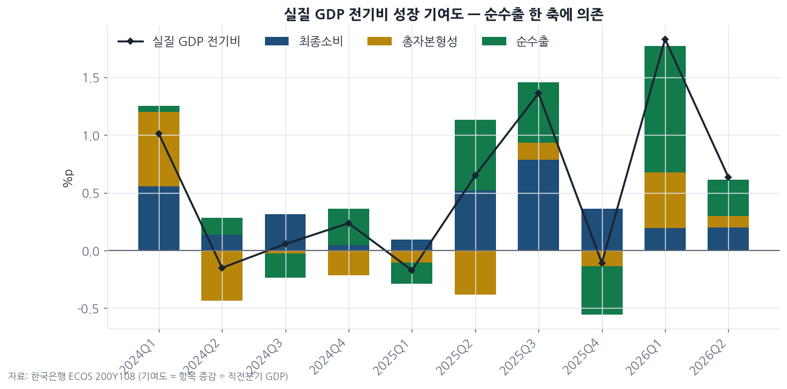

### 1-3. 명목 vs 실질 괴리 — GDP 디플레이터 폭발

| 분기 | 실질 GDP(yoy) | 명목 GDP(yoy) | 디플레이터(yoy) |
|---|---|---|---|
| 2025Q3 | 2.09 | 4.82 | 2.68 |
| 2025Q4 | 1.73 | 6.54 | 4.73 |
| 2026Q1 | 3.78 | **17.18** | **12.92** |
| 2026Q2 | 3.76 | **26.18** | **21.60** |

명목 수출은 전년비 **+70.4%**(26Q2)인데 실질 수출은 **+8.9%**. 차이 전부가 **수출단가(=교역조건)** 다.
GNI가 GDP보다 훨씬 빠르다 — 국민총소득 +15.7%(26Q2) vs GDP +3.8%.

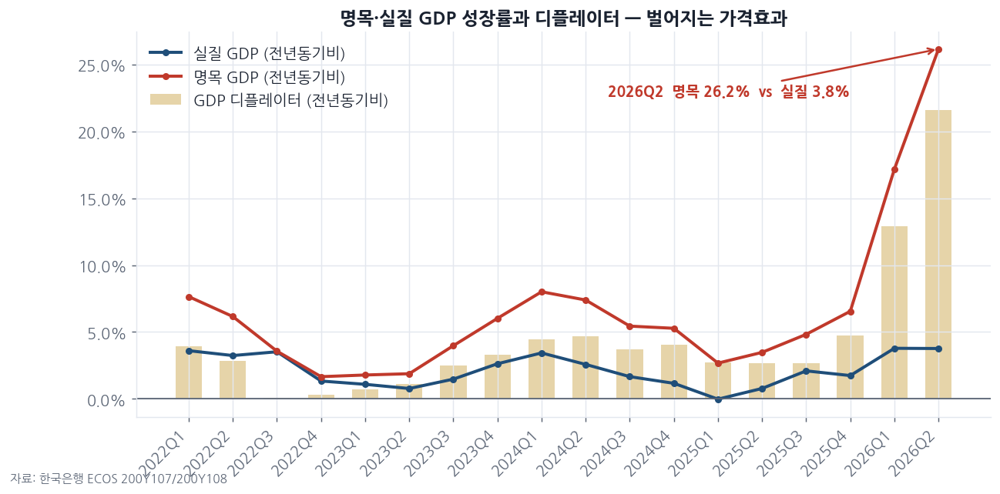

> **인사이트 ①** 이번 호황은 "더 많이 팔아서"가 아니라 **"훨씬 비싸게 팔아서"** 생긴 것이다.
> 가격 효과는 되돌림이 빠르다. 단가가 꺾이는 순간 명목 지표(기업 매출·이익)가 실질보다 훨씬 급하게 무너진다.
> 지금의 이익 레벨을 영속적인 것으로 가정하고 붙인 멀티플은 안전마진이 없다.

### 1-4. 산업별 실질 성장 (전년동기비, %)

| 업종 | 2025Q4 | 2026Q1 | 2026Q2 |
|---|---|---|---|
| 컴퓨터·전자·광학기기 제조업 | 10.70 | **23.07** | **20.62** |
| 금융 및 보험업 | 6.13 | 7.89 | 9.62 |
| 제조업(전체) | 2.58 | 7.32 | 6.59 |
| 정보통신업 | 1.94 | 1.26 | 3.81 |
| 도소매 및 숙박음식업 | 3.14 | 4.10 | 3.80 |
| 서비스업 | 2.45 | 3.16 | 3.49 |
| 운수업 | -0.33 | 2.82 | 1.80 |
| 화학물질 및 화학제품 제조업 | -1.52 | 1.17 | -0.65 |
| 전기장비 제조업 | -1.39 | 0.33 | -1.64 |
| 건설업 | -7.23 | -3.71 | **-3.65** |
| 코크스 및 석유정제품 제조업 | 4.07 | 5.11 | **-12.58** |

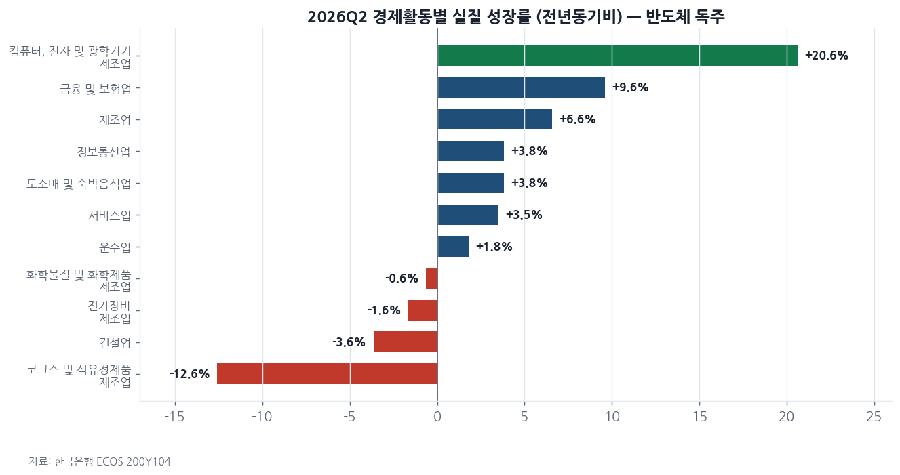

> **인사이트 ②** 성장이 **반도체 한 업종**에 몰려 있다. 건설은 9분기 연속 역성장이고,
> 석유정제는 유가 급등의 직격탄으로 2026Q2 **-12.6%** 급락(26Q1 +5.1% → 26Q2 -12.6%), 전기장비·화학도 마이너스다.
> 체감경기와 지표의 괴리(내수기업 BSI 95.7 vs 수출기업 104.3)가 여기서 나온다.
> 단일 업종 의존형 성장은 그 업종 사이클이 꺾일 때 분산 효과가 없다.

---

## 2. 수출입 — 사상 최대 흑자, 그러나 단가가 전부

### 2-1. 수출입 총액 (백만달러, 전년동월비)

| 시점 | 수출 | yoy | 수입 | yoy | 무역수지 |
|---|---|---|---|---|---|
| 2025.12 | 61,284 | +13.1% | 50,343 | +4.7% | 10,941 |
| 2026.03 | 78,411 | +55.2% | 54,253 | +16.2% | 24,158 |
| 2026.06 | 93,035 | +77.4% | 58,392 | +29.1% | **34,643** |
| 2026.08 | 91,387 | **+78.9%** | 56,523 | +24.5% | **34,863** |

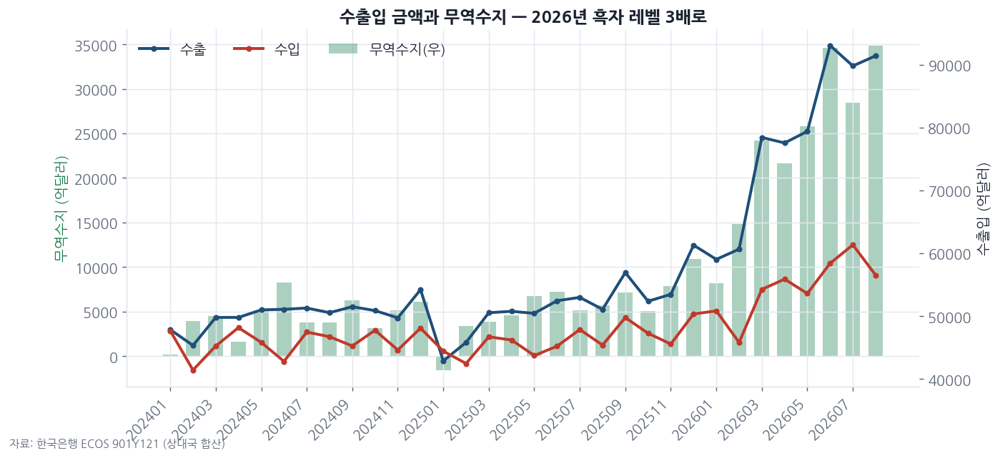

### 2-2. 수출 증가의 분해 — 물량인가 가격인가 (지수, 2020=100)

| 시점 | 금액지수 yoy | 물량지수 yoy | 단가 yoy | 순상품교역조건 yoy |
|---|---|---|---|---|
| 2026.03 | +52.6% | +23.6% | +23.5% | +22.8% |
| 2026.06 | +74.6% | +29.6% | +34.7% | +15.5% |
| 2026.08 | +75.9% | +25.9% | +39.7% | +27.1% |
| 2026.09 | **+89.2%** | **+32.1%** | **+43.2%** | **+25.4%** |

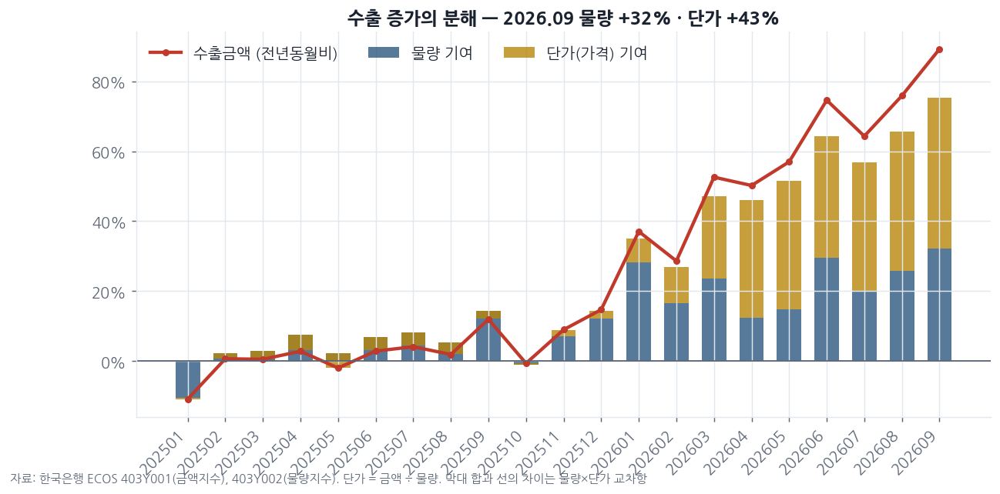

순상품교역조건지수 119.5, 소득교역조건지수 216.7(+65.7% yoy) — 수출 1단위로 살 수 있는 수입품이 크게 늘었다.

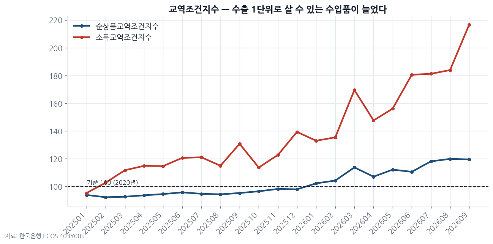

### 2-3. 지역별 수출 비중 / 증가율 (2026.08)

| 상대국 | 비중 | 전년동월비 |
|---|---|---|
| 중국 | 26.4% | +119.4% |
| 미국 | 18.1% | +89.2% |
| 홍콩 | 9.7% | **+226.5%** |
| 베트남 | 9.7% | +63.4% |
| 대만 | 7.1% | +48.0% |
| 말레이시아 | 3.7% | +223.6% |
| 일본 | 2.9% | +13.0% |

> **인사이트 ③** 홍콩·말레이시아·필리핀(+180%) 같은 **중계·후공정 허브**가 폭증했다.
> 이는 최종 수요라기보다 **반도체 공급망 재고 축적(채널 빌드업)** 신호일 가능성이 크다.
> 일본(+13%)처럼 반도체 노출이 낮은 지역은 평범하다 — 즉 수출 호조는 광범위하지 않고 **한 품목에 집중**돼 있다.
> 채널 재고는 반드시 되돌아온다. 흑자 레벨의 지속성을 의심해야 한다.

---

## 3. 심리지표 — 고점을 찍고 돌아섰다

### 3-1. 기업심리지수(BSI) 실적

| 시점 | 전산업 | 제조업 | 수출기업 | 내수기업 | 중소기업 | 서비스업 |
|---|---|---|---|---|---|---|
| 2026.06 | 97.7 | 101.2 | 106.4 | 98.0 | 95.7 | 97.2 |
| 2026.07 | 98.5 | 103.2 | 107.5 | 100.0 | 97.6 | 95.3 |
| 2026.08 | 99.6 | 103.8 | **108.5** | 99.4 | 99.8 | 96.5 |
| 2026.09 | 99.1 | 99.5 | 104.3 | 95.7 | 94.4 | 99.9 |

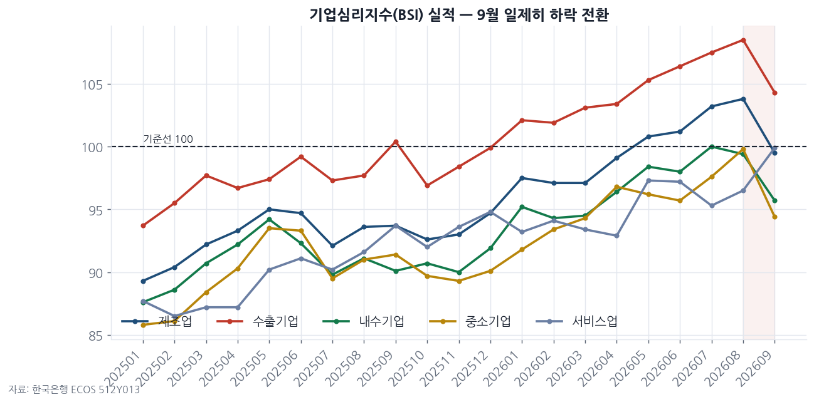

### 3-2. 제조업 세부 BSI — 가격 전가력 소멸

| 시점 | 원자재구입가격 | 제품판매가격 | 채산성 | 가동률 | 수출실적 |
|---|---|---|---|---|---|
| 2026.04 | 149 | 110 | 68 | 87 | 89 |
| 2026.06 | 140 | 107 | 73 | 90 | 96 |
| 2026.07 | 129 | 105 | 79 | 93 | 98 |
| 2026.09 | 121 | **98** | 79 | 89 | 92 |

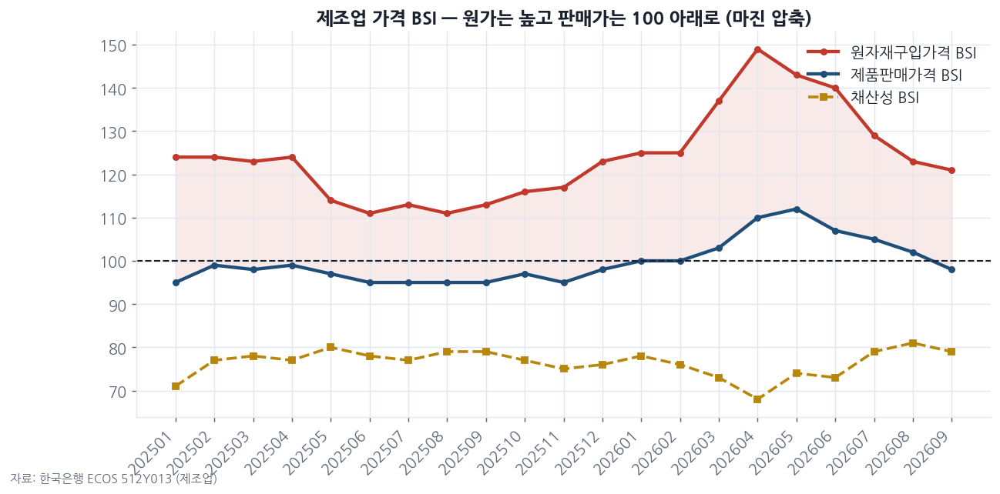

### 3-3. 소비자동향조사(CSI)

| 시점 | 소비자심리 | 현재경기판단 | 향후경기전망 | 금리수준전망 | 주택가격전망 | 물가수준전망 |
|---|---|---|---|---|---|---|
| 2026.02 | 112.1 | 95 | 102 | 105 | 108 | 147 |
| 2026.04 | 99.2 | 68 | 79 | 115 | 104 | 153 |
| 2026.06 | 106.6 | 86 | 92 | 126 | 120 | 150 |
| 2026.09 | 106.6 | 83 | 90 | **128** | 125 | 150 |

> **인사이트 ④** 제조업 BSI가 8월 103.8 → 9월 99.5로 **기준선 100 아래로 재이탈**.
> 특히 **제품판매가격 BSI 110 → 98**: 기업이 더 이상 가격을 올리지 못한다.
> 원자재가격(149→121)보다 판매가격이 더 빨리 꺾이면 **마진 압축**이 다음 분기 실적에 나타난다.
> 소비자는 "금리는 더 오른다(128)"고 보면서 현재경기는 83으로 본다 — **긴축 체감 + 경기 둔화**의 조합.

---

## 4. 물가 — 소비자물가는 안정, 생산자물가는 경고

### 4-1. CPI 전년동월비 (%)

| 시점 | 총지수 | 근원(식료품·에너지 제외) | 공업제품 | 석유류 | 서비스 | 집세 |
|---|---|---|---|---|---|---|
| 2026.01 | 2.01 | 2.02 | 1.70 | -0.04 | 2.25 | 0.88 |
| 2026.04 | 2.57 | 2.17 | 3.78 | **+21.92** | 2.41 | 0.98 |
| 2026.06 | 3.16 | 2.48 | 4.43 | +24.69 | 2.62 | 1.03 |
| 2026.09 | 2.88 | 2.80 | 4.17 | +14.78 | 2.75 | **1.34** |

### 4-2. PPI 전년동월비 (%)

| 시점 | PPI 총지수 | 공산품 | 서비스 | 전력·가스·수도 |
|---|---|---|---|---|
| 2026.01 | 1.90 | — | — | — |
| 2026.04 | 7.17 | 11.78 | 3.84 | -0.91 |
| 2026.06 | 8.47 | 12.98 | 4.87 | 1.33 |
| 2026.09 | 7.67 | **11.99** | 3.88 | **3.12** |

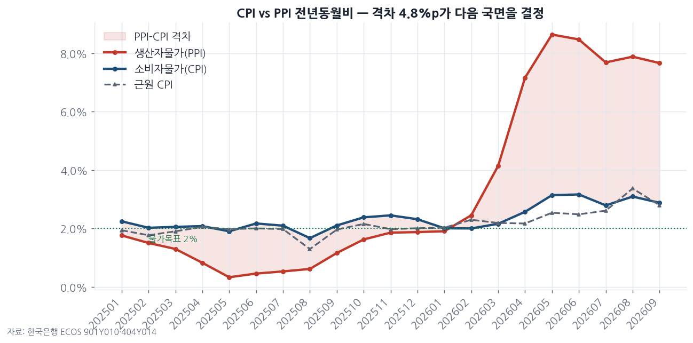

### 4-3. 원자재 (2026-10-22, 일간 종가)

| 품목 | 현재 | YTD | 1년 |
|---|---|---|---|
| Brent | $111.6 | **+83.7%** | +72.0% |
| WTI | $99.4 | **+73.4%** | +62.8% |
| 금 | $4,108 | -5.1% | +2.3% |
| 구리 | $6.47 | +14.6% | +28.1% |

> **인사이트 ⑤ (가장 중요)** CPI(2.9%)와 PPI(7.7%)의 **4.8%p 격차**가 핵심 리스크다.
> 생산자물가는 통상 2~3분기 시차로 소비자물가에 전이된다. 지금 CPI가 안정적인 건
> 기업이 **마진을 깎아 흡수**하고 있기 때문(채산성 BSI 79, 판매가격 BSI 98).
> 두 갈래뿐이다 — (A) 기업이 전가 → CPI 재상승 → 추가 긴축, (B) 전가 실패 → 기업 이익 훼손.
> **어느 쪽이든 주식 밸류에이션에는 악재**다. 유가 +84% YTD가 이 압력의 근원.

---

## 5. 금리 — 2연속 인상, 그리고 평탄해지는 커브

### 5-1. 국내 금리 (%)

| 시점 | 기준금리 | 가계대출 | 기업대출 | 주담대 | 가계 스프레드 |
|---|---|---|---|---|---|
| 2026.03 | 2.50 | 4.51 | 4.14 | 4.34 | 2.01 |
| 2026.06 | 2.50 | 4.50 | 4.27 | 4.36 | 2.00 |
| 2026.07 | **2.75** | 4.64 | 4.20 | 4.48 | 1.89 |
| 2026.08 | **3.00** | **4.76** | 4.30 | **4.66** | 1.76 |

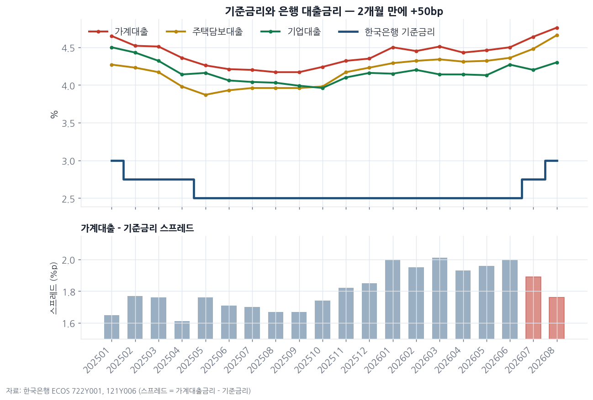

### 5-2. 주요국 정책금리 (%, 2026.09)

| 미국 | 유로 | 일본 | 중국 | 한국 |
|---|---|---|---|---|
| 3.88 | 2.50 | **1.25** | 3.00 | 3.00 |

### 5-3. 미국채 커브 (2026-10-22)

| 지표 | 현재 | YTD 변화 |
|---|---|---|
| 5년물 | 4.93% | +1.20%p |
| 10년물 | 4.93% | +0.93%p |
| 30년물 | 5.43% | +0.56%p |
| **30y-5y** | **0.49%p** | **-0.63%p** |

30y-5y 월평균: 2025.09 1.09 → 2026.06 0.73 → 2026.09 0.57 → 2026.10 **0.56**

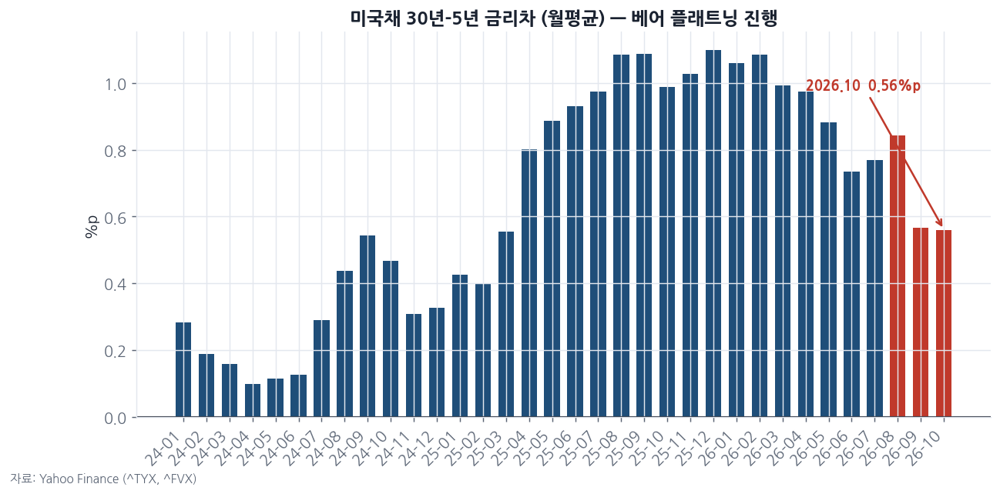

> **인사이트 ⑥** 한국은 2개월 만에 50bp 인상, 일본은 0.75→1.25%로 정상화 진행.
> **미국 커브의 베어 플래트닝**(단기금리가 장기보다 빠르게 상승)은 전형적인 **긴축 후반부** 신호다.
> 동시에 **가계대출 스프레드 축소(2.01→1.76)** — 은행이 기준금리 인상을 다 전가하지 못하고 있다.
> 이는 대출 수요 둔화의 방증이며, 내수 위축으로 연결된다.
> **할인율이 오르는 국면에서 고멀티플 자산은 구조적으로 불리하다.** 안전마진의 폭을 넓혀야 할 때.

---

## 6. 환율·대외부문 — 원화 강세의 진짜 이유

### 6-1. 원/달러 vs 달러인덱스

| 시점(월평균) | USD/KRW | 달러인덱스 |
|---|---|---|
| 2025.12 | 1,465.4 | 98.54 |
| 2026.03 | 1,485.1 | 99.48 |
| 2026.06 | 1,528.1 | 100.32 |
| 2026.09 | 1,358.3 | 100.03 |
| 2026.10 | **1,339.5** | 102.04 |

현재(10/22): **1,323원**, YTD **-8.4%**(원화 강세). 달러인덱스는 같은 기간 **+3.1%**(달러 강세).
일간 변화율 상관계수 최근 250일: **-0.01** (사실상 무상관).

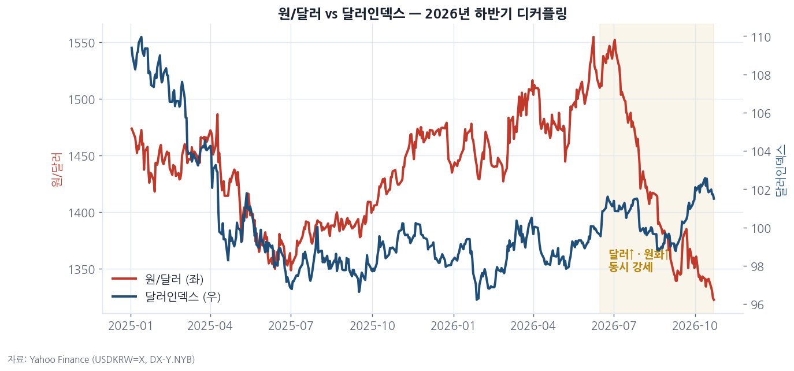

### 6-2. 국제투자대조표 (백만달러)

| 분기 | 대외금융자산 | 대외금융부채 | 순대외금융자산 |
|---|---|---|---|
| 2025Q2 | 2,669,933 | 1,663,166 | 1,006,767 |
| 2025Q4 | 2,867,609 | 1,981,930 | 885,678 |
| 2026Q1 | 2,882,591 | 2,129,040 | 753,551 |
| 2026Q2 | 3,084,253 | **3,020,204** | **64,049** |

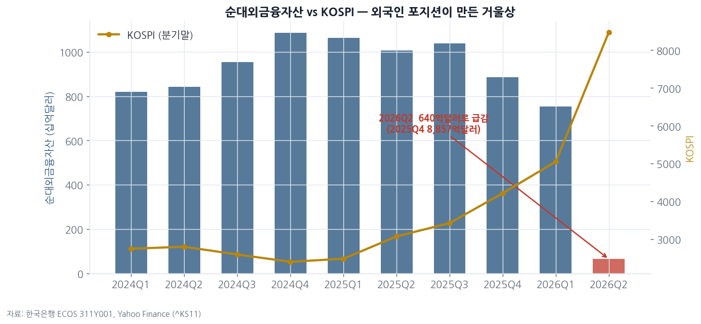

> **인사이트 ⑦** 달러가 강해지는데 원화도 강해졌다 — 교과서를 벗어난 움직임이고, 원인은 **수급**이다.
> 월 350억 달러 무역흑자 + 외국인의 한국 자산 대량 매입(대외금융부채가 한 분기 만에 2조1,290억 → 3조202억 달러, +8,912억 달러).
> 그런데 **순대외금융자산이 1조 달러 → 640억 달러로 붕괴**했다.
> 이는 한국 자산(주로 주식)의 **외국인 보유 평가액이 폭증**했다는 뜻이고,
> 실제로 KOSPI는 6월 8,484 고점 후 10월 5,539로 **-35%** 조정받았다.
> **되돌림이 시작되면 외국인 환매 → 원화 약세 → 환차손 가중**의 악순환이 열려 있다.
> 지금의 원화 강세는 구조적 체력이 아니라 **포지션의 결과**로 보는 것이 안전하다.

### 6-3. 자산시장 (2026-10-22)

| 지표 | 현재 | 1M | 3M | YTD |
|---|---|---|---|---|
| S&P500 | 7,712.6 | +0.1% | +3.8% | +12.5% |
| KOSPI | 5,539.2 | **-21.8%** | -8.0% | +28.5% |
| 금 | $4,108 | -4.9% | +1.7% | -5.1% |
| Brent | $111.6 | +8.3% | +32.7% | +83.7% |

---

## 7. 종합 판단 — 안전마진 관점

### 지금 시장이 가격에 반영한 것
반도체 슈퍼사이클, 사상 최대 무역흑자, 명목 GDP +26%.

### 데이터가 말하는 것
1. **성장의 질이 가격효과**다 — 실질 +3.8% vs 명목 +26%. 디플레이터 +21.6%는 정상이 아니다.
2. **심리가 먼저 돌아섰다** — 제조업 BSI 103.8→99.5, 판매가격 BSI 110→98.
3. **마진 압박이 시작됐다** — PPI 7.7% vs CPI 2.9%, 채산성 BSI 79.
4. **긴축은 진행 중이다** — 기준금리 3.0%(2개월 +50bp), 미국 커브 베어 플래트닝.
5. **포지션이 과밀하다** — 순대외금융자산 1조 → 640억 달러, KOSPI 고점 대비 -35%.

### 체크리스트 (다음 분기 확인 항목)

| 지표 | 현재 | 경계 수준 | 의미 |
|---|---|---|---|
| 수출 단가 yoy | +43.2% | <+10% | 가격효과 소멸 |
| 제조업 판매가격 BSI | 98 | <95 | 디플레 압력 |
| CPI 총지수 yoy | 2.88% | >3.5% | 추가 인상 |
| 30y-5y | 0.49%p | <0 | 역전 = 경기침체 신호 |
| 무역수지 | +348억$ | <+150억$ | 흑자 사이클 종료 |
| 순대외금융자산 | 640억$ | 마이너스 | 외국인 포지션 극단 |

### 결론
> 명목 지표의 호황은 **교역조건이라는 일시적 선물**이고, 그 선물은 이미 돌아서는 중이다.
> 실질 성장(3.8%)·내수(소비 +2.4%)·건설(-3.7%)이 말하는 한국 경제의 기초체력은 평범하다.
> **지금 필요한 것은 더 높은 목표주가가 아니라 더 넓은 안전마진이다.**
> 특히 2026년 명목 이익을 정상 이익으로 가정한 밸류에이션은 위험하다 — 분모(할인율)는 오르고 분자(이익)는 가격효과에 기대고 있다.

---

### 데이터 출처와 작성 기준
- 모든 수치는 **한국은행 ECOS OpenAPI** 원데이터를 직접 조회해 산출했다. 분기 지표 최신 시점은 2026Q2, 월 지표는 항목별로 2026.08~09이 혼재한다(수출입지수만 09월 공표).
- 성장 기여도 = 항목 증감 ÷ 직전분기 실질 GDP. 수출 단가 = 수출금액지수(403Y001) ÷ 수출물량지수(403Y002).
- 사용 통계표: 200Y103·200Y104·200Y107·200Y108(GDP), 901Y121·403Y001·403Y002·403Y005(수출입), 512Y013(BSI), 511Y002(CSI), 901Y010·404Y014(물가), 722Y001·121Y006·902Y006(금리), 311Y001(국제투자대조표).
- 시장 데이터(미국채·환율·원자재·지수)는 Yahoo Finance 2026-10-22 종가 기준.
- 차트 13종은 matplotlib으로 직접 생성했다.
