> 한국은행 보도자료 · 거시지표 · 15개 ETF 차트추세 · 내 연금/ISA 포트폴리오를 하나로 묶은 **주간 통합 리포트**입니다.
> 데이터 기준 — 2026-10-22 ~ 2026-10-29. 개인 포트폴리오는 **비중(%)·수익률(%)만** 공개합니다.

## 1. 이번 주 요약

**이번 주를 한 문장으로 줄이면: 완화를 기대하던 쪽이 양국에서 동시에 틀렸다.**

1. **한국은행은 만장일치로 3.00% 동결했지만 이것은 완화가 아니다.** 7·8월 연속 인상 후 첫 유보였는데, 총재는 "긴축 기조 지속"을 명시했고 성장·물가 전망 상향까지 예고했다. 닷새 뒤 나온 3분기 GDP가 전기비 **+1.0%**(8월 전망 +0.3%의 3배 이상)로 그 명분을 확정해줬다. 11월 26일 인상이 테이블 위에 올라왔다.
2. **미국도 같은 방향이었다.** FOMC는 3.75~4.00%를 동결했지만 **반대표 2개가 모두 "인상" 주장**이었고, 의장은 포워드 가이던스를 명시적으로 거부했다. 동결의 내용물이 비둘기가 아니다.
3. **그런데 성장 둔화 우려 쪽 근거는 오히려 되돌려졌다.** LEI 6개월 변화율이 △1.1%에서 **+0.6%**로 플러스 전환했고, 소비자신뢰는 4개월 만에 **91.7**(+7.5p)로 반등, 신규 실업수당 청구는 **19.4만건**으로 3개월 최저다. 장단기 금리 역전도 해소됐다(10년-2년 +38bp). 남은 압력은 **WTI 101.48달러·브렌트 110.28달러**라는 단일 공급 경로뿐이다.
4. **시장은 올랐는데 추세는 그대로다.** 15개 ETF 중 11종목이 주간 상승했고 일봉 데드크로스는 9건에서 **0건**으로 사라졌다. 그러나 **주봉은 15종목 전부 역배열**이고 주봉 골든크로스는 0건, 월봉은 15종목 전부 최근 10개월 안에 데드크로스를 냈다. 반등이 가격 위치만 올리고 이동평균 구조는 건드리지 못했다.
5. **내 포트폴리오는 2주간 정지했지만(+0.35% → △0.15%) 구성은 처음으로 갈라졌다.** 보유 주식 ETF 5종 가운데 **미국배당다우존스만** 밸류(이익수익률 5.5% > 미 10년물 5.05% > 예금 3.5%)와 추세(유일한 일봉 비약세·유일한 월봉 강세·주봉 전환 1순위) 양쪽에서 동시에 합격했다. 서로 독립된 두 방법이 같은 종목을 가리킨 첫 사례다. 반대로 ISA는 △18.42%로 4회 연속 악화됐고 현금은 3.6% → **2.7%**로 더 줄었다.

> **한 줄 선언** — 현재는 **4단계 과열 국면의 후반, 물가 압력이 에너지·운임이라는 공급 경로로 단일화된 「비용 충격 단독형」 구간**이며, 핵심 변수는 **100달러대에 고착된 유가가 12월 인상을 강제하는지 여부**다. 포트폴리오 관점에서 이번 주의 결론은 하나다 — **내 손실 자산의 3분의 1이 "금리 인하"에 걸려 있는데, 한·미 양국 중앙은행이 같은 주에 그 베팅을 부정했다.**

---


## 2. 한국은행 보도자료 분석

### 이번 주 주요 발표 (2026.10.22 ~ 10.29)

> 지난주와 달리 **이번 주는 한은 일정이 몰린 주간**이었다. 10월 금융통화위원회(10.22), 3분기 GDP 속보치(10.27), 10월 소비자동향조사(10.27), 10월 기업경기조사·ESI(10.29)가 연달아 나왔다. 한 주 안에 "금리 결정 → 실물 성적표 → 심리 지표"가 모두 확인된 드문 주다.

| 제목 | 발표일 | 핵심수치 | 중요도 | 시사점 |
|---|---|---|---|---|
| 통화정책방향 결정(10월 금통위) | 2026.10.22 | 기준금리 연 **3.00% 동결**, 금통위원 **7명 만장일치** | ★★★★★ | 7·8월 연속 인상 후 첫 숨 고르기. 총재는 "긴축 기조 지속" 명시 — **매파적 동결** |
| 2026년 3/4분기 실질 국내총생산(속보) | 2026.10.27 | 전기비 **+1.0%**, 전년동기비 **+3.4%**(8월 전망 +0.3%의 3배 이상), 실질 GDI 전기비 **+3.4%** | ★★★★★ | 성장 서프라이즈. 11월 수정 경제전망 상향과 **11월 인상 명분**을 동시에 제공 |
| 2026년 10월 소비자동향조사 | 2026.10.27 | CCSI **105.4**(-1.2p), 기대인플레이션(1년) **2.7%**(4개월째 동일), 물가인식 **2.9%**(-0.1%p) | ★★★☆☆ | 증시 조정·중동 불확실성으로 한 달 만에 하락 전환. 다만 기준선 100 위 유지 |
| 2026년 10월 기업경기조사 결과 및 ESI | 2026.10.29 | 전산업 CBSI **104.2**(+5.1p, 2022.8 이후 최고), 제조업 **105.6**(+6.1p), ESI **100.8**(+0.9p) | ★★★★☆ | 기업 체감경기 4년여 만에 100선 회복. 중소기업(+11.2p)·내수기업(+8.1p) 반등폭이 더 큼 |
| (직전주 참고) 2026년 9월 생산자물가지수(잠정) | 2026.10.21 | 전월비 **+0.2%**(2개월 연속 상승), 전년동월비 **+7.7%**(8월 7.9%) | ★★★☆☆ | 7%대 PPI는 여전히 높다. 소비자물가로의 비용 전가 압력이 남아 있음 |

> **수집 방법 고지**: 한은 보도자료 목록 페이지(`newsData/list.do`)는 이번 주에도 JS 렌더링으로 **게시물 0건**이 반환되어 직접 수집에 실패했다(fetch MCP도 robots.txt 접근 실패). 위 표는 WebSearch + KDI 경제정보센터의 한은 자료 재게시 페이지 + 언론 보도(파이낸셜뉴스·글로벌이코노믹·뉴스1·데일리안·뉴데일리 등) 교차확인으로 재구성했으며 **누락된 발표가 있을 수 있다**. 원문 PDF는 확인하지 못했다. 한은 통계 보도자료는 전일 오후 배포·익일 조간 엠바고 관행이 있어, 언론 보도일(10.26, 10.28)과 자료상 발표일(10.27, 10.29)이 하루 차이 날 수 있다. 표는 자료상 발표일 기준이다.

### 2-1. 10월 금통위 — "매파적 동결", 만장일치 3.00%

**이 자료가 뭔가**: 금통위는 연 8회 열려 기준금리를 정한다. 기준금리는 은행이 한은과 거래할 때 쓰는 기준이 되는 이자율이고, 예금·대출·채권 금리의 출발점이다.

기준금리는 **연 3.00%로 동결**됐다. 7월·8월 각 25bp 인상 이후 첫 멈춤이고, 의결은 **총재 포함 7명 만장일치**였다. 소수의견은 없었다.

신현송 총재 기자간담회 요지는 다음과 같다.

- 동결을 **"호미질의 결실"**로 표현했다. 8월에 "가래로 막을 것을 호미로 막았다"고 했던 표현의 연장으로, 7·8월 선제 인상 덕에 시장 압력이 아니라 **국내 여건에 맞춰** 정책을 운용할 여력이 생겼다는 뜻이다.
- **"성장·물가의 상방 위험이 8월 전망 때보다 커졌다"**고 했다. 다만 3분기 GDP와 10월 물가를 확인하고 움직여도 늦지 않다고 판단했다고 설명했다.
- **긴축 기조는 지속**하겠다고 명시했다. 물가가 목표로 안정적으로 수렴한다는 확신이 들 때까지 대응하겠다는 것이다.
- 만장일치를 완화 신호로 읽지 말라고 선을 그었다. "소수의견으로 소통하는 방식은 이제 그렇게 받아들일 필요가 없다"고 답했다.
- 성장률은 올해·내년 모두 8월 전망치(**3.3%**, **2.9%**)를 **상당폭 상회**할 것으로 봤다. 공식 수정은 11월 회의일에 공표한다.
- 내년 **근원물가도 기존 전망 2.5%를 상회**할 것으로 봤고, 물가가 2% 목표에 근접하는 시점은 내후년쯤으로 제시했다.
- 올해 통관 수출 **1조달러**, 경상수지 흑자는 기존 전망 **4,500억달러를 상회**할 것으로 전망했다.
- 최종금리는 제시하지 않았다. 다만 AI發 생산성 개선이 장기 성장률과 **중립금리를 끌어올릴 수 있다**고 언급해, 금리의 천장이 높아질 가능성을 열어뒀다.

**해석.** "동결"이라는 단어만 보면 완화지만, 문장을 다 읽으면 반대다. ① 상방 위험 확대 인정, ② 긴축 지속 명시, ③ 전망 상향 예고, ④ 중립금리 상승 가능성 언급 — 네 가지가 모두 한 방향을 가리킨다. 10월 동결은 **인상 사이클의 종료가 아니라 데이터 확인을 위한 1회 유보**로 읽는 것이 자연스럽다.

### 2-2. 3분기 GDP 속보치(10.27) — 전망의 3배, 그런데 민간소비는 역성장

**이 자료가 뭔가**: 분기 GDP 속보치는 그 분기 경제가 얼마나 커졌는지 가장 먼저 나오는 숫자다. "전기비"는 직전 분기 대비 성장률로, 경기의 방향과 속도를 본다.

3분기 실질 GDP는 **전기비 +1.0%, 전년동기비 +3.4%**였다. 한은이 8월에 제시한 3분기 전망 +0.3%의 **3배를 넘는 서프라이즈**다. 1분기 +1.8%, 2분기 +0.6%에 이어 다시 1%대다.

| 지출 항목 | 전기비 | 내용 |
|---|---|---|
| 민간소비 | **-0.2%** | 승용차·가전 등 재화, 금융·음식숙박 등 서비스 감소 |
| 정부소비 | +1.9% | 물건비·건강보험급여 중심 |
| 건설투자 | +0.7% | 토목 중심 |
| 설비투자 | **+4.1%** | 반도체 제조용 기계 주도 |
| 지식재산생산물투자 | +2.3% | — |
| 수출 | +2.3% | 반도체·기계류 및 전기전자기기 |
| 수입 | +2.4% | 원유·반도체 장비 |

생산 측면에서는 제조업 +2.0%, 건설업 +2.0%, 전기가스수도 +3.7%, 농림어업 +5.9%였고 **서비스업은 +0.2%**에 그쳤다(사업서비스 +3.9%, 운수 +1.4%, 도소매·숙박음식 -0.4%, 금융보험 -4.3%).

실질 GDI는 **전기비 +3.4%, 전년동기비 +18.8%**로 GDP 성장률을 크게 웃돌았다. 교역조건(수출가격÷수입가격)이 개선된 덕이다. 한은 관계자는 4분기가 전기비 **1.4% 이상**이면 연간 성장률이 4%를 넘길 수 있다고 설명했다.

**해석.** 성장의 질이 갈린다. 숫자를 만든 것은 반도체 설비투자(+4.1%)와 수출(+2.3%)이고, **민간소비는 2022년 4분기 이후 처음으로 전기비 감소(-0.2%)**했다. 교역조건이 밀어올린 GDI 급증은 기업 이익에는 좋지만 가계로는 아직 전달되지 않았다는 뜻이기도 하다. "경제는 좋은데 체감은 나쁘다"는 괴리의 근거가 이 표 안에 있다. 금통위 입장에서는 성장 상향 명분이 되고, 가계 입장에서는 금리 인상이 더 아픈 구간이다.

### 2-3. 10월 소비자동향조사(10.27) — 심리는 한 달 만에 하락 전환

**이 자료가 뭔가**: CCSI(소비자심리지수)는 가계 2,500곳 안팎에 "살림살이, 경기, 물가가 어떨 것 같냐"를 물어 만든 지수다. 100보다 크면 장기평균(2003.1~2025.12)보다 낙관적이라는 뜻이다.

10월 CCSI는 **105.4로 전월 대비 1.2p 하락**했다. 9월(106.6) 상승을 한 달 만에 되돌렸지만 기준선 100은 유지했다. 한은은 **국내 증시 조정과 중동 지역 충돌 지속**으로 비관적 경기 전망이 늘어난 것을 원인으로 설명했다.

| 세부 지수 | 10월 | 전월비 |
|---|---|---|
| 현재생활형편 | 93 | +1p |
| 생활형편전망 | 97 | -1p |
| 가계수입전망 | 101 | -1p |
| 소비지출전망 | 109 | -1p |
| 현재경기판단 | 82 | -1p |
| 향후경기전망 | 88 | -2p |
| 취업기회전망 | 86 | 하락 |
| 금리수준전망 | 127 | 하락 |
| 주택가격전망 | 124 | 하락 |

물가 쪽은 **지난 1년 물가인식 2.9%(-0.1%p)**, **향후 1년 기대인플레이션 2.7%(4개월 연속 동일)**였다.

**해석.** GDP가 +1.0%인 분기에 소비심리는 떨어졌다. 2-2의 민간소비 -0.2%와 정확히 같은 이야기를 한다. 기대인플레이션 2.7%가 **네 달째 꿈쩍 않는다**는 점이 한은에게는 더 중요하다. 목표 2%보다 0.7%p 높은 수준에 고착돼 있으면 "인상 종료"를 선언하기 어렵다. 금리수준전망(127)이 떨어진 것은 가계가 추가 인상 가능성을 조금 낮게 본다는 뜻인데, 이는 총재 발언과 반대 방향이라 **가계 기대와 한은 의도 사이에 간극**이 있다.

### 2-4. 10월 기업경기조사·ESI(10.29) — 체감경기 4년 만에 100선 회복

**이 자료가 뭔가**: CBSI는 기업에 업황·매출·채산성 등을 물어 만든 지수다. ESI는 여기에 소비자 심리를 합쳐 경제 전체의 심리를 본다. 둘 다 100이 장기평균이다.

10월 전산업 CBSI는 **104.2로 전월 대비 +5.1p**, 2022년 8월 이후 가장 높고 기준선 100을 넘은 것은 2022년 9월 이후 4년여 만이다.

- 제조업 CBSI **105.6**(+6.1p): 제품재고 감소가 +3.5p 기여, 생산 +1.1p, 자금사정 +0.9p, 신규수주 +0.8p
- 비제조업 CBSI **103.2**(+4.3p): 채산성·매출 개선이 주도
- 규모별: 중소기업 **105.6**(+11.2p), 대기업 **105.1**
- 유형별: 내수기업 **103.8**(+8.1p), 수출기업 **106.1**(+1.8p)
- 다음 달 전망: 전산업 **101.8**(+2.2p), 제조업 103.0(+1.9p), 비제조업 101.0(+2.4p). 단 **수출기업 전망은 104.4로 -1.4p 하락**
- ESI **100.8**(+0.9p), 순환변동치 **100.1**(+1.0p)

상승 배경으로는 9월 추석 연휴·완성차 파업 여파 소멸에 따른 기저효과, 그리고 반도체·자동차·조선 등 주력 산업의 생산·투자 확대가 꼽혔다.

**해석.** 수치 자체는 강하지만 두 가지 단서를 달아야 한다. 첫째, **9월이 추석·파업으로 눌린 달**이었다는 점에서 상승폭 5.1p의 일부는 기저효과다. 둘째, 중소·내수기업의 반등폭이 큰 것은 "반도체 온기 확산"으로 읽히지만 **아직 한 달치 데이터**다. 반대로 수출기업의 다음 달 전망만 하락(-1.4p)한 것은 눈여겨볼 대목으로, 원화 강세 용인 기류(2-1 참조)와 묶어서 보면 수출 채산성에 대한 경계가 먼저 반응했을 가능성이 있다.

### 2-5. 원화 — 총재가 "저평가"를 공식 언급했다

총재는 BIS 실질실효환율(REER)을 근거로 **원화가 역사적 평균 대비 여전히 상당히 저평가**돼 있다고 말했다. 8월 말 기준 REER은 **89**로 평균 **101**을 크게 밑돈다. 초여름의 고환율을 "비정상", 최근의 빠른 하락을 "비정상을 되돌리는 과정"으로 규정했다. 환율이 10% 하락하면 소득 1분위 가계의 구매력이 **0.4% 이상** 개선된다는 추정도 제시했다. 다만 역사적 평균까지 돌아갈 필요는 없다고 덧붙이고 환율의 **예측 가능성**을 강조했다.

**해석.** 중앙은행 총재가 자국 통화의 저평가를 공개적으로 말하는 것은 드물다. 이는 **원화 강세를 방어하지 않겠다**는 신호에 가깝다. 수입물가·물가안정·가계 구매력에는 유리하고, 환율 수혜에 의존해온 수출기업 마진에는 불리하다.

### 수집 불가 항목

- 한은 보도자료 목록 직접 수집(JS 렌더링, fetch MCP는 robots.txt 접근 실패) — 금주 전체 발표 목록 확정 불가, nttId 미확인
- 10월 금통위 **통화정책방향 의결문 원문**과 **의사록**(의사록은 통상 2주 후 공개, 미공개)
- 2026년 9월 **금융기관 가중평균금리**(통상 월말 발표, 금주 공개 여부 확인 불가 — 8월분은 대출금리 연 4.40%, 저축성수신 3.21%)
- 2026년 9월 **무역지수 및 교역조건**(8월분까지만 확인: 순상품교역조건 전년비 +27.1%, 지수 119.90)
- 10월 **외환보유액**(11월 초 발표 예정), 3분기 자금순환·국제투자대조표(미발표)
- 10월 금통위 당일 **원/달러 환율 종가** 및 금주 국고채 금리 레벨(한은 자료로 미확인)

### 이번 주 시사점 요약 (안전마진 관점)

1. **"동결"을 완화로 읽으면 안 된다.** 만장일치 동결 + 긴축 기조 지속 명시 + 성장·물가 전망 상향 예고는 **11월 26일 3.25% 인상**을 가리킨다. 3분기 GDP +1.0%는 그 명분을 확정해줬다. 할인율이 내려갈 근거는 이번 주에 오히려 줄었다.
2. **채권은 듀레이션을 늘릴 때가 아니다.** 총재가 AI發 중립금리 상승 가능성까지 언급한 만큼, 금리의 천장을 과거 기준으로 잡는 베팅은 위험하다. 단·중기 중심 방어적 운용을 유지한다.
3. **국내 주식은 "지수"가 아니라 "업종"으로 갈린다.** 설비투자 +4.1%·수출 +2.3%는 반도체·장비·조선·자동차의 숫자이고, 민간소비 -0.2%와 도소매·숙박음식 -0.4%, 금융보험 -4.3%는 내수·금융의 숫자다. 지수 상승을 전제로 한 일괄 매수보다 **현금흐름이 실제로 개선되는 업종**에 집중한다.
4. **원화 강세는 양날의 칼이다.** 총재의 "저평가" 발언은 원화 절상 용인 신호다. 수입물가·내수 구매력에는 긍정, 수출기업 환산 이익에는 부정이다. 10월 CBSI에서 **수출기업 다음 달 전망만 하락**한 것이 이 리스크의 첫 신호일 수 있다. 환율 가정을 보수적으로 두고 수출주 밸류에이션을 다시 계산한다.
5. **다음 확인 포인트**: ① 11월 초 10월 소비자물가(한은이 기다린다고 명시한 데이터), ② 11월 26일 금통위 + **수정 경제전망**(성장률 3.3% → 상향폭, 내년 근원물가 2.5% → 상향폭), ③ 11월 초 공개될 10월 금통위 의사록(만장일치 뒤의 논의 온도), ④ 9월 가중평균금리와 가계대출 금리 — 7·8월 인상의 실제 전가 속도.

### 참고 링크

- 한국은행 보도자료 목록(수집 실패, JS 렌더링) — https://www.bok.or.kr/portal/singl/newsData/list.do?pageIndex=1&menuNo=201150&pageUnit=100
- (교차확인) 10.22 기준금리 동결·총재 간담회 종합 — https://www.fnnews.com/news/202610221300213740
- (교차확인) 10.22 "호미질의 결실"·원화 저평가 발언 — https://www.g-enews.com/article/Finance/2026/10/202610221152316837bb91c46fcd_1
- (교차확인) 10.22 금통위원 7명 만장일치 동결 — https://www.news1.kr/economy/trend/6328323
- (교차확인) 10.22 매파적 동결 평가 — https://www.topdaily.kr/articles/112452
- (교차확인) 3분기 GDP 속보치 +1.0% — https://www.dailian.co.kr/news/view/1706440
- (교차확인) 3분기 GDP 설비투자 +4.1%·민간소비 -0.2% — https://news.jkn.co.kr/post/1051908
- (교차확인) 10월 소비자동향조사 CCSI 105.4 — https://www.fnnews.com/news/202610261655342974
- (원자료 재게시) 2026년 10월 소비자동향조사 결과(한은 경제심리조사팀) — https://eiec.kdi.re.kr/policy/materialView.do?num=288557
- (교차확인) 10월 기업경기조사 CBSI 104.2·ESI 100.8 — https://biz.newdaily.co.kr/site/data/html/2026/10/28/2026102800345.html
- (교차확인) 10월 기업 체감경기 4년 2개월 만에 최고 — https://www.ajunews.com/view/20261028160652962
- (교차확인) 9월 생산자물가 전월비 +0.2%·전년비 +7.7% — https://biz.newdaily.co.kr/site/data/html/2026/10/20/2026102000300.html

---

## 3. 거시지표 분석

### 3-1. 지표 현황 (2026년 44주차)

| 지표 | 최신값 | 이전값 | 변화 | 발표일 |
|---|---|---|---|---|
| **미 FOMC 정책금리** | **3.75~4.00% 동결** (찬성 10·반대 2, 쿡·해맥 인상 주장) | 3.75~4.00% | 9/16 인상 후 첫 동결 | 10-28 |
| 미국 LEI 선행지수 (9월) | **99.6 보합(0.0%)** | 99.5 (8월, △0.1%) | 6개월 변화율 **+0.6%** (직전 6개월 △1.1%) | 10-22 |
| 미국 동행 / 후행지수 (9월) | 115.3 (+0.3%) / 121.1 (+0.5%) | — | 동행 상승 지속 | 10-22 |
| 한국 선행 / 동행 순환변동치 (9월) | 미발표 (9월 산업활동 10/30 예정) | 약 104.6 / 102.0 (8월) | — | — |
| ISM 제조업 PMI (10월) | 미발표 (11/2 예정) | 54.5 (9월) | — | — |
| ISM 신규주문 / 가격 / 고용 (9월, 최신 확정) | 55.3 / **77.9** / 52.7 | 53.7 / 71.1 / 51.2 (8월) | +1.6 / +6.8 / +1.5p | 10-01 |
| **NAHB 주택시장지수 (10월)** | **29** (현재 33 / 기대 32 / 내방 18) | 32 (35 / 37 / 23) | **△3p**, 예상 31 하회 | 10-19 |
| 신규 실업수당 청구 (10/17주) | **19.4만** (4주평균 19.775만) | 20.0만 | △0.6만, 3개월 최저 | 10-22 |
| 연속 실업수당 청구 (10/10주) | 172.8만 (6주 최고) | 170.3만 | +2.5만, 보험실업률 1.1% 7주 연속 | 10-22 |
| **Core PCE (9월, 전월비 / 전년비)** | **미발표** (10/29 21:30 KST) | +0.2% / 3.0% (8월) | 컨센서스 +0.3% / 3.1%, 클리블랜드 연은 나우캐스트 +0.28% / 3.05% | 10-29 예정 |
| 헤드라인 PCE (전년비) | 미발표 | 3.4% (8월) | — | 10-29 예정 |
| 미 3분기 GDP 속보치 | 미발표 (10/29 동시 발표) | 2.2% (2분기 확정) | 애틀랜타 연은 GDPNow 3.3%, 필라델피아 연은 SPF 2.5% | 10-29 예정 |
| **미 소비자신뢰 (10월)** | **91.7** (현재 120.4 / 기대 72.6) | 84.2(수정) (111.8 / 65.7) | **+7.5p** (+8.6 / +6.9), 4개월 만의 반등 | 10-27 |
| 미 10년 / 2년 / 3개월 (재무부 고시) | **5.05% / 4.67% / 4.18%** | 5.10% / 4.77% / 4.28% (10/15) | △5 / △10 / △10bp | 10-28 |
| 10년-2년 / 10년-3개월 | **+38bp / +87bp** | +33bp / +82bp (10/15) | +5bp / +5bp | 10-28 |
| 미 30년물 | 5.37% | 5.42% (10/20) | 10/5 고점 5.66% 대비 △29bp | 10-28 |
| **마진데빗 (FINRA, 9월)** | **1조 4,800억달러** | 1조 4,540억달러 (8월) | **+1.8%(+260억달러), YoY +31%** (6월 기록 1조 5,020억달러 대비 △1.5%) | 10-23 |
| **WTI / 브렌트** | **101.48 / 110.28달러** | 101.41 / 109.86달러 (10/16 종가) | +0.1% / +0.4% (주중 고점 10/23 **103.27 / 116.72달러**, 브렌트는 4/29 이후 최고) | 10-29 조회 |
| 미 원유 생산 / 재고 | 1,367.9만b/d (10/9주, 직전 1,397.9만) / 4억 1,560만배럴 (10/9주) | 1,397.9만b/d / 4억 2,410만배럴 (10/2주) | 재고 △860만배럴 (출처 간 상충) | EIA 주간 |
| SCFI 컨테이너 운임 (10월 4주) | **3,681.34** | 3,679.58 (10월 3주) | +1.76p(+0.05%), 3주 연속 상승 (9/18 고점 3,687.83) | 10-25 보도 |
| 미 재고/매출 비율 (8월) | **1.33** | 1.40 (25년 8월) | YoY △0.07, 재고 2조 8,200억달러(+0.4% MoM) | 10-15 |
| **한국은행 기준금리** | **3.00% 동결** (금통위원 7명 전원 찬성) | 3.00% | 7/16·8/27 인상 후 2회 연속 동결 | 10-22 |
| **한국 수출 10월 1~20일** | **616.1억달러 (+105.4%)** | 261억달러 (+102%, 1~10일) | 반도체 **275억달러 (+222.5%, 비중 44.7%)**, 일평균 47.4억달러 | 10-21 |
| 한국 9월 산업생산 | 미발표 (10/30 예정) | 8월 전산업 △1.3%, 광공업 △4.8% (전월비) | — | — |
| 한국 국고채 10년 | 수집 불가 (출처 간 4.11% / 4.44% 상충) | 4.461% (9/22) | — | — |

**시세 (10/29 조회, 일부 장중)**: 브렌트 110.28달러 · 금 4,038.0달러/oz · 은 52.69달러/oz · 구리 6.6255달러/lb · 달러지수 102.24 · VIX 16.91(10/28) · 원/달러 1,336.6원 · S&P500 7,743.98(10/28) · 나스닥 26,549.85(10/28) · 코스피 5,929.98(10/29, 10/28 종가 6,012.44)

> **데이터 주의**: ① 9월 Core PCE와 3분기 GDP 속보치는 한국시각 10/29 21:30 발표로, 이 글 작성 시점에는 수치가 없다. 실질금리 계산은 8월 확정치(코어 3.0%)를 쓴다. ② SK하이닉스 3분기 실적·주주환원 규모는 매체별로 83조원/100조원 등 보도가 엇갈리며 공시 원문은 확인하지 못했다. ③ 코스피 10/28 외국인 순매수는 7,879억~1조 1,504억원으로 집계 시점에 따라 4천억원 이상 벌어진다. ④ EIA 주간 원유 재고는 API 집계와 섞여 보도돼 10/16주 이후 값은 확정하지 못했다. ⑤ 미 재무부 고시 금리와 Yahoo의 ^TNX는 집계 방식이 달라 소수점 수준에서 차이가 난다 — 표는 재무부 고시를 쓴다. ⑥ **유가는 이번 호부터 종가 기준으로 통일했다.** 지난 호의 WTI 95.65 / 브렌트 102.58달러는 10/16 장중값이고, 같은 날 종가는 101.41 / 109.86달러였다. 전주 대비 변화율이 지난 호 기준으로 보이는 것과 다른 이유다.

### 3-2. 주요 지표 심층 해석

**⓪ 연준 — 「동결」이지만 매파 2명이 인상에 반대표를 던진 동결**

10/28 FOMC는 3.75~4.00%를 유지했다. 지난 호가 "동결 우세"로 본 쪽이 맞았다. 다만 내용은 비둘기가 아니다. 표결이 찬성 10·반대 2였고 반대 2표(리사 쿡 이사, 베스 해맥 클리블랜드 연은 총재)가 모두 **25bp 인상을 주장한 매파 반대**였다. 연준이 한 방향 2표 반대를 받는 것은 흔치 않다. 성명은 "인플레이션은 여전히 높은 수준(Inflation remains elevated)"이며 "추가 정보 축적이 정책 기조 판단에 도움이 될 것"이라는 문구를 유지했다. 케빈 워시 의장은 기자회견에서 "위기 상황이 아닌 한 포워드 가이던스를 믿지 않는다"고 말해 다음 회의 신호를 의도적으로 지웠다. 9월 점도표는 연말 금리를 4.1~4.4%로 제시했고 시장은 2026년 중 1회(25bp) 추가 인상을 가격에 반영하고 있다. 즉 **"동결 = 긴축 종료"가 아니라 "동결 = 12월 인상 전 데이터 대기"**다. 금리는 즉각 반응했다 — 10년물이 10/27 4.99%에서 10/28 5.05%로 6bp, 2년물도 4.70%에서 4.67%로 엇갈리며 곡선이 다시 가팔라졌다(10년-2년 29bp → 38bp).

**① 미국 LEI 99.6 — 🟢 양호 (18개월 만에 하락 추세 종료)**

LEI는 미래 6~9개월 경기 방향을 보는 10개 선행지표의 합성지수다. 9월은 99.6으로 **전월비 0.0%(보합)**, 8월 △0.1%에서 하락을 멈췄다. 더 중요한 것은 6개월 변화율이 **+0.6%**로, 직전 6개월(△1.1%)에서 1.7%p 개선되며 플러스로 돌아섰다는 점이다. 컨퍼런스보드의 침체 경보 기준은 6개월 연율 변화율이 △4.1% 아래로 떨어지면서 확산지수가 50 미만인 경우인데, +0.6%는 그 기준에서 4.7%p 떨어져 있다. 플러스 기여는 금리 스프레드, 주당 제조업 근로시간, 선행신용지수였고 마이너스 기여는 소비자 기대, S&P500, 비국방 자본재 수주였다. 7월 자료도 상향 수정됐다. 동행지수는 115.3(+0.3%)으로 실물 활동이 꺾이지 않았음을 보여준다. **2024년 중반 이후 LEI를 근거로 한 "침체 임박" 논리는 이번 발표로 사실상 철회해야 한다.** 다음 발표는 11/19다.

**② 한국 선행지수 — 수집 불가 (9월분 10/30 발표 예정)**

8월 선행 약 104.6 / 동행 약 102.0이 마지막 확인값이다. 대신 실물 대용지표인 수출은 압도적이다. 10월 1~20일 수출이 616.1억달러(+105.4%)로 같은 기간 역대 최대이고, 반도체만 275억달러(+222.5%)로 전체의 **44.7%**다. 전년 동기 대비 반도체 비중이 16.2%p 올랐다. 조업일수(13일 vs 10.5일)를 보정한 일평균도 47.4억달러로 역대 최대다. 수입은 471억달러(+42.8%), 무역수지는 약 145억달러 흑자다. **수출 증가의 약 3분의 2를 반도체 한 품목이 만들고 있다**는 점이 기회이자 집중 위험이다.

**③ 제조업 — 🟡 중립 / 가격 🔴 매우 위험 (10월분 미발표로 9월값 유지)**

10월 ISM은 11/2 발표다. 9월 확정치 기준으로 헤드라인 54.5(9개월 연속 확장), 신규주문 55.3, 고용 52.7, 가격 **77.9**다. 가격지수 77.9는 50(가격 보합선)을 27.9p, 통상 "이례적 압력"으로 보는 70선을 7.9p 넘는다. 이 수치가 중요한 이유는 10월 중 WTI가 101달러로 올라섰기 때문이다. 9월 ISM 조사 기간(9월 중순) 이후 유가가 약 12% 더 올랐으므로 **11/2 발표될 10월 가격지수는 77.9에서 더 오를 쪽에 무게가 실린다.** 재고/매출 비율 1.33은 전년 동월(1.40)보다 0.07 낮고 2008년 금융위기 피크(1.48)·2020년 4월(1.67)과 비교하면 재고 부담이 가볍다 — 수요가 꺾여 재고가 쌓이는 전형적 침체 패턴은 아직 없다.

**④ NAHB 29 — 🔴 매우 위험 (14년 만의 최저, 서브지수 전부 악화)**

NAHB 주택시장지수는 건설업체 심리로, 50이 낙관·비관의 경계다. 10월 29는 경계선보다 **21p 아래**이고 9월 32에서 3p 더 떨어졌으며 예상치 31도 2p 밑돌았다. 2차 출처 기준 2012년 6월 이후 최저다. 서브지수 세 개가 모두 내렸다 — 현재 판매 33(△2p), 6개월 기대 32(△5p), 내방객 18(△5p). **기대지수가 현재지수보다 더 빠르게 꺾였다는 점**이 이번 수치의 핵심이다. 내방객 18은 50 기준선의 36% 수준으로, 실수요 자체가 끊겼다는 뜻이다. 가격을 깎은 업체 비중이 43%로 2020~2026년 중 최고였고 평균 인하폭 6%, 인센티브 제공 업체는 65%다. 원인은 금리다 — 10년물이 5.05%, 30년 모기지는 7.40% 수준(2차 출처)으로, 금리가 내려오지 않는 한 건설 심리가 40선을 회복할 경로가 보이지 않는다. 18개월 연속 40 미만이다.

**⑤ 물가 — 🟠 경고 (수치는 당일 발표 전, 유가가 상방 압력)**

9월 Core PCE는 이 글 작성 시점 미발표다. 컨센서스는 전월비 +0.3% / 전년비 3.1%, 클리블랜드 연은 나우캐스트는 +0.28% / 3.05%다. 8월 확정치는 +0.2% / 3.0%였다. 전월비 +0.3%는 연율 약 3.7%로, 연준 목표에 해당하는 월 +0.17%의 **1.8배**다. 지난 호에서 "9월 PCE에서 CPI의 상방 서프라이즈(헤드라인 3.7%, 코어 2.6%)가 확인되면 12월 인상이 기정사실"이라 적었는데, 그 판정일이 바로 오늘이다. 컨센서스대로 3.1%가 나오면 연준 목표(2.0%)보다 1.1%p 높아 8월(1.0%p)보다 격차가 벌어진다. 동시에 유가 경로가 더 나빠졌다 — 10월 WTI 월평균 수준이 101.62달러로 9월(90.42달러 월말)보다 뚜렷이 높아, **10~11월 헤드라인 물가에 에너지 기여가 다시 플러스로 들어온다.**

**⑥ 금리 스프레드 10년-2년 +38bp / 10년-3개월 +87bp — 🟡 중립 (역전 위험 2주 연속 후퇴)**

역전(0bp 미만)은 통상 3~6개월 뒤 침체의 선행 신호로 읽힌다. 10년-2년은 10/15 +33bp → 10/27 +29bp까지 좁혀졌다가 FOMC 당일 +38bp로 벌어졌다. 역전까지 38bp 여유로 지난 호(33bp)보다 5bp 넓다. 10년-3개월은 +87bp다. 이번 주의 특징은 **구간별로 방향이 갈렸다**는 것이다. 10/21 → 10/22 하루에 10년물이 5.13%에서 4.96%로 17bp, 2년물이 4.81%에서 4.65%로 16bp 급락했다(원인은 확인하지 못했다). 그 뒤 FOMC의 매파적 동결로 10년물만 5.05%로 되돌아왔다. 월간으로 보면 9월 말(10년 5.29%, 2년 4.88%)보다 10년 △24bp, 2년 △21bp로 **금리 레벨 자체는 내려왔다.** 30년물도 10/5 고점 5.66%에서 5.37%로 29bp 내렸다. 9월 말의 "장기금리 폭주"는 10월에 일단 진정됐다.

**⑦ 신규 실업수당 19.4만건 — 💚 매우 양호 (3개월 최저), 연속 청구만 경고**

10/17주 19.4만건으로 전주보다 6천건 줄었고 예상(20.0만)을 6천건 밑돌아 3개월 최저다. 4주 평균은 19.775만건으로, 침체 경계선으로 보는 27~30만건보다 **7.2~10.2만건 낮다.** 해고는 역사적 저수준이다. 다만 한 축이 계속 나빠지고 있다 — **연속 청구 172.8만건**은 전주보다 2.5만건 늘어 6주 최고이고, 지난 호(171.6만)보다도 1.2만건 많다. 보험실업률은 1.1%로 7주 연속 같다. **신규(해고)는 최저인데 연속(재취업)은 늘어나는 "저해고·저채용"**이 더 굳어졌다. 한번 실직하면 다시 취업하는 데 걸리는 시간이 길어지고 있다는 뜻이다. 다음 발표(10/24주)는 오늘 10/29이고 컨센서스는 19.9만건이다.

**⑧ WTI 101.48달러 / 브렌트 110.28달러 — 🔴 위험 (100달러대 고착, 급등은 끝나고 고점 횡보)**

먼저 기준을 바로잡는다. 지난 호가 쓴 "WTI 95.65 / 브렌트 102.58달러"는 10/16 장중 스냅샷이었고, **같은 날 종가는 이미 101.41 / 109.86달러로 WTI가 100달러선을 넘긴 뒤였다.** 즉 급등은 지난주에 일어났고, 이번 주는 그 레벨에서의 움직임이다. 종가 기준 주간 변화는 WTI +0.1%, 브렌트 +0.4%로 사실상 보합이다.

그래도 🔴를 유지하는 이유는 **레벨 자체**다. 브렌트 110.28달러는 2025년 4분기 평균(63.04달러)보다 **75% 높고**, WTI 4분기 진행 평균 101.62달러는 3분기(86.95달러)보다 16.9% 높다. 주중 경로를 보면 10/23 종가가 WTI 103.27 / 브렌트 116.72달러로 4/29 이후 최고를 찍었다가 10/29 110.28달러로 **△5.5% 되밀렸다.** 원인은 수요가 아니라 공급 프리미엄이다 — 호르무즈 해협 유조선 피격이 기록적 수준으로 늘어 10월 초 통항이 2개월 최저로 떨어졌고, 후티의 사우디 에너지 시설 공격이 겹쳤다. 다만 **실제 걸프 물량은 거의 줄지 않았다**는 분석이 복수로 나온다. 10/26 전후 미·걸프·테헤란 간 중재 진전 보도에 가격이 빠진 것이 그 증거다. 현재 유가의 상당 부분은 **보험료·운임 상승과 위험 프리미엄**이며, 협상 헤드라인 하나에 5~10달러씩 움직이는 구조다. 미국 생산은 10/9주 1,367.9만b/d로 직전 주(1,397.9만)보다 30만b/d 줄었다. **투자 판단에서 중요한 것은 "더 오르느냐"가 아니라 "100달러대가 몇 달 지속되느냐"다** — 지속되면 10~12월 헤드라인 물가에 에너지 기여가 계속 플러스로 들어온다.

**⑨ SCFI 3,681.34 — 🟠 경고 (고점 근처 횡보, 비용 압력 유지)**

SCFI는 상하이 출발 컨테이너 운임 지수로, 글로벌 공급망 비용의 대리지표다. 10월 4주 3,681.34로 전주보다 1.76p(+0.05%) 올라 3주 연속 상승이다. 7월 말부터 8주 연속 올라 9/18 3,687.83에서 고점을 찍은 뒤 9/30 3,662.30까지 밀렸다가 다시 고점 부근으로 복귀했다. **코로나 이전 정상 구간(1,000 내외)의 약 3.7배**다. 지난 호의 "수집 불가"에서 수치를 되찾았는데, 결론은 "완화 없음"이다. 홍해·호르무즈 우회 운항이 이어지는 한 운임이 내려올 경로가 없고, 가전·IT 완제품 원가에 지속적으로 반영된다.

**⑩ 소비자신뢰 91.7 — 🟠 경고 (급반등, 그러나 기대지수는 여전히 침체선 아래)**

9월 84.2(수정)에서 **7.5p 급등**해 91.7, 예상(약 81)을 10p 넘게 웃돌며 6월 이후 최고다. 4개월 만의 상승이다. 현재상황 120.4(+8.6p), 기대 72.6(+6.9p)로 소득·사업·고용 기대 세 항목이 모두 개선됐다. 반등의 직접 원인은 휘발유 가격이 9월보다 내린 것으로 컨퍼런스보드가 지목했다. **다만 두 가지가 반등을 깎아내린다.** 첫째, 기대지수 72.6은 컨퍼런스보드가 "향후 1년 내 침체" 신호로 보는 **80선을 7.4p 밑돌고 2025년 2월 이후 21개월 연속 80 미만**이다. 둘째, 향후 6개월 서비스·내구재 **지출 계획은 오히려 줄었다** — 심리는 올랐는데 지갑은 닫겠다는 응답이다. 현재-기대 괴리는 47.8p로 지난 호(45.7p)보다 2.1p 넓어졌다. 해석하면 "지금은 견딜 만한데 앞으로는 모르겠다"는 구도가 유지된 채 레벨만 올라간 것이다. 지난 호의 "🔴 2014년 이후 최저권"에서 한 단계 올리되 🟢까지는 가지 않는다.

**⑪ 마진데빗 1조 4,800억달러 — 🟠 경고 (사상 최고권이나 증가 속도는 꺾였다)**

9월 마진데빗(증권 담보 차입잔액)은 1조 4,800억달러로 8월(1조 4,540억달러)보다 260억달러(+1.8%) 늘었다. 6월 사상 최고(1조 5,020억달러) 대비로는 **1.5% 낮다.** 전년 동월 대비로는 **+31%**다. 중요한 것은 속도다 — 뱅크오브아메리카 분석에 따르면 전년비 증가율이 5월 53.7%에서 9월 31.4%로 **22.3%p 둔화**했다. 역사적으로 마진데빗의 YoY 증가율이 극단에서 꺾이는 시점은 시장 고점과 겹치는 경우가 많았다(2000년, 2007년, 2021년). 지난 호의 "한국 레버리지 청산 개시"에 이어, 미국도 **잔액은 최고권인데 증가가 멈추는 국면**에 들어섰다. 다만 FINRA 통계는 증권사 신용융자만 집계하고 은행 담보대출은 빠져 있어 실제 레버리지는 더 클 수 있다.

### 3-3. 경기 온도계 종합

| 🇺🇸 분야 | 강도 | 핵심 수치 | 🇰🇷 분야 | 강도 | 핵심 수치 |
|---|---|---|---|---|---|
| 선행지수 | 🟢 | LEI 99.6 보합, 6개월 +0.6% | 선행지수 | 수집 불가 | 9월분 10/30 발표 |
| 제조업 | 🟡 | ISM 54.5 (9월), 재고/매출 1.33 | 산업생산 | 수집 불가 | 8월 전산업 △1.3% |
| 고용 | 🟠 | 신규 19.4만 / 연속 172.8만(6주 최고) | 수출 모멘텀 | 💚 | 10/1~20 +105.4%, 반도체 비중 44.7% |
| 물가 | 🟠 | 코어 PCE 3.0%(8월), 9월분 당일 발표 | 내수 | 🔴 | 8월 소매 △1.8%, 설비투자 △9.5% |
| 주택 | 🔴 | NAHB **29** (내방 18) | 통화정책 | 🟡 | 3.00% 동결(7명 전원), 11/26 차기 |
| 소비심리 | 🟠 | 91.7 / 기대 72.6 (80 미만 21개월) | 시장 | 🟠 | 코스피 5,930 (10/28 +6.63%) |
| 통화정책 | 🟠 | 3.75~4.00% 동결, 매파 반대 2표 | 환율 | 🟢 | 원/달러 1,336.6 (9/29 1,350.5 대비 강세) |
| 금융·레버리지 | 🟠 | 10년 5.05%, 마진 1.48조달러(YoY +31%) | 금융여건 | 수집 불가 | 국고 10년 출처 상충 |
| 에너지·공급망 | 🔴 | **WTI 101.48**, SCFI 3,681 | — | — | — |

### 3-4. 경기 사이클 4단계 위치 진단

**판정: 4단계 「과열 국면」 후반 유지 — 단, 이번 주 구도는 "수요 둔화"에서 「공급·비용 충격 단독」으로 좁혀졌다**

지난 호는 "성장 둔화가 가격 지표에 처음 반영 (스태그플레이션 경계)"였다. 이번 주 데이터는 **그 '성장 둔화' 쪽이 상당 부분 되돌려졌다.** 근거 4가지.

1. **선행지표가 하락을 멈췄다.** LEI 6개월 변화율이 △1.1%에서 **+0.6%**로 플러스 전환했고 동행지수도 +0.3%다. 침체 경보 기준(6개월 연율 △4.1%)과는 4.7%p 떨어져 있다. 지난 호에서 "9월분 미발표"로 비워둔 칸이 채워졌는데, 방향은 개선이었다.
2. **소비자 심리가 반등했다.** 91.7(+7.5p)은 4개월 만의 상승이고 예상을 10p 이상 웃돌았다. 다만 기대지수 72.6은 침체선 80을 21개월째 밑돌고 지출 계획은 감소해 "완전한 회복"은 아니다.
3. **고용은 해고 없는 정체가 굳어졌다.** 신규 청구 19.4만건은 침체선보다 7.2~10.2만건 낮다. 반면 연속 청구 172.8만건은 6주 최고다. 확장도 수축도 아닌 동결 상태다.
4. **물가 압력은 공급 쪽 단독으로 커졌다.** WTI가 101.48달러로 100달러대에 자리를 잡았고(4분기 진행 평균 101.62달러, 3분기 86.95달러 대비 +16.9%) SCFI는 3,681로 고점권이다. ISM 가격 77.9(9월)가 10월에 더 오를 환경이다. **반면 임금(9월 3.0%)과 주택(NAHB 29)은 디스인플레 쪽이다.**

종합하면, 현재는 **"실물 활동은 멈추지 않았고, 물가 압력은 에너지·운임이라는 단일 경로로 들어오는"** 국면이다. 전형적 과열(수요 견인 인플레)도, 전형적 침체 진입(수요 붕괴)도 아니다. 연준이 인상도 인하도 하지 않고 "데이터 대기"를 택한 것은 이 구도와 정확히 일치한다.

**다음 단계 전환 조건**

- **→ 1단계(긴축 말기·둔화) 진입**: ① 10년-2년 스프레드 0bp 미만(현재 **+38bp**), ② 신규 청구 4주 평균 25만건 초과(현재 **19.775만건**), ③ ISM 신규주문 50 미만(현재 55.3). **현재 0개 충족.** 지난 호 대비 ①은 5bp 더 멀어졌고 ②도 청구가 줄어 멀어졌다. 선행 신호로는 연속 청구가 185만건을 넘는지를 본다(현재 172.8만, 여유 12.2만건).
- **→ 긴축 조기 종료(3단계 복귀)**: 9월·10월 Core PCE 전월비가 0.1% 이하로 이어지고 WTI가 85달러 아래로 내려오는 경우. **유가가 100달러를 넘은 지금은 두 조건 모두 반대 방향이다.**
- **→ 재가속(과열 심화)**: WTI 110달러 돌파 + 9월 Core PCE 0.3% 이상이면 12월 인상이 확정되고 10년물이 5.3%를 재돌파한다.

### 3-5. 미국 vs 한국 경기 온도 비교

| 구분 | 미국 | 한국 |
|---|---|---|
| 국면 | 실물 안정 + 에너지발 물가 압력 → 긴축 일시 정지 | 수출 초호황 + 내수 위축, 증시 급락 후 급반등 |
| 근거 | LEI +0.6%(6개월), 청구 19.4만, 소비자신뢰 91.7 / WTI 101.48 | 10/1~20 수출 +105.4%, 반도체 비중 44.7% / 8월 소매 △1.8% |
| 정책 | 3.75~4.00% 동결 (반대 2표 모두 인상), 12월 회의 12/8~9 | 3.00% 동결 (7명 전원), 차기 11/26 |
| 시장 | S&P500 7,744 (10/28), 나스닥 26,550, VIX 16.91 | 코스피 5,930 (10/29), 10/28 6,012.44 (+6.63%) |
| 장기금리 | 10년 5.05% (지난 호 대비 △5bp) | 수집 불가 |
| 환율 | 달러지수 102.24 (+0.4%) | 원/달러 1,336.6원 |

**디커플링 — 지난 호의 "실물 호황 vs 증시 투매"가 한 주 만에 봉합되는 중이다.** 코스피는 10/26 장중 5,469까지 밀려 6/22 고점(9,114.55) 대비 △40.0%를 찍은 뒤, 10/27 +3.1%, 10/28 **+6.63%(374.10p)**로 6,012.44에 마감해 10거래일 만에 6,000선을 회복했다. 이틀 연속 매수 사이드카가 발동했다. 반등의 트리거는 거시가 아니라 **개별 기업 이벤트**다 — SK하이닉스의 3분기 실적과 대규모 추가 주주환원 발표에 SK하이닉스가 +10.89%, 삼성전자가 +9.01% 올랐고, 외국인이 두 종목을 각각 약 3,859억원·3,748억원 순매수했다(유가증권시장 전체 외국인 순매수는 매체별 7,879억~1조 1,504억원). 개인은 약 1.8조원 순매도로 차익을 실현했다. 10/29은 5,929.98로 소폭 반락했다.

여기서 읽어야 할 것은 두 가지다. 첫째, **급락도 급등도 반도체 두 종목이 만들었다.** 9월 월평균 기준 삼성전자+SK하이닉스의 코스피 시총 비중이 약 52.8%(금융투자협회)이므로, 한국 증시는 사실상 반도체 사이클의 레버리지 상품이다. 둘째, **원화는 급락장에서도 강세를 유지했다.** 원/달러 1,336.6원은 9/29(1,350.5원)보다 원화가 1.0% 강하고, 7월 말(1,453.2원)보다는 8.0% 강하다. 달러지수가 같은 기간 100.8 → 102.24로 1.4% 올랐는데도 원화가 강했다는 것은 **무역수지 흑자(10월 1~20일만 145억달러)가 환율을 떠받치고 있다**는 뜻이다. 외국인 주식 매도가 환율로 번지지 않은 이유도 여기에 있다.

> **자산배분 시사점 한 줄**: 미국은 실물 안정 + 에너지발 물가, 한국은 수출 호조 + 내수 부진으로 **양국 모두 "성장"으로 단정하기 어려운 혼조**이므로, 위험자산 비중을 늘리기보다 현금·단기채(3개월 실질 +1.18%p)를 유지하고, 한국 노출은 반도체 쏠림(시총 52.8%)을 감안해 추격 매수를 삼간다.

### 3-6. 인플레이션 및 실질금리 환경

**인플레 국면: 「비용 충격형 재가열」 유지 (지난 호와 동일 등급, 원인은 더 단순해졌다)**

지난 호에서 "상품·에너지는 재가열, 서비스·임금은 둔화인 비용 충격형"이라 판정했는데, 이번 주에 그 구도가 더 선명해졌다. 상방은 WTI 101.48달러(4분기 평균 101.62달러로 3분기 +16.9%), 브렌트 110.28달러(2025년 4분기 평균 대비 +75%), SCFI 3,681(고점권)이다. 하방은 NAHB 29(주거비 선행 약화), 임금 3.0%(9월, 2021년 이후 최저권), 재고/매출 1.33(재고 압박 없음)이다. **수요가 끌어올리는 물가가 아니라 공급이 밀어올리는 물가**다. 이 구분이 중요한 이유는, 비용 충격형 인플레는 금리 인상으로 잡히지 않고 오히려 수요만 추가로 꺾는다는 점에 있다. 연준이 10월에 동결한 실질적 이유도 여기에 가깝다.

**실질금리** (재무부 10/28 고시, 코어 PCE 3.0%(8월 확정) 기준)

| 구간 | 명목 | 실질 | 지난 호 | 변화 |
|---|---|---|---|---|
| 10년 | 5.05% | **+2.05%p** | +2.10%p | △0.05%p |
| 3개월 | 4.18% | **+1.18%p** | +1.28%p | △0.10%p |
| 정책금리 (중간값) | 3.875% | **+0.875%p** | +0.875%p | 보합 |

장기 실질금리가 +2%p를 넘은 상태가 2주째 이어진다. 2003~2007년 평균(약 +2.0%p)과 비슷하고 2010~2021년 평균(약 +0.3%p)보다 1.7%p 높다. **성장주·부동산·금에는 역풍, 현금·단기채에는 순풍**이다. NAHB 29는 이 실질금리의 직접 결과물이다. 다만 소폭이지만 세 구간 모두 지난 호보다 낮아졌고, 9월 Core PCE가 3.1%로 나오면 장기 실질금리는 +1.95%p로 2%p를 밑돌게 된다.

**금 매력도: 🌟🌟 (2/5, 지난 호 2 유지)**

금은 4,038달러/oz로 10/16(4,181달러) 대비 △3.4%, 9월 말(4,186.7달러) 대비 △3.6%다. 4분기 진행 평균은 4,042달러로 3분기(4,258달러)보다 5.1% 낮다. 3축 평가는 ① **실질금리**: 장기 +2.05%p로 2%p 위 유지 → 역풍(△0.05%p 완화는 미미). ② **지정학**: 호르무즈 유조선 피격, 브렌트 110달러 → 순풍. 단 10/26 중재 진전 보도로 프리미엄이 깎이는 중. ③ **달러**: DXY 102.24(+0.4%) → 역풍. **순풍 1, 역풍 2**로 지난 호와 같다. 은은 52.69달러로 10/16(56.99달러) 대비 △7.5%, 금보다 2.2배 더 빠지며 산업금속 성격이 드러났다. 금/은 비율은 76.6배로 10/16(73.4배)보다 벌어졌다.

**금·구리·유가 조합 — 「비용 충격형」 심화**

| 원자재 | 10/16 | 10/29 | 변화 | 해석 |
|---|---|---|---|---|
| 금 (USD/oz) | 4,181 | 4,038 | △3.4% | 실질금리 +2.05%p와 달러 강세가 지정학 프리미엄을 압도 |
| 은 (USD/oz) | 56.99 | 52.69 | △7.5% | 산업 수요 비중이 커 금보다 낙폭 2.2배 |
| 구리 (USD/lb) | 6.53 | 6.6255 | **+1.5%** | 실물 수요는 꺾이지 않았다 (4분기 평균 6.64, 3분기 6.53 상회) |
| WTI (USD) | 101.41 | 101.48 | +0.1% (주중 고점 103.27) | 100달러대 고착, 급등은 지난주에 완료 |

(※ 10/16은 종가 기준이다. 지난 호가 인용한 95.65달러는 같은 날 장중값이어서 이번 표와 직접 비교되지 않는다.)

- **유가 고착 + 구리 상승 + 금 하락**은 지난 호(유가↑·구리↓·금↓)에서 한 칸 바뀐 조합이다. 구리가 올랐다는 것은 **수요 낙관이 되살아났다**는 뜻으로, LEI·소비자신뢰 반등과 방향이 같다.
- **금 약세는 전적으로 실질금리·달러가 주도**한다. 지정학 긴장이 더 커졌는데도 금이 빠졌다는 사실이 이를 증명한다.
- **종합**: 지난 호의 "스태그플레이션형(비용↑ + 수요↓)"에서 **"비용 충격 단독형(비용↑ + 수요 유지)"**으로 이동했다. 침체 색채는 옅어지고 인플레 색채는 짙어졌다.

### 3-7. 레버리지 및 시장 과열 진단

**7-1. 마진데빗 & 스프레드**

9월 마진데빗 1조 4,800억달러(+1.8% MoM, +31% YoY)로 사상 최고(6월 1조 5,020억달러)의 98.5% 수준이다. 그러나 YoY 증가율이 5월 53.7% → 9월 31.4%로 **22.3%p 둔화**했다. 스프레드는 10년-2년 +38bp, 10년-3개월 +87bp로 역전 신호가 없고 2주 연속 넓어졌다. 지난 호의 **"한국 레버리지 청산 + 곡선 재가파름"**은 이번 호에서 **"한국 청산 일단락(코스피 +6.63% 반등) + 미국 레버리지 증가 속도 둔화 + 곡선 유지"**로 바뀌었다. 레버리지 자체는 최고권이므로 경계 등급(🟠)은 유지한다.

**7-2. 과열 지표 축약 시계열**
(분기 = 월말 종가 평균, 월 = 월말 종가, 주 = 금요일 종가. 시세는 Yahoo Finance 10/29 조회이며 10/29 값은 장중, S&P500은 10/28 종가. 스프레드는 미 재무부 고시 월말·주말 기준.)

| 기간 | 금(USD/oz) | 구리(USD/lb) | WTI(USD) | 미10Y-3M(bp) | S&P500 / 코스피 |
|---|---|---|---|---|---|
| 2026-Q2 | 4,420 | 6.16 | 87.31 | +57 | 7,429 / 7,851 |
| 2026-Q3 | 4,258 | 6.53 | 86.95 | +109 | 7,609 / 6,751 |
| **2026-Q4 (진행)** | **4,043** | **6.64** | **101.62** | **+87** | **7,744 / 5,938** |
| 26년 9월 (9/30) | 4,186.7 | 6.56 | 90.42 | +109 | 7,652 / 6,838 |
| 26년 10월 (10/28~29) | 4,038 | 6.63 | 101.48 | +87 | 7,744 / 5,930 |
| 10월 1주 (10/2) | 4,162 | 6.49 | 91.11 | +109 | 7,723 / 7,004 |
| 10월 2주 (10/9) | 4,216 | 6.64 | 91.85 | +99 | 7,812 / 6,626 |
| 10월 3주 (10/16) | 4,181 | 6.53 | 101.41 | +83 | 7,659 / 5,668 |
| 10월 4주 (10/23) | 4,008 | 6.48 | 103.27 | +78 | 7,624 / 5,550 |
| 10월 5주 (10/28~29) | 4,038 | 6.63 | 101.48 | +87 | 7,744 / 5,930 |

4분기 진행 평균에서 눈에 띄는 것은 **WTI 101.62달러**다. 3분기 86.95달러보다 16.9% 높고 2025년 4분기(58.98달러)의 **1.72배**다. 금은 분기 평균이 3개 분기 연속 내려(4,880 → 4,420 → 4,258 → 4,043) 1분기 고점 대비 17.2% 낮다. 구리는 5개 분기 연속 올랐다(5.30 → 5.83 → 6.16 → 6.53 → 6.64).

| 과열 지표 | 한국 | 미국 | 신호 |
|---|---|---|---|
| 대장주 비중 | 삼전+하이닉스 약 52.8% (9월 월평균, 금투협) | Mag7 34.0~34.9% (10월, 출처별 상이) | 🟡 둘 다 80% 기준 미달 |
| 마진·레버리지 | 수집 불가 (10/28 반등으로 청산 일단락 추정) | 1조 4,800억달러 (9월, YoY +31%, 증가율 둔화) | 🟠 잔액 최고권·속도 둔화 |
| 펀드·외국인 순유입 | 외국인 10/28 +7,879억~1조 1,504억원 (2일 연속 순매수) | 수집 불가 | 🟢 한국 유입 전환 |
| 금리 스프레드 | 수집 불가 | 10Y-3M +87bp / 10Y-2Y +38bp | 🟢 역전 없음, 2주 연속 확대 |
| IPO 심리 | 수집 불가 (3분기 8곳 평균 △25%, 지난 호) | 수집 불가 | ⚪ 판단 유보 |

**7-3. 종합 판정: 🟡 중립 (지난 호 🟡 유지, 내부 구성은 개선)**

과열 3조건(대장주 비중 80% 초과 / 스프레드 역전 / IPO 소멸)은 **0개 충족**이다. 지난 호에서 🔴였던 "한국 급락·외국인 대규모 유출"이 🟢(2일 연속 순매수, 코스피 +6.63%)로 뒤집혔고, 스프레드도 2주 연속 넓어졌다. VIX는 10/23 19.45에서 10/28 **16.91**로 2.54p 내려 공포가 가라앉았다. 다만 저평가(🟢)로 보기엔 세 가지가 걸린다 — ① 미국 마진데빗 1조 4,800억달러는 여전히 사상 최고의 98.5%, ② S&P500 7,744는 10/6 고점(7,818.93) 대비 △1.0%에 불과해 조정이라 부를 수준이 아니고, ③ 나스닥은 10/6 고점 대비 △3.8%다. **"과열이 해소된 것이 아니라 공포가 해소된 것"**이라는 표현이 정확하다.

### 3-8. 리스크 시나리오

**🟡 베이스케이스 — 「동결 유지, 12월 인상 저울질, 유가가 변동성의 주인」** (확률 우위)

- **전제**: 9월 Core PCE가 전년비 3.0~3.1%(전월비 +0.2~0.3%)로 컨센서스 부근에 안착하고, 3분기 GDP가 2.5~3.3%로 견조하게 나온다. 호르무즈 중재가 지지부진하되 악화하지는 않아 WTI는 95~108달러, 브렌트 105~118달러 박스에 머문다. 청구는 20만건 이하를 유지한다.
- **전개**: 10년물은 4.95~5.20%, 10년-2년은 +30~45bp 범위다. 12월(12/8~9) 인상 확률이 50~70% 사이를 오간다. 소비자신뢰는 88~95선, 기대지수는 70대 초반에서 횡보한다. 코스피는 반도체 실적 모멘텀에 5,800~6,500에서 움직이고, 원/달러는 무역흑자에 힘입어 1,320~1,360원대다. S&P500은 7,600~7,850의 좁은 박스다.
- **주목지표**: 10/29 Core PCE·3분기 GDP, 11/2 ISM, 11/6 10월 고용, 11/10 10월 CPI.
- **자산영향**: 단기채·현금 긍정(실질 +1.18%p), 장기채 중립(5%선 저항), 에너지 긍정, 금·성장주 중립 이하, 한국 반도체는 실적 기반 선별 접근.

**🔴 리스크케이스 — 「유가 110달러 고착 + 물가 재가속 → 12월 인상 확정, 비용 충격이 수요로 전이」**

- **전제(트리거)**: 호르무즈 상황이 재악화해 브렌트가 120달러를 넘어 고착되고, 9월·10월 Core PCE 전월비가 연속 0.3% 이상으로 나오는 경우. 또는 11/2 ISM 가격지수가 80을 넘어 기업 원가 전가가 본격화하는 경우.
- **전개**: 12월 인상(4.00~4.25%)이 확정되고 2027년 추가 인상 경로가 가격에 반영돼 10년물이 5.30%를 재돌파, 30년물이 5.66%(10/5 고점)를 넘는다. 30년 모기지가 7.7%를 넘어 NAHB가 25 아래로 내려가고, 비용 전가가 소비로 번지며 기대지수가 65 밑으로 재하락한다. 연속 청구가 185만건을 넘어서면 "저채용"이 "해고"로 넘어간 신호다. 마진데빗 YoY 증가율이 마이너스로 꺾이면 반대매매가 시작되고 VIX 25 이상으로 간다. 한국은 수입물가 충격이 무역흑자를 잠식하고 원화가 1,400원대로 되밀린다.
- **주목지표**: 브렌트 120달러, 10년물 5.30%, ISM 가격 80, 연속 청구 185만건, VIX 25, NAHB 25.
- **자산영향**: 주식·장기채 동반 약세(인플레 국면의 장기채는 방어자산이 아니다), 에너지·원자재 강세, 현금·초단기채·물가연동채가 최선. 금은 실질금리 상승이 지정학 프리미엄을 다시 이길 가능성이 크다.

### 이번 주 발표일정 (향후 2~4주)

| 발표일 | 지표 | 이전값 | 예상값 | 왜 중요한가 |
|---|---|---|---|---|
| **10-29(목) 21:30** | **미 9월 Core PCE + 3분기 GDP 속보치** | 코어 3.0% (8월) / GDP 2.2% (2분기) | 코어 **+0.3% / 3.1%**, GDP 2.5~3.3% | 12월 인상 여부를 가르는 단일 최대 변수 |
| **11-02(월)** | **미 10월 ISM 제조업 PMI** | 54.5 / 가격 77.9 / 신규주문 55.3 | 컨센서스 미공개 | 유가 100달러 돌파가 기업 원가에 얼마나 들어왔는가 |
| **11-06(금)** | **미 10월 고용보고서** | 9월 +2.9만 / 실업률 4.2% | 수집 불가 | 2개월 연속 10만 미만이면 "둔화" 확정 |
| 10-29(목) | 미 신규 실업수당 (10/24주) | 19.4만 / 연속 172.8만 | 19.9만 | 연속 청구 175만 돌파 여부 |
| **10-30(금)** | **한국 9월 산업활동동향** | 8월 전산업 △1.3%, 광공업 △4.8% | 반등 전망 (KDI 요약) | 8월 급락이 일시 요인(자동차 휴가)이었는지 확인 + 9월 선행지수 동시 공개 |
| 11-01(일) | 한국 10월 수출입동향 (확정) | 9월 1,209.4억달러 (+83.5%) | 1~20일 +105.4% | 반도체 비중 44.7%의 지속 여부 |
| 11-04(수) | ISM 서비스 PMI | 수집 불가 | 수집 불가 | 서비스 물가 압력 |
| **11-10(화)** | **미 10월 CPI** | 3.7% / 코어 2.6% (9월) | 수집 불가 | 유가 상승의 1차 반영분 |
| 11-13(금) | 미 10월 PPI | 수집 불가 | 수집 불가 | 원가 전가 단계 확인 |
| 11-17(화) | 미 10월 소매판매 | 수집 불가 | 수집 불가 | "지출 계획 감소" 응답의 실현 여부 |
| 11-19(목) | 미 10월 LEI | 99.6 (보합) | 수집 불가 | 6개월 변화율 플러스 유지 여부 |
| **11-26(목)** | **한국은행 금통위 (올해 마지막)** | 3.00% | 수집 불가 | 2회 연속 동결 뒤 추가 인상 시기·속도 |
| 12-08~09 | 미 FOMC (점도표 포함) | 3.75~4.00% | 시장은 2026년 중 1회 인상 반영 | 점도표 갱신 — 2027년 경로 제시 |

**체크포인트**

- **9월 Core PCE (10/29)**: 전월비 **+0.2% 이하**면 안도 — 12월 인상 확률이 50% 아래로 내려가고 10년물은 4.9%대로, 성장주에 우호적이다. **+0.3%**면 컨센서스 부합으로 중립이나 전년비가 3.1%로 올라 목표 대비 격차가 1.1%p로 벌어진다. **+0.4% 이상**이면 리스크케이스 진입 — 12월 인상이 사실상 확정되고 10년물 5.2% 재돌파를 본다. 같이 나오는 3분기 GDP가 3% 이상이면 "성장도 물가도 뜨겁다"는 해석이 더해져 매파 쪽이 강해진다. ([BEA 릴리스 일정](https://www.bea.gov/news/schedule))
- **10월 ISM 가격지수 (11/2)**: 9월 77.9에서 **80을 넘으면** 10월 유가 급등이 이미 원가에 반영됐다는 뜻으로, 11/10 CPI·PPI의 상방 서프라이즈를 예고한다. **75 아래로 내려오면** 비용 충격이 일회성에 그친 신호다. 함께 보는 신규주문(현재 55.3)이 50 아래로 내려가면 4단계 → 1단계 전환 조건 ③이 충족된다. ([ISM 보고서 일정](https://www.ismworld.org/supply-management-news-and-reports/reports/rob-report-calendar/))
- **10월 고용보고서 (11/6)**: 9월 +2.9만에 이어 **2개월 연속 10만 미만**이면 저채용이 고착됐다는 뜻으로, 연속 청구 172.8만건 증가와 함께 1단계 전환의 선행 신호가 된다. 실업률이 4.4%를 넘으면 샴 법칙(Sahm Rule) 경계 구간에 들어간다. 반대로 +12만 이상이면 9월이 일시 부진이었다는 해석이 가능하다. ([BLS 발표 일정](https://www.bls.gov/schedule/news_release/empsit.htm))
- **한국 9월 산업활동동향 (10/30)**: 8월 전산업 △1.3%·광공업 △4.8%가 자동차 휴가 등 일시 요인이었다면 9월 전산업은 플러스로 돌아선다. 같이 공개되는 **9월 선행지수 순환변동치**가 8월(약 104.6)보다 오르면 수출 호조가 지수에 반영된 것이고, 내리면 "수출만 좋고 나머지는 식는" 구도가 통계로 확인된다. ([국가데이터처 보도자료](https://www.kostat.go.kr))

### 한 줄 선언

> "현재는 **4단계 과열 국면의 후반 — 단, 수요 둔화 우려가 되돌려지고(LEI 6개월 +0.6%, 소비자신뢰 91.7, 신규 청구 19.4만) 물가 압력이 에너지·운임이라는 공급 경로로 단일화된 「비용 충격 단독형」 구간**이며, 핵심 변수는 **100달러대에 고착된 유가(WTI 101.48달러·브렌트 110.28달러)가 12월 인상을 강제하는지 여부**다. 이 국면이 바뀌는 신호는 **① 브렌트 120달러 고착과 Core PCE 전월비 0.3% 이상이 겹쳐 12월 인상이 확정되고 10년물이 5.30%를 재돌파하는 것(→ 과열 심화·비용 충격의 수요 전이)** 또는 **② 호르무즈 중재 타결로 WTI가 85달러 아래로 내려오고 Core PCE 전월비가 0.1%대로 떨어져 긴축이 종료되는 것(→ 3단계 회복·확장기 복귀)**이다."

### 참고문헌

- 연준·FOMC: [CNBC, 10/28 연준 금리 동결](https://www.cnbc.com/2026/10/28/fed-interest-rate-decision-october-2026.html) · [Fox Business, 10월 FOMC](https://www.foxbusiness.com/economy/federal-reserve-interest-rate-decision-october-28-2026) · [Advisor Perspectives, Fed's Interest Rate Decision](https://www.advisorperspectives.com/dshort/updates/2026/10/28/feds-interest-rate-decision-october-28-2026) · [Kiplinger, October Fed Meeting](https://www.kiplinger.com/investing/live/fed-meeting-updates-and-commentary-october-2026) · [연준 FOMC 일정](https://www.federalreserve.gov/monetarypolicy/fomccalendars.htm)
- 선행지수: [Conference Board, 9월 LEI 보도자료(PDF)](https://www.conference-board.org/pdf_free/press/US%20LEI%20PRESS%20RELEASE-Sep%202026.pdf) · [Conference Board, US Leading Indicators](https://www.conference-board.org/topics/us-leading-indicators/) · [RISMedia, 9월 LEI 보합](https://www.rismedia.com/2026/10/22/forward-looking-indicators-stay-flat-in-september/)
- 소비자신뢰: [Advisor Perspectives, 10월 소비자신뢰](https://www.advisorperspectives.com/dshort/updates/2026/10/28/consumer-confidence-conference-board-october-2026) · [CFO Dive, 소비자신뢰 상승](https://www.cfodive.com/news/consumer-confidence-edges-up-decline-gas-prices-conference-board-inflation-fed-federal-reserve-warsh/872949/) · [Quartz, 4개월 만의 반등](https://qz.com/us-consumer-confidence-october-first-rise-four-months-102726)
- 주택: [NAHB, Housing Market Index](https://www.nahb.org/news-and-economics/housing-economics/indices/housing-market-index) · [Trading Economics, NAHB HMI](https://tradingeconomics.com/united-states/nahb-housing-market-index)
- 고용: [PNC Economics Research, 10/22 실업수당 청구(PDF)](https://www.pnc.com/content/dam/pnc-com/pdf/aboutpnc/EconomicReports/EconomicUpdates/2026/PNC_Economics_Research_Claims_22_October_2026.pdf) · [InvestingLive, 신규 청구 19.4만](https://investinglive.com/news/us-initial-jobless-claims-194k-vs-200k-estimate-better-than-expected/) · [Staffing Industry, 3개월 최저](https://www.staffingindustry.com/news/global-daily-news/us-initial-jobless-claims-fall-to-3-month-low-at-194000) · [DOL 주간 청구 원자료](https://www.dol.gov/ui/data.pdf)
- 물가·GDP: [Morningstar, 9월 PCE 프리뷰](https://www.morningstar.com/economy/september-pce-expected-show-rising-inflation) · [Cleveland Fed, Inflation Nowcasting](https://www.clevelandfed.org/indicators-and-data/inflation-nowcasting) · [BEA, Core PCE](https://www.bea.gov/data/personal-consumption-expenditures-price-index-excluding-food-and-energy) · [BEA 릴리스 일정](https://www.bea.gov/news/schedule)
- 금리: [미 재무부, Daily Treasury Par Yield Curve Rates](https://home.treasury.gov/resource-center/data-chart-center/interest-rates/TextView?type=daily_treasury_yield_curve&field_tdr_date_value=2026)
- 레버리지: [Advisor Perspectives, 9월 마진데빗 +1.8%](https://www.advisorperspectives.com/dshort/updates/2026/10/23/margin-debt-finra-september-2026) · [CNBC, 마진데빗 증가 둔화](https://www.cnbc.com/2026/10/27/margin-debt-growth-cools-after-2026-surge-may-signal-market-top.html) · [FINRA, Margin Statistics](https://www.finra.org/rules-guidance/key-topics/margin-accounts/margin-statistics)
- 에너지·공급망: [Oil & Gas Middle East, 10월 브렌트 가격 동인](https://www.oilandgasmiddleeast.com/news/brent-crude-price-drivers) · [CNN, 호르무즈 유조선 피격](https://www.cnn.com/2026/10/08/business/oil-diesel-prices-tanker-attacks-hormuz-intl) · [CNBC, 브렌트 110달러](https://www.cnbc.com/2026/10/16/oil-price-today-iran-strait-hormuz-ukraine-russia.html) · [Commodity Board, 원유 커브 분석](https://commodity-board.com/crude-oil-curve-stays-elevated-as-geopolitics-trump-softer-demand) · [뉴스웨이, SCFI 3,681.34](https://newsway.co.kr/news/view?ud=2026102317535916790)
- 재고: [Census, Manufacturing and Trade Inventories and Sales](https://www.census.gov/mtis/current/) · [FRED, Inventories to Sales Ratio](https://fred.stlouisfed.org/series/ISRATIO)
- 한국: [한국금융신문, 10월 금통위 3.00% 동결](https://www.fntimes.com/html/view.php?ud=202610221201381124179ad43907_18) · [뉴스1, 10월 통화정책방향 결정문 전문](https://www.news1.kr/economy/trend/6328320) · [세정일보, 10월 1~20일 수출 +105.4%](https://www.sejungilbo.com/news/articleView.html?idxno=60730) · [데일리안, 10월 중순 수출 616억달러](https://www.dailian.co.kr/news/view/1703943) · [디지털데일리, 코스피 6.63% 급등 6,000선 회복](https://www.ddaily.co.kr/page/view/2026102816032441843) · [한국경제, 외국인 1.1조 순매수](https://www.hankyung.com/article/2026102814461) · [인더스트리뉴스, 코스피 6,012 마감](https://www.industrynews.co.kr/news/articleView.html?idxno=88421) · [파이낸셜뉴스, 10월 말 반등 해석](https://www.fnnews.com/news/202610290701410620) · [금융투자협회, 9월 시총 비중](https://www.kofia.or.kr/brd/m_17/view.do?seq=2399) · [KDI, 8월 산업활동동향](https://eiec.kdi.re.kr/policy/materialView.do?num=287579)
- 집중도: [Historyofmarket, Mag7 S&P500 비중](https://historyofmarket.com/mag7/mag7-concentration/)
- 발표일정: [ISM 보고서 일정](https://www.ismworld.org/supply-management-news-and-reports/reports/rob-report-calendar/) · [US Economic Calendar 2026](https://marketupdate.net/us-economic-calendar/)
- 시세: Yahoo Finance chart API (GC=F, SI=F, HG=F, CL=F, BZ=F, ^GSPC, ^IXIC, ^KS11, ^VIX, KRW=X, DX-Y.NYB), 2026-10-29 조회(장중값 포함)

---

## 4. 차트·추세 분석

> 기준일 2026-10-29(목) 종가 · 대상 ETF 15개 · 일봉(3개월·MA5/20/60)·주봉(2년·MA5/10/20)·월봉(5년·MA3/6/12) 3중 시간프레임
> 데이터 출처: Yahoo Finance chart API. 15개 × 3개 봉단위 = 45개 시계열 전부 수집 성공(수집 실패 없음).
> 비교 기준: "1주 변화"는 10-22 종가 대비, "지난 호 대비"는 직전 발행 리포트 기준일(10-16) 종가 대비.
> 주봉·월봉의 마지막 봉은 미완성 구간(10/26~10/29, 10월 1일~29일)이다.
> **이번 주의 한 줄**: 가격은 11종목이 올랐는데 **추세 판정은 거의 그대로**다. 반등이 구조를 바꾸지 못했다.

### [0] 차트 분석 용어 안내 — 처음 보는 독자용

#### 이동평균선(MA)과 배열

최근 N개 봉의 종가를 평균한 선이 MA다. MA5는 최근 5봉 평균, MA20은 최근 20봉 평균이다. 짧은 선은 가격을 빨리 따라가고 긴 선은 천천히 움직인다. **선들의 위아래 순서**가 추세 방향을 알려준다.

```
정배열 (상승추세)            역배열 (하락추세)            혼조 (방향 불명)
  단기 MA5  ────────           장기 MA20 ────────           서로 엉켜 교차
  중기 MA10 ────────           중기 MA10 ────────           ─╳─╳─╳─╳─
  장기 MA20 ────────           단기 MA5  ────────
  위에서부터 단→중→장          위에서부터 장→중→단          순서 없음
  = 최근 가격이 과거보다 높다   = 최근 가격이 과거보다 낮다   = 추세 전환 구간
```

#### 반등과 추세 전환은 다르다 — 이번 주 핵심 개념

```
  [반등]  가격만 올라옴                [추세 전환]  가격이 MA를 되돌려 놓음
   MA60 ────────────                   MA60 ────────────
   MA20 ────────────                   MA20 ──────╲
       ╱╲    ╱  ← 가격                       ╱╲  ╱  ╲___╱──  ← 가격이 MA 위로
   ───╱  ╲__╱                          ───╱  ╲╱  MA5 ╱
   가격은 올랐지만 MA 아래 그대로        MA5가 MA20을 위로 뚫고 MA60 회복
   = 고저위치만 개선, 배열·크로스 변화 없음   = 배열이 바뀌고 골든크로스 발생
```

이번 주 15종목에서 일어난 일은 **왼쪽**이다. 고저위치는 올라갔지만 MA 배열과 크로스는 거의 그대로다.

| 용어 | 정의 | 읽는 법 |
|---|---|---|
| 정배열 / 역배열 / 혼조 | 단기>중기>장기 / 단기<중기<장기 / 그 외 | 상승추세 / 하락추세 / 전환·횡보 |
| 골든크로스(GC) / 데드크로스(DC) | 단기선이 중기선을 위로 / 아래로 통과 | 상승 전환 신호 / 하락 전환 신호. 장기선 아래에서 나온 GC는 신뢰도가 낮다 |
| 고저위치 | (현재가-구간최저)/(구간최고-구간최저)×100 | 0%는 구간 최저가, 100%는 최고가. 30% 미만 하단권, 70% 초과 상단권 |
| 모멘텀 | 구간 마지막 1/4 평균가가 직전 1/4 평균가 대비 몇 % 변했나 | 플러스는 가속, 마이너스는 감속 |
| 추세강도 | MA배열·장기MA 상하·모멘텀·고저위치를 각 +1/0/-1로 채점(-4~+4) | +2 이상 강세, -2 이하 약세, 그 사이 중립 |

### [1] 전체 시장 스냅샷

| 봉 단위 | 🟢 강세 | 🟡 중립 | 🔴 약세 | 정배열 / 역배열 / 혼조 | 직전(10-16) 강세·중립·약세 |
|---|---|---|---|---|---|
| 일봉 (3개월) | 0개 | 1개 | 14개 | 0 / 12 / 3 | 0 · 2 · 13 |
| 주봉 (2년) | 0개 | 8개 | 7개 | 0 / 15 / 0 | 0 · 9 · 6 |
| 월봉 (5년) | 2개 | 9개 | 4개 | 0 / 6 / 8 | 1 · 10 · 4 |

**한 줄 요약**: 15종목 중 **11종목이 1주 기준 상승**했는데도 강세·중립·약세 분포는 지난 호와 사실상 같다. 반등이 **가격 위치(고저위치)만 끌어올리고 구조(MA 배열·크로스)는 건드리지 못한** 전형적인 모양이다.

- **일봉 데드크로스가 9종목 → 0종목으로 사라졌고, 골든크로스가 3종목**(미국배당다우존스 8일 전·US리츠 9일 전·미국채10년 오늘) 나왔다. 하락 신호의 발생은 멈췄다. 이것이 이번 주의 가장 뚜렷한 긍정 변화다.
- 그런데 **일봉 약세는 13개 → 14개로 오히려 하나 늘었다.** 15종목 중 **14개가 여전히 일봉 MA60(3개월 장기선) 아래**, **11개가 MA20 아래**에 있다. 가격이 올라와도 평균선을 넘지 못했다.
- **주봉은 15종목 전부 역배열**이다. 지난 호 14개에서 하나 더 늘어 전 종목이 같은 모양이 됐다. 2년 구간에서 주봉 골든크로스는 최근 10주 내 **0건**이고, 데드크로스는 8종목에서 살아 있다.
- **월봉은 15종목 전부가 최근 10개월 내 데드크로스**를 겪었다. 다만 월봉 강세는 1개 → 2개(미국배당다우존스 +3, 글로벌반도체Top4 +2)로 늘었다.
- 1주 상승 상위는 키움200TR +9.1%, 미국AI데이터센터 +7.4%, 글로벌반도체Top4 +5.6%, KODEX200미국채혼합 +5.5%. **지난 호에 가장 크게 빠졌던 국내 주식·반도체·AI가 그대로 반등 상위**다. 되돌림의 성격이 강하다.
- 반대로 조선Top3 -10.5%, 바이오헬스케어 -7.0%는 반등장에서도 더 빠졌다. 이 둘은 **지난 호 대비로도 -18.2%, -5.2%**로 하락이 이어지는 중이다.
- 참고로 미국 지수 자체는 1주간 S&P500 +1.1%(7,744), 나스닥100 +2.9%(29,813)였고 원/달러는 1,335.1원으로 0.7% 원화 약세였다. 국내 상장 미국 ETF의 상승폭(S&P500 +1.1%, 나스닥100 +1.4%)이 지수보다 작은 것은 한국 증시 마감과 미국 종가 사이의 하루 시차가 섞인 결과다.

### [2] 종목별 추세 종합 스코어카드

정합성 판정: ✅ 3개 시간프레임 강도 일치 / ⚠️ 부분 일치(중립 혼재) / ❌ 상충(강세와 약세 동시 존재)

| 종목명 | 티커 | 현재가(원) | 1주 변화 | 지난 호 대비 | 일봉 | 주봉 | 월봉 | 정합성 |
|---|---|---|---|---|---|---|---|---|
| S&P500 | 360750.KS | 25,575 | +1.1% | -0.3% | 🔴 약세 | 🟡 중립 | 🟡 중립 | ⚠️ |
| 미국배당다우존스 | 446720.KS | 13,685 | +2.5% | +3.7% | 🟡 중립 | 🟡 중립 | 🟢 강세 | ⚠️ |
| 미국나스닥100 | 133690.KS | 174,450 | +1.4% | -1.3% | 🔴 약세 | 🟡 중립 | 🟡 중립 | ⚠️ |
| 키움200TR | 294400.KS | 124,170 | +9.1% | +6.5% | 🔴 약세 | 🟡 중립 | 🟡 중립 | ⚠️ |
| 은행고배당Top10 | 466940.KS | 23,470 | -1.2% | -3.4% | 🔴 약세 | 🟡 중립 | 🟡 중립 | ⚠️ |
| KODEX200미국채혼합 | 284430.KS | 19,120 | +5.5% | +3.9% | 🔴 약세 | 🟡 중립 | 🟡 중립 | ⚠️ |
| 미국채10년 | 305080.KS | 11,705 | +1.7% | +0.7% | 🔴 약세 | 🔴 약세 | 🔴 약세 | ✅ |
| US리츠 | 352560.KS | 11,645 | +0.6% | -1.1% | 🔴 약세 | 🔴 약세 | 🟡 중립 | ⚠️ |
| 금현물 | 411060.KS | 24,080 | -0.6% | -3.7% | 🔴 약세 | 🔴 약세 | 🟡 중립 | ⚠️ |
| 미국달러SOFR | 456610.KS | 58,400 | +1.0% | +0.5% | 🔴 약세 | 🔴 약세 | 🟡 중립 | ⚠️ |
| 글로벌반도체Top4 | 446770.KS | 71,915 | +5.6% | +2.8% | 🔴 약세 | 🟡 중립 | 🟢 강세 | ❌ |
| 미국AI전력인프라 | 487230.KS | 16,680 | +1.7% | -4.5% | 🔴 약세 | 🟡 중립 | 🟡 중립 | ⚠️ |
| 미국AI데이터센터 | 0142D0.KS | 8,230 | +7.4% | -3.1% | 🔴 약세 | 🔴 약세 | 🔴 약세 | ✅ |
| 바이오헬스케어 | 462900.KS | 10,925 | -7.0% | -5.2% | 🔴 약세 | 🔴 약세 | 🔴 약세 | ✅ |
| 조선Top3 | 466920.KS | 18,280 | -10.5% | -18.2% | 🔴 약세 | 🔴 약세 | 🔴 약세 | ✅ |

- ✅ 일치 4개는 **전부 약세 일치**(미국채10년·미국AI데이터센터·바이오헬스케어·조선Top3)다. 강세 일치는 지난 호에 이어 **0개**다.
- ❌ 상충이 1개 생겼다. **글로벌반도체Top4**가 월봉 강세(+2)와 일봉 약세(-3)를 동시에 갖고 있다. 지난 호 0개에서 늘어난 것인데, 이는 악화가 아니라 월봉이 강세로 올라온 결과다.
- 월봉 강세는 1개 → 2개로 늘었다. **미국배당다우존스(+3)**가 새로 올라왔고, **글로벌반도체Top4(+2)**가 따라왔다. 지난 호 유일한 월봉 강세였던 미국나스닥100은 +1(중립)로 한 칸 내려왔다.
- 일봉에서 유일한 비(非)약세는 **미국배당다우존스(중립 +1)** 하나다. 15종목 중 일봉 기준으로 MA20·MA60을 모두 넘어선 종목이 이것뿐이다.

### [3] 봉단위별 상세 지표

#### 3-1. 일봉 (최근 3개월, MA5 / MA20 / MA60)

| 종목명 | MA 5 / 20 / 60 | MA배열 | 크로스(최근 10일) | 고저위치 | 3개월 수익률 | 모멘텀 | 강도 |
|---|---|---|---|---|---|---|---|
| S&P500 | 25,348 / 25,654 / 26,120 | 역배열 | 없음 | 21.2% | -4.1% | -1.5% | 🔴 약세 (-3) |
| 미국배당다우존스 | 13,604 / 13,184 / 13,566 | 혼조 | 골든크로스 (8봉 전) | 61.3% | -4.4% | +0.5% | 🟡 중립 (+1) |
| 미국나스닥100 | 172,321 / 177,932 / 179,636 | 역배열 | 없음 | 26.4% | -1.6% | -3.0% | 🔴 약세 (-4) |
| 키움200TR | 118,696 / 126,757 / 135,568 | 역배열 | 없음 | 31.7% | +5.2% | -16.0% | 🔴 약세 (-3) |
| 은행고배당Top10 | 22,937 / 24,390 / 25,866 | 역배열 | 없음 | 20.0% | -5.6% | -10.9% | 🔴 약세 (-4) |
| KODEX200미국채혼합 | 18,652 / 19,187 / 20,197 | 역배열 | 없음 | 30.1% | -0.9% | -9.1% | 🔴 약세 (-3) |
| 미국채10년 | 11,638 / 11,602 / 12,022 | 혼조 | 골든크로스 (0봉 전) | 14.5% | -9.3% | -1.8% | 🔴 약세 (-2) |
| US리츠 | 11,779 / 11,608 / 12,027 | 혼조 | 골든크로스 (9봉 전) | 26.7% | -9.5% | -0.0% | 🔴 약세 (-2) |
| 금현물 | 23,914 / 24,711 / 26,373 | 역배열 | 없음 | 5.9% | -6.9% | -6.0% | 🔴 약세 (-4) |
| 미국달러SOFR | 58,069 / 58,323 / 59,459 | 역배열 | 없음 | 12.5% | -6.7% | -1.8% | 🔴 약세 (-3) |
| 글로벌반도체Top4 | 69,670 / 74,063 / 76,119 | 역배열 | 없음 | 30.2% | +1.7% | -9.7% | 🔴 약세 (-3) |
| 미국AI전력인프라 | 15,699 / 17,922 / 19,198 | 역배열 | 없음 | 27.7% | -15.7% | -12.0% | 🔴 약세 (-4) |
| 미국AI데이터센터 | 7,649 / 8,908 / 9,956 | 역배열 | 없음 | 23.1% | -7.1% | -19.4% | 🔴 약세 (-4) |
| 바이오헬스케어 | 11,146 / 11,894 / 13,215 | 역배열 | 없음 | 0.8% | -7.3% | -10.0% | 🔴 약세 (-4) |
| 조선Top3 | 19,127 / 22,327 / 26,169 | 역배열 | 없음 | 0.0% | -28.2% | -21.0% | 🔴 약세 (-4) |

읽는 포인트: **데드크로스가 0건**이다. 지난 호 9건에서 완전히 사라졌고, 대신 골든크로스가 3건 나왔다. 하지만 세 종목 모두 **MA60 아래에서 나온 골든크로스**(미국배당다우존스만 예외적으로 MA5 13,604 > MA60 13,566)라 신뢰도가 낮다. 고저위치는 전반적으로 올라왔다 — 10% 미만 종목이 지난 호 11개에서 **3개**(금현물 5.9%·바이오 0.8%·조선 0.0%)로 줄었다. 그런데 **역배열은 11개 → 12개로 늘었고 정배열은 여전히 0개**다. 가격만 바닥에서 떨어졌을 뿐 평균선 순서는 더 나빠졌다는 뜻이다. 조선Top3는 오늘 종가가 곧 3개월 최저(0.0%)이고 3개월 -28.2%로 15종목 중 낙폭 1위다.

#### 3-2. 주봉 (최근 2년, MA5 / MA10 / MA20)

| 종목명 | MA 5 / 10 / 20 | MA배열 | 크로스(최근 10주) | 고저위치 | 구간 수익률 | 모멘텀 | 강도 |
|---|---|---|---|---|---|---|---|
| S&P500 | 25,590 / 25,763 / 26,532 | 역배열 | 없음 | 67.3% | +30.4% | +7.6% | 🟡 중립 (-1) |
| 미국배당다우존스 | 13,347 / 13,349 / 13,712 | 역배열 | 없음 | 78.9% | +19.8% | +8.8% | 🟡 중립 (+0) |
| 미국나스닥100 | 176,410 / 178,231 / 183,416 | 역배열 | 데드크로스 (1봉 전) | 65.2% | +42.3% | +13.4% | 🟡 중립 (-1) |
| 키움200TR | 123,867 / 134,126 / 141,722 | 역배열 | 데드크로스 (3봉 전) | 55.1% | +187.8% | +47.9% | 🟡 중립 (-1) |
| 은행고배당Top10 | 23,845 / 25,334 / 25,740 | 역배열 | 데드크로스 (4봉 전) | 61.4% | +63.7% | +6.7% | 🟡 중립 (-1) |
| KODEX200미국채혼합 | 19,022 / 19,866 / 20,872 | 역배열 | 없음 | 52.6% | +50.6% | +14.6% | 🟡 중립 (-1) |
| 미국채10년 | 11,625 / 11,758 / 12,378 | 역배열 | 없음 | 8.2% | -3.5% | -5.3% | 🔴 약세 (-4) |
| US리츠 | 11,633 / 11,750 / 12,134 | 역배열 | 데드크로스 (9봉 전) | 25.5% | -7.5% | +2.7% | 🔴 약세 (-2) |
| 금현물 | 24,362 / 25,495 / 26,442 | 역배열 | 데드크로스 (5봉 전) | 40.2% | +35.7% | -12.3% | 🔴 약세 (-3) |
| 미국달러SOFR | 58,231 / 58,646 / 60,735 | 역배열 | 없음 | 25.8% | +4.9% | -1.2% | 🔴 약세 (-3) |
| 글로벌반도체Top4 | 72,582 / 75,534 / 79,783 | 역배열 | 데드크로스 (2봉 전) | 62.4% | +192.1% | +48.6% | 🟡 중립 (-1) |
| 미국AI전력인프라 | 17,198 / 18,312 / 20,402 | 역배열 | 없음 | 38.4% | +41.7% | +11.1% | 🟡 중립 (-1) |
| 미국AI데이터센터 | 8,512 / 9,500 / 10,242 | 역배열 | 데드크로스 (7봉 전) | 9.9% | -15.2% | -20.7% | 🔴 약세 (-4) |
| 바이오헬스케어 | 11,541 / 12,260 / 13,382 | 역배열 | 데드크로스 (7봉 전) | 0.0% | -23.3% | -36.9% | 🔴 약세 (-4) |
| 조선Top3 | 20,727 / 24,045 / 26,637 | 역배열 | 없음 | 21.5% | +56.2% | -19.6% | 🔴 약세 (-4) |

읽는 포인트: **15종목 전부 주봉 역배열**이다. 지난 호(14개)에서 미국나스닥100이 혼조 → 역배열로 바뀌면서 예외가 사라졌다. 최근 10주 안에 나온 주봉 골든크로스는 **0건**이고 데드크로스는 8건이다. 지난 호에 "유일하게 주봉 골든크로스가 살아 있다"던 미국나스닥100은 1주 전 데드크로스로 뒤집혔다. 주봉 MA5가 MA10에 가장 가까이 붙은 종목은 **미국배당다우존스(격차 -0.01%)**로, 다음 전환 후보 1순위다. 그 다음이 S&P500(-0.67%)·미국달러SOFR(-0.71%)·US리츠(-0.99%)다. 반대로 조선Top3(-13.80%)·미국AI데이터센터(-10.40%)는 격차가 커 단기 전환 가능성이 낮다. 바이오헬스케어는 고저위치 0.0%로 2년 최저가다. 미국AI데이터센터(상장 약 48주)는 구간이 2년보다 짧아 직접 비교에 주의가 필요하다.

#### 3-3. 월봉 (최근 5년, MA3 / MA6 / MA12)

| 종목명 | MA 3 / 6 / 12 | MA배열 | 크로스(최근 10개월) | 고저위치 | 구간 수익률 | 모멘텀 | 강도 |
|---|---|---|---|---|---|---|---|
| S&P500 | 25,685 / 26,395 / 25,930 | 혼조 | 데드크로스 (2봉 전) | 81.5% | +85.5% | +25.2% | 🟡 중립 (+1) |
| 미국배당다우존스 | 13,423 / 13,737 / 13,406 | 혼조 | 데드크로스 (2봉 전) | 86.6% | +45.3% | +18.9% | 🟢 강세 (+3) |
| 미국나스닥100 | 177,540 / 182,677 / 176,551 | 혼조 | 데드크로스 (2봉 전) | 78.8% | +100.7% | +33.8% | 🟡 중립 (+1) |
| 키움200TR | 131,175 / 143,161 / 130,672 | 혼조 | 데드크로스 (2봉 전) | 61.1% | +178.1% | +153.7% | 🟡 중립 (+0) |
| 은행고배당Top10 | 24,263 / 24,969 / 24,675 | 혼조 | 데드크로스 (0봉 전) | 77.6% | +133.3% | +18.9% | 🟡 중립 (+1) |
| KODEX200미국채혼합 | 19,630 / 20,978 / 20,527 | 혼조 | 데드크로스 (2봉 전) | 57.4% | +47.8% | +48.0% | 🟡 중립 (+0) |
| 미국채10년 | 11,680 / 12,324 / 12,842 | 역배열 | 데드크로스 (4봉 전) | 22.9% | -3.9% | +3.7% | 🔴 약세 (-2) |
| US리츠 | 11,665 / 12,088 / 12,000 | 혼조 | 데드크로스 (2봉 전) | 15.0% | -5.5% | +2.8% | 🟡 중립 (-1) |
| 금현물 | 24,600 / 25,785 / 28,714 | 역배열 | 데드크로스 (6봉 전) | 54.9% | +135.3% | +44.3% | 🟡 중립 (-1) |
| 미국달러SOFR | 58,605 / 60,601 / 61,730 | 역배열 | 데드크로스 (3봉 전) | 54.8% | +17.5% | +4.8% | 🟡 중립 (-1) |
| 글로벌반도체Top4 | 75,183 / 80,115 / 71,825 | 혼조 | 데드크로스 (2봉 전) | 69.0% | +708.5% | +133.3% | 🟢 강세 (+2) |
| 미국AI전력인프라 | 17,592 / 19,839 / 20,285 | 역배열 | 데드크로스 (3봉 전) | 40.9% | +75.9% | +6.4% | 🟡 중립 (-1) |
| 미국AI데이터센터 | 8,898 / 9,962 / N/A | N/A | 데드크로스 (3봉 전) | 2.8% | -19.2% | -19.5% | 🔴 약세 (-3) |
| 바이오헬스케어 | 11,495 / 13,000 / 17,645 | 역배열 | 데드크로스 (7봉 전) | 13.2% | +5.5% | -21.9% | 🔴 약세 (-4) |
| 조선Top3 | 21,225 / 25,276 / 30,862 | 역배열 | 데드크로스 (4봉 전) | 29.3% | +92.2% | -13.0% | 🔴 약세 (-4) |

읽는 포인트: **15종목 전부가 최근 10개월 내 월봉 데드크로스를 겪었다.** 월봉 MA3가 MA6 아래로 내려간 상태가 대부분 2~3개월째 이어지고 있고, 은행고배당Top10은 이번 달(0봉 전)에 새로 나왔다. 그런데도 강도는 1개 → 2개 강세로 늘었는데, 이유는 고저위치가 아니라 **MA12(1년 장기선) 돌파**다. 미국배당다우존스(13,685 > MA12 13,406)와 글로벌반도체Top4(71,915 > MA12 71,825)가 1년 평균선 위로 올라왔다. 반대로 S&P500(25,575 vs 25,930)과 미국나스닥100(174,450 vs 176,551)은 MA12를 2%·1% 차이로 아직 밑돌아 중립에 머물렀다. 월봉 MA12 위에 있는 종목은 **2개**다(지난 호 1개). 상장 기간이 5년보다 짧은 종목(배당다우·반도체 약 48개월, 미국달러SOFR 약 42개월, 바이오 약 39개월, 은행고배당·조선 약 37개월, US리츠 약 29개월, AI전력 약 28개월, AI데이터센터 약 11개월)은 가용 구간 전체로 계산했고, AI데이터센터는 MA12가 없어 N/A다.

### [4] 종목별 주봉 차트 (2년)

차트 읽기: 검정=종가, 빨강=MA5, 파랑점선=MA10, 초록점선=MA20. 초록 음영은 정배열, 빨강 음영은 역배열 구간. 금색 수직선 GC는 골든크로스, 빨강 수직선 DC는 데드크로스. 배경색은 종합 추세강도(연초록=강세, 연노랑=중립, 연빨강=약세)다.

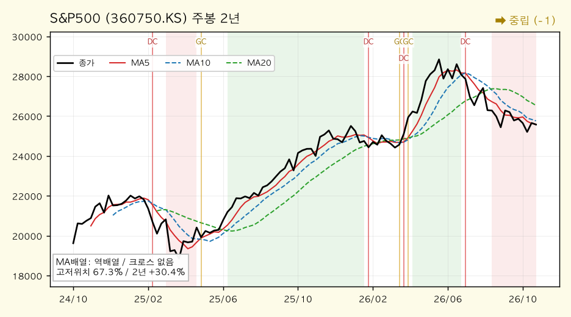

*S&P500(360750.KS) — 주봉 역배열, 2년 +30.4%, 고저위치 67.3%. 1주 +1.1%지만 일봉 MA5~MA60이 모두 역순. 주봉 MA5-MA10 격차 -0.67%로 전환 근접 2순위.*

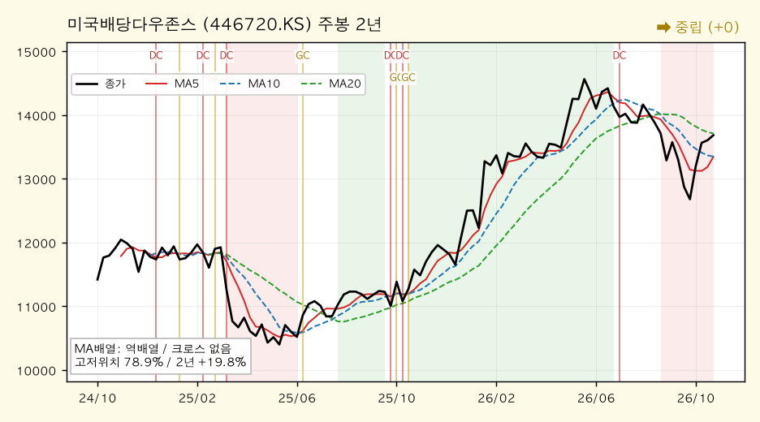

*미국배당다우존스(446720.KS) — 주봉 역배열, 2년 +19.8%, 고저위치 78.9%. **15종목 중 구조가 가장 온전하다.** 유일한 일봉 비약세(중립 +1), 유일한 월봉 +3 강세, 주봉 MA5-MA10 격차 -0.01%.*

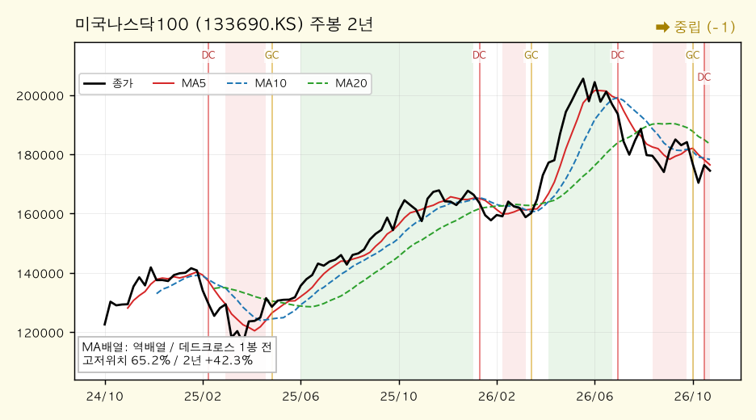

*미국나스닥100(133690.KS) — 주봉 역배열, 2년 +42.3%, 고저위치 65.2%. 지난 호의 "가장 온전한 종목" 자리를 내줬다. 주봉 혼조→역배열, 골든크로스가 1주 전 데드크로스로 뒤집혔다.*

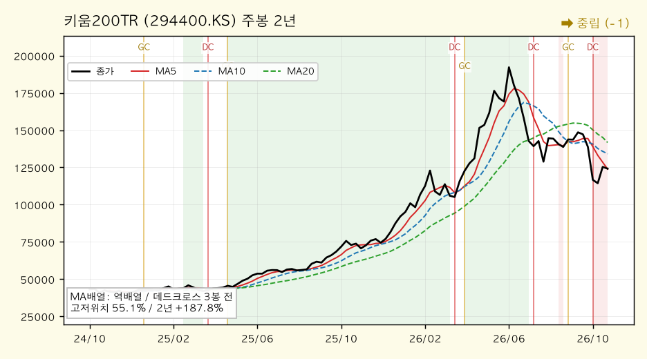

*키움200TR(294400.KS) — 주봉 역배열, 2년 +187.8%, 고저위치 55.1%. 1주 +9.1%로 반등 1위. 일봉 모멘텀은 여전히 -16.0%, 일봉 MA60이 현재가보다 9.2% 위다.*

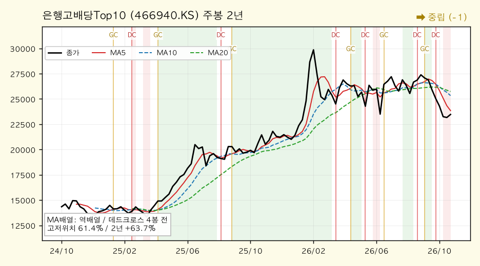

*은행고배당Top10(466940.KS) — 주봉 역배열, 2년 +63.7%, 고저위치 61.4%. 반등장에서 -1.2%로 역행. 월봉 데드크로스가 이번 달 새로 나왔다.*

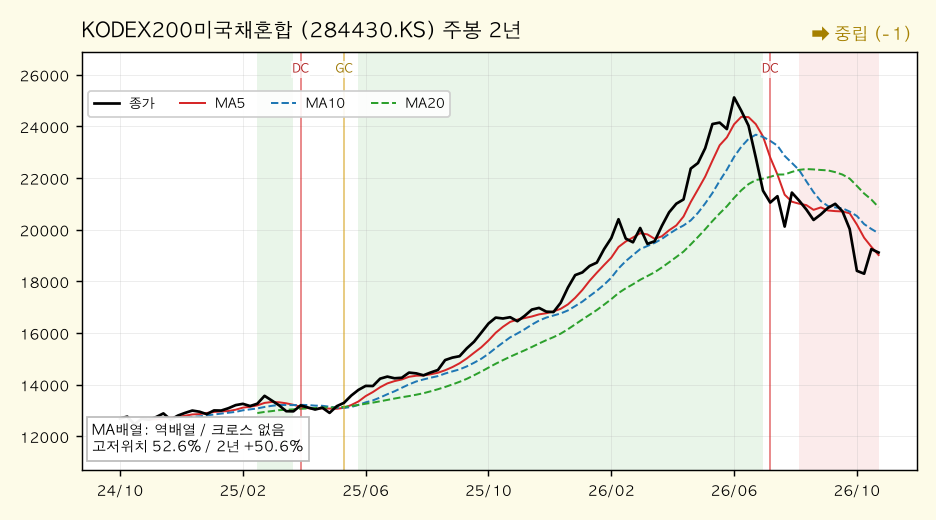

*KODEX200미국채혼합(284430.KS) — 주봉 역배열, 2년 +50.6%, 고저위치 52.6%. 1주 +5.5%. 주식·채권 양쪽이 같이 반등해 일봉 고저위치가 2.3%→30.1%로 크게 올라왔다.*

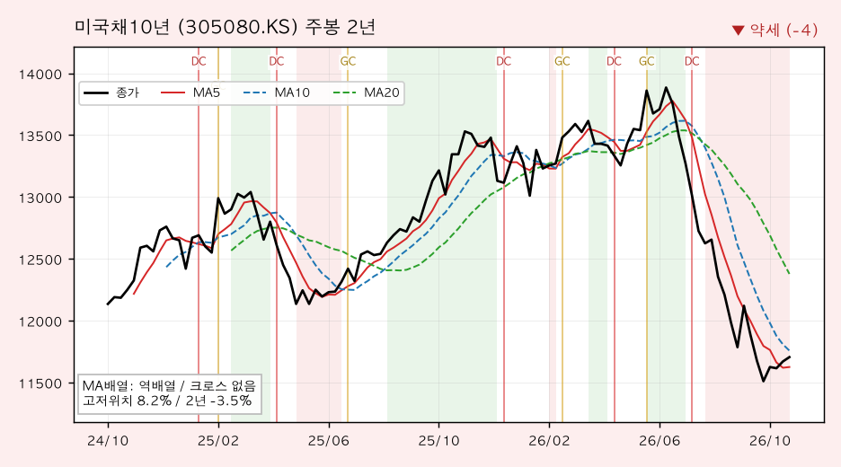

*미국채10년(305080.KS) — 주봉 역배열, 2년 -3.5%, 고저위치 8.2%. 일·주·월봉 약세 일치(3주 연속). 오늘 일봉 골든크로스가 나왔지만 MA60이 2.7% 위다.*

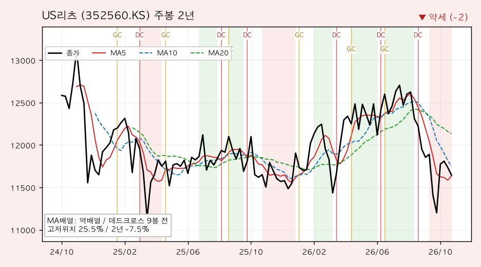

*US리츠(352560.KS) — 주봉 역배열, 2년 -7.5%, 고저위치 25.5%. 일봉 혼조(MA5>MA20)에 골든크로스 9일 전. 월봉 고저위치 15.0%로 장기 위치는 최하위권.*

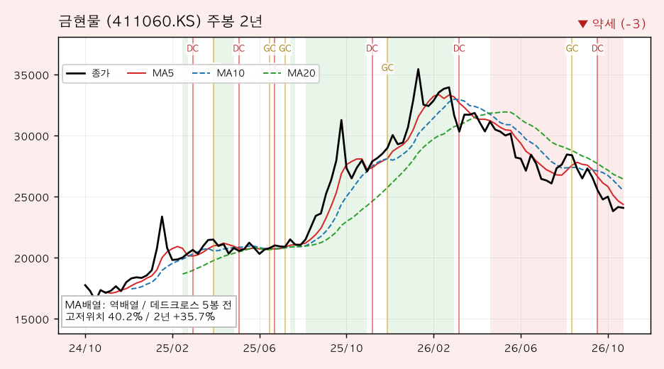

*금현물(411060.KS) — 주봉 역배열, 2년 +35.7%, 고저위치 40.2%. 반등장에서 -0.6%. 일봉 고저위치 5.9%, 월봉 MA12(28,714원)가 현재가보다 19% 높다.*

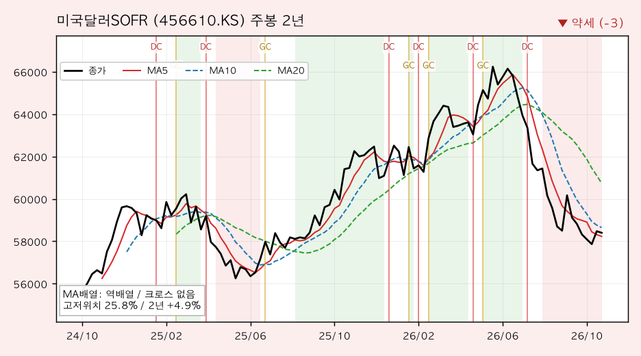

*미국달러SOFR(456610.KS) — 주봉 역배열, 2년 +4.9%, 고저위치 25.8%. 1주 +1.0%로 원화 약세(1,335원)를 그대로 받았다. 일봉 고저위치 0.0%→12.5%로 반등.*

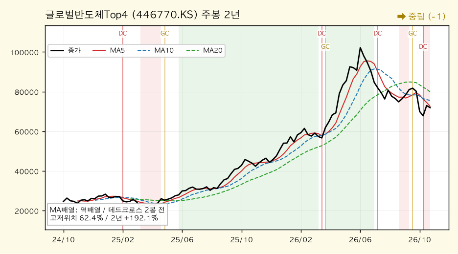

*글로벌반도체Top4(446770.KS) — 주봉 역배열, 2년 +192.1%, 고저위치 62.4%. 1주 +5.6%로 월봉 MA12를 다시 넘어 **월봉 강세(+2)로 복귀**. 일봉은 아직 -3 약세라 유일한 ❌ 상충 종목.*

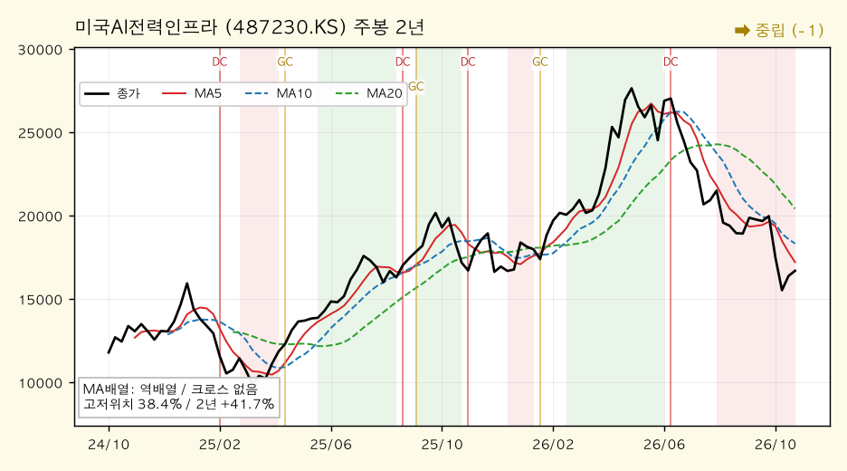

*미국AI전력인프라(487230.KS) — 주봉 역배열, 2년 +41.7%, 고저위치 38.4%. 1주 +1.7%에 그쳐 지난 호 대비 -4.5%. 일봉 MA5(15,699)가 MA60(19,198)보다 18% 낮다.*

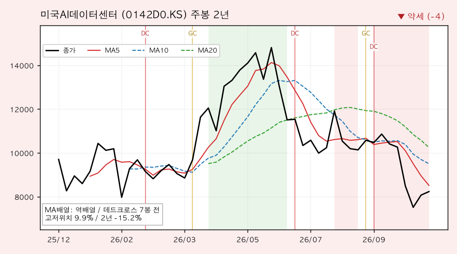

*미국AI데이터센터(0142D0.KS) — 주봉 역배열, 상장 후 -15.2%, 고저위치 9.9%. 1주 +7.4%로 반등 2위지만 일·주·월 약세 일치는 그대로. 월봉 고저위치 2.8%.*

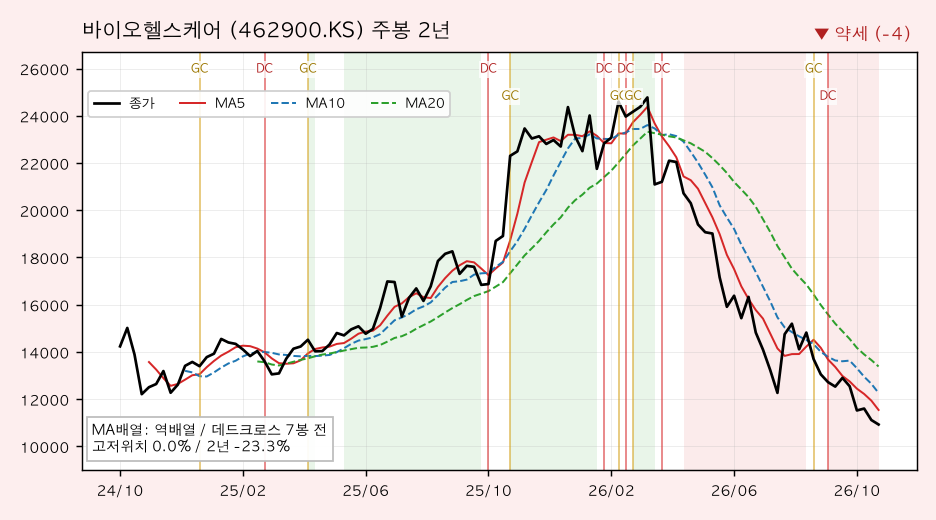

*바이오헬스케어(462900.KS) — 주봉 역배열, 2년 -23.3%, 고저위치 **0.0%(2년 최저)**. 1주 -7.0%로 반등장에서 역행. 주봉 모멘텀 -36.9%로 15종목 최약체.*

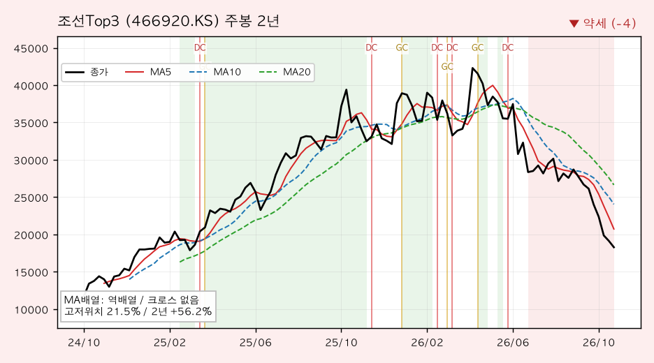

*조선Top3(466920.KS) — 주봉 역배열, 2년 +56.2%, 고저위치 21.5%. 1주 -10.5%, 지난 호 대비 -18.2%로 하락 1위. 일봉 고저위치 0.0%, 3개월 -28.2%.*

### [5] 추세추종 관점 주목 종목

#### 🚀 멀티타임 정배열 (추세 편승 구간)

**해당 종목 없음 — 3주 연속이다.** 일·주·월봉 어디에도 정배열 종목이 0개이고, 주봉은 15종목 전부가 역배열이다. 이번 주 11종목이 올랐는데도 이 칸이 비어 있다는 것은, 반등이 추세추종 규칙상 **신규 진입 신호를 전혀 만들지 못했다**는 뜻이다.

#### 📌 눌림목 후보 (장기 상승 + 단기 과매도)

| 종목명 | 월봉 고저위치 | 일봉 고저위치 | 괴리 | 판단 |
|---|---|---|---|---|
| S&P500 | 81.5% | 21.2% | 73.0%p → **60.3%p** | 보유 비중 1위. 괴리가 지난 호보다 좁혀졌지만 여전히 최대. 이번 주 분해 대상 |
| 은행고배당Top10 | 77.6% | 20.0% | 57.6%p | 월봉 데드크로스가 **이번 달 발생**, 반등장에서 -1.2%. 눌림목보다 **추세 훼손** 쪽 |
| 미국나스닥100 | 78.8% | 26.4% | 52.4%p | 주봉 데드크로스가 1주 전 새로 나와 구조가 한 단계 내려왔다 |
| 글로벌반도체Top4 | 69.0% | 30.2% | 38.8%p | 월봉 강세 복귀(+2). 괴리는 작지만 **구조 회복이 가장 빠른 후보** |
| 미국배당다우존스 | 86.6% | 61.3% | 25.3%p | 일봉이 이미 중립으로 회복. **후보에서 졸업하는 중** |

#### 눌림목은 어떻게 판정하나 — S&P500 사례 분해

지난 호에 이어 **보유 비중이 가장 크고 월봉·일봉 괴리도 가장 큰** S&P500(60.3%p)을 다시 분해한다. 같은 종목을 연속으로 보는 이유는, 한 주 사이 "괴리가 73.0%p → 60.3%p로 좁혀진 것이 구조 개선인지 아닌지"가 이번 주의 핵심 질문이기 때문이다.

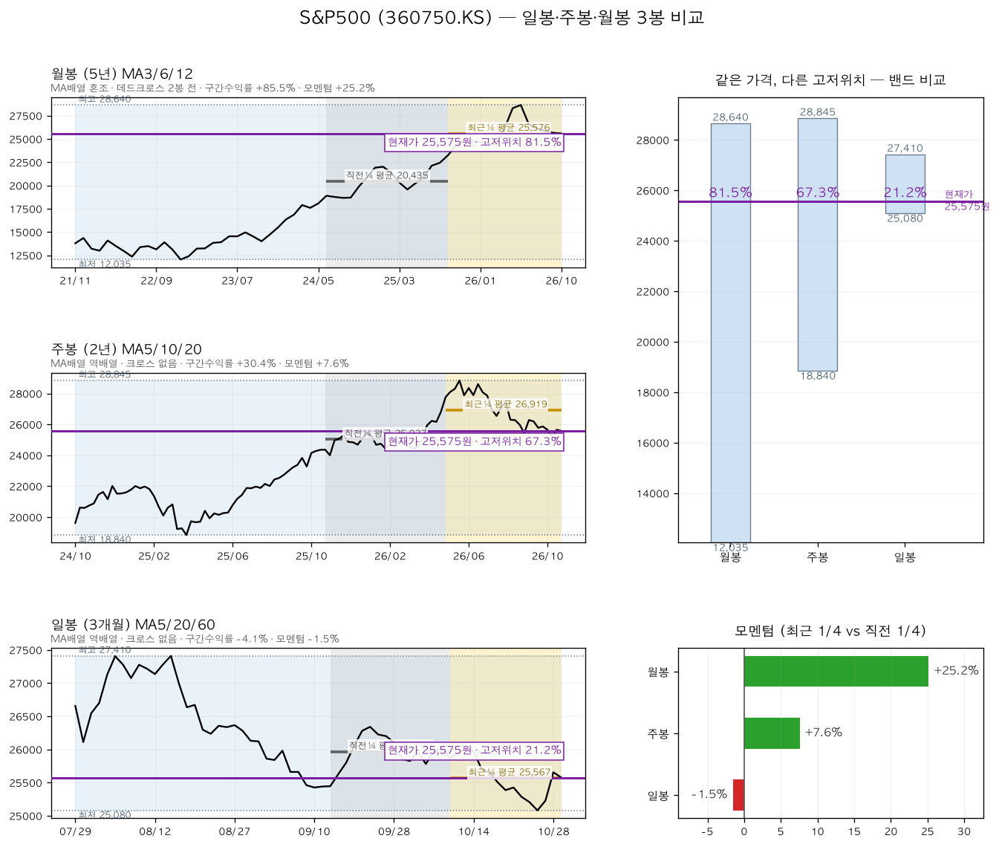

**① 같은 가격이 왜 81.5%이자 21.2%인가 — 밴드 비교**

세 패널의 보라색 가로선은 전부 같은 값(25,575원)이다. 밴드(기간 최고~최저) 안에서의 높이만 다르다.

| 봉 단위 | 밴드 범위 | 밴드 폭 | 월봉 대비 폭 | 현재가 위치 |
|---|---|---|---|---|
| 월봉 (5년) | 12,035 ~ 28,640원 | 16,605원 | 100% | **81.5%** (상단권) |
| 주봉 (2년) | 18,840 ~ 28,845원 | 10,005원 | 60% | 67.3% (중간 위) |
| 일봉 (3개월) | 25,080 ~ 27,410원 | 2,330원 | **14%** | **21.2%** (하단권) |

일봉 밴드 폭은 월봉의 14%다. 3개월 동안 최고가 대비 6.7% 빠진 것만으로 짧은 자의 하단권에 닿는다. 긴 자로 재면 여전히 상단권이다. **지난 호 9.0%였던 일봉 고저위치가 21.2%로 올라온 것은 가격이 3개월 최저(25,080원)에서 2.0% 떨어졌다는 뜻일 뿐**, 밴드 자체가 바뀐 것은 아니다.

**② 모멘텀은 다른 이야기를 한다 — 모멘텀 비교**

| 봉 단위 | 비교 구간 | 모멘텀(최근 ¼ vs 직전 ¼) | 지난 호 | 해석 |
|---|---|---|---|---|
| 월봉 (15개월씩) | 2023-08~2026-10 | **+25.2%** | +25.2% | 장기 가속, 변화 없음 |
| 주봉 (26주씩) | 2025-05~2026-10 | +7.6% | +8.6% | 가속 둔화가 계속 |
| 일봉 (15일씩) | 2026-09~2026-10 | **-1.5%** | +0.5% | **플러스에서 마이너스로 떨어졌다** |

여기가 중요하다. 1주간 가격은 +1.1% 올랐는데 **일봉 모멘텀은 +0.5% → -1.5%로 오히려 악화**됐다. 최근 15일 평균가(25,567원)가 직전 15일 평균가(25,957원)보다 낮기 때문이다. 반등은 마지막 며칠에 몰려 있었고, 구간 평균으로 보면 여전히 내려가는 중이다. **고저위치 개선과 모멘텀 악화가 동시에 일어난 것**이 이번 주 S&P500의 정확한 상태다.

**③ 그래도 "후보"로 두는 이유 — 그리고 불리한 신호**

- **유리 1**: 월봉 고저위치 81.5%·모멘텀 +25.2%로 장기 상승 구조가 유지된다. 5년 +85.5%.
- **유리 2**: 일봉 데드크로스가 소멸했고 현재가(25,575원)가 일봉 MA5(25,348원) 위로 올라섰다. 반등의 첫 조건은 충족했다.
- **유리 3**: 미국 S&P500 지수 자체는 7,744로 1주 +1.1%, 지난 호 대비 +1.1%다. 원지수는 하락하지 않았다.
- **불리 1**: **일봉 역배열(25,348 < 25,654 < 26,120)에 크로스 신호 없음.** MA20이 0.3%, MA60이 2.1% 위에 남아 있다. 가격이 MA5만 넘었을 뿐 중·장기선은 그대로다.
- **불리 2**: **일봉 모멘텀이 -1.5%로 마이너스 전환**했다(위 ②). 위치는 좋아졌는데 속도는 나빠졌다.
- **불리 3**: **주봉 역배열(25,590 < 25,763 < 26,532)**, 15종목 공통. 20주선이 3.7% 위에 있고 최근 10주 내 골든크로스는 없다.
- **불리 4**: **월봉 혼조에 MA3(25,685) < MA6(26,395)가 3개월째**다. 현재가가 월봉 MA12(25,930원)를 1.4% 밑돌아 월봉 강세로 올라가지 못했다.

유리한 근거는 전부 **고저위치·지수 레벨 같은 "위치" 지표**에서 나오고, 불리한 근거는 **MA 배열·크로스·모멘텀 같은 "구조·속도" 지표**에서 나온다. 지난 호와 같은 구도이고, 달라진 점은 **일봉 모멘텀이 플러스에서 마이너스로 넘어갔다**는 것 하나다. 즉 이번 주 반등은 S&P500에 한해서는 **개선이 아니라 위치 이동**이다. 따라서 "후보" 이상으로 승격하지 않고, 진입 조건은 지난 호와 동일하게 **일봉 MA5(25,348원)가 MA20(25,654원)을 상향 돌파하고 MA60(26,120원)을 회복하는 것**으로 유지한다. 두 선의 거리가 각각 1.2%·3.0%로 좁혀진 점은 조건 충족이 가까워졌음을 뜻한다.

#### ⚠️ 혼조 관망 (신호 불일치)

| 종목명 | 불일치 내용 |
|---|---|
| 글로벌반도체Top4 | 월봉 강세(+2, MA12 돌파)·주봉 모멘텀 +48.6% vs 일봉 약세(-3)·역배열·모멘텀 -9.7%. 15종목 중 유일한 ❌ 상충 |
| 미국배당다우존스 | 월봉 강세(+3)·일봉 중립(+1)·골든크로스 8일 전 vs 주봉 역배열. 주봉 MA5-MA10 격차 -0.01%로 전환 직전 |
| 키움200TR | 1주 +9.1% 반등 1위 vs 일봉 모멘텀 -16.0%, 주봉 데드크로스 3주 전, 일봉 MA60이 9.2% 위 |
| 미국AI데이터센터 | 1주 +7.4% 반등 2위 vs 일·주·월 약세 일치, 월봉 고저위치 2.8% |
| KODEX200미국채혼합 | 1주 +5.5%로 일봉 고저위치 2.3%→30.1% 급회복 vs 일봉 역배열·모멘텀 -9.1% |
| US리츠 | 일봉 혼조(MA5>MA20)·골든크로스 9일 전 vs 주봉 약세(-2)·월봉 고저위치 15.0% |
| 미국채10년 | 오늘 일봉 골든크로스 발생 vs 주봉 -4(2년 고저위치 8.2%)·월봉 -2 |

#### 🔻 멀티타임 약세 (회피·축소 구간)

| 종목명 | 근거 |
|---|---|
| 조선Top3 | 일·주·월봉 -4/-4/-4. 1주 -10.5%로 하락 1위, 3개월 -28.2%, 일봉 고저위치 0.0%(3개월 최저) |
| 바이오헬스케어 | 일·주·월봉 -4/-4/-4. 1주 -7.0%, 주봉 고저위치 0.0%(2년 최저), 주봉 모멘텀 -36.9% |
| 미국AI데이터센터 | 일·주·월봉 -4/-4/-3. 1주 +7.4% 반등에도 월봉 고저위치 2.8%, 주봉 모멘텀 -20.7% |
| 미국채10년 | 일·주·월봉 -2/-4/-2로 3주 연속 약세 일치. 주봉 고저위치 8.2% |
| 금현물 | 일봉 -4·주봉 -3. 반등장에서 -0.6% 역행, 월봉 MA12가 현재가보다 19% 위 |
| 미국달러SOFR | 일봉 -3·주봉 -3. 월봉만 중립(-1). 원/달러 1,335원 수준에 직접 연동 |

### [6] 자산군별 추세 비교

추세강도 평균(-4 ~ +4 척도)으로 자산군을 묶어 비교했다. 괄호는 지난 호(10-16) 값.

| 자산군 | 구성 종목 | 일봉 평균 | 주봉 평균 | 월봉 평균 |
|---|---|---|---|---|
| 주식 — 선진국 | S&P500, 나스닥100, 배당다우존스, 반도체, AI전력, AI데이터센터 | -2.8 (-2.5) | -1.3 (-1.3) | +0.5 (+0.3) |
| 주식 — 국내 | 키움200TR, 은행고배당Top10, 조선Top3, 바이오헬스케어 | -3.8 (-3.8) | -2.5 (-2.2) | -1.8 (-1.5) |
| 혼합 | KODEX200미국채혼합 | -3.0 (-4.0) | -1.0 (-1.0) | +0.0 (+0.0) |
| 채권 | 미국채10년 | -2.0 (-4.0) | -4.0 (-4.0) | -2.0 (-2.0) |
| 대안자산 | 금현물, 미국달러SOFR, US리츠 | -3.0 (-3.0) | -2.7 (-2.3) | -1.0 (-1.0) |
| 배당·인컴 | 배당다우존스, 은행고배당Top10, US리츠 | -1.7 (-3.0) | -1.0 (-1.0) | +1.0 (+0.3) |

**자산군 간 관계 해석**

첫째, **거의 모든 칸이 지난 호와 같다.** 18개 칸 중 12개가 동일하거나 0.3점 이내로 움직였다. 11종목이 올랐는데도 이렇다는 것이, 이번 반등의 성격을 가장 정확히 보여준다. 추세 점수는 **가격 수준이 아니라 가격과 평균선의 관계**를 재기 때문이다.

둘째, **배당·인컴이 가장 많이 개선됐다**(일봉 -3.0 → -1.7, 월봉 +0.3 → +1.0). 미국배당다우존스가 일봉 중립·월봉 강세로 올라선 효과다. 지난 호에서 "급락장에서 방어자산이 덜 빠진 것"이라고 평가했는데, 이번에는 **방어자산이 실제로 구조를 회복한 첫 사례**가 나왔다. 다만 은행고배당Top10은 반등장에서 -1.2%로 역행해 같은 자산군 안에서도 미국 배당주와 국내 은행주가 갈라졌다.

셋째, **채권 일봉이 -4.0 → -2.0으로 2점 올랐다.** 미국채10년이 오늘 일봉 골든크로스를 냈기 때문인데, 주봉은 -4.0 그대로다. 단기 반등과 중기 추세가 가장 크게 어긋난 자산군이다.

넷째, **국내 주식만 더 나빠졌다**(주봉 -2.2 → -2.5, 월봉 -1.5 → -1.8). 키움200TR이 +9.1%로 반등 1위였는데도 자산군 평균이 내려간 이유는 조선Top3(-10.5%)와 바이오헬스케어(-7.0%)가 같은 주에 더 빠졌기 때문이다. **국내 주식 안에서 지수와 테마가 정반대로 움직였다.**

다섯째, **선진국 주식은 월봉만 소폭 개선(+0.3 → +0.5)되고 일봉은 악화(-2.5 → -2.8)**됐다. 반도체·배당다우가 월봉 MA12를 넘어선 효과가 월봉에 잡혔지만, 일봉에서는 나스닥100이 중립 → 약세로 내려오며 상쇄됐다.

### [7] 종합 코멘트

**전체 추세 방향성**

시간축별 강세 비중은 월봉 13.3%(2개), 주봉 0%, 일봉 0%다. 지난 호(월봉 6.7% / 주봉 0% / 일봉 0%)와 비교하면 **월봉만 한 칸 나아졌고 주·일봉은 그대로**다. 구조를 말로 옮기면 "조정이 연장되고 한국발 충격이 추세 훼손으로 번지는 단계"에서 **"하락 신호의 발생은 멈췄지만 상승 구조는 아직 복원되지 않은 단계"**로 옮겨왔다. 일봉 데드크로스가 9건 → 0건으로 사라진 것은 분명한 진전이다. 그러나 일봉 정배열 0개, 주봉 역배열 15개, 월봉 데드크로스 15개라는 숫자는 **반등이 아직 "추세 전환"의 최소 조건조차 건드리지 못했음**을 보여준다. [0]의 도식으로 말하면 지금은 명백히 왼쪽(반등)이다.

**강세·약세 자산군의 교차 신호**

- 강세 일치 0개(3주 연속), 약세 일치 4개(미국채10년·AI데이터센터·바이오·조선)다. 약세 일치 명단은 지난 호와 동일하다.
- 이번 주 가장 많이 오른 4종목(키움200TR +9.1%·AI데이터센터 +7.4%·반도체 +5.6%·미국채혼합 +5.5%)은 모두 **지난 호에 가장 많이 빠졌던 종목**이다. 반면 가장 많이 빠진 2종목(조선 -10.5%·바이오 -7.0%)도 지난 호 하락 종목이다. 되돌림과 추세 지속이 같은 주에 섞였다.
- 주목할 교차는 **글로벌반도체Top4**다. 월봉 강세(+2)와 일봉 약세(-3)가 동시에 성립하는 유일한 종목이고, 월봉 MA12 돌파(71,915 vs 71,825)는 0.1% 차이의 간신한 돌파다. 다음 주 반락하면 바로 되돌려질 수 있다.
- 가장 온전한 종목은 **미국배당다우존스**로 바뀌었다. 유일한 일봉 비약세, 유일한 월봉 +3, 주봉 MA5-MA10 격차 -0.01%. 3주 전 "방어주 선호의 일시 복귀인지 미확인"이라고 적었던 종목이 세 주 연속 올라(+4.1% → +3.7% 누적) 구조를 바꿨다.

**추세추종 대응 방향**

1. **신규 진입 신호는 여전히 없다.** 정배열이 세 시간축 모두 0개이므로 추세추종 규칙상 신규 매수는 계속 관망한다. 데드크로스 소멸은 "덜 나빠짐"이지 "좋아짐"이 아니다.
2. **눌림목 매수 조건은 지난 호 그대로 유지한다.** 고저위치가 개선됐다는 이유만으로 조건을 완화하지 않는다. S&P500 기준 일봉 MA5(25,348원)의 MA20(25,654원) 상향 돌파와 MA60(26,120원) 회복이다. 두 선과의 거리가 1.2%·3.0%로 좁혀진 것은 긍정적이다.
3. **구조가 먼저 회복된 종목을 우선순위에 둔다.** 미국배당다우존스(일봉 중립·월봉 강세)와 글로벌반도체Top4(월봉 강세)가 유일한 두 사례다. 특히 미국배당다우존스는 주봉 골든크로스가 임박(격차 -0.01%)해, **15종목 중 가장 먼저 주봉 역배열을 깰 후보**다.
4. **약세 일치 종목은 반등 시 비중 축소 우선순위를 유지한다.** 조선Top3·바이오헬스케어는 반등장에서도 하락해 되돌림조차 없고, 미국AI데이터센터는 +7.4% 반등에도 월봉 고저위치가 2.8%에 머문다.
5. **다음 주 확인할 신호**: ① 미국배당다우존스 주봉 MA5가 MA10을 돌파해 15종목 중 첫 주봉 전환이 나오는지, ② 글로벌반도체Top4의 월봉 MA12 돌파(0.1% 차)가 유지되는지, ③ S&P500·미국나스닥100 일봉 MA5-MA20 재돌파, ④ 조선·바이오의 일·주봉 고저위치 0%가 깨지며 추가 하락이 이어지는지, ⑤ 일봉 데드크로스 0건 상태가 유지되는지.

---

## 5. 내 ETF 평가 & 대응

> 이 섹션은 개인 포트폴리오를 다루므로 **절대금액을 쓰지 않는다.** 모든 수치는 비중(%)·수익률(%)·주당 가격이다.
> 앞의 세 분석(한국은행·거시·차트)을 입력으로 받은 최종 종합이며, 관점은 **안전마진 기반 가치투자자**다.
> 기준: 포트폴리오 시트 10-29, 시세 Yahoo Finance 10-29 종가. 직전 리포트(10-16)와 **2주 간격**이다.

### 5-0. 이번 2주의 한 줄 — 손실 자산이 전부 "금리 인하"에 걸려 있다

지난 호의 한 줄은 "한국발 충격이 계좌 전체에 번졌다"였다. 그 충격은 2주 만에 상당 부분 되돌아왔다(코스피 10/28 +6.63%). 그런데 **내 포트폴리오는 거의 움직이지 않았다.** 전체 수익률이 +0.35%에서 -0.15%로 오히려 0.5%p 내려갔고, 퇴직연금은 소수점까지 똑같은 +6.22%다.

이유는 단순하다. 이번 주 한국은행과 연준이 **같은 메시지를 동시에** 냈기 때문이다.

| 항목 | 42주차(10-16) | 44주차(10-29) | 내 포트폴리오에의 의미 |
|---|---|---|---|
| 한국은행 기준금리 | 3.00% | **3.00% 만장일치 동결 + "긴축 기조 지속" 명시** | 완화가 아니라 **1회 유보**. 11/26 인상 가능 |
| 연준 정책금리 | 3.75~4.00% | **3.75~4.00% 동결, 반대 2표가 모두 '인상'** | 포워드 가이던스 거부. 12월 인상 저울질 |
| 미 10년물 | 5.10% | 5.05% | 할인율 고착. 장기채 반등 근거 약함 |
| 미 3개월물 | 4.28% | 4.18% | 현금이 여전히 4%대 이자 |
| 원/달러 | 약 1,332원 | 1,335.1원(차트 기준) / 1,336.6원(거시 기준) | 2주간 소폭 원화 약세 — 미국 자산에 **일시적 순풍** |
| 국제 금값 | 4,201달러 | 4,038달러 (△3.9%) | 금 4개 라인 전부 압박 |
| WTI | 95.7달러(장중) → 101.4달러(종가) | 101.5달러 | 비용 충격 단독형. 인하 명분을 지운다 |

**이 표가 말하는 것.** 내 손실 자산 — 금(13.0%, △3.9%), 미국채 10년·30년(6.2%, △6.1%), 미국달러단기채(4.7%, △9.3%), AI·반도체 테마(10.0%, △16.4%) — 은 **전부 금리가 내려가야 값이 오르는 자산**이다. 합치면 포트폴리오의 약 33.9%다. 반대로 수익을 내고 있는 자산 — 미국주식 지수(30.9%, +9.5%), 미국배당(11.9%, +9.5%), 혼합(14.0%)—은 금리 인하를 전제로 하지 않는다.

지난 2주에 바뀐 것은 가격이 아니라 **전제**다. 한·미 양국 중앙은행이 같은 주에 "동결하되 다음은 인상 쪽"이라고 말했다. 내 포트폴리오의 3분의 1이 걸고 있는 베팅이 **한 주 만에 한 칸 더 멀어졌다.**

### 5-1. 포트폴리오 현황 (비중·수익률만)

#### 전체

| 항목 | 값 | 직전(10-16) | 변화 |
|---|---|---|---|
| 전체 누적 수익률 | **△0.15%** | +0.35% | △0.50%p |
| 미국 자산 비중 | 69.7% (혼합형의 미국채 절반 포함 시 약 73.7%) | 69.0% | +0.7%p |
| 한국 자산 비중 (국내 주식 + 혼합형의 주식 절반) | 약 10.6% | 14.2%(기준 상이) | — |
| 금 비중 | 13.0% | 13.3% | △0.3%p |
| **현금 비중** | **2.7%** | 3.6% | **△0.9%p** |
| 달러 표시 자산 합계(미국 자산 + 금) | 약 82.8% | — | 환율 단일 리스크 노출 |

**현금이 또 줄었다.** 지난 호 목표가 "3.6% → 8% 이상"이었는데 실제로는 2.7%로 더 내려갔다. 2회 연속 미이행이고 방향도 반대다. 뒤의 5-6 ④에서 다루지만, 주봉 전 종목 역배열 구간에서 현금 2.7%는 **"조건이 충족돼도 살 수 없는 상태"**를 뜻한다.

#### 계좌별

| 계좌 | 전체 내 비중 | 계좌 수익률 | 직전(10-16) | 변화 | 성격 |
|---|---|---|---|---|---|
| 퇴직연금 | 40.1% | **+6.22%** | +6.22% | **0.00%p** | 종합형 — 2주간 완전 보합 |
| 개인IRP | 18.1% | **+3.81%** | +2.85% | **+0.96%p** | 4개 계좌 중 **유일한 개선** |
| 연금저축펀드 | 26.6% | **+1.08%** | +1.78% | △0.70%p | 금·장기채가 계속 발목 |
| ISA | 15.3% | **△18.42%** | △15.84% | △2.58%p | 테마 집중 — 4회 연속 악화 |

**ISA 한 계좌가 전체 성적표를 혼자 결정하고 있다.** 투입 기준으로 전체의 18.7%, 평가 기준으로 15.3%인 이 계좌를 빼면 **나머지 연금 3개 계좌 합산 수익률은 +4.0%**다. 전체가 △0.15%이니, ISA가 전체 수익률을 **약 4.2%p 끌어내렸다.**

반대로 **개인IRP가 유일하게 개선된 이유도 뚜렷하다.** 구성 4종 중 3종이 미국 배당·배당혼합·S&P500이고, 이 중 배당다우존스 계열이 2주간 +3.7~3.8% 올랐다. 4장의 차트 분석이 "미국배당다우존스가 15종목 중 구조가 가장 온전하다"고 판정한 것과 **계좌 수익률이 정확히 같은 말을 한다.**

#### 자산군별

| 자산군 | 전체 비중 | 수익률 | 2주 가격 변화 | 평가 |
|---|---|---|---|---|
| 미국주식(지수) | 30.9% | **+9.52%** | S&P500 △0.3% / 나스닥100 △1.3% | 최대 비중·최대 수익원. 가격은 사실상 정지 |
| 금 | 13.0% | △3.85% | △3.7% | 단일 자산군 2위. 4개 라인으로 쪼개져 있다(5-6 ②) |
| 미국배당 | 11.9% | **+9.50%** | +3.7~3.8% | 2주간 상승 상위. 구조·밸류 양쪽에서 유일한 합격 |
| 테마(AI·반도체) | 10.0% | **△16.39%** | 반도체 +2.8% / AI전력 △4.5% / AI데이터센터 △3.1% | 반도체만 반등, AI 둘은 반등장에서도 하락 |
| 한국주식+미국채 혼합 | 7.9% | +9.01% | +3.9% | 코스피 반등을 절반만큼 받음 |
| 달러/현금 | 7.3% | △6.12% | 달러단기채 +0.2% | 환율 단일 변수 |
| 한국주식 | 6.7% | **△16.19%** | 키움200TR +6.5% / 은행 △3.4% / 조선 △18.2% | 지수와 테마가 정반대로 갈렸다 |
| 미국채 | 6.2% | △6.13% | 10년 +0.7% / 30년 +1.3% | 금리 소폭 하락분만 반영 |
| 미국배당+미국채 혼합 | 6.1% | +2.15% | +2.6% | 가장 조용한 자산군 |

#### 종목별 통합 (계좌 합산)

| 종목 | 티커 | 현재가(원) | 전체 비중 | 수익률 | 2주 가격 | 차트 판정(일/주/월) |
|---|---|---|---|---|---|---|
| 타이거 미국 S&P500 | 360750 | 25,575 | 25.7% | +11.35% | △0.3% | 🔴 / 🟡 / 🟡 |
| SOL 미국배당다우존스 | 446720 | 13,685 | 8.5% | **+14.70%** | +3.7% | 🟡 / 🟡 / 🟢 |
| ACE KRX 금현물 | 411060 | 24,080 | 8.3% | △6.96% | △3.7% | 🔴 / 🔴 / 🟡 |
| 삼성 KODEX200 미국채혼합 | 284430 | 19,120 | 7.9% | +9.01% | +3.9% | 🔴 / 🟡 / 🟡 |
| SOL 미국배당미국채혼합50 | 490490 | 10,835 | 6.1% | +2.15% | +2.6% | (차트 15종목 외) |
| 타이거 KRX금현물 | 0072R0 | 11,530 | 4.7% | +2.15% | △3.7% | (차트 15종목 외) |
| TIGER 미국달러단기채권액티브 | 329750 | 12,685 | 4.7% | **△9.31%** | +0.2% | (차트 15종목 외) |
| 타이거 미국 나스닥100 | 133690 | 174,450 | 4.6% | +1.48% | △1.3% | 🔴 / 🟡 / 🟡 |
| 타이거 미국채 10년선물 | 305080 | 11,705 | 4.5% | △7.12% | +0.7% | 🔴 / 🔴 / 🔴 |
| 타이거 미국AI데이터센터Top4Plus | 0142D0 | 8,230 | 4.3% | **△24.96%** | △3.1% | 🔴 / 🔴 / 🔴 |
| ACE 글로벌반도체TOP4 plus | 446770 | 71,915 | 4.2% | △4.67% | +2.8% | 🔴 / 🟡 / 🟢 |
| 타이거 은행고배당플러스TOP10 | 466940 | 23,470 | 3.7% | △3.72% | △3.4% | 🔴 / 🟡 / 🟡 |
| TIGER 미국배당다우존스 | 458730 | 14,955 | 3.5% | △1.45% | +3.8% | (차트 15종목 외) |
| 현금 | — | — | 2.7% | — | — | — |
| SOL 조선TOP3플러스 | 466920 | 18,280 | 1.7% | **△40.90%** | △18.2% | 🔴 / 🔴 / 🔴 |
| ACE 미국30년국채액티브 | 453850 | 7,070 | 1.7% | △3.40% | +1.3% | (차트 15종목 외) |
| KODEX 미국AI전력핵심인프라 | 487230 | 16,680 | 1.6% | △17.61% | △4.5% | 🔴 / 🟡 / 🟡 |
| KIWOOM 200TR | 294400 | 124,170 | 1.3% | +2.71% | +6.5% | 🔴 / 🟡 / 🟡 |
| KODEX 미국S&P500 헬스케어 | 453640 | 14,640 | 0.6% | +0.14% | +2.4% | (차트 15종목 외) |

> **티커 확인 메모**: Yahoo Finance는 446720의 영문명을 "SOL US Dividend US Bond Mix 50"으로 잘못 표기한다. 국내 공시·거래소 기준으로 **446720 = SOL 미국배당다우존스**, **490490 = SOL 미국배당미국채혼합50**이 맞다. 또한 **타이거 KRX금현물은 411060이 아니라 0072R0**(2025.6 상장)이고, 411060은 ACE KRX금현물이다. KODEX 미국S&P500헬스케어는 **453640**(453650은 KODEX S&P500 금융). 4장 차트 분석이 다루는 15종목에 포함되지 않은 6종목(490490·0072R0·329750·458730·453850·453640)은 이 섹션에서 별도로 시세를 수집했다. **티커를 끝내 확인하지 못한 보유 종목은 없다.**

**가격만으로 눈에 띄는 두 종목.** 보유 19개 라인 중 4장 차트 분석에 빠져 있던 **KODEX 미국S&P500헬스케어**는 3개월 고저위치 **91.2%**로 보유 전 종목 중 최고이고, 현재가가 일봉 MA5·MA20·MA60을 모두 위로 넘긴 **유일한 보유 종목**이다. 비중이 0.6%라 전체에 주는 영향은 없지만, "일봉 정배열에 가장 가까운 자산이 포트폴리오에서 가장 작다"는 사실은 기록해 둘 만하다. 반대 끝은 **조선Top3**로, 2주 △18.2%에 누적 △40.90%다. 지난 호 △27.71%에서 13.2%p 더 나빠졌다.

#### 원금 투입의 흔적 — 2주간 무엇을 샀나

시트의 투입액 증감에서 역산한 **정성 추정**이며 금액은 공개하지 않는다. 가격 변화만으로 설명되는 수익률 변화와 실제 수익률의 차이로 판정했다.

| 종목 | 가격만 반영 시 예상 수익률 | 실제 수익률 | 판정 |
|---|---|---|---|
| 타이거 은행고배당플러스TOP10 | 약 △5.1% | △3.72% | **추가 매수 확실** (가격 △3.4% 구간에서) |
| 금(ACE·TIGER 합산) | 약 △5.2% | △3.85% | 소폭 추가 매수 추정 |
| 타이거 미국AI데이터센터 | 약 △25.0% | △24.96% | **추가 매수 없음** ✅ |
| SOL 조선TOP3 | 약 △40.9% | △40.90% | **추가 매수 없음** ✅ |
| ACE 글로벌반도체TOP4 | 약 △4.6% | △4.67% | 추가 매수 없음 |
| KIWOOM 200TR | 약 +2.8% | +2.71% | 추가 매수 없음 |
| KODEX 미국S&P500헬스케어 | 약 +0.1% | +0.14% | 추가 매수 없음 |

**지난 호 원칙의 이행 점검**

| 10-16 원칙 | 2주 뒤 결과 | 평가 |
|---|---|---|
| ISA는 추가 매수 금지, 반등 시 축소 | AI데이터센터·조선·반도체 **모두 추가 매수 없음** | ✅ **이행** — 지난 호 최대 실책이 교정됐다 |
| 현금 비중 3.6% → 8% 이상 | **2.7%로 추가 감소** | ❌ 2회 연속 미이행, 방향도 반대 |
| 은행고배당은 "정배열 확인 전 추가 금지" | 월봉 데드크로스가 이번 달 발생한 구간에서 **추가 매수** | ❌ 조건 미충족 상태의 매수 반복 |
| 금은 실질금리 하락 확인 전 보류 | 실질금리 +2.05%p 유지 중 **소폭 추가 매수** | ⚠️ 규모는 작으나 조건은 미충족 |
| S&P500·배당다우는 보유 | 보유 유지 | ✅ 이행 |
| 장기채 합산 5.9% 상한 | 6.2%로 소폭 초과 | ⚠️ 경계 |

**이번 2주의 교훈**: 지난 호가 가장 세게 지적한 항목(ISA 테마 추가 매수)은 교정됐다. 그런데 **같은 실수가 종목만 바꿔서 반복됐다.** 은행고배당은 지난 호에 "정배열이 사라진 뒤의 매수"라고 적은 바로 그 종목인데, 2주 뒤 월봉 데드크로스까지 나온 상태에서 또 샀다. 그 재원은 현금이었다. **"떨어진 것을 더 산다"는 습관은 사라진 게 아니라 ISA에서 연금저축으로 옮겨 갔다.**

### 5-2. 2단계 — 내 ETF의 펀더멘털 지표

#### 지표를 어떻게 읽나 (쉬운 설명)

| 지표 | 한 줄 정의 | 비유 |
|---|---|---|
| **PER** | 주가 ÷ 1주당 순이익. ETF는 담은 기업들의 시가총액 가중평균 | **"이 가게를 사면 지금 버는 돈으로 원금 회수에 몇 년 걸리나."** PER 20배 = 20년 |
| **이익수익률** | 1 ÷ PER × 100. PER을 이자율로 뒤집은 값 | **"이 가게의 연 이자율."** PER 20배면 연 5% |
| **PBR** | 주가 ÷ 1주당 순자산. 장부가 대비 몇 배인가 | **"가게 안의 집기·현금을 다 팔면 받는 돈의 몇 배를 내고 사는가."** 1배면 장부가에 사는 것 |
| **ROE** | 순이익 ÷ 자기자본 × 100. 여기서는 **PBR ÷ PER**로 역산 | **"내 돈 100만원을 맡기면 1년에 몇 만원을 벌어오나."** |
| **배당수익률** | 연간 분배금 ÷ 현재가 × 100 | **"가게에서 매년 내 통장으로 실제 꽂히는 돈의 비율."** |

**안전마진 판정의 기준선**: 한국 예금금리 **3.5%**다. 예금에 넣으면 아무 일을 안 해도 3.5%를 받는다. 주식 ETF의 이익수익률이 3.5%보다 낮으면 **위험을 더 지고 수익을 덜 받는 거래**다.

#### 보유 ETF 지표 (2026-10-29)

국내 상장 ETF에는 Yahoo가 펀더멘털 데이터를 제공하지 않는다. **동일 지수를 추종하는 미국 상장 ETF를 대리 지표**로 썼다(출처: Yahoo Finance `topHoldings` 보유종목 가중, 10-29 조회).

| 내 ETF | 추종 지수 | 대리 | PER | 이익수익률 | PBR | ROE(역산) | 배당수익률 |
|---|---|---|---|---|---|---|---|
| SOL·TIGER 미국배당다우존스 | Dow Jones US Dividend 100 | SCHD | **18.2배** | **5.5%** | 3.55배 | 19.5% | **3.2%** |
| 타이거 미국 S&P500 | S&P 500 | SPY | 24.2배 | 4.1% | 5.25배 | 21.7% | 1.0% |
| 타이거 미국 나스닥100 | Nasdaq 100 | QQQ | 28.3배 | 3.5% | 8.91배 | **31.5%** | 0.4% |
| KODEX 미국S&P500헬스케어 | S&P500 Health Care | XLV | 30.0배 | 3.3% | 4.74배 | 15.8% | 1.5% |
| ACE 글로벌반도체TOP4 | Solactive 글로벌 반도체 4종 | SOXX | **33.4배** | **3.0%** | **10.52배** | 31.5% | 0.2% |
| SOL 미국배당미국채혼합50 | SCHD 50% + 미국채 50% | 합성 | — | **약 5.3%**\* | — | — | — |

\* 혼합형은 주식 이익수익률 5.5%와 미 10년물 5.05%를 절반씩 가중한 **자산가중 기대수익률**이다. PER처럼 단일 지표로 쓰이는 값은 아니다.

**수집하지 못한 지표 (정직하게 표기)**

| 종목 | 사유 |
|---|---|
| 타이거 은행고배당플러스TOP10 | 2026년 10월 시점 국내 은행업종 PER·PBR·배당수익률 **확정치 수집 불가**. 2026년 상반기 증권사 자료 기준으로 업종 PBR 0.7~0.9배, 주주환원 수익률 6%대가 언급되나 **10월 시점 검증 불가** |
| KIWOOM 200TR | 코스피200 PER·PBR 10월 확정치 수집 불가. 2025년 5월 거래소 발표가 PER 11배·PBR 0.8배·배당 2.4%였으나, 이후 코스피가 큰 폭 상승했고 반도체 이익도 급증해 **그대로 쓸 수 없다** |
| SOL 조선TOP3플러스 | 수집 불가 |
| 타이거 미국AI데이터센터·KODEX 미국AI전력 | 대응하는 미국 상장 ETF가 없어 대리 지표를 만들 수 없음 |
| 모든 채권·금·달러 ETF | PER/PBR 개념이 적용되지 않음 (금리·듀레이션·환율로 평가) |

국내 종목의 밸류 지표를 못 구했다는 사실 자체가 판단에 들어간다. **"싼지 비싼지를 숫자로 확인할 수 없는 자산이 포트폴리오의 6.7%(한국주식)"**이며, 이 구간에서는 가격 하락을 저평가의 근거로 삼을 수 없다.

#### ETF를 하나의 회사로 보면 — 현금흐름 3분해

| 활동 | 보는 지표 | 내 포트폴리오의 모습 |
|---|---|---|
| **영업활동** (돈을 잘 버나) | ROE·영업이익률 | 보유 미국 ETF의 ROE는 15.8~31.5%로 **전부 양호**. 영업 자체가 문제인 자산은 없다 |
| **투자활동** (미래에 쓰나) | CAPEX·ROIC | 나스닥100·반도체·AI 테마가 이 축. ROE 31.5%는 재투자 수익률이 높다는 뜻이지만, **그 가치는 전적으로 할인율에 좌우**된다. 10년 실질금리 +2.05%p가 바로 그 할인율이다 |
| **재무활동** (주주에게 돌려주나) | 배당수익률·자사주 | 배당다우존스 3.2% vs S&P500 1.0% vs 나스닥100 0.4% vs 반도체 0.2%. **"지금 현금을 돌려주는 자산"과 "미래를 약속하는 자산"의 비중이 약 12% 대 40%**다 |

금리가 5%인 세상에서는 **세 번째 칸의 가치가 올라가고 두 번째 칸의 가치가 내려간다.** 내 포트폴리오는 두 번째 칸에 3배 이상 더 실려 있다.

### 5-3. 3단계 — 안전마진과 적정가격 범위

#### 무위험 수익률 사다리와 "등가 PER"

PER을 이자율로 뒤집으면, 각 무위험 수익률이 **"이 PER까지가 본전"**이라는 선을 만든다.

| 비교 대상 | 수익률 | 등가 PER | 의미 |
|---|---|---|---|
| 한국 기준금리 | 3.00% (11/26 인상 시 3.25%) | 33.3배 | 가장 느슨한 기준 |
| **한국 예금금리 (기준선)** | **3.5%** | **28.6배** | 이 PER보다 비싸면 예금만 못하다 |
| 미 정책금리 | 3.875% | 25.8배 | — |
| 미 3개월물 | 4.18% | 23.9배 | **현금성 자산**의 문턱 |
| **미 10년물** | **5.05%** | **19.8배** | 가장 엄격한 기준. 10년 묶는 돈의 무위험 대가 |

#### 내 주식 ETF는 이 사다리의 어디에 있나

| ETF | 이익수익률 | vs 예금 3.5% | vs 3개월물 4.18% | vs 10년물 5.05% |
|---|---|---|---|---|
| **미국배당다우존스** | **5.5%** | **+2.0%p** ✅ | **+1.3%p** ✅ | **+0.5%p** ✅ |
| 타이거 미국 S&P500 | 4.1% | +0.6%p ⚠️ | **△0.1%p** ❌ | △0.9%p ❌ |
| 타이거 미국 나스닥100 | 3.5% | ±0.0%p ⚠️ | △0.7%p ❌ | △1.5%p ❌ |
| KODEX 미국S&P500헬스케어 | 3.3% | △0.2%p ❌ | △0.9%p ❌ | △1.7%p ❌ |
| ACE 글로벌반도체TOP4 | 3.0% | △0.5%p ❌ | △1.2%p ❌ | **△2.1%p** ❌ |

**이 표가 이번 주 가장 중요한 한 장이다.** 보유 주식 ETF 다섯 중 **미 10년물을 이기는 것은 배당다우존스 하나뿐**이고, 예금 3.5%조차 못 넘는 것이 둘(헬스케어·반도체)이다. 최대 비중인 S&P500(25.7%)은 **미 3개월물보다도 이익수익률이 0.1%p 낮다** — 돈을 3개월짜리 미국 단기국채에 넣는 쪽이 이론적으로 더 많이 번다는 뜻이다.

그리고 **4장의 차트 분석이 독립적으로 같은 답을 냈다.** 15종목 중 "구조가 가장 온전하다"고 뽑힌 종목이 미국배당다우존스였고(유일한 일봉 비(非)약세, 유일한 월봉 +3, 주봉 전환 1순위), 밸류에이션으로도 유일한 합격이다. **방법이 전혀 다른 두 분석이 같은 종목을 가리킬 때가, 안전마진 투자자가 가장 신뢰할 수 있는 순간이다.**

> **지난 호와 달라진 점 — 출처를 밝힌다.** 지난 호는 S&P500 후행 PER을 약 26.8배(이익수익률 3.73%)로 썼고 출처는 외부 추정치였다. 이번 호는 Yahoo의 SPY 보유종목 가중 데이터에서 **24.2배(이익수익률 4.13%)**가 나왔다. 2주간 지수가 +1.1% 올랐는데 PER이 10% 내려가려면 이익이 약 11% 늘어야 하므로, **일부는 3분기 실적 반영이고 일부는 출처 차이**일 수 있다. 이 차이는 결론을 바꾸지 않는다 — 26.8배든 24.2배든 미 10년물 5.05%(등가 PER 19.8배)보다 비싸다.

#### S&P500 PER 24.2배는 50년 역사에서 어디쯤인가

| 시점 | S&P500 후행 PER | 현재(24.2배) 대비 |
|---|---|---|
| 50년 장기 평균 | **약 16배** | 현재는 평균의 **1.5배** |
| 2007년 금융위기 직전 | 약 20배 | 현재가 **21% 더 비싸다** |
| 2021년 코로나 후 유동성 장세 | 약 37배 | 현재는 그 **65% 수준** |
| 2000년 3월 닷컴 버블 | 약 44배 | 현재는 그 **55% 수준** |

읽는 법은 이렇다. **"버블이라고 부를 수준은 아니지만, 역사상 가장 비쌌던 두 번을 빼면 비싼 쪽"**이다. 더 중요한 것은 비교 대상이다. 2000년과 2021년의 고PER은 **금리가 낮을 때** 나왔다. 지금은 10년 실질금리가 +2.05%p로 2010~2021년 평균(+0.3%p)보다 1.7%p 높다. **같은 PER이라도 지금이 훨씬 비싸다.**

#### 적정가격 범위 (ETF별)

산출 규칙: ① 주식 ETF = PER 20배(이익수익률 5%) 강력매수 / PER 25배 적정매수, ② 금 = 목표 금값 비례, ③ 채권 = 금리 변화폭 × 듀레이션, ④ 달러형 = 원금 보존형이라 현재가 = 적정가, ⑤ 배당 ETF = 배당수익률 5% 달성가.

| ETF | 현재가 | 강력매수 구간 | 적정매수 상단 | 비고 |
|---|---|---|---|---|
| 타이거 미국 S&P500 | 25,575원 | **약 21,100원** (△17.4%) | 약 26,420원 | **PER 25배 기준선이 현재가 위로 올라왔다** — PER 룰로는 처음 "적정 구간" 진입 |
| 타이거 미국 나스닥100 | 174,450원 | 약 123,300원 (△29.3%) | 약 154,100원 | 적정 상단도 현재가보다 11.7% 아래 |
| ACE 글로벌반도체TOP4 | 71,915원 | 약 43,100원 (△40.1%) | 약 53,800원 | 5종 중 가장 멀다 |
| KODEX 미국S&P500헬스케어 | 14,640원 | 약 9,760원 (△33.3%) | 약 12,200원 | — |
| SOL 미국배당다우존스 | 13,685원 | **이미 PER 18.2배로 20배 아래** | — | 배당 5% 달성가 약 8,900원(스트레스 수준) |
| TIGER 미국배당다우존스 | 14,955원 | **이미 20배 아래** | — | 배당 5% 달성가 약 9,700원 |
| ACE KRX 금현물 | 24,080원 | — | 목표 **약 30,100원**(+25.2%) | 금 5,055달러 목표(지난 호 인용, **이번 주 미검증**) ÷ 현재 4,038달러. 원화 6% 절상 시 목표가 약 28,300원으로 깎인다 |
| 타이거 KRX금현물 | 11,530원 | — | 목표 약 14,400원 | 위와 동일 가정 |
| 타이거 미국채 10년선물 | 11,705원 | — | 금리 △0.5%p 시 약 12,200원(+4.0%) | 듀레이션 약 8. 12월 인상(+0.25%p)이면 약 11,500원(△2.0%) |
| ACE 미국30년국채액티브 | 7,070원 | — | 30년물 △0.5%p 시 약 7,700원(+8.5%) | 듀레이션 약 17. +0.3%p 상승이면 약 6,700원(△5.1%) — **양방향 폭이 가장 크다** |
| TIGER 미국달러단기채권액티브 | 12,685원 | 현재가 = 적정가 | — | 원금 보존형. 손익은 **전부 환율** |

(단순 비례 추정이며 환율·실적 변화를 반영하지 않는다. 금 목표가는 지난 호 인용값을 이번 주에 재검증하지 않았다.)

**여기서 처음 나온 신호 하나.** 지난 호에 S&P500의 적정매수 상단은 23,930원(PER 26.8배 기준)으로 현재가보다 **아래**였다. 이번 호에는 26,420원으로 **현재가 위**로 올라왔다. PER 룰만 보면 S&P500이 "적정 구간의 하단"에 들어온 것이다. 그러나 **무위험금리 기준으로는 여전히 탈락**이다(이익수익률 4.1% < 3개월물 4.18%). 두 기준이 처음으로 엇갈렸다 — 그래서 "추가 매수"가 아니라 **"매도 사유 없음 + 유보"**가 정답이다.

#### 마진데빗 — 왜 "증가"보다 "감소"가 무서운가

9월 마진데빗(증권사에서 빌려 주식을 산 돈)은 **1조 4,800억달러**로 사상 최고(6월 1조 5,020억달러)의 **98.5%**다. 전년비 +31.4%지만, 증가 속도는 5월 53.7%에서 **22.3%p 둔화**됐다.

**쉽게 설명하면 이렇다.** 마진데빗은 "주식을 담보로 빌린 돈"이다. 주가가 오를 땐 담보가치가 올라 더 빌릴 수 있으니 잔액이 는다. 그런데 주가가 떨어지면 담보가치가 깎이고, 증권사는 **"돈을 더 넣든지 주식을 팔든지"**를 요구한다(마진콜). 대부분은 판다. 그 매도가 주가를 더 떨어뜨리고, 담보가치가 또 깎이고, 또 마진콜이 온다.

그래서 **마진데빗 잔액의 감소는 "투자자가 알아서 빚을 갚았다"가 아니라 "강제로 팔렸다"의 흔적**인 경우가 많다. 2000년 3월, 2007년 7월, 2021년 10월 — 세 번 모두 마진데빗이 고점을 찍고 1년 이상 줄었고, 그 기간이 그대로 약세장이었다. **증가가 멈추는 순간이 고점이고, 감소가 시작되면 이미 연쇄가 돌고 있다.**

지금은 정확히 **"증가가 멈추는 구간"**이다. 잔액은 최고권인데 속도가 꺾였다. 다음에 볼 숫자는 마진데빗 전년비 증가율이 **마이너스로 넘어가는지**다.

**내 포트폴리오에의 의미**: 나는 레버리지를 쓰지 않으므로 직접 강제청산 대상이 아니다. 문제는 **남의 강제청산에 보유 종목 가격이 휩쓸릴 때 받아낼 현금이 2.7%뿐**이라는 것이다. 지난 호에 "3.6%는 얇다"고 썼는데 더 얇아졌다.

### 5-4. 4단계 — 세 가지 투자자 관점

| 관점 | 판단 기준 | 현재 시장 평가 | 내 포트폴리오에 대한 행동 |
|---|---|---|---|
| **가치투자자 (버핏)** | 이익수익률 > 무위험수익률, PER 15배 이하·PBR 1배 이하, 안전마진 | 🟠 **선별 가능** — 주식 ETF 5종 중 **배당다우존스(이익수익률 5.5% > 10년물 5.05%)만 합격**. S&P500은 3개월물에도 0.1%p 뒤진다. 국내 주식은 밸류 지표 자체를 확인하지 못했다 | **신규 자금은 배당다우존스와 현금·초단기채로만.** 나스닥100·반도체·헬스케어는 추가 금지. 국내 주식은 지표 확인 전 금지 |
| **성장주 투자자 (ARK)** | EPS 성장률, 점유율, AI·반도체 테마 | 🟡 **혼조** — 한국 10월 1~20일 반도체 수출 +222.5%(비중 44.7%), 3Q 설비투자 +4.1%로 **실적은 역사적 수준**. 그런데 글로벌반도체Top4는 누적 △4.67%이고 AI데이터센터는 △24.96%. **실적과 주가의 괴리가 3주째 안 좁혀진다** | 반도체는 월봉 MA12를 0.1% 차로 간신히 넘은 상태 — **유지하되 확대 금지.** AI데이터센터·AI전력은 실적 근거도 약하다 |
| **단기 트레이더 (모멘텀)** | 이동평균, VIX, 마진데빗 추세 | 🔴 **약세** — 일봉 데드크로스 9건→0건은 개선이나, **주봉 15종목 전부 역배열·주봉 골든크로스 0건·월봉 데드크로스 15건.** VIX 16.91로 공포는 가라앉았으나 마진데빗은 최고권 | **신규 진입 신호 0개.** 약세 일치 4종(미국채10년·AI데이터센터·바이오·조선) 중 내가 보유한 3종은 반등 시 축소 1순위 |

세 관점 중 **하나가 "선별 가능", 하나가 "혼조", 하나가 "약세"**다. 지난 호(관망·관망·약세)보다 한 칸 나아졌고, 그 한 칸을 만든 것은 전적으로 **배당다우존스 한 종목**이다. 안전마진 투자자는 가장 보수적인 관점을 신규 자금의 기준으로 삼되, **세 관점이 모두 같은 방향을 가리키는 종목이 있으면 그것을 먼저 본다.** 이번 주 그 종목이 하나 생겼다.

### 5-5. 5단계 — 🇰🇷 한국 금리환경 vs 🇺🇸 미국 금리환경 (분리 평가)

이번 주의 핵심은 **"두 중앙은행이 같은 주에 동결했지만, 동결의 의미가 서로 다르다"**는 점이다.

#### 🇰🇷 한국 자산 — 긴축 지속, 11월 인상 가능 (보유 약 10.6%, 금 13.0% 별도)

**금리 환경 요약**: 10/22 금통위 **3.00% 만장일치 동결**. 그러나 총재는 ① 성장·물가 상방 위험 확대 인정, ② **긴축 기조 지속 명시**, ③ 11월 전망 상향 예고, ④ AI發 중립금리 상승 가능성까지 언급했다. 3Q GDP 전기비 +1.0%(전망 +0.3%의 3배)가 인상 명분을 확정해줬고, 기대인플레이션 2.7%가 4개월째 고착이다. **11/26 인상(3.25%) 쪽에 무게가 실린다.** 동시에 총재가 BIS 실질실효환율 89(평균 101)를 근거로 **원화 저평가를 공식 언급**해 원화 강세를 용인하는 신호를 냈다.

| ETF | 비중 / 수익률 | 🇰🇷 금리환경 평가 |
|---|---|---|
| **타이거 은행고배당플러스TOP10** (한국 자산) | 3.7% / △3.72% | **금리 인상은 순이자마진에 유리하다 — 논리는 유효하다.** 문제는 시장이 그 논리를 사지 않는다는 것이다. 11종목이 오른 반등주에서 **혼자 △1.2%로 역행**했고 **월봉 데드크로스가 이번 달 새로 나왔다**. 밸류(업종 PBR 0.7~0.9배대 추정)는 보유 자산 중 가장 쌀 가능성이 높지만 **10월 시점 지표를 확인하지 못했다.** → **보유 유지, 추가 매수 중단** (지난 2주에 추가 매수한 것은 조건 미충족) |
| **KIWOOM 200TR** (한국 자산) | 1.3% / +2.71% | 2주 +6.5%로 코스피 반등을 그대로 받았다. 다만 **이 반등은 거시가 아니라 반도체 2종목(삼전+하이닉스, 코스피 시총 약 52.8%)이 만들었다.** 코스피200 노출은 사실상 반도체 레버리지다. 11월 인상은 지수 전체에 할인율 부담. → **현 비중 유지** |
| **SOL 조선TOP3플러스** (한국 자산) | 1.7% / **△40.90%** | 금리와 무관한 **추세 붕괴**다. 2주 △18.2%, 3개월 △28.2%, 일봉 고저위치 0.0%(3개월 최저), 일·주·월봉 △4/△4/△4 약세 일치. 반등장에서 더 빠진 2종목 중 하나. 원화 강세 용인은 수출 채산성에 추가 악재(10월 CBSI에서 **수출기업 전망만 △1.4p 하락**). → **반등 시 축소 1순위** |
| **삼성 KODEX200 미국채혼합** (한국+미국 혼합) | 7.9% / +9.01% | 절반이 코스피200, 절반이 미국채다. **한국 인상과 미국 동결을 동시에 받는 구조**인데 2주 +3.9%로 양쪽이 같이 반등했다. 수익권 유지. → **보유** |

**🇰🇷 한 줄**: 한국은 "인상 유보"지 "인하 전환"이 아니다. 금리 인상 수혜 논리(은행)는 살아 있지만 **추세가 그 논리를 3주째 부정**하고 있고, 가격이 싸다는 것을 숫자로 확인할 방법이 없다. **원화 강세 용인은 국내 수출주(조선)에 추가 역풍이자, 아래 미국 자산 전체에 대한 역풍이다.**

#### 🇺🇸 미국 자산 — 동결, 그러나 반대표는 둘 다 '인상' (보유 69.7%, 혼합 포함 약 73.7%)

**금리 환경 요약**: 10/28 FOMC **3.75~4.00% 동결**. 표결은 찬성 10·반대 2인데 **반대 2표가 모두 25bp 인상 주장**이었다. 성명은 "인플레이션은 여전히 높다"를 유지했고, 워시 의장은 "위기가 아닌 한 포워드 가이던스를 믿지 않는다"며 다음 신호를 의도적으로 지웠다. 10년물 5.05%, 10년 실질금리 **+2.05%p**(2010~2021년 평균 +0.3%p의 7배). WTI 101.5달러 고착으로 인하 명분이 오히려 줄었다.

| ETF | 비중 / 수익률 | 🇺🇸 금리환경 평가 |
|---|---|---|
| **타이거 미국 S&P500** (미국 자산) | 25.7% / +11.35% | 최대 비중·최대 수익원이며 **2주간 가격이 △0.3%로 사실상 정지**했다. PER 룰로는 적정 구간 하단에 처음 진입(적정 상단 26,420원)했으나 **이익수익률 4.1%가 미 3개월물 4.18%에도 뒤진다.** 일봉 모멘텀이 +0.5%→△1.5%로 마이너스 전환했다(4장). → **보유(매도 사유 없음), 추가 매수 유보** |
| **SOL·TIGER 미국배당다우존스** (미국 자산) | 11.9% / +9.50% | **이번 주 유일한 합격 자산.** 이익수익률 5.5%로 미 10년물을 0.5%p 넘는 유일한 주식 ETF이고, PER 18.2배로 강력매수 기준(20배) 아래이며, 차트상 15종목 중 유일한 일봉 비약세·유일한 월봉 +3·주봉 전환 1순위(MA5-MA10 격차 △0.01%)다. 금리 5% 환경에서 **"지금 현금을 돌려주는 자산"**의 상대 우위가 그대로 숫자로 나타났다. → **🟢 신규 자금 1순위** |
| **SOL 미국배당미국채혼합50** (미국 자산) | 6.1% / +2.15% | 배당다우 절반 + 미국채 절반. 자산가중 기대수익률 약 5.3%로 혼합형 중 가장 높다. **12월 인상 시 채권 절반이 손실**이지만 변동성은 가장 낮다. → **보유** |
| **타이거 미국 나스닥100** (미국 자산) | 4.6% / +1.48% | 지난 호의 "유일한 월봉 강세·주봉 골든크로스"라는 지위를 **둘 다 잃었다**(월봉 +1 중립, 주봉 데드크로스 1주 전). 이익수익률 3.5%는 예금 3.5%와 동률 — **위험을 지고 예금만큼 번다.** 실질금리 +2.05%p는 이 자산에 가장 직접적인 역풍이다. → **보유, 추가 금지** |
| **타이거 미국채 10년선물 / ACE 미국30년국채액티브** (미국 자산) | 6.2% / △7.12%·△3.40% | 5.05%·5.37%라는 레벨만 보면 분할 매수 구간이다. 그러나 ① 반대표 2개가 모두 인상, ② WTI 101달러 고착, ③ 10년물은 일·주·월봉 **약세 일치(3주 연속)**다. 오늘 일봉 골든크로스가 났지만 MA60이 2.7% 위다. → **합산 6.2%는 상한. 추가 확대는 ISM 가격지수 하락 또는 일봉 MA60 회복 확인 후** |
| **타이거 미국AI데이터센터 / KODEX 미국AI전력** (미국 자산) | 5.8% / △24.96%·△17.61% | 실질금리 +2.05%p가 가장 아프게 때리는 **장기 현금흐름 자산**이다. AI데이터센터는 1주 +7.4% 반등에도 월봉 고저위치 2.8%, 일·주·월 약세 일치. AI전력은 반등장에서 △4.5%. **펀더멘털 대리 지표조차 구할 수 없다.** → **🔴 추가 매수 금지, 반등 시 축소** |
| **ACE 글로벌반도체TOP4** (미국·글로벌 자산) | 4.2% / △4.67% | PER 33.4배·PBR 10.52배로 **보유 자산 중 가장 비싸다**(이익수익률 3.0%, 10년물 대비 △2.1%p). 동시에 월봉 MA12를 0.1% 차로 넘어 **월봉 강세(+2)로 복귀**했고 한국 반도체 수출 +222.5%라는 실적 배경이 있다. 밸류와 모멘텀이 정면으로 충돌하는 유일한 자산. → **유지, 확대 금지.** 안전마진 투자자는 PER 33배를 "확인된 가치"로 사지 않는다 |
| **TIGER 미국달러단기채권액티브** (미국 자산) | 4.7% / **△9.31%** | 5-6 ③에서 별도로 다룬다. → **🔴 축소 1순위** |
| **KODEX 미국S&P500헬스케어** (미국 자산) | 0.6% / +0.14% | 비중은 가장 작은데 **3개월 고저위치 91.2%로 보유 종목 중 추세가 가장 좋다**. 다만 PER 30.0배로 이익수익률 3.3%는 예금 3.5%에도 못 미친다. → **유지(규모가 작아 영향 미미)** |
| **ACE·TIGER KRX금현물** (달러 표시 자산) | 13.0% / △3.85% | 금 매력도 2/5(순풍 1·역풍 2)가 유지된다. 실질금리 +2.05%p와 달러 강세가 지정학 프리미엄을 압도했고, **지정학 긴장이 더 커진 주에 금이 빠졌다**는 것이 그 증거다. → **추가 매수 보류** (5-6 ②) |

**🇺🇸 한 줄**: 미국은 "동결 = 긴축 종료"가 아니라 **"동결 = 12월 인상 전 데이터 대기"**다. 내 미국 자산 69.7% 중 **밸류 기준으로 합격한 것은 배당다우존스 11.9%뿐**이고, 나머지 약 58%는 "지금 사기엔 비싸지만 팔 이유도 없는" 구간에 있다.

#### 두 환경을 겹쳐 보면 — 환율이라는 공통 변수

한국은 인상 쪽, 미국은 유보 쪽이다. **금리차가 좁혀지는 방향**이고, 여기에 총재의 "원화 저평가" 발언이 얹혔다. 결론은 하나다: **원화 강세 압력.**

내 포트폴리오는 미국 자산 69.7% + 금 13.0% = **약 82.8%가 달러 표시 자산**이다. 원화가 5% 절상되면 종목을 하나도 안 건드려도 전체 수익률이 **약 4.1%p 깎인다.** 2주간 원화가 0.7% 약세여서 이번엔 순풍이었지만, 그것은 방향이 아니라 노이즈다. **환율은 이 포트폴리오에서 개별 종목보다 큰 단일 변수이며, 이번 주 한국은행이 그 방향을 공식적으로 정해줬다.**

### 5-6. 이 포트폴리오의 네 가지 긴장

#### ① ISA의 테마 집중 vs 연금 계좌의 안정성

| 계좌 | 상위 3종목 성격 | 계좌 내 합산 비중 | 계좌 수익률 |
|---|---|---|---|
| **ISA** | AI데이터센터·글로벌반도체·조선 + AI전력 (**테마 4종**) | **76.8%** | **△18.42%** |
| **퇴직연금** | S&P500·배당다우존스·KODEX200미국채혼합 (**지수·배당·혼합**) | 62.1% | **+6.22%** |

같은 사람의 돈인데 수익률이 **24.6%p** 벌어졌다. 차이를 만든 것은 종목 선택이 아니라 **구조**다.

- ISA 테마 4종의 **전체 포트폴리오 내 비중은 11.7%**다. 11.7%가 전체 수익률을 4.2%p 끌어내렸다(5-1 참조).
- ISA 테마 4종 중 밸류 지표를 확인할 수 있는 것은 **반도체 하나뿐**이고, 그 하나가 PER 33.4배로 가장 비싸다. 나머지 셋은 **비싼지 싼지조차 알 수 없는 자산**이다.
- 연금 계좌가 버틴 이유는 안목이 아니라 **지수·배당·혼합이라는 분산 자체**다. 퇴직연금은 2주간 수익률이 소수점까지 변하지 않았다 — 내부에서 S&P500·배당다우가 오른 만큼 달러단기채가 빠지며 상쇄됐다.

**판단.** ISA는 "회복하면 정리"가 아니라 **"구조를 바꿔야 하는 계좌"**다. 테마 76.8%는 분산이 아니라 **한 방향 베팅 4개**다. 다만 지금 손실 확정 매도를 권하지는 않는다 — ISA의 과세 특례는 만기까지 보유할 때 의미가 있고, 조선·AI데이터센터는 이미 고저위치 0~3% 구간이라 **반등 국면에서 축소하는 쪽이 합리적**이다. 핵심은 **"신규 자금을 ISA 테마에 더 넣지 않는 것"**이고, 이번 2주에는 그것이 지켜졌다(✅).

#### ② 금 — 네 개 계좌, 네 개의 진입 시점, 18.9%p의 스프레드

금은 **4개 계좌 전부**에 들어 있다. 같은 KRX 금현물 지수를 추종하는데 수익률은 이렇게 갈린다.

| 계좌 | 종목 | 전체 비중 | 수익률 | 진입 수준(현재가 대비) |
|---|---|---|---|---|
| 퇴직연금 | 타이거 KRX금현물 | 4.7% | **+2.15%** | 현재가의 약 0.98배 |
| 개인IRP | ACE KRX 금현물 | 2.5% | △3.20% | 약 1.03배 |
| 연금저축펀드 | ACE KRX 금현물 | 4.6% | △6.03% | 약 1.06배 |
| **ISA** | ACE KRX 금현물 | 1.2% | **△16.71%** | **약 1.20배** |

최고와 최저의 차이가 **18.9%p**다. 같은 자산인데 **"언제 샀나"만으로** 이만큼 갈렸다.

**이것은 분산인가.** 아니다. 네 계좌에 나눠 담은 것은 **자산 분산이 아니라 계좌 분산**이고, 가격 리스크는 전혀 줄지 않았다(합산 △3.85%). 계좌별 과세·연금 특례가 다르니 쪼개는 것 자체는 합리적이지만, 결과적으로 두 가지 문제가 생겼다.

1. **리밸런싱 단위가 네 개로 쪼개졌다.** 금 비중 13.0%를 조절하려면 네 번 판단해야 하고, 실제로 지난 2주에 "소폭 추가 매수"가 어느 계좌에서 일어났는지도 역산으로만 짐작된다.
2. **ISA 금은 현재가보다 약 20% 높은 수준에서 들어갔다.** 월봉 MA12(28,714원)가 현재가보다 19% 위라는 4장의 지적과 정확히 겹친다 — **1년 평균선 근처, 즉 가장 비쌌던 구간에서 산 금**이다. 공교롭게도 그 계좌가 테마 집중으로 가장 많이 깨진 ISA다.

**판단.** 금 13.0%는 단일 자산군 2위이고 목표가(약 30,100원, +25.2%)까지 여력은 남아 있다. 그러나 **금 매력도는 2/5로 3주째 같고, 실질금리 +2.05%p가 가장 큰 역풍**이다. → **추가 매수 보류, 비중 유지.** 만약 금을 줄여야 할 상황이 오면 **ISA 라인부터가 아니라 가장 수익이 난 퇴직연금 라인부터** 검토하는 쪽이, 세후 기준으로는 거꾸로일 수 있다 — 이 판단은 계좌별 과세 구조를 따로 확인해야 하므로 여기서는 결론 내지 않는다.

#### ③ 미국달러단기채권 — 이건 채권이 아니라 "달러 롱"이다

| 항목 | 값 |
|---|---|
| 비중 / 수익률 | 4.7% / **△9.31%** |
| 2주 가격 변화 | +0.2% (사실상 정지) |
| 현재가 | 12,685원 |
| 원/달러 | 1,335.1원 |

**△9.31%는 거의 전부 환손실이다.** 미국 단기채는 연 4%대 이자를 주므로, 보유 기간 이자를 받고도 9.3% 손실이라는 것은 환율이 그 이상 움직였다는 뜻이다. 원/달러는 7월 말 1,453.2원에서 현재 1,335.1원으로 **8.1% 원화 강세**다.

**문제는 앞으로다.** 한국은행 총재가 BIS 실질실효환율 **89(역사적 평균 101)**를 근거로 원화 저평가를 공식 언급했다. 평균까지 돌아갈 필요는 없다고 덧붙였지만, 격차의 **절반만 메워도 원화는 약 6% 절상**된다. 그러면 이 자산은 **연 4% 이자로 6% 환손실을 막지 못한다.**

**그리고 이 포지션의 진짜 문제는 분산이 아니라는 점이다.** 포트폴리오의 약 82.8%가 이미 달러 표시 자산이다. 미국달러단기채권은 **그 환 리스크의 순수 농축판**일 뿐, 다른 자산과 섞였을 때 상쇄해주는 것이 아무것도 없다. S&P500은 환이 나빠도 기업 이익이 받쳐주고, 금은 환이 나빠도 지정학이 받쳐준다. **이 자산에는 환율 말고 아무것도 없다.**

→ **🔴 축소 1순위.** 다만 손실 확정이 부담이라면, 적어도 **여기에 추가로 넣지 않고 신규 자금을 원화 현금·초단기채로 돌리는 것**이 최소한의 조치다. 미 3개월물 4.18%를 환 리스크 없이 받는 방법은 "달러 단기채"가 아니라 "원화 단기자금 + 달러 노출 축소"다.

#### ④ 주봉 전 종목 역배열 — 그래서 언제 사나

4장의 판정은 분명하다. **15종목 전부 주봉 역배열**, 최근 10주 주봉 골든크로스 **0건**, 월봉 데드크로스 **15건**. 일봉 데드크로스가 9건에서 0건으로 사라진 것은 개선이지만, 4장의 표현대로 **"하락 신호의 발생이 멈췄을 뿐 상승 구조는 복원되지 않았다."**

안전마진 투자자에게 이 상태가 주는 숙제는 **"사지 마라"가 아니라 "조건을 미리 적어두라"**다. 조건 없이 기다리면 결국 감으로 사게 되고, 지난 2주의 은행고배당 매수가 바로 그 사례다.

**추가 매수 조건 — 종목별로 미리 못 박는다**

| 종목 | 매수 재개 조건 | 현재 조건까지의 거리 |
|---|---|---|
| **미국배당다우존스** | **주봉 MA5 > MA10** (15종목 중 첫 주봉 전환) | **격차 △0.01%** — 사실상 다음 주 판정 |
| 타이거 미국 S&P500 | 일봉 MA5(25,348원) > MA20(25,654원) **그리고** MA60(26,120원) 회복 | MA20까지 1.2%, MA60까지 3.0% |
| ACE 글로벌반도체TOP4 | 월봉 MA12(71,825원) **2개월 연속 유지** + 일봉 MA20(74,063원) 회복 | 현재 0.1% 차로 간신히 위 / MA20까지 3.0% |
| 타이거 미국채 10년선물 | ISM 가격지수 77.9 → 70 이하 **또는** 일봉 MA60(12,022원) 회복 | MA60까지 2.7% |
| 타이거 은행고배당TOP10 | 월봉 MA3 > MA6 회복(이번 달 데드크로스 해소) **그리고** 10월 시점 업종 PBR·배당수익률 확인 | 두 조건 모두 미충족 |
| AI데이터센터·AI전력·조선 | **조건 없음 — 매수 재개 대상이 아니다** | — |

**그런데 조건이 충족돼도 살 돈이 없다.** 현금 2.7%다. 미국배당다우존스의 주봉 전환은 **다음 주에 나올 수도 있는데**, 그때 투입할 수 있는 실탄이 전체의 2.7%뿐이다.

그래서 **순서가 바뀐다.** "조건을 기다린다 → 충족되면 산다"가 아니라 **"조건이 충족되기 전에 현금을 먼저 만든다"**가 이번 주의 결론이다. 재원은 두 곳이다 — ① 신규 납입분 전액, ② 미국달러단기채권(4.7%)의 단계적 축소.

### 5-7. 종합 대응 원칙

**총평.** 전체 수익률 △0.15%는 지난 호(+0.35%)와 사실상 같다. 그런데 **내용은 처음으로 갈라졌다.** 지난 호에는 "어디에도 숨을 곳이 없었다"였는데, 이번 호에는 숨을 곳이 **하나** 생겼다 — 미국배당다우존스가 밸류(이익수익률 5.5% > 10년물 5.05%)와 추세(유일한 일봉 비약세·월봉 +3·주봉 전환 1순위) 양쪽에서 동시에 합격했다. 서로 독립된 두 방법이 같은 종목을 가리킨 것은 이 리포트에서 처음이다.

반대로 **악화된 축도 분명하다.** 현금이 3.6%에서 2.7%로 더 줄었고, ISA는 △18.42%로 4회 연속 악화됐으며, 조선Top3는 △40.90%에 이르렀다. 그리고 가장 중요하게, **내 손실 자산의 3분의 1이 걸고 있는 "금리 인하" 베팅이 한·미 양국 중앙은행에 의해 같은 주에 부정당했다.**

**대응 원칙 (우선순위순)**

1. **신규 자금은 현금·초단기채부터 쌓는다 (현금 2.7% → 8%).** 2회 연속 미이행한 항목이고, 이번엔 명확한 사용처까지 있다 — 미국배당다우존스의 주봉 전환이 다음 주에 나올 수 있다. **현금 없이 기다리는 것은 기다리는 게 아니다.** 미 3개월물 4.18%, 한국 예금 3.5%로 무위험 이자도 받는다.
2. **미국달러단기채권(4.7%)을 단계적으로 줄여 ①의 재원으로 쓴다.** 손익이 전부 환율인데 포트폴리오의 82.8%가 이미 달러 표시다. 분산 효과가 0인 환 리스크 농축 자산이며, 한국은행 총재가 이번 주 원화 절상 방향을 공식화했다.
3. **신규 매수가 허용되는 유일한 주식 자산은 미국배당다우존스다.** 주봉 MA5 > MA10 확인 후 분할. 이익수익률 5.5%는 미 10년물 5.05%와 예금 3.5%를 모두 넘는 **보유 주식 ETF 중 유일한 숫자**다.
4. **은행고배당은 추가 매수를 멈춘다 (한국 자산).** 금리 인상 수혜 논리는 유효하지만 ① 월봉 데드크로스가 이번 달 발생, ② 반등장 역행(△1.2%), ③ 10월 시점 밸류 지표 확인 불가 — 세 조건 중 하나도 충족되지 않았는데 지난 2주에 샀다. **같은 실수를 세 번째 하지 않는다.**
5. **ISA는 "추가 매수 금지" 유지 + 반등 시 축소.** 이번 2주에 금지는 지켜졌다(✅). 다음 단계는 축소인데, 조선·AI데이터센터가 고저위치 0~3%이므로 **반등을 기다려 실행한다.** 테마 4종 76.8%는 분산이 아니라 한 방향 베팅 4개다.
6. **금(13.0%)은 추가 매수 보류, 비중 유지.** 매력도 2/5, 실질금리 +2.05%p 역풍. 목표 약 30,100원까지 여력은 있으나 **지정학 긴장이 커진 주에 금이 빠졌다**는 사실이 실질금리의 우위를 증명한다.
7. **장기채(6.2%)는 상한으로 본다.** 5.05%·5.37%는 매력적 레벨이지만 FOMC 반대 2표가 모두 인상이고 WTI 101달러가 고착이다. 확대 조건은 ISM 가격지수 70 이하 또는 10년 ETF 일봉 MA60 회복.
8. **S&P500·나스닥100·반도체·헬스케어는 보유, 추가 금지.** 전부 이익수익률이 미 3개월물(4.18%)에 못 미친다. 팔 이유도 없으니 신규 자금만 돌린다.

#### 🔴 경계 vs 🟢 강조

| 구분 | 대상 | 이유 |
|---|---|---|
| 🔴 경계 | **현금 2.7%** | 2회 연속 목표 미이행, 방향도 반대. 매수 조건이 다음 주 충족될 수 있는데 실탄이 없다 |
| 🔴 경계 | **TIGER 미국달러단기채권액티브** (미국 자산) | △9.31%가 전부 환손실. 달러 노출 82.8% 위에 얹힌 순수 환 베팅. **축소 1순위** |
| 🔴 경계 | **SOL 조선TOP3플러스** (한국 자산) | △40.90%, 2주 △18.2%, 일·주·월 약세 일치, 일봉 고저위치 0.0% |
| 🔴 경계 | **타이거 미국AI데이터센터** (미국 자산) | △24.96%, 월봉 고저위치 2.8%, 펀더멘털 대리 지표조차 없음 |
| 🟡 관찰 | **타이거 은행고배당TOP10** (한국 자산) | 11월 인상 수혜 논리 vs 월봉 데드크로스 신규 발생. 추가 매수를 멈추고 10월 업종 지표를 기다린다 |
| 🟡 관찰 | **ACE 글로벌반도체TOP4** (미국·글로벌 자산) | PER 33.4배(최고가) vs 월봉 MA12 0.1% 차 돌파. 밸류와 모멘텀이 정면 충돌 |
| 🟡 관찰 | **ACE 미국30년국채액티브** (미국 자산) | 듀레이션 약 17로 금리 ±0.5%p에 ±8.5% — 보유 자산 중 금리 민감도 1위 |
| 🟢 강조 | **미국배당다우존스(SOL·TIGER)** (미국 자산) | 이익수익률 5.5% > 10년물 5.05%. 밸류·추세 양쪽 합격한 **유일한 자산**. 신규 자금 1순위 |
| 🟢 강조 | **퇴직연금 구조** | 지수·배당·혼합 62.1% 조합으로 2주간 수익률 변동 0.00%p. 변동성이 사라지는 구조가 무엇인지 보여준다 |
| 🟢 강조 | **ISA 추가 매수 중단 이행** | 지난 호 최대 실책이 교정됐다. 4종 전부 추가 매수 흔적 없음 |

#### 다음 2주에 확인할 것

1. **미국배당다우존스 주봉 MA5가 MA10을 넘는가** (격차 △0.01%) — 15종목 중 첫 주봉 전환. 이 리포트의 매수 조건 1번.
2. **10/29 21:30 미 9월 Core PCE·3분기 GDP** — 전월비 +0.4% 이상이면 12월 인상 확정, 10년물 5.2% 재돌파로 **내 장기채·금·AI 테마 전부에 추가 역풍**.
3. **11/26 금통위 + 수정 경제전망** — 3.25% 인상이면 원화 강세가 가속되고 **달러 표시 자산 82.8%에 환산 손실**.
4. **마진데빗 10월분 전년비 증가율이 플러스를 유지하는가** — 마이너스 전환은 강제청산 연쇄의 신호이고, 그때 현금 2.7%가 얼마나 얇은지가 드러난다.
5. **글로벌반도체Top4의 월봉 MA12(71,825원) 유지 여부** — 0.1% 차 돌파라 한 주 반락으로 되돌려진다.
6. **원/달러 1,320원 이탈 여부** — 총재의 REER 발언 이후 첫 방향 확인. 이탈하면 달러단기채 축소를 서두른다.

---

## 6. 종합 코멘트 & 다음 주 관전 포인트

### 네 개의 분석이 한 곳을 가리킨 지점

이번 주는 드물게 **네 섹션의 결론이 서로 충돌하지 않았다.**

한국은행은 "동결했지만 긴축은 계속"이라고 했고, 연준은 "동결했지만 반대표는 둘 다 인상"이었다. 거시 지표는 침체 쪽 근거(LEI·소비자신뢰·실업수당)를 세 개나 되돌렸고, 남은 압력을 유가 하나로 압축했다. 차트는 "하락 신호의 발생은 멈췄지만 상승 구조는 아직 없다"는 중간 지대를 보여줬다. 그리고 포트폴리오에서는 **금리 인하를 전제로 한 자산들이 정확히 그만큼 아팠다.**

이 넷을 겹치면 하나의 문장이 남는다 — **금리는 당분간 내려가지 않고, 할인율이 내려갈 것을 전제로 한 밸류에이션은 아직 정당화되지 않았다.** 장기채(보유 6.2%), 금(13.0%), AI·데이터센터 테마(10.0%)가 모두 이 한 문장의 반대편에 서 있다. 이 셋을 합치면 내 자산의 약 29%다.

### 반등을 추세 전환으로 오해하지 않기

이번 주 데이터에서 가장 교육적인 부분은 **"11종목이 올랐는데 추세 점수는 거의 그대로"** 라는 사실이다. 자산군별 추세 점수 18개 칸 중 12개가 지난 호와 동일하거나 0.3점 이내였다. 추세 점수는 가격의 절대 수준이 아니라 **가격과 이동평균선의 관계**를 재기 때문이다.

가격이 오르면 고저위치(밴드 안에서의 위치)는 즉시 올라간다. 그러나 이동평균선은 과거 값의 평균이라 천천히 따라온다. 그래서 **"싸 보이는 정도"는 빠르게 개선되고 "구조가 바뀐 정도"는 느리게 바뀐다.** 눌림목 후보 S&P500의 월봉·일봉 고저위치 괴리가 60.3%p까지 벌어진 것도, 같은 가격이 기간에 따라 전혀 다른 의미가 되기 때문이다.

실천적으로는 이렇게 쓴다 — **고저위치가 좋아졌다는 이유만으로 매수 조건을 완화하지 않는다.** S&P500의 조건은 여전히 일봉 MA5의 MA20 상향 돌파와 MA60 회복이다. 두 선과의 거리가 1.2%·3.0%로 좁혀진 것은 진전이지만 아직 충족은 아니다.

### 이번 주가 바꾼 것 세 가지

| 바뀐 것 | 지난 호 | 이번 호 | 함의 |
|---|---|---|---|
| 한국 금리 경로 | 7·8월 인상 후 방향 불명 | 매파적 동결 + GDP +1.0%로 **11월 인상 명분 확보** | 국내 채권 듀레이션 확대 보류, 원화 강세 용인 |
| 미국 침체 논리 | LEI 6개월 △1.1%, 소비자신뢰 하락 | LEI **+0.6% 플러스 전환**, 신뢰 91.7, 청구 19.4만 | "침체 임박" 전제의 자산배분은 재검토 대상 |
| 포트폴리오의 피난처 | 없음("어디에도 숨을 곳이 없었다") | **미국배당다우존스 1종**(밸류·추세 동시 합격) | 신규 자금의 목적지가 처음으로 생겼다 |

### 다음 주 관전 포인트

**① 오늘 밤(10/29 21:30) 미 9월 Core PCE + 3분기 GDP 속보치 — 이번 주 최대 변수**
이 리포트 작성 시점에 아직 발표되지 않았다. 전월비 **+0.2% 이하**면 12월 인상 확률이 50% 밑으로 내려가며 10년물이 4.9%대로, 성장주에 우호적이다. **+0.3%**면 컨센서스 부합이지만 전년비가 3.1%로 올라 목표와의 격차가 1.1%p로 벌어진다. **+0.4% 이상**이면 12월 인상이 사실상 확정되고 10년물 5.2% 재돌파 — 내 장기채·금·AI 테마 전부에 추가 역풍이다.

**② 10/30 한국 9월 산업활동동향 + 9월 선행지수 순환변동치**
8월 전산업 △1.3%·광공업 △4.8%가 자동차 휴가 등 일시 요인이었는지 확인한다. 선행지수가 함께 오르면 수출 호조가 지수에 반영된 것이고, 내리면 **"수출만 좋고 나머지는 식는"** 구도가 통계로 확정된다. 3분기 민간소비 △0.2%(2022년 4분기 이후 첫 역성장)와 함께 읽어야 한다.

**③ 11/2 미 10월 ISM 제조업 PMI, 특히 가격지수**
9월 77.9에서 **80을 넘으면** 유가 100달러 돌파가 이미 기업 원가에 반영됐다는 뜻으로, 11/10 CPI의 상방 서프라이즈를 예고한다. **75 아래**면 비용 충격이 일회성이었다는 신호다. 신규주문(현재 55.3)이 50 아래로 내려가면 과열 국면에서 긴축 말기로의 전환 조건이 하나 충족된다.

**④ 미국배당다우존스의 주봉 MA5가 MA10을 넘는가 (격차 △0.01%)**
15종목 중 첫 주봉 역배열 탈출 후보다. 이 신호가 나오면 이 리포트가 제시한 유일한 신규 매수 조건이 충족된다. 문제는 **현금이 2.7%뿐이라 실탄이 없다**는 것이다. 조건 충족을 기다리는 것이 아니라 충족되기 전에 현금을 먼저 만들어야 하는 이유다.

**⑤ 원/달러 1,320원 이탈 여부**
총재가 BIS 실질실효환율 89(장기평균 101)를 들어 원화 저평가를 공식 언급한 뒤 첫 방향 확인이다. 내 포트폴리오의 **82.8%가 달러 표시**이므로 원화 절상은 그 전체에 환산 손실로 돌아온다. 이탈하면 미국달러단기채권 축소를 서두른다.

**⑥ 11/26 금통위 + 수정 경제전망**
올해 마지막 회의다. 3.25% 인상이면 국내 은행주 순이자마진에는 긍정이지만 원화 강세가 가속되고, 성장률 3.3%·내년 근원물가 2.5% 전망의 상향폭이 2027년 경로를 가른다.

### 이번 주의 행동 원칙

1. **현금을 2.7%에서 8%로 복원한다.** 2회 연속 미이행이고 방향도 반대로 갔다. 미 3개월물 4.18%·한국 예금 3.5%로 무위험 이자도 받는다.
2. **그 재원은 미국달러단기채권(4.7%, △9.31%) 축소에서 만든다.** 손익이 전부 환율인데 포트폴리오의 82.8%가 이미 달러 표시다. 분산 효과가 0인 환 리스크 농축 자산이다.
3. **신규 매수가 허용되는 주식 자산은 미국배당다우존스 하나뿐이다.** 주봉 MA5 > MA10 확인 후 분할.
4. **은행고배당은 추가 매수를 멈춘다.** 금리 인상 수혜 논리는 유효하지만 월봉 데드크로스가 이번 달 발생했고 반등장에서 홀로 역행했다.
5. **ISA는 추가 매수 금지를 유지하고, 반등 시 축소한다.** 테마 4종 76.8%는 분산이 아니라 같은 방향 베팅 4개다.

> 세 시간축 모두에서 정배열이 0개인 시장에서 추세추종이 내리는 결론은 단순하다 — **덜 나빠진 것을 좋아진 것으로 읽지 않는다.**
> 데드크로스가 사라진 것은 분명한 진전이지만, 골든크로스가 나타난 것은 아니다. 지금 사야 할 것은 종목이 아니라 **조건이 충족됐을 때 살 수 있는 능력**, 곧 현금이다.

---

## 면책 문구

본 글은 정보 제공 및 개인 기록 목적이며 투자 자문이 아닙니다. 모든 투자 판단과 그 책임은 본인에게 있습니다. 개인 포트폴리오의 비중(%)·수익률(%)만 공개하며, 절대금액은 공개하지 않습니다.
