> 한국은행 보도자료 · 거시지표 · 15개 ETF 차트추세 · 내 연금/ISA 포트폴리오를 하나로 묶은 **주간 통합 리포트**입니다.
> 데이터 기준 — 2026-10-30 ~ 2026-11-06. 개인 포트폴리오는 **비중(%)·수익률(%)만** 공개합니다.

## 1. 이번 주 요약

**이번 주를 한 문장으로 줄이면: 실물은 더 뜨거워졌는데, 가격이 먼저 식기 시작했다.**

1. **실물 지표는 과열 쪽으로 한 칸 더 갔다.** 미국 3분기 GDP **3.4%**, 10월 고용 **+16.5만**(컨센서스 6만 안팎), 시간당 임금 +0.4%, 9월 Core PCE **3.1%**. 한국은 9월 경상수지 **614.6억달러**로 월간 사상 최대, 10월 수출 +93.7%(반도체 +259%), 9월 전산업생산 +3.0%. 유가는 WTI 101.5 → **90.3달러**(△11.0%)로 내렸지만 12월 연준 인상 확률은 **76.8%**를 지켰다. 물가 압력의 원천이 유가에서 수요·임금으로 옮겨갔다.
2. **그런데 11/5 하루에 자산시장이 꺾였다.** S&P500 △4.4%, 나스닥100 △6.4%, VIX 16.6 → 28.2. 코스피는 11/5 △5.3%, 11/6 △6.0%(장중 서킷브레이커)로 **6월 고점 대비 △44.5%**다. 정부는 11/6 긴급 시장상황점검회의를 열었다.
3. **차트에서는 자금이 성장에서 방어로 이동했다.** 15종목 중 9종목이 3개월 최저가로 마감했고, AI데이터센터 △20.9%·AI전력 △16.8%·반도체 △14.1%·키움200TR △12.9%(1주). 반대로 금·미국채·달러·리츠·배당은 올랐다. 그리고 지난 호가 기다리던 신호 — **미국배당다우존스의 주봉 골든크로스 — 가 나와, 15종목 중 유일하게 일·주·월봉 강세가 일치**했다.
4. **내 포트폴리오는 한 주에 △2.8%**(납입 제외, 누적 △0.15% → △2.90%). 코스피가 14.8% 빠진 주에 이 정도로 막은 것은 금·미국채·배당·달러 비중 덕분이다. 그러나 **ISA 한 계좌가 △13.3%** 빠지며 손실의 약 73%를 만들었다. 매매도 있었다 — 달러단기채를 줄이고 배당다우·S&P500·미국채·금·200TR을 샀는데, 그 결과 **현금이 2.7% → 1.0%**로 줄었다.

> **한 줄 선언** — 현재는 **4단계 과열 국면의 후반, 실물은 과열인데 자산 가격이 먼저 조정에 들어간 「실물 과열·가격 조정」 구간**이며, 핵심 변수는 **유가가 빠져도 70%대 후반을 지키는 12월 인상이 AI·반도체 디레버리징과 겹치는지 여부**다. 포트폴리오 관점에서 이번 주의 결론은 하나다 — **가치(이익수익률 5.6%)와 추세(세 시간축 강세)가 같은 종목을 가리켰고, 나는 그 종목을 샀지만, 그러느라 다음 기회를 살 현금을 1.0%만 남겼다.**

---

## 2. 한국은행 보도자료 분석

### 이번 주 주요 발표 (2026.10.31 ~ 11.07)

> 지난주가 "금리 결정 → GDP → 심리"가 한꺼번에 나온 주였다면, 이번 주는 **물가와 대외 건전성**을 확인한 주다. 10월 소비자물가에 대한 한은 점검(11.3), 10월 말 외환보유액(11.4), 9월 국제수지(11.5)가 나왔다. 그리고 주 후반 글로벌 증시 급락으로 11.6 정부 주재 **긴급 시장상황점검회의**가 열렸다. 금통위 일정은 없었다.

| 제목 | 발표일 | 핵심수치 | 중요도 | 시사점 |
|---|---|---|---|---|
| 2026년 9월 국제수지(잠정) | 2026.11.05 | 경상수지 **614.6억달러 흑자(월간 사상 최대)**, 상품수지 627.5억달러, 1~9월 누적 **3,406.6억달러** | ★★★★★ | 반도체 수출이 만든 기록. 연간 전망 4,500억달러의 75.7%를 이미 채움 → 11월 전망 상향 재료 |
| 10월 소비자물가 관련 물가상황 점검회의 | 2026.11.03 | CPI 전년비 **2.8%**(9월 2.9%), 근원물가 **2.8%**(전월과 동일), 생활물가 2.6% | ★★★★☆ | 헤드라인은 둔화, 근원은 고착. 한은은 "11월에도 2%대 후반" 전망 |
| 2026년 10월 말 외환보유액 | 2026.11.04 | **4,431.6억달러**(+26.0억달러), 2022.5 이후 최대, 세계 9위(9월 말 기준) | ★★★☆☆ | 대외 완충력 확충. 급락장에서 원화 신뢰의 바닥을 받쳐줌 |
| (직전주 미수집분) 2026년 9월 금융기관 가중평균금리 | 2026.10.29 | 가계대출 **4.96%**(+0.20%p, 5개월 연속↑), 주담대 4.88%, 고정형 주담대 **5.11%**(통계 이후 첫 5%대), 저축성수신 3.45% | ★★★★☆ | 7·8월 인상이 가계 대출금리로 빠르게 전가 중 |
| 정부 주재 긴급 시장상황점검회의(한은 참석) | 2026.11.06 | 보도 기준 코스피 장중 **-8.52%**(4,924.61), 서킷브레이커 발동 | ★★★★☆ | 한은의 별도 발언·유동성 조치는 **확인 불가**. 정부는 반대매매 완화 등 증시 대책 |

> **수집 방법 고지**: 한은 보도자료 목록 페이지(`newsData/list.do`)는 이번 주에도 JS 렌더링으로 **게시물 0건**이 반환되어 직접 수집에 실패했다. 대신 한은 **통계 공표일정 페이지**는 정상 수집돼, 10.30~11.4 사이에는 공표 예정 통계가 없고 11.5 국제수지가 유일한 정기 통계였음을 확인했다. 나머지는 WebSearch + 언론 보도(이투데이·EBN·디지털타임스·한국경제·뉴스핌·머니투데이·데일리안 등) 교차확인으로 재구성했다. 원문 PDF는 확인하지 못했다.

### 2-1. 9월 국제수지(11.5) — 경상흑자 월 600억달러 시대

**이 자료가 뭔가**: 경상수지는 한 나라가 상품·서비스를 팔고 사고, 해외에서 이자·배당을 주고받은 결과의 합이다. 흑자가 크면 외화가 들어온다는 뜻이고, 원화 가치와 대외 신인도의 바탕이 된다.

9월 경상수지는 **614.6억달러 흑자**로 월간 기준 사상 최대다. 8월(461.1억달러)보다 153.5억달러, 전년 같은 달(142.2억달러)보다 472.4억달러 많다. 3분기 합계는 **1,496.5억달러**, 1~9월 누적은 **3,406.6억달러**로 전년 동기(838.9억달러)의 4배를 넘는다.

| 항목 | 9월 | 내용 |
|---|---|---|
| 상품수지 | **+627.5억달러** | 역대 최대(종전 6월 478.9억달러) |
| 상품수출 | 1,307.2억달러 | 전년비 **+92.4%** |
| 상품수입 | 679.7억달러 | 전년비 +29.4% |
| 서비스수지 | -33.5억달러 | 적자 확대(8월 -16.8억달러). 여행 -7.7억, 지재권 -7.7억 |
| 본원소득수지 | +26.5억달러 | 8월 +19.2억달러 |
| 금융계정 순자산 | +543.4억달러 | 역대 최대 증가. 내국인 해외증권투자 +166.3억, **외국인 국내증권투자 -138.1억** |

통관 기준으로 반도체 수출이 **+260.3%**, SSD가 +392.3% 늘었다. 전체 수출에서 반도체가 차지하는 비중은 1월 31.2%에서 9월 **49.9%**로 올라왔다. 김영환 경제통계1국장은 10월 경상흑자도 **"역대 2위 정도"**를 예상했다.

**해석.** 한은이 8월에 잡은 연간 전망(4,500억달러)은 남은 석 달 동안 월평균 약 365억달러만 벌면 달성된다. 최근 추세라면 연간 5,000억달러 안팎까지 거론된다. 지난주 총재가 말한 "경상흑자 4,500억달러 상회"가 숫자로 확인된 셈이다. 다만 두 가지는 짚어야 한다. ① **수출의 절반이 반도체** 한 품목이다. 반도체 가격이 꺾이면 흑자도 같이 꺾이는 구조다. ② 9월 금융계정에서 **외국인은 국내 증권을 138.1억달러 순매도**했다. 경상흑자로 외화는 쌓이는데 외국인 자금은 빠져나가는 엇갈림이 이미 9월에 나타났고, 이번 주 급락장과 같은 방향이다.

### 2-2. 10월 소비자물가 점검(11.3) — 헤드라인 2.8%, 근원도 2.8%

**이 자료가 뭔가**: 통계청(국가데이터처)이 소비자물가를 발표하는 날 한은은 부총재보 주재로 물가상황 점검회의를 열어 자체 평가와 다음 달 전망을 낸다. 총재가 10월 금통위에서 "확인하고 움직이겠다"고 한 바로 그 데이터다.

10월 소비자물가는 **전년비 2.8%**(전월비 +0.2%)로 9월 2.9%에서 0.1%p 낮아졌다. 이지호 부총재보 주재 점검회의에서 한은은 농축수산물 하락(9월 -0.3% → 10월 **-1.7%**)이 둔화의 주된 요인이라고 설명했다.

- **근원물가**(식료품·에너지 제외) **2.8%로 전월과 같다.** 개인서비스·내구재 중심의 오름세가 이어졌다.
- 석유류 **+14.9%**(경유 +19.7%, 휘발유 +11.6%). 보도에 따르면 유류 최고가격제가 헤드라인을 약 0.8%p 끌어내렸다.
- 가공식품 +2.9%(11개월 만에 최고), 외식 +2.9%. 생활물가 **2.6%**(9월 2.5%).
- 한은 전망: **11월에도 2%대 후반** 유지. 중동 불확실성 속 비용 충격 전이와 수요 측 압력이 상방 위험.

**해석.** 헤드라인 둔화는 채소값과 유류 가격 상한제 덕이고, 정책이 눌러놓은 0.8%p를 걷어내면 실질 물가 압력은 3%대 중반이다. 더 중요한 것은 **근원물가 2.8%가 꿈쩍하지 않는다**는 점이다. 지난주 소비자동향조사의 기대인플레이션 2.7%(4개월째 동일)와 같은 그림이다. 한은이 10월에 "확인하겠다"던 물가 데이터는 **인상 명분을 약화시키지 않았다.**

### 2-3. 10월 말 외환보유액(11.4) — 4,431.6억달러, 4년 5개월 만에 최대

**이 자료가 뭔가**: 외환보유액은 한은과 정부가 위기 때 쓸 수 있는 외화 비상금이다. 환율이 급변할 때 시장 안정에 쓰는 "방파제"다.

10월 말 외환보유액은 **4,431.6억달러**로 9월 말보다 **26.0억달러** 늘었다. 2022년 5월(4,477.1억달러) 이후 최대다. 9월에는 한미전략투자공사 위탁 여파로 17.2억달러 줄었다가 한 달 만에 반등했다. 한은은 외화자산 운용수익과 금융기관 외화예수금 증가를 원인으로 들었다.

| 구성 | 10월 말 | 전월비 |
|---|---|---|
| 유가증권 | 3,824.3억달러(86.3%) | -35.9억달러 |
| 예치금 | 362.7억달러 | **+63.2억달러** |
| SDR | 154.1억달러 | -0.7억달러 |
| IMF포지션 | 42.5억달러 | -0.5억달러 |
| 금 | 47.9억달러 | 변동 없음 |

9월 말 기준 순위는 **세계 9위**(8월 11위)로 두 계단 올랐다.

**해석.** 증가분 대부분이 **금융기관 외화예수금(예치금)** 이라는 점은 한은이 시장에서 달러를 사들여 쌓은 것이 아니라는 뜻이다. 경상흑자(2-1)로 들어온 달러가 금융권에 쌓이고 그 일부가 보유액에 잡힌 구조로 읽힌다. 이번 주 같은 급락장에서 외국인 이탈이 환율로 번질 때 쓸 여력이 충분하다는 점은 원화 자산의 하방을 받치는 요인이다.

### 2-4. (직전주 미수집분) 9월 가중평균금리(10.29) — 가계대출 금리 5% 목전

지난주 "수집 불가"로 남겨둔 항목을 확인했다. 9월 예금은행 신규취급 기준 **가계대출 금리는 4.96%**로 0.20%p 올라 5개월 연속 상승, 2023년 11월(5.04%) 이후 최고다. **주담대 4.88%**(+0.22%p)는 2012년 4월 이후 14년 5개월 만에 최고이고, **고정형 주담대는 5.11%**로 통계 집계 이후 처음 5%를 넘었다. 신용대출 6.49%(+0.16%p), 전체 대출 4.57%(+0.17%p), 저축성수신 3.45%(+0.24%p).

**해석.** 8월(대출 4.40%, 수신 3.21%)과 비교하면 7·8월 두 차례 인상이 **한두 달 만에 대출·예금 금리에 거의 그대로 전가**됐다. 11월 3.25% 인상이 현실화되면 가계대출 금리 5%대 진입은 사실상 기정사실이다. 지난주 3분기 민간소비 -0.2%와 함께 보면 **가계의 이자 부담이 소비를 누르는 경로**가 이미 작동하기 시작했다.

### 2-5. 11.6 긴급 시장상황점검회의 — 한은의 목소리는 아직 없다

미국 반도체주 급락 여파로 국내 증시가 11.5에 이어 11.6에도 크게 밀렸다. 보도에 따르면 11.6 코스피는 장중 **459.19p(-8.52%) 하락한 4,924.61**까지 떨어져 1단계 서킷브레이커가 발동됐고, 장중 5,000선이 무너진 것은 9개월 만이다. 정부는 같은 날 부총리 주재로 금융·통화당국 수장이 참여하는 **긴급 시장상황점검회의**를 열었고, 반대매매 완화(증권사 담보비율 유지의무 3개월 면제) 등을 내놨다. 정부 메시지는 "변동성은 커졌지만 기초여건은 견조"였다.

한은 쪽 참석자는 보도마다 엇갈리며(총재 vs 부총재), **한은 명의의 별도 발언이나 유동성 공급·시장안정 조치는 확인하지 못했다(수집 불가).**

**해석.** 이번 급락은 반도체 쏠림의 반대편이다. 2-1에서 본 것처럼 수출의 절반, 경상흑자의 대부분이 반도체에서 나왔고, 9월에 이미 외국인 증권자금이 빠지고 있었다. 한은 입장에서 증시 급락은 11월 결정을 흔들 수 있는 **유일한 변수**다. 물가(2-2)와 성장(지난주 GDP)은 인상을 가리키지만, 금융안정 리스크가 커지면 "인상 시기 조절" 명분이 생긴다. 다음 주 의사록과 이후 총재 발언에서 **금융안정 언급의 비중**이 늘어나는지 봐야 한다.

### 수집 불가 항목

- 한은 보도자료 목록 직접 수집(JS 렌더링, 0건 반환) — 금주 전체 발표 목록 확정 불가, nttId 미확인
- 11.6 긴급 시장상황점검회의에서의 **한은 발언·조치** 및 한은 참석자(보도 엇갈림)
- 금주 원/달러 환율·국고채 금리 레벨(한은 자료로 미확인)
- 10월 금통위 **의사록**(11.10 공개 예정, 금주 미공개)
- 10월 **국제금융·외환시장 동향**(금주 발표 확인 안 됨)
- 9월 통화 및 유동성(11.13), 10월 수출입물가(11.13), 3분기 가계신용(11.18), 10월 PPI(11.20) — 모두 다음 주 이후 공표 예정

### 이번 주 시사점 요약 (안전마진 관점)

1. **11월 인상 시나리오는 데이터상 유지된다.** 근원물가 2.8% 고착, 한은의 "11월도 2%대 후반" 전망, 사상 최대 경상흑자는 모두 지난주의 매파적 동결 해석과 같은 방향이다. 할인율이 내려갈 근거는 이번 주 지표에서도 나오지 않았다.
2. **변수는 금융시장이다.** 11.6 증시 급락은 한은이 "금융안정"을 이유로 인상 시기를 미룰 수 있는 유일한 명분이다. 11.10 의사록, 11.26 금통위 직전 발언에서 금융안정 비중이 커지는지 확인한다. 금리 방향 베팅보다 **양쪽 시나리오 모두 견딜 수 있는 포지션**이 안전마진이다.
3. **반도체 쏠림은 강점이자 단일 실패점이다.** 수출의 49.9%, 9월 상품흑자의 대부분이 반도체다. 같은 요인이 이번 주 급락의 진원이었다. 국내 비중을 반도체 경기 하나에 걸지 않는지 점검한다.
4. **대외 완충력은 충분하다.** 외환보유액 4,431.6억달러(4년 5개월 만에 최대)와 월 600억달러대 경상흑자는 급락장에서도 원화 급락 위험을 낮춰준다. 공포 매도보다 **가격이 가치 아래로 내려온 자산을 고르는 구간**으로 본다.
5. **가계는 이미 아프다.** 가계대출 4.96%, 고정형 주담대 5.11%. 추가 인상 시 내수·소비 관련 업종의 이익 추정은 보수적으로 잡는다.

### 참고 링크

- 한국은행 보도자료 목록(수집 실패, JS 렌더링) — https://www.bok.or.kr/portal/singl/newsData/list.do?pageIndex=1&menuNo=201150&pageUnit=100
- 한국은행 월간통계 공표일정 — https://www.bok.or.kr/portal/stats/statsPublictSchdul/listCldr.do?menuNo=200775
- (교차확인) 9월 경상수지 614.6억달러, 항목별 수치 — https://www.ebn.co.kr/news/articleView.html?idxno=1730589
- (교차확인) 1~9월 누적 3,406.6억달러, 경제통계1국장 코멘트 — https://www.dt.co.kr/article/12093443
- (교차확인) 9월 경상수지 사상 최대 — https://www.etoday.co.kr/news/view/2644322
- (교차확인) 10월 소비자물가 2.8%, 세부 품목 — https://www.mt.co.kr/index.php/economy/2026/11/03/2026110308121520247
- (교차확인) 한은 "11월 물가 2%대 후반" — https://www.etoday.co.kr/news/view/2643382
- (교차확인) 한은 물가상황 점검회의 — https://www.m-economynews.com/news/article.html?no=72496
- (교차확인) 10월 말 외환보유액 4,431.6억달러, 구성 — https://www.newspim.com/news/view/20261103001277
- (교차확인) 외환보유액 4년 5개월 만에 최대, 순위 — https://www.hankyung.com/article/2026110463191
- (교차확인) 9월 가계대출 금리 4.96% — https://www.gukjenews.com/news/articleView.html?idxno=3736381
- (교차확인) 9월 주담대 4.88%, 고정형 5.11% — https://www.dailian.co.kr/news/view/1707813
- (교차확인) 10월 금통위 의사록 11.10 공개 예정 — https://edaily.co.kr/News/Read?mediaCodeNo=257&newsId=01453046645643424
- (교차확인) 11.6 긴급 시장상황점검회의 — https://www.news1.kr/economy/trend/6345258
- (교차확인) 11.6 긴급 시장상황점검회의 — https://www.fnnews.com/news/202611061003530468

## 3. 거시지표 분석

### 3-1. 지표 현황 (2026년 45주차)

| 지표 | 최신값 | 이전값 | 변화 | 발표일 |
|---|---|---|---|---|
| **미 3분기 GDP 속보치 (연율)** | **3.4%** | 2.2% (2분기 확정) | +1.2%p, 컨센서스 3.2%·GDPNow 3.3% 상회 | 10-29 |
| **Core PCE (9월, 전월비 / 전년비)** | **+0.3% / 3.1%** | +0.3% / 3.0% (8월) | 전년비 +0.1%p, 컨센서스 부합 | 10-29 |
| 헤드라인 PCE (9월, 전월비 / 전년비) | **+0.5% / 3.6%** | 3.4% (8월) | +0.2%p (상품 3.9%, 서비스 3.5%) | 10-29 |
| 개인소득 / 소비 / 저축률 (9월) | +0.2% / +0.5% / **3.8%** | 저축률 4.0% (8월) | 실질소비 0.0%, 저축률 △0.2%p | 10-29 |
| **ISM 제조업 PMI (10월)** | **55.5** | 54.5 (9월) | +1.0p, 예상 54.5 상회, 10개월 연속 확장 | 11-02 |
| ISM 신규주문 / 가격 / 고용 (10월) | 55.5 / **75.2** / 52.4 | 55.3 / 77.9 / 52.7 | +0.2 / **△2.7** / △0.3p | 11-02 |
| ISM 생산 / 재고 / 공급자배송 / 수주잔고 (10월) | **59.0** / 51.4 / 59.1 / 54.6 | 56.7 / — / — / 56.4 | 생산 2021년 11월 이후 최고 | 11-02 |
| ISM 수입지수 (10월) | 수집 불가 | — | — | 11-02 |
| **미 10월 비농업 고용** | **+16.5만** | +6.0만 (9월, 2.9만에서 상향) | 컨센서스 5.9만~6.5만의 약 2.5~2.8배 | 11-06 |
| 실업률 / U-6 / 경활률 (10월) | **4.1%** / 7.9% / 61.9% | 4.2% / 7.6% / — | △0.1%p / +0.3%p | 11-06 |
| 평균 시간당 임금 (10월) | **+0.4% / 3.1%** | +0.1% / 3.0% (9월) | 예상 +0.3% / 2.9% 상회 | 11-06 |
| 신규 실업수당 청구 (10/31주) | **18.9만** (4주평균 19.475만) | 19.5만(수정) | △0.6만, 7월 중순 이후 최저 | 11-05 |
| 연속 실업수당 청구 (10/24주) | 171.8만 | 169.5만 | +2.3만, 예상 171만 소폭 상회 | 11-05 |
| Challenger 감원 발표 (10월) | 4만 3,994명 | 수집 불가 | — | 11-05 |
| **미 FOMC 정책금리** | 3.75~4.00% (10/28 동결, 매파 반대 2표) | — | 12월 인상 확률 **76.8%** (CME, 11/6) | — |
| 미국 LEI (9월, 신규 발표 없음) | 99.6 보합 | 99.5 | 6개월 +0.6% / 10월분 11/19 | 10-22 |
| NAHB 주택시장지수 (10월, 신규 발표 없음) | 29 (현재 33 / 기대 32 / 내방 18) | 32 | 11월분 11월 중순 | 10-19 |
| 미 소비자신뢰 (10월, 신규 발표 없음) | 91.7 (현재 120.4 / 기대 72.6) | 84.2 | 11월분 11/24 | 10-27 |
| 미시간대 소비심리 (11월 예비) | 수집 불가 | — | — | 11-06 |
| **미 10년 / 2년 / 3개월 (재무부 고시)** | **4.86% / 4.51% / 4.19%** | 5.05% / 4.67% / 4.18% (10/28) | **△19 / △16 / +1bp** | 11-06 |
| 10년-2년 / 10년-3개월 | **+35bp / +67bp** | +38bp / +87bp (10/28) | △3bp / **△20bp** | 11-06 |
| 미 30년물 | 5.26% | 5.37% (10/28) | △11bp | 11-06 |
| 마진데빗 (FINRA, 9월, 신규 발표 없음) | 1조 4,800억달러 | 1조 4,540억달러 | YoY +31%, 10월분 미발표 | 10-23 |
| **WTI / 브렌트 (종가)** | **90.34 / 97.76달러** | 101.48 / 110.28달러 (지난 호) | **△11.0% / △11.4%** (10/30 고점 104.12 / 117.64 대비 △13.2% / △16.9%) | 11-06 |
| 미 원유 재고 (10/23주) | 4억 1,060만배럴 (5년 평균 대비 △4%) | 4억 1,250만배럴 | △190만배럴, 정제가동률 92.8% | EIA 주간 |
| 미 원유 생산 | 수집 불가 (10/30주 미확인) | 1,367.9만b/d (10/9주) | — | — |
| SCFI 컨테이너 운임 | 수집 불가 (11월 1주 미확인) | 3,681.34 (10월 4주) | — | — |
| 미 재고/매출 비율 (8월, 신규 발표 없음) | 1.33 | 1.40 (25년 8월) | — | 10-15 |
| **한국 9월 전산업생산** | **+3.0% MoM** (지수 122.7) | 8월 △1.3% | **2011년 3월(+3.4%) 이후 최대 증가** | 10-30 |
| 한국 광공업 / 서비스업 / 소매판매 / 설비투자 / 건설기성 (9월) | **+9.0%** / +0.5% / **+3.6%** / +5.3% / +5.8% | 광공업 △4.8%, 소매 △1.8%, 설비 △9.5% (8월) | 반도체·자동차가 견인 | 10-30 |
| **한국 선행 / 동행 순환변동치 (9월)** | **△0.1p / +0.5p** (수준 원문 미확인) | 약 104.6 / 102.0 (8월) | 선행은 코스피·장단기금리차 감소로 하락 | 10-30 |
| **한국 10월 수출** | **1,152.8억달러 (+93.7%)** | 1,209.4억달러 (+83.5%, 9월) | 반도체 **+259%**, 비반도체 +34%, 일평균 52.4억달러(+76%) | 11-01 |
| 한국 10월 수입 / 무역수지 | 727.8억달러 (+36.0%) / **+425.0억달러** | 9월 400억달러대 흑자 | 에너지 수입 +63.1% | 11-01 |
| **한국 10월 소비자물가** | **2.8%** (근원 2.8%) | 2.9% (9월) | △0.1%p, 석유류 +14.9%, 최고가격제 효과 약 △0.8%p | 11-03 전후 |
| 한국은행 기준금리 | 3.00% | 3.00% | 11/26 금통위 | 10-22 |
| 한국 국고채 3년 / 10년 | 3.766% (10/29) / 수집 불가 | — | 3년물 10/29 △3.3bp | — |

**시세 (11/6 종가 기준, Yahoo)**: WTI 90.34달러 · 브렌트 97.76달러 · 금 4,079.5달러/oz · 은 51.97달러/oz · 구리 6.26달러/lb · 달러지수 102.28 · VIX **25.64**(11/5 28.18) · 원/달러 1,356.3원 · S&P500 **7,376.86** · 나스닥 **24,579.42** · 코스피 **5,059.69**(11/6, Yahoo 시세·11/5 종가 5,383.80)

> **데이터 주의**: ① 코스피 11/6 종가 5,059.69(△6.0%)는 Yahoo 일별 시계열 기준이며, 같은 날 장중 △8.52%(4,924.61)·서킷브레이커 발동 보도와 정합한다. KRX 공식 종가와 소폭 차이가 있을 수 있다. ② 한국 9월 선행·동행 순환변동치는 **변동폭(△0.1p / +0.5p)만 확인**했고 수준값은 원문에서 찾지 못했다. ③ 연속 청구 171.8만건은 10/24주 값이며, 직전 주(10/17주) 169.5만건은 발표치에서 역산한 값이다. 지난 호의 172.8만건(10/10주) 이후 한 차례 줄었다가 다시 늘었다. ④ 10월 고용 컨센서스는 다우존스 5.9만 / 로이터 6.5만으로 출처별로 다르다. ⑤ **4분기 진행 평균은 이번 호부터 10/1~11/6 일별 종가 단순평균으로 계산 방식을 바꿨다.** 지난 호의 WTI 4분기 평균 101.62달러는 10월 초 91달러대 구간이 반영되지 않은 값으로 보이며, 같은 기간 재계산하면 96.08달러다. ⑥ SCFI·미 원유 생산·ISM 수입지수·미시간대 11월 예비치·국고채 10년은 이번 주 수치를 확인하지 못했다.

### 3-2. 주요 지표 심층 해석

**⓪ 이번 주의 세 가지 사건 — 미 중간선거, 유가 급락, AI·반도체 투매**

이번 주는 거시지표보다 사건이 시장을 움직였다. 첫째, **11/3 미국 중간선거에서 민주당이 큰 차이로 이겼다.** 11/4 다우지수는 1,500포인트 넘게 올라 2025년 4월 이후 최고의 하루를 기록했고, 같은 날 밴스 부통령이 공화당 패배의 원인으로 이란 전쟁을 지목하자 시장은 "백악관이 이란 협상에 더 적극적일 것"으로 읽었다. 둘째, **유가가 일주일 만에 두 자릿수 하락했다.** 카타르 중재안(호르무즈 재개방 중심)이 돌면서 11/2 하루에 WTI가 △7.4%(104.12 → 96.46달러), 11/4 브렌트가 △8.7%(94.62달러)로 밀렸다. 셋째, **11/5 AI·반도체 주도주에 대한 기관 차익실현이 투매로 번졌다.** S&P500 △4.36%(2025년 4월 이후 최악의 하루), 나스닥 △5.52%로 고점 대비 약 11.9% 내려 조정 국면에 들어섰고, 필라델피아 반도체지수는 △12%, VIX는 하루 65% 넘게 뛰었다. 노무라는 "펀더멘털 악화가 아니라 연말 전 승자주 정리"라고 진단했고, 민주당 의회가 AI 데이터센터 확충을 늦출 수 있다는 규제 우려가 더해졌다. **세 사건의 공통점은 "거시는 오히려 좋아졌는데 가격은 크게 흔들렸다"는 것이다.**

**① 미국 LEI 99.6 — 🟢 양호 (신규 발표 없음, 실물지표가 방향을 확인)**

LEI는 10월분이 11/19 발표라 9월값(99.6 보합, 6개월 변화율 +0.6%)이 최신이다. 대신 이번 주 발표된 동행 성격의 지표들이 지난 호의 "하락 추세 종료" 판정을 뒷받침했다. 3분기 GDP 속보치가 **연율 3.4%**로 2분기(2.2%)보다 1.2%p 높았고 컨센서스(3.2%)와 애틀랜타 연은 GDPNow(3.3%)를 모두 웃돌았다. 개인소비가 성장을 이끌었다. 10월 고용도 +16.5만명으로 직전 12개월 평균(4.8만명)의 3.4배였다. 컨퍼런스보드 침체 경보 기준(6개월 연율 △4.1%)과의 거리 4.7%p는 그대로이고, 11/19 발표에서 6개월 변화율이 플러스를 유지하는지가 다음 확인점이다. 다만 속보치 GDP는 확정치와 평균 0.5%p 정도 차이가 난다는 점은 감안해야 한다.

**② 한국 선행지수 순환변동치 △0.1p — 🟡 중립 (실물은 폭발, 선행은 금융변수가 끌어내림)**

9월 산업활동동향은 숫자만 보면 "서프라이즈"다. 전산업생산이 전월비 **+3.0%**로 2011년 3월(+3.4%) 이후 15년 반 만에 최대 폭으로 늘었고, 광공업이 **+9.0%**(반도체·자동차), 소매판매 +3.6%, 설비투자 +5.3%, 건설기성 +5.8%로 생산·소비·투자가 모두 늘었다. 8월 급락(전산업 △1.3%, 광공업 △4.8%)이 자동차 파업·휴가라는 일시 요인이었다는 지난 호의 가설이 확인됐다. 동행지수 순환변동치도 +0.5p 올랐다. **그런데 선행지수 순환변동치는 △0.1p 내렸다.** 기계류 내수출하와 건설수주는 늘었지만 **코스피 하락과 장단기금리차 축소**가 끌어내렸다. 즉 실물 지표가 아니라 금융 변수가 선행지수를 낮춘 것이다. 10월 코스피가 9월 말보다 더 내려왔으므로(9/30 6,838 → 10/30 5,731, △16.2%), **10월 선행지수도 금융 변수에서 하방 압력을 받을 가능성이 크다.** "실물은 정점권, 선행은 꺾이는" 조합은 경기 고점 부근에서 자주 나타나는 패턴이라는 점에서 🟢이 아닌 🟡으로 둔다.

**③ 제조업 ISM 55.5 — 🟢 양호 / 가격 75.2 🔴 위험 (1단계 낮아졌지만 여전히 70 위)**

10월 ISM 제조업은 55.5로 9월보다 1.0p 올라 예상(54.5)을 1.0p 웃돌았고 10개월 연속 확장이다. 확장선 50보다 5.5p 높다. 세부를 보면 **생산 59.0**(2021년 11월 이후 최고)과 재고 51.4(확장 전환)가 헤드라인을 끌어올렸고, **신규주문은 55.5로 0.2p 오르는 데 그쳤다.** 수주잔고는 56.4 → 54.6으로 1.8p 줄었다. 즉 이번 개선은 "수요 가속"보다 "생산·재고 축적" 쪽이다 — 수주잔고를 털어 생산을 늘린 것이다. 고용은 52.4로 0.3p 내렸다(컨센서스 53.0). 가장 중요한 **가격지수는 77.9 → 75.2로 2.7p 내렸다.** 지난 호에서 "유가 100달러 돌파로 80을 넘을 수 있다"고 본 시나리오는 빗나갔다. 다만 75.2도 가격 보합선(50)보다 25.2p, "이례적 압력" 기준선(70)보다 5.2p 높아 🔴 등급은 유지한다. 11월 초 유가가 10% 넘게 빠졌으므로 **11월 가격지수는 70선 아래로 내려올 여지가 커졌다.** 공급자배송 59.1은 운송 지연이 여전함을 보여준다.

**④ NAHB 29 — 🔴 매우 위험 (신규 발표 없음, 금리 하락은 처음으로 우호적)**

11월분은 11월 중순 발표다. 10월 29는 기준선 50보다 21p 낮고 2012년 6월 이후 최저, 내방객 18이다. 이번 주 변화는 금리 쪽에서 나왔다 — **10년물이 5.05%에서 4.86%로 19bp 내려** 9월 말(5.29%)보다 43bp 낮아졌다. 모기지 금리도 시차를 두고 따라 내려올 수 있다. 다만 30년 모기지 7%대 초중반에서 0.2~0.4%p 내린 정도로는 내방객 18을 끌어올리기 어렵다. 2023~2024년 경험상 NAHB가 40선을 회복하려면 모기지 금리가 6%대 중반까지 내려와야 했다. **이번 주 고용·임금 서프라이즈로 12월 인상 확률이 77% 수준인 만큼, 금리 하락이 지속될지는 불확실하다.**

**⑤ 물가 — 🟠 경고 (Core PCE 3.1% 확인, 유가는 빠졌지만 임금이 다시 올랐다)**

9월 Core PCE는 전월비 **+0.3%** / 전년비 **3.1%**로 컨센서스에 정확히 맞았다. 8월(3.0%)보다 0.1%p 올라 연준 목표(2.0%)와의 격차가 1.1%p로 벌어졌다. 전월비 +0.3%가 8·9월 두 달 연속이며, 연율로 환산하면 약 3.7%로 목표 대비 월 +0.17%의 1.8배다. 헤드라인은 **+0.5% / 3.6%**로 8월 3.4%에서 0.2%p 올랐다 — 상품 3.9%, 서비스 3.5%로 상품 쪽이 더 뜨겁다. 저축률은 3.8%로 2025년 4월 고점(6.2%)보다 2.4%p 낮아, **소비가 소득(+0.2%)보다 빠르게(+0.5%) 늘면서 저축을 깎아 쓰는** 구조다. 이번 주 변화는 두 방향이다. **하방**: WTI가 101.48 → 90.34달러로 11.0% 빠져 11~12월 에너지 기여가 줄어든다. **상방**: 10월 시간당 임금이 **+0.4% / 3.1%**로 예상(+0.3% / 2.9%)을 웃돌았다. 지난 호에서 "임금은 디스인플레 쪽(3.0%)"이라 적었는데, 그 축이 한 달 만에 흔들렸다. **물가 압력의 무게중심이 "에너지"에서 "임금·수요"로 옮겨가는 초기 신호**로 읽는다. 11/10 10월 CPI(9월 헤드라인 3.7%, 코어 2.6%)가 이를 판정한다.

**⑥ 금리 스프레드 10년-2년 +35bp / 10년-3개월 +67bp — 🟡 중립 (곡선이 평탄해지기 시작)**

역전(0bp 미만)은 통상 3~6개월 뒤 침체의 선행 신호다. 10년-2년은 +38bp → +35bp로 3bp, **10년-3개월은 +87bp → +67bp로 20bp 좁혀졌다.** 원인은 장기물 하락이다 — 10년물 △19bp(5.05 → 4.86%), 30년물 △11bp인 반면 3개월물은 4.18 → 4.19%로 제자리다. 단기물이 버틴 것은 12월 인상 확률(76.8%)이 그대로이기 때문이고, 장기물이 내린 것은 유가 급락으로 기대인플레가 낮아지고 11/5 주식 투매로 안전자산 수요가 몰렸기 때문이다. **"정책금리는 오를 것, 장기 성장·물가는 식을 것"**이라는 시장의 해석이 곡선에 반영된 것이다. 역전까지 여유는 10년-2년 35bp, 10년-3개월 67bp로 아직 넓지만, 12월 인상(+25bp)이 단기물에 반영되고 장기물이 지금 수준에 머물면 10년-3개월은 40bp대로 좁혀진다. 방향은 지난 2주의 "가팔라짐"에서 **"평탄화"로 바뀌었다.**

**⑦ 신규 실업수당 18.9만건 — 💚 매우 양호 (7월 중순 이후 최저) + 고용보고서 반전**

10/31주 신규 청구는 18.9만건으로 전주(19.5만, 수정)보다 6천건 줄어 예상(19.6~19.7만)을 밑돌았고 7월 중순 이후 최저다. 4주 평균은 19.475만건으로 침체 경계선(27~30만건)보다 **7.5~10.5만건 낮다.** 더 큰 뉴스는 고용보고서다. 10월 비농업 고용이 **+16.5만명**으로 컨센서스(5.9~6.5만)의 약 2.5~2.8배였고, 8월(18.6만)·9월(6.0만)이 합계 8.4만명 상향 수정됐다. 실업률은 4.2% → **4.1%**로 내렸다. 업종별로는 전문·사업서비스 +7.0만, 헬스케어 +4.2만, 제조업 +1.9만이다. 지난 호에서 "2개월 연속 10만 미만이면 저채용 고착"이라 했는데, **9월이 6.0만으로 상향되고 10월이 16.5만으로 나오면서 그 판정은 철회한다.** 남는 경고는 두 가지다. 연속 청구가 171.8만건으로 다시 늘었고(+2.3만), 광의실업률 U-6가 7.9%로 0.3%p 올랐다 — 비자발적 단시간 근로가 늘었다는 뜻이다. 그래도 종합 등급은 지난 호 🟠에서 💚로 두 단계 올린다.

**⑧ WTI 90.34달러 / 브렌트 97.76달러 — 🟠 경고 (🔴에서 한 단계 하향, 위험 프리미엄이 빠지는 중)**

주간 경로가 극적이었다. 10/30 금요일 종가에 **WTI 104.12 / 브렌트 117.64달러로 4/29 이후 최고**를 다시 찍었다가, 11/2(월) 카타르 중재안 보도에 WTI △7.4%, 11/4(수) 중간선거 결과와 밴스 부통령 발언에 브렌트 △8.7%(94.62달러)로 무너졌다. 11/6 종가는 WTI 90.34 / 브렌트 97.76달러로 **지난 호 대비 △11.0% / △11.4%, 10/30 고점 대비 △13.2% / △16.9%**다. 지난 호에서 "현재 유가의 상당 부분은 보험료·운임 상승과 위험 프리미엄이며, 협상 헤드라인 하나에 5~10달러씩 움직이는 구조"라고 적은 대로 움직였다.

그래도 💚·🟢까지 내리지 않는 이유는 두 가지다. 첫째, **레벨이 여전히 높다.** 브렌트 97.76달러는 2025년 4분기 평균(63.04달러)보다 55% 높고, 전쟁 전(2월 말, 약 72달러)보다 36% 높다. 4분기 진행 평균(10/1~11/6 일별 종가)은 WTI 96.08 / 브렌트 106.76달러다. 둘째, **합의가 아니라 기대다.** 이란은 미 해상봉쇄 해제를 선결조건으로 내걸었고, 호르무즈 유조선 공격은 최근 보도 시점까지 이어졌다. 리스타드는 호르무즈 물동량이 전쟁 전 수준으로 돌아가기 어렵다고 봤다. 4월 2주 휴전 때도 유가가 급락했다가 되돌아왔다. 미 원유 재고는 10/23주 4억 1,060만배럴로 5년 평균보다 4% 적다. **투자 판단에서 중요한 질문이 "100달러가 지속되느냐"에서 "90달러 아래가 유지되느냐"로 바뀌었다.** 80달러대 중반으로 내려오면 지난 호가 제시한 "긴축 조기 종료" 조건(WTI 85달러 미만)에 근접한다.

**⑨ SCFI — 수집 불가 (이번 주 수치 미확인, 지난 호 3,681.34 🟠 유지)**

11월 1주 SCFI는 확인하지 못했다. 지난 호 값 3,681.34(10월 4주)는 코로나 이전 정상 구간(1,000 내외)의 약 3.7배다. 삼성SDS 물류 시황 자료는 10~11월에 국경절 이후 중국발 선적 둔화와 수에즈 복귀에 따른 공급 부담으로 하방 압력이 커질 것으로 전망했다. 유가 급락은 선사 연료비(벙커유)를 낮추는 방향이므로 운임에는 하방 요인이다. 다음 호에서 수치로 확인한다.

**⑩ 소비자신뢰 91.7 — 🟠 경고 (신규 발표 없음, 11/24 발표)**

10월 91.7(현재 120.4 / 기대 72.6)이 최신이다. 기대지수는 침체 신호선 80을 7.4p 밑돌고 21개월 연속 80 미만이다. 이번 주 사건들이 11월 심리에 주는 영향은 엇갈린다. **긍정**: 휘발유 가격 하락(유가 △11%), 고용 +16.5만, 임금 +0.4%. **부정**: 11/5 S&P500 △4.36%·나스닥 조정 진입으로 주식 자산 효과가 꺾였다. 소비자신뢰지수는 주가와 상관이 높은 편이어서, 11월은 "현재상황은 유지, 기대는 주가 따라 출렁"일 가능성이 크다. 미시간대 11월 예비치(11/6)는 수치를 확인하지 못했다.

**⑪ 마진데빗 1조 4,800억달러 — 🟠 경고 (신규 발표 없음, 11/5 투매가 시험대)**

10월분은 11월 하순 발표다. 9월 1조 4,800억달러는 사상 최고(6월 1조 5,020억달러)의 98.5%이고 YoY 증가율은 5월 53.7%에서 9월 31.4%로 22.3%p 둔화했다. 이번 주 11/5 하루에 나스닥100 시가총액 약 2.3조달러가 사라졌고, 반도체지수가 △12% 빠지면서 **레버리지가 많이 걸린 AI·반도체 종목에서 반대매매가 나왔을 가능성이 크다.** 반다리서치는 개인이 이날 약 2.65억~3.58억달러를 순매도했다고 집계했다. 지난 호에서 "잔액 최고권 + 증가 둔화 = 고점 패턴(2000·2007·2021년)"을 경고했는데, 그 시험대가 이번 주에 왔다. 10월·11월 마진데빗이 전월비 마이너스로 나오면 디레버리징이 공식화된다.

### 3-3. 경기 온도계 종합

| 🇺🇸 분야 | 강도 | 핵심 수치 | 🇰🇷 분야 | 강도 | 핵심 수치 |
|---|---|---|---|---|---|
| 성장·선행 | 🟢 | GDP 3분기 **3.4%**, LEI 6개월 +0.6% | 선행지수 | 🟡 | 순환변동치 △0.1p (코스피·금리차 탓) |
| 제조업 | 🟢 | ISM **55.5**, 생산 59.0 | 산업생산 | 💚 | 9월 **+3.0%** (광공업 +9.0%), 15년 반 만에 최대 |
| 고용 | 💚 | 비농업 **+16.5만**, 실업률 4.1%, 청구 18.9만 | 수출 모멘텀 | 💚 | 10월 **+93.7%**, 반도체 +259%, 흑자 425억달러 |
| 물가 | 🟠 | 코어 PCE **3.1%**, 임금 +0.4% | 내수 | 🟢 | 9월 소매 +3.6%, 설비 +5.3% (8월 급락 만회) |
| 주택 | 🔴 | NAHB 29 (내방 18) | 물가 | 🟡 | CPI 2.8%, 석유류 +14.9% (최고가격제로 △0.8%p) |
| 소비심리 | 🟠 | 91.7 / 기대 72.6 | 통화정책 | 🟡 | 3.00%, 11/26 금통위 |
| 통화정책 | 🟠 | 3.75~4.00%, 12월 인상 **76.8%** | 시장 | 🔴 | 코스피 5,060 (11/6, 고점 대비 △44.5%) |
| 금융·레버리지 | 🟠 | 10년 4.86%, VIX **25.64**, 나스닥 조정 | 환율 | 🟡 | 원/달러 1,356.3 (지난 호 대비 원화 △1.5%) |
| 에너지·공급망 | 🟠 | **WTI 90.34**(△11.0%), SCFI 수집 불가 | 금융여건 | 수집 불가 | 국고 3년 3.766% (10/29), 10년 미확인 |

### 3-4. 경기 사이클 4단계 위치 진단

**판정: 4단계 「과열 국면」 후반 유지 — 단, 물가 압력의 원천이 "공급(유가)"에서 "수요·임금"으로 넘어가고, 자산 가격은 과열 해소(가격 조정)에 들어갔다**

지난 호는 "비용 충격 단독형(비용↑ + 수요 유지)"이었다. 이번 주 데이터는 **비용 쪽은 빠지고, 수요 쪽은 오히려 더 뜨거워졌다.** 근거 5가지.

1. **성장은 가속했다.** 3분기 GDP 3.4%는 2분기(2.2%)보다 1.2%p 높고 잠재성장률(약 1.8~2.0%)의 1.7배 이상이다. ISM 55.5는 10개월 연속 확장이고 생산 59.0은 4년 11개월 만의 최고다.
2. **고용이 반등했다.** 비농업 +16.5만은 12개월 평균의 3.4배, 실업률 4.1%(△0.1%p), 신규 청구 18.9만(7월 중순 이후 최저). 지난 호의 "저해고·저채용"에서 **"저해고·채용 재개"**로 바뀌었다.
3. **임금·수요발 물가 신호가 나왔다.** Core PCE 3.1%(+0.1%p), 시간당 임금 +0.4%/3.1%(예상 상회), 저축률 3.8%(소비 > 소득). 수요 견인 인플레의 교과서적 재료다.
4. **비용 충격은 후퇴했다.** WTI △11.0%, 브렌트 △11.4%, ISM 가격 77.9 → 75.2. 지난 호의 핵심 변수였던 유가가 이번 주에는 하방으로 움직였다.
5. **자산시장에서 과열 해소가 시작됐다.** S&P500 7,377(10/6 고점 7,818.93 대비 △5.7%), 나스닥 고점 대비 약 △11%로 조정 진입, 코스피는 6/22 고점(9,114.55) 대비 △44.5%, VIX 25.64. 실물은 과열인데 가격은 먼저 꺾이는 **"실물-가격 괴리"**가 커졌다.

종합하면 실물 지표만 보면 4단계(과열) 색채가 지난 호보다 **더 짙어졌다.** 연준 입장에서는 유가가 빠져도 인상 근거가 약해지지 않은 것이다 — 12월 인상 확률이 10/28 73.3% → 10/29 79.6%(PCE 후) → 11/6 76.8%(고용 후)로 70%대 후반을 지킨 것이 그 증거다. 유가 급락이 없었다면 고용 서프라이즈 후 확률은 더 올랐을 것이다.

**다음 단계 전환 조건**

- **→ 1단계(긴축 말기·둔화) 진입**: ① 10년-2년 스프레드 0bp 미만(현재 **+35bp**), ② 신규 청구 4주 평균 25만건 초과(현재 **19.475만건**), ③ ISM 신규주문 50 미만(현재 **55.5**). **현재 0개 충족.** 다만 10년-3개월이 2주 만에 20bp 좁혀졌고, 12월 인상 시 단기물이 25bp 더 오르면 40bp대로 들어간다. 주가 조정이 마진 청산·소비 위축으로 번지면(역자산효과) 실물이 뒤따를 수 있다.
- **→ 긴축 조기 종료(3단계 복귀)**: WTI 85달러 미만 + Core PCE 전월비 0.1%대. **유가 조건은 지난 호 대비 11달러 가까워졌으나(90.34달러), 임금 +0.4%가 물가 조건을 멀어지게 했다.**
- **→ 재가속(과열 심화)**: 10월 CPI 코어 전월비 0.4% 이상 + 11월 고용도 15만 이상이면 12월 인상이 확정되고 2027년 1월 추가 인상까지 가격에 반영된다.

### 3-5. 미국 vs 한국 경기 온도 비교

| 구분 | 미국 | 한국 |
|---|---|---|
| 국면 | 성장 재가속 + 임금발 물가 압력 → 12월 인상 대기 | 실물·수출 초호황 + 증시 붕괴 (선행지수 하락) |
| 근거 | GDP 3.4%, 고용 +16.5만, ISM 55.5 / 코어 PCE 3.1% | 9월 생산 +3.0%, 10월 수출 +93.7% / 코스피 △44.5%(고점 대비) |
| 정책 | 3.75~4.00%, 12월(12/8~9) 인상 확률 76.8% | 3.00%, 차기 11/26 (올해 마지막) |
| 시장 | S&P500 7,377 (지난 호 대비 △4.7%), 나스닥 24,579 (△7.4%), VIX 25.64 | 코스피 5,060 (지난 호 5,930 대비 △14.7%, Yahoo 기준) |
| 장기금리 | 10년 4.86% (지난 호 대비 △19bp) | 국고 3년 3.766% (10/29), 10년 수집 불가 |
| 환율 | 달러지수 102.28 (보합) | 원/달러 1,356.3원 (지난 호 1,336.6원 대비 원화 △1.5%) |
| 물가 | 코어 PCE 3.1%, CPI 3.7% (9월) | CPI 2.8%, 근원 2.8% (10월) |

**디커플링 — "실물 최고, 증시 최악"이 한국에서 극단으로 벌어졌다.** 한국의 10월 수출은 1,152.8억달러(+93.7%)로 두 달 연속 1,100억달러를 넘었고, 반도체는 **+259%**, 반도체를 뺀 품목도 +34%다. 무역수지 흑자는 425억달러로 전년보다 365억달러 늘었고 1~10월 누적 수출이 9,300억달러로 사상 처음 9,000억달러를 넘었다. 산업통상부는 11월 중 연간 수출 1조달러 달성을 기정사실로 본다. 9월 산업생산도 15년 반 만에 최대폭 증가다. **그런데 코스피는 지난 호(5,930)에서 11/6 5,060(Yahoo 시세)으로 약 14.7% 더 빠졌다.** 지난 호에서 "10/28 +6.63% 반등은 개별 기업 이벤트"였다고 적었는데, 그 반등은 1주일 만에 소멸했다. 원인은 국내가 아니라 **미국 반도체지수 △12%(11/5)**다. 코스피가 삼성전자+SK하이닉스 비중 약 52.8%(9월 월평균)의 "반도체 레버리지 지수"라는 점이 하방에서도 그대로 작동했다.

환율도 지난 호와 다르게 움직였다. 원/달러는 1,336.6 → 1,356.3원으로 원화가 1.5% 약해졌는데, 같은 기간 달러지수는 102.24 → 102.28로 보합이었다. **달러 강세가 아니라 원화 고유의 약세**이며, 외국인 주식 매도가 환율로 번지기 시작한 신호다. 425억달러 흑자로도 막지 못했다는 점은 자본 유출 속도가 경상 유입을 일시적으로 앞질렀다는 뜻이다. 다만 유가 급락은 한국에 가장 큰 수혜다 — 10월 에너지 수입이 +63.1%였으므로 유가가 10% 빠지면 월 수입액이 수십억달러 줄어 흑자 폭이 커진다.

> **자산배분 시사점 한 줄**: 미국은 성장 재가속 + 임금발 물가로 긴축 연장, 한국은 실물 호황 + 증시 붕괴로 **양국 모두 실물은 "성장"이지만 자산 가격은 "조정"이 진행 중**이므로, 위험자산 추격 매수 대신 현금·단기채(3개월 실질 +1.09%p)를 유지하고, 한국 반도체 노출은 실물(수출 +259%)과 가격(△44.5%)의 괴리가 안전마진으로 바뀌는 구간인지 분할로 접근한다.

### 3-6. 인플레이션 및 실질금리 환경

**인플레 국면: 「비용 충격형」에서 「수요·임금형」으로 이동 중 — 등급은 🟠 「고착」 유지**

지난 호는 "공급이 밀어올리는 물가(유가·운임)"였다. 이번 주에 공급 쪽 압력은 빠졌다 — WTI △11.0%, ISM 가격 △2.7p. 반면 수요 쪽 압력이 새로 확인됐다 — GDP 3.4%, 고용 +16.5만, 임금 +0.4%, 저축률 3.8%로 소비가 소득을 앞질렀다. 코어 PCE는 8월 3.0% → 9월 3.1%로 두 달 연속 3% 이상이다. **이 구분이 중요한 이유는 지난 호와 정반대다.** 비용 충격형 인플레는 금리 인상으로 잡히지 않지만, 수요형 인플레는 금리 인상의 정확한 대상이다. 즉 **연준이 12월에 올릴 명분은 유가가 빠진 지금 오히려 더 깨끗해졌다.** 한국은 CPI 2.8%(근원 2.8%)로 안정권이지만, 석유류 +14.9%를 최고가격제가 약 0.8%p 눌러준 결과여서 정책이 없었다면 3.6%였다.

**실질금리** (재무부 11/6 고시, 코어 PCE 3.1%(9월) 기준)

| 구간 | 명목 | 실질 | 지난 호 | 변화 |
|---|---|---|---|---|
| 10년 | 4.86% | **+1.76%p** | +2.05%p | **△0.29%p** |
| 3개월 | 4.19% | **+1.09%p** | +1.18%p | △0.09%p |
| 정책금리 (중간값) | 3.875% | **+0.775%p** | +0.875%p | △0.10%p |

장기 실질금리가 2주 연속 +2%p 위에 있다가 **+1.76%p로 2%p 아래로 내려왔다.** 명목 10년물 △19bp와 코어 PCE +0.1%p가 합쳐진 결과다. 2003~2007년 평균(약 +2.0%p)보다 0.24%p 낮고 2010~2021년 평균(약 +0.3%p)보다 1.46%p 높다. 여전히 성장주·부동산에 우호적이라고 하기는 어렵지만, **역풍의 강도는 4주 만에 처음으로 의미 있게 약해졌다.** 다만 12월 인상이 실현되면 정책 실질금리는 +1.0%p를 넘어선다.

**금 매력도: 🌟🌟🌟 (3/5, 지난 호 2에서 1단계 상향)**

금은 4,079.5달러/oz로 지난 호(4,038달러)보다 +1.0%, 10/30 저점(3,898.9달러) 대비 +4.6% 반등했다. 3축 평가는 ① **실질금리**: 10년 +1.76%p로 2%p 아래로 내려옴 → 역풍에서 **중립**으로. ② **지정학**: 이란 협상 기대로 유가 프리미엄이 빠지는 중 → 순풍 약화. 대신 11/5 주식 투매·VIX 25.64라는 **금융시장 불안**이 새 순풍으로 들어왔다. ③ **달러**: DXY 102.28 보합 → 중립. **순풍 1(금융 불안), 중립 2, 역풍 0**으로 지난 호(순풍 1, 역풍 2)보다 개선됐다. 은은 51.97달러(△1.4%)로 금보다 약해 금/은 비율이 78.5배로 더 벌어졌다 — 산업금속보다 안전자산 쪽 수요라는 뜻이다. 다만 12월 인상과 실질금리 재상승 가능성이 남아 4개 이상은 주지 않는다.

**금·구리·유가 조합 — 「비용 완화 + 위험회피」로 이동**

| 원자재 | 10/29 (지난 호) | 11/6 | 변화 | 해석 |
|---|---|---|---|---|
| 금 (USD/oz) | 4,038 | 4,079.5 | **+1.0%** | 실질금리 2%p 하회 + 주식 투매로 위험회피 수요 |
| 은 (USD/oz) | 52.69 | 51.97 | △1.4% | 산업금속 성격, 금보다 약세 |
| 구리 (USD/lb) | 6.6255 | 6.26 | **△5.5%** | AI 데이터센터 투자 둔화 우려가 구리에도 전이 |
| WTI (USD) | 101.48 | 90.34 | **△11.0%** | 이란 협상 기대로 위험 프리미엄 제거 |

- **유가↓·구리↓·금↑**은 지난 호(유가 고착·구리↑·금↓)와 세 축이 모두 뒤집힌 조합이다. 교과서적으로는 "경기 둔화 + 위험회피" 신호다.
- 그런데 같은 주의 실물 지표(GDP 3.4%, 고용 +16.5만, ISM 55.5)는 반대로 강했다. **원자재 시장이 실물이 아니라 "AI 투자 사이클의 피크 우려"와 "지정학 프리미엄 제거"에 반응했다**고 보는 것이 맞다. 구리는 AI 데이터센터 전력망 수요의 대리 지표 역할을 해왔기 때문이다.
- **종합**: 지난 호의 "비용 충격 단독형(비용↑ + 수요 유지)"에서 **"비용↓ + 실물 수요↑ + 자산시장 위험회피"**라는 엇갈린 조합으로 이동했다. 원자재가 실물을 앞서가는 것인지, 일시적 포지션 정리인지는 11월 ISM·구리 가격이 판가름한다.

### 3-7. 레버리지 및 시장 과열 진단

**7-1. 마진데빗 & 스프레드**

9월 마진데빗 1조 4,800억달러(YoY +31%, 증가율 둔화)가 최신이다. 이번 주 11/5 투매(S&P500 △4.36%, 나스닥100 △6.3%, 반도체지수 △12%)는 지난 호에서 경고한 "레버리지 최고권 + 증가 둔화" 패턴이 가격으로 드러난 첫 사건이다. VIX가 16.91 → 25.64로 8.73p(+52%) 뛰었다. 스프레드는 10년-2년 +35bp, 10년-3개월 +67bp로 역전은 없으나 2주 연속 확대에서 **평탄화로 방향이 바뀌었다.** 지난 호의 **"한국 청산 일단락 + 미국 레버리지 증가 둔화"**는 이번 호에서 **"한국 재청산(△14.7%) + 미국 AI 주도주 디레버리징 개시 + 곡선 평탄화"**로 바뀌었다. 경계 등급(🟠)을 유지하되 방향은 악화다.

**7-2. 과열 지표 축약 시계열**
(분기 = 지난 호 기준 유지, **2026-Q4 진행은 10/1~11/6 일별 종가 단순평균으로 재계산**, 월 = 월말 종가, 주 = 금요일 종가. 시세는 Yahoo Finance 11/7 조회. 스프레드는 미 재무부 고시 기준. 코스피 11/6은 Yahoo 메타 시세.)

| 기간 | 금(USD/oz) | 구리(USD/lb) | WTI(USD) | 미10Y-3M(bp) | S&P500 / 코스피 |
|---|---|---|---|---|---|
| 2026-Q2 | 4,420 | 6.16 | 87.31 | +57 | 7,429 / 7,851 |
| 2026-Q3 | 4,258 | 6.53 | 86.95 | +109 | 7,609 / 6,751 |
| **2026-Q4 (진행, 재계산)** | **4,105** | **6.52** | **96.08** | **+67** | **7,686 / 5,979** |
| 26년 9월 (9/30) | 4,186.7 | 6.56 | 90.42 | +109 | 7,652 / 6,838 |
| 26년 10월 (10/30) | 3,898.9 | 6.46 | 104.12 | +78 | 7,580 / 5,731 |
| 10월 3주 (10/16) | 4,181 | 6.53 | 101.41 | +83 | 7,659 / 5,668 |
| 10월 4주 (10/23) | 4,008 | 6.48 | 103.27 | +78 | 7,624 / 5,550 |
| 10월 5주 (10/30) | 3,898.9 | 6.46 | 104.12 | +78 | 7,580 / 5,731 |
| **11월 1주 (11/6)** | **4,079.5** | **6.26** | **90.34** | **+67** | **7,377 / 5,060** |

10월 월말 값은 "유가 최고(104.12달러) + 금 최저(3,898.9달러)"로 비용 충격형의 정점이었다. 그로부터 1주일 만에 WTI △13.2%, 금 +4.6%, 구리 △3.1%, S&P500 △2.7%, 코스피 △11.7%로 전부 뒤집혔다. 구리는 4분기 진행 평균(6.52)이 3분기(6.53)를 처음으로 밑돌아 **5개 분기 연속 상승이 멈출 위기**다. 10Y-3M은 9월 말 +109bp에서 +67bp로 42bp 좁혀졌다.

| 과열 지표 | 한국 | 미국 | 신호 |
|---|---|---|---|
| 대장주 비중 | 삼전+하이닉스 약 52.8% (9월 월평균, 금투협, 신규 미확인) | Mag7 34~35% (10월, 신규 미확인) | 🟡 둘 다 80% 기준 미달 |
| 마진·레버리지 | 수집 불가 (11/5~6 급락으로 반대매매 추정) | 1조 4,800억달러 (9월), 11/5 AI주 디레버리징 | 🟠 청산 국면 진입 |
| 펀드·외국인 순유입 | 수집 불가 (원화 △1.5%로 외국인 유출 추정) | 개인 11/5 순매도 2.65억~3.58억달러 (반다리서치) | 🟠 유출 전환 |
| 금리 스프레드 | 수집 불가 (선행지수에서 "장단기금리차 감소" 확인) | 10Y-3M +67bp / 10Y-2Y +35bp | 🟡 역전 없음, 평탄화 시작 |
| IPO 심리 | 수집 불가 | 수집 불가 | ⚪ 판단 유보 |

**7-3. 종합 판정: 🟡 중립 (지난 호 🟡 유지, 내부 구성은 "공포 해소"에서 "공포 재점화"로 악화)**

과열 3조건(대장주 비중 80% 초과 / 스프레드 역전 / IPO 소멸)은 여전히 **0개 충족**이다. 그러나 지난 호에서 🟢였던 "한국 외국인 유입 전환"이 원화 약세·코스피 △14.7%로 다시 🟠가 됐고, VIX는 16.91 → 25.64로 공포 구간(20 이상)에 다시 들어왔다. 지난 호의 문장 "과열이 해소된 것이 아니라 공포가 해소된 것"은 이번 주에 **"과열이 가격 조정으로 해소되기 시작했고, 공포가 돌아왔다"**로 바뀌었다. 저평가(🟢) 쪽으로 보려면 ① VIX가 20 아래로 안정되고, ② 나스닥이 200일선을 회복하며, ③ 10월 마진데빗 감소가 확인돼 디레버리징이 마무리됐다는 증거가 필요하다. 지금은 셋 다 아니다.

### 3-8. 리스크 시나리오

**🟡 베이스케이스 — 「12월 인상 단행, 유가 80~100달러 박스, AI주 조정은 1~2개월 내 진정」** (확률 우위)

- **전제**: 10월 CPI가 헤드라인 3.5~3.8%, 코어 전월비 +0.3% 부근으로 나와 12월 인상 확률이 70~85%를 유지한다. 이란 협상은 기대와 실망을 오가되 전면 결렬은 없어 WTI 82~100달러, 브렌트 88~108달러에 머문다. 신규 청구는 20만건 안팎이다.
- **전개**: 12/8~9 FOMC에서 4.00~4.25%로 인상하고 점도표는 2027년 추가 1회를 시사한다. 10년물은 4.70~5.00%, 10년-3개월은 +40~70bp로 좁혀진다. S&P500은 7,100~7,600에서 바닥을 다지고 VIX는 18~25 사이로 내려온다. 코스피는 4,800~5,800의 넓은 박스에서 수출 데이터(11월 1조달러 돌파)와 미국 반도체 주가 사이를 오간다. 원/달러는 1,330~1,380원.
- **주목지표**: 11/10 CPI, 11/13 전후 PPI, 11/17 소매판매, 11/19 LEI, 11/26 금통위, 12/4 11월 고용.
- **자산영향**: 단기채·현금 긍정(실질 +1.09%p), 장기채 중립~긍정(유가 하락·주가 조정), 금 중립 이상, 에너지 중립(프리미엄 소멸), 성장주는 실적 확인 전까지 중립, 한국 반도체는 실물-가격 괴리 확대로 **분할 접근 검토 구간**.

**🔴 리스크케이스 — 「인상 + AI 투자 사이클 피크 동시 진행 → 역자산효과가 실물로 전이」**

- **전제(트리거)**: 10월 CPI 코어 전월비 0.4% 이상 + 11월 고용 15만 이상으로 12월 인상과 2027년 1월 추가 인상이 동시에 가격에 반영되는 경우. 동시에 AI 하이퍼스케일러가 설비투자 가이던스를 낮추거나 민주당 의회가 데이터센터 규제를 구체화해 AI·반도체주 조정이 2차 하락으로 이어지는 경우.
- **전개**: 단기물이 오르고 장기물은 성장 우려로 내려 10년-3개월이 +30bp 아래로 좁혀진다. 나스닥은 고점 대비 △20%(약사 장세)로 확대되고 VIX 30 이상이 1주 넘게 지속된다. 마진데빗이 전월비 마이너스로 돌아서며 반대매매가 반대매매를 부른다. 저축률 3.8%로 완충이 얇은 가계가 자산 감소에 소비를 줄여 4분기 GDP가 1%대로 꺾이고, 연속 청구가 185만건을 넘는다. 한국은 반도체 주가 추가 하락에 외국인 유출이 가속해 원/달러 1,400원을 다시 넘고 코스피 4,500선을 시험한다. 실물 수출은 시차를 두고(2~3분기 뒤) 둔화한다.
- **주목지표**: VIX 30, 나스닥 고점 대비 △20%, 10년-3개월 +30bp, 연속 청구 185만건, 원/달러 1,400원, 하이퍼스케일러 설비투자 가이던스.
- **자산영향**: 주식 약세(특히 AI·반도체·고PER), 장기채는 이번엔 **방어자산으로 작동**(유가 하락으로 인플레 프리미엄이 빠졌기 때문 — 지난 호 리스크케이스와 다른 점), 금 강세, 달러 강세, 현금·단기채 최선. 한국은 반도체 실적이 견고해도 밸류에이션 압축이 먼저 온다.

### 이번 주 발표일정 (향후 2~4주)

| 발표일 | 지표 | 이전값 | 예상값 | 왜 중요한가 |
|---|---|---|---|---|
| **11-10(화) 22:30 KST** | **미 10월 CPI** | 헤드라인 3.7% / 코어 2.6% (9월) | 수집 불가 (컨센서스 미공개) | 임금 +0.4% 이후 첫 물가 지표, 12월 인상 확정 여부 |
| 11-12(목) | 미 신규 실업수당 (11/7주) | 18.9만 / 연속 171.8만 | 수집 불가 | 연속 청구 175만 돌파 여부 |
| 11-13(금) 전후 | 미 10월 PPI | 수집 불가 | 수집 불가 | 유가 급락 전 원가 전가 확인 (날짜 미확인) |
| 11-17(화) | 미 10월 소매판매 | 수집 불가 | 수집 불가 | 저축률 3.8%에서 소비가 계속 버티는지 |
| 11월 중순 | 미 11월 NAHB | 29 | 수집 불가 | 10년물 △43bp(9월 말 대비)가 건설 심리에 닿았는지 |
| **11-19(목)** | **미 10월 LEI** | 99.6 (보합) | 수집 불가 | 주가 하락이 LEI 마이너스 기여로 들어오는지 |
| 11-20(금) | 미시간대 11월 확정치 | 수집 불가 (예비치 미확인) | 수집 불가 | 주가 급락이 심리에 준 충격 |
| 11-24(화) | 미 11월 소비자신뢰 | 91.7 / 기대 72.6 | 수집 불가 | 기대지수 80 회복 여부 |
| **11-26(목)** | **한국은행 금통위 (올해 마지막)** | 3.00% | 수집 불가 | 코스피 급락·원화 약세 속 동결 유지 여부, 2027년 경로 |
| 11월 말 | 미 10월 PCE / 한국 10월 산업활동 | 코어 3.1% / 9월 생산 +3.0% | 수집 불가 | 날짜 미확인, 다음 호에서 확인 |
| 12-01(화) | 한국 11월 수출 / 미 11월 ISM 제조업 | 1,152.8억달러 / 55.5 (가격 75.2) | 수집 불가 | 연간 수출 1조달러 돌파 확인 / 가격지수 70 하회 여부 |
| **12-04(금)** | **미 11월 고용보고서** | +16.5만 / 실업률 4.1% | 수집 불가 | FOMC 5일 전 마지막 고용 |
| **12-08~09** | **미 FOMC (점도표 포함)** | 3.75~4.00% | 인상 확률 76.8% (CME, 11/6) | 4.00~4.25% 인상 여부와 2027년 경로 |

**체크포인트**

- **10월 CPI (11/10)**: 코어 전월비 **+0.2% 이하**면 임금 서프라이즈가 물가로 아직 번지지 않았다는 뜻으로, 12월 인상 확률이 60%대로 내려가고 장기물 하락·주가 반등에 우호적이다. **+0.3%**면 현재 가격(76.8%)과 부합해 중립. **+0.4% 이상**이면 리스크케이스 진입 — 12월 인상이 확정되고 1월 추가 인상까지 반영되면서 단기물이 오르고 곡선이 더 평탄해진다. 헤드라인은 10월 유가가 최고점(10/30 104달러)이었으므로 높게 나와도 11월부터 꺾일 것이라는 점을 감안해 **코어 중심으로 읽는다.** ([BLS CPI 발표 일정](https://www.bls.gov/schedule/news_release/cpi.htm))
- **한국은행 금통위 (11/26)**: 9월 생산 +3.0%·수출 +93.7%·CPI 2.8%만 보면 추가 인상 근거가 있다. 그러나 코스피 고점 대비 △44.5%, 원화 약세, 선행지수 하락(금융변수 탓)을 감안하면 **동결 유지 가능성이 높다**고 본다. 만약 인상한다면 원화 방어 목적이 섞였다는 신호이고, 동결하면서 소수의견에 인하가 나오면 금융안정이 정책 우선순위로 올라왔다는 신호다. ([한국은행 통화정책방향](https://www.bok.or.kr/portal/singl/crncyPolicyDrcMtg/listYear.do?mtgSe=A&menuNo=200755))
- **11월 고용 (12/4)**: 10월 +16.5만이 **2개월 연속 15만 이상**으로 이어지면 "채용 재개"가 추세가 되고 12월 인상이 사실상 확정된다. 반대로 **5만 미만**으로 되돌아가면 10월은 일시적이었다는 해석과 함께 주가 조정의 역자산효과가 고용에 닿기 시작했다는 신호다. 시간당 임금이 두 달 연속 +0.4%면 코어 PCE 3%대 고착 판정을 내린다. ([BLS 발표 일정](https://www.bls.gov/schedule/news_release/empsit.htm))

### 한 줄 선언

> "현재는 **4단계 과열 국면의 후반 — 단, 물가 압력의 원천이 유가(WTI 101.48 → 90.34달러, △11.0%)에서 수요·임금(GDP 3.4%, 고용 +16.5만, 임금 +0.4%, 코어 PCE 3.1%)으로 넘어갔고, 자산시장은 실물보다 먼저 과열 해소(나스닥 조정 진입, 코스피 고점 대비 △44.5%, VIX 25.64)에 들어간 「실물 과열·가격 조정」 구간**이며, 핵심 변수는 **유가가 빠졌는데도 76.8%를 지키는 12월 인상이 AI·반도체 디레버리징과 겹치는지 여부**다. 이 국면이 바뀌는 신호는 **① 10월 CPI 코어 전월비 0.4% 이상과 VIX 30·나스닥 고점 대비 △20%가 겹쳐 인상과 역자산효과가 동시에 진행되는 것(→ 1단계 긴축 말기·둔화 진입)** 또는 **② 이란 합의로 WTI가 85달러 아래로 내려오고 코어 물가 전월비가 0.2% 이하로 둔화해 12월 인상이 철회되는 것(→ 3단계 회복·확장기 복귀)**이다."

### 참고문헌

- 물가·GDP: [Fox Business, 9월 PCE·3분기 GDP](https://www.foxbusiness.com/economy/september-2026-pce-inflation) · [BEA, Personal Income and Outlays, September 2026](https://bea.gov/news/2026/personal-income-and-outlays-september-2026) · [Continuum Economics, 3분기 GDP 모멘텀](https://continuumeconomics.com/a/3bc7d40f/us-q3-gdp-sustains-momentum-core-pce-prices-still-above-target) · [Babypips, 3분기 GDP·코어 PCE](https://www.babypips.com/news/headline-us-q3-gdp-core-pce-december-fed-rate-hike-focus-2026-10-30) · [First Trust, 9월 개인소득](https://www.ftportfolios.com/Commentary/EconomicResearch/2026/10/29/personal-income-rose-0.2percent-in-september)
- 제조업: [InvestingLive, 10월 ISM 55.5](https://investinglive.com/news/us-ism-manufacturing-pmi-for-october-55-5-versus-54-5-estimate/) · [Verified Investing, 10월 ISM 가격 75.2](https://verifiedinvesting.com/blogs/us-economic-metrics/ism-manufacturing-october-2026) · [TheStreet Pro, 생산 2021년 이후 최고](https://pro.thestreet.com/market-commentary/ism-manufacturing-accelerates-production-hits-highest-since-2021) · [TD Economics, 10월 ISM](https://economics.td.com/us-ism-manufacturing-index)
- 고용: [CNBC, 10월 고용 16.5만](https://www.cnbc.com/2026/11/06/jobs-report-october-2026.html) · [BLS, Employment Situation Summary](https://www.bls.gov/news.release/empsit.nr0.htm) · [FXStreet, 10월 NFP](https://www.fxstreet.com/news/us-nonfarm-payrolls-expected-to-pick-up-in-october-202611060930) · [InvestingLive, 신규 청구 18.9만](https://investinglive.com/news/us-initial-jobless-claims-189k-vs-196k-estimate/) · [FXStreet, 청구 18.9만](https://www.fxstreet.com/news/us-initial-jobless-claims-dropped-to-189k-last-week-202611051334) · [DOL 주간 청구 원자료](https://www.dol.gov/ui/data.pdf)
- 시장·선거: [Yahoo Finance, 11/5 다우 1,800p 급락·나스닥 조정](https://finance.yahoo.com/markets/live/stock-market-today-thursday-november-5-dow-sp-500-nasdaq-plunge-chip-stocks-melt-down-193726491.html) · [Washington Post, 중간선거 후 상승분 반납](https://www.washingtonpost.com/business/2026/11/05/us-stocks-slide-wiping-out-post-midterm-gains/) · [Stock Titan, 11/5 마감](https://www.stocktitan.net/articles/stock-market-today-live-november-5-2026) · [CNBC, 11/6 시장 뉴스](https://www.cnbc.com/2026/11/05/stock-market-today-live-updates.html)
- 에너지: [CNBC, 유가 90달러 하회·밴스 발언](https://www.cnbc.com/2026/11/04/oil-price-iran-war-us-election-strait-hormuz.html) · [CNBC, 이란 협상 기대에 7% 급락](https://www.cnbc.com/2026/11/02/oil-prices-fall-as-iran-us-pursue-diplomacy.html) · [Gulf News, 유가 8% 급락](https://gulfnews.com/business/energy/oil-plunges-8-as-us-iran-peace-hopes-ease-hormuz-fears-1.500733408) · [Oilprice, 트레이더들의 평화 선반영](https://oilprice.com/Energy/Energy-General/The-Iran-War-Isnt-Over-but-Oil-Traders-Are-Already-Pricing-In-Peace.html) · [DTN, 호르무즈 외교 진전](https://www.dtnpf.com/agriculture/web/ag/news/world-policy/article/2026/11/02/oil-sinks-6-hormuz-diplomacy-gathers) · [Oil & Gas 360, 주간 원유 재고](https://www.oilandgas360.com/?p=1062559)
- 공급망: [Cello Square(삼성SDS), 해운 시황 백서](https://www.cello-square.com/kr/whitepaper/view-638.do)
- 금리: [미 재무부, Daily Treasury Par Yield Curve Rates](https://home.treasury.gov/resource-center/data-chart-center/interest-rates/TextView?type=daily_treasury_yield_curve&field_tdr_date_value=2026) · [CME FedWatch](https://www.cmegroup.com/markets/interest-rates/cme-fedwatch-tool.html)
- 한국: [KDI 경제정보센터, 2026년 9월 산업활동동향](https://eiec.kdi.re.kr/policy/materialView.do?num=288806) · [뉴스토마토, 생산·소비·투자 증가에도 불황 시그널](https://newstomato.com/ReadNews.aspx?no=1206506) · [코리안센터, 소비 3.6%·투자 5.3% 증가](https://www.koreancenter.or.kr/news/articleView.html?idxno=1432111) · [KDI 경제정보센터, 10월 수출입동향](https://eiec.kdi.re.kr/policy/materialView.do?num=288880) · [Korea Daily, 10월 수출 1,153억달러](https://www.koreadaily.com/article/20261031170604268) · [KDI 경제정보센터, 10월 소비자물가동향](https://eiec.kdi.re.kr/policy/materialView.do?num=288986&topic=L) · [뉴스토마토, 10월 물가 2.8%](https://newstomato.com/ReadNews.aspx?no=1319021) · [SBS Biz, 국고채 3년 3.766%](https://biz.sbs.co.kr/amp/article/20000343079)
- 발표일정: [BLS CPI 일정](https://www.bls.gov/schedule/news_release/cpi.htm) · [BLS 고용 일정](https://www.bls.gov/schedule/news_release/empsit.htm) · [연준 FOMC 일정](https://www.federalreserve.gov/monetarypolicy/fomccalendars.htm) · [Thrive in Markets, CPI 2026 일정](https://thriveinmarkets.com/calendar/dates/cpi-2026/)
- 이전 호 인용(신규 발표 없음): Conference Board 9월 LEI·10월 소비자신뢰, NAHB 10월, FINRA 9월 마진데빗, 금융투자협회 9월 시총 비중 — 2026-10-29 호 참고문헌 참조
- 시세: Yahoo Finance chart API (GC=F, SI=F, HG=F, CL=F, BZ=F, ^GSPC, ^IXIC, ^KS11, ^VIX, KRW=X, DX-Y.NYB, ^TNX, ^IRX), 2026-11-07 조회. 코스피 11/6은 메타 시세로 종가 교차 확인 전

## 4. 차트·추세 분석

> 기준일 2026-11-06(금) 종가 · 대상 ETF 15개 · 일봉(3개월·MA5/20/60)·주봉(2년·MA5/10/20)·월봉(5년·MA3/6/12) 3중 시간프레임
> 데이터 출처: Yahoo Finance chart API. 15개 × 3개 봉단위 = 45개 시계열 전부 수집 성공(키움200TR 일봉은 1회 재시도 후 성공).
> 비교 기준: "1주 변화"는 10-30 종가 대비, "지난 호 대비"는 직전 발행 리포트 기준일(10-29) 종가 대비.
> 월봉의 마지막 봉은 미완성 구간(11월 1일~6일)이다. 미국AI데이터센터는 상장 약 49주로 주봉·월봉 구간이 짧다.
> **이번 주의 한 줄**: AI·반도체·국내 주식이 한 주 만에 두 자릿수로 무너졌고, **채권·금·배당·리츠만 올랐다.** 그리고 지난 호가 기다리던 신호 — **미국배당다우존스의 주봉 골든크로스 — 가 실제로 나왔다.**

### [0] 차트 분석 용어 안내 — 처음 보는 독자용

#### 이동평균선(MA)과 배열

최근 N개 봉의 종가를 평균한 선이 MA다. MA5는 최근 5봉 평균, MA20은 최근 20봉 평균이다. 짧은 선은 가격을 빨리 따라가고 긴 선은 천천히 움직인다. **선들의 위아래 순서**가 추세 방향을 알려준다.

```
정배열 (상승추세)            역배열 (하락추세)            혼조 (방향 불명)
  단기 MA5  ────────           장기 MA20 ────────           서로 엉켜 교차
  중기 MA10 ────────           중기 MA10 ────────           ─╳─╳─╳─╳─
  장기 MA20 ────────           단기 MA5  ────────
  위에서부터 단→중→장          위에서부터 장→중→단          순서 없음
  = 최근 가격이 과거보다 높다   = 최근 가격이 과거보다 낮다   = 추세 전환 구간
```

#### 시간축이 다르면 같은 가격이 다른 말을 한다 — 이번 주 핵심 개념

```
  월봉(5년) 밴드  ┌──────────┐ 최고        같은 현재가가
                 │          │             월봉에서는 "상단 76.6%"
     현재가 ─────│──────────│──           주봉에서는 "중간 59.1%"
                 │          │             일봉에서는 "바닥 0.0%"
                 └──────────┘ 최저
  일봉(3개월) 밴드는 좁아서 현재가가 밴드 맨 아래에 걸린다
```

급락 주간에는 짧은 시간축이 먼저 "바닥"을 찍는다. 이 바닥이 **긴 추세 안의 눌림**인지 **긴 추세의 꺾임**인지는 월봉·주봉의 MA 배열이 가른다.

| 용어 | 정의 | 읽는 법 |
|---|---|---|
| 정배열 / 역배열 / 혼조 | 단기>중기>장기 / 단기<중기<장기 / 그 외 | 상승추세 / 하락추세 / 전환·횡보 |
| 골든크로스(GC) / 데드크로스(DC) | 단기선이 중기선을 위로 / 아래로 통과 | 상승 전환 신호 / 하락 전환 신호. 장기선 아래에서 나온 GC는 신뢰도가 낮다 |
| 고저위치 | (현재가-구간최저)/(구간최고-구간최저)×100 | 0%는 구간 최저가, 100%는 최고가. 30% 미만 하단권, 70% 초과 상단권 |
| 모멘텀 | 구간 마지막 1/4 평균가가 직전 1/4 평균가 대비 몇 % 변했나 | 플러스는 가속, 마이너스는 감속 |
| 추세강도 | MA배열·장기MA 상하·모멘텀·고저위치를 각 +1/0/-1로 채점(-4~+4) | +2 이상 강세, -2 이하 약세, 그 사이 중립 |

### [1] 전체 시장 스냅샷

| 봉 단위 | 🟢 강세 | 🟡 중립 | 🔴 약세 | 정배열 / 역배열 / 혼조 | 직전(10-29) 강세·중립·약세 |
|---|---|---|---|---|---|
| 일봉 (3개월) | 3개 | 1개 | 11개 | 0 / 11 / 4 | 0 · 1 · 14 |
| 주봉 (2년) | 1개 | 7개 | 7개 | 0 / 12 / 3 | 0 · 8 · 7 |
| 월봉 (5년) | 1개 | 10개 | 4개 | 1 / 13 / 1 | 2 · 9 · 4 |

**한 줄 요약**: 분포만 보면 일봉 강세가 0개 → 3개로 늘어 "좋아진 주"처럼 보인다. 그러나 늘어난 강세 3개는 **미국배당다우존스·미국채10년·US리츠**, 곧 방어자산이고, 같은 주에 **9종목이 3개월 최저가(일봉 고저위치 0.0%)로 마감**했다. 이번 주는 개선이 아니라 **자금이 성장에서 방어로 이동한 주**다.

- **11/5 하루에 시장이 꺾였다.** S&P500 지수 -4.4%(7,688.62 → 7,353.73), 나스닥100 -6.4%, VIX 16.6 → 28.2. 코스피는 11/5 -5.3%에 이어 11/6 -6.0%(5,059.69, 장중 서킷브레이커)로 6/22 고점(9,114.55) 대비 -44.5%다.
- **1주 하락 상위는 전부 AI·반도체·국내 주식**이다. 미국AI데이터센터 -20.9%, 미국AI전력인프라 -16.8%, 글로벌반도체Top4 -14.1%, 키움200TR -12.9%, KODEX200미국채혼합 -5.6%, 미국나스닥100 -5.4%.
- **1주 상승은 방어자산 5종**이다. 금현물 +3.4%, 미국채10년 +2.4%, 미국달러SOFR +1.9%(원/달러 1,338 → 1,356원), US리츠 +1.3%, 미국배당다우존스 +0.4%.
- **일봉 데드크로스는 1건**(KODEX200미국채혼합)뿐이다. 이미 역배열이던 종목이 더 빠진 것이라 새 크로스가 생길 여지가 없었다. 크로스 건수가 적다고 안심할 주가 아니다.
- **주봉 역배열은 15개 → 12개로 줄었다.** 빠져나온 3개(미국배당다우존스·미국채10년·US리츠)는 모두 이번 주 주봉 골든크로스를 냈다.
- **월봉 정배열이 처음으로 1개 생겼다** — 미국배당다우존스(MA3 13,988 > MA6 13,779 > MA12 13,656), 이번 달 월봉 골든크로스(미완성 봉 기준).

### [2] 종목별 추세 종합 스코어카드

정합성 판정: ✅ 3개 시간프레임 강도 일치 / ⚠️ 부분 일치(중립 혼재) / ❌ 상충(강세와 약세 동시 존재)

| 종목명 | 티커 | 현재가(원) | 1주 변화 | 지난 호 대비 | 일봉 | 주봉 | 월봉 | 정합성 |
|---|---|---|---|---|---|---|---|---|
| S&P500 | 360750.KS | 24,755 | -2.2% | -3.2% | 🔴 약세 | 🟡 중립 | 🟡 중립 | ⚠️ |
| 미국배당다우존스 | 446720.KS | 13,955 | +0.4% | +2.0% | 🟢 강세 | 🟢 강세 | 🟢 강세 | ✅ |
| 미국나스닥100 | 133690.KS | 161,300 | -5.4% | -7.5% | 🔴 약세 | 🟡 중립 | 🟡 중립 | ⚠️ |
| 키움200TR | 294400.KS | 104,010 | -12.9% | -16.2% | 🔴 약세 | 🟡 중립 | 🟡 중립 | ⚠️ |
| 은행고배당Top10 | 466940.KS | 23,250 | -0.9% | -0.9% | 🔴 약세 | 🟡 중립 | 🟡 중립 | ⚠️ |
| KODEX200미국채혼합 | 284430.KS | 17,720 | -5.6% | -7.3% | 🔴 약세 | 🟡 중립 | 🟡 중립 | ⚠️ |
| 미국채10년 | 305080.KS | 12,040 | +2.4% | +2.9% | 🟢 강세 | 🔴 약세 | 🟡 중립 | ❌ |
| US리츠 | 352560.KS | 12,090 | +1.3% | +3.8% | 🟢 강세 | 🟡 중립 | 🟡 중립 | ⚠️ |
| 금현물 | 411060.KS | 24,655 | +3.4% | +2.4% | 🔴 약세 | 🔴 약세 | 🟡 중립 | ⚠️ |
| 미국달러SOFR | 456610.KS | 59,430 | +1.9% | +1.8% | 🟡 중립 | 🔴 약세 | 🟡 중립 | ⚠️ |
| 글로벌반도체Top4 | 446770.KS | 59,525 | -14.1% | -17.2% | 🔴 약세 | 🟡 중립 | 🟡 중립 | ⚠️ |
| 미국AI전력인프라 | 487230.KS | 13,535 | -16.8% | -18.9% | 🔴 약세 | 🔴 약세 | 🔴 약세 | ✅ |
| 미국AI데이터센터 | 0142D0.KS | 6,190 | -20.9% | -24.8% | 🔴 약세 | 🔴 약세 | 🔴 약세 | ✅ |
| 바이오헬스케어 | 462900.KS | 10,520 | -2.0% | -3.7% | 🔴 약세 | 🔴 약세 | 🔴 약세 | ✅ |
| 조선Top3 | 466920.KS | 17,960 | -2.0% | -1.8% | 🔴 약세 | 🔴 약세 | 🔴 약세 | ✅ |

- **강세 일치 ✅가 처음 나왔다 — 미국배당다우존스.** 일봉 +3·주봉 +3·월봉 +4. 지난 호에 "가장 온전한 종목"으로 꼽았던 것이 세 시간축 모두에서 강세로 확정됐다.
- 약세 일치 ✅는 4개 → **4개**(미국AI전력인프라·미국AI데이터센터·바이오헬스케어·조선Top3)다. 미국채10년이 빠지고 미국AI전력인프라가 들어왔다.
- ❌ 상충은 **미국채10년**이다. 일봉 강세(+2)·주봉 약세(-3). 주봉 골든크로스가 이번 주 막 나왔지만(MA5-MA10 격차 +0.08%) 현재가가 주봉 MA20(12,306원)보다 2.2% 아래다.
- 지난 호 ❌였던 글로벌반도체Top4는 월봉 강세 → 중립으로 내려오며 상충이 해소됐다. **좋은 쪽이 아니라 나쁜 쪽으로 일치해 간 것**이다. 지난 호에 "0.1% 차이의 간신한 돌파라 반락하면 되돌려질 수 있다"고 쓴 그대로다.

### [3] 봉단위별 상세 지표

#### 3-1. 일봉 (최근 3개월, MA5 / MA20 / MA60)

| 종목명 | MA 5 / 20 / 60 | MA배열 | 크로스(최근 10일) | 고저위치 | 3개월 수익률 | 모멘텀 | 강도 |
|---|---|---|---|---|---|---|---|
| S&P500 | 25,145 / 25,434 / 25,935 | 역배열 | 없음 | 0.0% | -9.7% | -2.5% | 🔴 약세 (-4) |
| 미국배당다우존스 | 13,949 / 13,514 / 13,565 | 혼조 | 없음 | 85.0% | -0.6% | +4.9% | 🟢 강세 (+3) |
| 미국나스닥100 | 166,147 / 172,735 / 177,962 | 역배열 | 없음 | 0.0% | -14.2% | -6.6% | 🔴 약세 (-4) |
| 키움200TR | 114,593 / 118,152 / 133,759 | 역배열 | 없음 | 0.0% | -24.1% | -15.2% | 🔴 약세 (-4) |
| 은행고배당Top10 | 23,174 / 23,645 / 25,579 | 역배열 | 없음 | 16.1% | -11.0% | -8.9% | 🔴 약세 (-4) |
| KODEX200미국채혼합 | 18,476 / 18,608 / 19,992 | 역배열 | 데드크로스 (1봉 전) | 0.0% | -15.3% | -7.5% | 🔴 약세 (-4) |
| 미국채10년 | 11,880 / 11,678 / 11,937 | 혼조 | 골든크로스 (6봉 전) | 43.4% | -5.5% | +0.4% | 🟢 강세 (+2) |
| US리츠 | 12,072 / 11,808 / 11,973 | 혼조 | 없음 | 62.5% | -4.1% | +2.7% | 🟢 강세 (+2) |
| 금현물 | 24,180 / 24,380 / 26,136 | 역배열 | 없음 | 20.1% | -7.3% | -4.8% | 🔴 약세 (-4) |
| 미국달러SOFR | 58,813 / 58,328 / 59,164 | 혼조 | 골든크로스 (4봉 전) | 42.1% | -3.6% | -0.8% | 🟡 중립 (+0) |
| 글로벌반도체Top4 | 65,200 / 69,320 / 74,997 | 역배열 | 없음 | 0.0% | -24.9% | -13.3% | 🔴 약세 (-4) |
| 미국AI전력인프라 | 15,392 / 16,585 / 18,654 | 역배열 | 없음 | 0.0% | -36.9% | -17.8% | 🔴 약세 (-4) |
| 미국AI데이터센터 | 6,919 / 7,892 / 9,626 | 역배열 | 없음 | 0.0% | -44.1% | -25.2% | 🔴 약세 (-4) |
| 바이오헬스케어 | 10,801 / 11,246 / 12,908 | 역배열 | 없음 | 0.0% | -26.3% | -9.0% | 🔴 약세 (-4) |
| 조선Top3 | 19,103 / 20,362 / 25,190 | 역배열 | 없음 | 0.0% | -39.7% | -21.2% | 🔴 약세 (-4) |

읽는 포인트: **15종목 중 9종목이 고저위치 0.0%**, 곧 오늘 종가가 3개월 최저가다. 지난 호 10% 미만이 3개였던 것과 비교하면 반등분을 전부 반납하고 더 내려갔다. 3개월 수익률 하위는 미국AI데이터센터 -44.1%, 조선Top3 -39.7%, 미국AI전력인프라 -36.9%, 바이오헬스케어 -26.3%, 글로벌반도체Top4 -24.9%, 키움200TR -24.1%다. 현재가가 일봉 MA60 위에 있는 종목은 **4개**(미국배당다우존스 +2.9%·US리츠 +1.0%·미국채10년 +0.9%·미국달러SOFR +0.4%)이고, 모두 방어·인컴 자산이다. 반대로 미국AI데이터센터는 MA60보다 35.7%, 조선Top3 28.7%, 미국AI전력인프라 27.4% 아래다.

#### 3-2. 주봉 (최근 2년, MA5 / MA10 / MA20)

| 종목명 | MA 5 / 10 / 20 | MA배열 | 크로스(최근 10주) | 고저위치 | 구간 수익률 | 모멘텀 | 강도 |
|---|---|---|---|---|---|---|---|
| S&P500 | 25,135 / 25,524 / 26,317 | 역배열 | 없음 | 59.1% | +19.3% | +6.4% | 🟡 중립 (-1) |
| 미국배당다우존스 | 13,715 / 13,430 / 13,720 | 혼조 | 골든크로스 (1봉 전) | 85.4% | +17.2% | +8.2% | 🟢 강세 (+3) |
| 미국나스닥100 | 168,045 / 174,758 / 180,643 | 역배열 | 데드크로스 (2봉 전) | 50.4% | +24.8% | +11.3% | 🟡 중립 (-1) |
| 키움200TR | 111,684 / 128,041 / 136,601 | 역배열 | 데드크로스 (4봉 전) | 41.8% | +145.1% | +40.7% | 🟡 중립 (-1) |
| 은행고배당Top10 | 23,499 / 24,978 / 25,731 | 역배열 | 데드크로스 (5봉 전) | 60.1% | +55.6% | +5.7% | 🟡 중립 (-1) |
| KODEX200미국채혼합 | 18,185 / 19,412 / 20,434 | 역배열 | 없음 | 40.7% | +39.7% | +11.8% | 🟡 중립 (-1) |
| 미국채10년 | 11,815 / 11,805 / 12,306 | 혼조 | 골든크로스 (0봉 전) | 22.3% | -1.7% | -5.6% | 🔴 약세 (-3) |
| US리츠 | 11,941 / 11,801 / 12,150 | 혼조 | 골든크로스 (0봉 전) | 48.0% | -5.0% | +2.7% | 🟡 중립 (+0) |
| 금현물 | 24,392 / 25,259 / 26,332 | 역배열 | 데드크로스 (6봉 전) | 41.1% | +42.1% | -13.3% | 🔴 약세 (-3) |
| 미국달러SOFR | 58,626 / 58,806 / 60,443 | 역배열 | 없음 | 31.8% | +4.9% | -1.6% | 🔴 약세 (-3) |
| 글로벌반도체Top4 | 65,233 / 72,398 / 77,057 | 역배열 | 데드크로스 (3봉 전) | 47.0% | +141.6% | +41.9% | 🟡 중립 (-1) |
| 미국AI전력인프라 | 15,263 / 17,446 / 19,565 | 역배열 | 없음 | 20.7% | +1.3% | +5.5% | 🔴 약세 (-2) |
| 미국AI데이터센터 | 7,242 / 8,877 / 9,785 | 역배열 | 데드크로스 (8봉 전) | 0.0% | -36.2% | -23.4% | 🔴 약세 (-4) |
| 바이오헬스케어 | 10,978 / 11,864 / 13,098 | 역배열 | 데드크로스 (8봉 전) | 0.0% | -13.8% | -38.3% | 🔴 약세 (-4) |
| 조선Top3 | 19,294 / 22,970 / 25,940 | 역배열 | 없음 | 17.0% | +24.8% | -21.9% | 🔴 약세 (-4) |

읽는 포인트: **주봉 골든크로스 3건이 이번 주와 지난주에 나왔다** — 미국배당다우존스(1봉 전), 미국채10년(이번 봉), US리츠(이번 봉). 지난 호에 "주봉 MA5-MA10 격차 -0.01%, 첫 전환 후보 1순위"로 적은 미국배당다우존스가 실제로 넘었고, 격차는 이제 **+2.13%**다. 반대로 주봉 MA5가 MA10보다 가장 멀리 아래에 있는 종목은 미국AI데이터센터(-18.4%)·조선Top3(-16.0%)·키움200TR(-12.8%)·미국AI전력인프라(-12.5%)다. 이 넷은 단기 반등이 와도 주봉 구조 회복까지는 여러 주가 걸린다. 키움200TR과 글로벌반도체Top4는 2년 수익률이 여전히 +145.1%, +141.6%라는 점도 함께 봐야 한다 — **오른 폭이 컸던 만큼 되돌림 폭도 크다.**

#### 3-3. 월봉 (최근 5년, MA3 / MA6 / MA12)

| 종목명 | MA 3 / 6 / 12 | MA배열 | 크로스(최근 10개월) | 고저위치 | 구간 수익률 | 모멘텀 | 강도 |
|---|---|---|---|---|---|---|---|
| S&P500 | 25,198 / 25,682 / 25,898 | 역배열 | 데드크로스 (3봉 전) | 76.6% | +87.5% | +23.8% | 🟡 중립 (+0) |
| 미국배당다우존스 | 13,988 / 13,779 / 13,656 | 정배열 | 골든크로스 (0봉 전) | 91.5% | +48.1% | +21.3% | 🟢 강세 (+4) |
| 미국나스닥100 | 166,213 / 173,140 / 175,285 | 역배열 | 데드크로스 (3봉 전) | 69.7% | +110.9% | +31.4% | 🟡 중립 (-1) |
| 키움200TR | 111,560 / 127,116 / 131,143 | 역배열 | 데드크로스 (3봉 전) | 47.4% | +140.2% | +152.3% | 🟡 중립 (-1) |
| 은행고배당Top10 | 23,440 / 24,823 / 24,868 | 역배열 | 데드크로스 (1봉 전) | 76.4% | +131.1% | +15.2% | 🟡 중립 (+0) |
| KODEX200미국채혼합 | 18,248 / 19,556 / 20,474 | 역배열 | 데드크로스 (3봉 전) | 47.1% | +39.0% | +47.2% | 🟡 중립 (-1) |
| 미국채10년 | 11,897 / 12,042 / 12,772 | 역배열 | 데드크로스 (5봉 전) | 34.2% | +0.4% | +3.1% | 🟡 중립 (-1) |
| US리츠 | 12,150 / 12,165 / 12,126 | 혼조 | 데드크로스 (3봉 전) | 40.6% | -1.9% | +2.8% | 🟡 중립 (+0) |
| 금현물 | 24,470 / 25,414 / 28,395 | 역배열 | 데드크로스 (7봉 전) | 57.2% | +140.9% | +45.4% | 🟡 중립 (-1) |
| 미국달러SOFR | 58,822 / 59,412 / 61,615 | 역배열 | 데드크로스 (4봉 전) | 60.4% | +19.6% | +4.0% | 🟡 중립 (-1) |
| 글로벌반도체Top4 | 64,042 / 71,293 / 71,871 | 역배열 | 데드크로스 (3봉 전) | 55.5% | +569.2% | +121.2% | 🟡 중립 (-1) |
| 미국AI전력인프라 | 14,778 / 17,211 / 19,856 | 역배열 | 데드크로스 (4봉 전) | 23.0% | +42.7% | -8.4% | 🔴 약세 (-4) |
| 미국AI데이터센터 | 6,875 / 8,477 / 9,716 | 역배열 | 데드크로스 (4봉 전) | 0.0% | -39.2% | -31.8% | 🔴 약세 (-4) |
| 바이오헬스케어 | 10,808 / 11,912 / 16,584 | 역배열 | 데드크로스 (8봉 전) | 10.6% | +1.5% | -22.5% | 🔴 약세 (-4) |
| 조선Top3 | 18,353 / 22,898 / 29,634 | 역배열 | 데드크로스 (5봉 전) | 28.4% | +88.9% | -19.0% | 🔴 약세 (-4) |

읽는 포인트: 월봉 역배열은 13개다. 그러나 월봉 **고저위치는 여전히 대부분 중상단**(S&P500 76.6%·은행고배당Top10 76.4%·미국나스닥100 69.7%·미국달러SOFR 60.4%)이다. 5년 시계로 보면 지금의 하락은 아직 "큰 상승 뒤의 조정" 범위다. 예외는 미국AI데이터센터(0.0%)·바이오헬스케어(10.6%)·미국AI전력인프라(23.0%)·조선Top3(28.4%)로, 이 넷은 **월봉에서도 하단권**이고 월봉 강도 -4다. 미국배당다우존스의 월봉 골든크로스는 11월 봉이 6거래일만 반영된 상태라 **월말까지 유지돼야 확정**이다.

### [4] 종목별 주봉 차트 (2년)

차트 읽기: 검정=종가, 빨강=MA5, 파랑점선=MA10, 초록점선=MA20. 초록 음영은 정배열, 빨강 음영은 역배열 구간. 금색 수직선 GC는 골든크로스, 빨강 수직선 DC는 데드크로스. 배경색은 종합 추세강도(연초록=강세, 연노랑=중립, 연빨강=약세)다.

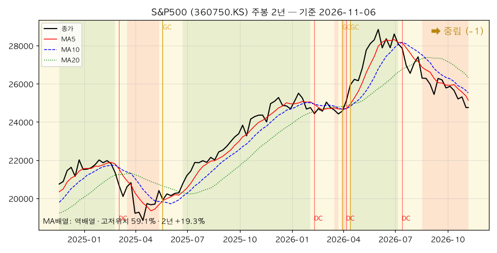

*S&P500(360750.KS) — 주봉 역배열, 2년 +19.3%, 고저위치 59.1%. 1주 -2.2%, 일봉 고저위치 0.0%(3개월 최저). 주봉 MA5-MA10 격차가 -0.67% → -1.52%로 다시 벌어졌다.*

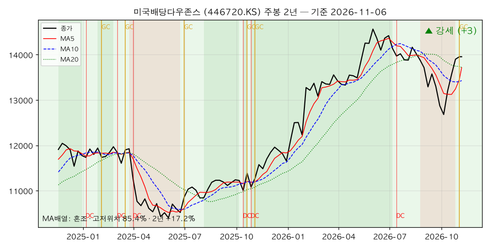

*미국배당다우존스(446720.KS) — 주봉 혼조(MA5가 MA10을 넘었고 MA20과는 0.04% 차), 2년 +17.2%, 고저위치 85.4%. **주봉 골든크로스 1봉 전, 월봉 정배열·골든크로스.** 15종목 중 유일한 3개 시간축 강세 일치.*

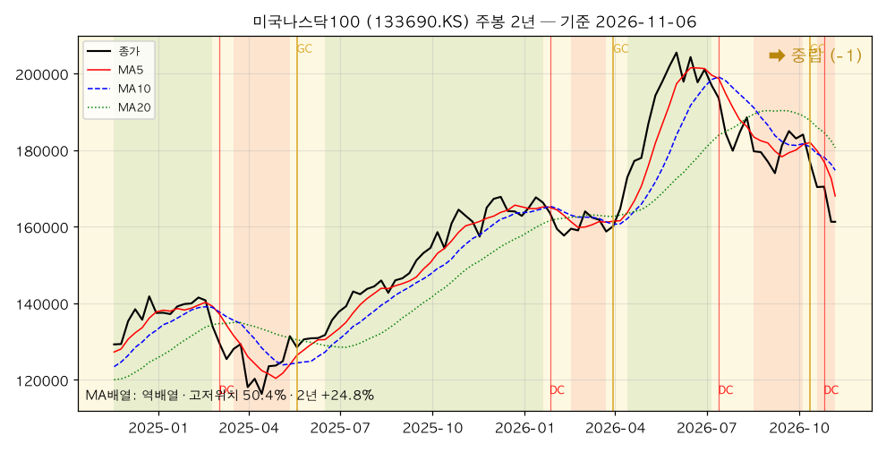

*미국나스닥100(133690.KS) — 주봉 역배열, 2년 +24.8%, 고저위치 50.4%. 1주 -5.4%, 지난 호 대비 -7.5%. 일봉 MA60보다 9.4% 아래.*

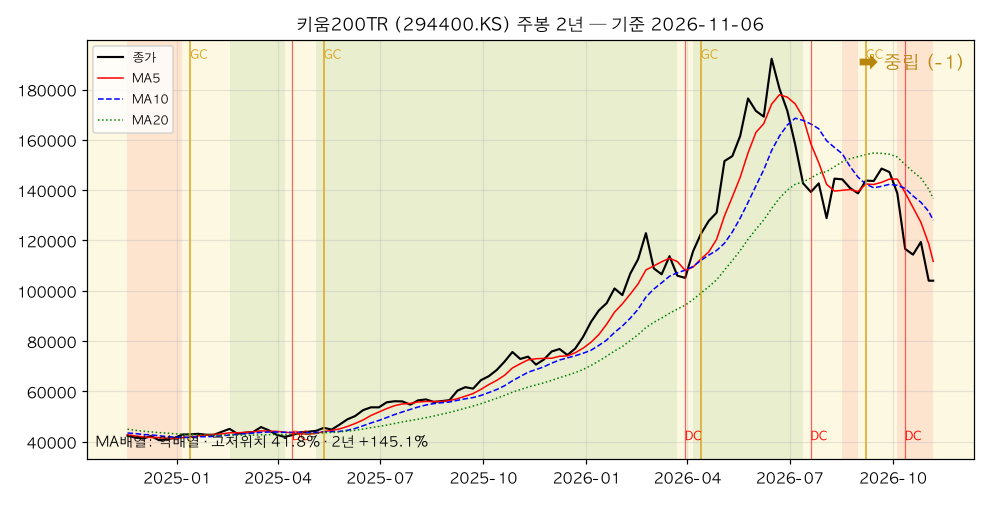

*키움200TR(294400.KS) — 주봉 역배열, 2년 +145.1%, 고저위치 41.8%. 1주 -12.9%로 지난 호 반등 1위(+9.1%)를 전부 반납. 일봉 MA60보다 22.2% 아래.*

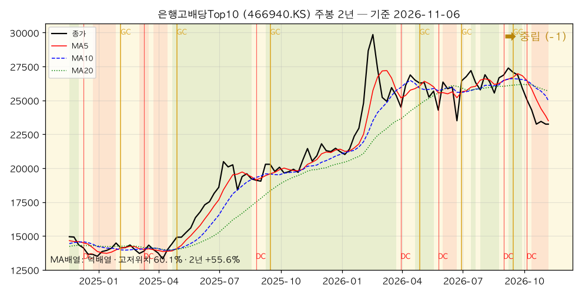

*은행고배당Top10(466940.KS) — 주봉 역배열, 2년 +55.6%, 고저위치 60.1%. 급락장에서 -0.9%로 국내 주식 중 가장 덜 빠졌다. 월봉 데드크로스 1봉 전.*

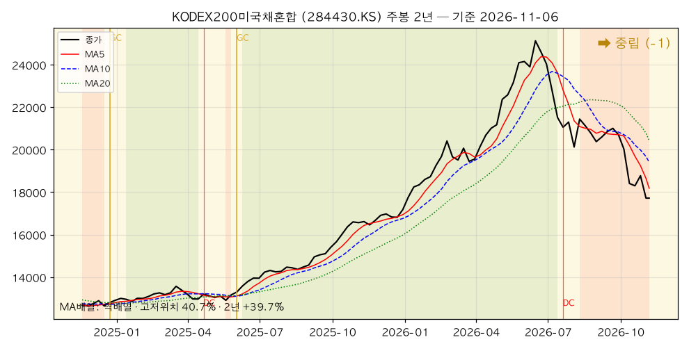

*KODEX200미국채혼합(284430.KS) — 주봉 역배열, 2년 +39.7%, 고저위치 40.7%. 1주 -5.6%. 채권 절반이 들어 있어도 코스피200 하락을 막지 못했다. 일봉 데드크로스 1봉 전.*

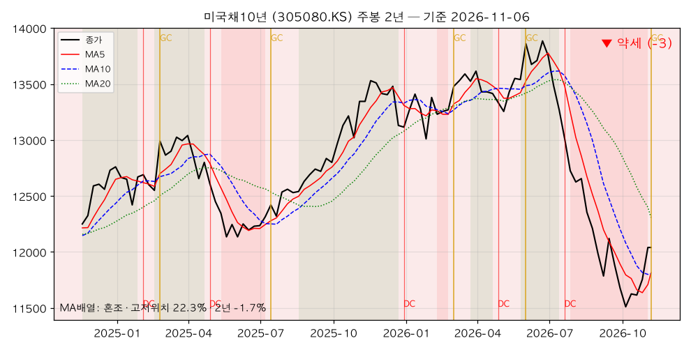

*미국채10년(305080.KS) — 주봉 혼조, 2년 -1.7%, 고저위치 22.3%. **이번 봉 주봉 골든크로스**(격차 +0.08%). 일봉 강세 +2, 주봉은 아직 MA20 아래라 약세 -3.*

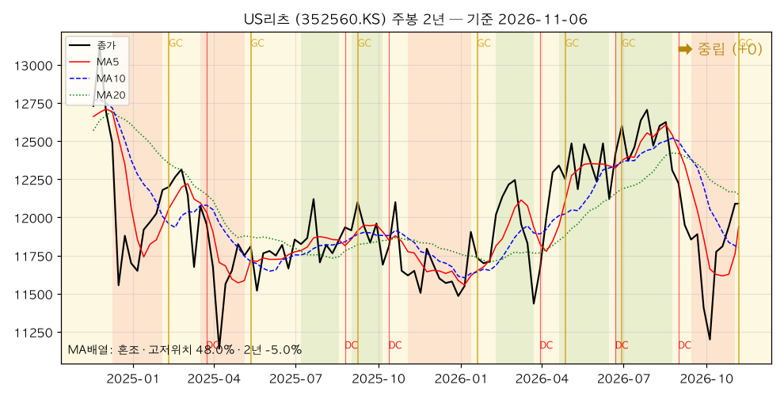

*US리츠(352560.KS) — 주봉 혼조, 2년 -5.0%, 고저위치 48.0%. 이번 봉 주봉 골든크로스. 지난 호 대비 +3.8%로 15종목 중 상승률 1위.*

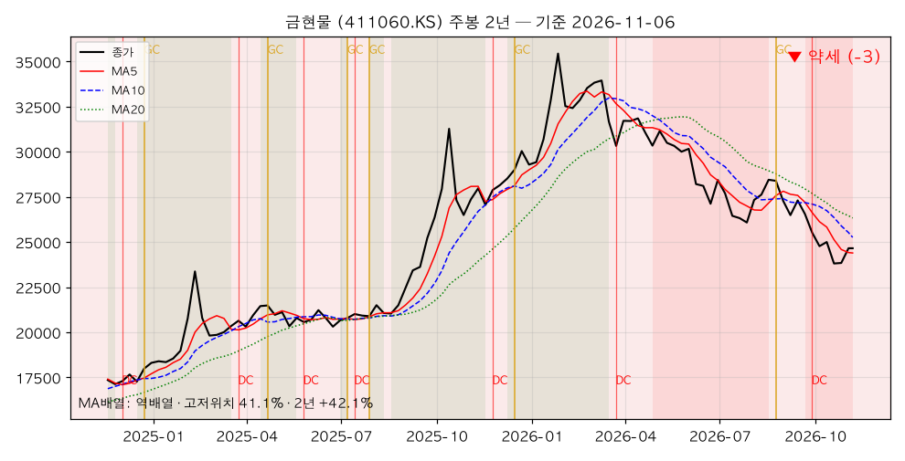

*금현물(411060.KS) — 주봉 역배열, 2년 +42.1%, 고저위치 41.1%. 1주 +3.4%로 상승률 1위(국제 금 3,898.9 → 4,079.5달러, +4.6%). 다만 주봉 MA20(26,332원)이 현재가보다 6.8% 위다.*

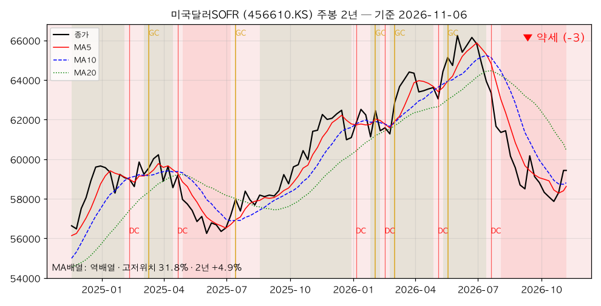

*미국달러SOFR(456610.KS) — 주봉 역배열, 2년 +4.9%, 고저위치 31.8%. 원/달러 1,356원(+1.4%)을 그대로 반영해 +1.9%. 일봉 골든크로스 4봉 전.*

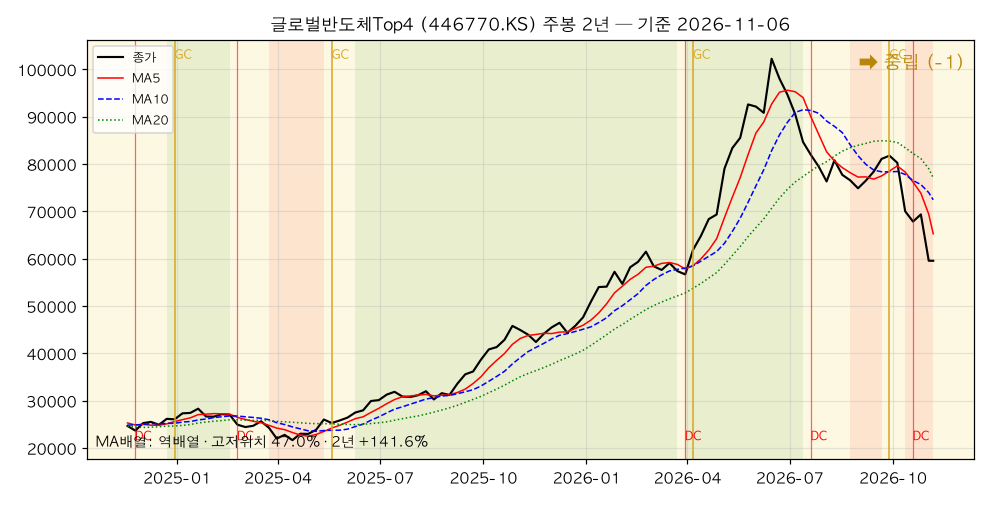

*글로벌반도체Top4(446770.KS) — 주봉 역배열, 2년 +141.6%, 고저위치 47.0%. 1주 -14.1%. 지난 호 월봉 강세 → 중립. 주봉 MA5-MA10 격차 -9.9%.*

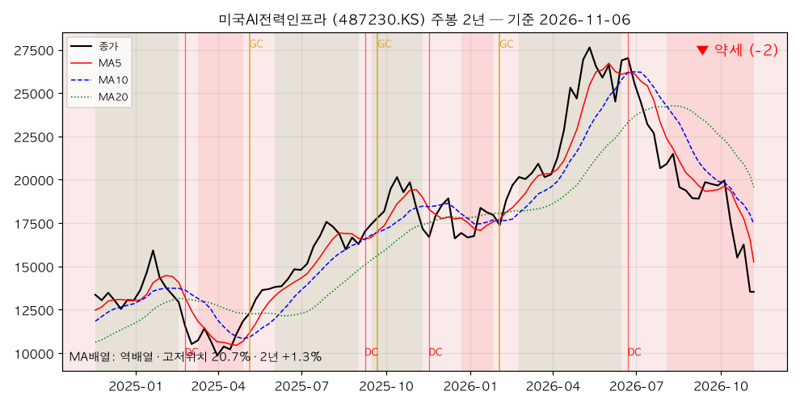

*미국AI전력인프라(487230.KS) — 주봉 역배열, 2년 +1.3%, 고저위치 20.7%. 1주 -16.8%. 이번 주 약세 일치 명단에 새로 들어왔다. 3개월 -36.9%.*

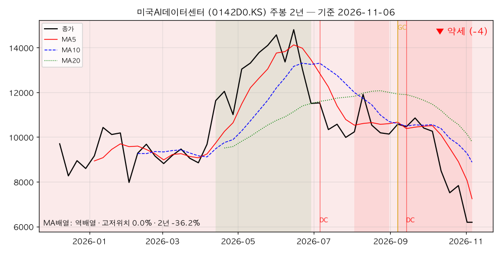

*미국AI데이터센터(0142D0.KS) — 주봉 역배열, 상장 후 -36.2%, 고저위치 0.0%(상장 이후 최저). 1주 -20.9%로 15종목 중 하락률 1위.*

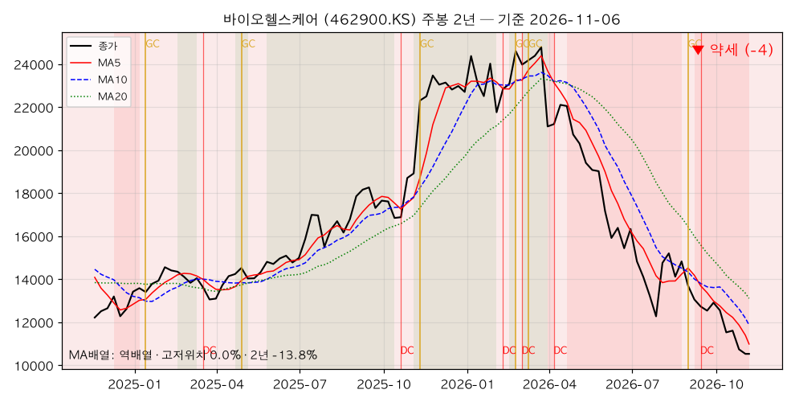

*바이오헬스케어(462900.KS) — 주봉 역배열, 2년 -13.8%, 고저위치 0.0%(2년 최저). 주봉 모멘텀 -38.3%로 15종목 중 가장 약하다.*

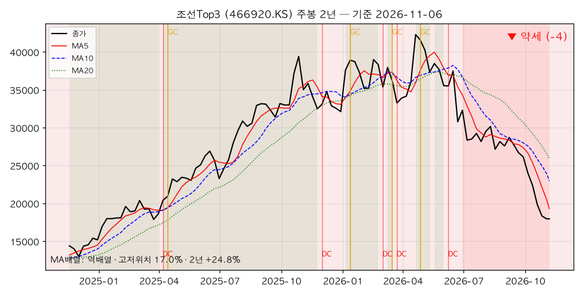

*조선Top3(466920.KS) — 주봉 역배열, 2년 +24.8%, 고저위치 17.0%. 1주 -2.0%로 급락장에서는 덜 빠졌지만 일·주·월봉 모두 -4, 3개월 -39.7%.*

### [5] 추세추종 관점 주목 종목

#### 🚀 멀티타임 강세 (추세 편승 구간)

| 종목 | 일봉 | 주봉 | 월봉 | 근거 |
|---|---|---|---|---|
| 미국배당다우존스 | 🟢 +3 | 🟢 +3 | 🟢 +4 | 주봉 GC 1봉 전, 월봉 정배열·GC, 일봉 MA60 +2.9% 위, 3개 시간축 고저위치 85~92% |

세 시간축 정배열(엄밀한 의미의 멀티타임 정배열)은 아직 0개다. 미국배당다우존스는 월봉만 정배열이고 일·주봉은 혼조(단기선이 장기선 위로 막 올라온 상태)다. 그래도 **강도 점수 기준으로는 이 리포트 시리즈에서 처음 나온 멀티타임 강세**다. 반대 신호도 적는다 — 고저위치 85~92%는 상단권이라 "싸게 사는" 구간은 아니고, 월봉 GC는 11월 봉 6거래일만 반영된 상태다.

#### 📌 눌림목 후보 (장기 상승 + 단기 과매도)

| 종목 | 월봉 고저위치 | 일봉 고저위치 | 괴리 | 월봉 강도 | 일봉 강도 |
|---|---|---|---|---|---|
| S&P500 | 76.6% | 0.0% | 76.6%p | 🟡 0 | 🔴 -4 |
| 은행고배당Top10 | 76.4% | 16.1% | 60.3%p | 🟡 0 | 🔴 -4 |
| 미국나스닥100 | 69.7% | 0.0% | 69.7%p | 🟡 -1 | 🔴 -4 |

#### 눌림목은 어떻게 판정하나 — S&P500 사례 분해

포트폴리오 최대 비중 종목이고 월봉·일봉 괴리가 가장 크다(지난 호 60.3%p → 이번 호 76.6%p).

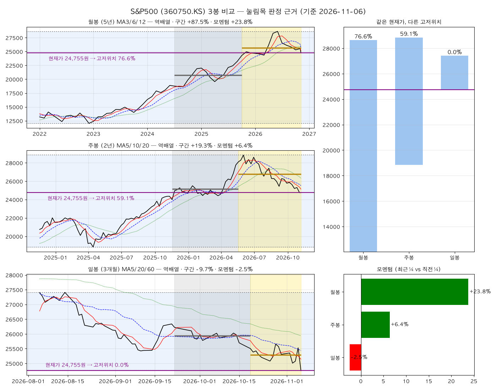

**① 밴드 비교** — 같은 24,755원이 시간축마다 다른 위치다.

| 봉 단위 | 구간 최저 | 구간 최고 | 고저위치 |
|---|---|---|---|
| 월봉 (5년) | 12,035 | 28,640 | 76.6% |
| 주봉 (2년) | 18,840 | 28,845 | 59.1% |
| 일봉 (3개월) | 24,755 | 27,410 | 0.0% |

**② 모멘텀 비교** — 월봉 +23.8%, 주봉 +6.4%, 일봉 -2.5%. 긴 시간축은 아직 가속, 짧은 시간축만 감속이다. "장기 상승 추세 속 단기 조정"이라는 눌림목의 정의에 맞는 모양이다.

**③ 그래도 후보일 뿐인 이유 (반대 신호)**
- **월봉이 역배열이고 데드크로스가 3개월 전에 나왔다.** 장기 추세 자체가 꺾이기 시작했다는 증거다. 눌림목의 전제(장기 상승 유지)가 흔들리고 있다.
- 주봉도 역배열, MA5-MA10 격차가 -1.52%로 지난 호보다 벌어졌다. 주봉 골든크로스는 최근 10주 0건.
- 일봉 고저위치 0.0%는 "충분히 쌌다"가 아니라 **"아직 바닥을 확인하지 못했다"**는 뜻이기도 하다.
- 결론: 매수 조건은 지난 호 그대로 둔다. 일봉 MA5(25,145원)의 MA20(25,434원) 상향 돌파와 MA60(25,935원) 회복. 현재가는 MA20보다 2.7%, MA60보다 4.5% 아래로 **지난 호(1.2%·3.0%)보다 멀어졌다.**

#### ⚠️ 혼조 관망 (신호 불일치)

| 종목 | 상태 | 관망 이유 |
|---|---|---|
| 미국채10년 | 일봉 +2·주봉 -3·월봉 -1 | 주봉 GC가 막 나왔지만 주봉 MA20 아래. 위험회피 매수인지 금리 하락 추세인지 미확인 |
| US리츠 | 일봉 +2·주봉 0·월봉 0 | 주봉 GC 이번 봉. 월봉 혼조, 2년 수익률 -5.0% |
| 미국달러SOFR | 일봉 0·주봉 -3·월봉 -1 | 환율에 연동. 원화 약세 지속 여부에 달림 |
| 금현물 | 일봉 -4·주봉 -3·월봉 -1 | 1주 +3.4%지만 일·주봉 MA 아래 그대로. 반등과 전환을 구분해야 한다 |

#### 🔻 멀티타임 약세 (회피·축소 구간)

| 종목 | 일·주·월봉 | 핵심 수치 |
|---|---|---|
| 미국AI데이터센터 | -4 · -4 · -4 | 1주 -20.9%, 상장 이후 최저, 일봉 MA60 -35.7% |
| 미국AI전력인프라 | -4 · -2 · -4 | 1주 -16.8%, 3개월 -36.9% |
| 조선Top3 | -4 · -4 · -4 | 3개월 -39.7%, 주봉 MA5-MA10 -16.0% |
| 바이오헬스케어 | -4 · -4 · -4 | 2년 최저, 주봉 모멘텀 -38.3% |

### [6] 자산군별 추세 비교

추세강도 평균(-4 ~ +4 척도)으로 자산군을 묶어 비교했다. 괄호는 지난 호(10-29) 값.

| 자산군 | 구성 종목 | 일봉 평균 | 주봉 평균 | 월봉 평균 |
|---|---|---|---|---|
| 주식 — 선진국 | S&P500, 나스닥100, 배당다우존스, 반도체, AI전력, AI데이터센터 | -2.8 (-2.8) | -1.0 (-1.3) | -1.0 (+0.5) |
| 주식 — 국내 | 키움200TR, 은행고배당Top10, 조선Top3, 바이오헬스케어 | -4.0 (-3.8) | -2.5 (-2.5) | -2.2 (-1.8) |
| 혼합 | KODEX200미국채혼합 | -4.0 (-3.0) | -1.0 (-1.0) | -1.0 (+0.0) |
| 채권 | 미국채10년 | +2.0 (-2.0) | -3.0 (-4.0) | -1.0 (-2.0) |
| 대안자산 | 금현물, 미국달러SOFR, US리츠 | -0.7 (-3.0) | -2.0 (-2.7) | -0.7 (-1.0) |
| 배당·인컴 | 배당다우존스, 은행고배당Top10, US리츠 | +0.3 (-1.7) | +0.7 (-1.0) | +1.3 (+1.0) |

**자산군 간 관계 해석**

첫째, **이번 주는 자산군이 정확히 둘로 갈렸다.** 채권·대안·배당은 세 시간축 모두 개선됐고(채권 일봉 -2.0 → +2.0, 대안 일봉 -3.0 → -0.7, 배당 주봉 -1.0 → +0.7), 주식·혼합은 일봉 또는 월봉이 악화됐다. 지난 호에 "거의 모든 칸이 그대로"였던 것과 정반대다. 반등은 구조를 못 바꿨지만 **급락은 구조를 바꿨다.**

둘째, **선진국 주식 월봉이 +0.5 → -1.0으로 1.5점 떨어졌다.** 이번 주 가장 큰 변화다. 글로벌반도체Top4의 월봉 강세 이탈과 AI 두 종목의 월봉 -4가 원인이다. "AI가 미국 주식을 끌어올린다"는 지난 1년의 구조가 월봉에서 처음 흔들렸다.

셋째, **배당·인컴이 유일하게 세 시간축 모두 플러스**다. 미국배당다우존스(+3/+3/+4)가 끌었고, US리츠가 받쳤다. 은행고배당Top10은 일·주봉 약세지만 급락장 낙폭(-0.9%)이 국내 주식 중 가장 작았다.

넷째, **혼합 자산은 이름과 달리 방어를 못 했다**(일봉 -3.0 → -4.0). KODEX200미국채혼합은 코스피200 비중 때문에 1주 -5.6%였다. 미국채가 +2.4% 오른 주에 혼합형이 -5.6%라는 것은, 이 상품의 위험이 사실상 국내 주식이라는 뜻이다.

다섯째, **채권의 일봉과 주봉이 가장 크게 어긋나 있다**(+2.0 vs -3.0). 위험회피성 매수로 단기 강세가 나왔지만, 12월 인상 확률 76.8%(거시 섹션)가 유지되는 한 주봉 추세 전환까지는 근거가 부족하다.

### [7] 종합 코멘트

**전체 추세 방향성**

시간축별 강세 비중은 월봉 6.7%(1개), 주봉 6.7%(1개), 일봉 20.0%(3개)다. 숫자로는 지난 호(13.3% / 0% / 0%)보다 나아 보인다. 그러나 내용은 반대다. 지난 호의 강세는 성장(반도체)과 배당이 반반이었는데, 이번 호의 강세는 **전부 방어자산**이다. 시장 전체의 추세는 "하락 신호의 발생은 멈췄지만 상승 구조는 복원되지 않은 단계"에서 **"성장 자산의 추세가 월봉 단위로 꺾이기 시작하고, 방어 자산이 추세를 넘겨받는 단계"**로 옮겨왔다.

**강세·약세 자산군의 교차 신호**

- 강세 일치 1개(미국배당다우존스, 첫 사례), 약세 일치 4개(AI전력·AI데이터센터·바이오·조선).
- 1주 하락 상위 4종목(AI데이터센터·AI전력·반도체·키움200TR)은 **지난 1~2년 상승률 상위 종목**이기도 하다. 오른 순서대로 빠졌다. 디레버리징(빚을 낸 매수의 청산)의 전형적인 모양이다.
- 1주 상승 5종목(금·미국채·SOFR·리츠·배당다우)은 서로 성격이 다르지만 **공통점은 AI·반도체 노출이 거의 없다는 것**이다.
- 지난 호에 제시한 다섯 가지 확인 신호 중 결과: ① 미국배당다우존스 주봉 전환 — **충족** ② 반도체 월봉 MA12 돌파 유지 — **실패** ③ S&P500·나스닥100 일봉 MA5-MA20 재돌파 — **실패** ④ 조선·바이오 추가 하락 — **진행**(바이오 2년 최저) ⑤ 일봉 데드크로스 0건 유지 — **1건 발생**.

**추세추종 대응 방향**

1. **신규 진입은 미국배당다우존스 하나만 허용된다.** 지난 호에 걸어 둔 조건(주봉 MA5 > MA10)이 충족됐다. 다만 고저위치가 85% 이상 상단권이라 한 번에 들어가지 않고 분할한다. 월봉 GC가 11월 말 확정되면 나머지를 채운다.
2. **눌림목 후보(S&P500·나스닥100)의 매수 조건은 유지하되 서두르지 않는다.** 일봉 MA20·MA60과의 거리가 지난 호보다 멀어졌다. 월봉 역배열이 확정되는 쪽으로 가고 있어 "눌림"이 "꺾임"으로 바뀔 위험이 커졌다.
3. **약세 일치 4종목은 반등 시 축소 원칙을 유지한다.** 특히 AI 두 종목은 일봉 MA60보다 27~36% 아래라 기술적 반등이 나와도 구조 회복까지 거리가 멀다.
4. **방어자산의 단기 강세를 추격하지 않는다.** 미국채10년·US리츠의 주봉 GC는 이번 봉에 막 나왔고 주봉 MA20 아래다. 한 주 더 유지되는지 본다.
5. **다음 주 확인할 신호**: ① 미국배당다우존스 주봉 GC 유지(격차 +2.13%) ② 미국채10년·US리츠 주봉 GC가 MA20 회복으로 이어지는지 ③ S&P500 일봉 고저위치 0% 탈출(3개월 최저 24,755원 지지 여부) ④ AI·반도체 3종의 주봉 하락 속도 둔화 ⑤ VIX 30 돌파 여부(거시 섹션 전환 조건과 연결).

## 5. 내 ETF 평가 & 대응

> 이 섹션은 개인 포트폴리오를 다루므로 **절대금액을 쓰지 않는다.** 모든 수치는 비중(%)·수익률(%)·주당 가격이다.
> 앞의 세 분석(한국은행·거시·차트)을 입력으로 받은 최종 종합이며, 관점은 **안전마진 기반 가치투자자**다.
> 기준: 포트폴리오 시트 11-08 갱신본, 시세 Yahoo Finance 11-06 종가. 직전 리포트(10-29)와 비교한다. *(11-07 첫 발행본은 시트 미갱신 상태의 추정치였고, 11-08 실제 시트로 이 섹션을 교체했다.)*

### 5-0. 이번 주의 한 줄 — 방어자산이 계좌를 지켰고, 나는 그 주에 현금을 다 썼다

지난 호의 결론은 "내 손실 자산의 3분의 1이 금리 인하에 걸려 있는데, 한·미 중앙은행이 그 베팅을 부정했다"였다. 일주일 뒤 실제로 무너진 것은 그 3분의 1이 아니었다. **AI·반도체·국내 주식이 한 주 만에 두 자릿수로 빠졌고, 금·미국채·달러·배당은 올랐다.**

| 항목 | 44주차(10-29) | 45주차(11-06) | 내 포트폴리오에의 의미 |
|---|---|---|---|
| S&P500 지수 | 7,720 | 7,377 (△4.4%) | 최대 비중 자산 조정 진입 |
| 나스닥100 지수 | 29,403 | 26,990 (△8.2%) | AI·반도체 디레버리징 |
| 코스피 | 5,938 | 5,060 (△14.8%) | 11/6 장중 서킷브레이커 |
| VIX | 17.2 | 25.6 | 공포 지수 1.5배 |
| 미 10년물 | 5.05% | **4.86%** | 장기채 반등(+19bp 하락) |
| 미 3개월물 | 4.18% | 4.19% | 현금 이자 유지 |
| 12월 연준 인상 확률 | — | **76.8%** | 단기금리는 내려올 생각이 없다 |
| 원/달러 | 1,340원 | 1,356원 (+1.2%) | 달러 자산에 순풍 |
| 국제 금값 | 4,031달러 | 4,079.5달러 (+1.2%) | 금 4개 라인 일제히 상승 |
| WTI | 101.5달러 | 90.3달러 (△11.0%) | 비용 충격 완화 |

**이 표가 말하는 것.** 지난 호에 "금리 인하 베팅"으로 분류한 금(13.7%)·미국채(7.3%)·달러단기채(3.8%)는 이번 주 **모두 플러스**였다. 이유는 금리 인하가 아니라 **위험회피**다. 주식이 무너지는 주에 장기채·금·달러가 오르는 것은 이 자산들의 본래 역할이고, 이번 주 그 역할이 작동했다. 반대로 지난 호에 "실적은 역사적 수준"이라고 유보했던 AI·반도체 테마(8.1%)가 **이번 주 계좌 손실의 약 4분의 3**을 만들었다.

그리고 이번 주 시트에는 **실제 매매**가 찍혀 있다. 방향은 대체로 맞았지만, 지난 세 호가 반복한 원칙 하나 — 현금 복원 — 는 정반대로 갔다.

### 5-1. 포트폴리오 현황 (비중·수익률만)

#### 전체

| 항목 | 값 | 직전(10-29) | 변화 |
|---|---|---|---|
| 전체 누적 수익률 | **△2.90%** | △0.15% | **△2.75%p** |
| 이번 주 계좌 가치 변화(신규 납입 제외) | **△2.77%** | — | 같은 기간 S&P500 지수 △4.4%, 코스피 △14.8% |
| 미국 자산 비중(혼합형 제외) | 약 66.9% | 69.7% | △2.8%p |
| 금 비중 | **13.7%** | 13.0% | +0.7%p (소폭 추가 매수 + 가격 상승) |
| **현금 비중** | **1.0%** | 2.7% | **△1.7%p** — 연금저축 현금 전액 투입 |
| 달러 표시 자산 합계(미국 자산 + 금) | 약 80.6% | 약 82.8% | △2.2%p (달러단기채 축소) |

**코스피가 14.8% 빠진 주에 계좌는 2.8% 빠졌다.** 국내 주식 직접 노출이 7.0%(혼합형 절반 포함 약 10.9%)로 작았고, 달러 표시 자산이 80%를 넘어 원화 약세(+1.2%)를 받았기 때문이다. 지난 호에 "환율 단일 리스크"로 경계한 높은 달러 비중이 **이번 주에는 완충재**로 작동했다. 리스크가 사라진 것은 아니다. 이번 주는 방향이 유리했을 뿐이다.

#### 계좌별

| 계좌 | 전체 내 비중 | 계좌 수익률 | 직전(10-29) | 변화 | 주간 가치 변화(납입 제외) |
|---|---|---|---|---|---|
| 퇴직연금 | 40.5% | **+5.09%** | +6.22% | △1.13%p | △1.06% |
| 연금저축펀드 | 26.8% | **△0.38%** | +1.08% | △1.46%p | △1.44% |
| 개인IRP | 18.6% | **+4.17%** | +3.81% | **+0.36%p** | **+0.35%** |
| ISA | 14.1% | **△28.36%** | △18.42% | **△9.94%p** | **△13.27%** |

**개인IRP가 2주 연속 유일하게 올랐다.** 구성(미국배당미국채혼합50·S&P500·미국배당다우존스·금)이 이번 주 시장에서 가장 이상적인 조합이었다. 배당·채권·금 세 축이 S&P500의 하락을 상쇄했다.

**ISA는 한 주에 △13.3%다.** 계좌 수익률이 △18.42% → **△28.36%**로 악화됐다. 이번 주 전체 가치 변화(△2.77%) 중 **△2.02%p가 ISA 한 계좌**에서 나왔다. 전체의 14%인 계좌가 손실의 약 73%를 만들었다.

#### 이번 주 실제로 무엇을 사고팔았나

시트의 투입 원가 증감에서 역산한 **정성 판정**이다. 금액은 공개하지 않고, 전체 원금 대비 비율로만 크기를 표시한다. 매매일은 **11/5(목)**이다.

| 계좌 | 줄인 것 | 늘린 것 | 원금 대비 규모 |
|---|---|---|---|
| 퇴직연금 | **미국달러단기채권**(약 △1.0%p), 현금(△0.3%p) | **SOL 미국배당다우존스**(+0.6%p), 타이거 S&P500(+0.7%p) | 계좌 내 교체 |
| 연금저축펀드 | **현금 전액**(△1.4%p) | **미국채 10년선물**(+0.7%p), **KIWOOM 200TR**(+0.5%p), ACE 금현물(+0.2%p), S&P500·은행고배당(소량) | 계좌 내 교체 |
| ISA | — | ACE 미국30년국채(+0.1%p), **KODEX 미국S&P500헬스케어**(+0.5%p) | 신규 납입 |
| 개인IRP | — | TIGER 미국배당다우존스(소량) | — |

#### 11/5에 산 것들은 하루 뒤 어떻게 됐나 — 시차의 함정

11/5는 이번 주 급락의 날이지만, **국내 상장 미국 ETF에게는 급락 전날**이었다. 미국 증시가 무너진 것은 미국 시간 11/5이고, 한국 시장은 그 결과를 11/6에 받았다. 11/5 한국 장중에 거래된 미국 ETF는 오히려 미국 11/4 반등(S&P500 +1.6%)을 반영해 올라 있었다.

| 11/5 매매 | 11/5 종가(전일비) | 11/6 종가(다음 날) | 읽는 법 |
|---|---|---|---|
| SOL 미국배당다우존스 매수 | 14,110 (+2.2%) | 13,955 (△1.1%) | 반등한 날 샀다. 손실은 작다 |
| 타이거 미국 S&P500 매수 | 25,530 (+1.8%) | 24,755 (**△3.0%**) | **미국 급락 직전의 고점**에서 샀다 |
| KODEX 미국S&P500헬스케어 매수 | 15,540 (+4.1%) | 15,005 (△3.4%) | 같은 시차 |
| 금현물 매수 | 24,915 (+2.8%) | 24,655 (△1.0%) | 같은 시차, 손실은 작다 |
| 미국채 10년선물 매수 | 11,895 (+0.8%) | 12,040 (**+1.2%**) | 급락에 안전자산으로 올랐다 |
| 미국30년국채 매수 | 7,170 (+1.3%) | 7,140 (△0.4%) | 보합 |
| KIWOOM 200TR 매수 | 111,285 (**△5.7%**) | 104,010 (**△6.5%**) | 떨어지는 날 샀고, 다음 날 더 떨어졌다 |
| 미국달러단기채권 매도 | 12,750 (보합) | 12,895 (+1.1%) | 판 다음 날 원화 약세로 올랐다 |

**교훈은 두 가지다.** 첫째, **국내 상장 해외 ETF는 그날 밤 미국 시장의 결과를 하루 늦게 받는다.** 미국에서 큰 사건이 예상되는 날(지표 발표, 실적, 변동성 급등)에 한국 장중에 사면, 그날 밤의 위험을 그대로 떠안는다. 둘째, **200TR은 "떨어지는 칼"을 잡은 사례**다. 11/5 △5.7% 날에 샀고 다음 날 △6.5%가 더 나왔다. 4장 기준으로 이 종목은 일봉 고저위치 0.0%·MA60보다 22% 아래로, 매수 신호가 하나도 없었다. 밸류 근거도 없었다(5-2). 반대로 배당다우는 **신호가 확인된 뒤에** 샀고, 다음 날 손실도 가장 작은 쪽이었다. 같은 날의 두 매수가 원칙을 지킨 것과 어긴 것의 차이를 보여준다.

ISA의 AI·반도체·조선은 **추가 매수 없음** — 원칙이 3주째 지켜졌다. 전체 원금은 약 +0.6% 늘었다(신규 납입).

**지난 호 원칙의 이행 점검**

| 10-29 원칙 | 이번 주 매매 | 평가 |
|---|---|---|
| 신규 매수는 미국배당다우존스 하나뿐, 주봉 MA5 > MA10 확인 후 | SOL·TIGER 배당다우 추가 → **조건은 이번 주 충족**(4장) | ✅ 이행 — 주봉 골든크로스는 10/30 마감 봉에서 이미 확정됐고, 매수는 11/5. **조건 확인 후 매수**였다 |
| 현금 재원은 미국달러단기채권 축소로 | 달러단기채 **축소 실행** | ✅ 이행 — 다만 매도 다음 날(11/6) 원화 약세로 +1.1% 더 올랐다 |
| **현금 2.7% → 8% 복원** | 현금 **1.0%**로 추가 감소. 연금저축 현금 전액이 미국채·200TR·금으로 | ❌ **3회 연속 미이행, 방향 반대.** 달러단기채를 줄인 돈도 현금이 아니라 주식으로 갔다 |
| 국내 주식은 밸류 확인 전 추가 금지 | **KIWOOM 200TR 추가 매수** | ❌ 원칙 위반. 11/5 △5.7% 날 매수, 다음 날 △6.5%. 누적 +2.71% → △11.75% |
| 장기채 합산 상한(6%대) | 미국채 10년 추가 → 미국채 비중 **7.3%** | ⚠️ 상한 초과. 단 이번 주 미국채는 +2.9%로 결과는 좋았다 |
| ISA 추가 매수 금지(테마) | AI·반도체·조선 추가 없음, 헬스케어·30년국채만 | ✅ 이행 — 테마가 아닌 방어 쪽으로 납입분을 돌렸다 |
| 은행고배당 추가 매수 중단 | 소량 추가 | ⚠️ 규모는 미미 |

**정리하면 "무엇을 샀는가"는 대체로 맞았고, "얼마를 남겼는가"가 틀렸다.** 배당다우·미국채·헬스케어 매수는 이번 주 각각 +2.0%·+2.9%·+2.5%로 결과도 좋았다. 문제는 그 대가로 현금이 1.0%까지 내려왔다는 것이다. 4장이 S&P500 강력매수가를 21,430원으로 제시한 지금, **그 가격이 오면 쓸 돈이 사실상 없다.**

#### 자산군별

| 자산군 | 전체 비중 | 누적 수익률 | 직전 비중 / 수익률 | 이번 주 가격 | 평가 |
|---|---|---|---|---|---|
| 미국주식(지수) | 31.4% | +4.80% | 30.9% / +9.52% | S&P500 △3.2% / 나스닥100 △7.5% | 최대 비중. 추가 매수로 비중 소폭 상승 |
| 금 | 13.7% | △2.82% | 13.0% / △3.85% | +2.0~2.4% | 이번 주 최대 플러스 기여 |
| 미국배당 | 13.4% | **+13.89%** | 11.9% / +9.50% | +2.0% | 매수 + 상승. 세 시간축 강세(4장) |
| 테마(AI·반도체) | 8.1% | **△33.71%** | 10.0% / △16.39% | △17~25% | 비중 8%로 이번 주 손실의 대부분 |
| 한국주식+미국채 혼합 | 7.8% | +5.44% | 7.9% / +9.01% | △7.3% | 혼합형인데 방어를 못 했다(4장 [6]) |
| 미국채 | 7.3% | △3.00% | 6.2% / △6.13% | 10년 +2.9% / 30년 +1.0% | 매수 + 금리 19bp 하락 |
| 한국주식 | 7.0% | △18.79% | 6.7% / △16.19% | 200TR △16.2% / 은행 △0.9% / 조선 △1.8% | 200TR 추가 매수로 비중 상승 |
| 미국배당+미국채 혼합 | 6.4% | +4.32% | 6.1% / +2.15% | +2.1% | 2주 연속 조용한 플러스 |
| 달러/현금 | 4.8% | △6.71% | 7.3% / △6.12% | 달러단기채 +1.7% | **축소 실행**. 이 중 현금은 1.0% |
| 미국 헬스케어 | 1.1% | +1.02% | 0.6% / +0.14% | +2.5% | ISA 신규 납입분 |

#### 종목별 통합 (계좌 합산)

| 종목 | 티커 | 현재가(원) | 전체 비중 | 누적 수익률 | 1주 가격(10-29 대비) | 차트 판정(일/주/월) |
|---|---|---|---|---|---|---|
| 타이거 미국 S&P500 | 360750 | 24,755 | 26.0% | +7.26% | △3.2% | 🔴 / 🟡 / 🟡 |
| SOL 미국배당다우존스 | 446720 | 13,955 | 9.8% | **+19.84%** | +2.0% | 🟢 / 🟢 / 🟢 |
| ACE KRX 금현물 | 411060 | 24,655 | 8.9% | △4.64% | +2.4% | 🔴 / 🔴 / 🟡 |
| 삼성 KODEX200 미국채혼합 | 284430 | 17,720 | 7.8% | +5.44% | △7.3% | 🔴 / 🟡 / 🟡 |
| SOL 미국배당미국채혼합50 | 490490 | 11,065 | 6.4% | +4.32% | +2.1% | (차트 15종목 외) |
| 타이거 미국채 10년선물 | 305080 | 12,040 | 5.4% | △3.70% | +2.9% | 🟢 / 🔴 / 🟡 |
| 타이거 KRX금현물 | 0072R0 | 11,765 | 4.8% | +0.78% | +2.0% | (차트 15종목 외) |
| 타이거 미국 나스닥100 | 133690 | 161,300 | 4.3% | △7.27% | △7.5% | 🔴 / 🟡 / 🟡 |
| TIGER 미국달러단기채권액티브 | 329750 | 12,895 | 3.8% | △8.31% | +1.7% | (차트 15종목 외) |
| 타이거 은행고배당플러스TOP10 | 466940 | 23,250 | 3.7% | △4.60% | △0.9% | 🔴 / 🟡 / 🟡 |
| TIGER 미국배당다우존스 | 458730 | 15,250 | 3.6% | +0.48% | +2.0% | (차트 15종목 외) |
| ACE 글로벌반도체TOP4 plus | 446770 | 59,525 | 3.5% | **△21.10%** | △17.2% | 🔴 / 🟡 / 🟡 |
| 타이거 미국AI데이터센터Top4Plus | 0142D0 | 6,190 | 3.3% | **△43.56%** | △24.8% | 🔴 / 🔴 / 🔴 |
| ACE 미국30년국채액티브 | 453850 | 7,140 | 1.9% | △0.94% | +1.0% | (차트 15종목 외) |
| SOL 조선TOP3플러스 | 466920 | 17,960 | 1.7% | **△41.94%** | △1.8% | 🔴 / 🔴 / 🔴 |
| KIWOOM 200TR | 294400 | 104,010 | 1.6% | △11.75% | △16.2% | 🔴 / 🟡 / 🟡 |
| KODEX 미국AI전력핵심인프라 | 487230 | 13,535 | 1.3% | **△33.14%** | △18.9% | 🔴 / 🔴 / 🔴 |
| KODEX 미국S&P500 헬스케어 | 453640 | 15,005 | 1.1% | +1.02% | +2.5% | (차트 15종목 외) |
| 현금 | — | — | 1.0% | — | — | — |

> 티커 메모(지난 호와 동일): 446720 = SOL 미국배당다우존스, 490490 = SOL 미국배당미국채혼합50, 타이거 KRX금현물 = 0072R0, KODEX 미국S&P500헬스케어 = 453640. 차트 15종목 밖의 6종목은 이 섹션에서 별도로 시세를 수집했다. 시세 수집 실패 종목은 없다.

**누적 손실 -30% 이상 종목이 셋이다.** 미국AI데이터센터 △43.56%, 조선TOP3 △41.94%, 미국AI전력 △33.14%. 셋 다 ISA에 있고 셋 다 4장에서 세 시간축 약세 일치 판정을 받았다. 반대 끝은 **SOL 미국배당다우존스 +19.84%**로, 보유 종목 중 누적 수익률 1위이자 이번 주 매수한 종목이다.

### 5-2. 2단계 — 내 ETF의 펀더멘털 지표

#### 지표를 어떻게 읽나 (쉬운 설명)

| 지표 | 한 줄 정의 | 비유 |
|---|---|---|
| **PER** | 주가 ÷ 1주당 순이익. ETF는 담은 기업들의 시가총액 가중평균 | **"이 가게를 사면 지금 버는 돈으로 원금 회수에 몇 년 걸리나."** PER 20배 = 20년 |
| **이익수익률** | 1 ÷ PER × 100 | **"이 가게의 연 이자율."** PER 20배면 연 5% |
| **PBR** | 주가 ÷ 1주당 순자산 | **"가게 집기·현금을 다 팔면 받는 돈의 몇 배를 내고 사는가."** |
| **ROE** | 순이익 ÷ 자기자본. 여기서는 PBR ÷ PER로 역산 | **"내 돈 100을 맡기면 1년에 몇을 벌어오나."** |
| **배당수익률** | 연간 분배금 ÷ 현재가 | **"매년 통장에 실제로 꽂히는 비율."** |

**안전마진의 기준선**: 한국 예금금리 **3.5%**. 이익수익률이 이보다 낮으면 위험을 더 지고 수익을 덜 받는 거래다.

#### 보유 ETF 지표 (2026-11-06 추정)

국내 상장 ETF는 Yahoo가 펀더멘털을 제공하지 않아 **동일 지수 미국 상장 ETF를 대리 지표**로 쓴다. 지난 호(10-29)의 보유종목 가중 PER에 **10-29 → 11-06 대리 ETF 가격 변화율**을 반영했다. 일주일 사이 이익 추정치는 바뀌지 않았다고 가정한 근사치다.

| 내 ETF | 대리 | 대리 가격 1주 | PER (지난 호 → 이번 호) | 이익수익률 | PBR(지난 호) | ROE(역산) | 배당수익률 |
|---|---|---|---|---|---|---|---|
| SOL·TIGER 미국배당다우존스 | SCHD | △1.2% | 18.2 → **18.0배** | **5.6%** | 3.55배 | 19.5% | **3.2%** |
| 타이거 미국 S&P500 | SPY | △4.4% | 24.2 → **23.1배** | **4.3%** | 5.25배 | 21.7% | 1.0% |
| 타이거 미국 나스닥100 | QQQ | △8.3% | 28.3 → **26.0배** | 3.8% | 8.91배 | 31.5% | 0.4% |
| KODEX 미국S&P500헬스케어 | XLV | +0.4% | 30.0 → 30.1배 | 3.3% | 4.74배 | 15.8% | 1.5% |
| ACE 글로벌반도체TOP4 | SOXX | **△20.3%** | 33.4 → **26.6배** | **3.8%** | 10.52배 | 31.5% | 0.2% |
| SOL 미국배당미국채혼합50 | 합성 | — | — | 약 5.2%\* | — | — | — |

\* 주식 이익수익률 5.6%와 미 10년물 4.86%의 절반 가중 기대수익률.

**수집하지 못한 지표**: 은행고배당TOP10·KIWOOM 200TR·조선TOP3의 11월 시점 PER·PBR 확정치, 미국AI데이터센터·AI전력의 대리 ETF(대응 미국 상장 ETF 없음). 채권·금·달러 ETF는 PER 개념이 적용되지 않는다. 지난 호와 동일하다.

#### ETF를 하나의 회사로 보면 — 현금흐름 3분해

| 활동 | 보는 지표 | 이번 주 달라진 점 |
|---|---|---|
| **영업활동** (돈을 잘 버나) | ROE·영업이익률 | 바뀐 것 없음. 보유 미국 ETF ROE 15.8~31.5%. 한국 9월 반도체 통관수출 +260%(2장), 10월 +259%(3장)로 반도체 실적은 오히려 더 강해졌다 |
| **투자활동** (미래에 쓰나) | CAPEX·ROIC | **이번 주 시장이 의심한 칸이 여기다.** AI 설비투자가 회수될지에 대한 의심이 반도체·AI 테마를 한 주에 17~25% 끌어내렸다. 실적은 좋아지는데 주가는 무너지는, 3주째 이어진 괴리가 이번 주 극단까지 벌어졌다 |
| **재무활동** (주주에게 돌려주나) | 배당수익률·자사주 | 배당다우존스 3.2%가 이번 주 유일하게 세 시간축 강세. **"지금 현금을 돌려주는 자산"이 "미래를 약속하는 자산"을 처음으로 추세에서 이겼다** |

### 5-3. 3단계 — 안전마진과 적정가격 범위

#### 무위험 수익률 사다리와 "등가 PER"

| 비교 대상 | 수익률 | 등가 PER | 지난 호 대비 |
|---|---|---|---|
| 한국 기준금리 | 3.00% (11/26 결정) | 33.3배 | — |
| **한국 예금금리 (기준선)** | **3.5%** | **28.6배** | — |
| 미 정책금리 | 3.875% (12월 인상 확률 76.8%) | 25.8배 | — |
| 미 3개월물 | 4.19% | 23.9배 | 보합 |
| **미 10년물** | **4.86%** | **20.6배** | 19.8배 → 20.6배로 **기준이 느슨해졌다** |

#### 내 주식 ETF는 이 사다리의 어디에 있나

| ETF | 이익수익률 | vs 예금 3.5% | vs 3개월물 4.19% | vs 10년물 4.86% | 지난 호 대비 |
|---|---|---|---|---|---|
| **미국배당다우존스** | **5.6%** | **+2.1%p** ✅ | **+1.4%p** ✅ | **+0.7%p** ✅ | 3개 기준 모두 합격 유지 |
| 타이거 미국 S&P500 | 4.3% | +0.8%p ✅ | **+0.1%p** ✅ | △0.5%p ❌ | **3개월물을 처음으로 넘었다** |
| 타이거 미국 나스닥100 | 3.8% | +0.3%p ✅ | △0.4%p ❌ | △1.0%p ❌ | 예금 기준 통과로 개선 |
| ACE 글로벌반도체TOP4 | 3.8% | +0.3%p ✅ | △0.4%p ❌ | △1.1%p ❌ | **△0.5%p → +0.3%p, 예금 기준 통과** |
| KODEX 미국S&P500헬스케어 | 3.3% | △0.2%p ❌ | △0.9%p ❌ | △1.5%p ❌ | 변화 없음 |

**급락이 안전마진을 만들어 냈다 — 다만 아직 "충분하다"고 말할 수준은 아니다.** 한 주 사이에 S&P500이 3개월물 기준을, 나스닥100과 반도체가 예금 기준을 넘어섰다. 가격이 빠지고 미 10년물이 내려가 기준 자체도 느슨해진 결과다. 그러나 가장 엄격한 기준(미 10년물)을 넘는 것은 **여전히 배당다우존스 하나**다. 그리고 반도체의 PER 26.6배는 "이익이 그대로"라는 가정에 기댄 숫자다. 시장이 이번 주 의심한 것이 바로 그 이익의 지속성이므로, 이 개선을 그대로 믿으면 안 된다.

#### S&P500 PER 23.1배는 50년 역사에서 어디쯤인가

| 시점 | S&P500 후행 PER | 현재(23.1배) 대비 |
|---|---|---|
| 50년 장기 평균 | 약 16배 | 현재는 평균의 **1.44배** (지난 호 1.5배) |
| 2007년 금융위기 직전 | 약 20배 | 현재가 **16% 더 비싸다** (지난 호 21%) |
| 2021년 코로나 후 유동성 장세 | 약 37배 | 그 62% 수준 |
| 2000년 3월 닷컴 버블 | 약 44배 | 그 53% 수준 |

S&P500 지수가 한 주에 4.4% 빠졌지만 **50년 평균 대비 1.44배**다. 평균 수준(16배)까지 가려면 지수가 지금보다 약 31% 더 내려가야 한다. 이번 주 하락은 "싸졌다"가 아니라 **"덜 비싸졌다"**다.

#### 적정가격 범위 (ETF별, 원화 주당 가격)

| ETF | 현재가 | 강력매수가 | 적정매수가 | 매도·경계가 | 현재 위치 |
|---|---|---|---|---|---|
| 타이거 미국 S&P500 | 24,755 | **21,430** (PER 20배) | 22,075 (10년물 등가 20.6배) | 26,790 (PER 25배) | 적정매수가보다 12% 위. **조건부 대기** |
| SOL 미국배당다우존스 | 13,955 | 이미 PER 18.0배로 20배 이하 | — | 배당수익률 5% 달성가 9,040 | **강력매수 구간 안**(PER 기준). 단 배당 5% 기준으로는 멀다 |
| 타이거 미국 나스닥100 | 161,300 | 124,080 (PER 20배) | 155,100 (PER 25배) | — | 적정매수가 4% 위 |
| ACE 글로벌반도체TOP4 | 59,525 | 44,755 (PER 20배) | 55,945 (PER 25배) | — | 적정매수가 6% 위. 이익 지속 가정 시 |
| 금현물 (411060) | 24,655 | — | — | **30,550** (JP모건 목표 5,055달러 환산) | 목표가까지 +23.9% 여지 |
| 미국채10년 (305080) | 12,040 | — | — | 금리 50bp 하락 시 약 +4%, 상승 시 약 △4% (듀레이션 약 8년, 환율 제외) | 12월 인상 시 하방 |
| 미국달러SOFR·달러단기채 | — | 현재가 = 적정가 | — | — | 원금 보존형. 손익은 환율 |

> 계산: 주식 ETF는 현재가 × (목표 PER ÷ 현재 PER). 환율 변동은 반영하지 않았다. 금은 현재가 × (목표 금값 ÷ 현재 금값 4,079.5달러).

#### 마진데빗 — 이번 주가 "감소가 무서운" 이유의 시험대였다

9월 마진데빗은 1조 4,800억달러로 사상 최고(6월)의 98.5%다(3장). 지난 호에서 "잔액 최고권 + 증가 둔화 = 2000·2007·2021년의 고점 패턴"이라고 경고했다. **마진데빗이 줄어드는 과정은 빚을 갚는 과정이고, 빚을 갚기 위해 파는 주식은 가격을 가리지 않는다.** 11/5 하루에 반도체지수가 12% 빠진 것은 이 강제청산이 레버리지가 가장 많이 걸린 AI·반도체에서 일어났을 가능성을 보여준다. 10월분(11월 하순 발표)이 전월비 마이너스로 나오면 디레버리징이 공식화된다. 그 경우 **"싸졌으니 산다"는 논리는 한 번 더 미뤄야 한다** — 강제 매도는 펀더멘털과 무관하게 한동안 이어진다.

### 5-4. 4단계 — 세 가지 투자자 관점

| 관점 | 판단 기준 | 현재 시장 평가 | 내 포트폴리오에 대한 행동 |
|---|---|---|---|
| **가치투자자 (버핏)** | 이익수익률 > 무위험수익률, 안전마진 | 🟠 **선별 가능, 후보가 늘었다** — 배당다우존스는 3개 기준 모두 합격. S&P500이 3개월물을, 나스닥100·반도체가 예금 기준을 처음 넘었다. 그러나 10년물 기준 합격은 여전히 1종 | **신규 자금 1순위는 배당다우존스.** S&P500은 강력매수가(21,430원) 근처까지 기다린다. 반도체는 이익 지속성 확인 전 보류 |
| **성장주 투자자 (ARK)** | EPS 성장률, 점유율, AI·반도체 테마 | 🔴 **테마 붕괴** — 한국 10월 반도체 수출 +259%로 실적은 최강인데, 반도체 ETF는 1주 △17%, AI데이터센터 △25%. **실적과 주가의 괴리가 극단**까지 벌어졌다 | 실적이 맞다면 이 괴리는 언젠가 기회가 된다. 그러나 **디레버리징이 끝났다는 증거(마진데빗·VIX) 전에는 손대지 않는다** |
| **단기 트레이더 (모멘텀)** | 이동평균, VIX, 마진데빗 추세 | 🔴 **약세, 방어로 이동** — 9종목이 3개월 최저, VIX 25.6. 강세 일치는 배당다우존스 1종, 주봉 GC는 배당다우·미국채10년·US리츠 3종 | 배당다우는 지난 호 조건(주봉 MA5 > MA10) 충족 → 분할 진입. AI 3종은 반등 시 축소 |

**세 관점 중 둘이 같은 종목을 가리킨다.** 가치(이익수익률 5.6%, 3개 기준 합격)와 모멘텀(세 시간축 강세 일치)이 미국배당다우존스에서 겹쳤다. 지난 호에는 "두 방법이 같은 종목을 처음 가리켰다"고 썼고, 이번 주는 그 종목이 **실제로 조건을 충족했다.** 성장 관점은 반대로 가장 나빠졌다.

### 5-5. 5단계 — 🇰🇷 한국 금리환경 vs 🇺🇸 미국 금리환경 (분리 평가)

#### 🇰🇷 한국 자산 — 실물은 과열, 증시는 붕괴 (보유: 국내 주식 7.0%, 혼합형 7.8%)

| 지표 | 값 | 출처 |
|---|---|---|
| 기준금리 | 3.00% (10/23 매파적 동결, 11/26 결정) | 2장 |
| 10월 CPI / 근원 | 2.8% / 2.8% | 2장 |
| 9월 경상수지 | 614.6억달러 흑자(월간 사상 최대) | 2장 |
| 9월 가계대출 금리 | 4.96%(5개월 연속 상승) | 2장 |
| 코스피 | 5,060 (6/22 고점 대비 △44.5%) | 3장 |

**11/26 금통위를 두고 2장과 3장의 판단이 갈린다.** 2장(한국은행)은 물가 2%대 후반 고착·경상흑자 기록을 들어 "3.25% 인상 명분은 유지, 증시 급락만이 금융안정을 이유로 미룰 변수"로 봤다. 3장(거시)은 코스피 △44.5%·원화 약세를 들어 "동결 유지 가능성이 높다"고 봤다. 이 리포트의 판단은 **동결 쪽에 무게를 두되 확신하지 않는다**는 것이다.

- **은행고배당TOP10 (한국 자산)**: 금리 인상 시 순이자마진 확대 수혜 논리는 유효하다. 이번 주 코스피 △14.8%에 은행 ETF는 △0.9%로 국내 주식 중 가장 버텼다. 그러나 월봉 데드크로스가 1봉 전에 나왔고, 금통위가 동결하면 수혜 논리가 한 분기 미뤄진다. **보유, 추가 매수는 월봉 회복 후.**
- **KIWOOM 200TR·KODEX200미국채혼합 (한국 자산)**: 코스피 2년 +145%의 되돌림 한복판이다. 국내 지수의 PER·PBR 확정치를 구하지 못해 "싸졌다"고 말할 근거가 없다. 그런데 이번 주 200TR을 추가로 샀다. **보유는 하되, 더 사지 않는다.** 이번 매수는 밸류 근거가 아니라 가격 하락에 반응한 것으로 기록해 둔다.
- **조선TOP3 (한국 자산)**: 누적 △41.94%. 세 시간축 약세 일치. 이번 주 덜 빠진 것(△1.8%)은 이미 많이 빠졌기 때문이다. **반등 시 축소.**

#### 🇺🇸 미국 자산 — 금리 인하가 아니라 "인상 후 장기금리 하락" (보유 약 66.9%)

| 지표 | 값 | 출처 |
|---|---|---|
| 연준 정책금리 | 3.75~4.00%, 12월 인상 확률 76.8% | 3장 |
| 3분기 GDP / 10월 고용 | 3.4% / +16.5만 | 3장 |
| 9월 Core PCE | 3.1% | 3장 |
| 10년물 / 실질 10년 | 4.86% / +1.76%p | 3장 |

**이번 주 미국 금리의 모양은 "단기는 오르고 장기는 내리는" 평탄화다.** 이것은 지난 호가 가정한 "금리 인하" 시나리오가 아니다. 그러나 결과적으로 장기채·금에는 우호적이었다.

- **S&P500·나스닥100 (미국 자산)**: 12월 인상은 할인율 상승 요인이다. 이번 주 하락으로 이익수익률이 4.3%·3.8%로 올라왔지만 10년물(4.86%)에 못 미친다. **보유, 추가 매수는 강력매수가 근처에서만.**
- **미국배당다우존스 (미국 자산)**: 금리가 높은 세상에서 현금을 돌려주는 자산의 가치가 올라간다는 지난 호의 논리가 이번 주 가격으로 확인됐다. **분할 매수 대상.**
- **미국채 10년·30년 (미국 자산)**: 이번 주 추가 매수했고 가격도 +2.9%·+1.0% 올랐다. 그러나 12월 인상이 현실화되면 단기물이 먼저 오르고, 장기물이 따라 오를지는 미지수다. 비중이 7.3%로 지난 호 상한(6%대)을 넘었다. **보유, 추가 금지.**
- **US리츠 (참고, 미보유)**: 주봉 GC가 나왔지만 미보유 종목이다.

#### 두 환경을 겹쳐 보면 — 환율이라는 공통 변수

이번 주 원/달러 환율은 1.2% 올랐다(원화 약세, 3장 참조). 내 자산의 약 80.6%가 달러 표시이므로 **원화 약세는 계좌 전체에 순풍**이었다. 그런데 이 원화 약세의 원인은 한국 증시 붕괴와 외국인 매도(9월 국내 증권투자 △138.1억달러)다. **내 포트폴리오는 한국 경제가 나빠 보일수록 원화 기준으로 좋아지는 구조**다. 이것은 헤지이지만, 한국은행이 원화 방어를 위해 금리를 올리거나 수출 호조로 원화가 반등하면 **같은 크기로 역풍**이 된다.

### 5-6. 이 포트폴리오의 세 가지 긴장

#### ① ISA — "테마 집중"이 한 주에 계좌를 10%p 더 끌어내렸다

ISA 구성은 AI데이터센터 28%·반도체 27%·조선 11%·30년국채 11%·AI전력 10%·금 8%·헬스케어 4%(10-29 시트 기준 계좌 내 비중)였다. 이 중 AI·반도체 3종(약 65%)이 이번 주 17~25% 빠졌다. 지난 호에 "테마 4종 76.8%는 분산이 아니라 같은 방향 베팅 4개"라고 썼다. 이번 주 그 4개가 **같은 날 같은 방향으로** 움직였다. 이번 주 ISA 납입분을 테마가 아니라 헬스케어·30년국채로 돌린 것은 옳은 대응이었다. 그 결과 테마 4종의 계좌 내 비중은 약 70%로 내려왔다.

계좌 수익률 △28.36%는 원금을 회복하려면 **+39.6%가 필요**하다는 뜻이다. 손실이 커질수록 회복에 필요한 수익률은 더 빠르게 커진다(△50%면 +100%). 이것이 안전마진 투자자가 "얼마나 벌 수 있나"보다 **"얼마나 잃을 수 있나"**를 먼저 보는 이유다.

#### ② 금 — 네 개 계좌의 네 진입 시점, 이번 주는 모두 플러스

금 4개 라인(ACE 2개 계좌·ISA·TIGER 퇴직연금)은 1주 +2.0~2.4%로 일제히 올랐다. 그러나 누적 수익률은 라인별로 +0.78%(타이거 퇴직연금)부터 △14.72%(ISA)까지 벌어져 있다. 같은 자산을 다른 가격에 샀다는 뜻이다. 3장은 금 매력도를 2★ → 3★으로 올렸다(실질금리 2%p 하회 + 금융 불안). 이번 주 연금저축에서 금을 소량 더 샀는데, 지난 호의 조건(실질금리 하락 확인)은 이번 주 +1.76%p로 **절반쯤 충족**됐다. **추가 매수는 실질금리가 1.5%p 아래로 내려가는지 확인 후**로 둔다. 금 비중 13.7%는 이미 단일 자산군 2위다.

#### ③ 현금 1.0% — 조건이 충족된 주에 현금을 다 썼다

지난 호는 "조건이 충족되기 전에 현금을 먼저 만들어야 한다"고 썼다. 이번 주 실제로 일어난 일은 반대다. **달러단기채를 줄인 돈과 연금저축의 현금이 모두 다른 자산으로 갔고, 현금은 2.7% → 1.0%가 됐다.**

옹호할 부분도 있다. 산 것의 대부분(배당다우·미국채·헬스케어·금)은 이 리포트가 "덜 나쁘다"고 평가한 자산이었고, 이번 주 실제로 올랐다. 문제는 **무엇을 샀느냐가 아니라 남긴 것이 없다**는 데 있다. S&P500이 강력매수가 21,430원(현재가 대비 △13%)에 오더라도, VIX가 30을 넘는 진짜 공포 구간이 오더라도, 지금 상태로는 대응할 수 없다. **현금은 수익을 내는 자산이 아니라 다음 기회를 사는 옵션이다.** 미 3개월물 4.19%, 한국 예금 3.5%로 그 옵션을 들고 있는 비용은 사실상 0이다.

### 5-7. 종합 대응 원칙

1. **현금을 8%로 복원한다 — 4회째 같은 원칙이고, 이번에는 순서를 바꾼다.** 신규 납입분은 당분간 전부 현금(또는 초단기채)으로 둔다. 매수보다 현금이 먼저다. 재원 후보는 ① 남은 미국달러단기채권(3.8%), ② 반등 시 ISA의 AI 테마다.
2. **미국배당다우존스는 이번 주 매수로 1차 분할을 마친 것으로 본다.** 비중은 13.4%(배당 계열 합산)다. 고저위치 85% 이상 상단권이므로 2차는 **월봉 GC가 11월 말 확정된 뒤**, 그리고 현금이 복원된 뒤에 넣는다.
3. **S&P500은 기다린다.** 이익수익률이 3개월물을 처음 넘었지만 10년물에는 못 미친다. 강력매수가(21,430원) 또는 일봉 MA5-MA20 골든크로스 중 먼저 오는 것을 신호로 쓴다. 이번 주 퇴직연금에서 소폭 추가한 것으로 당분간 충분하다.
4. **AI·반도체 테마는 "싸졌다"는 이유로 사지 않는다.** 디레버리징 중에는 가격이 펀더멘털과 무관하게 움직인다. 3주째 지킨 ISA 추가 매수 금지를 유지하고, **반등 시 AI데이터센터·AI전력부터 축소**한다.
5. **국내 주식(200TR)·미국채·금은 이번 주 매수분으로 동결한다.** 200TR은 밸류 근거 없는 매수였고, 미국채는 상한을 넘었고, 금은 조건이 절반만 충족됐다.

#### 🔴 경계 vs 🟢 강조

| 🔴 경계 | 이유 |
|---|---|
| 타이거 미국AI데이터센터 | 누적 △43.56%, 세 시간축 약세, 일봉 MA60 △35.7% |
| KODEX 미국AI전력핵심인프라 | 누적 △33.14%, 약세 일치 명단 신규 진입 |
| SOL 조선TOP3 | 누적 △41.94%, 3개월 △39.7% |
| ACE 글로벌반도체TOP4 | 1주 △17.2%, 월봉 강세 이탈. 밸류 개선은 이익 지속 가정에 의존 |

| 🟢 강조 | 이유 |
|---|---|
| SOL·TIGER 미국배당다우존스 | 이익수익률 5.6%(10년물 +0.7%p), 세 시간축 강세 일치, 주봉 GC 충족, 누적 +19.84%(SOL). 이번 주 1차 매수 완료 |
| SOL 미국배당미국채혼합50 | 2주 연속 조용한 플러스, 개인IRP의 핵심 |
| 현금 | 1.0% — 지금 가장 부족한 자산 |

#### 다음 주에 확인할 것

1. **현금 비중** — 1.0%에서 얼마나 복원됐는지. 다음 호에서 가장 먼저 확인한다.
2. **11/10 전후 미 10월 CPI** — 코어 전월비 0.4% 이상이면 12월 인상 확정, 장기채·금 반등이 되돌려질 수 있다.
3. **VIX 30 돌파 여부** — 3장이 제시한 1단계(긴축 말기) 전환 조건 중 하나. 넘으면 S&P500 강력매수가 시나리오가 현실이 된다.
4. **미국배당다우존스 주봉 GC 유지(격차 +2.13%)** — 분할 매수 1차 이후 두 번째 진입의 근거.
5. **11/26 금통위** — 인상이면 은행고배당 수혜와 원화 강세(내 달러 자산 역풍)가 동시에 온다.

---

## 6. 종합 코멘트 & 다음 주 관전 포인트

### 네 개의 분석이 이번 주 말한 것

지난 호는 네 섹션이 "금리는 내려가지 않는다"는 한 문장으로 모였다. 이번 주는 그 문장이 여전히 맞는데도 **시장이 전혀 다른 곳에서 터졌다.**

한국은행 섹션은 물가 2%대 후반 고착과 경상흑자 기록으로 인상 명분이 살아 있다고 봤고, 거시 섹션은 고용·임금·GDP가 모두 예상을 넘은 것을 확인했다. 실물만 보면 지난 호보다 더 매파적인 주였다. 그런데 차트는 AI·반도체·국내 주식의 붕괴를 기록했고, 포트폴리오에서 무너진 것은 "금리 인하에 걸린 자산"이 아니라 **"이익 성장에 걸린 자산"**이었다.

이 넷을 겹치면 남는 문장은 이렇다 — **좋은 실적이 좋은 주가를 보장하지 않는 구간에 들어왔다.** 반도체 수출 +259%와 반도체 ETF 1주 △17%가 같은 주에 나왔다. 실적이 아니라 **레버리지와 기대**가 가격을 움직이고 있다는 뜻이다. 마진데빗이 사상 최고의 98.5%인 상태에서 맞은 첫 급락이라는 점이 이 해석을 뒷받침한다.

### 지난 호의 판단 중 틀린 것과 맞은 것

| 지난 호의 판단 | 이번 주 결과 | 평가 |
|---|---|---|
| "내 손실 자산의 3분의 1이 금리 인하에 걸려 있어 위험하다" | 그 자산들(금·미국채·달러)이 **이번 주 계좌를 지켰다** | ❌ 위험 평가는 맞았을 수 있으나, 이 자산들의 **위험회피 기능**을 과소평가했다 |
| "AI·반도체는 실적이 역사적 수준이라 유지하되 확대 금지" | 1주 △17~25% | ⚠️ 확대 금지는 옳았다. "유지"가 비쌌다 |
| "미국배당다우존스가 유일한 피난처, 주봉 MA5 > MA10 확인 후 분할" | 조건 충족, 세 시간축 강세 일치 | ✅ 정확히 맞았다 |
| "현금을 8%로 복원하라" | 실제로는 **1.0%로 감소**(달러단기채 축소분도 주식·채권 매수로) | ✅ 판단은 맞았고, ❌ 실행은 3회 연속 반대 방향이었다 |

틀린 것을 기록하는 이유는 하나다. 다음에 "금리 인하 베팅"이라는 같은 라벨을 붙일 때, **그 자산이 위기에 어떻게 움직이는지**를 함께 적어야 한다는 교훈이다.

### 다음 주 관전 포인트

**① 11/10 한국은행 10월 금통위 의사록**
매파적 만장일치 동결 때 위원들이 11월 인상을 얼마나 구체적으로 언급했는지가 관건이다. 이후 증시가 44.5% 빠진 상태라 의사록의 매파 색채가 강할수록 **11/26 결정이 "금융안정 vs 물가"의 정면 충돌**이 된다.

**② 11/10 미 10월 CPI**
코어 전월비 **0.4% 이상**이면 12월 인상이 사실상 확정되고, 이번 주 내린 10년물(4.86%)이 되돌려진다. 내 장기채·금의 이번 주 상승분이 반납될 수 있다. **0.2% 이하**면 인상 확률이 꺾이며 이번 주 급락한 성장주에 첫 숨통이 트인다.

**③ VIX 30 돌파 여부와 나스닥 고점 대비 △20%**
3장이 제시한 1단계(긴축 말기·둔화) 전환 조건이다. 둘이 겹치면 디레버리징이 실물로 번지는 역자산효과 시나리오가 시작된다. 반대로 VIX가 20 아래로 돌아오면 이번 주는 "과열 국면 안의 조정"으로 정리된다.

**④ 미국배당다우존스 주봉 골든크로스 유지 (격차 +2.13%)**
이번 주 충족된 매수 조건이 한 주 더 유지되는지 확인한다. 유지되면 분할 매수의 두 번째 근거가 된다. 함께 미국채10년·US리츠의 주봉 GC가 MA20 회복으로 이어지는지도 본다.

**⑤ 코스피 5,000선과 원/달러 1,360원**
코스피가 5,000을 깨고 원/달러가 1,360원을 넘으면, 한국은행은 원화 방어(인상)와 증시 안정(동결) 사이에서 더 어려워진다. 내 포트폴리오에는 원화 약세가 계속 순풍이지만, 그 순풍의 원인이 한국 경제의 약세라는 점을 잊지 않는다.

**⑥ 11/26 금통위 + 수정 경제전망 (2주 뒤)**
2장은 인상 명분 유지, 3장은 동결 가능성 우세로 판단이 갈린다. 결과에 따라 은행고배당(인상 수혜)과 달러 자산(원화 강세 시 역풍)의 방향이 반대로 움직인다.

### 이번 주의 행동 원칙

1. **현금을 8%로 복원한다 — 이번에는 매수보다 먼저.** 4회째 같은 원칙이고, 이번 주 현금은 오히려 1.0%로 줄었다. 신규 납입분은 당분간 현금(초단기채)으로 두고, 남은 미국달러단기채권(3.8%)이 다음 재원이다.
2. **미국배당다우존스는 이번 주 매수로 1차 분할을 마쳤다.** 2차는 월봉 골든크로스가 11월 말 확정되고 현금이 복원된 뒤에 넣는다.
3. **S&P500은 강력매수가(21,430원) 또는 일봉 골든크로스 중 먼저 오는 것을 기다린다.** 이익수익률이 3개월물을 처음 넘었지만, 10년물에는 아직 못 미친다.
4. **AI·반도체는 "싸졌다"는 이유로 사지 않는다.** 디레버리징 중의 가격은 펀더멘털을 따르지 않는다. 반등 시 ISA의 AI데이터센터·AI전력부터 축소한다.
5. **금·미국채·200TR은 이번 주 매수분으로 동결한다.** 금·미국채는 이번 주 제 역할을 했지만 미국채는 상한을 넘었다. 200TR 매수는 밸류 근거가 없었다.

> 추세추종의 원칙은 이번 주도 같았다 — **좋아질 것을 미리 사지 않고, 좋아진 것을 확인하고 산다.** 이번 주 확인된 것은 하나였다.
> 안전마진의 원칙도 같았다 — **얼마나 벌 수 있느냐보다 얼마나 잃을 수 있느냐를 먼저 본다.** ISA의 △28%는 원금 회복에 +40%가 필요하다는 뜻이다.

---

## 면책 문구

본 글은 정보 제공 및 개인 기록 목적이며 투자 자문이 아닙니다. 모든 투자 판단과 그 책임은 본인에게 있습니다. 개인 포트폴리오의 비중(%)·수익률(%)만 공개하며, 절대금액은 공개하지 않습니다.

