> 한국은행 ECOS OpenAPI와 Yahoo Finance 원데이터로 쓴 **월간 거시 점검**입니다. 주간 리포트가 시장을 본다면 이 글은 펀더멘털을 봅니다.
> 계열마다 최신 시점이 다릅니다 — **실질 GDP 2026Q3(속보)**, 명목 GDP·국제투자대조표 2026Q2, 수출입·PPI·대출금리 2026.09, BSI·CSI·CPI·기준금리 2026.10, 시장데이터 2026-11-06.
> 직전 점검(2026-10-22) 이후 17일 만이라, 새로 들어온 계열은 **3분기 실질 GDP, 9월 수출입 총액, 10월 BSI·CSI·CPI, 9월 대출금리**입니다. 수출입지수(단가 분해)·PPI·국제투자대조표는 지난 글과 같은 시점입니다.

## 0. 한 장 요약

| 축 | 지난 글(10/22) | 이번 글 | 방향 |
|---|---|---|---|
| 성장 | 실질 GDP +3.76%(26Q2, 전년비) | **+3.36%(26Q3)**, 전기비 +0.97% | 둔화 속 투자 주도로 교체 |
| 수출입 | 무역흑자 350억$(26.8) | **489억$(26.9)**, 수출 +96% | 사상 최대 경신 |
| 심리 | 제조업 BSI 99.5(26.9) | **105.6(26.10)**, 11월 전망 103 | 반등 — 지난 글의 "고점 통과" 판단 철회 |
| 물가 | CPI 2.88%, PPI 7.67%(26.9) | CPI **2.82%**(26.10), PPI 7.67%(26.9) | CPI 안정, PPI 미갱신 |
| 금리 | 기준금리 3.00% | 3.00%(26.10 동결), 가계대출 **4.96%**(26.9) | 대출금리 한 달 +20bp |
| 환율 | 1,323원 | **1,356원**(11/6) | 원화 소폭 약세 전환 |
| 자산 | KOSPI 5,539 | **5,060**(1개월 -23.6%) | 실물과 반대로 하락 |

**핵심 서사:** *성장의 엔진이 순수출에서 설비투자로 넘어갔고, 가계소비는 사실상 멈췄다. 실물 지표가 버티는 동안 자산시장만 먼저 크게 꺾였다.*

**직전 체크리스트 점검:** 6개 항목 중 **경계 수준을 넘긴 것은 없다.** 다만 3개(수출 단가·순대외금융자산·PPI 연동 항목)는 새 데이터가 아직 나오지 않았다. 표는 7장에 정리했다.

---

## 1. GDP — 3분기 속보: 성장의 주인공이 바뀌었다

### 1-1. 실질 성장률 (전년동기비, %)

| 분기 | GDP | 가계소비 | 정부소비 | 건설투자 | 설비투자 | 지식재산 | 수출 | 수입 |
|---|---|---|---|---|---|---|---|---|
| 2025Q4 | 1.73 | 2.25 | 3.61 | -6.96 | -1.98 | 2.40 | 4.64 | 3.94 |
| 2026Q1 | 3.78 | 2.55 | 3.14 | -1.73 | 4.31 | 2.50 | 11.82 | 8.54 |
| 2026Q2 | 3.76 | 2.15 | 2.08 | -1.13 | 6.46 | 5.02 | 8.89 | 6.17 |
| **2026Q3** | **3.36** | **0.71** | 2.60 | -0.70 | **9.36** | **6.52** | 8.54 | 6.96 |

### 1-2. 전기비 성장 기여도 (%p)

| 분기 | 최종소비 | 총자본형성 | 순수출 | GDP(전기비) |
|---|---|---|---|---|
| 2026Q1 | 0.19 | 0.48 | **1.10** | 1.83 |
| 2026Q2 | 0.20 | 0.10 | 0.32 | 0.63 |
| **2026Q3** | 0.22 | **0.70** | 0.16 | **0.97** |

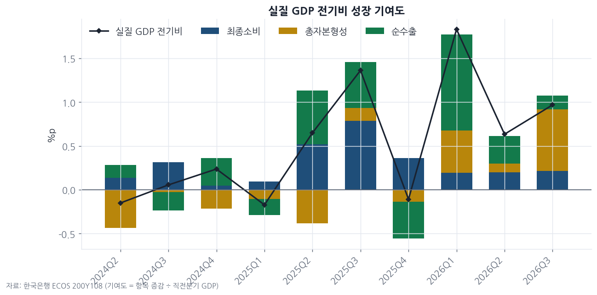

> **인사이트 ①** 3분기 전기비 성장 0.97% 가운데 **0.70%p가 투자(총자본형성)** 에서 나왔다. 상반기를 끌던 순수출 기여는 1.10 → 0.32 → 0.16%p로 줄었다.
> 설비투자는 전년비 +9.36%, 지식재산 투자는 +6.52%로 가속했고, 건설도 -0.70%로 역성장 폭이 거의 사라졌다.
> 반대로 **가계소비는 +0.71%** 로 2025Q1(+0.37%) 이후 가장 약하다. 기준금리 2연속 인상(2.50→3.00%)과 가계대출 금리 4.96%가 소비에 먼저 걸리고 있다.
> 수출 호황의 이익이 기업 설비로는 흘러가는데 가계 지갑으로는 흘러가지 않는 구조다. 내수 업종의 이익 추정에는 보수적 가정이 맞다.

### 1-3. 명목 vs 실질 — 3분기 명목치는 아직 없다

| 분기 | 실질 GDP(yoy) | 명목 GDP(yoy) | 디플레이터(yoy) |
|---|---|---|---|
| 2025Q4 | 1.73 | 6.54 | 4.73 |
| 2026Q1 | 3.78 | 17.18 | 12.92 |
| 2026Q2 | 3.76 | **26.18** | **21.60** |
| 2026Q3 | 3.36 | 미공표 | 미공표 |

한국은행은 실질 GDP 속보를 먼저 내고 명목은 잠정치(통상 12월 초)에 낸다. 그래서 지난 글의 핵심이던 "명목 +26% vs 실질 +3.8%" 괴리가 3분기에 어떻게 됐는지는 **아직 판단할 수 없다.**
대신 같은 속보에 실린 소득 지표가 단서를 준다 — 실질 **국내총소득(GDI) +18.88%**(26Q2 +15.87%), 실질 **국민총소득(GNI) +14.54%**(26Q2 +15.74%). 교역조건 이득은 3분기에도 줄지 않았다.

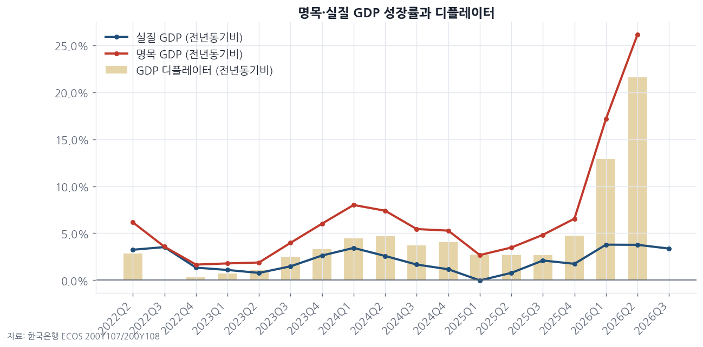

### 1-4. 산업별 실질 성장 (전년동기비, %) — 움직인 업종만

| 업종 | 2026Q1 | 2026Q2 | 2026Q3 |
|---|---|---|---|
| 컴퓨터·전자·광학기기 제조업 | **23.07** | 20.62 | **15.41** |
| 제조업(전체) | 7.32 | 6.59 | 6.98 |
| 기계 및 장비 제조업 | -1.15 | 3.73 | **5.43** |
| 정보통신업 | 1.26 | 3.81 | 4.72 |
| 금융 및 보험업 | 7.89 | **9.62** | **3.06** |
| 서비스업 | 3.16 | 3.49 | 2.45 |
| 도소매 및 숙박음식업 | 4.10 | 3.80 | **1.44** |
| 건설업 | -3.71 | -3.65 | -1.46 |
| 전기장비 제조업 | 0.33 | -1.64 | -3.96 |
| 코크스 및 석유정제품 제조업 | 5.11 | -12.58 | -12.20 |

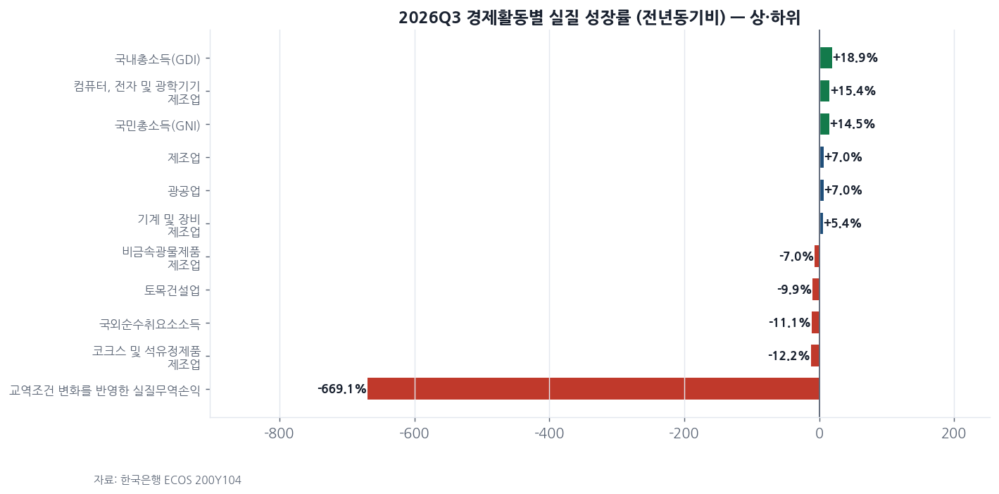

> **인사이트 ②** 반도체(컴퓨터·전자)는 여전히 +15%대지만 **23% → 21% → 15%로 2분기 연속 감속**했다. 단일 업종 의존 구조는 그대로인데, 그 업종의 성장 속도가 내려오고 있다.
> 기계·장비가 +5.4%로 올라온 것은 1-2의 설비투자 증가와 같은 그림이다.
> **금융·보험이 9.6% → 3.1%** 로 급감했고, 도소매·숙박음식도 1.4%로 내려왔다. 주식시장 거래 위축과 가계소비 둔화가 서비스업 부가가치에 바로 찍혔다.

---

## 2. 수출입 — 9월, 사상 최대 흑자 경신

### 2-1. 수출입 총액 (억달러, 전년동월비)

| 시점 | 수출 | yoy | 수입 | yoy | 무역수지 |
|---|---|---|---|---|---|
| 2025.09 | 569.2 | +10.5% | 497.6 | +10.0% | 71.6 |
| 2026.06 | 930.3 | +77.4% | 583.9 | +29.1% | 346.4 |
| 2026.07 | 897.9 | +69.5% | 613.3 | +28.1% | 284.6 |
| 2026.08 | 915.0 | +79.1% | 565.2 | +24.5% | 349.8 |
| **2026.09** | **1,115.4** | **+96.0%** | 626.1 | +25.8% | **489.3** |

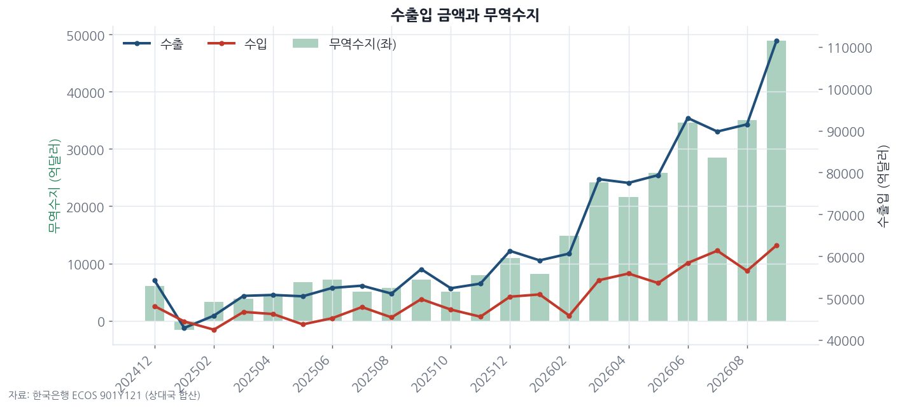

### 2-2. 수출 증가의 분해 (2020=100 지수) — 9월이 최신, 지난 글과 같은 시점

| 시점 | 금액지수 yoy | 물량지수 yoy | 단가 yoy |
|---|---|---|---|
| 2026.06 | +74.6% | +29.6% | +34.7% |
| 2026.07 | +64.3% | +20.1% | +36.9% |
| 2026.08 | +75.9% | +25.9% | +39.7% |
| 2026.09 | **+89.2%** | **+32.1%** | **+43.2%** |

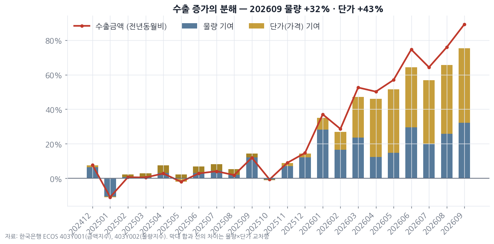

순상품교역조건지수 119.5, 소득교역조건지수 216.7(26.9). 10월 지수는 아직 공표 전이다.

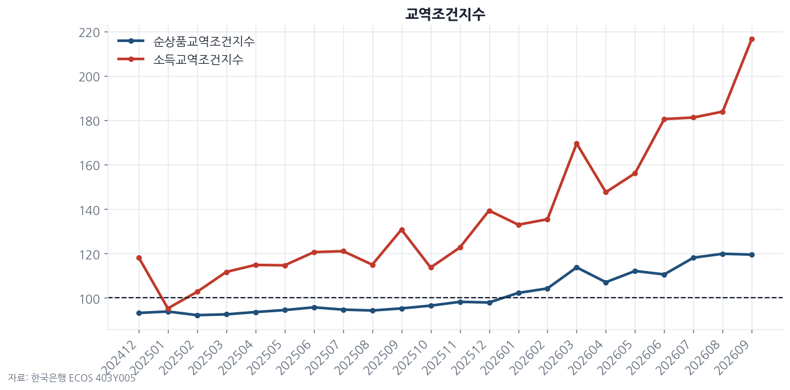

### 2-3. 상대국별 수출 증가율 (전년동월비, %)

| 상대국 | 2026.08 | 2026.09 | 9월 비중 |
|---|---|---|---|
| 중국 | 119.5 | 123.1 | 23.4% |
| 미국 | 89.1 | **136.9** | 21.8% |
| 홍콩 | 227.9 | 202.4 | 9.5% |
| 대만 | 48.1 | 96.6 | 9.2% |
| 필리핀 | 178.3 | **233.5** | 3.5% |
| 싱가포르 | 12.2 | **151.2** | 3.4% |
| 말레이시아 | 217.5 | 209.6 | 2.8% |
| 일본 | 13.0 | 25.2 | 2.9% |
| 베트남 | 63.4 | 43.9 | 7.6% |

> **인사이트 ③** 9월 수출 1,115억 달러, 흑자 489억 달러 — 한 달 흑자가 1년 전 같은 달(72억 달러)의 **약 7배**다.
> 미국향이 +137%로 뛰고 싱가포르·필리핀·말레이시아 같은 후공정·중계 허브가 +150~230%를 기록했다. 지난 글에서 짚은 **채널 재고 축적** 가능성은 9월에 오히려 커졌다.
> 9월 단가 기여(+43.2%)가 물량(+32.1%)보다 여전히 크다. 흑자의 상당 부분이 가격에서 나온다는 판단은 그대로다. 단가가 꺾이는 시점을 확인할 10월 수출입지수가 다음 달의 가장 중요한 숫자다.

---

## 3. 심리지표 — 10월에 다시 올라섰다

### 3-1. 기업심리지수(BSI) 실적 / 11월 전망

| 시점 | 전산업 | 제조업 | 수출기업 | 내수기업 | 중소기업 | 서비스업 |
|---|---|---|---|---|---|---|
| 2026.08 | 99.6 | 103.8 | 108.5 | 99.4 | 99.8 | 96.5 |
| 2026.09 | 99.1 | 99.5 | 104.3 | 95.7 | 94.4 | 99.9 |
| **2026.10** | **104.2** | **105.6** | 106.1 | **103.8** | **105.6** | 102.7 |
| 2026.11 전망 | 101.8 | 103.0 | 104.4 | 101.7 | 101.3 | 101.0 |

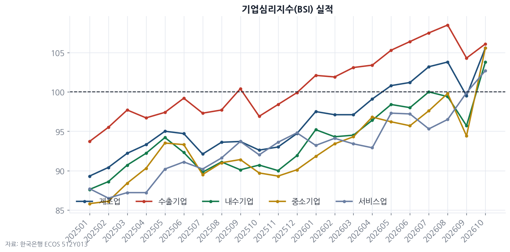

### 3-2. 제조업 세부 BSI — 종합은 올랐는데 업황·수출은 아니다

| 시점 | 업황 | 가동률 | 생산 | 내수판매 | 수출실적 | 원자재가격 | 판매가격 | 채산성 | 인력사정 |
|---|---|---|---|---|---|---|---|---|---|
| 2026.08 | 81 | 90 | 92 | 91 | 95 | 123 | 102 | 81 | 94 |
| 2026.09 | 79 | 89 | 89 | 84 | 92 | 121 | 98 | 79 | 94 |
| **2026.10** | **78** | **96** | 94 | 91 | **91** | **124** | 99 | 79 | **87** |

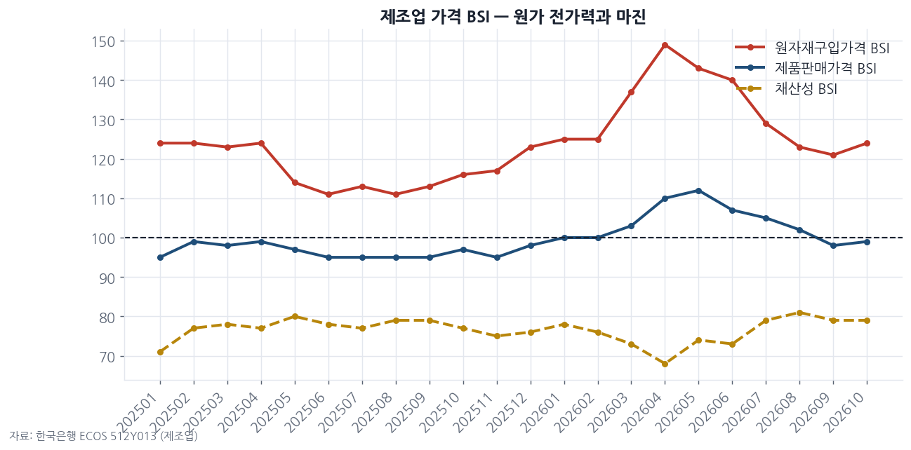

### 3-3. 소비자동향조사(CSI)

| 시점 | 소비자심리 | 현재경기판단 | 향후경기전망 | 금리수준전망 | 주택가격전망 | 물가수준전망 | 취업기회전망 |
|---|---|---|---|---|---|---|---|
| 2026.08 | 104.5 | 79 | 89 | 125 | 125 | 149 | 86 |
| 2026.09 | 106.6 | 83 | 90 | 128 | 125 | 150 | 88 |
| **2026.10** | **105.4** | 82 | 88 | 127 | 124 | 149 | 86 |

> **인사이트 ④ — 지난 판단의 수정** 지난 글은 9월 제조업 BSI 99.5를 근거로 "고점 통과 조짐"이라고 썼다. **10월 105.6으로 반등해 그 판단은 틀렸다.** 9월은 일시적 눌림이었다.
> 다만 반등의 구성을 보면 가동률(89→96)과 내수판매(84→91)가 올렸고, **업황(78)과 수출실적(91)은 오히려 내렸다.** 가동률은 1-2의 설비투자 증가와, 내수판매 반등은 소비 데이터와 맞춰 봐야 한다(3분기 가계소비 +0.71%와는 아직 어긋난다).
> 원자재가격 BSI가 121 → 124로 다시 올랐는데 판매가격은 99, 채산성은 79에 머문다. **원가 압력이 다시 붙는데 가격 전가는 여전히 안 되는** 조합이다.
> 소비자 쪽은 10월에도 현재경기 82, 금리 전망 127로 긴축 체감이 이어진다. 기업 심리와 가계 심리가 갈라진 것이 이번 달의 특징이다.

---

## 4. 물가 — CPI는 2.8%대에서 멈췄고, 집세가 오른다

### 4-1. CPI 전년동월비 (%)

| 시점 | 총지수 | 근원 | 농축수산물 | 공업제품 | 석유류 | 서비스 | 집세 | 외식 |
|---|---|---|---|---|---|---|---|---|
| 2026.06 | 3.16 | 2.48 | 3.21 | 4.43 | 24.69 | 2.62 | 1.03 | 2.62 |
| 2026.08 | 3.09 | 3.37 | -2.58 | 3.73 | 14.16 | 3.71 | 1.25 | 2.73 |
| 2026.09 | 2.88 | 2.80 | -0.32 | 4.17 | 14.78 | 2.75 | 1.34 | 2.53 |
| **2026.10** | **2.82** | **2.80** | -1.70 | **4.43** | 14.87 | 2.67 | **1.44** | **2.92** |

### 4-2. PPI 전년동월비 (%) — 10월치 미공표

| 시점 | PPI 총지수 | 공산품 | 서비스 | 전력·가스·수도 |
|---|---|---|---|---|
| 2026.07 | 7.69 | 12.23 | 4.03 | 1.91 |
| 2026.08 | 7.88 | 12.12 | 4.41 | 2.95 |
| 2026.09 | **7.67** | 11.99 | 3.88 | **3.12** |

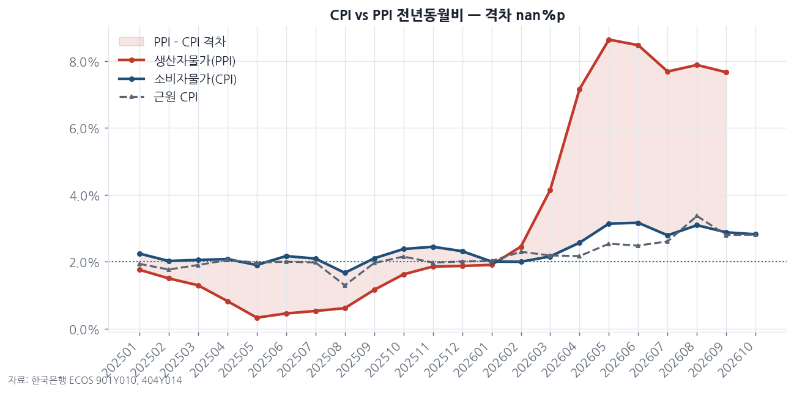

### 4-3. 원자재 (2026-11-06 종가)

| 품목 | 현재 | 지난 글(10/22) | 1M | YTD |
|---|---|---|---|---|
| Brent | $98.3 | $111.6 | -5.7% | +61.8% |
| WTI | $90.8 | $99.4 | -0.7% | +58.5% |
| 금 | $4,075 | $4,108 | -2.0% | -5.9% |
| 구리 | $6.24 | $6.47 | -4.3% | +10.6% |

> **인사이트 ⑤** 헤드라인 CPI는 2.82%로 안정적이지만 내용은 나빠졌다. 농축수산물(-1.70%)이 끌어내린 몫을 빼면 **공업제품 4.43%, 집세 1.44%(올해 들어 매달 상승), 외식 2.92%** 로 오르는 품목이 넓어졌다. 근원 2.80%는 1월(2.02%)보다 0.8%p 높다.
> PPI 9월 7.67%와 CPI의 격차는 **4.8%p로 그대로**이고, 10월 PPI는 아직 없다. 브렌트유가 한 달 새 -12% 내려온 것은 다음 PPI에서 격차를 줄일 수 있는 유일한 하방 요인이다.
> 전이(A: CPI 재상승)와 흡수(B: 마진 훼손) 중 어느 쪽인지는 아직 가려지지 않았다. 다만 3-2에서 채산성 BSI가 79에 머무는 것은 **B가 진행 중**이라는 쪽에 무게를 싣는다.

---

## 5. 금리 — 기준금리는 쉬었지만 대출금리는 더 올랐다

### 5-1. 국내 금리 (%)

| 시점 | 기준금리 | 가계대출 | 기업대출 | 주담대 | 가계 스프레드 |
|---|---|---|---|---|---|
| 2026.06 | 2.50 | 4.50 | 4.27 | 4.36 | 2.00 |
| 2026.07 | 2.75 | 4.64 | 4.20 | 4.48 | 1.89 |
| 2026.08 | 3.00 | 4.76 | 4.30 | 4.66 | 1.76 |
| **2026.09** | 3.00 | **4.96** | **4.49** | **4.88** | **1.96** |
| 2026.10 | 3.00 | — | — | — | — |

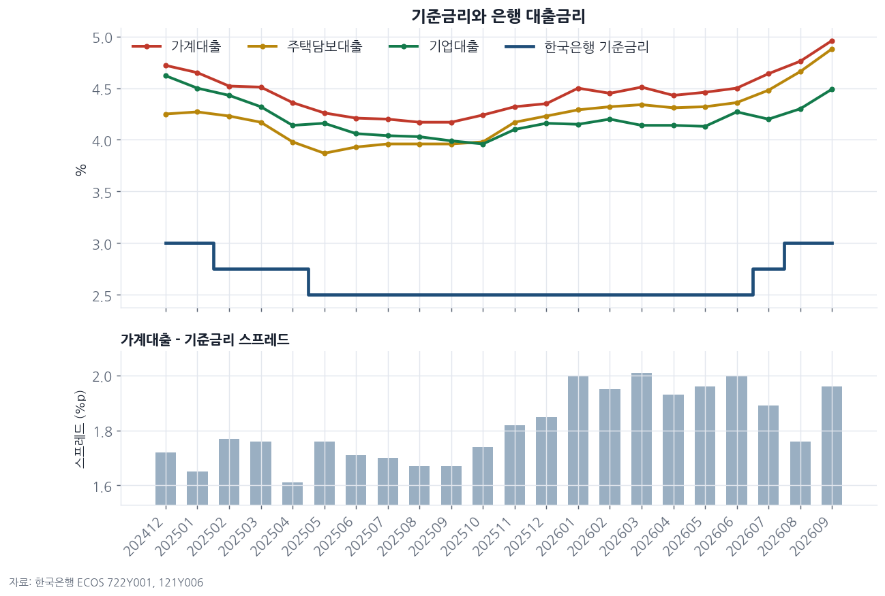

### 5-2. 주요국 정책금리 (%, 2026.09 — 최신)

| 미국 | 유로 | 일본 | 중국 | 한국 |
|---|---|---|---|---|
| 3.88 | 2.50 | 1.25 | 3.00 | 3.00 |

### 5-3. 미국채 커브 (2026-11-06)

| 지표 | 현재 | 지난 글(10/22) | 1M 변화 | YTD 변화 |
|---|---|---|---|---|
| 5년물 | 4.65% | 4.93% | -0.34%p | +0.91%p |
| 10년물 | 4.86% | 4.93% | -0.37%p | +0.67%p |
| 30년물 | 5.26% | 5.43% | -0.35%p | +0.40%p |
| **30y-5y** | **0.61%p** | 0.49%p | 0.00%p | -0.51%p |

30y-5y 월평균: 2026.06 0.73 → 2026.09 0.57 → 2026.10 0.55 → 2026.11(6일까지) 0.60

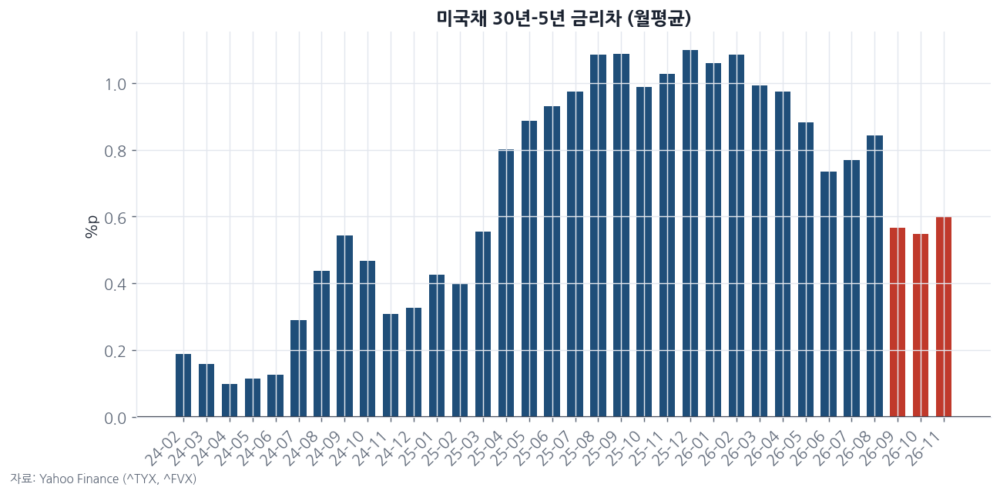

> **인사이트 ⑥ — 지난 판단의 수정** 지난 글은 가계대출 스프레드가 2.01 → 1.76%p로 줄어든 것을 "대출 수요 둔화의 방증"으로 읽었다. **9월 스프레드는 1.96%p로 되돌아왔다.** 은행이 인상분을 한 달 늦게 전가한 것에 가깝고, 수요 둔화의 근거로 쓰기는 약하다.
> 그 결과 가계가 실제로 내는 금리는 한 달 만에 **+20bp(4.76 → 4.96%)**, 주담대는 4.88%다. 기준금리 동결과 무관하게 가계의 이자 부담은 계속 오르고 있고, 1-1의 가계소비 +0.71%와 같은 방향이다.
> 미국채는 10월 말 고점(10년 월평균 5.13%)에서 30~37bp 내려왔고, 30y-5y는 0.61%p로 조금 가팔라졌다. 역전(경계선 0)과는 거리가 있다. 할인율이 정점을 지났는지는 한 달 데이터로 말할 수 없다.

---

## 6. 환율·대외부문 — 원화 강세가 멈췄다

### 6-1. 원/달러 vs 달러인덱스

| 시점(월평균) | USD/KRW | 달러인덱스 |
|---|---|---|
| 2026.06 | 1,528.1 | 100.32 |
| 2026.08 | 1,405.6 | 99.50 |
| 2026.09 | 1,358.3 | 100.03 |
| 2026.10 | **1,336.9** | 102.05 |
| 2026.11(6일까지) | 1,341.9 | 101.80 |

현재(11/6): **1,356원**, 1개월 **+1.3%**(원화 약세), YTD -6.1%. 달러인덱스 YTD +3.9%.
일간 변화율 상관계수(최근 250일): **0.03** — 여전히 무상관.

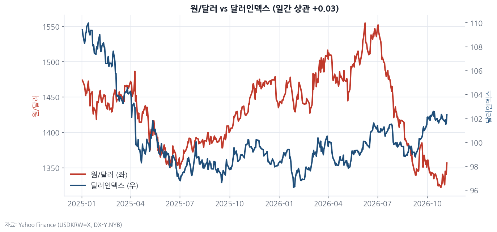

### 6-2. 국제투자대조표 (억달러) — 2026Q2가 최신, 지난 글과 같은 시점

| 분기 | 대외금융자산 | 대외금융부채 | 순대외금융자산 |
|---|---|---|---|
| 2025Q4 | 28,676 | 19,819 | 8,857 |
| 2026Q1 | 28,826 | 21,290 | 7,536 |
| 2026Q2 | 30,843 | **30,202** | **640** |

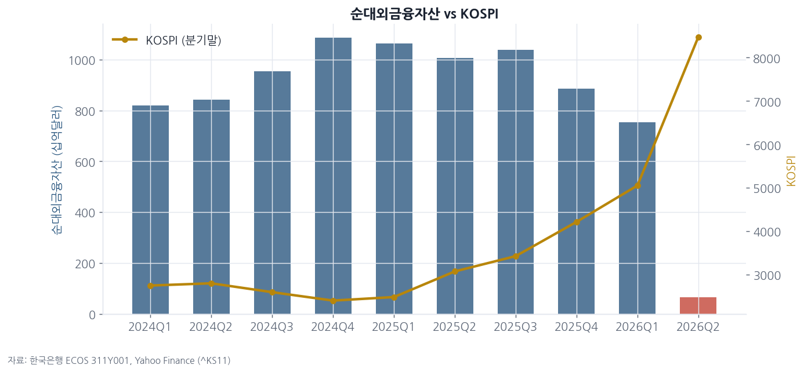

### 6-3. 자산시장 (2026-11-06)

| 지표 | 현재 | 지난 글(10/22) | 1M | 3M | YTD |
|---|---|---|---|---|---|
| KOSPI | 5,059.7 | 5,539.2 | **-23.6%** | -23.1% | +17.4% |
| S&P500 | 7,376.9 | 7,712.6 | -5.0% | -4.8% | +7.6% |
| 금 | $4,075 | $4,108 | -2.0% | -8.8% | -5.9% |
| Brent | $98.3 | $111.6 | -5.7% | +10.5% | +61.8% |

> **인사이트 ⑦** 9월 무역흑자 489억 달러가 들어왔는데도 원화는 1,323원 → 1,356원으로 **약해졌다.** 수출 대금 유입보다 큰 자금이 빠져나가고 있다는 뜻이고, 같은 기간 KOSPI가 -8.7%(10/22 대비), 1개월 -23.6% 내린 것과 맞물린다.
> 지난 글에서 "되돌림이 시작되면 외국인 환매 → 원화 약세"의 경로가 열려 있다고 썼는데, **그 초입으로 보이는 움직임**이 환율과 주가에 동시에 나타났다. 단, 이를 확정할 국제투자대조표 3분기치는 아직 없다.
> KOSPI는 6월 월평균(8,484) 대비 **-40%** 다. 반면 3분기 실질 GDP, 9월 수출, 10월 BSI는 모두 버텼다. **자산 가격이 펀더멘털보다 훨씬 먼저, 훨씬 크게 내려왔다.**

---

## 7. 종합 판단 — 안전마진 관점

### 지난 한 달 사이 달라진 것
1. **성장 엔진 교체** — 순수출 기여 0.32 → 0.16%p, 투자 기여 0.10 → 0.70%p(전기비). 설비투자 +9.4%.
2. **가계의 정지** — 가계소비 +0.71%, 가계대출 금리 4.96%(+20bp), 금융·도소매 성장 급감.
3. **흑자 사상 최대** — 9월 무역흑자 489억 달러(지난 글 350억). 단가 기여는 여전히 물량보다 크다.
4. **기업심리 반등, 가계심리 정체** — 제조업 BSI 99.5 → 105.6, 소비자심리 106.6 → 105.4.
5. **자산과 실물의 괴리** — KOSPI 1개월 -23.6%, 6월 월평균 대비 -40%. 실물 지표는 아직 꺾이지 않았다.

### 지난 글 판단 중 수정한 것
- "심리 고점 통과 조짐" → **철회.** 10월 BSI가 105.6으로 반등.
- "스프레드 축소 = 대출 수요 둔화" → **약화.** 9월 스프레드 1.96%p로 복귀, 전가 시차로 보는 게 맞다.
- "가격효과 중심 호황", "PPI-CPI 격차 4.8%p", "포지션 과밀" → **유지.** 반박할 새 데이터가 없다.

### 직전 체크리스트 점검

| 지표 | 지난 값 | 이번 값 | 경계 수준 | 판정 |
|---|---|---|---|---|
| 수출 단가 yoy | +43.2%(9월) | 미갱신 | <+10% | 데이터 대기 |
| 제조업 판매가격 BSI | 98 | **99**(10월) | <95 | 미도달 |
| CPI 총지수 yoy | 2.88% | **2.82%**(10월) | >3.5% | 미도달 |
| 30y-5y | 0.49%p | **0.61%p**(11/6) | <0 | 미도달, 오히려 확대 |
| 무역수지 | +348억$ | **+489억$**(9월) | <+150억$ | 미도달, 오히려 확대 |
| 순대외금융자산 | 640억$ | 미갱신(26Q2) | 마이너스 | 데이터 대기 |

### 다음 달 체크리스트

| 지표 | 현재 | 경계 수준 | 의미 |
|---|---|---|---|
| 수출 단가 yoy (10월 지수) | +43.2%(9월) | <+10% | 가격효과 소멸 → 명목 이익 급감 |
| 실질 가계소비 yoy | +0.71%(26Q3) | <0% | 내수 역성장 진입 |
| 명목 GDP·디플레이터 (26Q3 잠정) | 디플레이터 +21.6%(26Q2) | 하락 전환 | 교역조건 이득 정점 통과 |
| PPI yoy (10월) | 7.67%(9월) | PPI-CPI <2%p | 마진 압박 해소(유가 하락 반영 여부) |
| 가계대출 금리 | 4.96%(9월) | >5.0% | 가계 이자 부담 임계 |
| 제조업 판매가격 BSI | 99(10월) | <95 | 디플레 압력 |
| 순대외금융자산 (26Q3) | 640억$(26Q2) | 마이너스 | 외국인 포지션 극단 / 이탈 규모 확인 |
| 무역수지 | +489억$(9월) | <+150억$ | 흑자 사이클 종료 |

### 결론
> 이번 달 데이터는 "호황이 끝났다"고 말하지 않는다. 3분기 성장은 0.97%로 견조했고, 9월 흑자는 사상 최대였고, 기업 심리는 다시 올랐다.
> 하지만 **그 성장의 몫이 가계로 가지 않는다** — 소비 +0.7%, 대출금리 4.96%. 그리고 흑자의 큰 부분은 여전히 단가에서 나온다(+43.2%).
> 이번 달 가장 큰 변화는 펀더멘털이 아니라 **가격**이다. KOSPI가 한 달에 24% 내리는 동안 실물 지표는 거의 움직이지 않았다. 가치투자자에게 이것은 안전마진이 다시 생기기 시작하는 조건이지만, 그 마진을 계산할 분자(이익)가 **단가 효과로 부풀려져 있다**는 점을 잊으면 안 된다.
> 정상 이익을 2026년 명목 이익이 아니라 **단가가 평년으로 돌아간 이익**으로 놓고 계산할 때만, 지금의 가격 하락이 진짜 안전마진인지 판단할 수 있다.

---

### 데이터 출처와 작성 기준
- 모든 수치는 **한국은행 ECOS OpenAPI** 원데이터와 **Yahoo Finance** 종가를 `scripts/macro/fetch_and_chart.py` 로 직접 조회해 산출했다. 웹 검색 수치는 쓰지 않았다.
- 계열별 최신 시점: 실질 GDP 2026Q3(속보), 명목 GDP 2026Q2, 수출입·수출입지수 2026.09, BSI 실적·CSI·CPI·기준금리 2026.10, BSI 전망 2026.11, PPI·은행 대출금리 2026.09, 국제투자대조표 2026Q2, 시장데이터 2026-11-06.
- 성장 기여도 = 항목 증감 ÷ 직전분기 실질 GDP. 수출 단가 = 수출금액지수(403Y001) ÷ 수출물량지수(403Y002). 수출입 총액은 천달러 원자료를 억달러로 환산했다.
- 3분기 명목 GDP가 미공표라 디플레이터는 2026Q2까지만 표시했다.
- 사용 통계표: 200Y104·200Y107·200Y108(GDP), 901Y121·403Y001·403Y002·403Y005(수출입), 512Y013·512Y014(BSI), 511Y002(CSI), 901Y010·404Y014(물가), 722Y001·121Y006·902Y006(금리), 311Y001(국제투자대조표).
- 차트 13종은 matplotlib으로 직접 생성했다.
