> 한국은행 보도자료 · 거시지표 · 15개 ETF 차트추세 · 내 연금/ISA 포트폴리오를 하나로 묶은 **주간 통합 리포트**입니다.
> 데이터 기준 — 2026-11-07 ~ 2026-11-13. 개인 포트폴리오는 **비중(%)·수익률(%)만** 공개합니다. 이번 주는 포트폴리오 시트가 갱신되지 않아 보유 내역(11-08)에 1주 가격 변화를 곱한 **추정치**입니다.

## 1. 이번 주 요약

**이번 주를 한 문장으로 줄이면: 지난주 무너진 것이 돌아왔고, 지난주 버틴 것이 무너졌다.**

1. **물가가 꺾이지 않아 12월 인상이 확정됐다.** 미 10월 근원 CPI가 전월비 **+0.3%**(예상 +0.2%)로 3개월 연속 0.3%를 기록했고, 근원 PPI는 +0.5%였다. 에너지 물가가 +5.2% → +0.7%로 식었는데도 근원이 버텼다. CME 12월 인상 확률은 76.8% → **100%**, 미 10년물은 4.86% → **5.10%**(+24bp), 실질 10년은 +2.00%p로 돌아왔다.
2. **한국은행은 "쉼표"를 확인했고, 가계 빚은 다시 늘었다.** 10월 금통위 의사록은 만장일치 동결 속에서 "긴축 기조 유지 + 두 차례 인상 효과 점검"을 말했고, 주가 조정기의 **역자산효과**를 미리 경고했다. 10월 은행 가계대출은 **+5.0조원**으로 잔액이 처음 1,200조원을 넘었다. 수입물가는 원화 강세로 △1.8%, 수출물량은 전년비 **+43.9%로 역대 최대**다.
3. **차트에서는 가격이 돌아왔지만 추세는 돌아오지 않았다.** S&P500 +2.5%, 나스닥100 +3.5%, 코스피 +4.6%, VIX 25.6 → 19.3. AI전력 +10.5%·AI데이터센터 +7.3%·반도체 +5.8%가 반등을 이끌었지만, **일봉 약세 종목 수는 11개 그대로**다. 반대로 금 △4.9%·미국채10년 △3.3%·달러 △1.6%가 지난주 상승분을 반납했다. 그리고 **US리츠가 미국배당다우존스에 이어 두 번째로 세 시간축 강세**에 들어왔다.
4. **내 포트폴리오는 한 주 +0.29%로 제자리**(누적 △2.90% → △2.62%, 추정). 테마 반등(+0.62%p)과 금 하락(△0.67%p)이 거의 정확히 상쇄됐다. 원화가 1.7% 강해지면서 달러 자산 80% 구조가 처음으로 역풍을 받았다. ISA는 +3.5%였지만 지난주 낙폭의 약 4분의 1만 되돌렸다.

> **한 줄 선언** — 현재는 **4단계 과열 국면의 후반, 가격 조정의 무대가 주식에서 채권으로 옮겨간 「인상 확정·금리 재상승」 구간**이며, 핵심 변수는 **12월 인상 폭이 25bp에서 50bp로 커지는지, 그리고 10년물 5%대를 주식 반등이 견딜 수 있는지**다. 포트폴리오 관점의 결론은 지난주와 같다 — **가치(이익수익률 5.4%, 10년물 기준 유일 합격)와 추세(세 시간축 강세 2주 연속)가 같은 종목을 가리키고, 반등은 현금을 쌓을 기회다.**

---

## 2. 한국은행 보도자료 분석

### 이번 주 주요 발표 (2026.11.07 ~ 11.14)

> 지난주가 물가와 대외 건전성을 확인한 주였다면, 이번 주는 **10월 금통위의 속내(의사록)**와 **돈의 흐름(대출·통화량·수입물가)**을 확인한 주다. 11.10 의사록, 11.11 10월 금융시장 동향, 11.13 10월 수출입물가와 9월 통화 및 유동성이 나왔다. 금통위 일정은 없었고, 다음 결정은 **11.26 금통위(수정 경제전망 동반)**다.

| 우선순위 | 제목 | 발표일 | 핵심수치 | 시사점 |
|---|---|---|---|---|
| ★★★★★ | 2026년 제20차 금통위(10.22) 의사록 | 2026.11.10 | 7명 **만장일치 동결**(3.00%), "긴축 기조 유지" + "두 차례 인상 효과 점검" | 인상 사이클 종료가 아닌 **쉼표**. 11월은 데이터·금융안정 사이의 줄타기 |
| ★★★★☆ | 2026년 10월 금융시장 동향 | 2026.11.11 | 은행 가계대출 **+5.0조원**(9월 +0.5조원), 잔액 **1,203.9조원**(첫 1,200조 돌파), 기업대출 +10.2조원 | 인상에도 가계 빚이 다시 늘었다. 집단대출·'빚투'가 원인 |
| ★★★★☆ | 2026년 10월 수출입물가지수(잠정) | 2026.11.13 | 수입물가 **-1.8%**(전월비), 전년비 +13.5%, 수출물량 전년비 **+43.9%(역대 최대)**, 소득교역조건 +74.6% | 원화 강세·유가 하락으로 수입 물가 압력 완화. 반도체 물량은 여전히 폭주 |
| ★★★☆☆ | 2026년 9월 통화 및 유동성 | 2026.11.13 | M2(평잔) **4,283.9조원**, 전월비 +17.1조원(+0.4%), 전년비 +5.5% | 통화량 증가세는 둔화. 가계 자금은 +12.6조원으로 2024년 11월 이후 최대 |

> **수집 방법 고지**: 한은 보도자료 목록 페이지(`newsData/list.do`)는 이번 주에도 **게시물 0건**(JS 렌더링)으로 직접 수집에 실패했다. 한은 **통계 공표일정 페이지**는 정상 수집돼 11.13 수출입물가·통화 및 유동성 공표를 확인했다. 금융시장 동향은 KDI 경제정보센터에 게재된 한은 자료 요약으로 확인했고, 나머지는 WebSearch + 언론 보도 교차확인이다. 원문 PDF는 확인하지 못했다.

### 2-1. 10월 금통위 의사록(11.10) — "긴축은 계속, 속도만 조절"

**이 자료가 뭔가**: 금통위가 금리를 정한 뒤 약 2주 뒤에 공개하는 회의록이다. 위원들이 어떤 근거로 표를 던졌는지, 다음 회의에서 어디로 기울지 가늠하는 가장 직접적인 자료다.

10월 22일 회의에서 위원 7명은 **전원 기준금리 연 3.00% 동결**에 찬성했다. 7·8월 연속 인상 이후 첫 쉼표다. 보도된 위원 발언의 결은 다음과 같다.

- 한 위원: **긴축 기조는 지속**하되 두 차례 선제적 인상의 효과를 먼저 지켜볼 필요.
- 다른 위원: 향후 방향은 **인상 효과 점검 후** 결정하는 것이 적절.
- 또 다른 위원: 추가 긴축과 경기 호황에서 **소외된 부문**을 함께 고려해야.
- 동결이 기업에 적응 시간을 주고 기대를 안정시키는 효과가 있다는 의견도 나왔다.

금융안정 쪽 언급도 눈에 띈다. 한은은 주가가 계속 오르면 차익 자금이 **부동산으로 이동**할 수 있고, 반대로 **주가 조정기에는 역(逆)자산효과**로 가계 소비와 주택 구매력이 약해질 수 있다고 봤다. 국내 금융기관의 해외 사모대출 익스포저는 **약 31조원(총자산의 0.4%)**으로 큰 우려는 아니라고 평가했다. 한 위원은 **취약차주 연체율이 "매우 높은 수준"**이라고 지적했다. 환율은 외국인 주식 매도와 달러 강세에도 반도체 기업의 달러 공급 덕에 원화가 강세를 보였다고 정리됐다.

**해석.** 인하 논의는 없었고, "효과 점검"이라는 말이 반복됐다. 즉 11월은 **인상 또는 매파적 동결** 둘 중 하나다. 10월 회의 당시에는 주가가 오르는 국면이었는데, 그 뒤 10월 말~11월 초 증시가 크게 꺾였다(지난주 11.6 서킷브레이커). 위원들이 미리 언급한 **"주가 조정 시 역자산효과"** 시나리오가 실제로 진행 중이라는 점이 11월 결정의 무게추를 동결 쪽으로 옮길 수 있는 변수다.

### 2-2. 10월 금융시장 동향(11.11) — 가계 빚, 인상에도 다시 늘었다

**이 자료가 뭔가**: 한 달 동안 은행 대출·예금, 주가·금리가 어떻게 움직였는지 한은이 정리하는 월간 자료다. 금리 인상이 실제로 대출 수요를 누르고 있는지 가장 빨리 확인할 수 있다.

| 항목 | 9월 | 10월 |
|---|---|---|
| 은행 가계대출 증감 | +0.5조원 | **+5.0조원** |
| 은행 가계대출 잔액 | — | **1,203.9조원**(속보 기준 첫 1,200조원 돌파) |
| 은행 기업대출 증감 | +10.7조원 | +10.2조원 |
| 은행 수신 | +29.1조원 | +30.4조원 |
| 자산운용사 수신 | -11.1조원 | **+11.2조원**(증가 전환) |

보도에 따르면 증가 요인은 아파트 **집단대출**과 주식 투자 목적 대출(**'빚투'**)이다. 같은 자료에서 주가와 국고채 금리는 모두 **"큰 폭 하락"**했다. 언론 보도 기준으로 코스피는 9월 말 6,838에서 10월 말 5,731(-16.2%), 국고채 3년물은 4.01%에서 3.72%로 내렸다(한은 원문 수치로는 미확인). 한은은 AI 투자 둔화·반도체 경쟁 심화 우려를 원인으로 꼽았다.

**해석.** 9월 가중평균금리에서 가계대출 금리가 4.96%까지 올랐는데도(지난주 2-4) 10월 가계대출 증가폭은 10배로 커졌다. 금리보다 **집단대출 일정과 주식 레버리지**가 대출을 끌고 간 것이다. 문제는 이 '빚투' 자금이 10월 하락장 한복판에 있었다는 점이다. 의사록의 "취약차주 연체율 매우 높음"과 겹쳐 보면, 증시 조정이 길어질 때 **가계 건전성 → 소비** 경로의 위험이 커진다. 반면 국고채 금리가 0.3%p 가까이 내려간 것은 시장이 이미 **"추가 인상은 쉽지 않다"**에 일부 베팅하기 시작했다는 신호다.

### 2-3. 10월 수출입물가(11.13) — 수입물가 하락, 수출물량은 사상 최대

**이 자료가 뭔가**: 수입물가는 몇 달 뒤 소비자물가로 번지는 선행지표이고, 수출물가·물량은 우리 수출이 '값'으로 버는지 '양'으로 버는지를 보여준다.

| 항목 | 10월 | 비고 |
|---|---|---|
| 수입물가(원화) | 156.86, **전월비 -1.8%** | 9월 반등 후 한 달 만에 하락. 전년비 +13.5% |
| 수입물가(계약통화) | 전월비 -0.2% | 원화 기준 하락폭 대부분은 **환율 효과** |
| 용도별 수입물가 | 원재료 -3.0%, 중간재 -1.0%, 자본재 -1.8%, 소비재 -1.4% | 전 부문 하락 |
| 원/달러 월평균 | **1,337.66원**(-1.6%) | 9월 1,359.00원 |
| 두바이유 월평균 | 110.73달러(-2.6%) | 9월 113.71달러 |
| 수출물가 | 184.15, **전월비 +0.7%** | 3개월 만에 상승. 컴퓨터·전자 및 광학기기 +3.7% |
| 수출물량 | 전년비 **+43.9%** | 역대 최고 상승률(7월 20.1% → 8월 25.9% → 9월 32.2%) |
| 순상품교역조건 | 전년비 +21.3% | 8월 27.1%, 9월 25.4%에서 둔화 |
| 소득교역조건 | 전년비 **+74.6%** | 3개월 연속 역대 최고 상승률 |

한은 물가통계팀장은 10월 수출물가 상승에 대해 **4분기 반도체 고정계약가격이 새로 반영된 측면**이 있다고 설명했다. 또 11월 들어(11일까지) 환율은 소폭 올랐지만 **국제유가가 13% 내려** 수입물가 하방 요인이 될 것이라고 했다.

**해석.** 물가 측면에서는 반가운 숫자다. 수입물가가 내려가고 11월 유가도 크게 빠지면서, 지난주 "근원물가 2.8% 고착"의 압력은 **연말로 갈수록 완화**될 여지가 생겼다. 수출 측면에서는 반도체 4분기 계약가격이 올랐고 물량은 사상 최대다. 즉 지난주 증시 급락은 **실적 붕괴가 아니라 기대(밸류에이션)의 조정**이었다는 쪽에 무게가 실린다. 다만 교역조건 상승률이 석 달째 낮아지고 있어, 반도체 '가격' 모멘텀의 정점은 지났을 가능성을 염두에 둔다.

### 2-4. 9월 통화 및 유동성(11.13) — 통화량 증가 속도 둔화

**이 자료가 뭔가**: 시중에 풀린 돈의 양(M2)이다. 금리 인상이 돈의 증가 속도를 실제로 늦추고 있는지 보여준다.

9월 M2(평잔)는 **4,283.9조원**으로 전월보다 **17.1조원(+0.4%)** 늘어 11개월 연속 증가했지만, 증가율은 8월(+0.9%)의 절반 이하로 줄었다. 전년비 증가율은 **5.5%**(8월 5.6%)로 석 달째 둔화했다. 기업 보유 통화는 반도체 기업의 주주환원과 법인세 중간예납 영향으로 2년 미만 금전신탁이 약 10조원 줄며 11개월 만에 감소했다. 반면 **가계·비영리단체는 +12.6조원**으로 2024년 11월 이후 최대 증가다. 2년 미만 정기예적금이 +8.2조원 늘었다. M1은 1,355.2조원(-0.2%), Lf는 6,410조원(+0.4%).

**해석.** 금리가 올라가니 돈이 **정기예적금으로 이동**하고 있다(M1 감소, 정기예적금 증가). 긴축이 유동성 경로로는 작동하고 있다는 뜻이다. 가계 자금 증가에는 반도체 기업의 주주환원(배당·자사주)이 가계로 흘러간 효과도 섞여 있는 것으로 보인다.

### 수집 불가 항목

- 한은 보도자료 목록 직접 수집(JS 렌더링, 0건 반환) — 금주 전체 발표 목록 확정 불가, nttId 미확인
- 10월 금융시장 동향의 **주담대·기타대출 세부 내역**, 코스피·국고채 금리의 한은 원문 수치(언론 보도로만 확인)
- 10월 **국제금융·외환시장 동향 / 외국인 증권투자 자금 흐름**(금주 발표 여부 확인 안 됨)
- 수출물가의 **반도체·D램 품목별** 등락률, 수출물가 전년비
- 11.6 긴급 시장상황점검회의 이후 **한은 총재·한은 명의의 추가 발언이나 시장안정 조치**(금주 확인되지 않음)
- 다음 주 이후 공표 예정: 3분기 가계신용(11.18), 3분기 국제투자대조표(11.19), 3분기 차주별 가계부채·10월 PPI(11.20), 11월 소비자동향조사(11.24), 10월 가중평균금리·11월 기업경기조사(11.25), **11월 금통위 + 수정 경제전망(11.26)**

### 이번 주 시사점 요약 (안전마진 관점)

1. **11월 금통위는 "인상 vs 매파적 동결"의 줄다리기다.** 의사록은 긴축 기조를 확인했지만, 위원들이 미리 경고한 "주가 조정 시 역자산효과"가 실제로 진행 중이다. 수입물가 하락(-1.8%)과 유가 급락은 물가 쪽 인상 명분을 조금씩 약하게 만든다. 방향을 맞히려 하기보다 **두 시나리오 모두에서 견딜 수 있는 포지션**을 유지한다.
2. **시장은 이미 금리 정점에 일부 베팅했다.** 국고채 3년물이 10월 한 달 0.3%p 가까이 내렸다(보도 기준). 11월 인상이 나오면 채권은 되돌림 위험이 있고, 동결이면 추가 하락 여지가 있다. 채권 비중은 듀레이션을 한쪽으로 몰지 않는다.
3. **가계 레버리지가 하락장에 걸려 있다.** 은행 가계대출 +5.0조원, 잔액 1,200조원 돌파, 그 일부가 '빚투'다. 취약차주 연체율도 "매우 높은 수준"이다. 반대매매 물량이 나올 수 있는 구간에서는 **추격 매수보다 분할 접근**이 안전마진이다.
4. **반도체 펀더멘털은 아직 꺾이지 않았다.** 수출물량 +43.9%(역대 최대), 4분기 계약가격 상승. 지난주 급락은 실적보다 기대의 조정에 가깝다. 다만 교역조건 상승률이 석 달째 둔화 중이니, 가격이 가치 아래로 충분히 내려왔는지를 **이익 정점 가능성까지 반영해** 판단한다.
5. **원화 강세는 완충재다.** 10월 평균 환율 1,337.66원(-1.6%)과 지난주 외환보유액 4,431.6억달러는 외국인 이탈이 환율 위기로 번질 위험을 낮춘다. 해외자산 비중을 늘릴 때 환율 타이밍 부담은 상대적으로 적은 구간이다.

### 참고 링크

- 한국은행 보도자료 목록(수집 실패, JS 렌더링) — https://www.bok.or.kr/portal/singl/newsData/list.do?pageIndex=1&menuNo=201150&pageUnit=100
- 한국은행 월간통계 공표일정 — https://www.bok.or.kr/portal/stats/statsPublictSchdul/listCldr.do?menuNo=200775
- (KDI 게재) 한국은행 「2026년 10월 금융시장 동향」 — https://eiec.kdi.re.kr/policy/materialView.do?num=289367
- (KDI 게재) 한국은행 10월 금통위 의사록 — https://eiec.kdi.re.kr/policy/materialView.do?num=289322
- (교차확인) 10월 금통위 의사록 "긴축 기조는 지속" — https://www.koreancenter.or.kr/news/articleView.html?idxno=1437402
- (교차확인) 10월 은행 가계대출, 잔액 1,200조원 돌파 — https://www.koreancenter.or.kr/news/articleView.html?idxno=1437840
- (교차확인) 10월 금융시장 동향 — https://www.sidae.com/article/2026111112064126046
- (교차확인) 10월 수입물가 1.8% 하락, 수출물량 역대 최대 — https://www.ezyeconomy.com/news/articleView.html?idxno=241826
- (교차확인) 10월 수입물가 — https://www.econovill.com/news/articleView.html?idxno=757126
- (교차확인) 10월 수입물가 — https://www.sentv.co.kr/article/view/sentv202611130027
- (교차확인) 10월 수입물가 — https://biz.heraldcorp.com/article/10935402
- (교차확인) 9월 통화 및 유동성 — https://biz.sbs.co.kr/article/20000346180
- (교차확인) 9월 통화량 17.1조원 증가 — https://www.econovill.com/news/articleView.html?idxno=757192
- (교차확인) 9월 M2 증가율 석 달째 둔화 — https://m.sedaily.com/article/20113967


---

## 3. 거시지표 분석

### 3-1. 지표 현황 (2026년 46주차)

| 지표 | 최신값 | 이전값 | 변화 | 발표일 |
|---|---|---|---|---|
| **미 10월 CPI (전월비)** | **+0.4%** (소수점 둘째 자리 +0.35%) | +0.6% (9월) | 컨센서스 +0.3% 상회 | 11-10 |
| **미 10월 근원 CPI (전월비)** | **+0.3%** | +0.3% (9월) | 컨센서스 +0.2% 상회, **3개월 연속 +0.3%** | 11-10 |
| CPI 전년비 (헤드라인 / 근원) | **미발표** (BLS 비공표) | 3.7% / 2.6% (9월) | 2025년 10월 셧다운으로 기준월 가격 미수집 | 11-10 |
| CPI 세부 (에너지 / 식품 / 주거 / 근원상품 / 에너지 제외 서비스, 전월비) | +0.7% / +0.5% / +0.3% / +0.16% / **+0.34%** | 에너지 +5.2%, 식품 0.0% (9월) | 에너지 급감속, 서비스·식품 견조 | 11-10 |
| **미 10월 PPI 최종수요** | **+0.3% MoM / 6.5% YoY** | +1.3% / 6.3% (9월) | 전년비 +0.2%p, **2022년 11월 이후 최고권** | 11-13 |
| PPI 근원 (식품·에너지·유통 제외) | **+0.5% MoM / 4.9% YoY** | 수집 불가 | 에너지 △0.1%에도 근원은 가속 | 11-13 |
| 신규 실업수당 청구 (11/7주) | **20.0만** | 19.1만 (10/31주, 18.9만에서 상향) | +0.9만 | 11-12 |
| 연속 실업수당 청구 (10/31주) | **169.7만** | 171.7만 (10/24주) | △2.0만 | 11-12 |
| 신규 청구 4주 평균 | 수집 불가 | 19.475만 (지난 호) | — | 11-12 |
| **미시간대 소비심리 (11월 예비)** | **51.0** (현재 51.0 / 기대 50.9) | 48.0 (10월) | +3.0p, 예상 48.0 상회, 3개월 최고 | 11-06 |
| 미시간대 기대인플레 (1년 / 5년) | **4.3% / 3.4%** | 4.7% / 3.5% | △0.4%p / △0.1%p | 11-06 |
| **미 FOMC 정책금리** | 3.75~4.00% | — | 12월 인상 확률 **100%** (25bp 89% / 50bp 11%, CME, 11/10) | — |
| **미 10년 / 2년 / 3개월 (CMT)** | **5.10% / 4.86% / 4.32%** (11/12) | 4.86% / 4.51% / 4.19% (11/6) | **+24 / +35 / +13bp** | 11-12 |
| 10년-2년 / 10년-3개월 | **+24bp / +78bp** (11/12), 10년-3개월 11/13 **+83bp** | +35bp / +67bp (11/6) | **△11bp / +11~16bp** | 11-13 |
| 미 30년물 | 5.43% (11/12) | 5.26% (11/6) | +17bp | 11-12 |
| 미국 LEI (9월, 신규 발표 없음) | 99.6 보합 | 99.5 | 10월분 발표일 재확인 필요 | 10-22 |
| ISM 제조업 (10월, 신규 발표 없음) | 55.5 (가격 75.2) | 54.5 | 11월분 12/1 | 11-02 |
| NAHB 주택시장지수 (10월, 신규 발표 없음) | 29 (내방 18) | 32 | 11월분 발표일 수집 불가 | 10-19 |
| 미 소비자신뢰 (10월, 신규 발표 없음) | 91.7 (기대 72.6) | 84.2 | 11월분 11/24 | 10-27 |
| 미 9월 소매판매 (신규 발표 없음) | +0.8% | — | 예상 +0.3% 상회, 10월분 11/17 | — |
| 마진데빗 (FINRA, 10월) | **미발표** (9월 1조 4,800억달러 유지) | 1조 4,540억달러 (8월) | YoY +31.4% (9월) | — |
| **WTI / 브렌트 (11/13 종가)** | **88.92 / 96.08달러** | 90.83 / 98.32달러 (11/6, Yahoo 재조회) | **△2.1% / △2.3%** (주중 저점 11/10 86.04 / 91.49) | 11-13 |
| 미 원유 생산 / 재고 | 수집 불가 | 1,367.9만b/d (10/9주) | — | — |
| SCFI 컨테이너 운임 | 수집 불가 (2주 연속 미확인) | 3,681.34 (10월 4주) | — | — |
| 미 재고/매출 비율 (8월, 신규 발표 없음) | 1.33 | 1.40 (25년 8월) | — | 10-15 |
| **한국 10월 고용** | 취업자 **+13.9만 (YoY)**, 실업률 **2.0%** (10월 기준 역대 최저) | 4개월 연속 10만명대 증가 | 계절조정 취업자 **전월비 △5만**, 청년 △19.6만 | 11-11 |
| 한국 고용률 (15세 이상 / 15~64세 / 청년) | 63.3% / 70.4% / 42.9% | — | △0.1%p / +0.3%p / △1.7%p (청년 30개월 연속 하락) | 11-11 |
| **한국 11월 1~10일 수출** | **335억달러 (+111.9%)** | 10월 +93.7% | 반도체 **166.3억달러 (+331.2%)**, 비중 49.7%(+25.3%p) | 11-11 |
| 한국 11월 1~10일 일평균 수출 / 연간 누적 | 44.6억달러 (+97.7%) / **9,637억달러** | — | 1조달러까지 약 363억달러 | 11-11 |
| 한국 3분기 실질 GDP (전년동기비 / 전기비) | 3.36% / 0.97% | 3.76% / 0.63% (2분기) | ECOS 원자료(11/8 수집) | 10월 하순 |
| 한국 소비자심리지수 (10월) | 105.4 | 106.6 (9월) | △1.2p | 10월 하순 |
| 한국 선행지수 순환변동치 (9월, 신규 발표 없음) | △0.1p | — | 10월분 11월 말 | 10-30 |
| 한국은행 기준금리 | 3.00% | 3.00% | 11/26 금통위 | 10-22 |
| 한국 국고채 3년 / 10년 | 수집 불가 | 3.766% (10/29, 3년) | — | — |

**시세 (11/13 종가 기준, Yahoo)**: WTI 88.92달러 · 브렌트 96.08달러 · 금 3,887.6달러/oz · 은 48.65달러/oz · 구리 6.063달러/lb · 달러지수 103.41 · VIX **19.30**(11/11 17.49) · 원/달러 1,333.8원 · S&P500 **7,561.67** · 나스닥 **25,136.27** · 나스닥100 27,943.74 · 필라델피아 반도체 10,146.32 · 코스피 **5,290.53**(11/13) · 미 10년(^TNX) 5.15%(11/13)

> **데이터 주의**: ① **10월 CPI·근원 CPI의 전년비는 BLS가 공표하지 않았다.** 2025년 10월 정부 셧다운으로 그 달 가격이 수집되지 않아 비교 기준이 없기 때문이다. 이번 호의 물가 판단은 전월비 기준이다. ② 헤드라인 CPI 전월비는 반올림 기준 +0.4%, 소수점 둘째 자리 +0.35%로 출처마다 표기가 다르다. ③ 미 국채 수익률은 FRED의 CMT(재무부 고시와 동일 계열) 11/12 값을 썼다. 11/11은 재향군인의 날로 채권시장이 휴장했고, 11/13 값은 10년-3개월 스프레드(+83bp)만 확인했다. 11/13 10년물 5.15%는 Yahoo ^TNX 시세다. ④ **WTI 11/6 종가가 지난 호 90.34달러에서 Yahoo 재조회 시 90.83달러로 바뀌었다**(브렌트 97.76 → 98.32달러). 주간 변화율은 재조회 값 기준이다. ⑤ 신규 청구 10/31주는 18.9만에서 19.1만으로, 연속 청구 10/24주는 171.8만에서 171.7만으로 수정됐다. ⑥ 미시간대 11월 예비치는 11/6 발표분으로 지난 호에서 수집하지 못해 이번 호에 반영한다. ⑦ 코스피 일자는 Yahoo의 UTC 타임스탬프(전일 15:00Z)를 한국 날짜로 환산했고, 11/11 종가 5,375.36은 MTN 마감시황과 일치한다. ⑧ SCFI·FINRA 10월 마진데빗·NAHB 11월·국고채·신규 청구 4주 평균은 확인하지 못했다.

### 3-2. 주요 지표 심층 해석

**⓪ 이번 주의 구도 — 주식이 회복하자 채권이 무너졌다**

지난 호의 구도는 "거시는 좋아졌는데 가격이 흔들렸다"였다. 이번 주는 그 흔들림이 **주식에서 채권으로 옮겨갔다.** 주식은 회복했다 — S&P500 7,376.86 → 7,561.67(+2.5%), 나스닥100 +3.5%, 필라델피아 반도체지수는 **+8.1%**로 11/5 투매(△12%)의 약 3분의 2를 되찾았다. VIX는 25.64 → 19.30으로 공포 구간(20) 아래로 내려왔고, 코스피도 5,059.69 → 5,290.53(+4.6%)으로 반등했다. 반면 국채는 크게 밀렸다. **11/10 10월 CPI가 근원 기준 컨센서스(+0.2%)를 0.1%p 웃돌자** 2년물이 하루에 17bp(4.56 → 4.73%) 올랐고, 10년물은 이틀 뒤 5.10%로 **10/28(5.05%) 이후 2주 만에 5%를 되찾았다.** 월러 연준 이사가 "근원 0.3% 이상이면 12월 50bp 인상을 고려해야 한다"고 밝히면서 12월 인상 확률은 76.8%에서 **100%(25bp 89% / 50bp 11%)**가 됐다. 이번 주의 결론은 간단하다. **12월 인상은 더 이상 "확률"이 아니라 "폭"의 문제가 됐다.**

**① 미국 LEI 99.6 — 🟢 양호 (신규 발표 없음)**

10월분 LEI는 이번 주에 나오지 않았다(지난 호는 11/19로 적었으나 이번 주 확인한 11월 발표 일정표에는 없어 날짜를 재확인해야 한다). 9월 99.6(보합, 6개월 +0.6%)이 최신이며, 컨퍼런스보드 침체 경보선(6개월 연율 △4.1%)과의 거리 4.7%p도 그대로다. 이번 주 정보로 보면 LEI 구성요소 중 **주가(S&P500 +2.5%)와 소비자 기대(미시간대 기대 50.9, +4.3%)는 플러스 기여, 장단기 금리차(10년-2년 35 → 24bp)는 마이너스 기여**로 엇갈린다. 신규 청구 20.0만건은 여전히 LEI에 우호적인 수준이다. 등급은 🟢 유지.

**② 한국 선행지수 — 🟡 중립 (신규 발표 없음, 고용은 "총량 양호·질 악화")**

선행지수는 11월 말 10월분이 나온다. 이번 주 새 정보는 10월 고용이다. 취업자가 전년보다 **13.9만명** 늘어 4개월 연속 10만명대를 이었고, 실업률 **2.0%**는 10월 기준 역대 최저다. 그러나 속을 보면 약하다. **계절조정 취업자는 전월보다 5만명 줄었고**, 15세 이상 고용률은 63.3%로 0.1%p 내렸다. 청년 취업자는 19.6만명 줄었고 청년 고용률(42.9%)은 1.7%p 떨어져 30개월 연속 하락이다. 수출 +111.9%(11월 1~10일)라는 숫자와 비교하면 **반도체 호황이 고용으로 번지지 않는 "고용 없는 수출 호황"**이다. 반도체는 자본집약적이어서 수출 1억달러당 고용 유발이 작기 때문이다. 10월 소비자심리지수도 105.4로 9월(106.6)보다 1.2p 내렸다(기준선 100 위). 10월 코스피가 9월 말 대비 16.2% 빠졌으므로 10월 선행지수는 금융 변수에서 하방 압력을 받을 가능성이 크다는 지난 호 판단을 유지한다.

**③ 제조업 ISM 55.5 — 🟢 양호 / 가격 75.2 🔴 위험 (신규 발표 없음, PPI가 대신 답했다)**

11월 ISM은 12/1 발표다. 대신 10월 PPI가 제조업 원가 흐름을 보여줬다. 최종수요 PPI는 **전월비 +0.3% / 전년비 6.5%**로 9월(+1.3% / 6.3%)보다 월간 상승폭은 1.0%p 줄었지만 전년비는 0.2%p 올라 **2022년 11월 이후 최고권**이다. 핵심은 구성이다. **에너지는 △0.1%로 꺾였는데, 식품·에너지·유통을 뺀 근원 PPI는 +0.5% / 4.9%**로 오히려 빨라졌다. 9월 유가 급등분(에너지 PPI +10.8%)이 중간재·서비스 단가로 번지는 "2차 효과"가 진행 중이라는 뜻이다. ISM 가격지수 75.2(기준선 50 대비 +25.2p, 이례적 압력선 70 대비 +5.2p)가 11월에 70 아래로 내려올 수 있다는 지난 호 전망은 WTI가 10월 평균(96.94달러)보다 약 8% 낮은 88.92달러에 있다는 점에서 유효하지만, **근원 PPI +0.5%는 원가 압력이 유가 없이도 남아 있다**는 경고다. 🔴 유지.

**④ NAHB 29 — 🔴 매우 위험 (신규 발표 없음, 금리 역풍 재개)**

11월분 발표일은 확인하지 못했다. 10월 29(기준선 50 대비 △21p, 내방객 18)가 최신이다. 지난 호에서 "10년물이 19bp 내려 처음으로 금리가 우호적"이라고 적었는데, **이번 주 10년물이 24bp 올라 5.10%로 그 효과를 전부 되돌렸다.** 30년물도 5.43%로 17bp 올랐다. 모기지 금리는 10년물에 연동되므로 11~12월 모기지 금리는 다시 오를 가능성이 높다. 2023~2024년 경험상 NAHB 40선 회복에는 모기지 6%대 중반이 필요했는데, 10년물 5%대에서는 그 조건과 거리가 더 멀어졌다. 11/18 10월 주택착공이 다음 확인점이다.

**⑤ 물가 — 🟠 경고 (근원 CPI 3개월 연속 +0.3%, "고착" 판정 강화)**

10월 CPI는 헤드라인 **+0.4%**(컨센서스 +0.3%), 근원 **+0.3%**(컨센서스 +0.2%)로 둘 다 예상을 0.1%p 웃돌았다. 전년비는 셧다운 탓에 공표되지 않았다. 구성이 중요하다. **헤드라인이 9월(+0.6%)보다 낮아진 것은 순전히 에너지(+5.2% → +0.7%) 덕분이고, 근원·서비스·식품은 꺾이지 않았다.** 에너지 제외 서비스 +0.34%(가중치 60.2%, 기여 +0.20%p), 주거 +0.3%(전체 상승의 30% 이상), 식품 +0.5%(9월 0.0%)다. 근원 +0.3%가 8·9·10월 3개월 연속이며, 연율로 환산하면 약 3.7%로 연준 목표(2%)의 1.8배다. 지난 호에서 "물가 압력의 무게중심이 에너지에서 임금·수요로 이동하는 초기 신호"라고 적었는데, **10월 CPI의 서비스 기여와 근원 PPI +0.5%가 그 이동을 확인했다.**

반대 방향의 신호도 있다. 미시간대 **1년 기대인플레가 4.7% → 4.3%로 0.4%p, 5년 기대가 3.5% → 3.4%로 내렸다.** 휘발유 가격 하락이 가계의 물가 인식을 낮추고 있다. 카시카리 미니애폴리스 연은 총재는 "CPI가 올바른 방향으로 가고 있다"고 평가했다. 즉 연준 내부에도 "에너지 정상화 + 기대 안정"을 보는 쪽과 "근원 고착"을 보는 쪽이 갈려 있다. 다만 시장 가격(12월 인상 100%)은 후자 쪽에 섰다. 🟠 유지, 10월 PCE(11/25)가 근원 PCE 3.1%를 넘는지가 다음 판정이다.

**⑥ 금리 스프레드 10년-2년 +24bp / 10년-3개월 +78~83bp — 🟡 중립 (곡선이 두 갈래로 움직였다)**

이번 주 곡선은 특이하게 움직였다. **10년-2년은 +35 → +24bp로 11bp 좁혀진 반면, 10년-3개월은 +67 → +78bp(11/12), +83bp(11/13)로 오히려 벌어졌다.** 원인은 2년물이다. 2년물은 12월 인상과 2027년 추가 인상을 반영해 35bp(4.51 → 4.86%) 뛰었고, 3개월물은 13bp(4.19 → 4.32%)만 올랐다. 즉 시장은 "12월 한 번"이 아니라 **"12월 + 내년 상반기 추가"를 가격에 넣기 시작했다.** 로건 댈러스 연은 총재가 최소 두 차례 추가 인상을 주장한 것도 같은 맥락이다. 10년-2년의 역전까지 여유는 24bp로 지난 호 35bp보다 11bp 줄었다. 12월에 50bp를 올리고 장기물이 지금에 머물면 2년물이 추가로 오르며 10년-2년은 한 자릿수로 들어갈 수 있다. 장기물 상승(10년 +24bp)은 성장 기대보다 **물가·기간 프리미엄 재반영**에 가깝다 — 30년물(+17bp)보다 2년물(+35bp)이 더 올랐기 때문이다. 방향은 지난 호에 이어 "베어 플래트닝(bear flattening, 금리가 오르면서 곡선이 평탄해지는 형태)"이다.

**⑦ 신규 실업수당 20.0만건 — 💚 매우 양호 (소폭 증가, 연속 청구는 감소)**

11/7주 신규 청구는 20.0만건으로 전주(19.1만, 상향 수정)보다 9천건 늘었지만, 침체 경계선(27~30만건)보다 **7~10만건 낮다.** 연속 청구는 10/31주 169.7만건으로 2만건 줄어 지난 호에서 걱정한 "175만 돌파"와 반대로 움직였다. 즉 **해고도 적고, 실직자의 재취업도 다시 빨라지는** 조합이다. 10월 고용 +16.5만·실업률 4.1%와 일관된다. 11/5 주가 급락이 고용으로 번진 흔적은 아직 없다. 💚 유지.

**⑧ WTI 88.92달러 / 브렌트 96.08달러 — 🟠 경고 (위험 프리미엄 제거 일단락, 하단 지지 확인)**

이번 주 WTI는 11/10 86.04달러로 내려가 **2개월 만의 최저**를 찍은 뒤, 11/11 호르무즈 해협 상선 공격 보도로 반등해 11/13 88.92달러에 마쳤다. 주간으로는 △2.1%로 지난 주(△11%)보다 변동이 크게 줄었다. 브렌트는 11월 초 대비 약 21%, WTI는 약 17% 내렸다. 그러나 **협상 기대만으로 85달러를 깨지는 못했다.** 호르무즈 통항 불안이 여전해 WTI 미들랜드 유럽 인도분이 기준가보다 배럴당 22.80달러 높은 사상 최고 프리미엄에 거래됐다는 보도도 나왔다. 4분기 진행 평균(10/1~11/13)은 WTI 94.74 / 브렌트 104.74달러로 지난 호(96.08 / 106.76)보다 낮아졌다. 지난 호가 제시한 "긴축 조기 종료" 조건(WTI 85달러 미만)까지는 약 3.9달러 남았다. 🟠 유지 — **유가는 이제 물가 판단의 주변수가 아니다. 근원 서비스가 주변수다.**

**⑨ SCFI — 수집 불가 (2주 연속 미확인)**

11월 1~2주 SCFI를 확인하지 못했다. 마지막 확인값 3,681.34(10월 4주)는 코로나 이전 정상 구간(1,000 내외)의 약 3.7배다. 벙커유 가격과 연동되는 브렌트가 10월 평균(108.34달러, ECOS 원자료) 대비 11/13 96.08달러로 약 11% 낮다는 점은 운임 하방 요인이다. 다음 호에서 수치로 확인한다.

**⑩ 소비자심리 — 🟠 경고 (미시간대 반등, 그러나 50선은 역사적 저점권)**

미시간대 11월 예비치는 **51.0으로 10월(48.0)보다 3.0p 올라** 예상(48.0)을 웃돌며 3개월 최고를 기록했다. 현재여건 51.0(+9.2%), 기대 50.9(+4.3%)로 둘 다 올랐다. 다만 절대 수준은 여전히 50선 초반으로, 기준선(100)의 절반 수준에 머물러 있다. 이 조사는 11/5 주가 급락 전후에 걸쳐 진행됐는데도 반등했다는 점에서 **휘발유 가격 하락 효과가 주가 충격보다 컸다**고 읽는다. 컨퍼런스보드 10월 91.7(기대 72.6, 침체 신호선 80 대비 △7.4p)이 최신이며 11월분은 11/24 발표다. 🟠 유지.

**⑪ 마진데빗 — 🟠 경고 (10월분 미발표, 반도체 반등이 디레버리징을 멈췄는지 관건)**

FINRA 10월분은 아직 나오지 않았다. 9월 1조 4,800억달러(사상 최고 6월 1조 5,020억달러의 98.5%, YoY +31.4%)가 최신이다. 이번 주 반도체지수가 +8.1% 반등하고 VIX가 20 아래로 내려오면서, 11/5 하루의 반대매매가 연쇄 청산으로 번지지는 않았다. 반대로 말하면 **레버리지가 크게 줄지 않은 채 반등했을 가능성**이 있다. 10월 말 기준치에는 11/5 이후 움직임이 들어가지 않으므로, 실제 디레버리징 규모는 12월 하순에 나올 11월분에서 확인된다.

### 3-3. 경기 온도계 종합

| 🇺🇸 분야 | 강도 | 핵심 수치 | 🇰🇷 분야 | 강도 | 핵심 수치 |
|---|---|---|---|---|---|
| 성장·선행 | 🟢 | GDP 3분기 3.4%, LEI 6개월 +0.6% | 선행지수 | 🟡 | 9월 순환변동치 △0.1p, 10월분 하방 압력 |
| 제조업 | 🟢 | ISM 55.5 / 근원 PPI **+0.5%** | 산업생산 | 💚 | 9월 +3.0%, 3분기 실질 GDP 3.36% YoY |
| 고용 | 💚 | 신규 청구 **20.0만**, 연속 169.7만 | 수출 모멘텀 | 💚 | 11월 1~10일 **+111.9%**, 반도체 **+331.2%** |
| 물가 | 🟠 | 근원 CPI **+0.3%** (3개월 연속), PPI 6.5% | 고용 | 🟡 | 취업자 +13.9만, 실업률 2.0% / 계절조정 △5만 |
| 주택 | 🔴 | NAHB 29, 10년물 5.10% 재돌파 | 물가 | 🟡 | CPI 2.8% (10월, 신규 없음) |
| 소비심리 | 🟠 | 미시간대 **51.0** (+3.0p), 1년 기대인플레 4.3% | 소비심리 | 🟡 | CSI 105.4 (△1.2p) |
| 통화정책 | 🔴 | 12월 인상 **100%** (50bp 11%) | 통화정책 | 🟡 | 3.00%, 11/26 금통위 |
| 금융·레버리지 | 🟠 | 10년 5.10%, 2년 +35bp, VIX **19.30** | 시장 | 🟠 | 코스피 5,291 (+4.6%, 고점 대비 △42.0%) |
| 에너지·공급망 | 🟠 | **WTI 88.92** (△2.1%), SCFI 수집 불가 | 환율 | 🟢 | 원/달러 1,333.8 (원화 +1.7%) |

통화정책 칸을 🟠에서 🔴로 한 단계 올렸다. 인상 여부의 불확실성이 사라지고 **"25bp냐 50bp냐"와 "내년 추가 인상"이 논점**이 됐기 때문이다. 한국 시장은 🔴에서 🟠로, 환율은 🟡에서 🟢로 한 단계씩 개선했다.

### 3-4. 경기 사이클 4단계 위치 진단

**판정: 4단계 「과열 국면」 후반 유지 — 이번 주에 "인상 확정"이 나왔고, 가격 조정의 무대가 주식에서 채권으로 옮겨갔다**

지난 호의 구도("실물 과열·가격 조정")는 그대로다. 달라진 것은 **연준의 대응이 확정됐다는 점**이다. 근거 5가지.

1. **근원 물가가 꺾이지 않았다.** 근원 CPI 전월비 +0.3%가 3개월 연속이고(연율 약 3.7%), 에너지 제외 서비스 +0.34%, 근원 PPI +0.5% / 4.9%다. 에너지가 빠진(+5.2% → +0.7%) 자리에서도 물가가 연준 목표의 약 1.8배 속도로 오른다.
2. **고용은 여전히 탄탄하다.** 신규 청구 20.0만건(경계선 27~30만건 대비 7~10만건 아래), 연속 청구 169.7만건(△2.0만). 지난 호의 고용 +16.5만·실업률 4.1%와 일관된다.
3. **연준은 인상을 사실상 확정했다.** 12월 인상 확률 76.8% → **100%**(50bp 11%). 월러 이사는 50bp 가능성을 열었고 로건 총재는 최소 두 차례 추가 인상을 주장했다. 2년물 +35bp는 "12월 이후"까지 가격에 반영됐다는 신호다.
4. **장기금리가 5%를 되찾았다.** 10년물 4.86 → 5.10%(+24bp), 실질 10년 +1.76 → **+2.00%p**. 과열 국면 후반의 전형인 "긴축이 장기금리를 통해 금융여건을 조이는" 단계다.
5. **주식은 반등했지만 고점을 회복하지 못했다.** S&P500 7,561.67(10/6 고점 7,818.93 대비 △3.3%), 코스피 5,290.53(6/22 고점 대비 △42.0%). VIX 19.30으로 공포는 걷혔지만, 반도체 반등(+8.1%)이 금리 5%와 함께 지속될 수 있는지는 미지수다.

종합하면 **실물(고용·서비스 물가)은 과열 색채를 유지하고, 정책은 그 과열에 대한 대응(인상)을 확정했으며, 금융여건은 장기금리를 통해 다시 조여지고 있다.** 과열 국면이 끝나는 경로는 대체로 이 "정책·금리 긴축 → 시차를 두고 실물 둔화"다. 지금은 그 경로의 입구다.

**다음 단계 전환 조건**

- **→ 1단계(긴축 말기·둔화) 진입**: ① 10년-2년 0bp 미만(현재 **+24bp**, 지난 호 대비 11bp 근접), ② 신규 청구 4주 평균 25만건 초과(현재 주간 **20.0만건**), ③ ISM 신규주문 50 미만(현재 **55.5**). **현재 0개 충족, 다만 ①이 가장 빠르게 다가오고 있다.** 12월 50bp 인상이면 ①이 1~2개월 안에 충족될 수 있다.
- **→ 긴축 조기 종료(3단계 복귀)**: WTI 85달러 미만 + 근원 물가 전월비 0.1%대. **유가 조건은 3.9달러 거리까지 왔으나, 근원 CPI 3개월 연속 +0.3%로 물가 조건은 지난 호보다 멀어졌다.**
- **→ 재가속(과열 심화)**: 10월 소매판매(11/17) 전월비 +0.5% 이상 + 10월 근원 PCE(11/25) +0.3% 이상이면 12월 50bp와 2027년 1월 추가 인상이 기본 시나리오가 된다.

### 3-5. 미국 vs 한국 경기 온도 비교

| 구분 | 미국 | 한국 |
|---|---|---|
| 국면 | 성장 + 근원 물가 고착 → 12월 인상 확정 | 수출 초호황 + 고용의 질 악화 + 증시 반등 |
| 근거 | 근원 CPI +0.3%(3개월 연속), PPI 6.5%, 청구 20.0만 | 11월 1~10일 수출 +111.9%, 반도체 +331.2% / 계절조정 취업자 △5만 |
| 정책 | 3.75~4.00%, 12/8~9 인상 확률 100% | 3.00%, 11/26 금통위 (올해 마지막) |
| 시장 | S&P500 7,562 (+2.5%), 나스닥 25,136 (+2.3%), VIX 19.30 | 코스피 5,291 (+4.6%), 11/11 외국인 6,590억원 순매수 |
| 장기금리 | 10년 5.10% (+24bp) | 국고채 수집 불가 |
| 환율 | 달러지수 103.41 (+1.1%) | 원/달러 1,333.8원 (원화 +1.7%) |
| 물가 | 근원 CPI 전월비 +0.3%, 전년비 미공표 | CPI 2.8%, 근원 2.8% (10월) |

**디커플링 — 지난 호의 "원화 고유의 약세"가 한 주 만에 "원화 고유의 강세"로 뒤집혔다.** 달러지수가 102.30 → 103.41로 1.1% 올랐는데 원/달러는 1,356.3 → 1,333.8원으로 원화가 1.7% 강해졌다. 달러 강세 속 원화 강세는 국내 고유 요인이다 — **반도체 주가 반등과 외국인 주식 순매수 복귀**(11/11 하루 6,590억원)다. ECOS 원자료상 최근 250일 원/달러와 달러지수의 일간 변화율 상관계수가 0.028로 사실상 0이라는 점도, 원화가 달러보다 한국 증시·반도체 흐름에 묶여 있음을 보여준다.

실물은 한 단계 더 강해졌다. 11월 1~10일 수출 335억달러(+111.9%)는 같은 기간 기준 역대 최대이며, 반도체가 166.3억달러로 **전체의 49.7%**다. 연간 누적은 9,637억달러로 **1조달러까지 약 363억달러**가 남아 11월 중 달성이 확실시된다. 반면 고용은 이 호황을 따라가지 못한다(계절조정 취업자 △5만, 청년 △19.6만). **수출의 반도체 의존(49.7%)과 코스피의 반도체 의존(삼성전자·SK하이닉스 비중 약 52.8%, 9월)**이 같은 크기라는 점에서, 한국 경기와 증시는 사실상 하나의 반도체 사이클 지표가 됐다.

> **자산배분 시사점 한 줄**: 미국은 성장 + 근원 물가 고착으로 **인상 확정·장기금리 5% 재돌파**, 한국은 반도체 수출 초호황으로 **원화·증시 반등**이 나와 "미국 성장 + 한국 성장(반도체 한정)" 조합이지만, 미국 장기금리 5%대·실질 +2.00%p가 위험자산 밸류에이션을 누르므로 위험자산 확대보다 **현금·단기채(3개월 실질 +1.22%p)를 축으로 두고 한국 반도체는 실물-가격 괴리를 안전마진으로 보는 분할 접근**을 유지한다.

### 3-6. 인플레이션 및 실질금리 환경

**인플레 국면: 🟠 「고착」 유지 — "수요·임금형"으로의 이동이 근원 서비스에서 확인됐다**

지난 호에서 "비용 충격형에서 수요·임금형으로 이동 중"이라 판정했다. 이번 주 데이터가 이를 확인했다. **헤드라인은 에너지 덕분에 9월 +0.6% → 10월 +0.4%로 둔화했지만, 근원(+0.3%)·에너지 제외 서비스(+0.34%)·식품(+0.5%)은 그대로다.** 생산자 단계에서도 에너지 PPI는 △0.1%로 꺾였는데 근원 PPI는 +0.5%로 빨라졌다. 비용 충격이 빠진 자리를 수요·서비스 물가가 채우고 있다. 반면 미시간대 1년 기대인플레(4.7 → 4.3%)와 5년 기대(3.5 → 3.4%)가 내려 **"기대가 풀리는" 신호**는 있다. 연준이 12월에 공격적으로 올리면 이 기대 하락을 굳힐 수 있다는 것이 월러 이사의 논리다. 한국은 10월 CPI 2.8%(신규 발표 없음)로 안정권이다.

**실질금리** (CMT 11/12, 근원 PCE 3.1%(9월) 기준)

| 구간 | 명목 | 실질 | 지난 호 | 변화 |
|---|---|---|---|---|
| 10년 | 5.10% | **+2.00%p** | +1.76%p | **+0.24%p** |
| 2년 | 4.86% | **+1.76%p** | +1.41%p | +0.35%p |
| 3개월 | 4.32% | **+1.22%p** | +1.09%p | +0.13%p |
| 정책금리 (중간값) | 3.875% | **+0.775%p** | +0.775%p | 0 |

10년 실질금리가 한 주 만에 **+2.00%p로 복귀**했다. 2003~2007년 평균(약 +2.0%p)과 같은 수준이고 2010~2021년 평균(약 +0.3%p)보다 1.7%p 높다. 지난 호에 "역풍이 4주 만에 처음으로 약해졌다"고 적었으나 그 완화는 한 주로 끝났다. 12월에 25bp만 올려도 정책 실질금리는 +1.0%p를 넘고, 50bp면 +1.275%p가 된다. **성장주·부동산·금에 모두 역풍**이며, 현금·단기채의 실질 수익률은 1%p를 넘어 매력이 커졌다.

**금 매력도: 🌟🌟 (2/5, 지난 호 3에서 1단계 하향)**

금은 4,074.9 → 3,887.6달러/oz로 **△4.6%** 내려 10/30 저점(3,898.9달러) 아래로 밀렸다. 3축 평가는 ① **실질금리**: 10년 +2.00%p로 복귀 → **역풍**. ② **지정학·금융불안**: VIX 25.64 → 19.30으로 지난 호의 새 순풍(금융 불안)이 사라짐, 호르무즈 위험은 잔존 → 중립. ③ **달러**: DXY 102.30 → 103.41(+1.1%) → **역풍**. **순풍 0, 중립 1, 역풍 2**로 지난 호(순풍 1, 중립 2)보다 악화했다. 은은 △6.1%(48.65달러)로 금보다 더 빠져 금/은 비율이 79.9배로 벌어졌다. 12월 인상 이후 실질금리가 정점을 찍는 시점이 금의 다음 진입 신호다.

**금·구리·유가 조합 — 「긴축 확정 + 달러 강세」**

| 원자재 | 11/6 (지난 호) | 11/13 | 변화 | 해석 |
|---|---|---|---|---|
| 금 (USD/oz) | 4,074.9 | 3,887.6 | **△4.6%** | 실질금리 +2.00%p 복귀, 달러 강세 |
| 은 (USD/oz) | 51.80 | 48.65 | △6.1% | 금보다 약세, 산업 수요 부진 |
| 구리 (USD/lb) | 6.218 | 6.063 | **△2.5%** | 반도체 주가 반등에도 하락, 3주 연속 하락 |
| WTI (USD) | 90.83 | 88.92 | △2.1% | 85~90달러에서 하단 지지 |

- **유가↓·구리↓·금↓·달러↑**는 "긴축 강화"의 교과서적 조합이다. 지난 호(유가↓·구리↓·금↑)에서 금만 방향을 바꿨다 — 위험회피가 끝나고 금리가 주도권을 잡았다는 뜻이다.
- 구리는 반도체지수가 +8.1% 반등하는 동안에도 2.5% 내렸다. 지난 호에서 구리 하락을 "AI 데이터센터 투자 둔화 우려"로 해석했는데, 이번 주에는 반도체 주가와 구리가 다르게 움직여 **구리 하락의 주원인이 달러 강세·금리 상승 쪽으로 옮겨갔다**고 본다.
- **종합**: 원자재 시장이 "인상 확정 + 실질금리 2% + 달러 강세"를 반영하고 있다. 원자재 전반이 동시에 내리는 국면은 대체로 긴축의 마지막 구간에서 나타나며, 실물 둔화의 선행 신호가 될 수 있어 다음 호에서 구리 추세를 계속 확인한다.

### 3-7. 레버리지 및 시장 과열 진단

**7-1. 마진데빗 & 스프레드**

FINRA 10월 마진데빗은 미발표로, 9월 1조 4,800억달러(YoY +31.4%)가 최신이다. 이번 주 VIX가 25.64 → 19.30으로 내려오고 반도체지수가 +8.1% 반등하면서, 11/5 투매가 연쇄 반대매매로 번지는 시나리오는 일단 피했다. 스프레드는 **10년-2년 +24bp(△11bp)로 평탄화 가속, 10년-3개월 +83bp(11/13)로 확대**의 두 갈래다. 2년물이 정책 경로(추가 인상)를 반영해 가장 크게 오른 결과다. 지난 호의 **"한국 재청산 + 미국 AI 주도주 디레버리징 개시 + 곡선 평탄화"**는 이번 호에서 **"한국·미국 반도체 반등 + 디레버리징 일시 정지 + 금리 주도의 평탄화"**로 바뀌었다. 레버리지 위험은 줄지 않은 채 가격만 회복했고, 그 위에 장기금리 5%가 얹혔다는 점에서 경계 등급(🟠)을 유지한다.

**7-2. 과열 지표 축약 시계열**
(분기 = 지난 호 기준 유지, **2026-Q4 진행은 10/1~11/13 일별 종가 단순평균**, 월 = 월말 종가, 주 = 금요일 종가. 시세는 Yahoo Finance 11/14 조회. 10Y-3M은 미 재무부·FRED 기준. 11/6 WTI는 Yahoo 재조회 값.)

| 기간 | 금(USD/oz) | 구리(USD/lb) | WTI(USD) | 미10Y-3M(bp) | S&P500 / 코스피 |
|---|---|---|---|---|---|
| 2026-Q2 | 4,420 | 6.16 | 87.31 | +57 | 7,429 / 7,851 |
| 2026-Q3 | 4,258 | 6.53 | 86.95 | +109 | 7,609 / 6,751 |
| **2026-Q4 (진행)** | **4,086** | **6.47** | **94.74** | 수집 불가(평균 미산출) | **7,668 / 5,846** |
| 26년 9월 (9/30) | 4,186.7 | 6.56 | 90.42 | +109 | 7,652 / 6,838 |
| 26년 10월 (10/30) | 3,898.9 | 6.46 | 104.12 | +78 | 7,580 / 5,731 |
| 10월 4주 (10/23) | 4,008 | 6.48 | 103.27 | +78 | 7,624 / 5,550 |
| 10월 5주 (10/30) | 3,898.9 | 6.46 | 104.12 | +78 | 7,580 / 5,731 |
| 11월 1주 (11/6) | 4,074.9 | 6.22 | 90.83 | +67 | 7,377 / 5,060 |
| **11월 2주 (11/13)** | **3,887.6** | **6.06** | **88.92** | **+83** | **7,562 / 5,291** |

금은 10월 말 저점(3,898.9달러)을 하회해 **4분기 진행 평균(4,086)이 3분기(4,258)보다 4.0% 낮다** — 2분기 이후 3개 분기 연속 하락이다. 구리 4분기 진행 평균(6.47)은 3분기(6.53)를 0.9% 밑돌아 지난 호에서 경고한 "5개 분기 연속 상승 중단"이 굳어지고 있다. 10Y-3M은 9월 말 +109bp → 11/6 +67bp까지 좁혀졌다가 이번 주 +83bp로 되돌아왔다.

| 과열 지표 | 한국 | 미국 | 신호 |
|---|---|---|---|
| 대장주 비중 | 삼전+하이닉스 약 52.8% (9월, 신규 미확인) / 수출 내 반도체 49.7% | Mag7 34~35% (10월, 신규 미확인) | 🟡 둘 다 80% 기준 미달 |
| 마진·레버리지 | 수집 불가 | 1조 4,800억달러 (9월), 10월분 미발표 | 🟠 디레버리징 일시 정지 |
| 펀드·외국인 순유입 | 외국인 11/11 6,590억원 순매수, 원화 +1.7% | 수집 불가 | 🟡 유출 → 유입 재전환 |
| 금리 스프레드 | 수집 불가 | 10Y-3M +83bp / 10Y-2Y +24bp | 🟡 역전 없음, 10Y-2Y 평탄화 가속 |
| IPO 심리 | 수집 불가 | 수집 불가 | ⚪ 판단 유보 |

**7-3. 종합 판정: 🟡 중립 (지난 호 🟡 유지, 내부 구성은 "공포 재점화"에서 "공포 진정·금리 부담"으로 이동)**

과열 3조건(대장주 비중 80% 초과 / 스프레드 역전 / IPO 소멸)은 여전히 **0개 충족**이다. VIX가 20 아래로 내려오고 한국 외국인 유입이 재개돼 지난 호의 🟠 항목 하나(펀드·외국인)가 🟡로 돌아왔다. 대신 새로운 부담은 **장기금리 5.10%와 실질 +2.00%p**다. 지난 호가 제시한 🟢 조건 3가지 중 ① VIX 20 아래 안정은 **충족**(19.30, 단 11/13 장중 20.92), ② 나스닥 200일선 회복은 수집 불가, ③ 10월 마진데빗 감소 확인은 미발표다. 1/3 충족으로 🟡에 머문다.

### 3-8. 리스크 시나리오

**🟡 베이스케이스 — 「12월 25bp 인상 + 매파적 점도표, 10년물 4.9~5.2% 박스, 주식은 범위 장세」** (확률 우위)

- **전제**: 10월 소매판매(11/17)가 +0.2~0.5%로 소비가 버티고, 10월 근원 PCE(11/25)가 전월비 +0.2~0.3%로 나와 50bp까지는 가지 않는다(FedWatch 25bp 89%와 부합). 이란 협상은 기대와 공격 사이를 오가 WTI 84~95달러에 머문다. 신규 청구는 19~22만건.
- **전개**: 12/8~9 FOMC에서 4.00~4.25%로 25bp 인상하고 점도표는 2027년 1~2회 추가 인상을 시사한다. 2년물 4.8~5.0%, 10년물 4.9~5.2%로 10년-2년은 +10~25bp에 머문다. S&P500은 7,300~7,800, VIX 16~22. 코스피는 반도체 수출(11월 1조달러 돌파)과 미 금리 사이에서 5,000~5,800. 원/달러 1,310~1,370원. 11/26 금통위는 동결.
- **주목지표**: 11/17 소매판매, 11/18 FOMC 의사록·주택착공, 11월 셋째 주 엔비디아 실적, 11/24 소비자신뢰, 11/25 근원 PCE·GDP 잠정치, 11/26 금통위.
- **자산영향**: 현금·단기채 최선(3개월 실질 +1.22%p), 장기채는 5% 이상에서 분할 매수 검토 가능하나 추가 인상 반영 전까지 중립, 금 약세~중립, 에너지 중립, 성장주 중립, 한국 반도체는 실물(+331%)과 가격(고점 대비 △42%)의 괴리로 **분할 접근 구간 유지**.

**🔴 리스크케이스 — 「50bp 인상 + 장기금리 5.3% 돌파 → 곡선 역전 임박과 2차 주가 조정」**

- **전제(트리거)**: 10월 근원 PCE가 전월비 +0.4% 이상이거나 소매판매가 +0.7% 이상 나와 FedWatch 50bp 확률이 50%를 넘는 경우. 동시에 엔비디아 실적·가이던스가 기대에 못 미쳐 반도체 반등(+8.1%)이 되돌려지는 경우.
- **전개**: 2년물이 5%를 넘고 10년-2년이 0bp에 근접한다. 10년물 5.3% 이상(지난 9월 말 5.29% 상회)에서 모기지·회사채 금리가 동반 상승해 주택(NAHB 20대)과 레버리지 투자(마진데빗)가 동시에 압박받는다. 나스닥은 11/5 저점을 다시 시험하고 VIX 28 이상으로 복귀한다. 달러 강세(DXY 105 이상)로 신흥국 자금이 빠지면서 원/달러가 1,380원 이상으로 반락하고 코스피는 5,000선을 다시 하회한다.
- **주목지표**: FedWatch 50bp 확률 50%, 2년물 5.0%, 10년-2년 +10bp 미만, 10년물 5.3%, VIX 28, DXY 105, 원/달러 1,380원.
- **자산영향**: 주식 약세(고PER·AI·반도체), 장기채 약세(인상폭 확대로 지난 호와 달리 방어 실패 — **이번 주 금리 동반 상승이 그 리허설이었다**), 금 약세, 달러 강세, 현금·초단기채 최선. 한국은 수출 실물이 견고해도 외국인 유출이 먼저 온다.

### 이번 주 발표일정 (향후 2~4주)

| 발표일 | 지표 | 이전값 | 예상값 | 왜 중요한가 |
|---|---|---|---|---|
| **11-17(화) 22:30 KST** | **미 10월 소매판매** | +0.8% (9월, 예상 +0.3% 상회) | 수집 불가 | 미시간대 반등이 실제 소비로 이어졌는지, 12월 50bp 여부 |
| 11-19(목) 04:00 KST | 미 FOMC 의사록 (10/27~28) | 동결, 인상 소수의견 2명 | — | 추가 인상 폭·횟수에 대한 위원 분포 |
| 11-18(수) 22:30 KST | 미 10월 주택착공 | 수집 불가 | 수집 불가 | 10년물 5% 재돌파 직전 주택 경기 |
| 11월 셋째 주 | 엔비디아 3분기 실적 | — | — | 11/5 AI 투매 이후 반도체 반등(+8.1%)의 지속성 |
| 11-19(목) | 미 신규 실업수당 (11/14주) | 20.0만 / 연속 169.7만 | 수집 불가 | 20만 위 정착 여부 |
| 11-20(금) | 미시간대 11월 확정치 | 51.0 (예비) / 1년 기대 4.3% | 수집 불가 | 기대인플레 하락 지속 여부 |
| 11-24(화) | 미 11월 소비자신뢰 | 91.7 / 기대 72.6 | 수집 불가 | 기대지수 80 회복 여부 |
| **11-25(수) 22:30 KST** | **미 10월 PCE / 3분기 GDP 잠정치** | 근원 PCE 3.1% (+0.3%) / GDP 3.4% | 수집 불가 | 12월 25bp vs 50bp 판가름 |
| **11-26(목)** | **한국은행 금통위 (올해 마지막)** | 3.00% | 수집 불가 | 원화 강세 전환 속 동결 유지, 2027년 경로 |
| 미정 | 미 10월 LEI / 11월 NAHB / FINRA 10월 마진데빗 | 99.6 / 29 / 1조 4,800억달러 | 수집 불가 | 발표일 미확인, 다음 호에서 확인 |
| 12-01(화) | 한국 11월 수출 / 미 11월 ISM 제조업 | 1,152.8억달러 / 55.5 (가격 75.2) | 수집 불가 | 연간 1조달러 돌파 확인 / 가격지수 70 하회 여부 |
| **12-04(금)** | **미 11월 고용보고서** | +16.5만 / 실업률 4.1% | 수집 불가 | FOMC 직전 마지막 고용 |
| **12-08~09** | **미 FOMC (점도표 포함)** | 3.75~4.00% | 인상 확률 100% (25bp 89% / 50bp 11%, CME 11/10) | 인상 폭과 2027년 경로 |

**체크포인트**

- **10월 PCE (11/25)**: 근원 PCE 전월비 **+0.2% 이하**면 근원 CPI +0.3%가 PCE 가중치에서는 덜 뜨거웠다는 뜻으로, 50bp 확률이 사라지고 장기물이 4.9% 아래로 내려올 여지가 생긴다. **+0.3%**면 현재 가격(25bp 89%)과 부합해 중립. **+0.4% 이상**이면 리스크케이스 진입 — 50bp가 기본 시나리오로 올라오고 2년물이 5%를 시험한다. 셧다운 탓에 CPI 전년비가 비공표인 만큼 **이번 PCE 전년비가 10월 물가 수준의 유일한 공식 확인치**가 된다. ([BEA 발표 일정](https://www.bea.gov/news/schedule))
- **10월 소매판매 (11/17)**: 9월 +0.8%에 이어 **+0.5% 이상**이면 "저축률 3.8%에서도 소비가 줄지 않는다"는 수요 과열 증거로 12월 50bp 확률을 끌어올린다. **0% 이하**면 11/5 주가 급락의 역자산효과가 소비에 닿기 시작했다는 첫 신호다. 미시간대 반등(51.0)과 엇갈리는지 함께 본다. ([미 인구조사국 소매판매](https://www.census.gov/retail/index.html))
- **한국은행 금통위 (11/26)**: 지난 호는 원화 약세 속 동결을 예상했다. 이번 주 원화가 1.7% 강해지고 수출이 +111.9%로 더 가팔라졌으며 실업률이 2.0%로 내려와 **인상 근거는 오히려 늘었다.** 다만 계절조정 취업자 △5만과 청년 고용 악화, 미 금리 상승에 따른 외국인 자금 변동성을 감안하면 **동결 유지 가능성이 높다**고 본다. 인상 소수의견이 나오면 2027년 상반기 인상 신호다. ([한국은행 통화정책방향](https://www.bok.or.kr/portal/singl/crncyPolicyDrcMtg/listYear.do?mtgSe=A&menuNo=200755))

### 한 줄 선언

> "현재는 **4단계 과열 국면의 후반 — 근원 물가(근원 CPI 3개월 연속 +0.3%, 근원 PPI +0.5%)가 에너지 둔화(CPI 에너지 +5.2% → +0.7%)에도 꺾이지 않아 12월 인상이 확정(CME 100%)되고, 가격 조정의 무대가 주식(S&P500 +2.5%, VIX 19.30, 코스피 +4.6%)에서 채권(10년물 4.86 → 5.10%, 2년물 +35bp, 실질 10년 +2.00%p)으로 옮겨간 「인상 확정·금리 재상승」 구간**이며, 핵심 변수는 **12월 인상 폭이 25bp에서 50bp로 커지는지, 그리고 장기금리 5%대를 반도체 반등이 견딜 수 있는지**다. 이 국면이 바뀌는 신호는 **① 10월 근원 PCE가 전월비 0.4% 이상으로 나와 50bp 인상이 기본 시나리오가 되고 10년-2년 스프레드(현재 +24bp)가 0bp에 근접하는 것(→ 1단계 긴축 말기·둔화 진입)** 또는 **② WTI가 85달러 아래로 내려오고 근원 PCE가 전월비 0.2% 이하로 둔화해 내년 추가 인상 기대가 사라지는 것(→ 3단계 회복·확장기 복귀)**이다."

### 참고문헌

- 물가(CPI): [StockAnalysis, 10월 CPI +0.4%·근원 +0.3%](https://stockanalysis.com/news/us-cpi-rises-october-2026/) · [Verified Investing, 10월 CPI 구성 분석](https://verifiedinvesting.com/blogs/us-economic-metrics/cpi-mom-october-2026) · [InvestingLive, 근원 CPI +0.3% vs 예상 +0.2%](https://investinglive.com/news/us-october-core-cpi-vs-0-2-expected/) · [Stocktwits, 카시카리 발언](https://stocktwits.com/news-articles/markets/equity/october-inflation-inches-higher-but-stays-in-line-with-expectations/cJ4jJhIRfR) · [BLS, CPI 보도자료 11/10](https://www.bls.gov/news.release/archives/cpi_11102026.htm)
- 물가(PPI): [BLS, Producer Price Index News Release (2026년 10월)](https://www.bls.gov/news.release/ppi.nr0.htm) · [BLS TED, 9월 PPI 6.3%](https://www.bls.gov/opub/ted/2026/producer-price-index-up-6-3-percent-in-september-largest-12-month-increase-since-december-2022.htm)
- 연준·금리: [MPA, 12월 인상 확률 100%·월러 50bp 언급](https://www.mpamag.com/us/mortgage-industry/industry-trends/fed-rate-hike-odds-hit-100-as-waller-floats-bigger-december-move/596880) · [InvestingLive, 월러 "근원 CPI 뜨거우면 50bp"](https://investinglive.com/central-banks/fed-s-waller-says-a-half-point-rate-hike-in-december-may-be-needed-if-core-cpi-comes-in-hot/) · [Morningstar/MarketWatch, 10년물 5% 재돌파](https://www.morningstar.com/news/marketwatch/2026111076/stocks-fall-as-the-10-year-treasury-yield-reclaims-5) · [FRED DGS10·DGS2·DGS3MO·DGS30·T10Y3M](https://fred.stlouisfed.org/series/DGS10) · [CME FedWatch](https://www.cmegroup.com/markets/interest-rates/cme-fedwatch-tool.html)
- 고용(미국): [FRED ICSA (신규 청구)](https://fred.stlouisfed.org/series/ICSA) · [FRED CCSA (연속 청구)](https://fred.stlouisfed.org/series/CCSA) · [DOL 주간 청구 원자료](https://www.dol.gov/ui/data.pdf)
- 소비심리: [InvestingLive, 미시간대 11월 예비 51.0](https://investinglive.com/news/november-us-umich-prelim-consumer-sentiment-vs-48-0-expected/) · [StockAnalysis, 소비심리 3개월 최고](https://stockanalysis.com/news/consumer-sentiment-rises-november-2026/) · [ABA Banking Journal, 11월 예비치](https://bankingjournal.aba.com/2026/11/preliminary-consumer-sentiment-rises-in-november/)
- 시장: [ADN/AP, 11/11 AI주 반등](https://www.adn.com/business-economy/2026/11/11/rebounding-ai-stocks-lift-wall-street/) · [La Nacion, 11/11 미 주요지수](https://www.lanacion.com.ar/usa/how-major-us-stock-indexes-fared-wednesday-11112026-nid11112026/) · [MTN, 11/11 코스피 5,300선·외국인 순매수](https://news.mtn.co.kr/article/2026111115573998013)
- 에너지: [HDFC Sky, 11/11 브렌트 반등·호르무즈 공격](https://hdfcsky.com/news/brent-crude-oil-price-today-november-11-2026-brent-rises-1-14percent-to-92-5-as-strait-of-hormuz-attacks-dent-peace-hopes) · [Energy Connects, 이란 평화 진전 불확실성에 반등](https://www.energyconnects.com/news/oil/2026/november/oil-extends-rebound-on-uncertainty-over-iran-war-peace-progress/)
- 레버리지: [Briefs, 마진데빗 증가율 둔화(9월 31.4%)](https://www.briefs.co/?p=28271) · [First Trust, 마진데빗](https://www.ftportfolios.com/Commentary/EconomicResearch/2026/10/15/margin-debt-continues-to-climb)
- 한국: [KDI 경제정보센터, 2026년 10월 고용동향](https://eiec.kdi.re.kr/policy/materialView.do?num=289363) · [MTN, 10월 취업자 13.9만·청년 19.6만 감소](https://news.mtn.co.kr/article/2026111108164949518) · [Supple, 청년 고용률 30개월 연속 하락](https://supple.kr/news/cmwbaz2rdh8l2al9pl4lgu3de) · [코리안센터, 11월 초순 수출 +112%](https://www.koreancenter.or.kr/news/articleView.html?idxno=1437665) · [Supple, 반도체 +331% 역대 최대](https://supple.kr/news/cmwbd48pmk6kdal9puqr74ihp) · 한국은행 ECOS 원자료(3분기 GDP·10월 CSI·원/달러-달러지수 상관계수, `macro-data.md` 2026-11-08 수집)
- 발표일정: [FedRateCalc, 2026년 11월 미국 경제 일정](https://fedratecalc.com/us-economic-calendar/november-2026/) · [ForexFundamentals, 미 소매판매 11/17](https://forexfundamentals.com/economic-calendar/us-retail-sales/2026-11-17) · [Thrive in Markets, 11/16 주간 일정](https://thriveinmarkets.com/calendar/2026-11-16/) · [연준 FOMC 일정](https://www.federalreserve.gov/monetarypolicy/fomccalendars.htm)
- 이전 호 인용(신규 발표 없음): Conference Board 9월 LEI·10월 소비자신뢰, ISM 10월, NAHB 10월, FINRA 9월 마진데빗, 금융투자협회 9월 시총 비중, 한국 9월 산업활동동향·10월 CPI — 2026-11-07 호 참고문헌 참조
- 시세: Yahoo Finance (GC=F, SI=F, HG=F, CL=F, BZ=F, ^GSPC, ^IXIC, ^NDX, ^SOX, ^KS11, ^VIX, KRW=X, DX-Y.NYB, ^TNX), 2026-11-14 조회


---

## 4. 차트·추세 분석

> 기준일 2026-11-13(금) 종가 · 대상 ETF 15개 · 일봉(3개월·MA5/20/60)·주봉(2년·MA5/10/20)·월봉(5년·MA3/6/12) 3중 시간프레임
> 데이터 출처: Yahoo Finance chart API. 15개 × 3개 봉단위 = 45개 시계열 전부 수집 성공.
> 비교 기준: "1주 변화"는 11-06(지난 호 기준일) 종가 대비. 월봉의 마지막 봉은 미완성 구간(11월 1일~13일)이다. 미국AI데이터센터는 상장 약 50주라 월봉 MA12가 없다(N/A).
> **계산 보정 안내**: 지난 호 주봉 표는 Yahoo가 마지막 주를 한 번 더 내려준 중복 봉이 섞여 MA5가 한 주 앞당겨 계산됐다(예: 미국배당다우존스 주봉 MA5 13,715원은 실제로는 이번 주 값). 이번 호부터 같은 주·같은 달 봉을 하나로 합쳐 계산하고, "지난 호 대비" 강도도 이 방식으로 11-06 기준을 다시 계산해 비교했다.
> **이번 주의 한 줄**: 지난주 무너진 AI·반도체·국내 주식이 **5~10% 되돌렸고**, 지난주 오른 금·미국채·달러는 **그만큼 반납했다.** 그러나 15종목 중 일봉 구조(MA 배열)가 바뀐 종목은 거의 없다 — **가격은 돌아왔지만 추세는 돌아오지 않았다.** 대신 **US리츠가 미국배당다우존스에 이어 두 번째로 세 시간축 강세**에 들어왔다.

### [0] 차트 분석 용어 안내 — 처음 보는 독자용

#### 이동평균선(MA)과 배열

최근 N개 봉의 종가를 평균한 선이 MA다. MA5는 최근 5봉 평균, MA20은 최근 20봉 평균이다. 짧은 선은 가격을 빨리 따라가고 긴 선은 천천히 움직인다. **선들의 위아래 순서**가 추세 방향을 알려준다.

```
정배열 (상승추세)            역배열 (하락추세)            혼조 (방향 불명)
  단기 MA5  ────────           장기 MA20 ────────           서로 엉켜 교차
  중기 MA10 ────────           중기 MA10 ────────           ─╳─╳─╳─╳─
  장기 MA20 ────────           단기 MA5  ────────
  위에서부터 단→중→장          위에서부터 장→중→단          순서 없음
  = 최근 가격이 과거보다 높다   = 최근 가격이 과거보다 낮다   = 추세 전환 구간
```

#### 반등과 추세 전환은 다르다 — 이번 주 핵심 개념

```
  가격 ──╮            ╭── 반등 (+5~10%)
         ╰──╮      ╭──╯
            ╰──────╯              MA20 ───────────────  ← 아직 가격 위에 있다
                                  MA60 ───────────────  ← 더 위에 있다
  "추세 전환"이라고 부르려면: 가격이 MA20·MA60을 넘고, MA5가 MA20을 위로 뚫어야(골든크로스) 한다
```

한 주에 10% 오른 종목도 그 전에 30~40% 빠졌다면 이동평균선은 여전히 가격보다 위에 있다. 이번 주 반등한 종목 대부분이 이 상태다. 추세추종은 **가격이 오른 것**이 아니라 **선의 순서가 바뀐 것**을 신호로 본다.

| 용어 | 정의 | 읽는 법 |
|---|---|---|
| 정배열 / 역배열 / 혼조 | 단기>중기>장기 / 단기<중기<장기 / 그 외 | 상승추세 / 하락추세 / 전환·횡보 |
| 골든크로스(GC) / 데드크로스(DC) | 단기선이 중기선을 위로 / 아래로 통과 | 상승 전환 신호 / 하락 전환 신호. 장기선 아래에서 나온 GC는 신뢰도가 낮다 |
| 고저위치 | (현재가-구간최저)/(구간최고-구간최저)×100 | 0%는 구간 최저가, 100%는 최고가. 30% 미만 하단권, 70% 초과 상단권 |
| 모멘텀 | 구간 마지막 1/4 평균가가 직전 1/4 평균가 대비 몇 % 변했나 | 플러스는 가속, 마이너스는 감속 |
| 추세강도 | MA배열·장기MA 상하·모멘텀·고저위치를 각 +1/0/-1로 채점(-4~+4) | +2 이상 강세, -2 이하 약세, 그 사이 중립 |

### [1] 전체 시장 스냅샷

| 봉 단위 | 🟢 강세 | 🟡 중립 | 🔴 약세 | 정배열 / 역배열 / 혼조 | 직전(11-06 재계산) 강세·중립·약세 |
|---|---|---|---|---|---|
| 일봉 (3개월) | 2개 | 2개 | 11개 | 1 / 10 / 4 | 3 · 1 · 11 |
| 주봉 (2년) | 2개 | 6개 | 7개 | 0 / 13 / 2 | 1 · 7 · 7 |
| 월봉 (5년) | 2개 | 9개 | 4개 | 0 / 6 / 8 | 2 · 9 · 4 |

**한 줄 요약**: 지수는 한 주 만에 크게 되돌렸다. S&P500 지수 7,376.86 → 7,561.67(+2.5%), 나스닥100 +3.5%, 코스피 5,059.69 → 5,290.53(+4.6%), VIX 25.6 → 19.3. 그런데 **강세·약세 분포는 거의 그대로**다. 일봉 약세 11개는 지난주와 같은 숫자다. 반등이 컸던 종목일수록 직전 낙폭이 더 컸기 때문에 이동평균선을 넘지 못했다.

- **1주 상승 상위는 지난주 하락 상위와 같은 이름**이다. 미국AI전력인프라 +10.5%, 미국AI데이터센터 +7.3%, 글로벌반도체Top4 +5.8%, 키움200TR +5.2%, 바이오헬스케어 +5.1%. 지난주 -14~-21%를 기록한 종목들이다. 되돌린 비율은 대략 절반 이하다.
- **1주 하락은 지난주 피난처였던 자산**이다. 금현물 -4.9%(국제 금 4,074.9 → 3,887.6달러, -4.6%), 미국채10년 -3.3%, 미국달러SOFR -1.6%(원/달러 1,356 → 1,334원, 원화 강세). 위험회피 수요가 빠지자 지난주 상승분을 그대로 돌려줬다.
- **미국배당다우존스는 1주 0.0%**로 제자리였지만 일봉이 **정배열로 올라섰다**(MA5 13,884 > MA20 13,718 > MA60 13,550). 15종목 중 유일한 일봉 정배열이다.
- **US리츠가 주봉 강세(+2)로 올라서며 세 시간축 강세 일치**에 들어왔다. 지난 호에 "주봉 GC가 막 나왔으니 한 주 더 유지되는지 본다"고 적은 조건을 충족했다.
- **월봉은 11월 미완성 봉 기준으로 혼조가 8개로 늘었다.** 대부분 "월봉 MA3이 MA12 아래로 내려왔지만 MA6은 아직 위"인 상태로, 상승 추세가 꺾이는 중간 단계다.

### [2] 종목별 추세 종합 스코어카드

정합성 판정: ✅ 3개 시간프레임 강도 일치 / ⚠️ 부분 일치(중립 혼재) / ❌ 상충(강세와 약세 동시 존재)

| 종목명 | 티커 | 현재가(원) | 1주 변화 | 일봉 | 주봉 | 월봉 | 정합성 |
|---|---|---|---|---|---|---|---|
| S&P500 | 360750.KS | 25,120 | +1.5% | 🔴 약세 | 🟡 중립 | 🟡 중립 | ⚠️ |
| 미국배당다우존스 | 446720.KS | 13,955 | +0.0% | 🟢 강세 | 🟢 강세 | 🟢 강세 | ✅ |
| 미국나스닥100 | 133690.KS | 166,720 | +3.4% | 🔴 약세 | 🟡 중립 | 🟡 중립 | ⚠️ |
| 키움200TR | 294400.KS | 109,380 | +5.2% | 🔴 약세 | 🟡 중립 | 🟡 중립 | ⚠️ |
| 은행고배당Top10 | 466940.KS | 23,765 | +2.2% | 🔴 약세 | 🟡 중립 | 🟡 중립 | ⚠️ |
| KODEX200미국채혼합 | 284430.KS | 17,915 | +1.1% | 🔴 약세 | 🟡 중립 | 🟡 중립 | ⚠️ |
| 미국채10년 | 305080.KS | 11,645 | -3.3% | 🟡 중립 | 🔴 약세 | 🔴 약세 | ⚠️ |
| US리츠 | 352560.KS | 12,235 | +1.2% | 🟢 강세 | 🟢 강세 | 🟢 강세 | ✅ |
| 금현물 | 411060.KS | 23,450 | -4.9% | 🔴 약세 | 🔴 약세 | 🟡 중립 | ⚠️ |
| 미국달러SOFR | 456610.KS | 58,490 | -1.6% | 🟡 중립 | 🔴 약세 | 🟡 중립 | ⚠️ |
| 글로벌반도체Top4 | 446770.KS | 62,960 | +5.8% | 🔴 약세 | 🟡 중립 | 🟡 중립 | ⚠️ |
| 미국AI전력인프라 | 487230.KS | 14,960 | +10.5% | 🔴 약세 | 🔴 약세 | 🟡 중립 | ⚠️ |
| 미국AI데이터센터 | 0142D0.KS | 6,640 | +7.3% | 🔴 약세 | 🔴 약세 | 🔴 약세 | ✅ |
| 바이오헬스케어 | 462900.KS | 11,055 | +5.1% | 🔴 약세 | 🔴 약세 | 🔴 약세 | ✅ |
| 조선Top3 | 466920.KS | 18,390 | +2.4% | 🔴 약세 | 🔴 약세 | 🔴 약세 | ✅ |

- **강세 일치 ✅가 1개 → 2개**가 됐다. 미국배당다우존스(일봉 +4·주봉 +3·월봉 +3)와 **US리츠(+3·+2·+2)**. 둘 다 배당·인컴 자산이다.
- **약세 일치 ✅는 3개**(미국AI데이터센터·바이오헬스케어·조선Top3). 미국AI전력인프라는 1주 +10.5% 반등으로 월봉이 중립(-1)으로 올라와 명단에서 빠졌지만, 일·주봉은 여전히 약세다.
- **❌ 상충은 0개**다. 지난주 상충이던 미국채10년은 일봉 강세(+2)가 중립(-1)으로 내려오면서 "나쁜 쪽으로 일치"해 갔다. 위험회피성 매수가 끝나자 주봉·월봉의 약세 추세가 다시 드러났다.

### [3] 봉단위별 상세 지표

#### 3-1. 일봉 (최근 3개월, MA5 / MA20 / MA60)

| 종목명 | MA 5 / 20 / 60 | MA배열 | 크로스(최근 10일) | 고저위치 | 3개월 수익률 | 모멘텀 | 강도 |
|---|---|---|---|---|---|---|---|
| S&P500 | 24,995 / 25,218 / 25,746 | 역배열 | 없음 | 13.9% | -7.4% | -2.1% | 🔴 약세 (-4) |
| 미국배당다우존스 | 13,884 / 13,718 / 13,550 | 정배열 | 없음 | 85.0% | -0.9% | +5.7% | 🟢 강세 (+4) |
| 미국나스닥100 | 164,787 / 169,012 / 176,127 | 역배열 | 없음 | 20.9% | -10.1% | -6.3% | 🔴 약세 (-4) |
| 키움200TR | 108,489 / 114,595 / 131,467 | 역배열 | 없음 | 13.3% | -19.3% | -10.4% | 🔴 약세 (-4) |
| 은행고배당Top10 | 23,218 / 23,336 / 25,331 | 역배열 | 없음 | 25.4% | -8.2% | -6.3% | 🔴 약세 (-4) |
| KODEX200미국채혼합 | 17,929 / 18,368 / 19,758 | 역배열 | 데드크로스 (6봉 전) | 8.0% | -13.4% | -4.3% | 🔴 약세 (-4) |
| 미국채10년 | 11,748 / 11,712 / 11,864 | 혼조 | 없음 | 12.6% | -7.6% | +1.5% | 🟡 중립 (-1) |
| US리츠 | 12,228 / 11,957 / 11,958 | 혼조 | 없음 | 72.6% | -0.3% | +4.1% | 🟢 강세 (+3) |
| 금현물 | 24,220 / 24,171 / 25,831 | 혼조 | 골든크로스 (4봉 전) | 0.0% | -16.3% | -3.0% | 🔴 약세 (-3) |
| 미국달러SOFR | 58,501 / 58,350 / 58,921 | 혼조 | 골든크로스 (9봉 전) | 18.5% | -4.7% | +0.3% | 🟡 중립 (-1) |
| 글로벌반도체Top4 | 62,272 / 66,570 / 73,644 | 역배열 | 없음 | 14.6% | -19.2% | -11.9% | 🔴 약세 (-4) |
| 미국AI전력인프라 | 14,679 / 15,616 / 18,116 | 역배열 | 없음 | 17.1% | -28.8% | -16.7% | 🔴 약세 (-4) |
| 미국AI데이터센터 | 6,696 / 7,288 / 9,260 | 역배열 | 없음 | 7.9% | -39.1% | -22.2% | 🔴 약세 (-4) |
| 바이오헬스케어 | 11,037 / 11,155 / 12,534 | 역배열 | 없음 | 12.5% | -27.5% | -9.5% | 🔴 약세 (-4) |
| 조선Top3 | 18,123 / 19,223 / 24,220 | 역배열 | 없음 | 8.2% | -37.2% | -18.7% | 🔴 약세 (-4) |

읽는 포인트: 지난주 9종목이 고저위치 0.0%(3개월 최저)였는데, 이번 주 0.0%는 **금현물 1개**뿐이다. 나머지는 바닥에서 8~25%만큼 올라왔다. 그러나 **현재가가 일봉 MA60 위에 있는 종목은 2개**(미국배당다우존스 +3.0%·US리츠 +2.3%)로 지난주 4개에서 줄었다. 미국채10년(-1.8%)과 미국달러SOFR(-0.7%)이 MA60 아래로 내려갔기 때문이다. 반등한 종목들은 MA60과의 거리가 여전히 멀다 — 미국AI데이터센터 -28.3%, 조선Top3 -24.1%, 미국AI전력인프라 -17.4%, 키움200TR -16.8%, 글로벌반도체Top4 -14.5%. 금현물은 일봉 골든크로스(4봉 전)가 났는데도 가격이 3개월 최저로 마감했다. **장기선(MA60) 아래에서 나온 GC가 왜 신뢰도가 낮은지** 보여주는 사례다.

#### 3-2. 주봉 (최근 2년, MA5 / MA10 / MA20)

| 종목명 | MA 5 / 10 / 20 | MA배열 | 크로스(최근 10주) | 고저위치 | 구간 수익률 | 모멘텀 | 강도 |
|---|---|---|---|---|---|---|---|
| S&P500 | 25,208 / 25,560 / 26,335 | 역배열 | 없음 | 62.8% | +21.1% | +6.4% | 🟡 중립 (-1) |
| 미국배당다우존스 | 13,715 / 13,430 / 13,720 | 혼조 | 골든크로스 (1봉 전) | 85.4% | +17.2% | +8.2% | 🟢 강세 (+3) |
| 미국나스닥100 | 169,129 / 175,300 / 180,914 | 역배열 | 데드크로스 (2봉 전) | 56.5% | +29.0% | +11.5% | 🟡 중립 (-1) |
| 키움200TR | 112,758 / 128,578 / 136,870 | 역배열 | 데드크로스 (4봉 전) | 45.3% | +157.7% | +40.9% | 🟡 중립 (-1) |
| 은행고배당Top10 | 23,602 / 25,030 / 25,756 | 역배열 | 데드크로스 (5봉 전) | 63.2% | +59.0% | +5.8% | 🟡 중립 (-1) |
| KODEX200미국채혼합 | 18,224 / 19,432 / 20,444 | 역배열 | 없음 | 42.2% | +41.2% | +11.9% | 🟡 중립 (-1) |
| 미국채10년 | 11,736 / 11,766 / 12,286 | 역배열 | 없음 | 5.7% | -4.9% | -5.7% | 🔴 약세 (-4) |
| US리츠 | 11,970 / 11,816 / 12,158 | 혼조 | 골든크로스 (0봉 전) | 55.3% | -3.9% | +2.7% | 🟢 강세 (+2) |
| 금현물 | 24,151 / 25,138 / 26,272 | 역배열 | 데드크로스 (6봉 전) | 34.5% | +35.2% | -13.4% | 🔴 약세 (-3) |
| 미국달러SOFR | 58,438 / 58,712 / 60,396 | 역배열 | 없음 | 22.4% | +3.3% | -1.7% | 🔴 약세 (-4) |
| 글로벌반도체Top4 | 65,920 / 72,742 / 77,229 | 역배열 | 데드크로스 (3봉 전) | 51.3% | +155.6% | +42.2% | 🟡 중립 (-1) |
| 미국AI전력인프라 | 15,548 / 17,589 / 19,636 | 역배열 | 없음 | 28.7% | +11.9% | +5.8% | 🔴 약세 (-2) |
| 미국AI데이터센터 | 7,332 / 8,922 / 9,808 | 역배열 | 데드크로스 (8봉 전) | 5.2% | -31.5% | -23.1% | 🔴 약세 (-4) |
| 바이오헬스케어 | 11,085 / 11,917 / 13,124 | 역배열 | 데드크로스 (8봉 전) | 3.8% | -9.5% | -38.2% | 🔴 약세 (-4) |
| 조선Top3 | 19,380 / 23,014 / 25,962 | 역배열 | 없음 | 18.4% | +27.8% | -21.9% | 🔴 약세 (-4) |

읽는 포인트: 주봉 골든크로스는 **미국배당다우존스(1봉 전)·US리츠(이번 봉)** 2건이고, 둘 다 유지됐다. 미국배당다우존스의 주봉 MA5-MA10 격차는 +2.13%, US리츠는 +1.31%다. 반대로 미국채10년은 지난주 막 나왔던 주봉 GC가 이번 주 가격 하락(-3.3%)으로 **되돌려졌다**(MA5-MA10 격차 -0.25%). 주봉 고저위치 5.7%로 2년 최저권이다. 반등한 성장 종목들의 주봉 MA5-MA10 격차는 아직 크게 벌어져 있다 — 미국AI데이터센터 -17.8%, 조선Top3 -15.8%, 키움200TR -12.3%, 미국AI전력인프라 -11.6%, 글로벌반도체Top4 -9.4%. 이 격차가 0이 되어야 주봉 골든크로스다. 한 주 +5~10% 반등으로는 몇 주가 더 걸린다.

#### 3-3. 월봉 (최근 5년, MA3 / MA6 / MA12)

| 종목명 | MA 3 / 6 / 12 | MA배열 | 크로스(최근 10개월) | 고저위치 | 구간 수익률 | 모멘텀 | 강도 |
|---|---|---|---|---|---|---|---|
| S&P500 | 25,418 / 26,262 / 25,864 | 혼조 | 데드크로스 (2봉 전) | 78.8% | +75.1% | +24.9% | 🟡 중립 (+1) |
| 미국배당다우존스 | 13,612 / 13,831 / 13,453 | 혼조 | 데드크로스 (2봉 전) | 91.5% | +48.1% | +19.3% | 🟢 강세 (+3) |
| 미국나스닥100 | 173,002 / 180,408 / 175,416 | 혼조 | 데드크로스 (2봉 전) | 73.4% | +89.9% | +33.1% | 🟡 중립 (+1) |
| 키움200TR | 124,255 / 139,701 / 128,942 | 혼조 | 데드크로스 (2봉 전) | 51.0% | +130.2% | +150.7% | 🟡 중립 (+0) |
| 은행고배당Top10 | 24,455 / 25,065 / 24,722 | 혼조 | 데드크로스 (0봉 전) | 79.4% | +136.2% | +19.2% | 🟡 중립 (+1) |
| KODEX200미국채혼합 | 19,070 / 20,698 / 20,387 | 혼조 | 데드크로스 (2봉 전) | 48.5% | +34.5% | +47.1% | 🟡 중립 (+0) |
| 미국채10년 | 11,688 / 12,328 / 12,844 | 역배열 | 데드크로스 (4봉 전) | 20.9% | -4.2% | +3.8% | 🔴 약세 (-2) |
| US리츠 | 11,930 / 12,221 / 12,067 | 혼조 | 데드크로스 (2봉 전) | 49.0% | -0.7% | +3.8% | 🟢 강세 (+2) |
| 금현물 | 24,287 / 25,628 / 28,636 | 역배열 | 데드크로스 (6봉 전) | 52.4% | +129.1% | +44.0% | 🟡 중립 (-1) |
| 미국달러SOFR | 58,582 / 60,589 / 61,725 | 역배열 | 데드크로스 (3봉 전) | 55.3% | +17.7% | +4.7% | 🟡 중립 (-1) |
| 글로벌반도체Top4 | 70,980 / 78,013 / 70,774 | 혼조 | 데드크로스 (2봉 전) | 59.2% | +607.8% | +129.9% | 🟡 중립 (+0) |
| 미국AI전력인프라 | 16,983 / 19,535 / 20,132 | 역배열 | 데드크로스 (3봉 전) | 31.2% | +57.7% | +5.0% | 🟡 중립 (-1) |
| 미국AI데이터센터 | 8,288 / 9,657 / N/A | N/A | 데드크로스 (3봉 전) | 0.0% | -34.8% | -28.5% | 🔴 약세 (-2) |
| 바이오헬스케어 | 11,410 / 12,958 / 17,624 | 역배열 | 데드크로스 (7봉 전) | 14.0% | +6.7% | -22.0% | 🔴 약세 (-4) |
| 조선Top3 | 20,993 / 25,160 / 30,804 | 역배열 | 데드크로스 (4봉 전) | 29.7% | +93.4% | -13.3% | 🔴 약세 (-4) |

읽는 포인트: 월봉 강세는 미국배당다우존스(+3)·US리츠(+2) 2개다. 다만 두 종목 모두 월봉 MA3이 MA6 아래(데드크로스 2봉 전)에 있어 **월봉 MA 배열은 아직 혼조**다. 월봉 강도가 강세인 이유는 현재가가 MA12 위에 있고 모멘텀이 플러스이기 때문이다. 월봉에서 가장 무거운 신호는 **은행고배당Top10의 월봉 데드크로스(이번 봉)**다. 11월 미완성 봉 기준이라 월말까지 지켜봐야 하지만, 1주 +2.2% 반등에도 MA3(24,455원)이 MA6(25,065원)을 밑돌았다. 월봉 고저위치는 S&P500 78.8%·은행고배당Top10 79.4%·미국나스닥100 73.4%로 5년 시계에서는 여전히 상단권이다.

### [4] 종목별 주봉 차트 (2년)

차트 읽기: 검정=종가, 빨강=MA5, 파랑점선=MA10, 초록점선=MA20. 초록 음영은 정배열, 빨강 음영은 역배열 구간. 금색 수직선 GC는 골든크로스, 빨강 수직선 DC는 데드크로스. 배경색은 주봉 추세강도(연초록=강세, 연노랑=중립, 연빨강=약세)다.

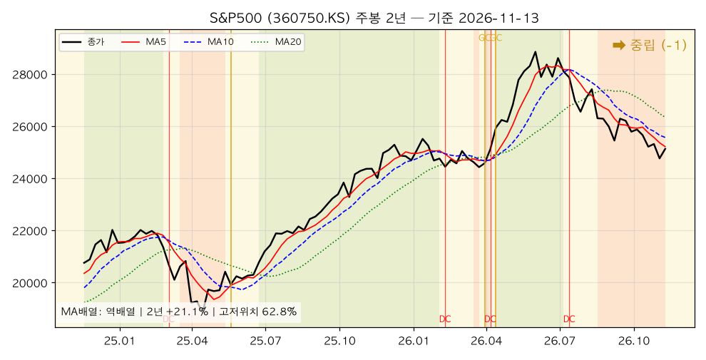

*S&P500(360750.KS) — 주봉 역배열, 2년 +21.1%, 고저위치 62.8%. 1주 +1.5%(지수 +2.5%보다 작은 것은 원화 강세 1.7% 때문). 주봉 MA5-MA10 격차 -1.38%.*

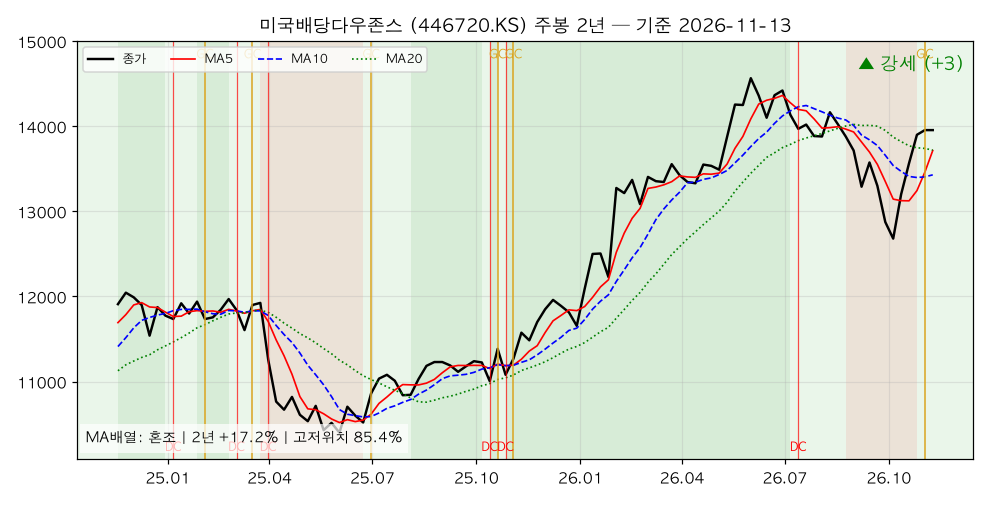

*미국배당다우존스(446720.KS) — 주봉 혼조(MA5 > MA10, MA5와 MA20은 거의 같음), 2년 +17.2%, 고저위치 85.4%. **주봉 GC 유지, 일봉 정배열 진입.** 세 시간축 강세 2주 연속.*

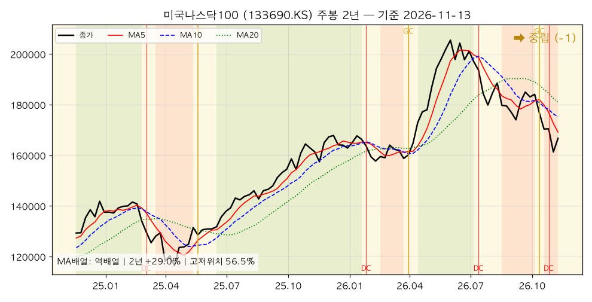

*미국나스닥100(133690.KS) — 주봉 역배열, 2년 +29.0%, 고저위치 56.5%. 1주 +3.4%. 일봉 MA60보다 5.3% 아래(지난주 9.4%에서 좁혀짐).*

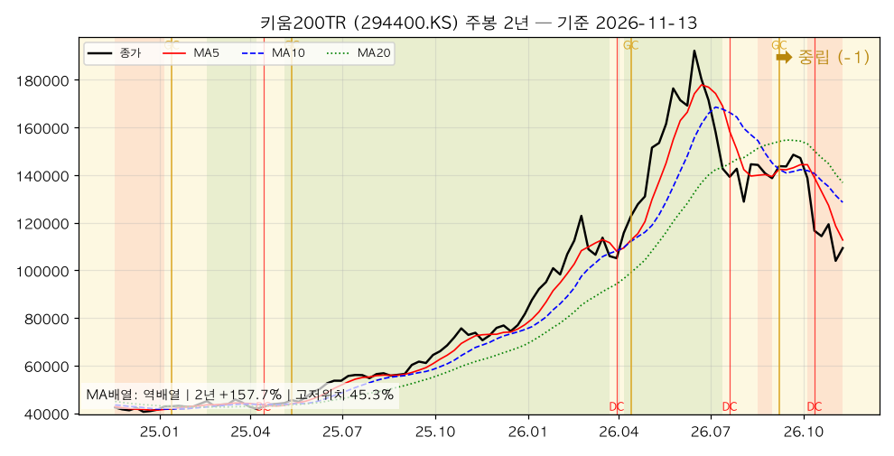

*키움200TR(294400.KS) — 주봉 역배열, 2년 +157.7%, 고저위치 45.3%. 1주 +5.2%로 지난주 -12.9%의 약 40%를 되돌림. 일봉 MA60보다 16.8% 아래.*

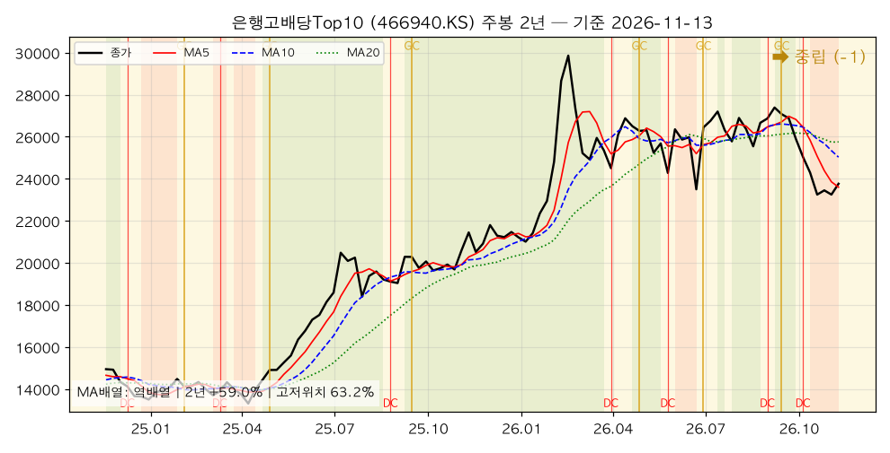

*은행고배당Top10(466940.KS) — 주봉 역배열, 2년 +59.0%, 고저위치 63.2%. 1주 +2.2%. 그러나 **월봉 데드크로스가 이번 봉에 발생**(미완성 봉).*

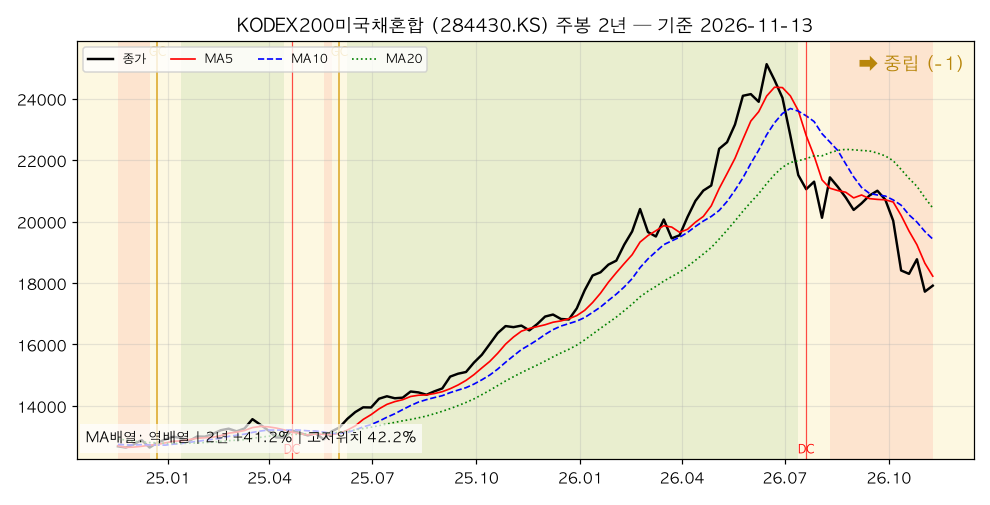

*KODEX200미국채혼합(284430.KS) — 주봉 역배열, 2년 +41.2%, 고저위치 42.2%. 1주 +1.1%. 코스피 +4.6%와 미국채 -3.3%가 서로 상쇄했다. 지난주와 반대 방향으로 "혼합"의 의미가 드러난 주.*

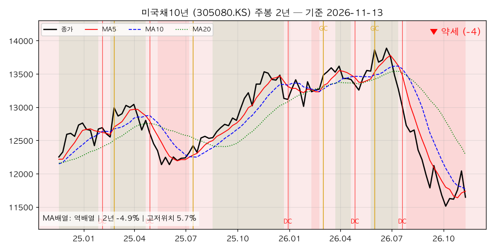

*미국채10년(305080.KS) — 주봉 역배열, 2년 -4.9%, 고저위치 5.7%(2년 최저권). 1주 -3.3%. 지난주 주봉 GC가 한 주 만에 되돌려졌다.*

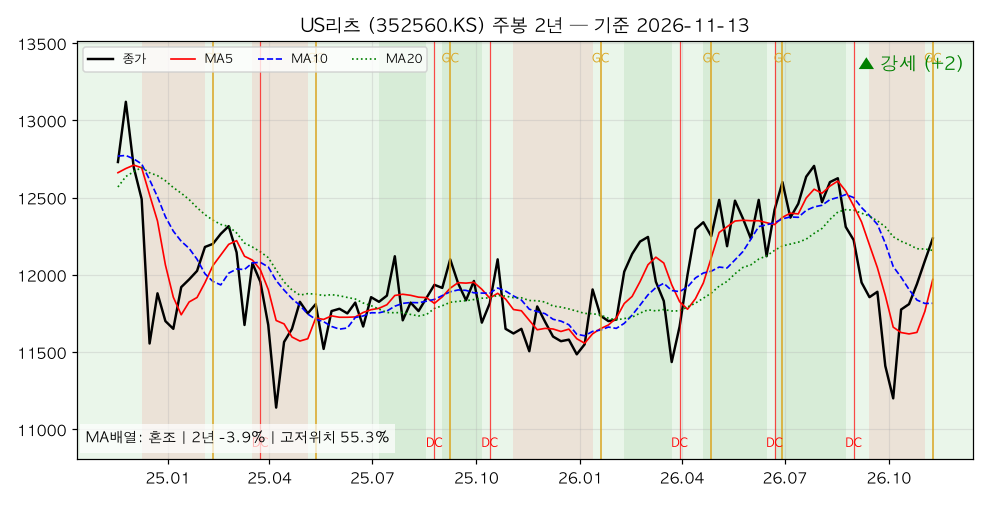

*US리츠(352560.KS) — 주봉 혼조, 2년 -3.9%, 고저위치 55.3%. **주봉 GC 유지 → 주봉 강세(+2)로 상향, 세 시간축 강세 일치.** 2년 수익률은 여전히 마이너스다.*

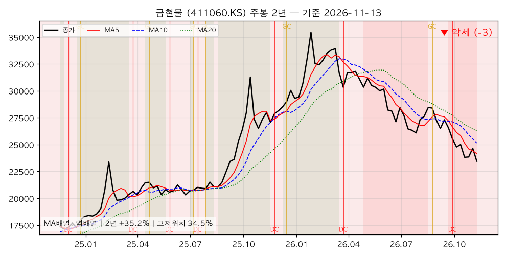

*금현물(411060.KS) — 주봉 역배열, 2년 +35.2%, 고저위치 34.5%. 1주 -4.9%로 하락률 1위. 일봉 고저위치 0.0%(3개월 최저). 주봉 MA20(26,272원)이 현재가보다 12.0% 위.*

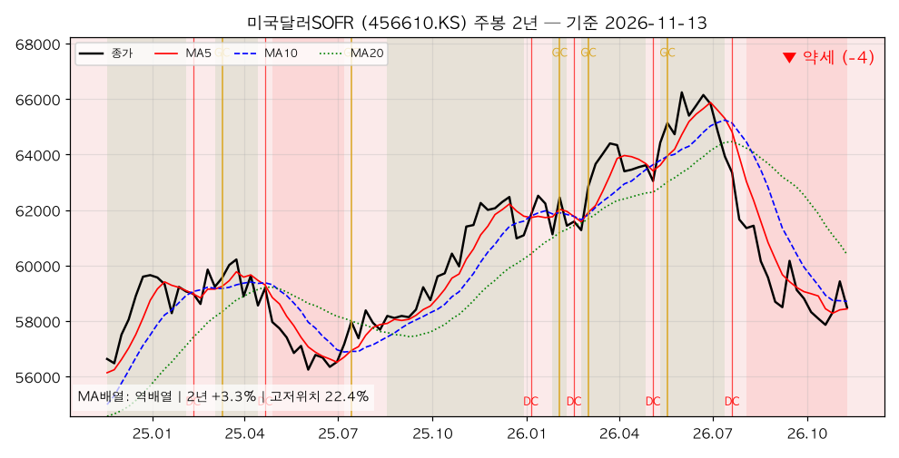

*미국달러SOFR(456610.KS) — 주봉 역배열, 2년 +3.3%, 고저위치 22.4%. 원/달러 1,334원(-1.7%)을 반영해 -1.6%. 주봉 강도 -3 → -4.*

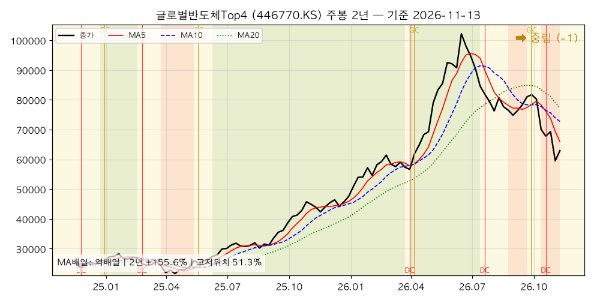

*글로벌반도체Top4(446770.KS) — 주봉 역배열, 2년 +155.6%, 고저위치 51.3%. 1주 +5.8%. 주봉 MA5-MA10 격차 -9.4%로 지난주(-9.9%)와 거의 같다.*

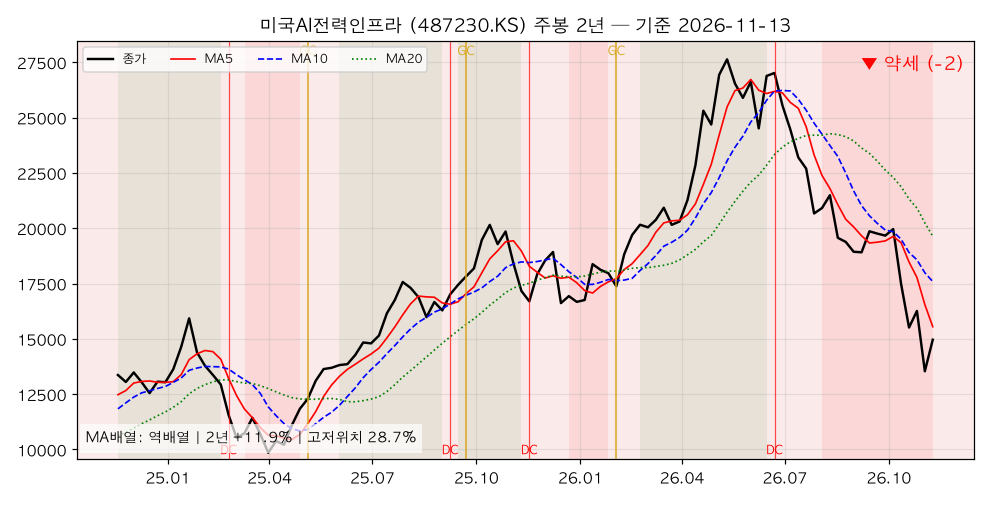

*미국AI전력인프라(487230.KS) — 주봉 역배열, 2년 +11.9%, 고저위치 28.7%. 1주 +10.5%로 상승률 1위. 그래도 일봉 MA60보다 17.4% 아래, 3개월 -28.8%.*

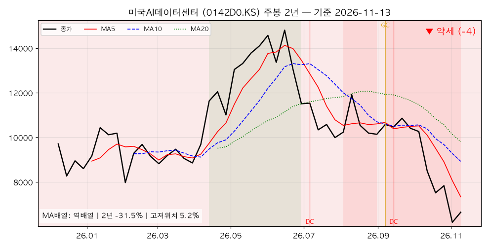

*미국AI데이터센터(0142D0.KS) — 주봉 역배열, 상장 후 -31.5%, 고저위치 5.2%. 1주 +7.3%. 주봉 MA5-MA10 격차 -17.8%로 15종목 중 가장 멀다.*

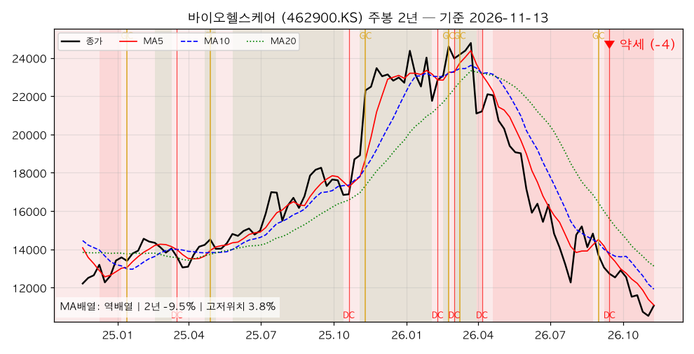

*바이오헬스케어(462900.KS) — 주봉 역배열, 2년 -9.5%, 고저위치 3.8%. 1주 +5.1%. 주봉 모멘텀 -38.2%로 여전히 15종목 중 가장 약하다.*

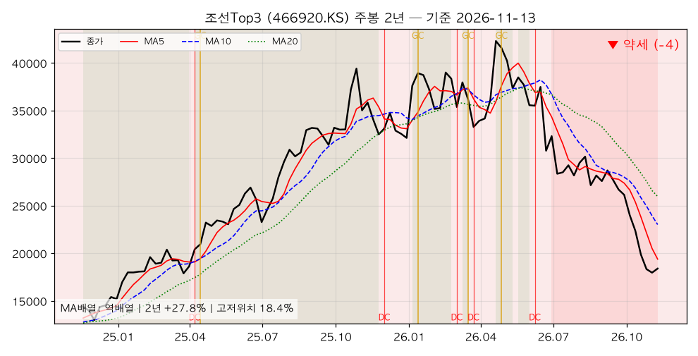

*조선Top3(466920.KS) — 주봉 역배열, 2년 +27.8%, 고저위치 18.4%. 1주 +2.4%. 일·주·월봉 모두 -4, 월봉 MA12보다 40.3% 아래.*

### [5] 추세추종 관점 주목 종목

#### 🚀 멀티타임 강세 (추세 편승 구간)

| 종목 | 일봉 | 주봉 | 월봉 | 근거 |
|---|---|---|---|---|
| 미국배당다우존스 | 🟢 +4 | 🟢 +3 | 🟢 +3 | 일봉 정배열 진입, 주봉 GC 유지(+2.13%), 일봉 MA60 +3.0% 위, 고저위치 85~92% |
| US리츠 | 🟢 +3 | 🟢 +2 | 🟢 +2 | 주봉 GC 유지(+1.31%), 일봉 MA60 +2.3% 위, 일봉 고저위치 72.6% |

반대 신호도 적는다. 미국배당다우존스는 고저위치 85~92%의 상단권이라 "싸게 사는" 구간이 아니고, 1주 수익률은 0.0%로 상승 속도가 멈췄다. 월봉은 MA3이 MA6 아래라 **월봉 배열은 혼조**다. 지난 호에 "11월 말 월봉 GC 확정"을 2차 분할 조건으로 걸었는데, 이번 호의 보정된 계산으로는 월봉 MA3(13,612원)이 MA6(13,831원)보다 1.6% 아래라 **11월 말까지 월봉 골든크로스가 나오려면 월말 종가가 약 15,270원(현재가 대비 +9.4%)을 넘어야 한다.** 조건을 "월봉 GC"에서 "주봉 GC 유지 + 일봉 정배열 유지"로 바꿔 읽는 것이 현실적이다. US리츠는 2년 수익률 -3.9%로 긴 시계에서는 아직 회복 중이다.

#### 📌 눌림목 후보 (장기 상승 + 단기 과매도)

| 종목 | 월봉 고저위치 | 일봉 고저위치 | 괴리 | 월봉 강도 | 일봉 강도 |
|---|---|---|---|---|---|
| S&P500 | 78.8% | 13.9% | 64.9%p | 🟡 +1 | 🔴 -4 |
| 은행고배당Top10 | 79.4% | 25.4% | 54.0%p | 🟡 +1 | 🔴 -4 |
| 미국나스닥100 | 73.4% | 20.9% | 52.5%p | 🟡 +1 | 🔴 -4 |
| 글로벌반도체Top4 | 59.2% | 14.6% | 44.6%p | 🟡 0 | 🔴 -4 |

#### 눌림목은 어떻게 판정하나 — S&P500 사례 분해

포트폴리오 최대 비중 종목이고 월봉·일봉 괴리가 가장 크다(지난 호 76.6%p → 이번 호 64.9%p, 일봉이 바닥에서 올라오며 좁혀짐).

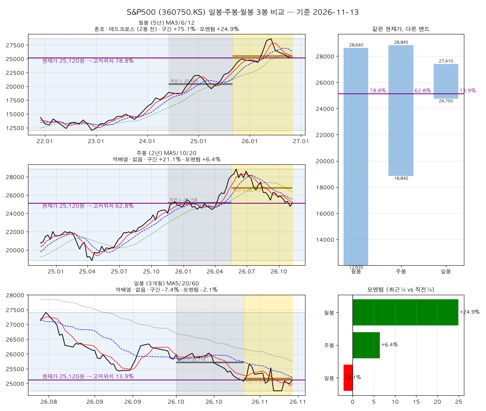

**① 밴드 비교** — 같은 25,120원이 시간축마다 다른 위치다.

| 봉 단위 | 구간 최저 | 구간 최고 | 고저위치 |
|---|---|---|---|
| 월봉 (5년) | 12,035 | 28,640 | 78.8% |
| 주봉 (2년) | 18,840 | 28,845 | 62.8% |
| 일봉 (3개월) | 24,750 | 27,410 | 13.9% |

일봉 3개월 최저가가 11/9의 24,750원으로 한 번 더 낮아졌고, 그 뒤 5거래일 동안 25,000원 안팎에서 버텼다. **지난 호에 확인 포인트로 둔 "3개월 최저 24,755원 지지"는 5원 차이로 깨졌다가 곧바로 회복했다** — 사실상 같은 가격대에서 바닥을 다진 모양이다.

**② 모멘텀 비교** — 월봉 +24.9%, 주봉 +6.4%, 일봉 -2.1%. 긴 시간축은 가속, 짧은 시간축만 감속이다. 일봉 감속 폭은 지난 호 -2.5%에서 -2.1%로 줄었다.

**③ 그래도 후보일 뿐인 이유 (반대 신호)**
- **월봉 MA3이 MA6 아래로 내려온 데드크로스가 2개월 전에 나왔고**, 11월 봉에서도 회복하지 못했다(MA3 25,418 < MA6 26,262).
- 주봉은 역배열, MA5-MA10 격차 -1.38%. 최근 10주 주봉 골든크로스 0건.
- **지수는 +2.5% 올랐는데 이 ETF는 +1.5%**였다. 원화가 1.7% 강해진 탓이다. 원화 강세가 이어지면 미국 지수가 회복해도 원화 ETF의 회복은 더디다.
- 결론: 매수 조건은 지난 호 그대로 둔다. 일봉 MA5(24,995원)의 MA20(25,218원) 상향 돌파와 MA60(25,746원) 회복. 현재가는 MA20보다 0.4%, MA60보다 2.4% 아래로 **지난 호(2.7%·4.5%)보다 가까워졌다.** 일봉 GC는 MA5가 0.9%만 더 오르면 나온다 — 다음 주 가장 먼저 확인할 신호다.

#### ⚠️ 혼조 관망 (신호 불일치)

| 종목 | 상태 | 관망 이유 |
|---|---|---|
| 미국채10년 | 일봉 -1·주봉 -4·월봉 -2 | 지난주 주봉 GC가 한 주 만에 되돌려짐. 2년 최저권(5.7%). 금리 하락 추세라는 증거가 아직 없다 |
| 미국달러SOFR | 일봉 -1·주봉 -4·월봉 -1 | 원/달러 1,334원으로 원화 강세 전환. 환율 방향이 바뀌는지 확인 필요 |
| 금현물 | 일봉 -3·주봉 -3·월봉 -1 | 일봉 GC(4봉 전)가 났는데도 3개월 최저 마감. MA60 아래의 GC는 무효에 가깝다 |
| 은행고배당Top10 | 일봉 -4·주봉 -1·월봉 +1 | 눌림목 후보지만 월봉 DC가 이번 봉에 발생. 11월 말 확정 여부 확인 |

#### 🔻 멀티타임 약세 (회피·축소 구간)

| 종목 | 일·주·월봉 | 핵심 수치 |
|---|---|---|
| 미국AI데이터센터 | -4 · -4 · -2 | 1주 +7.3%에도 일봉 MA60 -28.3%, 주봉 MA5-MA10 -17.8% |
| 조선Top3 | -4 · -4 · -4 | 3개월 -37.2%, 월봉 MA12 -40.3% |
| 바이오헬스케어 | -4 · -4 · -4 | 주봉 고저위치 3.8%, 주봉 모멘텀 -38.2% |
| (준약세) 미국AI전력인프라 | -4 · -2 · -1 | 1주 +10.5%로 월봉만 중립 복귀. 일봉 MA60 -17.4% |

### [6] 자산군별 추세 비교

추세강도 평균(-4 ~ +4 척도)으로 자산군을 묶어 비교했다. 괄호는 11-06 기준 재계산 값.

| 자산군 | 구성 종목 | 일봉 평균 | 주봉 평균 | 월봉 평균 |
|---|---|---|---|---|
| 주식 — 선진국 | S&P500, 나스닥100, 배당다우존스, 반도체, AI전력, AI데이터센터 | -2.7 (-2.8) | -1.0 (-1.0) | +0.3 (+0.3) |
| 주식 — 국내 | 키움200TR, 은행고배당Top10, 조선Top3, 바이오헬스케어 | -4.0 (-4.0) | -2.5 (-2.5) | -1.8 (-1.8) |
| 혼합 | KODEX200미국채혼합 | -4.0 (-4.0) | -1.0 (-1.0) | +0.0 (+0.0) |
| 채권 | 미국채10년 | -1.0 (+2.0) | -4.0 (-4.0) | -2.0 (-2.0) |
| 대안자산 | 금현물, 미국달러SOFR, US리츠 | -0.3 (-0.7) | -1.7 (-2.3) | +0.0 (+0.0) |
| 배당·인컴 | 배당다우존스, 은행고배당Top10, US리츠 | +1.0 (+0.3) | +1.3 (+0.3) | +2.0 (+2.0) |

**자산군 간 관계 해석**

첫째, **가격은 크게 움직였는데 자산군 점수는 거의 그대로다.** 주식·혼합의 세 시간축 평균은 소수점 첫째 자리까지 지난주와 같다. 성장 자산의 +5~10% 반등이 이동평균선 구조를 바꾸지 못했다는 뜻이다. 지난 호에 "반등은 구조를 못 바꿨지만 급락은 구조를 바꿨다"고 적었는데, 이번 주는 그 문장의 앞부분이 다시 확인됐다.

둘째, **움직인 것은 채권(일봉 +2.0 → -1.0)과 배당·인컴(주봉 +0.3 → +1.3)**이다. 위험회피 수요가 빠지자 미국채의 단기 강세가 사라졌고, 배당·인컴은 US리츠의 주봉 강세 전환으로 점수가 올랐다.

셋째, **배당·인컴은 3주째 유일하게 세 시간축 모두 플러스**다. 급락 주(지난주)에도, 반등 주(이번 주)에도 추세가 유지됐다. "방향과 상관없이 버티는 자산"이 무엇인지 두 주에 걸쳐 확인된 셈이다.

넷째, **혼합 자산은 지난주와 반대 이유로 제자리였다.** 지난주는 국내 주식 하락을 채권이 못 막았고, 이번 주는 국내 주식 반등(+4.6%)을 미국채 하락(-3.3%)이 깎았다. 결과는 1주 +1.1%.

### [7] 종합 코멘트

**전체 추세 방향성**

시간축별 강세 비중은 일봉 13.3%(2개), 주봉 13.3%(2개), 월봉 13.3%(2개)로 처음으로 세 시간축이 같은 숫자다. 그리고 그 2개가 **같은 두 종목(미국배당다우존스·US리츠)**이다. 시장 전체는 "급락 → 기술적 반등"의 한 사이클을 마쳤지만 **추세의 주도권은 여전히 배당·인컴이 쥐고 있다.** 성장 자산은 가격만 돌아왔고 구조는 돌아오지 않았다.

**강세·약세 자산군의 교차 신호**

- 강세 일치 2개(미국배당다우존스·US리츠), 약세 일치 3개(AI데이터센터·바이오·조선).
- 1주 상승 상위 5종목은 지난주 하락 상위 5종목과 거의 같다. **급락 후 첫 주의 기술적 반등**이라는 전형적인 모양이다. 이 반등이 진짜 추세 전환인지는 주봉 MA5-MA10 격차(-9~-18%)가 줄어드는 속도로 판단한다.
- 1주 하락 3종목(금·미국채·달러)은 지난주 상승 종목이다. **위험회피 수요의 반대 매매**로 읽힌다. 다만 미국채10년은 2년 최저권이라, 금리 쪽 추세(주봉 -4)가 원래 약했던 것이 다시 드러난 것이기도 하다.
- 지난 호에 제시한 다섯 가지 확인 신호의 결과: ① 미국배당다우존스 주봉 GC 유지 — **충족** ② 미국채10년·US리츠 주봉 GC → MA20 회복 — **US리츠 충족, 미국채10년 실패(GC 되돌림)** ③ S&P500 일봉 3개월 최저 지지 — **5원 차로 깨졌다가 회복(사실상 지지)** ④ AI·반도체 주봉 하락 속도 둔화 — **충족(1주 +5~10% 반등)** ⑤ VIX 30 돌파 — **미발생**(28.2 → 19.3).

**추세추종 대응 방향**

1. **신규 진입 허용은 미국배당다우존스·US리츠 두 종목.** 둘 다 강세 일치다. 다만 미국배당다우존스는 상단권(85%+)이라 추가는 분할로, US리츠는 2년 수익률이 마이너스라 "회복 초입"으로 보고 소액부터 접근한다.
2. **S&P500 눌림목의 매수 조건(일봉 MA5 > MA20)이 가장 가까워졌다.** MA5가 0.9%만 오르면 충족된다. 조건이 충족되면 그때 들어가고, 미리 들어가지 않는다.
3. **AI·반도체·조선·바이오의 반등은 "축소 기회"로 본다.** 일봉 MA60까지 14~28%가 남아 있다. 약세 일치 종목은 반등 시 비중을 줄이는 원칙을 유지한다.
4. **금·미국채의 하락을 "싸졌다"로 사지 않는다.** 금은 3개월 최저, 미국채10년은 2년 최저권이다. 둘 다 주봉 MA20 아래에 있다. 추세추종 관점에서는 주봉 GC 재발생을 기다린다.
5. **다음 주 확인할 신호**: ① S&P500 일봉 골든크로스(MA5 24,995 → MA20 25,218 상향) ② 미국배당다우존스·US리츠 주봉 GC 유지 ③ 은행고배당Top10 월봉 DC가 월말 전에 되돌려지는지 ④ 반등 종목들의 주봉 MA5-MA10 격차 축소 속도 ⑤ 원/달러 1,330원 아래 원화 강세 지속 여부(달러 자산 전반의 원화 환산 수익률).


---

## 5. 내 ETF 평가 & 대응

> 이 섹션은 개인 포트폴리오를 다루므로 **절대금액을 쓰지 않는다.** 모든 수치는 비중(%)·수익률(%)·주당 가격이다.
> 앞의 세 분석(한국은행·거시·차트)을 입력으로 받은 최종 종합이며, 관점은 **안전마진 기반 가치투자자**다.
> 기준: 포트폴리오 시트는 이번 주 **갱신되지 않았다**(마지막 갱신 11-08). 그래서 11-08 시트의 보유 내역을 그대로 두고, 각 종목의 평가 비율에 **Yahoo Finance 11-06 → 11-13 종가 변화율**을 곱해 추정했다. 이번 주 매매·신규 납입은 반영되지 않았다(매매가 없었다고 가정). 퇴직연금의 타이거 KRX금현물은 ACE KRX금현물(411060)을, TIGER 미국배당다우존스는 458730을 가격 대리로 썼다.

### 5-0. 이번 주의 한 줄 — 지난주 계좌를 지킨 자산이 이번 주 계좌를 깎았다

지난 호의 결론은 "방어자산(금·미국채·달러)이 계좌를 지켰다"였다. 일주일 뒤에는 정확히 반대가 일어났다. **AI·반도체·국내 주식이 5~10% 되돌렸고, 금·미국채·달러가 2~5% 내려갔다.** 둘이 거의 상쇄되어 계좌 전체는 **+0.29%**로 제자리였다.

| 항목 | 45주차(11-06) | 46주차(11-13) | 내 포트폴리오에의 의미 |
|---|---|---|---|
| S&P500 지수 | 7,377 | 7,562 (+2.5%) | 최대 비중 자산 반등 |
| 나스닥100 지수 | 26,990 | 27,944 (+3.5%) | AI·반도체 기술적 반등 |
| 코스피 | 5,060 | 5,291 (+4.6%) | 서킷브레이커 이후 첫 반등 주 |
| VIX | 25.6 | 19.3 | 공포 지수 20 아래로 |
| 미 10년물 | 4.86% | 5.10% | **+24bp(11/12)** — 지난주 장기채 반등분을 모두 반납 |
| 12월 연준 인상 확률 | 76.8% | 100%(11/10, 25bp 89%) | **100%** — 인상은 확정, 남은 변수는 폭(25bp 89% / 50bp 11%) |
| 원/달러 | 1,356원 | 1,334원 (△1.7%) | **달러 자산 전체에 역풍** |
| 국제 금값 | 4,074.9달러 | 3,887.6달러 (△4.6%) | 금 4개 라인 일제히 하락 |
| WTI | 90.8달러 | 88.9달러 (△2.1%) | 비용 압력 추가 완화 |

**이 표가 말하는 것.** 지난주 금·미국채·달러가 오른 이유는 금리 인하가 아니라 **위험회피**였다. 이번 주 위험회피가 풀리자(VIX 25.6 → 19.3) 그 상승분이 그대로 빠졌다. 여기에 **원화가 1.7% 강해지면서** 미국 지수가 2.5% 오른 주에도 국내 상장 S&P500 ETF는 +1.5%에 그쳤다. 이 계좌의 약 80%가 달러 표시 자산이라는 사실이 지난주에는 완충재, 이번 주에는 브레이크였다.

### 5-1. 포트폴리오 현황 (비중·수익률만, 추정)

#### 전체

| 항목 | 값 | 직전(11-06) | 변화 |
|---|---|---|---|
| 전체 누적 수익률 | **△2.62%** (추정) | △2.90% | **+0.28%p** |
| 이번 주 계좌 가치 변화 | **+0.29%** | △2.77% | 같은 기간 S&P500 지수 +2.5%, 코스피 +4.6% |
| 미국 주식 비중(배당·헬스케어 포함) | 45.2% | 44.8% | +0.4%p |
| AI·반도체·조선 테마 비중 | 10.4% | 9.8% | +0.6%p (가격 반등) |
| 금 비중 | **13.0%** | 13.7% | △0.7%p (가격 하락) |
| **현금 비중** | **1.0%** | 1.0% | 변화 없음 — 시트 미갱신으로 확인 불가 |

**시장이 반등한 주에 계좌는 제자리였다.** 반등을 이끈 AI·테마(+6.3%)와 국내 주식(+3.1%)의 비중이 합쳐 15.9%로 작고, 반등을 깎은 금(△4.9%)·미국채(△3.5%)·달러(△1.6%)가 23.8%로 더 컸다. 지난주와 이번 주를 합치면 계좌는 약 △2.5%, 같은 2주간 S&P500 지수는 △2.0%, 코스피는 △10.9%다. **변동성은 시장보다 훨씬 작았고, 방향은 시장을 따라갔다.**

#### 계좌별

| 계좌 | 전체 내 비중 | 계좌 수익률 | 직전(11-06) | 주간 가치 변화 |
|---|---|---|---|---|
| 퇴직연금 | 40.4% | **+5.27%** | +5.09% | +0.17% |
| 연금저축펀드 | 26.7% | **△0.75%** | △0.38% | △0.37% |
| 개인IRP | 18.4% | **+3.20%** | +4.17% | **△0.92%** |
| ISA | 14.6% | **△25.87%** | △28.36% | **+3.47%** |

**순서가 지난주와 뒤집혔다.** 지난주 유일하게 올랐던 개인IRP가 이번 주 가장 많이 빠졌고(△0.92%), 지난주 △13.3%였던 ISA가 가장 많이 올랐다(+3.47%). 개인IRP는 배당미국채혼합·금 비중이 47%라 금리·금의 되돌림을 그대로 받았다. ISA는 AI·반도체·조선 3종(약 62%)의 반등을 받았지만, **지난주 낙폭의 약 4분의 1만 되돌렸다.**

#### 자산군별 — 이번 주 무엇이 계좌를 움직였나

| 자산군 | 비중 | 누적 수익률 | 1주 | 계좌 기여(%p) |
|---|---|---|---|---|
| 미국 주식 | 45.2% | +8.62% | +1.17% | **+0.52** |
| AI·반도체·조선 테마 | 10.4% | △31.23% | **+6.31%** | **+0.62** |
| 국내 주식 | 5.5% | △3.97% | +3.10% | +0.16 |
| 혼합형 | 14.1% | +4.67% | △0.25% | △0.04 |
| 미국채 | 7.0% | △6.37% | △3.48% | △0.25 |
| 금 | 13.0% | △7.57% | **△4.89%** | **△0.67** |
| 달러 단기채 | 3.8% | △9.77% | △1.59% | △0.06 |
| 현금 | 1.0% | — | — | — |

**금 한 자산이 이번 주 가장 큰 마이너스(△0.67%p)였다.** 비중 13%에 △4.9%가 곱해진 결과다. 반대로 비중 10%인 테마가 가장 큰 플러스(+0.62%p)였다. 두 숫자가 거의 같다는 것은, 이 포트폴리오에서 **금과 AI 테마가 서로의 헤지처럼 움직이고 있다**는 뜻이다. 지난주에도 같은 관계였다(방향만 반대).

#### 종목별 통합 (계좌 합산, 상위·특이 종목)

| 종목 | 전체 비중 | 누적 수익률 | 1주 |
|---|---|---|---|
| 타이거 미국 S&P500 | 26.4% | +8.84% | +1.47% |
| SOL 미국배당다우존스 | 9.7% | **+19.84%** | 0.00% |
| ACE KRX 금현물 (3개 계좌) | 8.5% | △9.30% | △4.89% |
| 삼성 KODEX200 미국채혼합 | 7.9% | +6.60% | +1.10% |
| SOL 미국배당미국채혼합50 | 6.2% | +2.34% | △1.90% |
| 타이거 미국채 10년선물 | 5.2% | △6.85% | △3.28% |
| 타이거 KRX금현물 | 4.5% | △4.15% | △4.89% |
| 타이거 미국 나스닥100 | 4.4% | △4.15% | +3.36% |
| 타이거 은행고배당플러스TOP10 | 3.8% | △2.49% | +2.22% |
| TIGER 미국달러단기채권액티브 | 3.8% | △9.77% | △1.59% |
| ACE 글로벌반도체TOP4 plus | 3.7% | △16.54% | +5.77% |
| TIGER 미국배당다우존스 | 3.6% | +0.15% | △0.33% |
| 타이거 미국AI데이터센터Top4Plus | 3.5% | **△39.45%** | +7.27% |
| ACE 미국30년국채액티브 | 1.8% | △4.96% | △4.05% |
| SOL 조선TOP3플러스 | 1.7% | **△40.55%** | +2.39% |
| KIWOOM 200TR | 1.7% | △7.19% | +5.16% |
| KODEX 미국AI전력핵심인프라 | 1.4% | △26.11% | **+10.53%** |
| KODEX 미국S&P500 헬스케어 | 1.1% | +1.86% | +0.83% |
| 현금 | 1.0% | — | — |

**누적 △30% 이상 종목은 여전히 둘**(AI데이터센터 △39.5%, 조선TOP3 △40.6%)이다. AI전력은 한 주 +10.5%로 △33.1% → △26.1%가 되며 명단에서 빠졌다. 그러나 4장의 판정은 일·주봉 약세 그대로다. 반대 끝은 **SOL 미국배당다우존스 +19.84%**로, 이번 주 0.0%였지만 4장에서 일봉 정배열에 진입했다.

### 5-2. 2단계 — 내 ETF의 펀더멘털 지표

#### 지표를 어떻게 읽나 (쉬운 설명)

| 지표 | 한 줄 정의 | 비유 |
|---|---|---|
| **PER** | 주가 ÷ 1주당 순이익. ETF는 담은 기업들의 시가총액 가중평균 | **"이 가게를 사면 지금 버는 돈으로 원금 회수에 몇 년 걸리나."** PER 20배 = 20년 |
| **이익수익률** | 1 ÷ PER × 100 | **"이 가게의 연 이자율."** PER 20배면 연 5% |
| **PBR** | 주가 ÷ 1주당 순자산 | **"가게 집기·현금을 다 팔면 받는 돈의 몇 배를 내고 사는가."** |
| **ROE** | 순이익 ÷ 자기자본. 여기서는 PBR ÷ PER로 역산 | **"내 돈 100을 맡기면 1년에 몇을 벌어오나."** |
| **배당수익률** | 연간 분배금 ÷ 현재가 | **"매년 통장에 실제로 꽂히는 비율."** |

**안전마진의 기준선**: 한국 예금금리 **3.5%**. 이익수익률이 이보다 낮으면 위험을 더 지고 수익을 덜 받는 거래다.

#### 보유 ETF 지표 (2026-11-13 추정)

국내 상장 ETF는 Yahoo가 펀더멘털을 제공하지 않아 **동일 지수 미국 상장 ETF를 대리 지표**로 쓴다. 지난 호(11-06)의 PER에 **11-06 → 11-13 대리 ETF 가격 변화율(달러 기준)**을 반영했다. 일주일 사이 이익 추정치는 바뀌지 않았다고 가정한 근사치다.

| 내 ETF | 대리 | 대리 가격 1주 | PER (지난 호 → 이번 호) | 이익수익률 | PBR(지난 호) | ROE(역산) | 배당수익률 |
|---|---|---|---|---|---|---|---|
| SOL·TIGER 미국배당다우존스 | SCHD | +2.7% | 18.0 → **18.5배** | **5.4%** | 3.55배 | 19.5% | **약 3.1%** |
| 타이거 미국 S&P500 | SPY | +2.6% | 23.1 → **23.7배** | **4.2%** | 5.25배 | 21.7% | 1.0% |
| 타이거 미국 나스닥100 | QQQ | +3.6% | 26.0 → **26.9배** | 3.7% | 8.91배 | 31.5% | 0.4% |
| KODEX 미국S&P500헬스케어 | XLV | +2.2% | 30.1 → 30.8배 | 3.2% | 4.74배 | 15.8% | 1.5% |
| ACE 글로벌반도체TOP4 | SOXX | **+9.4%** | 26.6 → **29.1배** | **3.4%** | 10.52배 | 31.5% | 0.2% |
| SOL 미국배당미국채혼합50 | 합성 | — | — | 약 5.3%\* | — | — | — |

\* 주식 이익수익률 5.4%와 미 10년물 5.10%의 절반 가중 기대수익률.

**달러 기준과 원화 기준이 이번 주 크게 달랐다.** SCHD는 달러로 +2.7% 올랐지만 국내 상장 미국배당다우존스는 0.0%였다. 원화 강세(△1.7%)와 국내 시장 시차가 그 차이를 만들었다. PER은 달러 기준 가격으로 계산하므로, **원화로 산 내 ETF의 가격은 거의 그대로인데 밸류에이션은 비싸졌다.** 환율이 원화 강세로 계속 가면 이 괴리는 더 커진다.

**수집하지 못한 지표**: 은행고배당TOP10·KIWOOM 200TR·조선TOP3의 11월 시점 PER·PBR 확정치, 미국AI데이터센터·AI전력의 대리 ETF(대응 미국 상장 ETF 없음). 채권·금·달러 ETF는 PER 개념이 적용되지 않는다. 지난 호와 동일하다.

#### ETF를 하나의 회사로 보면 — 현금흐름 3분해

| 활동 | 보는 지표 | 이번 주 달라진 점 |
|---|---|---|
| **영업활동** (돈을 잘 버나) | ROE·영업이익률 | 바뀐 것 없음. 보유 미국 ETF ROE 15.8~31.5%. 2장의 10월 수출물량 전년비 **+43.9%(역대 최대)**로 반도체 실적 모멘텀은 여전하다 |
| **투자활동** (미래에 쓰나) | CAPEX·ROIC | 지난주 시장이 의심한 칸. 이번 주 반도체 대리 ETF가 +9.4% 되돌렸지만 PER 29배로 **다시 비싸졌다.** 의심이 풀린 것이 아니라 강제 매도가 멈춘 것에 가깝다 |
| **재무활동** (주주에게 돌려주나) | 배당수익률·자사주 | 배당다우존스·US리츠 두 배당 자산이 4장에서 세 시간축 강세 일치. **"현금을 돌려주는 자산"이 급락 주와 반등 주를 모두 추세 유지로 통과했다** |

### 5-3. 3단계 — 안전마진과 적정가격 범위

#### 무위험 수익률 사다리와 "등가 PER"

| 비교 대상 | 수익률 | 등가 PER | 지난 호 대비 |
|---|---|---|---|
| 한국 기준금리 | 3.00% (11/26 결정) | 33.3배 | — |
| **한국 예금금리 (기준선)** | **3.5%** | **28.6배** | — |
| 미 정책금리 | 3.875% (12월 인상 확률 100%(11/10, 25bp 89%)) | 25.8배 | — |
| 미 3개월물 | 4.32% | 23.1배 | 4.19% → 4.32%, 기준 강화 |
| **미 10년물** | **5.10%** | **19.6배** | 20.6배 → 19.6배로 **기준이 다시 엄격해졌다** |

#### 내 주식 ETF는 이 사다리의 어디에 있나

| ETF | 이익수익률 | vs 예금 3.5% | vs 3개월물 4.32% | vs 10년물 5.10% | 지난 호 대비 |
|---|---|---|---|---|---|
| **미국배당다우존스** | **5.4%** | **+1.9%p** ✅ | **+1.1%p** ✅ | **+0.3%p** ✅ | 3개 기준 합격 유지. 단 10년물 여유가 0.7%p → **0.3%p로 줄었다** |
| 타이거 미국 S&P500 | 4.2% | +0.7%p ✅ | △0.1%p ❌ | △0.9%p ❌ | **3개월물 기준을 한 주 만에 다시 놓쳤다** |
| 타이거 미국 나스닥100 | 3.7% | +0.2%p ✅ | △0.6%p ❌ | △1.4%p ❌ | 예금 기준 간신히 유지 |
| ACE 글로벌반도체TOP4 | 3.4% | △0.1%p ❌ | △0.9%p ❌ | △1.7%p ❌ | **예금 기준 다시 탈락** |
| KODEX 미국S&P500헬스케어 | 3.2% | △0.3%p ❌ | △1.1%p ❌ | △1.9%p ❌ | 소폭 악화 |

**안전마진은 양쪽에서 동시에 깎였다.** 분자 쪽에서는 주가 반등이 이익수익률을 낮췄고, 분모 쪽에서는 미 10년물이 4.86% → 5.10%로 올라 기준선이 높아졌다. 지난주 "급락이 안전마진을 만들어 냈다"고 쓴 것의 대부분이 한 주 만에 사라졌다. 10년물 기준을 넘는 종목은 여전히 **배당다우존스 하나**이고, 그 여유도 0.3%p까지 얇아졌다. 10년물이 5.4%를 넘으면 이 마지막 합격선도 사라진다.

#### S&P500 PER 23.7배는 50년 역사에서 어디쯤인가

| 시점 | S&P500 후행 PER | 현재(23.7배) 대비 |
|---|---|---|
| 50년 장기 평균 | 약 16배 | 현재는 평균의 **1.48배** (지난 호 1.44배) |
| 2007년 금융위기 직전 | 약 20배 | 현재가 **19% 더 비싸다** (지난 호 16%) |
| 2021년 코로나 후 유동성 장세 | 약 37배 | 그 64% 수준 |
| 2000년 3월 닷컴 버블 | 약 44배 | 그 54% 수준 |

지난주 "싸졌다가 아니라 덜 비싸졌다"고 쓴 하락분의 절반 이상을 이번 주 반등이 되돌렸다. 평균 수준(16배)까지 가려면 지수가 지금보다 약 32% 더 내려가야 한다. **한 주의 반등으로 안전마진은 다시 얇아졌다.**

#### 적정가격 범위 (ETF별, 원화 주당 가격)

| ETF | 현재가 | 강력매수가 | 적정매수가 | 매도·경계가 | 현재 위치 |
|---|---|---|---|---|---|
| 타이거 미국 S&P500 | 25,120 | **21,200** (PER 20배) | 20,780 (10년물 등가 19.6배) | 26,500 (PER 25배) | 강력매수가보다 18% 위. 10년물 등가 PER이 20배 아래로 내려가 **적정매수가가 강력매수가보다 낮아졌다.** 조건부 대기 |
| SOL 미국배당다우존스 | 13,955 | 이미 PER 18.5배로 20배 이하 | — | 배당수익률 5% 달성가 약 8,700 | **강력매수 구간 안**(PER 기준). 배당 5% 기준으로는 멀다 |
| 타이거 미국 나스닥100 | 166,720 | 123,800 (PER 20배) | 154,700 (PER 25배) | — | 적정매수가보다 8% 위(지난 호 4%) |
| ACE 글로벌반도체TOP4 | 62,960 | 43,300 (PER 20배) | 54,100 (PER 25배) | — | 적정매수가보다 16% 위(지난 호 6%). 이익 지속 가정 시 |
| 금현물 (411060) | 23,450 | — | — | **30,500** (JP모건 목표 5,055달러 환산) | 목표가까지 +30.0% 여지(지난 호 +23.9%) |
| 미국채10년 (305080) | 11,645 | — | — | 금리 50bp 하락 시 약 +4%, 상승 시 약 △4% (듀레이션 약 8년, 환율 제외) | 2년 최저권. 12월 인상 시 추가 하방 |
| 미국달러SOFR·달러단기채 | — | 현재가 = 적정가 | — | — | 원금 보존형. 손익은 환율 |

> 계산: 주식 ETF는 현재가 × (목표 PER ÷ 현재 PER). 환율 변동은 반영하지 않았다. 금은 현재가 × (목표 금값 5,055달러 ÷ 현재 금값 3,887.6달러). 배당 5% 달성가는 현재가 × (현재 배당수익률 ÷ 5%).

#### 마진데빗 — "감소가 무서운" 국면은 아직 숫자로 확인되지 않았다

FINRA 10월 마진데빗은 아직 발표되지 않았다(3장). 9월 1조 4,800억달러, 사상 최고(6월)의 98.5%가 최신값이다. 지난 호에서 "10월분이 전월비 마이너스면 디레버리징이 공식화된다"고 썼다. 이번 주 VIX가 19.3으로 내려오고 반도체지수가 반등하면서 **연쇄 반대매매 시나리오는 일단 멈췄다.** 그러나 마진데빗이 줄었는지는 숫자로 확인되지 않았고, 10년물 5.10%는 빚을 낸 투자자의 이자 부담을 다시 키운다. **"강제 매도가 멈췄다"와 "빚이 줄었다"는 다른 말이다.** 10월분(11월 하순 발표)을 확인하기 전에는 이번 반등을 디레버리징 종료로 읽지 않는다.

### 5-4. 4단계 — 세 가지 투자자 관점

| 관점 | 판단 기준 | 현재 시장 평가 | 내 포트폴리오에 대한 행동 |
|---|---|---|---|
| **가치투자자 (버핏)** | 이익수익률 > 무위험수익률, 안전마진 | 🟠 **후보가 다시 줄었다** — 반등으로 PER이 올라 나스닥100·반도체가 예금 기준 근처로 되돌아갔다. 10년물 기준 합격은 여전히 배당다우존스 1종 | **신규 자금 1순위는 여전히 배당다우존스.** S&P500은 강력매수가(21,200원) 또는 4장의 일봉 GC 중 먼저 오는 것을 기다린다 |
| **성장주 투자자 (ARK)** | EPS 성장률, 점유율, AI·반도체 테마 | 🟡 **기술적 반등** — 반도체 대리 ETF +9.4%, AI전력 +10.5%. 수출물량 역대 최대(2장)로 실적 근거는 그대로다. 그러나 4장 기준 주봉 MA5-MA10 격차가 -9~-18%로 구조는 그대로 | 실적은 맞았고 가격만 무너졌다는 해석이 힘을 얻는다. 그래도 **주봉 GC 전에는 늘리지 않는다** |
| **단기 트레이더 (모멘텀)** | 이동평균, VIX, 마진데빗 추세 | 🟡 **약세 속 반등** — VIX 19.3, 강세 일치 2종(배당다우·US리츠), 일봉 약세는 여전히 11종 | 배당다우·US리츠만 추세 편승 대상. S&P500은 일봉 GC까지 MA5 +0.9% 남음 |

**세 관점 모두 지난주보다 한 단계 덜 비관적이지만, 행동은 바뀌지 않는다.** 가치는 "다시 비싸졌다", 성장은 "실적은 맞았다", 모멘텀은 "구조는 그대로"라고 말한다. 세 관점이 동시에 가리키는 종목은 여전히 **미국배당다우존스 하나**다.

### 5-5. 5단계 — 🇰🇷 한국 금리환경 vs 🇺🇸 미국 금리환경 (분리 평가)

#### 🇰🇷 한국 자산 — 인상 사이클의 "쉼표", 가계 빚은 다시 늘었다 (보유: 국내 주식 5.5%, 혼합형 7.9%)

| 지표 | 값 | 출처 |
|---|---|---|
| 기준금리 | 3.00% (10월 만장일치 동결, 11/26 결정) | 2장 |
| 10월 금통위 의사록 | "긴축 기조 유지 + 두 차례 인상 효과 점검", 주가 조정 시 역자산효과 경고 | 2장 |
| 10월 은행 가계대출 | +5.0조원(9월 +0.5조원), 잔액 첫 1,200조원 돌파 | 2장 |
| 10월 수입물가 | 전월비 △1.8%(원화 강세·유가 하락) | 2장 |
| 코스피 | 5,291 (1주 +4.6%, 6월 고점 대비 약 △42%) | 3·4장 |

**11/26 금통위의 무게추는 이번 주 양쪽으로 동시에 움직였다.** 가계대출 재급증은 인상 쪽, 수입물가 하락과 의사록의 "역자산효과" 경고는 동결 쪽이다. 이 리포트의 판단은 지난 호와 같이 **동결 쪽에 무게를 두되 확신하지 않는다.**

- **은행고배당TOP10 (한국 자산)**: 금리 인상 시 순이자마진 확대 수혜 논리는 유효하고, 가계대출 증가는 은행 이익에 단기 플러스다. 1주 +2.2%로 반등했지만 **월봉 데드크로스가 11월 봉에서 발생**했다(4장). **보유, 추가 매수는 월봉 회복 후.**
- **KIWOOM 200TR·KODEX200미국채혼합 (한국 자산)**: 코스피 +4.6% 반등에도 일봉 MA60까지 16.8% 남았다(4장). 국내 지수의 PER·PBR 확정치를 구하지 못해 "싸졌다"고 말할 근거가 없다. **보유하고, 연금저축 지수 추종 규칙 밖에서 추가로 사지는 않는다.**
- **조선TOP3 (한국 자산)**: 누적 △40.6%. 세 시간축 약세 일치. 1주 +2.4%는 반등주 중 가장 약했다. **반등 시 축소.**

#### 🇺🇸 미국 자산 — 12월 인상 확정, 장기금리 5% 재돌파 (보유 약 67%)

| 지표 | 값 | 출처 |
|---|---|---|
| 연준 정책금리 | 3.75~4.00%, 12월 인상 확률 100%(25bp 89%) | 3장 |
| 10월 CPI | 헤드라인 +0.4%, 근원 +0.3%(예상 +0.2%, 3개월 연속 0.3%) | 3장 |
| 10월 PPI | 전년비 6.5%, 근원 전월비 +0.5% | 3장 |
| 10년물 / 2년물 / 실질 10년 | 5.10% / 4.86% / +2.00%p | 3장 |

**지난 호에 "단기는 오르고 장기는 내리는 평탄화"라고 쓴 모양이 한 주 만에 깨졌다.** 근원 CPI가 예상보다 높게 나오자 2년물(+35bp)과 10년물(+24bp)이 함께 뛰었다. 지난주 장기채·금에 우호적이던 환경이 이번 주 그대로 역풍으로 바뀌었다. 주식은 같은 주에 올랐는데, 이것은 금리 때문이 아니라 지난주 투매의 되돌림이다. **금리가 5%를 넘는 세상에서 주식 반등이 얼마나 갈지**가 다음 몇 주의 질문이다.

- **S&P500·나스닥100 (미국 자산)**: 반등으로 이익수익률이 4.2%·3.7%로 내려왔다. 10년물(5.10%)에 못 미친다. **보유, 추가 매수는 강력매수가 또는 일봉 GC에서만.**
- **미국배당다우존스 (미국 자산)**: 이익수익률 5.4%로 3개 기준 중 10년물 기준까지 넘는 유일한 종목이고, 4장 일봉 정배열 진입. **분할 매수 대상 유지.**
- **미국채 10년·30년 (미국 자산)**: 1주 △3.3%·△4.1%로 지난주 상승분을 모두 반납했다. 미국채10년은 2년 최저권이다. 비중 7.0%로 상한(6%대)을 여전히 넘는다. **보유, 추가 금지.**
- **US리츠 (참고, 미보유)**: 4장에서 세 시간축 강세 일치에 들어왔다. 미보유 종목이라 행동은 없다. 배당·인컴 자산의 추세가 넓어지고 있다는 확인으로만 쓴다.

#### 두 환경을 겹쳐 보면 — 환율이 방향을 바꿨다

지난 호에 "내 포트폴리오는 한국 경제가 나빠 보일수록 원화 기준으로 좋아지는 구조이고, 원화가 반등하면 같은 크기로 역풍이 된다"고 썼다. **이번 주가 그 역풍의 첫 주**였다. 원/달러 환율이 1주에 1.7% 내려갔고(5-0 표), 2장의 10월 평균 환율도 원화 강세를 확인했다. 내 자산의 약 80%가 달러 표시라 **환율만으로 계좌가 약 1.3%p 깎인 셈**이다(달러 자산 비중 × 환율 변화). 코스피 반등과 외국인 자금 복귀가 원화 강세의 원인이라면, 이 역풍은 한국 증시가 회복할수록 커진다. **헤지는 양방향으로 작동한다.**

### 5-6. 이 포트폴리오의 세 가지 긴장

#### ① ISA — 반등은 받았지만, 회복에 필요한 거리는 거의 그대로다

ISA는 한 주 +3.5%로 계좌 수익률이 △28.4% → △25.9%가 됐다. 원금 회복에 필요한 수익률은 +39.6%에서 **+34.9%**로 줄었다. 지난주 △13.3%를 맞고 이번 주 +3.5%를 받았다는 것은, **급락의 약 4분의 1만 되돌렸다**는 뜻이다. 계좌 내 테마 4종(반도체·AI데이터센터·조선·AI전력) 비중은 가격 반등으로 약 71%로 올라갔다. 4장의 판정은 이 넷 모두 일·주봉 약세다. **반등은 비중을 줄일 기회이지 늘릴 이유가 아니다.**

#### ② 금 — 2주 연속 계좌에서 가장 큰 움직임을 만든 자산

금 4개 라인은 지난주 +2.0~2.4%, 이번 주 △4.9%였다. 금 비중 13.0%는 미국 주식 다음으로 크고, 두 주 연속 계좌 기여도 절댓값 1위다. 국제 금값은 4,074.9 → 3,887.6달러(△4.6%)로 4장 기준 3개월 최저에서 마감했다. 3장의 금 매력도 판단과 실질금리(10년 +2.00%p, 매력도 3★ → 2★)를 보면, 지난 호에 걸어 둔 추가 매수 조건(실질금리 1.5%p 아래)은 **오히려 멀어졌다(+1.76%p → +2.00%p)**. **금은 위험회피 수요가 빠질 때 가장 먼저 빠지는 자산**이라는 점을 이번 주 확인했다. 비중을 더 늘리지 않는다.

#### ③ 현금 1.0% — 시트가 갱신되지 않아 확인하지 못했다

지난 호의 1순위 확인 항목이 "현금이 퇴직연금·IRP에서 쌓였는가"였다. 이번 주 시트가 갱신되지 않아 **확인하지 못했다.** 매매가 없었다면 현금은 1.0% 그대로다. VIX가 19.3으로 내려와 "진짜 공포 구간에 쓸 현금"이 급하지 않아 보이는 지금이 오히려 현금을 쌓기 쉬운 때다. **가격이 오를 때 현금을 쌓고, 내릴 때 쓴다.** 이번 주 반등한 ISA 테마 종목의 일부를 줄이는 것이 그 재원이 될 수 있다.

### 5-7. 종합 대응 원칙

1. **현금 8% 목표는 그대로, 재원은 "반등한 약세 종목"에서.** 4장 기준 약세 일치·준약세인 AI데이터센터·AI전력·조선을 이번 주 같은 반등에서 일부 줄여 ISA 안의 현금으로 둔다. 퇴직연금·IRP의 신규 납입분은 현금으로 남긴다.
2. **미국배당다우존스 2차 분할 조건을 바꾼다.** 지난 호의 "11월 말 월봉 GC 확정"은 계산을 보정하니 월말 종가가 약 15,270원(+9.4%)을 넘어야 하는 사실상 불가능한 조건이었다. **"주봉 GC 유지 + 일봉 정배열 유지 + 현금 복원"**으로 바꾼다. 이번 주 앞의 두 조건은 충족됐고, 세 번째가 남았다.
3. **S&P500은 일봉 골든크로스를 기다린다.** 4장 기준 MA5가 0.9%만 더 오르면 된다. 이 신호가 오면 연금저축 지수 추종 분배와 퇴직연금 소량 추가에 쓴다. 이익수익률(4.2%)이 10년물을 넘지 못하므로 한 번에 크게 넣지 않는다.
4. **금·미국채의 하락을 "싸졌다"로 사지 않는다.** 둘 다 주봉 MA20 아래에서 3개월·2년 최저권이다. 미국채는 비중 상한 초과, 금은 실질금리 조건 미충족이다.
5. **원화 강세가 이어지는지 본다.** 1,330원 아래로 내려가면 달러 자산 80% 구조의 역풍이 커진다. 이때는 연금저축·IRP에서 원화 자산(은행고배당·200TR)의 규칙 비중을 지키는 것이 자연스러운 헤지다.

#### 🔴 경계 vs 🟢 강조

| 🔴 경계 | 이유 |
|---|---|
| 타이거 미국AI데이터센터 | 누적 △39.5%, 세 시간축 약세, 1주 +7.3%에도 일봉 MA60 △28.3% |
| SOL 조선TOP3 | 누적 △40.6%, 일·주·월봉 -4, 반등주 중 가장 약한 반등(+2.4%) |
| KODEX 미국AI전력핵심인프라 | 1주 +10.5%로 누적 △26.1%까지 회복했지만 일봉 MA60 △17.4% — 줄이기 좋은 반등 |
| ACE KRX 금현물 (3개 계좌 합산) | 1주 △4.9%, 3개월 최저, 2주 연속 계좌 최대 변동 요인 |

| 🟢 강조 | 이유 |
|---|---|
| SOL·TIGER 미국배당다우존스 | 이익수익률 5.4%, 세 시간축 강세 2주 연속, 일봉 정배열 진입, 누적 +19.84%(SOL) |
| 타이거 미국 S&P500 | 일봉 GC까지 MA5 +0.9%. 누적 +8.84%로 포트폴리오의 중심 |
| 현금 | 1.0% — 반등 주가 쌓기 좋은 때 |

#### 다음 주에 확인할 것

1. **시트 갱신 여부와 현금 비중** — 2주째 1순위 확인 항목. 퇴직연금·IRP·ISA에 현금이 쌓였는지.
2. **S&P500 일봉 골든크로스**(MA5 24,995 → MA20 25,218 상향) — 3번 원칙의 실행 조건.
3. **11/18 FOMC 의사록과 11/25 미 10월 PCE·3분기 GDP 잠정치** — 12월 인상 폭(25bp vs 50bp)과 10년물 5% 유지 여부. 근원 PCE 전월비 0.4% 이상이면 50bp 확률이 오르고 장기채·금이 한 번 더 밀린다. 0.2% 이하면 10년물이 5% 아래로 돌아오며 배당다우존스의 10년물 기준 여유가 회복된다.
4. **원/달러 1,330원** — 아래로 내려가면 달러 자산 역풍 확대.
5. **11/26 금통위 + 수정 경제전망** — 인상이면 은행고배당 수혜와 원화 강세(내 달러 자산 역풍)가 동시에 온다.

---

## 6. 종합 코멘트 & 다음 주 관전 포인트

### 네 개의 분석이 이번 주 말한 것

지난 호는 "좋은 실적이 좋은 주가를 보장하지 않는 구간"이라는 문장으로 모였다. 이번 주는 그 문장의 반대편이 확인됐다 — **좋은 반등이 좋은 추세를 보장하지 않는다.**

한국은행 섹션은 인상 사이클이 끝난 것이 아니라 쉬고 있다고 봤고, 가계 빚이 다시 늘었다는 것을 확인했다. 거시 섹션은 근원 물가가 꺾이지 않아 12월 인상이 확정되고 10년물이 5%를 넘었다는 것을 기록했다. 차트 섹션은 주식이 5~10% 되돌렸지만 이동평균선 구조는 하나도 바뀌지 않았다는 것을 보여줬다. 포트폴리오 섹션은 그 결과 계좌가 제자리였다는 것을 확인했다.

이 넷을 겹치면 남는 문장은 이렇다 — **금리가 올라가는 반등은 안전마진을 두 방향에서 깎는다.** 주가가 오르면 이익수익률이 내려가고, 금리가 오르면 기준선이 올라간다. 지난주 급락이 만들어 낸 매수 후보(S&P500의 3개월물 기준, 반도체의 예금 기준)는 한 주 만에 모두 사라졌다.

### 지난 호의 판단 중 틀린 것과 맞은 것

| 지난 호의 판단 | 이번 주 결과 | 평가 |
|---|---|---|
| "금·미국채·달러가 위험회피 기능으로 계좌를 지켰다" | 위험회피가 풀리자 **같은 자산이 계좌를 깎았다**(금 △4.9%, 미국채 △3.3%) | ⚠️ 기능은 맞았다. 다만 **양방향으로 작동한다**는 것을 함께 적어야 했다 |
| "미국배당다우존스 주봉 GC가 한 주 더 유지되는지 본다" | 유지(+2.13%), 일봉 정배열 진입 | ✅ 맞았다 |
| "미국채10년·US리츠의 주봉 GC가 MA20 회복으로 이어지는지 본다" | US리츠 충족(세 시간축 강세), 미국채10년 GC 되돌림 | ✅/❌ 반반 |
| "2차 분할은 11월 말 월봉 GC 확정 후" | 계산 보정 결과 사실상 불가능한 조건(+9.4% 필요) | ❌ 조건 설계가 잘못됐다. 이번 호에서 바꿨다 |
| "미 CPI 코어 0.4% 이상이면 장기채·금 상승분 반납" | 코어 0.3%였는데도 반납 | ⚠️ 방향은 맞았고 문턱은 높게 잡았다 |

### 다음 주 관전 포인트

**① 11/18 FOMC 의사록 + 엔비디아 실적**
의사록은 12월 인상 폭(25bp 89% vs 50bp 11%)의 단서다. 같은 주 엔비디아 실적은 이번 주 AI·반도체 반등이 "실적 확인"으로 이어질지 가르는 첫 시험대다. 실적이 좋은데 주가가 다시 빠지면, 지난주의 디레버리징이 끝나지 않았다는 신호로 읽는다.

**② 11/25 미 10월 PCE + 3분기 GDP 잠정치**
근원 PCE 전월비 **0.4% 이상**이면 50bp가 기본 시나리오가 되고, 3장이 제시한 1단계(긴축 말기·둔화) 전환 조건에 가까워진다. **0.2% 이하**면 10년물이 5% 아래로 돌아오며 장기채·금·배당다우의 밸류에이션 여유가 회복된다.

**③ 미 10년물 5.3% 선**
9월 말 고점(5.29%)이다. 넘으면 주택·레버리지 투자가 동시에 압박받는 리스크 시나리오(3장)가 시작되고, 배당다우존스의 10년물 기준 합격도 위태로워진다(여유 0.3%p).

**④ S&P500 일봉 골든크로스**
MA5가 0.9%만 더 오르면 충족된다. 4·5장이 공통으로 걸어 둔 S&P500 매수 조건이다. 금리 상승과 주가 반등이 부딪히는 지점에서 이 신호가 먼저 나오는지 본다.

**⑤ 11/18 한국 3분기 가계신용 → 11/26 금통위 + 수정 경제전망**
가계신용이 10월 은행 가계대출 급증(+5.0조원)과 같은 방향이면 인상 명분이 커진다. 반대로 코스피는 6월 고점 대비 약 △42%다. 의사록이 미리 언급한 "역자산효과"와 "가계 빚 재증가"가 정면으로 부딪히는 결정이다.

**⑥ 원/달러 1,330원**
이번 주 1,334원. 아래로 내려가면 내 달러 자산 80% 구조의 역풍이 커진다. 원화 강세의 원인이 외국인 자금 복귀와 수출 호조라면, 한국 경제에는 좋은 소식이 내 계좌에는 나쁜 소식이 된다.

### 이번 주의 행동 원칙

1. **반등은 현금을 쌓을 기회다.** 현금 1.0%는 2주째 그대로(추정)다. 4장 약세 일치·준약세 종목(AI데이터센터·AI전력·조선)의 반등분 일부를 ISA 안의 현금으로 돌린다.
2. **미국배당다우존스 2차 분할 조건을 "주봉 GC 유지 + 일봉 정배열 유지 + 현금 복원"으로 바꾼다.** 앞의 둘은 충족됐고, 남은 것은 현금이다.
3. **S&P500은 일봉 골든크로스를 기다린다.** 이익수익률 4.2%가 10년물 5.10%에 못 미치므로 신호가 와도 나눠서 넣는다.
4. **금·미국채의 하락을 저가 매수 기회로 보지 않는다.** 실질금리 +2.00%p는 금에 역풍이고, 12월 인상 확정은 채권에 역풍이다. 둘 다 주봉 MA20 아래다.
5. **환율이 방향을 바꿨다는 것을 계좌 운용에 반영한다.** 연금저축·IRP의 원화 자산(은행고배당·200TR) 규칙 비중을 지키는 것이 달러 자산 80%의 자연스러운 헤지다.

> 추세추종의 원칙은 이번 주도 같았다 — **가격이 오른 것이 아니라 선의 순서가 바뀐 것을 신호로 본다.** 이번 주 순서가 바뀐 종목은 둘(미국배당다우존스 일봉 정배열, US리츠 주봉 강세)이었고, 둘 다 배당·인컴이었다.
> 안전마진의 원칙도 같았다 — **가격이 오르고 금리도 오르면 안전마진은 두 배로 줄어든다.** 지난주의 매수 후보가 이번 주 사라진 이유다.

---

## 면책 문구

본 글은 정보 제공 및 개인 기록 목적이며 투자 자문이 아닙니다. 모든 투자 판단과 그 책임은 본인에게 있습니다. 개인 포트폴리오의 비중(%)·수익률(%)만 공개하며, 절대금액은 공개하지 않습니다.
