> 한국은행 ECOS OpenAPI와 Yahoo Finance 원데이터로 쓴 **월간 거시 점검**입니다. 주간 리포트가 시장을 본다면 이 글은 펀더멘털을 봅니다.
> 계열마다 최신 시점이 다릅니다 — 실질 GDP 2026Q3(속보), 명목 GDP 2026Q2, **수출입·수출입지수·PPI 2026.10**, BSI 실적·CSI·CPI·기준금리 2026.10, BSI 전망 2026.11, 은행 대출금리 2026.09, **국제투자대조표 2026Q3**, 시장데이터 2026-11-19 종가(원/달러는 11/20).
> 직전 점검(2026-11-08) 이후 12일 만이라, 새로 들어온 계열은 **10월 수출입·수출입지수·교역조건·PPI, 3분기 국제투자대조표**뿐입니다. GDP·BSI·CSI·CPI·대출금리는 지난 글과 같은 시점이라 짧게 다룹니다.
> ECOS가 9월 수치를 소폭 수정했습니다(무역흑자 489.3 → 491.2억 달러, PPI 7.67 → 7.65%). 이 글은 수정된 값을 씁니다.

## 0. 한 장 요약

| 축 | 지난 글(11/8) | 이번 글 | 방향 |
|---|---|---|---|
| 성장 | 실질 GDP +3.36%(26Q3) | 갱신 없음 | 26Q3 잠정치 대기 |
| 수출입 | 흑자 491억$, 수출 +96%(26.9) | **흑자 430억$, 수출 +104.8%(26.10)** | 수출은 가속, 흑자는 축소 |
| 수출 분해 | 물량 +32.2%, 단가 +43.2%(26.9) | **물량 +43.9%, 단가 +44.3%** | 물량이 단가를 따라잡음 |
| 교역조건 | 순상품 119.5(26.9) | **117.1(26.10)** | 두 달째 하락 |
| 물가 | PPI 7.65%(26.9), CPI 2.82% | **PPI 7.21%(26.10)**, CPI 2.82% | PPI-CPI 격차 4.8 → 4.4%p |
| 금리 | 미 10년 4.86%(11/6) | **5.05%(11/19)** | 장기금리 재상승 |
| 대외 | 순대외금융자산 640억$(26Q2) | **3,448억$(26Q3)** | 대외부채 1,428억$ 감소 |
| 환율 | 1,356원(11/6) | **1,335원(11/20)** | 달러 강세 속 원화 안정 |

**핵심 서사:** *지난 글이 기다리던 "단가의 꺾임"은 오지 않았다. 대신 수출 물량이 +43.9%로 뛰어 단가와 나란히 섰다. 호황의 질은 오히려 좋아졌지만, 수입단가가 더 빨리 올라 교역조건과 흑자는 줄기 시작했다.*

**직전 체크리스트 점검:** 8개 항목 중 **경계 수준을 넘긴 것은 없다.** 새 값이 나온 4개(수출 단가·PPI 격차·무역수지·순대외금융자산)는 모두 경계에서 멀어지거나 거리를 유지했다. 나머지 4개는 데이터 대기다. 표는 7장에 정리했다.

---

## 1. 수출입 — 10월, 수출이 처음으로 두 배가 됐다

이번 달 새 데이터의 중심이 수출입이라 순서를 바꿔 먼저 쓴다.

### 1-1. 수출입 총액 (억달러, 전년동월비)

| 시점 | 수출 | yoy | 수입 | yoy | 무역수지 |
|---|---|---|---|---|---|
| 2025.10 | 523.6 | +2.9% | 472.7 | -1.0% | 50.9 |
| 2026.07 | 898.1 | +69.5% | 613.6 | +28.2% | 284.4 |
| 2026.08 | 914.6 | +79.1% | 565.3 | +24.5% | 349.3 |
| 2026.09 | 1,117.2 | +96.3% | 626.0 | +25.8% | **491.2** |
| **2026.10** | **1,072.4** | **+104.8%** | **642.2** | **+35.8%** | **430.3** |

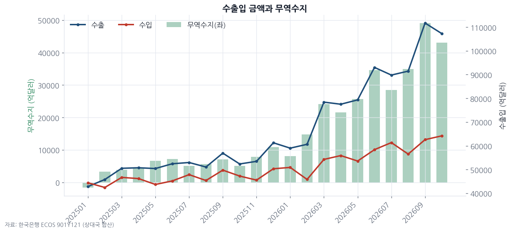

### 1-2. 수출 증가의 분해 (2020=100 지수, 단가 = 금액지수 ÷ 물량지수)

| 시점 | 금액지수 yoy | 물량지수 yoy | 단가 yoy | 단가 − 물량 |
|---|---|---|---|---|
| 2026.04 | +50.2% | +12.4% | +33.7% | 21.3%p |
| 2026.06 | +74.6% | +29.6% | +34.7% | 5.1%p |
| 2026.08 | +75.9% | +25.9% | +39.7% | 13.8%p |
| 2026.09 | +89.4% | +32.2% | +43.2% | 11.0%p |
| **2026.10** | **+107.6%** | **+43.9%** | **+44.3%** | **0.4%p** |

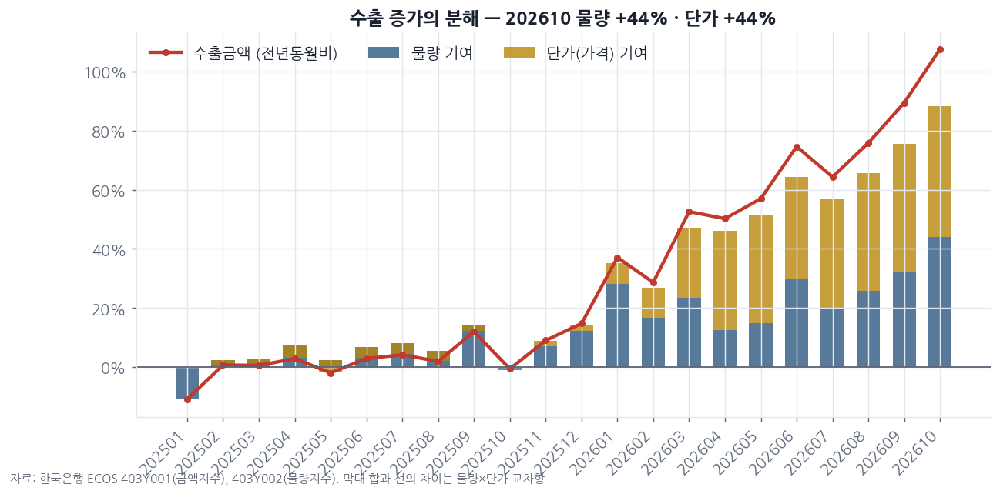

### 1-3. 교역조건지수

| 시점 | 순상품교역조건 | 소득교역조건 |
|---|---|---|
| 2026.06 | 110.6 | 180.5 |
| 2026.08 | **119.9** | 183.9 |
| 2026.09 | 119.5 | **216.8** |
| **2026.10** | **117.1** | **198.4** |

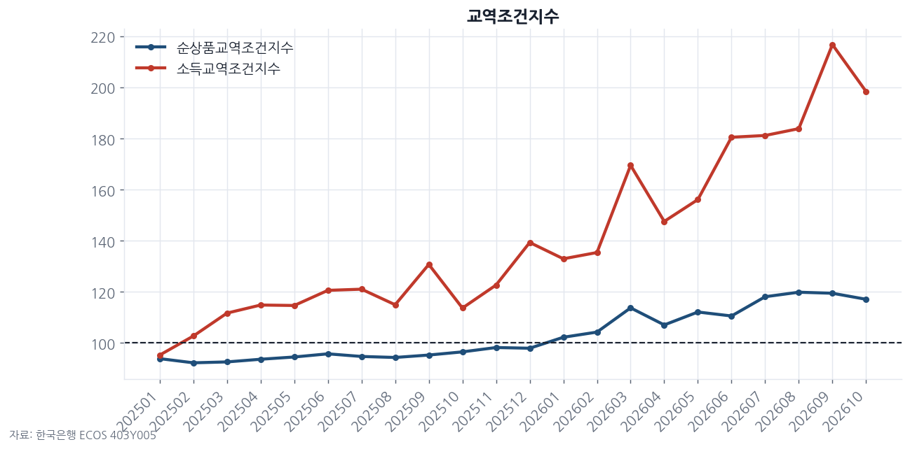

> **인사이트 ① — 머리기사** 지난 글은 "단가가 꺾이는 시점을 확인할 10월 수출입지수가 다음 달의 가장 중요한 숫자"라고 썼다. 결과는 **단가 +44.3%로 오히려 소폭 더 올랐다.** 경계 수준(+10%)과의 거리는 더 벌어졌다.
> 진짜 변화는 물량이다. 물량 증가율이 32.2 → **43.9%** 로 뛰어 단가(44.3%)와 거의 같아졌다. 3월 이후 처음으로 "가격 주도 호황"이라는 설명이 절반만 맞게 됐다. 물량이 받쳐 주는 이익은 단가만으로 부풀려진 이익보다 질이 좋다 — 지난 글 결론의 "정상 이익" 할인 폭을 조금 줄여도 되는 근거다.
> 반대 방향의 신호도 있다. 순상품교역조건이 119.9 → 119.5 → **117.1** 로 두 달째 내렸다. 수출단가가 올랐는데 이 지수가 내렸다는 것은 **수입단가가 더 빨리 올랐다**는 뜻이다. 수입이 +35.8%로 가속했고, 흑자는 491 → 430억 달러로 줄었다(그래도 1년 전의 8.5배다).

### 1-4. 상대국별 증가율 (전년동월비, %)

| 수출 상대국 | 2026.09 | 2026.10 | 10월 비중 |
|---|---|---|---|
| 중국 | 123.1 | 133.8 | 25.2% |
| 미국 | 136.9 | **186.8** | **23.3%** |
| 대만 | 96.7 | 70.0 | 8.2% |
| 베트남 | 43.9 | 63.6 | 7.8% |
| 홍콩 | 203.6 | **110.0** | 6.0% |
| 싱가포르 | 152.1 | 158.5 | 3.6% |
| 필리핀 | 238.5 | **389.9** | 3.6% |
| 말레이시아 | 211.0 | **390.3** | 3.2% |

| 수입 상대국 | 2026.09 | 2026.10 | 10월 비중 |
|---|---|---|---|
| 중국 | 42.8 | **60.1** | 28.3% |
| 대만 | 78.7 | 60.3 | 7.4% |
| 사우디아라비아 | -11.6 | **34.1** | 5.5% |
| 아랍에미리트 | 20.3 | **128.5** | 3.6% |
| 말레이시아 | 29.3 | 51.2 | 3.1% |

> **인사이트 ②** 미국향 수출이 +186.8%, 비중 23.3%로 중국(25.2%)과의 차이가 2%p 이내로 좁혀졌다. 필리핀·말레이시아는 +390%로 9월보다 더 가팔라졌다. 지난 글에서 짚은 **후공정·중계 허브 경유 물량**이 10월 물량지수 급등과 같은 방향이다. 최종 수요인지 채널 재고인지는 이 데이터로 가를 수 없고, 그래서 위험 요인으로 계속 남겨 둔다.
> 수입 쪽에서는 사우디(+34.1%)·UAE(+128.5%)가 플러스로 돌아섰다. 10월 브렌트 월평균이 $108.3로 올해 최고였던 것과 맞물린다. 1-3의 교역조건 하락은 원유 수입단가로 상당 부분 설명된다.

---

## 2. GDP — 갱신 없음, 12월 잠정치가 다음 관문

| 분기 | GDP | 가계소비 | 설비투자 | 지식재산 | 건설투자 | 수출 |
|---|---|---|---|---|---|---|
| 2026Q1 | 3.78 | 2.55 | 4.31 | 2.50 | -1.73 | 11.82 |
| 2026Q2 | 3.76 | 2.15 | 6.46 | 5.02 | -1.13 | 8.89 |
| **2026Q3** | **3.36** | **0.71** | **9.36** | 6.52 | -0.70 | 8.54 |

실질 전년동기비(%). 전기비 기여도는 26Q3 최종소비 0.22, 총자본형성 0.70, 순수출 0.16%p(GDP +0.97%).

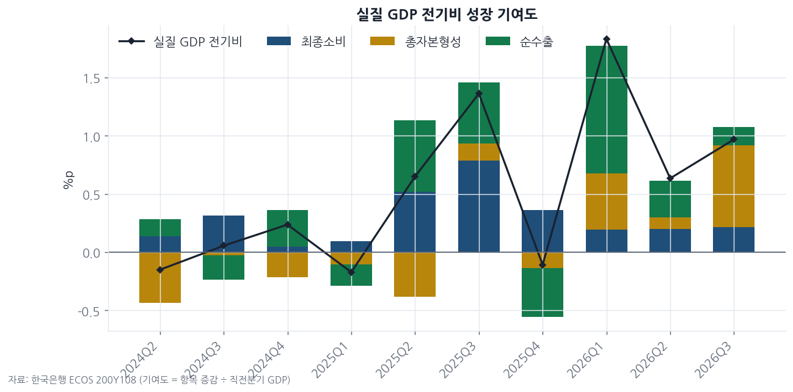

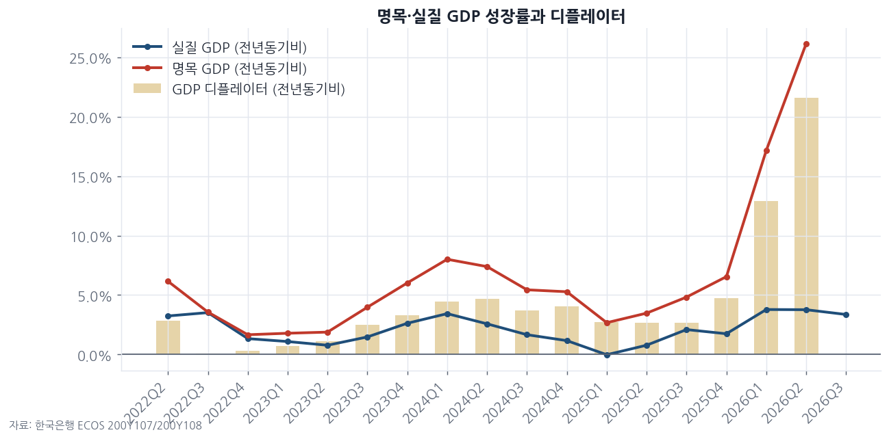

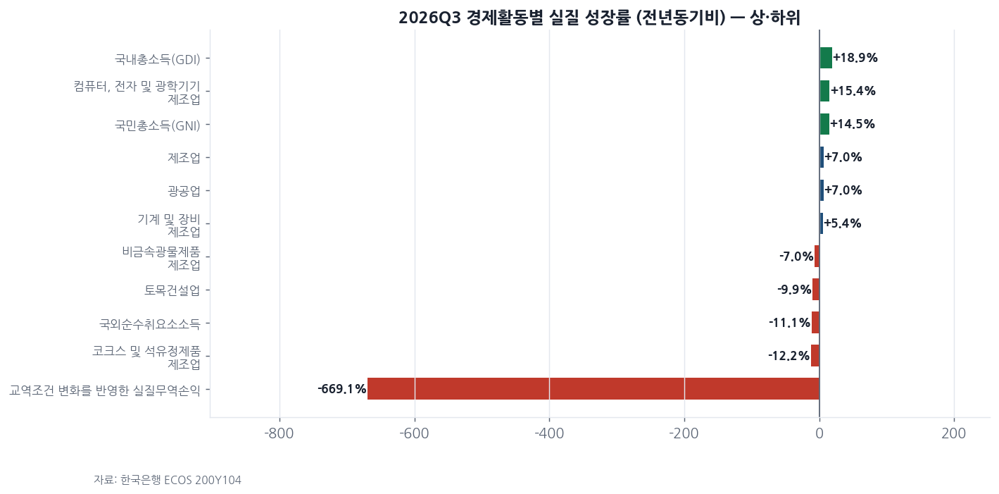

> **인사이트 ③** 새 숫자는 없다. 지난 글의 판단 — 성장 엔진이 순수출에서 설비투자로 넘어갔고 가계소비(+0.71%)는 멈췄다 — 을 바꿀 근거도 없다.
> 다만 1-2의 10월 물량 +43.9%는 4분기 실질 순수출 기여가 3분기(0.16%p)보다 커질 수 있는 재료다. 명목 GDP와 디플레이터(26Q2 +21.6%)는 3분기 잠정치에서 처음 나오고, 1-3의 교역조건 하락이 디플레이터 정점 통과로 이어지는지가 거기서 확인된다.

---

## 3. 심리지표 — 갱신 없음

| 시점 | 제조업 BSI | 수출기업 | 내수기업 | 판매가격 BSI | 원자재가격 BSI | 채산성 BSI | 소비자심리 |
|---|---|---|---|---|---|---|---|
| 2026.09 | 99.5 | 104.3 | 95.7 | 98 | 121 | 79 | 106.6 |
| **2026.10** | **105.6** | 106.1 | 103.8 | 99 | 124 | 79 | 105.4 |
| 2026.11 전망 | 103.0 | 104.4 | 101.7 | — | — | — | — |

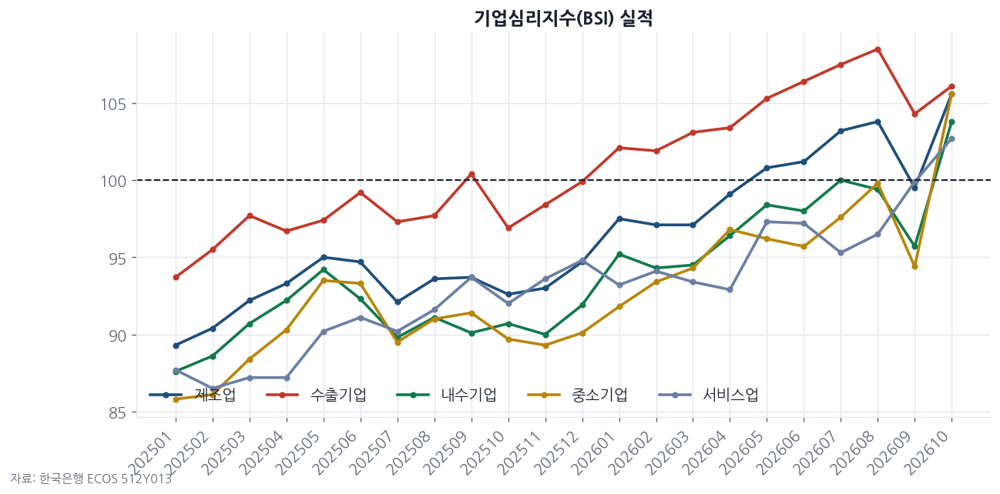

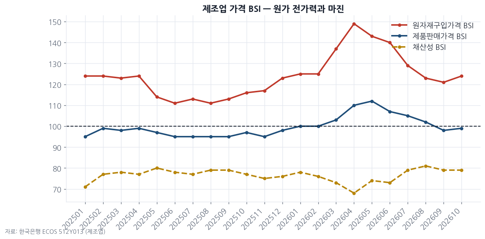

> **인사이트 ④** 10월 BSI·CSI는 지난 글에서 다뤘다. 이번에 덧붙일 것은 하나 — 10월 **수출기업 BSI 실적은 106.1로 9월(104.3)보다 조금 올랐을 뿐**인데, 같은 달 수출 물량은 +43.9%로 뛰었다. 제조업 세부의 수출실적 BSI(91)와 업황 BSI(78)도 여전히 낮다. 숫자로 찍힌 호황을 기업이 체감하지 못하는 괴리가 이어지고 있고, 채산성 79는 그 이유가 마진이라는 쪽을 가리킨다.

---

## 4. 물가 — PPI가 내려오며 격차가 좁혀졌다

### 4-1. PPI (2020=100)

| 시점 | PPI 지수 | 총지수 yoy | 공산품 | 서비스 | 전력·가스·수도 | 농림수산품 |
|---|---|---|---|---|---|---|
| 2026.05 | **129.98** | **8.64** | 13.50 | 4.89 | 0.17 | 4.75 |
| 2026.08 | 129.58 | 7.88 | 12.12 | 4.41 | 2.95 | 1.10 |
| 2026.09 | 129.76 | 7.65 | 12.01 | 3.89 | 2.91 | 2.78 |
| **2026.10** | 129.66 | **7.21** | **11.63** | **3.40** | **3.70** | -1.58 |

### 4-2. CPI vs PPI (전년동월비, %)

| 시점 | CPI | 근원 CPI | PPI | PPI − CPI |
|---|---|---|---|---|
| 2026.05 | 3.14 | 2.54 | 8.64 | 5.50%p |
| 2026.08 | 3.09 | 3.37 | 7.88 | 4.79%p |
| 2026.09 | 2.88 | 2.80 | 7.65 | 4.77%p |
| **2026.10** | **2.82** | **2.80** | **7.21** | **4.39%p** |

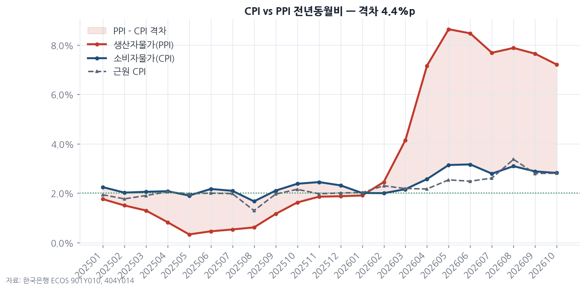

> **인사이트 ⑤** PPI 상승률이 5월 8.64% → 10월 **7.21%** 로 내려왔고, PPI-CPI 격차는 5월 5.50%p에서 다섯 달째 줄어 **4.39%p** 가 됐다(9월 4.77%p). 경계 수준(2%p)까지는 아직 멀다.
> 다만 내용을 보면 **지수 자체는 5월 이후 129.4~130.0에서 옆걸음**이다. 상승률 둔화는 가격이 내린 결과가 아니라 작년 하반기 기저가 올라온 결과다. 생산자 단계의 원가 수준은 그대로 높다.
> 품목별로는 공산품(11.63%)·서비스(3.40%)가 둔화했지만 **전력·가스·수도는 5월 0.17% → 10월 3.70%** 로 올라와 PPI 대분류 중 유일하게 오름세다. 에너지 원가가 공공요금 단계로 넘어오는 중이다.
> 10월 PPI에는 브렌트 월평균 $108.3(올해 최고)이 반영됐다. 11월 들어 브렌트는 $89.8로 한 달 새 -20.7% 내렸는데, 이 하락은 아직 어느 물가 지표에도 들어가지 않았다.

---

## 5. 금리 — 국내는 그대로, 미국 장기금리는 다시 5%

### 5-1. 국내 금리 (%) — 대출금리는 9월이 최신

| 시점 | 기준금리 | 가계대출 | 기업대출 | 주담대 | 가계 스프레드 |
|---|---|---|---|---|---|
| 2026.07 | 2.75 | 4.64 | 4.20 | 4.48 | 1.89 |
| 2026.08 | 3.00 | 4.76 | 4.30 | 4.66 | 1.76 |
| 2026.09 | 3.00 | **4.96** | 4.49 | 4.88 | 1.96 |
| 2026.10 | 3.00 | — | — | — | — |

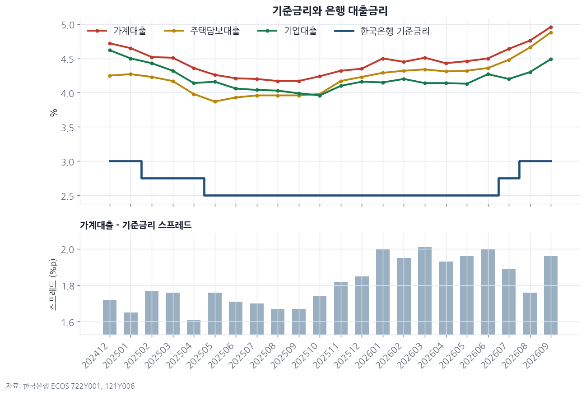

### 5-2. 주요국 정책금리 (%, 2026.10)

| 미국 | 유로 | 일본 | 중국 | 한국 |
|---|---|---|---|---|
| 3.88 | 2.50 | 1.25 | 3.00 | 3.00 |

10월에는 다섯 곳 모두 동결했다. 한·미 정책금리 차는 -0.88%p.

### 5-3. 미국채 커브 (2026-11-19)

| 지표 | 현재 | 지난 글(11/6) | 1M 변화 | YTD 변화 |
|---|---|---|---|---|
| 5년물 | 4.87% | 4.65% | +0.10%p | +1.13%p |
| 10년물 | **5.05%** | 4.86% | +0.10%p | +0.87%p |
| 30년물 | 5.40% | 5.26% | +0.11%p | +0.54%p |
| 30y-5y | **0.53%p** | 0.61%p | +0.02%p | -0.59%p |

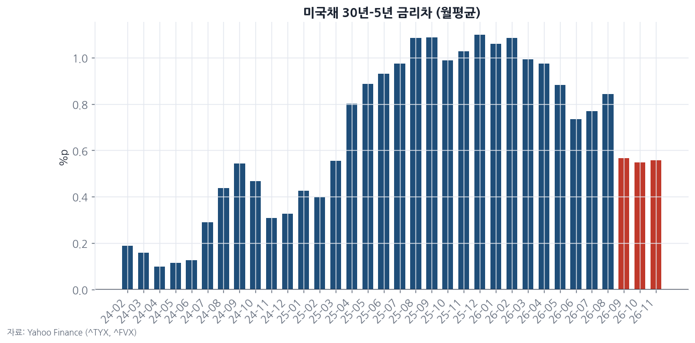

> **인사이트 ⑥** 국내 금리는 새 숫자가 없다. 가계대출 금리 4.96%가 경계선(5.0%)에 4bp 남은 상태로 10월치를 기다린다.
> 미국채는 지난 글 이후 2주 만에 5년·10년·30년물이 모두 14~22bp 되올라 **10년물이 다시 5%대(5.05%)** 에 들어섰다. 지난 글은 "할인율이 정점을 지났는지 한 달 데이터로 말할 수 없다"고 썼는데, 2주 만에 그 질문의 답이 "아직 아니다" 쪽으로 기울었다.
> 같은 한 달 동안 브렌트 -20.7%, 금 -11.2%, 구리 -12.4%로 원자재가 일제히 내렸는데도 장기금리는 올랐다. 원가 부담은 줄고 할인율 부담은 그대로인 조합이다. 30y-5y는 0.53%p로 역전(0)과는 여전히 거리가 있다.

---

## 6. 환율·대외부문 — 대외부채가 줄며 순자산이 되살아났다

### 6-1. 국제투자대조표 (억달러) — 2026Q3 신규

| 분기 | 대외금융자산 | 대외금융부채 | 순대외금융자산 |
|---|---|---|---|
| 2025Q3 | 27,826 | 17,454 | 10,372 |
| 2026Q1 | 28,826 | 21,290 | 7,536 |
| 2026Q2 | 30,843 | **30,202** | **640** |
| **2026Q3** | **32,221** | **28,774** | **3,448** |

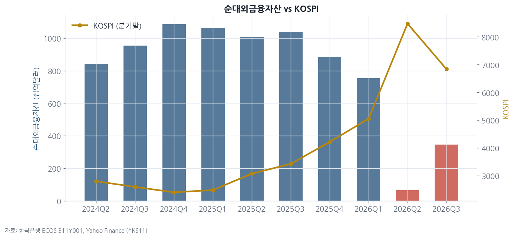

> **인사이트 ⑦** 지난 글이 경계로 둔 "순대외금융자산 마이너스 전환"은 일어나지 않았다. 3분기에 **640억 → 3,448억 달러**로 되살아났다.
> 내용은 두 가지다. 대외금융자산이 +1,379억 달러 늘었고(무역흑자 누적과 같은 방향), **대외금융부채가 -1,428억 달러 줄었다.** 부채에는 외국인이 보유한 국내 주식의 평가액이 들어가므로, 3분기 KOSPI 하락(분기말 기준, 차트)이 부채를 줄인 것으로 보인다. 다만 이 표만으로는 평가액 하락과 외국인 매도를 구분할 수 없다.
> 그래도 1년 전(1조 372억 달러)의 3분의 1 수준이다. 2분기의 극단(640억)에서 물러섰을 뿐, 외국인 포지션이 평상시로 돌아왔다고 말할 단계는 아니다. 다음 갱신(26Q4)은 3월이다.

### 6-2. 원/달러 vs 달러인덱스

| 시점 | USD/KRW | 달러인덱스 |
|---|---|---|
| 2026.06(월평균) | 1,528.1 | 100.32 |
| 2026.09(월평균) | 1,358.3 | 100.03 |
| 2026.10(월평균) | 1,336.9 | 102.05 |
| 11/6(지난 글) | 1,356 | — |
| **11/20** | **1,334.9** | **103.92**(11/19) |

1개월 변화: 원/달러 +0.7%, 달러인덱스 **+2.3%**. YTD: 원/달러 -7.5%(원화 강세), 달러인덱스 +5.6%.
일간 변화율 상관계수(최근 250일): **0.005** — 무상관.

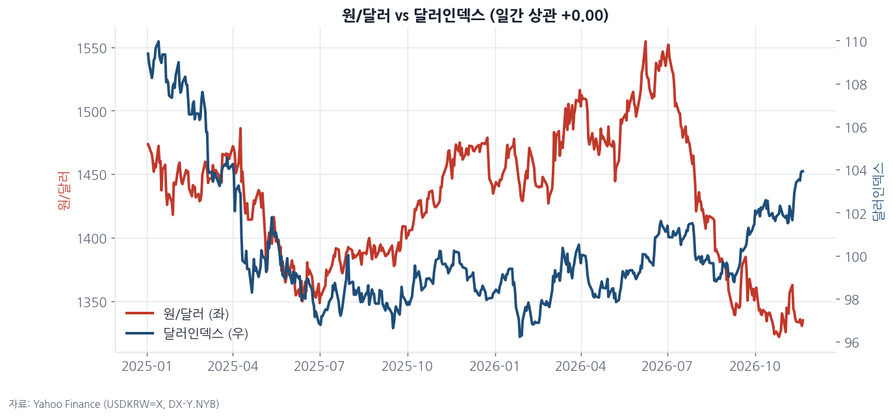

### 6-3. 자산시장 (2026-11-19 종가)

| 지표 | 현재 | 지난 글(11/6) | 1M | 3M | YTD |
|---|---|---|---|---|---|
| KOSPI | 5,067.4 | 5,059.7 | -8.4% | **-25.6%** | +17.6% |
| S&P500 | 7,175.8 | 7,376.9 | -6.4% | -6.5% | +4.6% |
| 금 | $3,607.7 | $4,075 | **-11.2%** | -22.5% | -16.7% |
| Brent | $89.8 | $98.3 | **-20.7%** | +2.2% | +47.8% |

> **인사이트 ⑧ — 지난 판단의 수정** 지난 글은 11/6 원/달러 1,356원을 근거로 "흑자 유입보다 큰 자금이 빠져나가는 초입"이라고 썼다. 이후 2주 동안 **달러인덱스가 +2.3% 오르는 사이 원화는 1,335원으로 오히려 강해졌다.** 이탈이 이어졌다면 나오기 어려운 조합이라, 그 해석은 약화한다.
> KOSPI도 지난 글 이후 거의 제자리(5,060 → 5,067)다. 한 달 -24%의 급락 국면은 일단 멈췄다. 자산 가격은 6월 월평균(8,484) 대비 여전히 -40% 수준이고, 같은 기간 수출 물량은 오히려 빨라졌다.

---

## 7. 종합 판단 — 안전마진 관점

### 지난 글 이후 달라진 것
1. **물량의 합류** — 10월 수출 물량 +43.9%, 단가 +44.3%. 단가와 물량의 격차가 11.0 → 0.4%p로 사라졌다.
2. **교역조건의 후퇴** — 순상품교역조건 119.9 → 117.1(두 달째 하락), 수입 +35.8%로 흑자 491 → 430억 달러.
3. **PPI 둔화** — 7.65 → 7.21%, PPI-CPI 격차 4.39%p. 단 PPI 지수 수준은 5월 이후 옆걸음.
4. **대외 순자산 회복** — 순대외금융자산 640억 → 3,448억 달러, 대외부채 -1,428억 달러.
5. **할인율 재상승** — 미 10년물 4.86 → 5.05%, 원자재는 일제히 -11~-21%.

### 지난 글 판단 중 수정한 것
- "흑자의 상당 부분이 가격에서 나온다" → **절반만 유지.** 10월은 물량과 단가가 같은 크기로 기여했다.
- "원화 약세 전환 = 외국인 이탈 초입" → **약화.** 달러 강세 속에서도 원화가 1,335원으로 되돌아왔고, 3분기 순대외금융자산은 오히려 회복했다.
- "할인율 정점 여부 판단 불가" → **정점 미통과 쪽으로 기울었다.** 미 10년물 5.05%.
- "성장 엔진 교체·가계소비 정지·PPI-CPI 격차로 인한 마진 압박" → **유지.** 반박할 새 데이터가 없다.

### 직전 체크리스트 점검

| 지표 | 지난 값 | 이번 값 | 경계 수준 | 판정 |
|---|---|---|---|---|
| 수출 단가 yoy | +43.2%(9월) | **+44.3%**(10월) | <+10% | 미도달, 오히려 확대 |
| 실질 가계소비 yoy | +0.71%(26Q3) | 미갱신 | <0% | 데이터 대기 |
| 명목 GDP·디플레이터 | +21.6%(26Q2) | 미갱신 | 하락 전환 | 데이터 대기(26Q3 잠정) |
| PPI-CPI 격차 | 4.77%p(9월) | **4.39%p**(10월) | <2%p | 미도달, 축소 중 |
| 가계대출 금리 | 4.96%(9월) | 미갱신 | >5.0% | 데이터 대기 |
| 제조업 판매가격 BSI | 99(10월) | 미갱신 | <95 | 데이터 대기 |
| 순대외금융자산 | 640억$(26Q2) | **3,448억$**(26Q3) | 마이너스 | 미도달, 오히려 회복 |
| 무역수지 | +491억$(9월) | **+430억$**(10월) | <+150억$ | 미도달 |

### 다음 달 체크리스트

| 지표 | 현재 | 경계 수준 | 의미 |
|---|---|---|---|
| 수출 단가 yoy | +44.3%(10월) | <+10% | 가격효과 소멸 → 명목 이익 급감 |
| 수출 물량 yoy | +43.9%(10월) | <+10% | 물량 동력 소멸 — 채널 재고였다는 신호 |
| 순상품교역조건지수 | 117.1(10월) | <110 | 6월 수준 회귀, 교역조건 이득 축소 |
| 실질 가계소비 yoy (26Q3 잠정) | +0.71% | <0% | 내수 역성장 진입 |
| GDP 디플레이터 yoy (26Q3 잠정) | +21.6%(26Q2) | 하락 전환 | 교역조건 이득 정점 통과 |
| PPI-CPI 격차 | 4.39%p(10월) | <2%p | 마진 압박 해소(11월 유가 하락 반영 여부) |
| 가계대출 금리 | 4.96%(9월) | >5.0% | 가계 이자 부담 임계 |
| 제조업 판매가격 BSI | 99(10월) | <95 | 디플레 압력 |
| 무역수지 | +430억$(10월) | <+150억$ | 흑자 사이클 종료 |
| 미국채 10년물 | 5.05%(11/19) | >5.13%(10월 월평균) | 할인율 신고점 |

순대외금융자산은 다음 갱신이 3월(26Q4)이라 이번 목록에서 뺐다.

### 결론
> 이번 달의 새 데이터는 지난 글의 걱정 두 가지를 덜어 줬다. 수출이 가격만으로 부풀려졌다는 걱정은 **물량 +43.9%** 로, 외국인 이탈이 가속한다는 걱정은 **순대외금융자산 3,448억 달러와 1,335원의 원화**로 약해졌다.
> 대신 새 걱정 하나가 생겼다. 수입단가가 수출단가보다 빨리 오르면서 **교역조건이 두 달째 내렸고, 흑자가 줄기 시작했다.** 지난 1년의 명목 호황을 만든 것은 교역조건이었다. 그 지수가 꺾이는 것은 단가의 꺾임보다 먼저 이익에 닿는다.
> 안전마진 관점에서 결론은 지난 글과 같다 — 정상 이익은 2026년 명목 이익이 아니라 **교역조건이 평년으로 돌아간 이익**으로 놓고 계산해야 한다. 달라진 점은 그 할인 폭이다. 물량이 따라온 만큼 할인 폭을 조금 줄일 근거가 생겼고, 미 10년물 5.05%는 그 이익에 적용할 할인율을 낮출 근거가 아직 없다는 뜻이다.

---

### 데이터 출처와 작성 기준
- 모든 수치는 **한국은행 ECOS OpenAPI** 원데이터와 **Yahoo Finance** 종가를 `scripts/macro/fetch_and_chart.py` 로 직접 조회해 산출했다. 웹 검색 수치는 쓰지 않았다.
- 계열별 최신 시점: 실질 GDP 2026Q3(속보), 명목 GDP 2026Q2, 수출입·수출입지수·PPI 2026.10, BSI 실적·CSI·CPI·기준금리·주요국 정책금리 2026.10, BSI 전망 2026.11, 은행 대출금리 2026.09, 국제투자대조표 2026Q3, 시장데이터 2026-11-19 종가(원/달러는 2026-11-20).
- 11/20 행의 KOSPI·S&P500·미국채·원자재는 당일 장 마감 전이라 11/19 값이 그대로 채워져 있어, 본문은 11/19 종가로 표기했다.
- 성장 기여도 = 항목 증감 ÷ 직전분기 실질 GDP. 수출 단가 = 수출금액지수(403Y001) ÷ 수출물량지수(403Y002). 수출입 총액은 천달러 원자료를 억달러로 환산했다. PPI-CPI 격차 = PPI 총지수 yoy − CPI 총지수 yoy.
- 3분기 명목 GDP가 미공표라 디플레이터는 2026Q2까지만 표시했다.
- 사용 통계표: 200Y104·200Y107·200Y108(GDP), 901Y121·403Y001·403Y002·403Y005(수출입), 512Y013·512Y014(BSI), 511Y002(CSI), 901Y010·404Y014(물가), 722Y001·121Y006·902Y006(금리), 311Y001(국제투자대조표).
- 차트 13종은 matplotlib으로 직접 생성했다.
