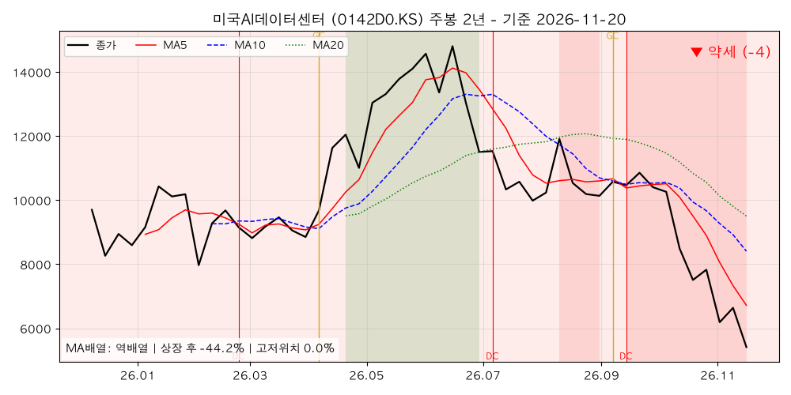
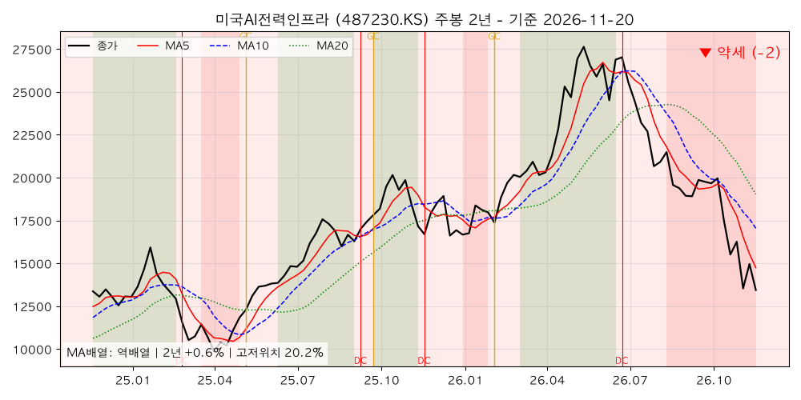
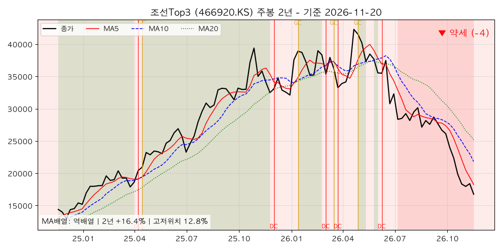
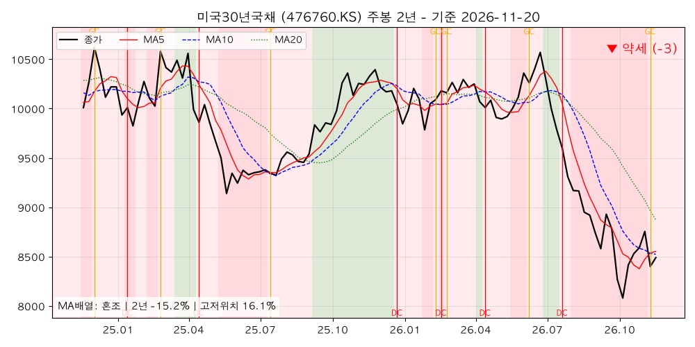
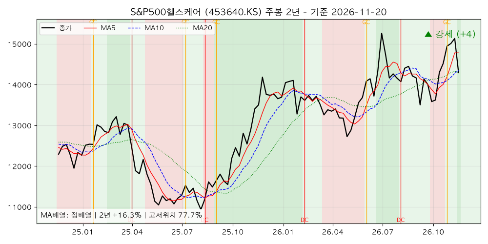
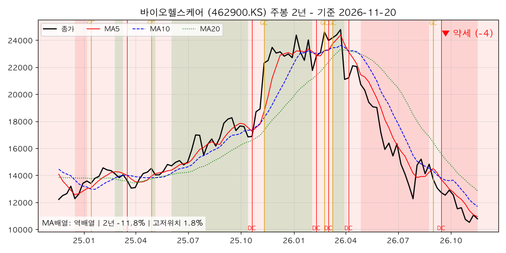

> 데이터 기준 2026-11-14 ~ 11-20. 개인 포트폴리오는 비중(%)·수익률(%)만 공개합니다. 시트가 11/8 이후 갱신되지 않아 계좌 숫자는 그 뒤 가격 변화를 곱한 **추정치**입니다.
> 11/26 새 형식(요약 → 상세 → 용어 풀이)으로 다시 썼습니다. 데이터는 11/20 기준이며, 그 뒤 일(11/26 금통위 결과 등)은 반영하지 않았습니다.

## 요약 — 이번 주 한눈에

### 이번 주 시장

- **주식이 무너졌다.** 엔비디아 CEO 사임 여파와 AI주 매도로 S&P500이 한 주 −8.6%(고점 대비 −11.6%, 조정 진입), 코스피가 −7.9%(4,870)였다. VIX(변동성 지수)는 19.3 → 35.9로 뛰었다.
- **채권은 버텼고 금은 같이 빠졌다.** 미 10년물 금리가 5.15 → 4.92%로 내려 미국채 ETF가 올랐다. 금은 빚을 갚기 위한 강제 매도에 휩쓸려 −8.9%였다.
- **한국은 금리 인상 명분이 약해졌다.** 3분기 가계 빚 증가가 2분기의 3분의 1로 줄었고 생산자물가 상승률도 7.21%로 내려왔다. 11/26 금통위는 동결이 기본 시나리오다.

### 내 계좌 — 이번 주 할 일

전체 누적 수익률 −8.28%(이번 주 −5.81%, 추정).

| 계좌 | 운용 방식 | 상태 | 이번 주 할 일 |
|---|---|---|---|
| 연금저축펀드 | 자산배분·리밸런싱 | ✅ 밴드 안 | 매매 없음. 신규 납입은 금현물 → 200TR 순서. 시트에 목표 비중 적기 |
| 개인IRP | 자산배분·리밸런싱 | ⚠️ 밴드 밖 (금 −12.2%p 부족) | 혼합50 −10.0%p · S&P500 −7.6%p → 금현물 +12.2%p · 배당다우존스 +5.4%p, 2~3번에 나눠서 |
| 퇴직연금 | 자산배분·리밸런싱 | ⚠️ 밴드 밖 (미국 주식 초과) | 배당다우존스·S&P500에서 약 17%p 덜어 현금 +7.4 · 미국채혼합 +5.4 · 금현물 +4.3%p, 나눠서. 비어 있는 10%p(리츠 칸) 결정 |
| ISA | 추세추종 | 🔴 6 · 🟡 1 · 🟢 0 | AI데이터센터·조선·AI전력부터 축소 → 현금. 헬스케어 보유 |

### 다음 주에 볼 것

1. **11/25 미 10월 PCE(개인소비지출 물가)** — 근원 전월비 0.2% 이하면 "12월이 마지막 인상"이 힘을 얻는다.
2. **11/26 금통위 + 수정 경제전망** — 동결 여부보다 "추가 인상" 언급과 성장·물가 전망 조합.
3. **VIX 30 아래 복귀** — 내려오면 연금 리밸런싱 나머지 회차를 앞당겨도 된다.

> **한 줄 결론** — 연금은 급락이 틀어 놓은 비중을 목표로 나눠서 되돌리고, ISA는 추세가 꺾인 테마를 줄인다. 두 계좌 모두 "기다림"이 아니라 "규칙대로"다.

---

# 상세 설명

## 1. 내 계좌 점검

> **이 섹션 핵심**
> - 연금 3계좌: 연금저축은 밴드(허용 범위) 안, **IRP와 퇴직연금은 밴드 밖**이다. 주식이 빠졌는데도 미국 주식이 목표보다 많고, 금·혼합형·현금이 모자라다.
> - ISA: 7종목 중 🔴축소 검토 6 · 🟡보유 1(S&P500헬스케어) · 🟢추가 가능 0. 계좌 누적 수익률은 −33.86%다.
> - 이번 주 할 일: IRP·퇴직연금은 계좌 안 교체 매매로 목표 비중에 되돌리되 VIX 35.9라 **2~3번에 나눈다.** ISA는 추세가 가장 약한 테마부터 줄여 현금으로 둔다.

기준: 포트폴리오 시트는 11/8 이후 갱신되지 않았다. 11/8 보유 내역에 11/20까지의 가격 변화를 곱한 **추정치**다. 국내 ETF 11/20 종가에는 그날 밤 미국 장(S&P500 지수 −3.7%)이 아직 담기지 않았다.

### 1-0. 포트폴리오 한눈에 — 한 주 −5.81%, 플러스는 채권뿐

| 계좌 | 운용 방식 | 전체 비중 | 누적 수익률 | 이번 주 |
|---|---|---|---|---|
| 연금저축펀드 | 자산배분·리밸런싱 | 26.9% | −5.58% | −4.87% |
| 개인IRP | 자산배분·리밸런싱 | 18.6% | −1.64% | −4.69% |
| 퇴직연금 | 자산배분·리밸런싱 | 40.7% | −0.15% | −5.15% |
| ISA | 추세추종 | 13.8% | −33.86% | −10.77% |
| **전체** | | 100% | **−8.28%** (지난주 −2.62%) | **−5.81%** |

| 자산군 | 비중 | 이번 주 | 전체 기여(%p) |
|---|---|---|---|
| 미국주식(배당 포함) | 45.3% | −5.94% / −4.77% | −2.53 |
| 혼합(주식+채권) | 14.5% | −3.35% | −0.47 |
| 금 | 12.5% | −9.38% | −1.22 |
| 테마(AI·반도체·조선) | 9.6% | −13.56% | −1.41 |
| 미국채권 | 7.5% | +0.88% | +0.06 |
| 한국주식 | 5.5% | −4.46% | −0.24 |
| 달러/현금 | 5.1% | +0.06% | +0.00 |

주식이 빠질 때 미국채는 버텼다. 금은 주식과 같이 빠졌다(강제 청산성 매도, 3장). 그 결과 연금 계좌에서 금 비중이 목표보다 크게 낮아졌다.

### 1-A. 연금 3계좌 — 자산배분·리밸런싱

밴드는 **5/25 규칙**이다. 목표가 20% 이상이면 ±5%p, 20% 미만이면 목표의 ±25%를 넘을 때 리밸런싱한다.

#### 연금저축펀드 — 밴드 안, 매매할 것 없음

| 종목 | 목표* | 현재 | 괴리 | 판정 |
|---|---|---|---|---|
| 타이거 미국 S&P500 | 38.4% | 41.5% | +3.1%p | ✅ 밴드 안 |
| 타이거 미국채 10년선물 | 20.9% | 20.8% | −0.1%p | ✅ 밴드 안 |
| ACE KRX 금현물 | 19.5% | 17.2% | −2.4%p | ✅ 밴드 안 |
| 타이거 은행고배당플러스TOP10 | 14.5% | 14.6% | +0.1%p | ✅ 밴드 안 |
| KIWOOM 200TR | 6.7% | 6.0% | −0.7%p | ✅ 밴드 안 |

\* 시트에 목표 비중이 없어 **입금 비중을 목표 대용**으로 썼다. 시트의 "리밸런싱" 열에 목표를 적어 주면 다음 주부터 그 값으로 판정한다.

- **할 일**: 팔지 않는다. 신규 납입분은 가장 모자란 순서로 **금현물(+2.4%p) → 200TR(+0.7%p)**에 넣는다(납입 리밸런싱).
- **이유**: S&P500이 −5.79%일 때 미국채 10년선물은 +0.82%였다. 주식·채권 분산이 작동했다. 금은 같이 빠졌지만 실질금리 하락이라는 순풍은 남아 있다(3장 금 매력도 2★ → 3★). 목표를 바꿀 근거는 없다.

#### 개인IRP — 밴드 밖: 혼합50·S&P500 초과, 금·배당다우 부족

| 종목 | 목표 | 현재 | 괴리 | 판정 |
|---|---|---|---|---|
| SOL 미국배당미국채혼합50 | 25.0% | 35.0% | +10.0%p | ⬆️ 초과 |
| 타이거 미국 S&P500 | 25.0% | 32.6% | +7.6%p | ⬆️ 초과 |
| TIGER 미국배당다우존스 | 25.0% | 19.6% | −5.4%p | ⬇️ 부족 |
| ACE KRX 금현물 | 25.0% | 12.8% | −12.2%p | ⬇️ 부족 |

- **할 일**: 혼합50에서 약 10.0%p, S&P500에서 약 7.6%p를 덜어 **금현물에 12.2%p, 배당다우존스에 5.4%p**를 채운다(합계 17.6%p). IRP 안의 교체 매매는 세금이 붙지 않는다.
- **나눠서**: VIX(변동성 지수) 35.9로 하루 변동폭이 크다. 1회에 전체의 1/3(약 6%p)씩 2~3번에 나눈다. 월요일에는 미국 금요일 하락분이 S&P500 ETF에 반영돼 초과폭이 조금 줄 수 있다. 첫 회 뒤 괴리를 다시 보고 남은 양을 맞춘다.
- **신규 납입분**: 금현물 → 배당다우존스 순서.
- **이유**: 금이 −9.38%로 가장 많이 빠져 가장 모자라졌다. 리밸런싱은 바로 이 자산을 채우는 일이다. 추세가 약하다는 이유로 미루지 않는다.

#### 퇴직연금 — 밴드 밖: 미국 주식 2종 초과, 현금·혼합형·금 부족

| 종목 | 목표 | 현재 | 괴리 | 판정 |
|---|---|---|---|---|
| SOL 미국배당다우존스 | 10.0% | 24.2% | +14.2%p | ⬆️ 초과 |
| 타이거 미국 S&P500 | 10.0% | 22.4% | +12.4%p | ⬆️ 초과 |
| 삼성 KODEX200 미국채혼합 | 25.0% | 19.6% | −5.4%p | ⬇️ 부족 |
| 타이거 KRX금현물 | 15.0% | 10.7% | −4.3%p | ⬇️ 부족 |
| 타이거 미국 나스닥100 | 10.0% | 10.7% | +0.7%p | ✅ 밴드 안 |
| TIGER 미국달러단기채권액티브 | 10.0% | 9.9% | −0.1%p | ✅ 밴드 안 |
| 현금 | 10.0% | 2.6% | −7.4%p | ⬇️ 부족 |

시트의 목표 합계가 **90%**다. 10%p가 비어 있다. 시트의 자산군 계획에는 **리츠 10%**가 적혀 있으니, 그 칸으로 보인다.

- **할 일**: 배당다우존스에서 약 9.1%p, S&P500에서 약 8.0%p(초과폭 비율대로, 합계 17.1%p)를 덜어 **현금 7.4%p, 미국채혼합 5.4%p, 금현물 4.3%p**를 채운다. 계좌 안 교체라 세금 부담이 없다. IRP와 같이 2~3번에 나눈다.
- **남는 약 10%p**: 위 교체 뒤에도 미국 주식 2종이 합쳐 약 9.5%p 많다. 이것이 비어 있는 10%p 칸이다. 리츠를 담을지 다른 자산에 나눌지 정해 시트에 적어 주기 바란다. 정해지기 전까지 이 부분은 그대로 둔다.
- **신규 납입분**: 미국채혼합 → 금현물 순서.
- **이유**: 달러단기채(+0.08%)와 미국채가 주식 급락을 완충했다. 금은 위기 초입에 주식과 같이 팔렸지만, 2008·2020년처럼 청산이 끝나면 먼저 회복한 경험이 있다. 각 자산의 역할이 깨진 증거는 없다.

#### 장기 보유 근거 점검 (가치 지표) — 유지

| 주식 ETF (대리 지표) | PER | 이익수익률 | vs 한국 기준금리 3.00% | vs 미 10년물 4.92% |
|---|---|---|---|---|
| 미국배당다우존스 (SCHD) | 17.4배 | 5.8% | +2.8%p | +0.8%p |
| 미국 S&P500 (SPY) | 21.7배 | 4.6% | +1.6%p | −0.3%p |
| 미국 나스닥100 (QQQ) | 24.1배 | 4.2% | +1.2%p | −0.8%p |

PER(주가가 1년 이익의 몇 배인가)은 미국 상장 대리 ETF 값에 이번 주 가격 변화를 반영한 **추정**이다. 은행고배당·200TR의 PER은 수집하지 못했다. 이익수익률(PER을 뒤집은 값)은 세 종목 모두 한국 기준금리보다 높고, 배당다우존스는 미 10년물보다도 높다. 한 주 만에 PER이 1~3배 내려갔다.

S&P500 PER 21.7배는 50년 평균(약 16배)의 1.36배다. 금융위기 직전(약 20배)보다 8% 높고, 코로나 후(약 37배)·닷컴(약 44배)에는 한참 못 미친다. 마진데빗(빚내서 산 주식 규모)은 10월 약 1조 4,480억달러로 9월보다 2.1% 줄었다. 과열이 가격으로 풀리는 중이다. **장기 보유 근거는 유지된다.** 비중 조절은 위의 리밸런싱 규칙이 한다.

#### 금리 환경 — 한국 vs 미국

- **한국 자산(은행고배당·200TR·KODEX200미국채혼합)**: 기준금리는 3.00%다. 3분기 가계 빚 증가 둔화(+9.8조원), 생산자물가 둔화(7.21%), 11월 유가 하락으로 11/26 금통위의 추가 인상 명분은 약해졌다(2장). 기본 시나리오는 "동결 + 긴축 기조 문구"다. 동결이 정점으로 읽히면 은행의 "금리 인상 수혜" 논리는 약해지지만, 배당이 받치는 역할은 그대로다.
- **미국 자산(S&P500·배당다우·나스닥100·미국채·달러)**: 정책금리 3.75~4.00%, 12월 25bp 인상 확률 97.5%다. 그런데 10년물은 5.15 → 4.92%로 내렸다. 시장은 "주가 급락이 연준을 멈추게 하나"를 묻기 시작했다(3장). 채권에는 순풍이지만, 이유가 성장 둔화·청산이라 주식에는 반갑지 않은 금리 하락이다.

### 1-B. ISA — 추세추종

**한 줄 판정: 🟢 0 · 🟡 1 · 🔴 6.** 🔴 종목의 합계 비중은 91.7%다. 30%를 넘는 종목은 없다(최대 글로벌반도체Top4 25.1%).

규칙(투자자가 바꾸기 전까지 적용): 🟢 **추가 가능** = 주봉 정배열(짧은 평균선이 위에 놓인 상승 구조) 또는 주봉 골든크로스 + 종가가 일봉 MA20(20일 평균선) 위 · 🟡 **보유** = 주봉 중립 · 🔴 **축소 검토** = 주봉 역배열, 또는 종가가 주봉 MA20 아래로 2주 연속.

| 종목 | 비중 | 누적 수익률 | 일·주·월봉 | 신호 | 근거 |
|---|---|---|---|---|---|
| 글로벌반도체Top4 | 25.1% | −26.89% | 🔴 🟡 🟡 | 🔴 축소 검토 | 주봉 역배열, 주봉 MA20 −26.7% |
| 미국AI데이터센터 | 22.1% | −50.62% | 🔴 🔴 🔴 | 🔴 축소 검토 | 역배열, 상장 후 최저, 1주 −18.4% |
| 미국30년국채 | 14.1% | −3.94% | 🟡 🔴 🔴 | 🔴 축소 검토 | 주봉 골든크로스에도 MA20 아래 20주째 |
| 조선Top3 | 12.2% | −45.85% | 🔴 🔴 🔴 | 🔴 축소 검토 | 역배열, 주봉 MA20 −33.5% |
| 미국AI전력인프라 | 9.8% | −33.61% | 🔴 🔴 🔴 | 🔴 축소 검토 | 역배열, 주봉 MA20 −29.4% |
| 금현물 | 8.4% | −26.50% | 🔴 🔴 🟡 | 🔴 축소 검토 | 역배열, 주봉 MA20 −18.0% |
| S&P500헬스케어 | 8.2% | −3.79% | 🟡 🟢 🟢 | 🟡 보유 | 주봉 정배열, 종가가 일봉 MA20 −4.2% |

#### 미국30년국채 — 개선 신호와 축소 규칙이 동시에 나왔다

이 종목은 ISA에서 이번 주 유일하게 오른(+1.1%) **완충 자산**이다. 1주 전 주봉 골든크로스(단기선이 중기선을 위로 뚫음)도 났다. 그러나 종가 8,490원이 주봉 MA20(8,873원)보다 4.3% 아래이고, 그 상태가 20주째다. 규칙상 🔴다.

규칙대로 적되, 순서는 마지막에 둔다. 테마를 줄인 돈이 갈 곳이 현금과 이 종목뿐이기 때문이다. 종가가 8,873원 위로 올라서면 🔴가 풀린다. 그때 일봉 MA20 위라면 골든크로스 조건으로 🟢까지 간다.

**투자자가 정할 것**: 지금 규칙은 테마와 완충 자산(채권·금)을 구분하지 않는다. 완충 자산에는 추세 대신 "ISA 내 비중 상한" 같은 별도 규칙을 둘지 정해 주면 다음 주부터 반영한다.

#### 축소 종목 처리 — 약한 순서로, 줄인 돈은 현금

1. **1차**: 세 시간축(일·주·월봉)이 모두 약세인 **AI데이터센터·조선·AI전력**(합계 44.1%)부터 줄인다.
2. **2차**: 주봉만 역배열인 **글로벌반도체Top4·금현물**.
3. **마지막**: 미국30년국채(위 설명).

규칙은 줄이는 폭을 정하지 않았다. 이 리포트는 **각 종목 비중의 절반**을 제안하고, 폭은 투자자가 정한다. 줄인 돈은 현금으로 둔다. 헬스케어는 🟡라 추가 조건이 아니다. "언젠가 회복한다"는 연금 계좌의 논리라 ISA에는 쓰지 않는다. 월요일에는 미국 금요일 하락분(나스닥100 지수 −5.6%)이 테마 ETF에 반영될 수 있어, 1차도 이틀에 나눌 만하다.

#### 다시 담는 조건

축소한 종목은 **주봉 정배열 또는 주봉 골든크로스가 나오고, 종가가 일봉 MA20 위**일 때(🟢) 다시 담는다. S&P500헬스케어는 종가가 주봉 MA20(14,281원) 아래로 2주 연속 내려가면 🔴로 바뀐다.

### 1-C. 세 가지 관점

| 관점 | 기준 | 이번 주 시각 | 내 계좌에의 의미 |
|---|---|---|---|
| 가치투자자 | 이익수익률 vs 무위험 수익률 | 배당다우존스 5.8%로 미 10년물보다 0.8%p 높다. S&P500은 0.3%p 차이로 좁혀졌다 | 연금 계좌의 장기 보유 근거 유지. 매매 타이밍으로 쓰지 않는다 |
| 성장주 투자자 | 실적·수요 | 엔비디아 3분기 매출·가이던스 모두 예상 상회. 주가는 CEO 사임 여파로 −22.9% | ISA 테마의 실적 이야기는 살아 있다. 그러나 ISA는 추세가 먼저다 |
| 모멘텀 트레이더 | 이동평균 배열·크로스 | ISA 7종목 중 강세 0, 테마 4종목 모두 3개월 최저 마감 | ISA 축소 신호와 같은 결론. **연금 계좌에는 적용하지 않는다** |

### 1-D. 이번 주 할 일 체크리스트

- [ ] **연금저축**: 매매 없음. 신규 납입은 금현물 → 200TR. 시트에 목표 비중 적기.
- [ ] **개인IRP**: 혼합50 −10.0%p · S&P500 −7.6%p → 금현물 +12.2%p · 배당다우존스 +5.4%p. 2~3번에 나눠서.
- [ ] **퇴직연금**: 배당다우존스 약 −9.1%p · S&P500 약 −8.0%p → 현금 +7.4%p · 미국채혼합 +5.4%p · 금현물 +4.3%p. 2~3번에 나눠서. 미배정 10%p(리츠 칸) 결정.
- [ ] **ISA**: AI데이터센터·조선·AI전력부터 비중 절반 축소 → 현금. 헬스케어 보유. 30년국채는 마지막, 완충 자산 규칙 결정.
- [ ] **시트 갱신**: 3주째 미갱신. 갱신되면 위 괴리를 다시 계산한다.

---

## 2. 시장 배경 ① 한국은행

> **이 섹션 핵심**
> - 3분기 가계 빚이 9.8조원 늘었다. 2분기(+26.4조원)의 약 3분의 1이고, '빚투' 성격의 기타대출은 4.9조원 줄었다.
> - 가계 빚 둔화·생산자물가 둔화(7.21%)·11월 유가 하락은 11.26 금통위의 추가 인상 명분을 약하게 한다. 연금 계좌의 한국 채권·은행고배당 목표 비중을 바꿀 만한 변화는 아니다.
> - 지난주(10월 금통위 의사록·돈의 흐름)에 이어 이번 주는 분기 성적표가 나왔다. 기준금리는 연 3.00% 그대로이고, 다음 결정은 11.26(목) 금통위다.

### 이번 주 주요 발표 — 빚은 식고, 물가 상승률은 내려왔다

| 발표 | 날짜 | 핵심 숫자 | 한 줄 의미 |
|---|---|---|---|
| 3분기 가계신용(잠정) | 11.18 | 잔액 2,030.5조원(사상 최대), 증가 +9.8조원, 기타대출 −4.9조원 | 증시 조정이 '빚투'를 줄였다 |
| 10월 생산자물가(잠정) | 11.20 | 전년비 +7.21%(9월 7.65%), 지수 129.66 | 둔화는 기저효과 덕. 11월 유가 하락은 아직 미반영 |
| 3분기 국제투자대조표 | 11.19 | 순대외금융자산 3,448억달러(2분기 640억달러) | '마이너스 전환' 우려에서 한발 물러섰다 |
| 3분기 차주별 가계부채 | 11.20 | 공표 확인, 수치 수집 불가 | 취약차주 연체율은 다음 주 재확인 |

### 2-1. 가계 빚 증가 속도가 3분의 1로 줄었다 — 다만 주담대는 1,200조원 돌파

가계신용(가계대출 + 카드 외상인 판매신용)은 9월 말 2,030.5조원이다. 3분기 증가폭 +9.8조원은 5개 분기 만에 가장 작다. 주택담보대출(주담대)은 +9.6조원 늘어 처음으로 1,200조원(1,202.3조원)을 넘었다. 반면 신용대출 등 기타대출은 −4.9조원으로 1년 만에 줄었다. 한은은 이를 "증시 조정으로 은행 신용대출과 증권사 신용공여가 줄어든 영향"으로 설명했다.

결론은 엇갈린 신호다. 총량은 진정됐지만 주택 쪽은 여전하다. 지난주 본 10월 은행 가계대출도 +5.0조원으로 다시 커졌다. 판매신용(+5.0조원, 분기 역대 2위)은 할부로 당겨 쓴 소비라 질이 좋지는 않다.

### 2-2. 생산자물가 상승률은 5달째 내려왔다 — 가격 수준은 옆걸음

생산자물가(PPI, 기업끼리 거래하는 가격)는 10월 전년비 +7.21%로 9월(7.65%)보다 0.44%p 낮다. 5월 8.64%가 정점이었다. 다만 지수는 5월 이후 129~130에서 거의 움직이지 않았다. 둔화는 작년 하반기 기저가 높아진 결과다. 대분류 중 전력·가스·수도만 2.91% → 3.70%로 올랐다.

금통위에 더 중요한 것은 아직 반영되지 않은 숫자다. 한은은 지난주 "11월 들어 국제유가가 13% 내렸다"고 언급했다. 11월 생산자물가도 내려갈 가능성이 크다. 물가 쪽 추가 인상 명분은 약해지는 방향이다.

### 2-3. 대외 순자산이 바닥에서 반등했다 — 1년 전의 3분의 1 수준

순대외금융자산(우리가 해외에 가진 금융자산 − 외국인이 국내에 가진 금융자산)은 3분기 말 3,448억달러로 2분기(640억달러)보다 크게 늘었다. 부채가 1,428억달러 줄었는데, 국내 주가 하락으로 외국인 보유 주식 평가액이 줄어든 효과로 보인다. 이 숫자만으로는 평가액 하락과 실제 매도를 나눌 수 없다. 1년 전(1조 달러대)과 비교하면 여전히 3분의 1이라 '안전 확인'이 아니라 '위험 완화'로 읽는다.

### 내 계좌에 주는 의미 — 비중을 바꿀 이유는 없다

- **한국 자산(은행고배당·200TR)**: 가계 빚 둔화는 은행 대출 성장이 느려진다는 뜻이지만, 은행 쪽 주담대는 늘었다. 장기 보유 근거를 흔들 변화는 아니다. 연금 계좌는 목표 비중을 유지하고 리밸런싱 규칙대로 간다.
- **원화·환율**: 순대외금융자산 회복은 외국인 이탈이 환율 위기로 번질 위험을 낮춘다. 달러 자산의 분산 역할은 그대로다.
- **금리**: 11.26 금통위는 "동결 + 긴축 기조 유지 문구"를 기본 시나리오로 본다. 인상이 나와도 견딜 수 있게 채권은 목표 비중 안에서 한 만기로 몰지 않는다. 결정보다 수정 경제전망(성장률 상향·물가 하향 여부)과 총재의 '추가 인상' 언급을 본다.

### 수집 불가 항목 · 참고 링크

- 한은 보도자료 목록 직접 수집 실패(JS 렌더링, 0건). 통계 공표일정 페이지로 네 건의 공표일을 확인했다. 가계신용은 언론 2곳 이상으로 교차확인했다. PPI·국제투자대조표는 2026-11-20 월간 거시 점검의 ECOS 수치(통계표 404Y014·311Y001)를 인용했다. PPI 전월비는 지수로 계산한 값이라 한은 발표와 소수점이 다를 수 있다.
- 수집 불가: 10월 PPI 보도자료 본문(공식 전월비·품목별 기여), 국제투자대조표 세부 내역(증권·직접투자·준비자산, 순대외채권), 3분기 차주별 가계부채 전 항목(평균 DSR·취약차주), 10월 국제금융·외환시장 동향, 11.26 금통위 전문가 설문.
- 다음 주 공표 예정: 11월 소비자동향조사(11.24), 10월 가중평균금리·11월 기업경기조사(11.25), 11월 금통위 + 수정 경제전망(11.26).
- [한국은행 보도자료 목록(수집 실패)](https://www.bok.or.kr/portal/singl/newsData/list.do?pageIndex=1&menuNo=201150&pageUnit=100) · [한국은행 월간통계 공표일정](https://www.bok.or.kr/portal/stats/statsPublictSchdul/listCldr.do?menuNo=200775)
- (교차확인) 3분기 가계신용: [코리안센터](https://www.koreancenter.or.kr/news/articleView.html?idxno=1441339) · [CEO스코어데일리](https://m.ceoscoredaily.com/page/view/2026111814305370053) · [시사경제](https://sateconomy.co.kr/news/view/1065586870262581) · [비즈워치](https://news.bizwatch.co.kr/article/finance/2026/11/18/0035)
- (참고) [2분기 국제투자대조표, 순대외금융자산 640억달러](https://view.asiae.co.kr/article/2026082010402019027) · [2분기 차주 DSR 현황](https://www.fnnews.com/news/202609250601280782) · [한국은행 10월 수출입물가(KDI 게재)](https://eiec.kdi.re.kr/policy/materialView.do?num=289523) · (내부) 2026년 11월 거시 통합 점검 `content/reports/2026-11-20.md`

---

## 3. 시장 배경 ② 거시지표

> **이 섹션 핵심**
> - 주식이 무너지고 채권이 살아났다. S&P500은 한 주 △8.6%(고점 대비 △11.6%, 조정 진입), VIX(변동성 지수)는 19.30 → 35.89, 미 10년물 금리는 5.15 → 4.92%다.
> - 주식이 빠질 때 미국 장기채가 처음으로 방어했다. 분산이 작동했다는 뜻이고, 연금 계좌의 목표 비중을 바꿀 변화는 아니다.
> - 지난주는 "주식 회복·채권 하락"이었는데 이번 주는 정반대다. 실물(고용·성장)은 아직 양호한데 금융시장이 먼저 빨간불이 됐다.

### 지표 현황 — 바뀐 것은 금융시장과 선행 지표다

| 지표 | 최신값 | 이전값 | 변화 | 발표일 |
|---|---|---|---|---|
| 미 정책금리 / 12월 25bp 인상 확률 | 3.75~4.00% / 97.5% | — | 50bp 기대는 축소 | 11/20 (CME) |
| FOMC 의사록(10월 회의) | "거의 모든 위원이 추가 인상 예상" | 동결 10:2 | AI 투자를 "중대한 물가 위험"으로 명시 | 11/18 |
| **미 10년 / 2년 / 3개월** | **4.92 / 4.63 / 4.32%** | 5.15 / 4.88 / 4.32% | △23 / △25 / 0bp | 11/20 |
| **10년-2년 / 10년-3개월** | **+29 / +60bp** | +27 / +83bp | +2 / △23bp | 11/20 |
| 하이일드 스프레드 | 3.52%p | 3.23%p | +29bp | 11/19 |
| 신규 실업수당 청구 | 20.3만 | 20.2만 | 예상 19.7만 상회 | 11/19 |
| **연속 실업수당 청구** | **176.3만** | 169.3만 | +7.0만(약 3년 만의 최대 증가) | 11/19 |
| **NAHB 주택시장지수** | **25** | 29 | 2012년 4월 이후 최저 | 11/17 |
| **필라델피아 연은 제조업** | **6.3**(신규주문 △0.4 / 지불가격 58.2) | 20.9(4.3 / 43.2) | 6개월 최저, 예상 23.2 | 11/19 |
| 미 10월 소매판매 | +0.2% MoM | +0.8% | 예상 부합 | 11/17 |
| 미시간대 소비심리(11월 확정) | 51.5 | 51.0(예비) / 48.0(10월) | 예상 51.6 | 11/20 |
| **WTI / 브렌트** | **83.62 / 89.87달러** | 88.56 / 95.84 | △5.6 / △6.2% | 11/20 |
| 미 원유 생산 | 1,403.2만 b/d | 1,401.3만 | 주간 최고권 | 11/18 |
| 마진데빗(10월) | 약 1조 4,480억달러 | 약 1조 4,800억 | △2.1% | 11월 셋째 주 |
| 엔비디아 3분기 매출 / 4분기 가이던스 | 1,158.4억 / 약 1,300억달러 | 예상 1,091억 / 1,251억 | 둘 다 예상 상회 | 11/17 |
| 한국 10월 생산자물가 | +7.21% YoY | 7.65% | △0.44%p | 11/20 |
| 한국은행 기준금리 | 3.00% | 3.00% | 11/26 금통위 예정 | 10/22 |

신규 발표가 없는 지표(근원 PCE 3.1%, ISM 55.5, 미 LEI 99.6, 한국 선행지수 △0.1p 등)는 "상세 지표"에 둔다.

**주간 시세 (11/13 → 11/20)**: S&P500 △8.6% · 나스닥 △10.0% · 반도체지수 △17.1% · 엔비디아 △22.9% · 코스피 △7.9%(4,869.96) · VIX +86%(35.89) · 금 △8.9% · 은 △16.2% · 구리 △10.1% · 달러지수 +0.4% · 원/달러 1,346.1원(원화 △0.9%).

### 이번 주 바뀐 지표 5개

#### ① 금리 — 매파적 의사록에도 금리가 내렸다

계기는 엔비디아다. 11/17 실적은 예상을 넘었지만, 11/12 젠슨 황 CEO 사임(이사회가 행동강령 위반으로 판단)이 겹쳐 주가가 한 주 △22.9% 빠졌다. 11/19 앤트로픽 상장이 다른 AI주의 자금을 빨아들였다는 해석도 있다. 반대편에서 2년물은 25bp, 10년물은 23bp 내렸다. 11/18 의사록이 매파적이었는데도 금리가 내렸다는 점이 핵심이다. 시장의 질문이 "연준이 얼마나 올리나"에서 "주가 급락이 연준을 멈추게 하나"로 바뀌었다.

곡선은 두 갈래로 움직였다. 3개월물은 12월 인상이 확실해 4.32%에 묶였고, 2년물은 내년 추가 인상 기대가 줄며 내렸다. 그래서 10년-3개월은 23bp 좁아지고 10년-2년은 2bp 벌어졌다. 금요일의 모습은 불 스티프닝(금리가 내리며 곡선이 가팔라지는 형태) 초입이다. 역사적으로 긴축 사이클이 끝날 무렵 나타난다. 🟡 중립.

#### ② 연속 실업수당 — 신규 해고는 적지만 재취업이 느려졌다

신규 청구 20.3만건은 침체 경계선(27~30만건)보다 7~10만건 낮다. 💚 매우 양호. 문제는 연속 청구다. 176.3만건으로 7.0만건 늘어 약 3년 만의 최대 증가이고, 8월 말 이후 최고다. 미시간주 청구 시스템 개편 효과(약 3.9만건)를 빼도 약 3만건 늘었다. 지난주의 "연속 청구 감소(△2.0만)"가 한 주 만에 뒤집혔다. 🟡 주의, 다음 주 175만 위 유지 여부를 본다.

#### ③ 필라델피아 연은 제조업 — 수요는 꺾이고 원가는 다시 오른다

헤드라인은 20.9 → 6.3으로 14.6p 떨어져 6개월 최저다. 예상(23.2)보다 16.9p 낮다. 신규주문은 4.3 → △0.4로 마이너스가 됐고, 지불가격은 43.2 → 58.2로 15.0p 뛰었다. 연준에게 가장 불편한 스태그플레이션형(성장 둔화 + 물가 상승) 신호다. 12/1 ISM 신규주문(10월 55.5)이 50 아래로 내려오면 경기 둔화 단계 전환 조건 하나가 채워진다. 신규주문 🟡, 가격 🔴.

#### ④ NAHB 25 — 14년 7개월 만의 최저

NAHB(주택건설업체 심리)는 29 → 25로 기준선 50보다 25p 낮다. 서브지수 3개가 모두 내렸다(현재판매 28, 6개월 기대 30, 내방객 16). 건설사 46%가 가격을 내렸고 68%가 인센티브를 줬다. 10월 착공은 +9.9% 튀었지만 선행 지표인 건축허가는 △7.4%다. 10년물 4.9%대로는 NAHB 40선 회복 조건(모기지 6%대 중반)과 거리가 멀다. 🔴 매우 위험.

#### ⑤ WTI 83.62달러 — "긴축 조기 종료" 유가 조건을 처음 채웠다

WTI는 주간 △5.6%로 85달러 아래, 브렌트는 90달러 아래로 내려왔다. 미 원유 생산은 주간 최고권(1,403.2만 b/d)이고 상업용 재고는 340만 배럴 늘었다. 이번 주 유가는 지정학보다 위험자산 청산과 수요 둔화를 따라 움직였다. 호르무즈 통항 불안은 남아 있다. 🟠 → 🟡 하향.

### 경기 온도계 — 실물은 양호, 금융시장 칸이 먼저 빨개졌다

| 🇺🇸 분야 | 강도 | 핵심 수치 | 🇰🇷 분야 | 강도 | 핵심 수치 |
|---|---|---|---|---|---|
| 성장·선행 | 🟢 | GDP 3분기 3.4%, LEI 99.6(9월) | 선행지수 | 🟡 | 9월 △0.1p, 금융변수 하방 압력 |
| 제조업 | 🟡↓ | ISM 55.5 / 필라델피아 6.3 | 산업생산 | 💚 | 9월 +3.0%, 3분기 GDP 3.36% |
| 고용 | 🟢↓ | 신규 20.3만 / 연속 176.3만 | 수출 | 💚 | 11월 1~10일 +111.9% |
| 물가 | 🟠 | 근원 PCE 3.1%, 지불가격 58.2 | 물가 | 🟢 | CPI 2.8%, PPI 7.21% |
| 주택·소비 | 🔴 / 🟠 | NAHB 25 / 미시간대 51.5 | 소비심리 | 🟡 | CSI 105.4(10월) |
| 통화정책 | 🔴 | 12월 25bp 인상 97.5% | 통화정책 | 🟡 | 3.00%, 11/26 금통위 |
| 금융·레버리지 | 🔴↑ | S&P500 △11.6%, VIX 35.89, HY +29bp | 시장 | 🔴↑ | 코스피 4,870, 11/20 △5.21% |
| 에너지 | 🟡↑ | WTI 83.62 | 환율 | 🟡 | 원/달러 1,346.1 |

### 경기 사이클 — 과열 국면 후반, 둔화 단계로 넘어가는 문턱

| 구분 | 내용 |
|---|---|
| 판정 | 4단계(과열 국면) 후반 유지. 금융여건 급긴축으로 1단계(긴축 말기·둔화) 문턱에 섰다 |
| 아직 과열인 근거 | 신규 청구 4주 평균 19.775만(전환선 25만), 3분기 GDP 3.4%, 연준 12월 인상 97.5% |
| 문턱에 선 근거 | S&P500 조정 진입, VIX 35.89(2026년 평균 18.4의 약 2배), 필라델피아 신규주문 △0.4, NAHB 25, 2년물 △25bp |
| → 1단계 전환 조건 | 10년-2년 0bp 미만(현재 +29) / 청구 4주 평균 25만 초과 / ISM 신규주문 50 미만 — 현재 0개 충족, 12/1 ISM이 가장 가깝다 |
| → 긴축 조기 종료 | WTI 85달러 미만(**이번 주 충족**) + 근원 물가 전월비 0.1%대(11/25 PCE에서 판가름) |
| → 과열 심화 | 근원 PCE +0.4% 이상 + VIX 20 미만 복귀. 소매판매 둔화로 확률은 낮아졌다 |

### 미국 vs 한국 — 둘 다 가격이 실물보다 먼저 꺾였다

미국은 "실물 성장 + 금융여건 급긴축", 한국은 "수출 초호황 + 증시 급락"이다. 지난주의 "원화 고유의 강세"는 한 주 만에 끝났다. 원화는 0.9% 약해져 달러지수 상승폭(+0.4%)의 두 배를 넘었다. 원인은 반도체 주가와 외국인 매도(11/20 하루 약 1조 1,300억원)다. 엔비디아 실적은 메모리 수요가 꺾이지 않았다는 확인인데, 코스피는 6/22 고점 대비 약 △47%다.

| 구분 | 미국 | 한국 |
|---|---|---|
| 실물 | 청구 20.3만, GDP 3.4% | 11월 1~10일 수출 +111.9% |
| 시장 | S&P500 6,910(△8.6%) | 코스피 4,870(△7.9%) |
| 정책 | 3.75~4.00%, 12/8~9 인상 97.5% | 3.00%, 11/26 금통위 |
| 환율 | 달러지수 103.84(+0.4%) | 원/달러 1,346.1원(원화 △0.9%) |

> **자산배분 시사점**: 연금 계좌의 목표 비중을 바꿀 변화는 아니다. 주식이 빠질 때 미국 장기채(10년 △23bp)가 처음으로 버텨 주식·채권 분산이 작동했다. 주식 비중이 밴드 아래로 내려가면 그것이 리밸런싱 기회다.

### 인플레이션 — 「고착」 유지, 다만 수요가 식기 시작했다

이번 주 미국 소비자물가 신규 발표는 없었다. 수요 쪽은 식고 있다(소매판매 +0.8 → +0.2%, 필라델피아 신규주문 마이너스). 원가 쪽은 엇갈린다. 유가와 10년 기대인플레(BEI)는 내렸지만 필라델피아 지불가격은 15p 뛰었다. 10년 실질금리(근원 PCE 기준)는 0.18%p 내렸지만, 시장 실질금리(TIPS)는 3bp만 내렸다. 명목금리 하락의 대부분이 기대인플레 하락(△9bp) 몫이라는 뜻이다. 금은 △8.9% 급락했지만 실질금리 하락·금융불안이 순풍이라 매력도는 🌟🌟🌟(3/5)로 한 단계 올렸다. 급락은 증거금 충당을 위한 강제 매도(은 △16.2%)로 본다.

| 구간 | 명목 | 실질(근원 PCE 3.1% 차감) | 지난주 |
|---|---|---|---|
| 10년 | 4.92% | +1.82%p | +2.00%p |
| 2년 | 4.63% | +1.53%p | +1.76%p |
| 3개월 | 4.32% | +1.22%p | +1.22%p |
| 정책금리(중간값) | 3.875% | +0.775%p | +0.775%p |

### 과열 진단 — 과열은 가격으로 해소되는 중, 아직 저평가 신호는 아니다

10월 마진데빗(빚내서 산 주식 규모)은 약 1조 4,480억달러로 9월보다 2.1% 줄었다. 사상 최고(6월 1조 5,020억달러)보다 3.6% 낮다. 11월에는 금·은·비트코인이 주식과 함께 빠지고 하이일드 스프레드가 29bp 벌어져 강제 청산이 본격화한 정황이다. 과열 3조건(대장주 비중 80% 초과 / 스프레드 역전 / IPO 소멸)은 0개 충족이다. 🟡 중립. 다음 주 🟢 조건은 VIX 25 아래, 하이일드 스프레드 3.3%p 아래, 코스피 외국인 순매수 재개다.

| 과열 지표 | 한국 | 미국 | 신호 |
|---|---|---|---|
| 대장주 비중 | 삼전+하이닉스 약 52.8%(9월) | Mag7 34~35%(10월) | 🟡 80% 기준 미달 |
| 레버리지 | 수집 불가 | 마진데빗 △2.1%(10월) | 🟠 디레버리징 재개 |
| 자금 흐름 | 외국인 11/20 약 1조 1,300억원 순매도 | 수집 불가 | 🟠 유출 재전환 |
| 금리 스프레드 | 수집 불가 | 10Y-3M +60 / 10Y-2Y +29bp | 🟡 역전 없음 |
| IPO 심리 | 수집 불가 | 앤트로픽 상장(공모 83 → 시초 111.50달러) | 🟡 흥행, 기존 AI주 수급 잠식 |

### 리스크 시나리오

**🟡 베이스 — 12월 25bp 인상 + 비둘기적 점도표, 주식은 바닥 다지기** (확률 우위)
- 전제: 근원 PCE 전월비 +0.2~0.3%, 신규 청구 20~23만. 연준은 12/9 4.00~4.25%로 올리되 2027년 추가 인상을 0~1회로 낮춘다.
- 전개: 10년물 4.7~5.0%, S&P500 6,700~7,300, VIX 25~30을 거쳐 20대 초반. 코스피 4,600~5,300, 원/달러 1,320~1,380원. 11/26 금통위는 동결 + 매파적 문구.
- 자산 움직임: 현금·단기채 유리, 장기채는 방어 역할 유지, 금은 강제 매도가 끝나면 반등 후보.

**🔴 리스크 — 인상 + 청산 연쇄가 신용 경색으로 번지는 2차 하락**
- 트리거: 근원 PCE +0.4% 이상에도 연준이 매파 유지, 하이일드 스프레드 4%p 초과 + VIX 40 이상 마감, AI 관련 부채에서 신용 사건.
- 전개: S&P500 고점 대비 △20%(약 6,255), 연속 청구 180만 초과, ISM 신규주문 50 미만. 원/달러 1,380원 이상, 코스피 4,500 하회.
- 자산 움직임: 주식 약세(AI·반도체·소형주), 성장 충격형이라 장기채 강세, 금은 초기 약세 후 반등, 달러 강세. 한국은 외국인 유출과 원화 약세가 함께 온다.

### 발표 일정 — 11/25 PCE와 11/26 금통위가 분기점

| 발표일 | 지표 | 이전값 | 왜 중요한가 |
|---|---|---|---|
| 11/24(화) | 미 소비자신뢰 / 한국 소비자심리 | 91.7(기대 72.6) / 105.4 | 주가 급락 후 첫 심리 지표 |
| **11/25(수)** | **미 10월 PCE / 3분기 GDP 잠정** | 근원 3.1%(+0.3%) / 3.4% | +0.2% 이하면 "12월이 마지막 인상", +0.4% 이상이면 리스크 시나리오 |
| **11/26(목)** | **한국은행 금통위 + 수정 경제전망** | 3.00% | 동결 + "추가 인상 점검" 문구가 기본. 성장 상향·물가 하향이면 금리 정점론 |
| 11월 말 | 한국 10월 산업활동(선행지수) | 생산 +3.0% / △0.1p | 금융변수의 하방 압력 확인 |
| **12/1(화)** | **미 11월 ISM / 한국 11월 수출** | 55.5(신규주문 55.5) / 1,152.8억달러 | 신규주문 50 하회 여부 |
| 12/4(금) | 미 11월 고용 | +16.5만 / 4.1% | FOMC 직전 마지막 고용 |
| **12/8~9** | **미 FOMC(점도표)** | 3.75~4.00% | 인상 폭보다 2027년 점도표 |

### 한 줄 선언

> 지금은 **과열 국면 후반의 「금융여건 급긴축」 구간**이다. 실물(신규 청구 20.3만, GDP 3.4%)과 연준(12월 인상 97.5%)은 아직 과열·긴축 쪽인데, S&P500 △11.6%·VIX 35.89로 금융시장이 먼저 "과열 이후"를 반영했다. 핵심 변수는 이 청산이 시장 안에서 끝나는지, 실물(연속 청구 176.3만, 필라델피아 신규주문 △0.4)로 번지는지다. 전환 신호는 ① 12/1 ISM 신규주문 50 미만 + 연속 청구 180만 초과(→ 둔화 단계) 또는 ② 11/25 근원 PCE 0.2% 이하 + VIX 25 아래 복귀(→ 회복·확장 복귀)다.

### 상세 지표

**신규 발표 없는 지표**: 근원 PCE 3.1% YoY / +0.3% MoM(9월), 헤드라인 PCE 3.6%(9월) · ISM 제조업 55.5(신규주문 55.5 / 가격 75.2 / 고용 52.4, 10월) · 미 LEI 99.6(9월, 10월분 미확인) · 미 소비자신뢰 91.7(10월) · 미 재고/매출 1.33(8월) · 미 30년물 5.31%(△16bp) · 10년 BEI 2.15% / TIPS 2.88% · 미 원유재고 4억 1,780만 배럴(+340만) · SCFI 3,633.45(11/6, △1.46%, 11월 2~3주 수집 불가) · 한국 3분기 GDP 3.36% YoY / 0.97% QoQ · 한국 선행지수 △0.1p(9월) · 한국 산업생산 +3.0% MoM(9월) · 한국 11월 1~20일 수출·국고채 금리 수집 불가.

**과열 지표 축약 시계열** (분기 = 일별 종가 평균, Q4는 10/1~11/20 진행 평균 / 주 = 금요일 종가, Yahoo 11/21 조회)

| 기간 | 금(USD/oz) | 구리(USD/lb) | WTI | 미10Y-3M(bp) | S&P500 / 코스피 |
|---|---|---|---|---|---|
| 2026-Q2 | 4,420 | 6.16 | 87.31 | +57 | 7,429 / 7,851 |
| 2026-Q3 | 4,258 | 6.53 | 86.95 | +109 | 7,609 / 6,751 |
| 2026-Q4(진행) | 4,039 | 6.37 | 93.33 | 미산출 | 7,609 / 5,713 |
| 10월 말(10/30) | 3,898.9 | 6.46 | 104.12 | +78 | 7,580 / 5,731 |
| 11/6 | 4,074.9 | 6.22 | 90.83 | +67 | 7,377 / 5,060 |
| 11/13 | 3,886.3 | 6.08 | 88.56 | +83 | 7,562 / 5,291 |
| **11/20** | **3,539.0** | **5.47** | **83.62** | **+60** | **6,910 / 4,870** |

금 Q4 진행 평균은 Q3보다 5.1% 낮아 3개 분기 연속 하락이다. 코스피 Q4 진행 평균은 Q3보다 15.4% 낮다.

**데이터 주의**: 미 국채는 이번 호부터 재무부 고시 par yield로 통일(비교 기준 11/13). 11/13 원자재 종가는 Yahoo 재조회 값. S&P500 고점 대비 △11.6%는 일별 종가 고점(10/6, 7,818.93) 기준. 연속 청구 급증 중 약 3.9만건은 미시간주 시스템 개편 영향이라는 분석이 있다. 마진데빗 10월분은 GuruFocus와 복수 보도로 확인. SCFI 11/6은 대만 언론 인용. 미시간대 확정 기대인플레·미 LEI 10월분은 수집 불가.

### 참고문헌

- 연준·금리: [StockAnalysis, 10월 FOMC 의사록(11/18)](https://stockanalysis.com/news/fed-minutes-october-2026/) · [미 재무부, Daily Treasury Par Yield Curve Rates](https://home.treasury.gov/resource-center/data-chart-center/interest-rates/TextView?type=daily_treasury_yield_curve) · [FRED T10Y2Y·T10Y3M·DFII10·T10YIE·BAMLH0A0HYM2](https://fred.stlouisfed.org/series/T10Y2Y) · [CME FedWatch](https://www.cmegroup.com/markets/interest-rates/cme-fedwatch-tool.html) · [연준 FOMC 일정](https://www.federalreserve.gov/monetarypolicy/fomccalendars.htm)
- 시장: [Yahoo Finance, 11/20 증시 라이브](https://sg.finance.yahoo.com/news/live/stock-market-today-friday-november-19-dow-sp-500-nasdaq-anthropic-nvidia-141644188.html) · [Yahoo Finance, 11/19 엔비디아 CEO 교체 여파](https://finance.yahoo.com/markets/stocks/articles/stock-market-today-nov-19-222025646.html) · [CNBC, 11/19 증시 라이브](https://www.cnbc.com/2026/11/18/stock-market-today-live-updates.html) · [Motley Fool, 11/18 엔비디아 약세](https://www.fool.com/coverage/stock-market-today/2026/11/18/stock-market-today-nov-18-nvidia-slips-on-strong-results-as-succession-and-china-business-risks-weigh/)
- 엔비디아: [NVIDIA, 3분기 FY2027 실적 발표](https://nvidianews.nvidia.com/news/nvidia-announces-financial-results-for-third-quarter-fiscal-2027) · [CNBC, 3분기 실적·CEO 교체](https://www.cnbc.com/2026/11/17/nvidia-nvda-earnings-report-q3-2027.html) · [TradingKey, 가이던스 1,300억달러](https://www.tradingkey.com/analysis/stocks/us-stocks/262309793-nvidia-earnings-report-q3-rubin-ramp-data-center-growth-revenue-guidance-gross-margin-tradingkey)
- 고용·제조업: [MLQ, 신규 청구 20.3만·필라델피아 연은 6.3](https://mlq.ai/news/jobless-claims-edge-up-to-203000-as-the-philadelphia-fed-index-falls-to-a-six-month-low-and-prices-paid-jump/) · [Spokesman/Reuters, 신규 청구](https://www.spokesman.com/stories/2026/nov/19/us-weekly-jobless-claims-edge-up-but-labor-market-/) · [Quartz, 2주 연속 20만건 상회](https://qz.com/us-jobless-claims-203000-second-week-above-200000-111926) · [DOL 주간 청구 원자료](https://www.dol.gov/ui/data.pdf)
- 주택: [NAHB, 11월 건설업 심리](https://www.nahb.org/news-and-economics/press-releases/2026/11/builder-sentiment-continues-to-fall-on-affordability-concerns) · [IBTimes, 14년 최저·가격 인하 46%](https://www.ibtimes.com/us-homebuilder-confidence-14-year-low-mortgage-rates-3809881) · [Census, 10월 신규주택 착공](https://www.census.gov/construction/nrc/pdf/newresconst_202610.pdf) · [NAHB Eye on Housing, 단독주택 착공](https://eyeonhousing.org/2026/11/single-family-starts-post-modest-monthly-rebound-amid-challenging-conditions/)
- 소비: [StockAnalysis, 10월 소매판매 +0.2%](https://stockanalysis.com/news/us-retail-sales-rise-october-2026/) · [WCAX/AP, 10월 소매판매 둔화](https://www.wcax.com/2026/11/17/spending-growth-slowed-retail-stores-october-high-prices-give-shoppers-pause/) · [Advisor Perspectives, 10월 소매판매](https://www.advisorperspectives.com/dshort/updates/2026/11/17/october-retail-sales-up-but-slowed) · 미시간대 11월 확정 51.5는 위 Yahoo 11/20 라이브 인용
- 물가: [BEA, 9월 개인소득·지출(근원 PCE 3.1%)](https://www.bea.gov/index.ph%70/news/2026/personal-income-and-outlays-september-2026) · [BEA 발표 일정](https://www.bea.gov/news/schedule) · 지난 호(2026-11-14) 물가 참고문헌 참조
- 레버리지: [GuruFocus, FINRA 마진데빗 10월](https://www.gurufocus.com/economic_indicators/4264/finra-investor-margin-debt) · [The Currency Analytics, 10월 마진데빗 1.45조달러](https://thecurrencyanalytics.com/regulations/us-margin-debt-holds-1-45-trillion-after-october-drop-309600) · [FINRA Margin Statistics](https://www.finra.org/investors/margin-statistics)
- 에너지·운임: [EIA, 주간 원유 생산(WCRFPUS2)](https://www.eia.gov/dnav/pet/hist/LeafHandler.ashx?n=PET&s=WCRFPUS2&f=W) · [EIA, Weekly Petroleum Status Report 11/18](https://www.eia.gov/petroleum/supply/weekly/archive/2026/2026_11_18/wpsr_2026_11_18.php) · [BOE Report, 원유재고 증가](https://boereport.com/2026/11/18/us-crude-stocks-gasoline-and-distillate-inventories-rise-eia-says/amp/) · [UAnalyze, SCFI 11/6](https://uanalyze.com.tw/articles/8723858562)
- 한국: [Businesskorea, 11/20 코스피 △5.21%](https://www.businesskorea.co.kr/news/articleView.html?idxno=281841) · [시사저널e, 검은 금요일 4,869 마감](https://www.sisajournal-e.com/news/articleView.html?idxno=425214) · [EBN, 외국인·기관 2조원 매도](https://www.ebn.co.kr/news/articleView.html?idxno=1732513) · [이투데이, 아시아 증시 동반 급락](https://www.etoday.co.kr/news/view/2650961) · [한국은행 통화정책방향](https://www.bok.or.kr/portal/singl/crncyPolicyDrcMtg/listYear.do?mtgSe=A&menuNo=200755) · 한국은행 ECOS 원자료(`macro-data.md` 2026-11-20 수집)
- 이전 호 인용(신규 발표 없음): Conference Board 9월 LEI·10월 소비자신뢰, ISM 10월, 금융투자협회 9월 시총 비중, 한국 9월 산업활동동향·10월 고용·11월 1~10일 수출 — 2026-11-07·11-14 호 참고문헌 참조
- 시세: Yahoo Finance (GC=F, SI=F, HG=F, CL=F, BZ=F, ^GSPC, ^IXIC, ^NDX, ^SOX, ^KS11, ^VIX, KRW=X, DX-Y.NYB, ^TNX, NVDA), 2026-11-21 조회

---

## 4. 시장 배경 ③ 차트·추세

> **이 섹션 핵심**
> - 지난주 반등이 한 주 만에 지워졌다. 17종목 중 14개가 내렸고, 지수 그룹 9종목 중 주봉 강세는 0개다(지난주 2개).
> - ISA 그룹 신호는 🟢추가 가능 0 · 🟡보유 1(S&P500헬스케어) · 🔴축소 검토 6, 관찰 종목(바이오헬스케어)도 🔴다. 30%를 넘는 종목은 없다(최대 글로벌반도체Top4 25.1%).
> - 지난주 대비 바뀐 신호는 S&P500헬스케어 하나다(🟢 → 🟡). 미국30년국채는 주봉 골든크로스가 났지만 주봉 MA20 아래가 20주째라 🔴가 유지됐다.

기준: 2026-11-20(금) 종가, Yahoo Finance. 1주 변화는 11-13 종가 대비. 국내 상장 ETF 종가는 한국 장 마감 기준이라, 그 뒤 열린 미국 금요일 장(S&P500 지수 -3.7%, 나스닥100 -5.6%)은 아직 반영되지 않았다.

### 4-1. 지수 그룹 — 시장 분위기 (참고용)

연금 계좌의 지수 ETF다. 연금은 목표 비중 리밸런싱으로 운용하므로 여기서는 시장 상태만 읽는다.

| 종목 | 현재가(원) | 1주 | 일봉 · 주봉 · 월봉 |
|---|---|---|---|
| S&P500 | 23,665 | -5.8% | 🔴 · 🟡 · 🟡 |
| 미국나스닥100 | 155,220 | -6.9% | 🔴 · 🟡 · 🟡 |
| 미국배당다우존스 | 13,280 | -4.8% | 🟡 · 🟡 · 🟡 |
| 키움200TR | 100,370 | -8.2% | 🔴 · 🟡 · 🟡 |
| 은행고배당Top10 | 23,100 | -2.8% | 🔴 · 🟡 · 🟡 |
| KODEX200미국채혼합 | 17,100 | -4.5% | 🔴 · 🟡 · 🟡 |
| 미국채10년 | 11,740 | +0.8% | 🔴 · 🔴 · 🔴 |
| US리츠 | 11,770 | -3.8% | 🟡 · 🟡 · 🟡 |
| 미국달러SOFR | 58,570 | +0.1% | 🟡 · 🔴 · 🟡 |

🟢 강세 · 🟡 중립 · 🔴 약세 (배열·평균선 위치·모멘텀·고저위치를 합친 점수, -4~+4)

주식형은 단기(일봉)가 일제히 약세이고, 중기(주봉)·장기(월봉)는 중립에 머물렀다. 미국배당다우존스·US리츠는 지난주 세 시간축 강세에서 모두 중립으로 내려왔고, 오른 것은 미국채10년(+0.8%)과 미국달러SOFR(+0.1%)뿐이다. VIX(미국 주식 변동성 지수)가 35.9로 30을 넘어 하루 변동폭이 큰 구간이라, 리밸런싱을 한 번에 하기보다 나눠서 할 만한 환경이다.

### 4-2. ISA 그룹 — 추세 신호 (매매 판단 근거)

신호 규칙(agents/etf-analysis.md): 🟢 **추가 가능** = 주봉 정배열(짧은 평균선이 긴 평균선 위에 차례로 놓인 상승 구조) 또는 주봉 골든크로스(단기선이 중기선을 위로 뚫음) + 종가가 일봉 MA20(20일 평균선) 위 · 🟡 **보유** = 주봉 중립 · 🔴 **축소 검토** = 주봉 역배열(하락 구조), 또는 종가가 주봉 MA20 아래로 2주 연속. 한 종목이 ISA의 30%를 넘으면 넘는 만큼 줄인다.

| 종목 (ISA 비중) | 1주 | 일·주·월봉 | 주봉 배열 | 주봉 MA20 대비 | 신호 |
|---|---|---|---|---|---|
| 글로벌반도체Top4 (25.1%) | -12.4% | 🔴 🟡 🟡 | 역배열 | -26.7% (17주째 아래) | 🔴 축소 검토 |
| 미국AI데이터센터 (22.1%) | -18.4% | 🔴 🔴 🔴 | 역배열 | -43.0% (20주째) | 🔴 축소 검토 |
| 미국30년국채 (14.1%) | +1.1% | 🟡 🔴 🔴 | 혼조 · GC 1주 전 | -4.3% (20주째) | 🔴 축소 검토 |
| 조선Top3 (12.2%) | -8.9% | 🔴 🔴 🔴 | 역배열 | -33.5% (22주째) | 🔴 축소 검토 |
| 미국AI전력인프라 (9.8%) | -10.2% | 🔴 🔴 🔴 | 역배열 | -29.4% (19주째) | 🔴 축소 검토 |
| 금현물 (8.4%) | -9.4% | 🔴 🔴 🟡 | 역배열 | -18.0% (31주째) | 🔴 축소 검토 |
| S&P500헬스케어 (8.2%) | -5.6% | 🟡 🟢 🟢 | 정배열 · GC 3주 전 | +0.1% | 🟡 보유 |
| 바이오헬스케어 (관찰) | -2.5% | 🔴 🔴 🔴 | 역배열 | -16.1% (34주째) | 🔴 진입 조건 아님 |

- **S&P500헬스케어만 🔴를 피했다.** 주봉은 정배열이지만 종가(14,290원)가 일봉 MA20(14,916원)보다 4.2% 아래라 추가 조건을 채우지 못해 🟡로 둔다. 주봉 MA20(14,281원)과의 거리는 +0.1%로 거의 붙어 있다.
- **미국30년국채는 개선 신호와 축소 규칙이 동시에 나왔다.** 주봉 골든크로스(1주 전)가 났지만 종가 8,490원이 주봉 MA20(8,873원) 아래다. 2주 연속 규칙에 걸려 🔴다.
- 테마 4종목과 금현물은 주봉 역배열이고 주봉 MA20보다 18~43% 아래다. 다섯 종목 모두 3개월 최저가로 마감했다(일봉 고저위치 0.0%).

#### 종목별 주봉 차트 (2년)

차트 읽기: 검정=종가, 빨강=MA5, 파랑 점선=MA10, 초록 점선=MA20. 초록 음영=정배열, 빨강 음영=역배열 구간. 금색 GC·빨강 DC 세로선=골든·데드크로스. 배경색=주봉 강도(연초록 강세 · 연노랑 중립 · 연빨강 약세).

| 글로벌반도체Top4 | 미국AI데이터센터 |
|---|---|
|  |  |
| 역배열, 고저위치(2년 구간에서의 위치, 0%=최저) 41.6%. MA5-MA10 격차 -10.9%로 벌어지는 중. | 역배열, 상장 후 최저(고저위치 0.0%). 1주 -18.4%로 ISA 그룹 하락률 1위. |

| 미국AI전력인프라 | 조선Top3 |
|---|---|
|  |  |
| 역배열, 2년 수익률 +0.6%로 거의 0. 월봉도 약세로 내려와 세 시간축 약세. | 역배열, 일·주·월봉 모두 -4점. 주봉 MA20보다 33.5% 아래. |

| 미국30년국채 | S&P500헬스케어 |
|---|---|
|  |  |
| 주봉 GC(1주 전)로 MA5가 MA10 위(+0.3%). 그러나 MA20(8,873원)까지 4.3% 남았다. | 주봉 정배열, 고저위치 77.7%. 1주 -5.6%로 주봉 MA20에 닿을 만큼 밀렸다. |

| 금현물 | 바이오헬스케어 (관찰) |
|---|---|
|  |  |
| 역배열, 2주 연속 급락(1주 -9.4%). 주봉 MA20이 현재가보다 21.9% 위. | 역배열, 고저위치 1.8%, 주봉 모멘텀 -39.2%로 그룹에서 가장 약하다. |

#### 지난주 대비 바뀐 것

같은 규칙을 11-13 데이터에 적용해 비교했다.

| 종목 | 지난주 → 이번 주 | 이유 |
|---|---|---|
| S&P500헬스케어 | 🟢 → 🟡 | 일봉 MA5가 MA20 아래로 내려가는 데드크로스가 이번 봉에 났고, 종가가 일봉 MA20 아래(-4.2%)로 내려가 추가 조건이 깨졌다. 주봉은 혼조 → 정배열로 오히려 좋아졌다. |
| 미국30년국채 | 🔴 → 🔴 | 신호는 그대로. 주봉 GC가 지난주 봉에 났고 1주 +1.1%로 올랐지만 주봉 MA20 아래는 20주째다. |
| 나머지 6종목 | 🔴 → 🔴 | 주봉 역배열 유지. 1주 낙폭 -2.5~-18.4%. |

다음 주 경계선: S&P500헬스케어는 종가가 주봉 MA20 아래로 내려가면 1주째가 되고, 2주 연속이면 🔴다. 미국30년국채는 종가가 주봉 MA20(현재 8,873원) 위로 올라서면 🔴에서 벗어나고, 그때 일봉 MA20 위라면 주봉 GC 조건으로 🟢까지 갈 수 있다.

### 4-3. 상세 지표

강도 점수는 MA 배열(정배열 +1·역배열 -1), 가장 긴 평균선 위/아래(±1), 모멘텀(최근 ¼ 구간 평균이 직전 ¼보다 높으면 +1), 고저위치(70% 초과 +1·30% 미만 -1)를 더한 값이다. +2 이상 🟢, -2 이하 🔴. 크로스는 최근 10봉 안에서 단기선과 중기선이 교차한 것이고, 숫자는 몇 봉 전인지다(0=이번 봉). 상장 기간이 표시 구간보다 짧은 종목은 상장 후 전체로 계산해 "(상장 후)"로 표시했고, 미국AI데이터센터 월봉 MA12는 데이터가 모자라 N/A다. 월봉 마지막 봉은 11월 1~20일 미완성 구간이다.

#### 일봉 (3개월, MA5/20/60)

| 종목 | 배열 · 크로스 | 고저위치 | 3개월 수익률 | 모멘텀 | 강도 |
|---|---|---|---|---|---|
| **ISA 그룹** | | | | | |
| 글로벌반도체Top4 | 역배열 · - | 0.0% | -29.0% | -12.4% | 🔴 -4 |
| 미국AI데이터센터 | 역배열 · - | 0.0% | -48.6% | -20.6% | 🔴 -4 |
| 미국AI전력인프라 | 역배열 · - | 0.0% | -31.3% | -13.4% | 🔴 -4 |
| 조선Top3 | 역배열 · - | 0.0% | -38.3% | -12.2% | 🔴 -4 |
| 미국30년국채 | 역배열 · DC4 | 42.5% | -5.1% | +1.1% | 🟡 -1 |
| S&P500헬스케어 | 혼조 · DC0 | 42.9% | -1.1% | +5.1% | 🟡 +0 |
| 금현물 | 역배열 · DC4 | 0.0% | -25.3% | -3.4% | 🔴 -4 |
| 바이오헬스케어 | 역배열 · DC3 | 7.5% | -23.6% | -4.5% | 🔴 -4 |
| **지수 그룹** | | | | | |
| S&P500 | 역배열 · - | 0.0% | -10.0% | -2.7% | 🔴 -4 |
| 미국나스닥100 | 역배열 · - | 0.0% | -13.6% | -6.4% | 🔴 -4 |
| 미국배당다우존스 | 혼조 · DC1 | 40.8% | -5.3% | +3.4% | 🟡 +0 |
| 키움200TR | 역배열 · - | 0.0% | -30.4% | -8.8% | 🔴 -4 |
| 은행고배당Top10 | 혼조 · GC4 | 13.4% | -9.6% | -2.1% | 🔴 -3 |
| KODEX200미국채혼합 | 역배열 · - | 0.0% | -19.1% | -3.9% | 🔴 -4 |
| 미국채10년 | 역배열 · DC4 | 27.7% | -5.0% | +1.3% | 🔴 -2 |
| US리츠 | 혼조 · DC0 | 40.0% | -6.8% | +3.2% | 🟡 +0 |
| 미국달러SOFR | 역배열 · DC2 | 32.5% | -2.6% | +0.7% | 🟡 -1 |

#### 주봉 (2년, MA5/10/20)

| 종목 | 배열 · 크로스 | 고저위치 | 2년 수익률 | 모멘텀 | 강도 |
|---|---|---|---|---|---|
| **ISA 그룹** | | | | | |
| 글로벌반도체Top4 | 역배열 · DC4 | 41.6% | +123.9% | +36.1% | 🟡 -1 |
| 미국AI데이터센터 | 역배열 · DC9 | 0.0% | -44.2% (상장 후) | -24.1% | 🔴 -4 |
| 미국AI전력인프라 | 역배열 · - | 20.2% | +0.6% | +1.4% | 🔴 -2 |
| 조선Top3 | 역배열 · - | 12.8% | +16.4% | -24.5% | 🔴 -4 |
| 미국30년국채 | 혼조 · GC1 | 16.1% | -15.2% | -8.8% | 🔴 -3 |
| S&P500헬스케어 | 정배열 · GC3 | 77.7% | +16.3% | +5.3% | 🟢 +4 |
| 금현물 | 역배열 · DC7 | 22.5% | +22.5% | -14.9% | 🔴 -4 |
| 바이오헬스케어 | 역배열 · DC9 | 1.8% | -11.8% | -39.2% | 🔴 -4 |
| **지수 그룹** | | | | | |
| S&P500 | 역배열 · - | 48.2% | +14.0% | +5.1% | 🟡 -1 |
| 미국나스닥100 | 역배열 · DC3 | 43.6% | +20.1% | +9.4% | 🟡 -1 |
| 미국배당다우존스 | 혼조 · GC2 | 69.1% | +11.5% | +7.1% | 🟡 +0 |
| 키움200TR | 역배열 · DC5 | 39.4% | +136.5% | +34.1% | 🟡 -1 |
| 은행고배당Top10 | 역배열 · DC6 | 59.2% | +54.6% | +4.6% | 🟡 -1 |
| KODEX200미국채혼합 | 역배열 · - | 35.7% | +34.8% | +9.2% | 🟡 -1 |
| 미국채10년 | 역배열 · - | 9.7% | -4.2% | -6.2% | 🔴 -4 |
| US리츠 | 혼조 · GC1 | 31.8% | -7.5% | +2.2% | 🟡 +0 |
| 미국달러SOFR | 역배열 · - | 23.2% | +3.4% | -2.2% | 🔴 -4 |

#### 월봉 (5년, MA3/6/12)

| 종목 | 배열 · 크로스 | 고저위치 | 5년 수익률 | 모멘텀 | 강도 |
|---|---|---|---|---|---|
| **ISA 그룹** | | | | | |
| 글로벌반도체Top4 | 혼조 · DC2 | 50.7% | +520.1% (상장 후) | +127.8% | 🟡 +0 |
| 미국AI데이터센터 | N/A · DC3 | 0.0% | -46.8% (상장 후) | -34.6% | 🔴 -2 |
| 미국AI전력인프라 | 역배열 · DC3 | 22.5% | +41.7% (상장 후) | +3.9% | 🔴 -2 |
| 조선Top3 | 역배열 · DC4 | 24.7% | +76.1% (상장 후) | -13.8% | 🔴 -4 |
| 미국30년국채 | 역배열 · DC4 | 5.9% | -12.9% (상장 후) | -7.3% | 🔴 -4 |
| S&P500헬스케어 | 혼조 · DC0 | 83.4% | +33.0% (상장 후) | +13.2% | 🟢 +3 |
| 금현물 | 역배열 · DC6 | 43.7% | +107.6% (상장 후) | +43.2% | 🟡 -1 |
| 바이오헬스케어 | 역배열 · DC7 | 12.3% | +4.0% (상장 후) | -22.2% | 🔴 -4 |
| **지수 그룹** | | | | | |
| S&P500 | 혼조 · DC2 | 70.0% | +64.9% | +24.4% | 🟡 +1 |
| 미국나스닥100 | 혼조 · DC2 | 65.5% | +76.8% | +32.5% | 🟡 +0 |
| 미국배당다우존스 | 혼조 · DC2 | 79.2% | +41.0% (상장 후) | +18.8% | 🟡 +1 |
| 키움200TR | 혼조 · DC2 | 44.9% | +111.2% | +149.4% | 🟡 +0 |
| 은행고배당Top10 | 혼조 · DC0 | 75.5% | +129.6% (상장 후) | +18.9% | 🟡 +1 |
| KODEX200미국채혼합 | 혼조 · DC2 | 42.5% | +28.4% | +46.7% | 🟡 +0 |
| 미국채10년 | 역배열 · DC4 | 24.1% | -3.4% | +3.8% | 🔴 -2 |
| US리츠 | 혼조 · DC2 | 22.2% | -4.5% (상장 후) | +3.2% | 🟡 -1 |
| 미국달러SOFR | 역배열 · DC3 | 55.8% | +17.9% (상장 후) | +4.8% | 🟡 -1 |

---

## 5. 지난 판단 점검 & 다음 주 관전 포인트

> **이 섹션 핵심**
> - 지난주 판단 7개 중 맞은 것 3, 틀린 것 2, 반반 2다. 금리를 위험으로 걸고 주가 쪽 청산을 놓친 것이 가장 큰 실수였다.
> - 지난주에는 연금 계좌 매수에도 추세 조건을 걸었다. 결과는 손실을 피했지만, 새 원칙(연금 = 리밸런싱)과 맞지 않아 이번 주부터 쓰지 않는다.
> - 다음 주 분기점은 11/25 미 PCE와 11/26 금통위다.

### 지난 판단 점검

| 지난주(46주차) 판단 | 이번 주 결과 | 평가 |
|---|---|---|
| "위험의 무대가 주식에서 채권으로 옮겨갔다", 미 10년물 5.3%를 위험선으로 | 무대는 주식으로 돌아왔고 10년물은 4.92%로 내렸다. 위험은 AI 서사와 빚투 청산에서 왔다 | ❌ 틀렸다. 주가 쪽 청산을 감시선에 넣지 않았다 |
| "반등은 현금을 쌓을 기회다" | 반등은 모두 되돌려졌고 테마는 −13.6%였다 | ✅ ISA에는 맞았다. 시트 미갱신으로 실행 여부는 확인 불가 |
| "금·미국채의 하락을 저가 매수 기회로 보지 않는다" | 금은 −9.4% 더 빠졌고, 미국채는 +0.8% 올랐다 | ⚠️ 금은 결과만 맞았다. 연금 계좌에서 금은 목표보다 모자란 자산이라 리밸런싱으로 채웠어야 한다. 이번 주부터 바로잡는다 |
| 배당다우존스·S&P500 추가 매수에 일봉 조건을 건다 | 두 종목 모두 −5% 안팎. 조건이 매수를 막았다 | ⚠️ 결과는 맞았다. 그러나 연금 계좌에 추세 조건을 쓴 것은 원칙 위반이다. 두 종목은 IRP·퇴직연금에서 이미 목표 초과였다 |
| "가치와 추세가 같은 종목(배당다우존스)을 가리킨다" | 가치는 좋아졌고(이익수익률 5.4 → 5.8%), 추세는 강세에서 중립으로 내려왔다 | ⚠️ 반반. 미국 주식 중 가장 덜 빠진 것은 맞았다 |
| "원화 강세가 이어지는지 본다(1,330원)" | 원화는 반대로 약해졌다(1,346원) | ❌ 틀렸다. 원화는 한국 반도체 주가에 묶여 있다는 진단을 하락 쪽에도 적용했어야 했다 |
| "실적이 좋은데 주가가 빠지면 디레버리징이 끝나지 않았다는 신호" | 엔비디아 실적 상회 뒤 −22.9%, 10월 마진데빗 −2.1% | ✅ 맞았다. 다만 CEO 사임이 겹쳐 순수한 청산 신호로만 읽기는 어렵다 |

### 다음 주 관전 포인트

**① 11/25 미 10월 PCE + 3분기 GDP 잠정치**
근원 PCE 전월비 0.2% 이하면 "12월이 마지막 인상"이 굳고 미 10년물이 더 내려갈 수 있다. 0.4% 이상이면 주가 급락 중에도 연준이 긴축을 이어 가는 리스크 시나리오다. 11/27 미국 휴장이 겹쳐 반응이 과장될 수 있다.

**② 11/26 금통위 + 수정 경제전망**
기본은 "동결 + 긴축 기조 문구"다. 성장률 상향·물가 하향 조합이면 한국 금리 정점론이 힘을 얻는다. 인상이 나오면 코스피 부담과 원화 강세가 함께 온다.

**③ VIX 30선과 월요일 갭**
국내 ETF는 미국 금요일 하락분(S&P500 −3.7%, 나스닥100 −5.6%)을 월요일에 반영한다. 이것은 새 뉴스가 아니라 지난주의 정보다. VIX가 30 아래로 내려오면 연금 리밸런싱 나머지 회차를 앞당길 수 있다.

**④ 12/1 미 ISM 신규주문 50선 · 연속 실업수당 청구 180만**
필라델피아 연은 신규주문은 이미 −0.4로 마이너스다. ISM 신규주문이 50 아래로 내려오면 경기 둔화 단계 전환 조건 하나가 채워진다. 그때부터 하락은 "시장 안의 청산"이 아니라 "실물 둔화의 선반영"이 된다.

**⑤ ISA 경계선 두 개**
S&P500헬스케어는 종가가 주봉 MA20(14,281원) 아래로 2주 연속 내려가면 🔴다. 미국30년국채는 주봉 MA20(8,873원) 위로 올라서면 🔴에서 벗어난다.

### 계좌별 행동 원칙

**연금저축·IRP·퇴직연금 — 자산배분·리밸런싱**
1. 밴드(5/25 규칙) 밖이면 목표 비중으로 되돌리고, 안이면 신규 납입을 가장 모자란 자산부터 넣는다.
2. 하락이나 약한 추세를 이유로 매수를 미루거나 팔지 않는다. 급락은 리밸런싱 기회다.
3. VIX 30 이상이면 2~3번에 나눈다. 차트·거시 정보는 이 속도 조절에만 쓴다.
4. 가치 지표는 "장기로 들고 갈 근거가 여전한가"만 점검한다. 목표 비중 변경은 투자자가 정한다.

**ISA — 추세추종**
1. 🟢 추가 가능 · 🟡 보유 · 🔴 축소 검토. 신호대로 움직인다.
2. 한 종목이 ISA의 30%를 넘으면 신호와 관계없이 넘는 만큼 줄인다.
3. 줄인 돈은 추세가 버티는 자산이나 현금으로 둔다.
4. "언젠가 회복한다"는 연금의 논리다. ISA에서는 축소 신호를 그 이유로 무시하지 않는다.

---

## 용어 풀이

이번 글에 나온 용어만 모았다. 본문에서는 처음 나올 때 괄호로 짧게 풀었다.

### 내 계좌 운용

| 용어 | 쉬운 뜻 |
|---|---|
| 자산배분 | 돈을 주식·채권·금·달러처럼 서로 다르게 움직이는 자산에 정해진 비율로 나눠 두는 방식. 하나가 빠져도 다른 것이 버텨 준다. |
| 리밸런싱 | 시간이 지나 비율이 틀어지면 원래 목표 비율로 되돌리는 것. 많이 오른 것을 조금 덜고 덜 오른(많이 빠진) 것을 채운다. |
| 목표 비중 | 각 자산을 계좌에서 몇 %로 가져갈지 미리 정해 둔 값. 시트의 "리밸런싱" 열. |
| 괴리(%p) | 지금 비중에서 목표 비중을 뺀 값. +면 목표보다 많고, −면 모자라다. |
| 밴드(허용 범위) | 이 정도 벗어난 건 그냥 둔다는 범위. 이 리포트는 "5/25 규칙"을 쓴다. |
| 5/25 규칙 | 목표가 20% 이상인 자산은 ±5%p, 20% 미만인 자산은 목표의 ±25%를 넘으면 리밸런싱한다. 예: 목표 10%면 7.5~12.5%는 그대로 둔다. |
| 납입 리밸런싱 | 파는 대신 새로 넣는 돈을 모자란 자산에 먼저 넣어 비율을 맞추는 방법. 세금·수수료가 없다. |
| 추세추종 | 오르는 추세에 올라타고, 추세가 꺾이면 내리는 방식. 이 리포트에서는 ISA에만 쓴다. |
| 추정치 | 시트가 갱신되지 않아, 마지막 시트 값에 그 뒤 가격 변화를 곱해 계산한 값. |
| 완충 자산 | 주식이 빠질 때 덜 빠지거나 오르는 자산(채권·달러·현금 등). 계좌 전체의 낙폭을 줄이는 역할. |
| 혼합형 ETF | 주식과 채권을 정해진 비율로 함께 담은 ETF. 예: 미국배당주 50% + 미국채 50%. |
| 리츠(REITs) | 건물·물류창고 같은 부동산에 투자해 임대료를 나눠 주는 상품. 주식처럼 사고판다. |

### 차트·추세

| 용어 | 쉬운 뜻 |
|---|---|
| 이동평균선(MA) | 최근 N개 봉의 평균 가격을 이은 선. MA20 = 최근 20봉 평균. 가격의 흔들림을 걸러 방향만 보여 준다. |
| 일봉·주봉·월봉 | 하루·일주일·한 달 가격을 막대 하나로 나타낸 것. 일봉은 단기, 월봉은 장기 흐름. |
| 정배열 | 짧은 평균선이 위, 긴 평균선이 아래에 차례로 놓인 상태. 상승 추세. |
| 역배열 | 긴 평균선이 위, 짧은 평균선이 아래. 하락 추세. |
| 혼조 | 평균선 순서가 섞여 있어 방향이 뚜렷하지 않은 상태. |
| 골든크로스(GC) | 짧은 평균선이 긴 평균선을 아래에서 위로 뚫는 것. 상승 전환 신호로 본다. |
| 데드크로스(DC) | 짧은 평균선이 긴 평균선을 위에서 아래로 뚫는 것. 하락 전환 신호로 본다. |
| 고저위치 | 기간 최저가를 0%, 최고가를 100%로 볼 때 지금 가격의 위치. |
| 모멘텀 | 최근 구간 평균이 그 직전 구간보다 높은지 낮은지. 상승 속도가 붙는지 꺾이는지. |
| 조정(국면) | 고점에서 10% 이상 20% 미만 빠진 상태. 20% 넘게 빠지면 약세장이라고 부른다. |

### 가치·안전마진

| 용어 | 쉬운 뜻 |
|---|---|
| PER | 주가가 1년 이익의 몇 배인가. 20배면 지금 이익으로 원금을 버는 데 20년. 낮을수록 싸다. |
| 이익수익률 | PER을 뒤집은 값(1÷PER). PER 20배면 5%. 주식의 "이자율"처럼 예금·국채 금리와 비교한다. |
| 무위험 수익률 | 떼일 걱정 없이 받을 수 있는 수익률. 예금금리나 국채금리. 주식은 이보다 더 벌어야 의미가 있다. |
| 마진데빗 | 투자자들이 증권사에서 빌려 주식을 산 돈의 총액. 너무 많으면 하락 때 강제 매도가 연쇄로 일어난다. |
| 디레버리징 | 빌린 돈을 갚으려고 자산을 파는 것. 좋은 자산까지 함께 팔려 가격이 같이 빠진다. |
| 대리 지표 | 국내 ETF의 PER 등을 직접 구할 수 없을 때, 같은 지수를 따르는 미국 상장 ETF 값을 빌려 쓰는 것. 근사치다. |
| 가이던스 | 회사가 스스로 내놓는 다음 분기·연도 실적 전망. |
| 강제 청산 | 빚내서 산 투자자가 담보가 모자라 자산을 억지로 파는 것. 좋은 자산도 함께 팔려 가격이 같이 빠진다. |
| 빚투 | 빚을 내서 투자하는 것. 신용대출·증권사 신용으로 주식을 사는 경우. |
| IPO | 회사가 주식시장에 처음 상장해 주식을 파는 것. 흥행하면 투자 심리가 뜨겁다는 신호. |

### 금리·거시

| 용어 | 쉬운 뜻 |
|---|---|
| 기준금리(정책금리) | 중앙은행이 정하는 기준 금리. 올리면 돈이 귀해지고 내리면 흔해진다. |
| 금통위 | 한국은행 금융통화위원회. 한국 기준금리를 정하는 회의. |
| FOMC | 미국 연준의 금리 결정 회의. |
| 연준(Fed) | 미국 중앙은행. |
| bp(베이시스포인트) | 0.01%p. 25bp = 0.25%p. |
| 국채 10년물 | 정부가 10년 뒤 갚기로 하고 빌린 돈의 금리. 장기 금리의 기준. |
| 장단기 금리차(스프레드) | 10년물 금리 − 2년물(또는 3개월물) 금리. 마이너스(역전)면 경기 침체 신호로 본다. |
| 실질금리 | 명목금리에서 물가상승률을 뺀 금리. 높으면 금처럼 이자가 없는 자산에 불리하다. |
| CPI / PCE | 소비자물가지수 / 개인소비지출 물가. PCE는 연준이 가장 중시하는 물가 지표. |
| 근원(Core) | 가격이 크게 출렁이는 식품·에너지를 뺀 물가. 물가의 바닥 흐름. |
| PPI | 생산자물가지수. 기업 간 거래 가격. 소비자물가에 몇 달 앞서 움직인다. |
| ISM 제조업 PMI | 미국 제조업 구매담당자 설문 지수. 50보다 크면 확장, 작으면 위축. |
| 경기선행지수(LEI·CLI) | 몇 달 뒤 경기를 미리 보여 주는 지표 묶음. |
| 실업수당 청구건수 | 새로 실업수당을 신청한 사람 수. 늘면 고용이 식는 신호. |
| NAHB | 미국 주택건설업체 체감 지수. 50 아래면 비관이 많다. |
| VIX(공포지수) | S&P500의 앞으로 30일 예상 변동성. 20 아래는 평온, 30 위는 공포. |
| 하이일드 스프레드 | 신용이 낮은 회사채 금리 − 국채 금리. 벌어지면 시장이 위험을 꺼린다. |
| 환율(원/달러) | 1달러를 사는 데 드는 원화. 오르면(원화 약세) 달러 자산의 원화 가치가 오른다. |
| 경기 사이클 4단계 | ① 긴축 말기 ② 금리 인하기 ③ 회복·확장기 ④ 과열기. 이 리포트가 지금 위치를 진단하는 틀. |
| 가계신용 | 가계가 금융기관에서 빌린 돈(대출 + 카드 사용액)의 합. |
| 불 스티프닝 | 단기 금리가 장기 금리보다 더 많이 내려 금리 곡선이 가팔라지는 모양. 긴축이 끝나 갈 무렵 자주 나온다. |
| 스태그플레이션 | 경기는 식는데 물가는 오르는 상태. 중앙은행이 금리를 내리기도 올리기도 어려워진다. |
| 점도표 | 연준 위원들이 각자 예상하는 앞으로의 금리를 점으로 찍은 표. 금리 경로의 힌트. |
| 기대인플레이션(BEI) | 시장이 예상하는 앞으로의 물가상승률. 일반 국채 금리 − 물가연동국채 금리로 구한다. |
| TIPS | 미국 물가연동국채. 물가만큼 원금이 불어나서, 그 금리가 곧 시장의 실질금리다. |
| 기저효과 | 비교 대상(작년 같은 달)이 너무 높거나 낮아서 올해 숫자가 실제보다 크게·작게 보이는 현상. |
| 순대외금융자산 | 우리나라가 해외에 가진 금융자산 − 외국인이 국내에 가진 금융자산. 클수록 외화 위기에 강하다. |
| 판매신용 | 카드 할부처럼 물건을 먼저 받고 나중에 갚는 외상. 가계신용의 한 부분. |
| 주택담보대출(주담대) | 집을 담보로 빌린 돈. 가계 빚에서 가장 큰 몫이다. |
| 연속 실업수당 청구 | 실업수당을 계속 받고 있는 사람 수. 늘면 실직자가 다시 일자리를 찾기 어려워졌다는 뜻. |
| 필라델피아 연은 제조업지수 | 미국 필라델피아 지역 제조업체 설문 지수. 0보다 크면 확장. 전국 ISM보다 먼저 나온다. |
| 미시간대 소비심리 | 미국 소비자들이 느끼는 경기·살림살이 체감을 설문으로 잰 지수. |
| 수정 경제전망 | 한국은행이 분기마다 고쳐 내놓는 성장률·물가 전망. 금리 방향을 읽는 단서. |
| DSR | 소득 중 빚 갚는 데(원금+이자) 쓰는 비율. 높을수록 빚 부담이 크다. |
| MoM / YoY | MoM은 전월 대비, YoY는 전년 같은 달 대비 변화율. |

## 면책 문구

본 글은 정보 제공 및 개인 기록 목적이며 투자 자문이 아닙니다. 모든 투자 판단과 그 책임은 본인에게 있습니다. 개인 포트폴리오의 비중(%)·수익률(%)만 공개하며, 절대금액은 공개하지 않습니다.
