> 한국은행 보도자료 · 거시지표 · 15개 ETF 차트추세 · 내 연금/ISA 포트폴리오를 하나로 묶은 **주간 통합 리포트**입니다.
> 데이터 기준 — 2026-11-14 ~ 2026-11-20. 개인 포트폴리오는 **비중(%)·수익률(%)만** 공개합니다. 이번 주도 포트폴리오 시트가 갱신되지 않아(2주째, 마지막 갱신 11-08) 보유 내역에 2주 가격 변화를 곱한 **추정치**입니다.

## 1. 이번 주 요약

**이번 주를 한 문장으로 줄이면: 지난주의 반등은 바닥이 아니었고, 이번 주에는 피난처까지 같이 팔렸다.**

1. **엔비디아가 실적은 이겼고 주가는 졌다.** 11/12 젠슨 황 CEO 사임(CFO 콜레트 크레스 임시 CEO) 뒤 11/17 3분기 매출 1,158억달러(예상 +6%)·가이던스 1,300억달러로 기대를 넘었지만, 주가는 한 주 **△22.9%**(125.53달러)였다. 11/19 앤트로픽(ANT) 나스닥 상장이 기존 AI주의 수급을 빨아들였다는 해석도 겹쳤다. S&P500 7,562 → **6,910(△8.6%)**으로 2025년 4월 이후 최악의 주를 보내며 고점 대비 △11.6% **조정 국면**에 들어갔고, 나스닥100 △10.4%, 반도체지수 △17.1%, VIX 19.3 → **35.9**.
2. **금리가 내렸는데 금이 빠졌다 — 디레버리징의 지문이다.** 미 10년물 5.15% → **4.92%(△23bp)**, 2년물 △25bp. 매파적 의사록에도 시장은 "12월 한 번(25bp 97.5%)은 올리지만 그다음은 없을 수 있다"로 경로를 고쳤다. 그런데 금 △8.9%·은 △16.2%·구리 △10.1%가 같이 빠졌다. 10월 마진데빗은 **△2.1%**로 감소가 확인됐고, 하이일드 스프레드는 +29bp. "팔 수 있는 것을 다 파는" 증거금 충당형 매도다.
3. **한국은행 자료는 "빚투가 식었다"고 말했고, 증시는 그보다 더 빨리 식었다.** 3분기 가계신용 증가폭은 +9.8조원으로 2분기의 3분의 1, 기타대출은 **△4.9조원**(1년 만의 감소)이다. 10월 PPI 상승률은 7.21%로 둔화, 순대외금융자산은 3,448억달러로 반등했다. 반면 코스피는 4,870(△7.9%, 11/20 하루 △5.21%)으로 5,000선이 깨졌고 원/달러는 1,346원으로 원화가 다시 약해졌다. 11/26 금통위의 저울은 **동결 쪽**으로 기울었다.
4. **차트는 "반등 실패 → 전저점 이탈"을 그대로 그렸다.** 15종목 중 13개 하락, **9개가 3개월 최저가 마감**, 일봉 MA60 위 종목 0개. 지난 호까지 버티던 미국배당다우존스·US리츠가 세 시간축 강세에서 내려와 **강세 판정이 일·주·월봉 모두 0개**가 됐다. 이 분석을 시작한 뒤 처음이다.
5. **내 포트폴리오는 한 주 △5.81%**(누적 △2.62% → **△8.28%**, 추정)로 네 계좌가 모두 누적 마이너스가 됐다. 테마(AI·반도체·조선) △13.56%, 금 △9.38%가 가장 아팠고 플러스는 채권(+0.88%)뿐이었다. ISA는 △10.77%로 누적 △33.86%. 국내 상장 ETF 종가가 미국 금요일 장(S&P500 △3.7%)보다 먼저 찍혀, **월요일에 약 1%p 추가 하락분이 반영될 수 있다.**

> **한 줄 선언** — 현재는 **4단계 과열 국면의 후반, 실물과 연준은 여전히 과열·긴축 쪽인데 금융시장이 먼저 "과열 이후"를 가격에 넣은 「금융여건 급긴축·디레버리징」 구간**이며, 핵심 변수는 **이 강제 청산이 시장 안에서 끝나는지(VIX 30 하회), 실물로 번지는지(12/1 ISM 신규주문 50 하회·연속 청구 180만)**다. 포트폴리오 관점의 결론은 지난주와 달라졌다 — **급락이 처음으로 안전마진을 만들었다(S&P500 3개월물 기준 재합격, 배당다우존스 10년물 여유 0.3 → 0.8%p). 그러나 추세는 어떤 종목에도 진입을 허락하지 않았고, 현금 1%로는 그 안전마진을 쓸 수 없다. 이번 주 할 일은 사는 것이 아니라 가격표를 만드는 것이다.**

---


## 2. 한국은행 보도자료 분석

### 이번 주 주요 발표 (2026.11.14 ~ 11.21)

> 지난주가 10월 금통위의 속내(의사록)와 돈의 흐름을 확인한 주였다면, 이번 주는 **분기 성적표**를 받은 주다. 11.18 3분기 가계신용, 11.19 3분기 국제투자대조표, 11.20 10월 생산자물가와 3분기 차주별 가계부채가 나왔다. 이번 주에도 금통위는 없었다. 기준금리는 **연 3.00%** 그대로이고, 다음 결정은 **11.26(목) 금통위**다. 수정 경제전망도 이날 함께 나온다.

| 우선순위 | 제목 | 발표일 | 핵심수치 | 시사점 |
|---|---|---|---|---|
| ★★★★★ | 2026년 3분기 가계신용(잠정) | 2026.11.18 | 잔액 **2,030.5조원**(사상 최대), 증가폭 **+9.8조원**(2분기 +26.4조원의 약 1/3), 기타대출 **-4.9조원** | 증시 조정이 '빚투'를 줄였다. 금리 인상과 증시 하락이 겹쳐 가계 레버리지가 식는 중 |
| ★★★★☆ | 2026년 10월 생산자물가지수(잠정) | 2026.11.20 | 지수 129.66(2020=100), 전년비 **+7.21%**(9월 7.65%), 전월비 약 -0.1%(ECOS 지수로 계산) | 상승률 둔화는 기저효과가 주도. 11월 유가 급락은 아직 미반영 → 11.26 금통위의 인상 명분이 약해지는 쪽 |
| ★★★★☆ | 2026년 3분기 국제투자대조표 | 2026.11.19 | 순대외금융자산 **3,448억달러**(2분기 640억달러), 대외금융부채 -1,428억달러 | 2분기의 '마이너스 전환' 우려에서 한발 물러섰다. 부채 감소는 국내 주가 하락 영향으로 보임 |
| ★★★☆☆ | 2026년 3분기 차주별 가계부채 | 2026.11.20 | 공표 확인(일정표). 세부 수치는 **수집 불가** | 의사록의 "취약차주 연체율 매우 높음"을 확인할 자료였지만 이번 주에는 숫자를 확보하지 못했다 |

> **수집 방법 고지**: 한은 보도자료 목록 페이지(`newsData/list.do`)는 이번 주에도 **게시물 0건**(JS 렌더링)으로 직접 수집에 실패했다. 한은 **통계 공표일정 페이지**는 정상 수집돼 위 네 건의 공표 일자를 확인했다. 가계신용은 언론 보도 두 곳 이상으로 교차확인했다. 생산자물가와 국제투자대조표는 해당 보도기사를 찾지 못해, 어제 발행한 월간 거시 점검(2026-11-20)이 **ECOS에서 직접 받은 수치**를 인용했다. 한은 원문 PDF는 모두 확인하지 못했다.

### 2-1. 3분기 가계신용(11.18) — 가계 빚 증가 속도가 3분의 1로 줄었다

**이 자료가 뭔가**: 가계가 금융기관에서 빌린 돈(가계대출)과 카드로 결제하고 아직 갚지 않은 돈(판매신용)을 합친 전체 가계 빚이다. 분기마다 나오며, 가계 레버리지의 '총량'을 보는 가장 기본 지표다.

| 항목 | 9월 말 잔액 | 3분기 증감 | 비고 |
|---|---|---|---|
| 가계신용 | **2,030.5조원** | **+9.8조원** | 사상 최대. 증가폭은 5개 분기 만에 최소(2분기 +26.4조원). 10분기 연속 증가 |
| 가계대출 | 1,896.8조원 | +4.7조원 | 2025년 1분기 이후 최소 증가 |
| └ 주택담보대출 | **1,202.3조원** | +9.6조원 | 처음으로 1,200조원 돌파 |
| └ 기타대출 | 694.5조원 | **-4.9조원** | 1년 만에 감소 전환 |
| 판매신용 | 133.7조원 | **+5.0조원** | 분기 증가폭 역대 2위(1위 2021년 4분기 +5.2조원) |

기관별로는 **은행만 늘었다**(+8.1조원, 주담대 +9.0조원). 비은행예금취급기관(-1.0조원)과 보험·증권 등 기타금융기관(-2.4조원)은 줄었다. 한은 금융통계팀장은 기타대출 감소를 **"증시 조정으로 은행 신용대출과 증권사 신용공여가 줄어든 영향"**으로 설명했다. 판매신용 급증은 가전 환급 행사·장기 할부·스마트폰 판매 호조 때문이라고 했다. 2분기 말 81.1%였던 가계부채/GDP 비율은 3분기 말 **80% 아래로 내려갈 가능성**이 거론된다(명목 GDP 잠정치는 12월 초 공표).

4분기 전망에 대해 한은은 정부 대출 관리와 주택 거래 감소가 증가세를 누르겠지만, **집값 상승 기대와 신규 입주 물량**이 위로 밀 수 있다고 봤다. 또 신용대출은 **증시 상황에 따라 변동성이 커질 수 있다**고 했다.

**해석.** 숫자는 두 겹이다. 분기 전체로는 빚 증가 속도가 확 줄었고, '빚투' 성격의 기타대출은 줄었다. 7·8월 연속 인상과 증시 조정이 함께 효과를 낸 것이다. 하지만 지난주 본 **10월 은행 가계대출은 +5.0조원**으로 다시 커졌다. 즉 3분기의 둔화가 4분기에도 이어진다고 보기는 이르다. 주담대 잔액이 처음 1,200조원을 넘은 것도 부담이다. 금통위 입장에서는 "총량은 진정, 주택 쪽은 여전"이라는 엇갈린 신호다. 판매신용 급증은 소비가 완전히 꺼지지는 않았다는 뜻이기도 하지만, 할부로 당겨 쓴 소비라는 점에서 질이 좋지는 않다.

### 2-2. 10월 생산자물가(11.20) — 상승률은 내려왔지만, 가격은 옆걸음

**이 자료가 뭔가**: 기업끼리 거래하는 상품·서비스의 가격이다. 몇 달 뒤 소비자물가로 번지는 선행 성격이 있다.

| 항목 | 9월 | 10월 |
|---|---|---|
| PPI 지수(2020=100) | 129.76 | **129.66** |
| 전년동월비 | 7.65% | **7.21%** |
| 공산품 | 12.01% | 11.63% |
| 서비스 | 3.89% | 3.40% |
| 전력·가스·수도 | 2.91% | **3.70%** |
| 농림수산품 | 2.78% | -1.58% |

(수치: ECOS 통계표 404Y014, 2026-11-20 월간 거시 점검 인용. 전월비는 지수로 계산한 값이며 한은 발표 등락률과 소수점이 다를 수 있다.)

**해석.** 전년비 상승률은 5월 8.64%를 정점으로 다섯 달째 내려왔다. 다만 지수 자체는 5월 이후 129~130에서 거의 움직이지 않았다. 둔화는 **작년 하반기 기저가 높아진 결과**이고, 생산자 단계의 원가 수준은 여전히 높다. 대분류 중 **전력·가스·수도만 오름세**인데, 에너지 원가가 공공요금으로 넘어오는 과정으로 보인다.

금통위 관점에서 더 중요한 것은 아직 반영되지 않은 숫자다. 지난주 수출입물가 발표 때 한은은 **11월 들어 국제유가가 13% 내렸다**고 언급했다. 10월 수입물가(-1.8%)에 이어 11월 생산자물가까지 내려갈 가능성이 크다. 물가 쪽에서 **추가 인상 명분은 약해지는 방향**이다.

### 2-3. 3분기 국제투자대조표(11.19) — 대외 순자산, 바닥에서 반등

**이 자료가 뭔가**: 우리나라가 해외에 가진 금융자산과 외국인이 우리나라에 가진 금융자산(우리 입장에서 부채)의 분기말 잔액이다. 순대외금융자산이 클수록 외환위기 내성이 크다.

| 분기 | 대외금융자산 | 대외금융부채 | 순대외금융자산 |
|---|---|---|---|
| 2026Q1 | 28,826억$ | 21,290억$ | 7,536억$ |
| 2026Q2 | 30,843억$ | 30,202억$ | **640억$** |
| **2026Q3** | **32,221억$** | **28,774억$** | **3,448억$** |

(수치: ECOS 통계표 311Y001, 2026-11-20 월간 거시 점검 인용. 2분기 수치는 8.20 발표 당시 보도와 일치)

**해석.** 2분기에는 외국인이 보유한 국내 주식의 평가액이 폭증하면서 순대외금융자산이 640억달러까지 줄어 '마이너스 전환' 우려가 있었다. 3분기에는 자산이 +1,379억달러 늘고 **부채가 -1,428억달러 줄면서** 3,448억달러로 되살아났다. 부채 감소는 국내 주가 하락으로 외국인 보유 주식 평가액이 줄어든 효과로 보인다. 다만 이 표만으로는 평가액 하락과 외국인 실제 매도를 나눌 수 없다. 1년 전(1조 달러대)과 비교하면 여전히 3분의 1 수준이다. 세부 내역(증권·직접투자·준비자산별 증감, 순대외채권)은 확인하지 못했다.

### 2-4. 3분기 차주별 가계부채(11.20) — 공표 확인, 수치 미확보

한은 공표일정에서 11.20 12:00 공표를 확인했지만, 이번 주 보도나 원문으로 수치를 확보하지 못했다. 참고로 직전 2분기 자료(국회 제출 보도 기준)에서는 전체 차주 평균 DSR이 36.0%로 9분기 만에 올랐고, DSR 100% 이상 차주가 7.1%였다. 3분기 수치는 다음 주에 다시 확인한다.

### 수집 불가 항목

- 한은 보도자료 목록 직접 수집(JS 렌더링, 0건 반환) — 금주 전체 발표 목록 확정 불가, nttId 미확인
- **10월 생산자물가** 한은 보도자료 본문(전월비 공식 등락률, 품목별 기여, 국내공급물가·총산출물가) — ECOS 지수만 확보, 언론 교차확인 실패
- **3분기 국제투자대조표** 세부 내역(증권투자·직접투자·준비자산별, 순대외채권, 단기외채 비중) — ECOS 합계만 확보, 언론 교차확인 실패
- **3분기 차주별 가계부채** 전 항목(평균 DSR, 취약차주 비중·연체율)
- 10월 국제금융·외환시장 동향 / 외국인 증권투자 자금 흐름(공표 일정표에 없음, 금주 발표 여부 미확인)
- **11.26 금통위 시장 전망**(채권 전문가 설문 등) — 2026년 11월분 설문을 찾지 못함. 일부 해외 IB(모건스탠리)의 11월 인상 전망 보도는 있었으나 작성 시점이 불분명해 인용하지 않음
- 다음 주 공표 예정: 11월 소비자동향조사(11.24), 10월 가중평균금리·11월 기업경기조사(11.25), **11월 금통위 + 수정 경제전망(11.26)**

### 이번 주 시사점 요약 (안전마진 관점)

1. **11.26 금통위는 "동결 쪽으로 기우는 저울"이다.** 가계 빚 증가 속도 둔화(3분기 +9.8조원, 기타대출 감소), PPI 상승률 둔화(7.21%), 11월 유가 급락은 모두 추가 인상 명분을 약하게 한다. 반면 10월 은행 가계대출 반등(+5.0조원)과 주담대 1,200조원 돌파는 매파적 문구를 남길 이유다. **"동결 + 긴축 기조 유지 문구"**를 기본 시나리오로 두되, 인상이 나와도 견딜 수 있게 채권 듀레이션을 한쪽으로 몰지 않는다.
2. **수정 경제전망이 진짜 재료다.** 반도체 수출물량이 사상 최대인 만큼 성장률은 상향, 물가는 유가 하락으로 하향 조정될 가능성이 있다. 이 조합이면 금리 정점론이 힘을 받는다. 결정 그 자체보다 **전망치와 총재 기자회견의 '추가 인상' 언급 여부**를 본다.
3. **'빚투'가 식은 것은 시장 체력에 양면적이다.** 증권사 신용공여가 줄었다는 것은 반대매매 연쇄 위험이 낮아졌다는 뜻이다(하방 완충). 동시에 레버리지 매수세가 반등을 밀어 올리기도 어렵다. 반등을 쫓기보다 **가격이 가치 아래로 내려올 때 분할로 접근**한다.
4. **대외 건전성은 한 고비 넘겼다.** 순대외금융자산 3,448억달러 회복은 외국인 이탈이 환율 위기로 번질 위험을 낮춘다. 다만 1년 전의 3분의 1 수준이라 '안전 확인'이 아니라 '위험 완화'로 읽는다.
5. **원가 압력은 수치보다 끈질기다.** PPI 지수는 5월 이후 옆걸음이고 전력·가스·수도는 오름세다. 원가를 가격에 넘기지 못하는 기업의 마진 압박은 이어진다. 가치평가 시 **이익률 회복을 낙관적으로 가정하지 않는다.**

### 참고 링크

- 한국은행 보도자료 목록(수집 실패, JS 렌더링) — https://www.bok.or.kr/portal/singl/newsData/list.do?pageIndex=1&menuNo=201150&pageUnit=100
- 한국은행 월간통계 공표일정 — https://www.bok.or.kr/portal/stats/statsPublictSchdul/listCldr.do?menuNo=200775
- (교차확인) 3분기 가계신용 — 주담대 9.6조↑·기타대출 4.9조↓ — https://www.koreancenter.or.kr/news/articleView.html?idxno=1441339
- (교차확인) 3분기 가계빚 2030조 넘었다…'빚투'는 감소 — https://m.ceoscoredaily.com/page/view/2026111814305370053
- (교차확인) 3분기 가계빚 2030조원 역대 최대…카드 외상 5조원 급증 — https://sateconomy.co.kr/news/view/1065586870262581
- (교차확인) 3분기 가계신용 — https://news.bizwatch.co.kr/article/finance/2026/11/18/0035
- (참고) 2분기 국제투자대조표, 순대외금융자산 640억달러 — https://view.asiae.co.kr/article/2026082010402019027
- (참고) 2분기 차주 DSR 현황 — https://www.fnnews.com/news/202609250601280782
- (KDI 게재) 한국은행 「2026년 10월 수출입물가지수 및 무역지수(잠정)」 — https://eiec.kdi.re.kr/policy/materialView.do?num=289523
- (내부) 2026년 11월 거시 통합 점검 — PPI·국제투자대조표 ECOS 수치 — `content/reports/2026-11-20.md`

---

## 3. 거시지표 분석

### 3-1. 지표 현황 (2026년 47주차)

| 지표 | 최신값 | 이전값 | 변화 | 발표일 | 출처 |
|---|---|---|---|---|---|
| **미 FOMC 정책금리** | 3.75~4.00% | — | 12월 **25bp 인상 97.5%** (CME, 11/20 오후). 50bp 기대는 축소 | — | CME FedWatch |
| **FOMC 의사록 (10/27~28 회의)** | "거의 모든 위원이 추가 인상 예상", 일부 "25bp 초과 인상 검토" | 동결 10:2 (쿡·해맥 인상 소수의견) | AI 투자를 "중대한 물가 위험", AI 관련 부채를 금융안정 우려로 명시 | 11-18 | Fed |
| **미 10년 / 2년 / 3개월 (재무부 고시)** | **4.92% / 4.63% / 4.32%** (11/20) | 5.15% / 4.88% / 4.32% (11/13) | **△23 / △25 / 0bp** | 11-20 | 미 재무부 |
| **10년-2년 / 10년-3개월** | **+29bp / +60bp** | +27bp / +83bp (11/13) | **+2bp / △23bp** | 11-20 | 미 재무부·FRED |
| 미 30년물 | 5.31% | 5.47% | △16bp | 11-20 | 미 재무부 |
| 10년 기대인플레(BEI) / 10년 TIPS 실질 | 2.15% (11/20) / 2.88% (11/19) | 2.24% / 2.91% (11/13) | △9bp / △3bp | 11-20 | FRED |
| 하이일드 스프레드 (ICE BofA) | **3.52%p** (11/19) | 3.23%p (11/13) | **+29bp** | 11-19 | FRED |
| **신규 실업수당 청구 (11/14주)** | **20.3만** | 20.2만 (11/7주, 20.0만에서 상향) | +0.1만, 예상 19.7만 상회 | 11-19 | DOL |
| 신규 청구 4주 평균 | 19.775만 | 19.575만 | +0.2만 | 11-19 | DOL |
| **연속 실업수당 청구 (11/7주)** | **176.3만** | 169.3만 (10/31주, 169.7만에서 하향) | **+7.0만, 약 3년 만의 최대 주간 증가**, 8월 말 이후 최고 | 11-19 | DOL |
| **NAHB 주택시장지수 (11월)** | **25** (현재판매 28 / 기대 30 / 내방 16) | 29 (10월) | **△4p, 2012년 4월 이후 최저**, 예상 29 하회 | 11-17 | NAHB |
| 미 10월 주택착공 / 건축허가 | 130.9만 / 129.5만 (연율) | 119.1만 (9월, 하향) / — | 착공 **+9.9%**, 허가 **△7.4%** | 11-18 | Census |
| **미 10월 소매판매** | **+0.2% MoM** (전년비 +6.8%) | +0.8% (9월) | 예상 부합, 자동차 △1.6% | 11-17 | Census |
| **필라델피아 연은 제조업 (11월)** | **6.3** (신규주문 **△0.4** / 고용 11.6 / 지불가격 **58.2**) | 20.9 (신규주문 4.3 / 지불가격 43.2) | △14.6p, 6개월 최저, 예상 23.2 대폭 하회 | 11-19 | 필라델피아 연은 |
| **미시간대 소비심리 (11월 확정)** | **51.5** | 51.0 (예비) / 48.0 (10월) | 예상 51.6 소폭 하회 | 11-20 | 미시간대 |
| 미시간대 기대인플레 (1년 / 5년) | 확정치 수집 불가 | 4.3% / 3.4% (11월 예비) | — | 11-20 | 미시간대 |
| Core PCE (전년비 / 전월비, 9월) | 3.1% / +0.3% (신규 발표 없음) | 3.0% (8월) | 10월분 11/25 | 10-29 | BEA |
| 헤드라인 PCE (전년비, 9월) | 3.6% (전월비 +0.5%, 신규 발표 없음) | — | 10월분 11/25 | 10-29 | BEA |
| 미국 LEI | **미발표** (9월 99.6 보합이 최신) | 99.5 (8월) | 10월분 발표 확인 못함 | 10-22 | Conference Board |
| ISM 제조업 PMI (10월, 신규 없음) | 55.5 (신규주문 55.5 / 가격 75.2 / 고용 52.4) | 54.5 | 11월분 12/1 | 11-02 | ISM |
| 미 소비자신뢰 (10월, 신규 없음) | 91.7 (기대 72.6) | 84.2 | 11월분 11/24 예정 | 10-27 | Conference Board |
| **마진데빗 (FINRA, 10월)** | **약 1조 4,480억달러** | 약 1조 4,800억달러 (9월) | **△2.1% (약 △320억달러)**, 사상 최고(6월 1조 5,020억달러) 대비 △3.6% | 11월 셋째 주 | FINRA |
| **WTI / 브렌트 (11/20 종가)** | **83.62 / 89.87달러** | 88.56 / 95.84달러 (11/13, Yahoo 재조회) | **△5.6% / △6.2%** | 11-20 | Yahoo(NYMEX·ICE) |
| **미 원유 생산 (11/13주)** | **1,403.2만 b/d** | 1,401.3만 b/d (11/6주) | +1.9만, 주간 기준 최고권 | 11-18 | EIA |
| 미 상업용 원유재고 (11/13주) | 4억 1,780만 배럴 | — | +340만 배럴, 5년 평균 대비 △3% | 11-18 | EIA |
| SCFI 컨테이너 운임 | **3,633.45** (11/6) | 3,687.35 (10/30, 역산) | △1.46%, 9월 중순 이후 최저. 11/13·11/20 수집 불가 | 11-06 | 상하이항운거래소(대만 언론 인용) |
| 미 재고/매출 비율 (8월, 신규 없음) | 1.33 | 1.40 (25년 8월) | 9월분 확인 못함 | 10-15 | Census/FRED |
| **엔비디아 3분기(FY27) 실적** | 매출 **1,158.4억달러** (예상 1,091억) / EPS 2.68달러 (예상 2.48) | 매출 약 570억달러 (전년 동기) | 4분기 가이던스 **약 1,300억달러** (예상 1,251억) | 11-17 | NVIDIA·CNBC |
| 한국 10월 생산자물가 | **+7.21% YoY** | 7.65% (9월) | △0.44%p | 11-20 | 한국은행 |
| 한국 3분기 실질 GDP (전년동기비 / 전기비) | 3.36% / 0.97% (신규 없음) | 3.76% / 0.63% | — | 10월 하순 | 한국은행 ECOS |
| 한국 선행지수 순환변동치 (9월, 신규 없음) | △0.1p | — | 10월분 11월 말 | 10-30 | 통계청 |
| 한국 9월 전산업생산 (신규 없음) | +3.0% MoM | △1.3% (8월) | 10월분 11월 말 | 10-30 | 통계청 |
| 한국 11월 1~20일 수출 | **수집 불가** (토요일 발표 여부 확인 못함) | 1~10일 335억달러 (+111.9%) | — | — | 관세청 |
| 한국은행 기준금리 | 3.00% | 3.00% | 11/26 금통위 | 10-22 | 한국은행 |
| 한국 국고채 3년 / 10년 | 수집 불가 | 3.736% (11/3, 3년) | — | — | — |

**시세 (11/20 종가 기준, Yahoo)**: WTI 83.62달러 · 브렌트 89.87달러 · 금 **3,539.0달러/oz** · 은 **41.08달러/oz** · 구리 **5.465달러/lb** · 달러지수 103.84 · VIX **35.89**(장중 약 40) · 원/달러 **1,346.1원** · S&P500 **6,910.39** · 나스닥 **22,617.73** · 나스닥100 25,028.98 · 필라델피아 반도체 **8,408.59** · 엔비디아 **125.53달러** · 코스피 **4,869.96**(11/20) · 미 10년(^TNX) 4.91%

**주간 변화 (11/13 → 11/20)**: S&P500 **△8.6%** · 나스닥 **△10.0%** · 나스닥100 △10.4% · 반도체지수 **△17.1%** · 엔비디아 **△22.9%** · 코스피 **△7.9%** · VIX 19.30 → 35.89(**+86%**) · 금 △8.9% · 은 △16.2% · 구리 △10.1% · WTI △5.6% · 달러지수 +0.4% · 원/달러 +0.9%(원화 약세)

> **데이터 주의**: ① 미 국채 수익률은 이번 호부터 **미 재무부 고시 par yield**로 통일했다. 지난 호 표의 11/12 값(5.10 / 4.86 / 4.32%) 대신 11/13 값(5.15 / 4.88 / 4.32%)을 비교 기준으로 쓴다. 11/20 FRED CMT(DGS10 등)는 조회 시점에 미반영이라, 같은 날 재무부 고시와 FRED 스프레드(T10Y2Y +0.29 / T10Y3M +0.60)가 일치하는 것을 확인했다. ② 11/13 원자재 종가가 Yahoo 재조회 시 WTI 88.92 → 88.56달러, 브렌트 96.08 → 95.84달러, 금 3,887.6 → 3,886.3달러, 은 48.65 → 49.03달러로 바뀌었다. 주간 변화율은 재조회 값 기준이다. ③ S&P500의 고점 대비 하락률은 Yahoo 일별 종가 고점(10/6, 7,818.93) 기준 **△11.6%**다. 일부 보도의 △10.7%는 장중 기준으로 보인다. ④ 신규 청구 11/7주는 20.0만에서 20.2만으로 상향, 연속 청구 10/31주는 169.7만에서 169.3만으로 하향 수정됐다. **연속 청구 급증의 상당 부분(약 3.9만건)은 미시간주 청구 시스템 개편 영향**이라는 분석이 있다. ⑤ 마진데빗 10월분은 FINRA 원문 대신 GuruFocus(1,448,360백만달러)와 복수 보도로 확인했다. 9월 수치는 출처마다 1조 4,800억달러 안팎이다. ⑥ SCFI 11/6 값은 대만 언론이 상하이항운거래소 발표를 인용한 것으로 공식 원문은 확인하지 못했다. ⑦ 엔비디아 4분기 매출총이익률 가이던스(71~72%)는 일부 매체에서만 확인돼 본문에서 참고로만 쓴다. ⑧ 미 LEI 10월분·미시간대 확정 기대인플레·한국 11월 1~20일 수출·국고채·SCFI 11월 2~3주·미 재고/매출 9월은 확인하지 못했다.

### 3-2. 주요 지표 심층 해석

**⓪ 이번 주의 구도 — 채권에서 주식으로, 조정의 무대가 다시 돌아왔다**

지난 호의 결론은 "주식이 회복하자 채권이 무너졌다"였다. 이번 주는 정반대다. **주식이 무너졌고 채권이 살아났다.** S&P500은 주간 △8.6%로 2025년 4월 이후 최악의 한 주를 보냈고, 10/6 고점 대비 △11.6%로 **조정 국면(△10%)에 들어갔다.** 나스닥은 △10.0%로 2026년 연간 상승분을 모두 반납했고, 반도체지수는 △17.1%다. VIX는 19.30에서 35.89로 86% 뛰었다. 촉발점은 엔비디아다. 11/17 실적은 매출 1,158억달러(예상 대비 +6%)와 가이던스 1,300억달러(예상 대비 +4%)로 모두 기대를 넘었지만, **11/12 젠슨 황 CEO의 사임(이사회가 행동강령 위반으로 판단)**이 겹치며 주가는 주간 △22.9%(11/20 하루 약 △14%)로 무너졌다. 11/19 앤트로픽 상장이 다른 AI주에서 자금을 빨아들였다는 해석도 나왔다. 반대편에서 국채는 강세였다. 10년물은 5.15 → 4.92%로 23bp, 2년물은 4.88 → 4.63%로 25bp 내렸다. **11/18 의사록이 매파적이었는데도 금리가 내렸다는 점**이 이번 주의 핵심이다. 시장은 "연준이 얼마나 올리나"에서 "주가 급락이 연준을 멈추게 하나"로 질문을 바꿨다. 다만 12월 25bp 인상 확률(97.5%)은 그대로라, 바뀐 것은 50bp 가능성과 내년 추가 인상 경로다.

**① 미국 LEI — 🟢 양호 유지, 단 10월분 미발표 (구성요소는 이번 주 급격히 악화)**

LEI 10월분은 지난 호에 이어 이번 주에도 발표를 확인하지 못했다. 9월 99.6(보합, 6개월 +0.6%)이 최신이며, 컨퍼런스보드 침체 경보선(6개월 연율 △4.1%)과의 거리 4.7%p도 그대로다. 그러나 11월 구성요소를 이번 주 정보로 추정하면 방향이 분명히 나빠졌다. **주가(S&P500 △8.6%), 제조업 신규주문(필라델피아 연은 신규주문 4.3 → △0.4), 건축허가(△7.4%), 소비자 기대**가 모두 마이너스 기여다. 장단기 금리차(10년-2년 +27 → +29bp)는 소폭 플러스 기여, 신규 청구 20.3만건은 여전히 중립 이상이다. 11월 LEI가 한 달에 △0.3% 이상 빠지면 6개월 변화율이 마이너스로 돌아설 수 있다. 등급은 🟢 유지하되 "다음 발표에서 🟡로 내려갈 확률이 높다"고 본다.

**② 한국 선행지수 — 🟡 중립 (신규 발표 없음, 금융변수 하방 압력이 더 커졌다)**

10월분은 11월 말 발표다. 지난 두 호에서 "9월 선행지수 △0.1p는 실물이 아니라 코스피 하락과 장단기 금리차 축소 탓"이라 진단했다. 이번 주 코스피는 5,290.53 → 4,869.96으로 7.9% 더 빠졌고, 11/20 하루에만 **△5.21%**(외국인 유가증권시장 순매도 약 1조 1,300억원)를 기록했다. 10월 평균(약 5,731, 10/30 종가 기준)과 비교해도 11월 수준이 15% 낮아, **11월 선행지수까지 금융 변수가 두 달 연속 끌어내릴 가능성이 크다.** 반면 실물 측은 견조하다 — 10월 PPI 7.21%(9월 7.65%)로 물가 압력은 내려오고 있고, 11월 1~10일 수출은 +111.9%였다. 1~20일 수출은 이번 호 작성 시점까지 확인하지 못했다. "실물 강세·금융 약세"의 괴리가 커졌다는 점에서 🟡를 유지한다.

**③ 제조업 — ISM 55.5 🟢 / 가격 75.2 🔴 (신규 발표 없음), 필라델피아 연은이 "둔화 + 원가 재상승"을 경고**

11월 ISM은 12/1 발표다. 대신 11/19 필라델피아 연은 제조업지수가 선행 신호를 줬다. 헤드라인은 **20.9 → 6.3으로 14.6p 급락**해 6개월 최저이고, 예상(23.2)을 16.9p 밑돌았다. 더 중요한 것은 세부다. **신규주문이 4.3 → △0.4로 마이너스 전환**했고, 지불가격은 **43.2 → 58.2로 15.0p 급등**했다. 출하(25.7)와 고용(11.6)은 아직 버티지만, 미래 설비투자 지수는 16p 빠진 18.9다. 즉 "수요는 꺾이고 원가는 다시 오르는" 조합으로, 연준 입장에서 가장 불편한 스태그플레이션형 신호다. 설문 응답 기업의 56%가 비용 상승을 예상했다(직전 44%). ISM 신규주문(10월 55.5)이 11월에 50 아래로 내려오면 1단계 전환 조건 하나가 충족된다. 가격 🔴, 헤드라인 🟢 유지, 다만 신규주문 쪽은 🟡로 한 단계 경계를 올린다.

**④ NAHB 25 — 🔴 매우 위험 (14년 7개월 만의 최저)**

11월 NAHB는 **29 → 25로 4p 떨어져 2012년 4월 이후 최저**다. 기준선(50) 대비 △25p이고, 예상(29 유지)을 4p 밑돌았다. 서브지수 3개가 모두 내렸다 — **현재판매 28(△6p), 향후 6개월 기대 30(△2p), 내방객 16**(코로나 초기 제외 15년 만의 최저). 건설사 46%가 가격을 내렸고(10월 43%), 68%가 인센티브를 줬다(코로나 이후 최고). 10월 착공은 130.9만(+9.9%)으로 튀었지만 **건축허가는 129.5만(△7.4%)으로 줄어 선행 신호는 부정적**이다. 이번 주 10년물이 23bp 내린 것은 모기지 금리에 우호적이지만, 10년물 4.9%대에서도 2023~2024년 경험상 NAHB 40선 회복 조건(모기지 6%대 중반)과는 거리가 멀다. 🔴 유지.

**⑤ 물가 — 🟠 경고 (신규 CPI·PCE 없음, 생산자 단계 원가가 다시 고개)**

이번 주 미국 소비자물가 발표는 없었다. 10월 PCE는 11/25에 나온다. 9월 근원 PCE는 전년비 3.1%·전월비 +0.3%로 연준 목표(2%)의 1.55배다. 이번 주 정보는 엇갈린다. 하방 쪽으로는 **WTI가 83.62달러로 2주 연속 내려 9월 말(90.42달러) 대비 △7.5%**, 10년 기대인플레(BEI)가 2.24 → 2.15%로 9bp 내렸고, 한국 PPI도 7.65 → 7.21%로 둔화했다. 상방 쪽으로는 **필라델피아 연은 지불가격이 15p 급등(58.2)**했고, 의사록은 AI 투자를 "중대한 물가 위험"으로 명시했다. 쿡 연준 이사는 "물가가 5년 넘게 목표를 웃돌았다, 기다리면 뒤처진다"고 말했다. 지난 호의 "근원 서비스 고착" 판정은 새로운 반증이 없어 유지한다. 🟠 유지 — 11/25 근원 PCE 전월비가 +0.3% 이상이면 "주가 급락에도 12월 인상" 논리가 굳는다.

**⑥ 금리 스프레드 10년-2년 +29bp / 10년-3개월 +60bp — 🟡 중립 (곡선이 또 두 갈래로 움직였다)**

이번 주 곡선은 지난 호와 거울상으로 움직였다. **10년-2년은 +27 → +29bp로 2bp 벌어졌고, 10년-3개월은 +83 → +60bp로 23bp 좁혀졌다.** 원인은 단기 구간의 분화다. 3개월물은 12월 인상이 확정적이라 4.32%에 고정됐고, 2년물은 "주가 급락 → 내년 추가 인상 축소" 기대로 25bp 내렸다. 10년물도 안전자산 수요로 23bp 내렸다. 즉 시장은 **"12월 한 번은 올리지만 그 다음은 없을 수 있다"**로 경로를 수정했다. 금요일 하루 2년물 △13bp, 5년물 △16bp는 주가 급락에 따른 전형적인 "불 스티프닝(bull steepening, 금리가 내리며 곡선이 가팔라지는 형태)" 초입이다. 역사적으로 이 모양은 긴축 사이클이 끝날 무렵에 나타난다. 10년-3개월이 12월 인상(+25bp) 이후 30~35bp까지 좁혀질 수 있다는 점은 경계 요인이다. 🟡 유지.

**⑦ 신규 실업수당 20.3만건 — 💚 매우 양호 / 연속 청구 176.3만건 🟡 (주의 신호 하나)**

11/14주 신규 청구는 20.3만건으로 예상(19.7만)을 6천건 웃돌며 2주 연속 20만건 위에 머물렀다. 그래도 침체 경계선(27~30만건)보다 **7~10만건 낮고**, 4주 평균 19.775만건도 지난 1년 범위 안이다. 문제는 연속 청구다. **11/7주 176.3만건으로 7.0만건 늘어 약 3년 만의 최대 주간 증가**이며 8월 말 이후 최고다. 미시간주 청구 시스템 개편 효과(미조정 기준 약 3.9만건)를 빼도 약 3만건 증가로, "해고는 적지만 재취업이 느려지는" 흐름이 다시 보인다. 지난 호의 "연속 청구 감소(△2.0만)"는 한 주 만에 뒤집혔다. 신규 청구 💚 유지, 연속 청구는 다음 주 175만 위 유지 여부를 본다.

**⑧ WTI 83.62달러 / 원유 생산 1,403만 b/d — 🟡 중립 (경고에서 한 단계 하향)**

WTI는 11/18 83.26달러로 내려간 뒤 83달러대에 머물며 주간 △5.6%, 브렌트는 89.87달러로 **90달러를 하회**했다. 지난 호가 제시한 "긴축 조기 종료" 유가 조건(WTI 85달러 미만)을 **처음 충족**했다. 공급 쪽 근거도 분명하다 — EIA 주간 원유 생산은 11/13주 **1,403.2만 b/d로 주간 기준 최고권**이고, 상업용 재고는 340만 배럴 늘었다. 4분기 진행 평균(10/1~11/20)은 WTI 93.33달러로 지난 호(94.74달러)보다 1.41달러 낮아졌다. 수요 쪽에서는 구리 △10.1%와 주가 급락이 경기 둔화 우려를 키웠다. 호르무즈 통항 불안은 남아 있지만, 이번 주 유가는 지정학보다 **위험자산 디레버리징과 수요 둔화**를 따라 움직였다. 🟠 → 🟡 하향.

**⑨ SCFI 3,633.45 (11/6) — 🟠 경고 (3주 만에 수치 확인, 완만한 하락)**

11/6 SCFI는 3,633.45로 한 주 전보다 1.46% 내려 9월 중순 이후 최저다. 10월 월평균(3,678.10)보다 1.2% 낮다. 코로나 이전 정상 구간(1,000 내외)의 약 3.6배로 절대 수준은 여전히 높다. 비수기 물동량 둔화와 수에즈 항로 복귀에 따른 선복 증가가 하락 요인이고, 미주 노선은 상대적으로 높게 유지되고 있다. 11월 2~3주 값은 확인하지 못했으나, 브렌트가 10월 평균 대비 약 17% 낮다는 점(벙커유 비용)을 감안하면 하락 방향이 이어질 가능성이 크다. 🟠 유지.

**⑩ 소비자심리 — 🟠 경고 (미시간대 확정 51.5, 주가 급락 전 조사)**

미시간대 11월 확정치는 **51.5로 예비치(51.0)보다 0.5p, 10월(48.0)보다 3.5p** 올랐다. 다만 예상(51.6)은 소폭 밑돌았고, 절대 수준은 기준선(100)의 절반이다. 조사 기간 대부분이 이번 주 주가 급락(S&P500 △8.6%) 이전이라 **주가 충격이 반영되지 않았다**고 봐야 한다. 확정 기대인플레(1년·5년)는 확인하지 못했다(예비치 4.3% / 3.4%). 10월 소매판매는 +0.2%로 9월(+0.8%)보다 0.6%p 둔화해 예상과 같았는데, 자동차 △1.6%·가구 감소가 끌어내렸고 유일한 서비스 항목인 외식은 +0.2%로 3월 이후 가장 약했다. 즉 "심리는 바닥에서 반등, 지출은 둔화"다. 11/24 컨퍼런스보드 소비자신뢰에서 기대지수(10월 72.6, 침체 신호선 80)가 주가 급락을 반영해 다시 내려가는지가 다음 확인점이다. 🟠 유지.

**⑪ 마진데빗 1조 4,480억달러 — 🟠 경고 (10월 감소 확인, 11월은 강제 청산 국면)**

FINRA 10월 마진데빗은 **약 1조 4,480억달러로 9월보다 2.1%(약 320억달러) 줄었다.** 사상 최고(6월 1조 5,020억달러)보다 3.6% 낮고, 전년비 증가율은 9월 31.4%에서 약 22%로 둔화했다. 고객 현금(Free Credit)은 약 4,230억달러다. 지난 호에서 "레버리지가 줄지 않은 채 반등했을 가능성"을 경고했는데, **10월 말 기준으로는 소폭 디레버리징이 시작됐고, 11월에는 그것이 가속했을 정황이 뚜렷하다.** 금(△8.9%)·은(△16.2%)·비트코인(5만 9천달러 하회, 11월 △23%)이 주식과 같이 빠진 것은 "팔 수 있는 것을 판다"는 증거금 충당형 매도의 전형이다. 하이일드 스프레드도 6거래일 만에 29bp 벌어졌다. 실제 청산 규모는 12월 셋째 주 11월분에서 확인된다.

### 3-3. 경기 온도계 종합

| 🇺🇸 분야 | 강도 | 핵심 수치 | 🇰🇷 분야 | 강도 | 핵심 수치 |
|---|---|---|---|---|---|
| 성장·선행 | 🟢 | GDP 3분기 3.4%, LEI 9월 99.6 (10월 미발표) | 선행지수 | 🟡 | 9월 △0.1p, 10·11월 금융변수 하방 압력 |
| 제조업 | 🟡 | ISM 55.5 / **필라델피아 6.3, 신규주문 △0.4** | 산업생산 | 💚 | 9월 +3.0%, 3분기 GDP 3.36% YoY |
| 고용 | 🟢 | 신규 청구 20.3만 / **연속 176.3만 (+7.0만)** | 수출 모멘텀 | 💚 | 11월 1~10일 +111.9% (1~20일 수집 불가) |
| 물가 | 🟠 | 근원 PCE 3.1% (9월), 필라델피아 지불가격 **58.2** | 물가 | 🟢 | CPI 2.8%, **PPI 7.21%** (△0.44%p) |
| 주택 | 🔴 | **NAHB 25** (2012년 4월 이후 최저), 허가 △7.4% | 소비심리 | 🟡 | CSI 105.4 (10월, 11월분 11/24) |
| 소비심리 | 🟠 | 미시간대 51.5, 소매판매 +0.2% | 고용 | 🟡 | 실업률 2.0% / 계절조정 취업자 △5만 (10월) |
| 통화정책 | 🔴 | 12월 25bp **97.5%**, 의사록 "거의 모두 추가 인상" | 통화정책 | 🟡 | 3.00%, 11/26 금통위 |
| 금융·레버리지 | 🔴 | **S&P500 조정 진입(△11.6%)**, VIX **35.89**, HY +29bp | 시장 | 🔴 | 코스피 4,870 (△7.9%), 11/20 △5.21% |
| 에너지·공급망 | 🟡 | **WTI 83.62** (85달러 하회), 생산 1,403만 b/d | 환율 | 🟡 | 원/달러 1,346.1 (원화 △0.9%) |

금융·레버리지를 🟠에서 🔴로, 한국 시장을 🟠에서 🔴로 올렸다. 제조업은 🟢에서 🟡로, 고용은 💚에서 🟢로 한 단계씩 내렸다. 에너지는 🟠에서 🟡로 개선했다. **실물 지표 대부분은 아직 양호권인데, 금융시장 칸이 먼저 빨간색이 됐다** — 이번 주 온도계의 요약이다.

### 3-4. 경기 사이클 4단계 위치 진단

**판정: 4단계 「과열 국면」 후반 유지 — 단, "금융여건 급긴축"으로 1단계(긴축 말기) 전환 문턱에 섰다**

지난 호는 "인상 확정, 가격 조정이 주식에서 채권으로"였다. 이번 주는 **조정이 주식으로 돌아오면서 강도가 커졌다.** 아직 1단계로 넘기지 않는 이유와 문턱에 섰다고 보는 이유를 함께 적는다. 근거 5가지.

1. **실물 고용은 아직 과열권이다.** 신규 청구 20.3만건(경계선 27~30만 대비 7~10만 아래), 4주 평균 19.775만건. 3분기 GDP 3.4%. 1단계 전환 조건(4주 평균 25만 초과)과는 5.2만건 거리다.
2. **연준은 아직 긴축 쪽이다.** 12월 25bp 인상 97.5%, 의사록은 "거의 모든 위원이 추가 인상 예상". 정책금리 실질값(+0.775%p)은 인상 후 +1.0%p를 넘는다.
3. **그러나 금융여건이 한 주 만에 급격히 조여졌다.** S&P500 △8.6%(조정 진입), 나스닥 △10.0%, VIX 35.89(2026년 평균 18.4의 약 2배), 하이일드 스프레드 +29bp. 주가는 LEI 구성요소이자 가계 자산효과의 통로다.
4. **선행 실물 지표가 꺾이기 시작했다.** 필라델피아 연은 신규주문 △0.4(마이너스 전환), NAHB 25(14년 7개월 최저), 건축허가 △7.4%, 연속 청구 +7.0만건.
5. **시장은 긴축 사이클의 끝을 가격에 넣기 시작했다.** 2년물 △25bp, 10년-2년 확대(불 스티프닝), 원자재 동반 급락(금 △8.9%·구리 △10.1%·WTI △5.6%).

종합하면 **실물(고용·서비스 물가)은 여전히 과열 색채를 띠고 연준은 인상을 예고했지만, 금융시장은 이미 "과열 이후"를 가격에 반영하고 있다.** 지난 호에서 "과열 국면이 끝나는 경로는 정책·금리 긴축 → 시차를 두고 실물 둔화"이고 "지금은 그 경로의 입구"라 적었다. 이번 주에 그 경로가 **장기금리가 아니라 주가를 통해** 한 걸음 진행됐다.

**다음 단계 전환 조건**

- **→ 1단계(긴축 말기·둔화) 진입**: ① 10년-2년 0bp 미만(현재 **+29bp**, 이번 주 오히려 2bp 확대), ② 신규 청구 4주 평균 25만건 초과(현재 **19.775만건**), ③ ISM 신규주문 50 미만(10월 **55.5**, 11월분 12/1 — 필라델피아 신규주문 △0.4가 선행 경고). **현재 0개 충족, 다만 ③이 12/1에 충족될 가능성이 가장 높다.** 이번 주 추가한 보조 조건: S&P500 고점 대비 △20%(현재 △11.6%) 또는 VIX 40 이상 종가 마감(현재 35.89).
- **→ 긴축 조기 종료(3단계 복귀)**: WTI 85달러 미만 + 근원 물가 전월비 0.1%대. **유가 조건은 이번 주 처음 충족(83.62달러)**, 물가 조건은 11/25 근원 PCE에서 판가름.
- **→ 재가속(과열 심화)**: 10월 근원 PCE +0.4% 이상 + 주가 급반등(VIX 20 미만 복귀). 이번 주 소매판매 +0.2%로 이 경로의 확률은 지난 호보다 낮아졌다.

### 3-5. 미국 vs 한국 경기 온도 비교

| 구분 | 미국 | 한국 |
|---|---|---|
| 국면 | 성장 + 물가 고착 → 12월 인상 대기, **금융시장 조정 진입** | 수출 초호황 + 증시 급락 (반도체 동반 하락) |
| 근거 | 청구 20.3만, 근원 PCE 3.1% / S&P500 △8.6%, VIX 35.89 | 11월 1~10일 수출 +111.9% / 코스피 △7.9%, 11/20 △5.21% |
| 정책 | 3.75~4.00%, 12/8~9 25bp 인상 97.5% | 3.00%, 11/26 금통위 (수정 경제전망 동시 발표) |
| 시장 | S&P500 6,910 / 나스닥 22,618 (연초 대비 하락 전환) | 코스피 4,870 (5,000선 붕괴), 삼성전자 △7.01%·SK하이닉스 △5.92% (11/20) |
| 장기금리 | 10년 4.92% (△23bp) | 국고채 수집 불가 |
| 환율 | 달러지수 103.84 (+0.4%) | 원/달러 1,346.1원 (원화 △0.9%) |
| 물가 | 근원 PCE 3.1% (9월) | CPI 2.8% (10월), PPI 7.21% |

**디커플링 — 지난 호의 "원화 고유의 강세"는 한 주 만에 끝났다.** 원화는 이번 주 0.9% 약해졌는데, 달러지수 상승폭(+0.4%)의 두 배 이상이다. 국내 고유 요인은 다시 **반도체 주가와 외국인 매도**다. 11/20 하루 외국인이 유가증권시장에서 약 1조 1,300억원을 팔았다. ECOS 원자료상 최근 250일 원/달러와 달러지수의 일간 변화율 상관계수는 0.005로 지난 호(0.028)보다 더 0에 가까워졌다. 원화는 달러가 아니라 **한국 반도체 주가에 묶인 통화**라는 지난 호 판단이 하방에서도 확인됐다.

실물과 가격의 괴리는 극단으로 벌어졌다. 11월 1~10일 수출의 49.7%가 반도체였고, 엔비디아 실적(데이터센터 매출 1,076억달러, 사상 최대)은 **한국 메모리 수요가 꺾이지 않았다**는 확인이다. 그런데 코스피는 6/22 고점 대비 약 △47%다(지난 호 △42.0%에서 역산). 엔비디아 주가 하락의 원인이 실적이 아니라 **CEO 공백·AI 정책 불확실성·수급(앤트로픽 상장)**이라는 점에서, 한국 반도체의 이익 체력과 가격이 다르게 움직이고 있다.

> **자산배분 시사점 한 줄**: 미국은 "실물 성장 + 금융여건 급긴축", 한국은 "수출 실물 초호황 + 증시 급락"으로 **양국 모두 위험자산 가격이 실물보다 먼저 꺾인 국면**이다. 현금·단기채(3개월 실질 +1.22%p)를 축으로 유지하되, 이번 주 미국 장기채가 처음으로 주가 급락에 방어 역할(10년 △23bp)을 했다는 점에서 **장기채 비중을 중립에서 소폭 확대 검토**로 옮기고, 한국 반도체는 실물-가격 괴리를 안전마진으로 보는 **분할 접근을 유지하되 매수 간격을 넓힌다.**

### 3-6. 인플레이션 및 실질금리 환경

**인플레 국면: 🟠 「고착」 유지 — 다만 "수요형 물가"의 수요 쪽이 흔들리기 시작했다**

이번 주 미국 소비자물가 신규 발표는 없었다. 지난 호에서 확인한 근원 CPI 3개월 연속 +0.3%, 근원 PPI +0.5%가 판정의 기반이다. 새로 생긴 변화는 두 가지다. 첫째, **수요 쪽이 식기 시작했다** — 소매판매 +0.8 → +0.2%, 필라델피아 신규주문 마이너스, 주가 △8.6%의 역자산효과. 수요형 인플레가 금리 인상의 정확한 대상이라는 지난 호 논리에 따르면, 수요가 식는 것은 물가를 잡는 정상 경로다. 둘째, **원가 쪽 신호는 엇갈린다** — 유가·BEI는 내렸지만 필라델피아 지불가격은 15p 뛰었다. 시장 기대인플레(10년 BEI 2.15%)는 근원 PCE(3.1%)보다 0.95%p 낮아, 채권시장은 장기적으로 물가가 내려온다고 본다. 한국은 CPI 2.8%, PPI 7.21%(△0.44%p)로 둔화 방향이다.

**실질금리** (재무부 고시 11/20, 근원 PCE 3.1%(9월) 기준)

| 구간 | 명목 | 실질 | 지난 호 | 변화 |
|---|---|---|---|---|
| 10년 | 4.92% | **+1.82%p** | +2.00%p | **△0.18%p** |
| 2년 | 4.63% | **+1.53%p** | +1.76%p | △0.23%p |
| 3개월 | 4.32% | **+1.22%p** | +1.22%p | 0 |
| 정책금리 (중간값) | 3.875% | **+0.775%p** | +0.775%p | 0 |
| (참고) 10년 TIPS 실질 | 2.88% (11/19) | — | 2.91% (11/13) | △0.03%p |

10년 실질금리(근원 PCE 기준)가 +2.00%p에서 **+1.82%p로 0.18%p 내렸다.** 다만 시장 실질금리(10년 TIPS)는 2.88%로 3bp밖에 내리지 않았다 — **이번 주 명목금리 하락의 대부분은 실질금리가 아니라 기대인플레(BEI △9bp) 하락**이라는 뜻이다. 시장은 "물가 하락 + 성장 둔화"를 가격에 넣었고, 실질 차입비용은 여전히 2003~2007년 평균(약 +2.0%p) 수준에 머물러 있다. 성장주에는 여전히 역풍이고, 3개월 실질 +1.22%p의 현금·단기채 매력은 그대로다.

**금 매력도: 🌟🌟🌟 (3/5, 지난 호 2에서 1단계 상향 — 가격은 급락했지만 조건은 개선)**

금은 3,886.3 → 3,539.0달러/oz로 **△8.9%** 급락해 2026년 3분기 평균(4,258달러)보다 17% 낮다. 그러나 3축 평가는 오히려 나아졌다. ① **실질금리**: 근원 PCE 기준 10년 +2.00 → +1.82%p로 하락, 2년물 △25bp로 정책 정점 기대 → **순풍 전환(약)**. ② **지정학·금융불안**: VIX 35.89, 하이일드 +29bp, 호르무즈 위험 잔존 → **순풍**. ③ **달러**: DXY +0.4% → **역풍(약)**. **순풍 2, 역풍 1**로 지난 호(순풍 0, 중립 1, 역풍 2)보다 개선됐다. 그런데도 금이 9% 빠진 것은 **증거금 충당을 위한 강제 매도**(은 △16.2%, 금/은 비율 79.9 → 86.1배) 때문으로 본다. 2020년 3월과 2008년 10월에도 금은 위기 초기에 같이 빠졌다가 유동성 경색이 풀린 뒤 먼저 반등했다. 매력도는 올리되, **진입 신호는 VIX가 정점을 찍고 내려오는 시점**으로 둔다.

**금·구리·유가 조합 — 「디레버리징 + 수요 둔화」**

| 원자재 | 11/13 (재조회) | 11/20 | 변화 | 해석 |
|---|---|---|---|---|
| 금 (USD/oz) | 3,886.3 | 3,539.0 | **△8.9%** | 강제 청산성 매도, 펀더멘털은 개선 |
| 은 (USD/oz) | 49.03 | 41.08 | **△16.2%** | 레버리지·산업 수요 동반 약세 |
| 구리 (USD/lb) | 6.08 | 5.465 | **△10.1%** | 4주 연속 하락, AI·경기 수요 우려 |
| WTI (USD) | 88.56 | 83.62 | △5.6% | 85달러 하회, 생산 최고권 |

- 지난 호의 "유가↓·구리↓·금↓·달러↑ = 긴축 강화" 조합이 이번 주에도 같은 방향이지만 **강도가 2~4배로 커졌다.** 동인은 금리가 아니라 디레버리징이다 — 금리가 내렸는데도 금이 빠졌기 때문이다.
- 구리는 4분기 진행 평균(10/1~11/20) 6.37달러로 3분기(6.53달러)보다 2.5% 낮다. **2분기 연속 하락이 굳어지는 중**이며, 구리/금 비율이 내리지 않은 점(둘 다 급락)은 이번 하락이 순수 경기 신호라기보다 유동성 신호라는 뜻이다.
- **종합**: 원자재 시장 전체가 "위험자산 청산"을 반영하고 있다. 2008년·2020년 경험상 이 국면은 짧고 격렬하며, 끝나는 신호는 VIX 정점 + 금의 선행 반등이다.

### 3-7. 레버리지 및 시장 과열 진단

**7-1. 마진데빗 & 스프레드**

FINRA 10월 마진데빗은 **약 1조 4,480억달러(△2.1%)**로 지난 호의 경고("반도체 반등이 디레버리징을 멈췄는지")에 대한 첫 답이 나왔다 — 10월 말에 이미 소폭 줄고 있었다. 전년비 증가율도 31.4%(9월) → 약 22%로 둔화했다. 11월에는 VIX 35.89, 금·은·비트코인 동반 급락, 하이일드 스프레드 +29bp(3.23 → 3.52%p)로 **강제 청산이 본격화한 정황**이다. 스프레드는 10년-2년 +29bp(소폭 확대), 10년-3개월 +60bp(23bp 축소)로 역전 신호는 없다. 지난 호의 "한국·미국 반도체 반등 + 디레버리징 일시 정지 + 금리 주도의 평탄화"는 이번 호에서 **"반도체 급락 + 디레버리징 재개·가속 + 주가 주도의 불 스티프닝"**으로 바뀌었다. 레버리지 위험이 가격으로 실현되고 있다는 점에서 🟠을 유지하되, 이번 주는 "경고"가 아니라 "진행 중"이다.

**7-2. 과열 지표 축약 시계열**
(분기 = 지난 호 기준 유지, **2026-Q4 진행은 10/1~11/20 일별 종가 단순평균**, 월 = 월말 종가, 주 = 금요일 종가. 시세는 Yahoo Finance 11/21 조회. 10Y-3M은 미 재무부·FRED 기준. 11/13 값은 Yahoo 재조회 값.)

| 기간 | 금(USD/oz) | 구리(USD/lb) | WTI(USD) | 미10Y-3M(bp) | S&P500 / 코스피 |
|---|---|---|---|---|---|
| 2026-Q2 | 4,420 | 6.16 | 87.31 | +57 | 7,429 / 7,851 |
| 2026-Q3 | 4,258 | 6.53 | 86.95 | +109 | 7,609 / 6,751 |
| **2026-Q4 (진행)** | **4,039** | **6.37** | **93.33** | 수집 불가(평균 미산출) | **7,609 / 5,713** |
| 26년 9월 (9/30) | 4,186.7 | 6.56 | 90.42 | +109 | 7,652 / 6,838 |
| 26년 10월 (10/30) | 3,898.9 | 6.46 | 104.12 | +78 | 7,580 / 5,731 |
| 10월 5주 (10/30) | 3,898.9 | 6.46 | 104.12 | +78 | 7,580 / 5,731 |
| 11월 1주 (11/6) | 4,074.9 | 6.22 | 90.83 | +67 | 7,377 / 5,060 |
| 11월 2주 (11/13) | 3,886.3 | 6.08 | 88.56 | +83 | 7,562 / 5,291 |
| **11월 3주 (11/20)** | **3,539.0** | **5.47** | **83.62** | **+60** | **6,910 / 4,870** |

금의 4분기 진행 평균(4,039)은 3분기(4,258)보다 5.1% 낮아 **3개 분기 연속 하락**이고, 11/20 종가는 그 평균보다 12.4% 더 아래다. 구리 진행 평균(6.37)은 3분기 대비 △2.5%로 지난 호(△0.9%)보다 낙폭이 커졌다. S&P500은 4분기 진행 평균(7,609)이 3분기(7,609)와 같지만, 11/20 종가는 그보다 9.2% 낮다. 코스피 4분기 진행 평균(5,713)은 3분기(6,751)보다 15.4% 낮다.

| 과열 지표 | 한국 | 미국 | 신호 |
|---|---|---|---|
| 대장주 비중 | 삼전+하이닉스 약 52.8% (9월, 신규 미확인) / 수출 내 반도체 49.7% | Mag7 34~35% (10월, 신규 미확인) | 🟡 둘 다 80% 기준 미달 |
| 마진·레버리지 | 수집 불가 | **1조 4,480억달러 (10월, △2.1%)** | 🟠 디레버리징 재개 |
| 펀드·외국인 순유입 | **외국인 11/20 약 1조 1,300억원 순매도**, 원화 △0.9% | 수집 불가 | 🟠 유입 → 유출 재전환 |
| 금리 스프레드 | 수집 불가 | 10Y-3M +60bp / 10Y-2Y +29bp | 🟡 역전 없음, 10Y-3M 축소 |
| IPO 심리 | 수집 불가 | **앤트로픽 상장(11/19, 공모가 83달러 → 시초가 111.50달러)**, 이튿날 약 △8% | 🟡 대형 IPO 흥행, 그러나 기존 AI주 수급 잠식 |

**7-3. 종합 판정: 🟡 중립 (지난 호 🟡 유지, 내부 구성은 "공포 진정·금리 부담"에서 "과열 해소·강제 청산 진행"으로 이동)**

과열 3조건(대장주 비중 80% 초과 / 스프레드 역전 / IPO 소멸)은 **0개 충족**이다. 저평가(🟢) 조건(유동성 정상·금 안정·IPO 회복)은 **IPO 회복 1개만 충족**하고 금 안정(△8.9%)과 유동성(VIX 35.89, HY +29bp)은 반대다. 지난 호가 제시한 🟢 조건 3가지 중 ① VIX 20 아래 안정은 **미충족으로 후퇴**(35.89), ② 나스닥 200일선 회복은 **미충족**(22,618, 200일선 25,157 대비 △10.1%), ③ 10월 마진데빗 감소 확인은 **충족**(△2.1%)이다. **과열은 가격으로 해소되는 중이며, 아직 저평가 신호로 넘어가지는 않았다.** 다음 호의 🟢 조건: VIX 25 아래 복귀, 하이일드 스프레드 3.3%p 아래 복귀, 코스피 외국인 순매수 재개.

### 3-8. 리스크 시나리오

**🟡 베이스케이스 — 「12월 25bp 인상 + 비둘기적 점도표, 주식은 바닥 다지기, 장기채 4.7~5.0%」** (확률 우위)

- **전제**: 10월 근원 PCE(11/25)가 전월비 +0.2~0.3%로 나오고, 신규 청구가 20~23만건에 머문다. 연준은 12/9 4.00~4.25%로 25bp 올리되, 금융여건 급긴축을 이유로 점도표의 2027년 추가 인상을 0~1회로 낮춘다. 엔비디아 CEO 선임 등 AI 관련 불확실성이 12월 중 일부 해소된다. WTI 78~90달러.
- **전개**: 2년물 4.4~4.7%, 10년물 4.7~5.0%로 10년-2년은 +25~40bp 확대(불 스티프닝). S&P500은 6,700~7,300 범위에서 바닥을 다지고 VIX는 25~30을 거쳐 20대 초반으로 내려온다. 코스피는 4,600~5,300, 원/달러 1,320~1,380원. 11/26 금통위는 동결 + 매파적 문구.
- **주목지표**: 11/24 소비자신뢰(기대지수), 11/25 근원 PCE·GDP 잠정치, 11/26 금통위·수정 경제전망, 12/1 ISM 신규주문, 12/4 고용, VIX 정점 여부.
- **자산영향**: 현금·단기채 최선 유지, **장기채는 중립 → 소폭 확대 검토**(이번 주 방어 확인), 금은 강제 매도가 끝나면 반등 후보, 에너지 중립, 성장주는 VIX 25 하회 확인 후 분할, 한국 반도체는 실물(수출 +111.9%)과 가격(고점 대비 약 △47%)의 괴리가 커져 **분할 접근 유지(간격 확대)**.

**🔴 리스크케이스 — 「인상 + 디레버리징 연쇄 → 신용 경색으로 번지는 2차 하락」**

- **전제(트리거)**: 근원 PCE가 +0.4% 이상 나와 연준이 주가 급락에도 매파 기조를 유지하거나(정책 실수 우려), 하이일드 스프레드가 4%p를 넘고 VIX가 40 이상에서 마감하는 경우. AI 관련 부채(의사록이 금융안정 위험으로 지목)에서 신용 사건이 나오는 경우.
- **전개**: S&P500이 고점 대비 △20%(약 6,255) 근처로 내려가 약세장에 진입한다. 마진콜이 연쇄되며 금·은·비트코인이 추가로 빠지고, 연속 청구가 180만건을 넘으며 실물 둔화가 확인된다. 12/1 ISM 신규주문이 50 아래로 내려와 1단계 전환 조건이 충족된다. 원/달러 1,380원 이상, 코스피 4,500 하회.
- **주목지표**: VIX 40 종가, 하이일드 스프레드 4%p, S&P500 6,255, 연속 청구 180만, ISM 신규주문 50, 원/달러 1,380원.
- **자산영향**: 주식 약세(고PER·AI·반도체·소형주), **장기채 강세**(지난 호 리스크케이스와 달리 성장 충격형이라 채권이 방어), 금은 초기 약세 후 반등, 달러 강세, 현금·초단기채 최선. 한국은 외국인 유출과 원화 약세가 동시에 온다.

### 이번 주 발표일정 (향후 2~4주)

| 발표일 | 지표 | 이전값 | 예상값 | 왜 중요한가 |
|---|---|---|---|---|
| 11-24(화) | 미 11월 소비자신뢰 (예정, 날짜 재확인 필요) | 91.7 / 기대 72.6 | 수집 불가 | 주가 급락 이후 첫 심리 지표 |
| 11-24(화) | 한국 11월 소비자심리지수 | 105.4 | 수집 불가 | 코스피 급락의 가계 심리 전이 |
| **11-25(수) 22:30 KST** | **미 10월 PCE / 3분기 GDP 잠정치** | 근원 PCE 3.1% (+0.3%) / GDP 3.4% | 수집 불가 | 12월 인상 이후 경로, 셧다운 탓 CPI 전년비 부재를 메우는 유일한 공식 물가 수준 |
| 11-26(목) | 미 신규 실업수당 (11/21주) | 20.3만 / 연속 176.3만 | 수집 불가 | 연속 청구 급증이 일시적(미시간)인지 |
| **11-26(목)** | **한국은행 금통위 + 수정 경제전망** | 3.00% | 수집 불가 (10월 하순 설문은 인상 우세, 이후 여건 변화) | 코스피 급락·원화 약세 속 동결/인상 |
| 11월 말 | 한국 10월 산업활동동향 (선행지수 포함) | 생산 +3.0% / 선행 △0.1p | 수집 불가 | 금융변수의 선행지수 하방 압력 확인 |
| 미정 | 한국 11월 1~20일 수출 / 미 10월 LEI | 1~10일 +111.9% / 99.6 | 수집 불가 | 이번 호 미확인 항목 |
| **12-01(화)** | **한국 11월 수출 / 미 11월 ISM 제조업** | 1,152.8억달러 / 55.5 (신규주문 55.5, 가격 75.2) | 수집 불가 | 연간 1조달러 확인 / 신규주문 50 하회 여부 |
| **12-04(금)** | **미 11월 고용보고서** | +16.5만 / 실업률 4.1% | 수집 불가 | FOMC 직전 마지막 고용 |
| **12-08~09** | **미 FOMC (점도표 포함)** | 3.75~4.00% | 25bp 인상 97.5% (CME 11/20) | 인상 폭보다 2027년 점도표 |
| 12월 셋째 주 | FINRA 11월 마진데빗 | 1조 4,480억달러 (10월) | — | 11월 강제 청산 규모 확인 |

**체크포인트**

- **10월 PCE (11/25)**: 근원 PCE 전월비 **+0.2% 이하**면 수요 둔화(소매판매 +0.2%)와 함께 "12월이 마지막 인상"이라는 시장 가격이 정당화되고, 장기채 강세·주식 바닥 다지기의 근거가 된다. **+0.3%**면 25bp 인상 + 중립적 점도표로 현재 가격과 부합. **+0.4% 이상**이면 리스크케이스 진입 — 주가 급락 중에도 연준이 매파를 유지해야 하는 "정책 실수" 구도가 된다. ([BEA 발표 일정](https://www.bea.gov/news/schedule))
- **한국은행 금통위 (11/26)**: 10월 하순 전문가 설문은 11월 인상(3.25%) 우세였지만, 그 이후 유가 △13%·PPI 둔화·가계부채 증가 속도 둔화·코스피 급락(11/20 △5.21%)이 겹쳤다. **동결 + "추가 인상 시기 점검" 문구 유지**를 기본으로 본다. 인상이 나오면 원화 강세·증시 추가 부담, 동결 + 인상 소수의견이면 2027년 1분기 인상 신호다. 수정 경제전망에서 성장률 상향·물가 하향 조합이면 금리 정점론이 힘을 받는다. ([한국은행 통화정책방향](https://www.bok.or.kr/portal/singl/crncyPolicyDrcMtg/listYear.do?mtgSe=A&menuNo=200755))
- **ISM 제조업 (12/1)**: 필라델피아 연은 신규주문 △0.4가 전국으로 번지면 ISM 신규주문(10월 55.5)이 **50 아래**로 내려오며 1단계 전환 조건 첫 번째가 충족된다. 가격지수(75.2)가 **70 아래**로 내려오면 유가 하락이 원가로 전이된 것이고, 반대로 필라델피아처럼 가격이 반등하면 스태그플레이션 경고가 된다. ([ISM 보고서](https://www.ismworld.org/supply-management-news-and-reports/reports/ism-pmi-reports/))

### 한 줄 선언

> "현재는 **4단계 과열 국면의 후반 — 실물(신규 청구 20.3만, GDP 3.4%)과 연준(12월 25bp 인상 97.5%, 의사록 "거의 모두 추가 인상")은 여전히 과열·긴축 쪽인데, 엔비디아 CEO 사임과 AI주 투매로 S&P500이 한 주 △8.6%(고점 대비 △11.6%) 조정에 들어가고 VIX가 35.89로 뛰며 금융시장이 먼저 "과열 이후"를 가격에 넣은 「금융여건 급긴축」 구간**이며, 핵심 변수는 **이번 디레버리징(마진데빗 10월 △2.1%, 금·은 동반 급락, 하이일드 +29bp)이 시장 안에서 끝나는지, 아니면 실물(연속 청구 176.3만, 필라델피아 신규주문 △0.4)로 번지는지**다. 이 국면이 바뀌는 신호는 **① 12/1 ISM 신규주문이 50 아래로 내려오고 연속 청구가 180만을 넘어 실물 둔화가 확인되는 것(→ 1단계 긴축 말기·둔화 진입)** 또는 **② 11/25 근원 PCE가 전월비 0.2% 이하로 나오고 VIX가 25 아래로 돌아와 "12월이 마지막 인상"이 굳는 것(→ 3단계 회복·확장기 복귀, 유가 조건 85달러 미만은 이미 충족)**이다."

### 참고문헌

- 연준·금리: [StockAnalysis, 10월 FOMC 의사록(11/18)](https://stockanalysis.com/news/fed-minutes-october-2026/) · [미 재무부, Daily Treasury Par Yield Curve Rates](https://home.treasury.gov/resource-center/data-chart-center/interest-rates/TextView?type=daily_treasury_yield_curve) · [FRED T10Y2Y·T10Y3M·DFII10·T10YIE·BAMLH0A0HYM2](https://fred.stlouisfed.org/series/T10Y2Y) · [CME FedWatch](https://www.cmegroup.com/markets/interest-rates/cme-fedwatch-tool.html) · [연준 FOMC 일정](https://www.federalreserve.gov/monetarypolicy/fomccalendars.htm)
- 시장: [Yahoo Finance, 11/20 증시 라이브(S&P500·다우 조정 진입, 나스닥 △5%)](https://sg.finance.yahoo.com/news/live/stock-market-today-friday-november-19-dow-sp-500-nasdaq-anthropic-nvidia-141644188.html) · [Yahoo Finance, 11/19 엔비디아 CEO 교체 여파](https://finance.yahoo.com/markets/stocks/articles/stock-market-today-nov-19-222025646.html) · [CNBC, 11/19 증시 라이브](https://www.cnbc.com/2026/11/18/stock-market-today-live-updates.html) · [Motley Fool, 11/18 엔비디아 약세](https://www.fool.com/coverage/stock-market-today/2026/11/18/stock-market-today-nov-18-nvidia-slips-on-strong-results-as-succession-and-china-business-risks-weigh/)
- 엔비디아: [NVIDIA, 3분기 FY2027 실적 발표](https://nvidianews.nvidia.com/news/nvidia-announces-financial-results-for-third-quarter-fiscal-2027) · [CNBC, 3분기 실적·CEO 교체](https://www.cnbc.com/2026/11/17/nvidia-nvda-earnings-report-q3-2027.html) · [TradingKey, 가이던스 1,300억달러](https://www.tradingkey.com/analysis/stocks/us-stocks/262309793-nvidia-earnings-report-q3-rubin-ramp-data-center-growth-revenue-guidance-gross-margin-tradingkey)
- 고용·제조업: [MLQ, 신규 청구 20.3만·필라델피아 연은 6.3](https://mlq.ai/news/jobless-claims-edge-up-to-203000-as-the-philadelphia-fed-index-falls-to-a-six-month-low-and-prices-paid-jump/) · [Spokesman/Reuters, 신규 청구](https://www.spokesman.com/stories/2026/nov/19/us-weekly-jobless-claims-edge-up-but-labor-market-/) · [Quartz, 2주 연속 20만건 상회](https://qz.com/us-jobless-claims-203000-second-week-above-200000-111926) · [DOL 주간 청구 원자료](https://www.dol.gov/ui/data.pdf)
- 주택: [NAHB, 11월 건설업 심리](https://www.nahb.org/news-and-economics/press-releases/2026/11/builder-sentiment-continues-to-fall-on-affordability-concerns) · [IBTimes, 14년 최저·가격 인하 46%](https://www.ibtimes.com/us-homebuilder-confidence-14-year-low-mortgage-rates-3809881) · [Census, 10월 신규주택 착공](https://www.census.gov/construction/nrc/pdf/newresconst_202610.pdf) · [NAHB Eye on Housing, 단독주택 착공](https://eyeonhousing.org/2026/11/single-family-starts-post-modest-monthly-rebound-amid-challenging-conditions/)
- 소비: [StockAnalysis, 10월 소매판매 +0.2%](https://stockanalysis.com/news/us-retail-sales-rise-october-2026/) · [WCAX/AP, 10월 소매판매 둔화](https://www.wcax.com/2026/11/17/spending-growth-slowed-retail-stores-october-high-prices-give-shoppers-pause/) · [Advisor Perspectives, 10월 소매판매](https://www.advisorperspectives.com/dshort/updates/2026/11/17/october-retail-sales-up-but-slowed) · 미시간대 11월 확정 51.5는 위 Yahoo 11/20 라이브 인용
- 물가: [BEA, 9월 개인소득·지출(근원 PCE 3.1%)](https://www.bea.gov/index.ph%70/news/2026/personal-income-and-outlays-september-2026) · 지난 호(2026-11-14) 물가 참고문헌 참조
- 레버리지: [GuruFocus, FINRA 마진데빗 10월 1,448,360백만달러](https://www.gurufocus.com/economic_indicators/4264/finra-investor-margin-debt) · [The Currency Analytics, 10월 마진데빗 1.45조달러](https://thecurrencyanalytics.com/regulations/us-margin-debt-holds-1-45-trillion-after-october-drop-309600) · [FINRA Margin Statistics](https://www.finra.org/investors/margin-statistics)
- 에너지·운임: [EIA, 주간 원유 생산(WCRFPUS2)](https://www.eia.gov/dnav/pet/hist/LeafHandler.ashx?n=PET&s=WCRFPUS2&f=W) · [EIA, Weekly Petroleum Status Report 11/18](https://www.eia.gov/petroleum/supply/weekly/archive/2026/2026_11_18/wpsr_2026_11_18.php) · [BOE Report, 원유재고 증가](https://boereport.com/2026/11/18/us-crude-stocks-gasoline-and-distillate-inventories-rise-eia-says/amp/) · [UAnalyze, SCFI 11/6](https://uanalyze.com.tw/articles/8723858562)
- 한국: [Businesskorea, 11/20 코스피 △5.21%](https://www.businesskorea.co.kr/news/articleView.html?idxno=281841) · [시사저널e, 검은 금요일 4,869 마감](https://www.sisajournal-e.com/news/articleView.html?idxno=425214) · [EBN, 외국인·기관 2조원 매도](https://www.ebn.co.kr/news/articleView.html?idxno=1732513) · [이투데이, 아시아 증시 동반 급락](https://www.etoday.co.kr/news/view/2650961) · 한국은행 10월 PPI(이번 주 ①장 참조) · 한국은행 ECOS 원자료(3분기 GDP·10월 CSI·CPI·원/달러-달러지수 상관계수, `macro-data.md` 2026-11-20 수집)
- 이전 호 인용(신규 발표 없음): Conference Board 9월 LEI·10월 소비자신뢰, ISM 10월, 금융투자협회 9월 시총 비중, 한국 9월 산업활동동향·10월 고용·11월 1~10일 수출 — 2026-11-07·11-14 호 참고문헌 참조
- 시세: Yahoo Finance (GC=F, SI=F, HG=F, CL=F, BZ=F, ^GSPC, ^IXIC, ^NDX, ^SOX, ^KS11, ^VIX, KRW=X, DX-Y.NYB, ^TNX, NVDA), 2026-11-21 조회

---

## 4. 차트·추세 분석

> 기준일 2026-11-20(금) 종가 · 대상 ETF 15개 · 일봉(3개월·MA5/20/60)·주봉(2년·MA5/10/20)·월봉(5년·MA3/6/12) 3중 시간프레임
> 데이터 출처: Yahoo Finance chart API. 15개 × 3개 봉단위 = 45개 시계열 전부 수집 성공.
> 비교 기준: "1주 변화"는 11-13(지난 호 기준일) 종가 대비. 같은 주·같은 달 봉은 하나로 합쳐 계산했고(지난 호와 같은 방식), 지난 호 강도는 11-13까지의 데이터로 다시 계산해 지난 호 표와 일치함을 확인했다. 월봉의 마지막 봉은 미완성 구간(11월 1일~20일)이다. 미국AI데이터센터는 상장 약 1년이라 월봉 MA12가 없다(N/A).
> **시차 주의**: 국내 상장 ETF의 11-20 종가는 한국 장 마감(15:30) 기준이다. 그 뒤 열린 미국 금요일 장에서 S&P500 지수는 -3.7%(7,175.83 → 6,910.39), 나스닥100은 -5.6% 더 떨어졌다. 미국 주식형 ETF는 이 하락분을 다음 주 월요일에 일부 더 반영할 수 있다. 코스피 11-20 종가는 Yahoo에서 비어 있어(N/A) 국내 지수 흐름은 키움200TR로 대신 읽었다.
> **이번 주의 한 줄**: 지난주의 반등이 **한 주 만에 전부 지워지고 그 아래로 내려갔다.** 15종목 중 13개가 하락했고, **9개가 3개월 최저가로 마감**했다. 무엇보다 지난 호까지 "흔들려도 버티던" **미국배당다우존스·US리츠가 세 시간축 강세에서 모두 중립으로 내려왔다.** 이번 주 15종목 중 **강세 판정은 일봉·주봉·월봉 모두 0개**다.

### [0] 차트 분석 용어 안내 — 처음 보는 독자용

#### 이동평균선(MA)과 배열

최근 N개 봉의 종가를 평균한 선이 MA다. MA5는 최근 5봉 평균, MA20은 최근 20봉 평균이다. 짧은 선은 가격을 빨리 따라가고 긴 선은 천천히 움직인다. **선들의 위아래 순서**가 추세 방향을 알려준다.

```
정배열 (상승추세)            역배열 (하락추세)            혼조 (방향 불명)
  단기 MA5  ────────           장기 MA20 ────────           서로 엉켜 교차
  중기 MA10 ────────           중기 MA10 ────────           ─╳─╳─╳─╳─
  장기 MA20 ────────           단기 MA5  ────────
  위에서부터 단→중→장          위에서부터 장→중→단          순서 없음
  = 최근 가격이 과거보다 높다   = 최근 가격이 과거보다 낮다   = 추세 전환 구간
```

#### 반등 실패 — "전저점 이탈"이 왜 무거운가 — 이번 주 핵심 개념

```
           반등(지난주)
  가격 ──╮   ╭──╮
         ╰───╯  ╰──╮
   전저점 ─ ─ ─ ─ ─ ─╰─ ─ ─ ─   ← 지난주 바닥(지지선)
                     ╰──── 이번 주: 바닥 아래로 마감 = "새 저점"
  MA20 ───────────────────── ← 반등이 닿지 못한 선
```

지난 호에 "가격은 돌아왔지만 추세는 돌아오지 않았다"고 적었다. 이동평균선 아래에서 나온 반등은 선에 닿기 전에 꺾이는 경우가 많고, 꺾인 뒤 **직전 저점까지 깨지면** 그 저점에서 산 사람들까지 손실 구간에 들어간다. 추세추종이 "반등을 사지 말고 선의 순서가 바뀔 때까지 기다리라"고 하는 이유가 이번 주에 그대로 나왔다.

| 용어 | 정의 | 읽는 법 |
|---|---|---|
| 정배열 / 역배열 / 혼조 | 단기>중기>장기 / 단기<중기<장기 / 그 외 | 상승추세 / 하락추세 / 전환·횡보 |
| 골든크로스(GC) / 데드크로스(DC) | 단기선이 중기선을 위로 / 아래로 통과 | 상승 전환 신호 / 하락 전환 신호. 장기선 아래에서 나온 GC는 신뢰도가 낮다 |
| 고저위치 | (현재가-구간최저)/(구간최고-구간최저)×100 | 0%는 구간 최저가, 100%는 최고가. 30% 미만 하단권, 70% 초과 상단권 |
| 모멘텀 | 구간 마지막 1/4 평균가가 직전 1/4 평균가 대비 몇 % 변했나 | 플러스는 가속, 마이너스는 감속 |
| 추세강도 | MA배열·장기MA 상하·모멘텀·고저위치를 각 +1/0/-1로 채점(-4~+4) | +2 이상 강세, -2 이하 약세, 그 사이 중립 |

### [1] 전체 시장 스냅샷

| 봉 단위 | 🟢 강세 | 🟡 중립 | 🔴 약세 | 정배열 / 역배열 / 혼조 | 직전(11-13) 강세·중립·약세 |
|---|---|---|---|---|---|
| 일봉 (3개월) | 0개 | 3개 | 12개 | 0 / 12 / 3 | 2 · 2 · 11 |
| 주봉 (2년) | 0개 | 8개 | 7개 | 0 / 13 / 2 | 2 · 6 · 7 |
| 월봉 (5년) | 0개 | 10개 | 5개 | 0 / 6 / 8 (N/A 1) | 2 · 9 · 4 |

**한 줄 요약**: 미국 지수가 한 주 동안 크게 밀렸다. S&P500 지수 7,561.67 → 6,910.39(-8.6%), 나스닥100 27,943.74 → 25,028.98(-10.4%), VIX 19.3 → 35.9. 국내도 코스피 5,290.53 → 5,137.89(11-19 기준, -2.9%)에 이어 금요일 키움200TR이 하루 -5.3% 떨어졌다. **강세 판정이 세 시간축 모두에서 사라진 것은 이 분석을 시작한 뒤 처음이다.**

- **1주 하락 상위는 지난주 반등 상위와 같은 이름**이다. 미국AI데이터센터 -18.4%, 글로벌반도체Top4 -12.4%, 미국AI전력인프라 -10.2%, 조선Top3 -8.9%, 키움200TR -8.2%. 지난주 +5~10% 반등분을 모두 반납하고 더 내려갔다.
- **이번 주는 피난처도 같이 빠졌다.** 금현물 -9.4%(국제 금 3,886.3 → 3,539.0달러, -8.9%)로 하락률 4위다. 지난주 -4.9%에 이은 2주 연속 급락이다. 위험회피 국면에서 금이 함께 팔리는 것은 "현금이 필요한 매도"가 섞여 있다는 신호로 읽힌다.
- **플러스는 2종목뿐**이다. 미국채10년 +0.8%(미국 10년물 금리 5.15% → 4.91%), 미국달러SOFR +0.1%(원/달러 1,333.8 → 1,346.1원, 원화 약세). 원화 약세가 달러 자산의 원화 환산 낙폭을 약 0.9%p 줄였다.
- **배당·인컴 두 종목이 강세에서 내려왔다.** 미국배당다우존스(-4.8%)는 일봉 정배열 → 혼조, 일봉 데드크로스(1봉 전). US리츠(-3.8%)는 이번 봉에 일봉 데드크로스. 둘 다 주봉 골든크로스는 아직 유지 중이다.
- **일봉 MA60 위에 있는 종목은 0개**다(지난주 2개). 15종목 전부가 3개월 평균선 아래에 있다.

### [2] 종목별 추세 종합 스코어카드

정합성 판정: ✅ 3개 시간프레임 강도 일치 / ⚠️ 부분 일치(중립 혼재) / ❌ 상충(강세와 약세 동시 존재)

| 종목명 | 티커 | 현재가(원) | 1주 변화 | 일봉 | 주봉 | 월봉 | 정합성 |
|---|---|---|---|---|---|---|---|
| S&P500 | 360750.KS | 23,665 | -5.8% | 🔴 약세 | 🟡 중립 | 🟡 중립 | ⚠️ |
| 미국배당다우존스 | 446720.KS | 13,280 | -4.8% | 🟡 중립 | 🟡 중립 | 🟡 중립 | ✅ |
| 미국나스닥100 | 133690.KS | 155,220 | -6.9% | 🔴 약세 | 🟡 중립 | 🟡 중립 | ⚠️ |
| 키움200TR | 294400.KS | 100,370 | -8.2% | 🔴 약세 | 🟡 중립 | 🟡 중립 | ⚠️ |
| 은행고배당Top10 | 466940.KS | 23,100 | -2.8% | 🔴 약세 | 🟡 중립 | 🟡 중립 | ⚠️ |
| KODEX200미국채혼합 | 284430.KS | 17,100 | -4.5% | 🔴 약세 | 🟡 중립 | 🟡 중립 | ⚠️ |
| 미국채10년 | 305080.KS | 11,740 | +0.8% | 🔴 약세 | 🔴 약세 | 🔴 약세 | ✅ |
| US리츠 | 352560.KS | 11,770 | -3.8% | 🟡 중립 | 🟡 중립 | 🟡 중립 | ✅ |
| 금현물 | 411060.KS | 21,250 | -9.4% | 🔴 약세 | 🔴 약세 | 🟡 중립 | ⚠️ |
| 미국달러SOFR | 456610.KS | 58,570 | +0.1% | 🟡 중립 | 🔴 약세 | 🟡 중립 | ⚠️ |
| 글로벌반도체Top4 | 446770.KS | 55,155 | -12.4% | 🔴 약세 | 🟡 중립 | 🟡 중립 | ⚠️ |
| 미국AI전력인프라 | 487230.KS | 13,440 | -10.2% | 🔴 약세 | 🔴 약세 | 🔴 약세 | ✅ |
| 미국AI데이터센터 | 0142D0.KS | 5,415 | -18.4% | 🔴 약세 | 🔴 약세 | 🔴 약세 | ✅ |
| 바이오헬스케어 | 462900.KS | 10,775 | -2.5% | 🔴 약세 | 🔴 약세 | 🔴 약세 | ✅ |
| 조선Top3 | 466920.KS | 16,750 | -8.9% | 🔴 약세 | 🔴 약세 | 🔴 약세 | ✅ |

- **강세 일치 ✅는 2개 → 0개**다. 미국배당다우존스(+4·+3·+3 → 0·0·+1)와 US리츠(+3·+2·+2 → 0·0·-1)가 모두 "중립 일치"로 내려왔다. 같은 ✅라도 의미가 정반대로 바뀌었다.
- **약세 일치 ✅는 3개 → 5개**다. 미국AI전력인프라가 월봉 약세(-1 → -2)로 내려오며 다시 들어왔고, **미국채10년은 1주 +0.8%로 올랐는데도** 일봉이 역배열로 바뀌며(-1 → -2) 세 시간축 약세가 됐다. 일봉 데드크로스(4봉 전)가 먼저 나고 금요일 반등이 뒤따른 순서다.
- **❌ 상충은 0개**다. 강세 판정이 하나도 없으니 상충도 생길 수 없다.

### [3] 봉단위별 상세 지표

#### 3-1. 일봉 (최근 3개월, MA5 / MA20 / MA60)

| 종목명 | MA 5 / 20 / 60 | MA배열 | 크로스(최근 10일) | 고저위치 | 3개월 수익률 | 모멘텀 | 강도 |
|---|---|---|---|---|---|---|---|
| S&P500 | 24,362 / 24,968 / 25,562 | 역배열 | 없음 | 0.0% | -10.0% | -2.7% | 🔴 약세 (-4) |
| 미국배당다우존스 | 13,629 / 13,783 / 13,513 | 혼조 | 데드크로스 (1봉 전) | 40.8% | -5.3% | +3.4% | 🟡 중립 (+0) |
| 미국나스닥100 | 160,331 / 165,902 / 174,364 | 역배열 | 없음 | 0.0% | -13.6% | -6.4% | 🔴 약세 (-4) |
| 키움200TR | 103,582 / 111,590 / 128,410 | 역배열 | 없음 | 0.0% | -30.4% | -8.8% | 🔴 약세 (-4) |
| 은행고배당Top10 | 23,535 / 23,226 / 25,162 | 혼조 | 골든크로스 (4봉 전) | 13.4% | -9.6% | -2.1% | 🔴 약세 (-3) |
| KODEX200미국채혼합 | 17,366 / 18,130 / 19,464 | 역배열 | 없음 | 0.0% | -19.1% | -3.9% | 🔴 약세 (-4) |
| 미국채10년 | 11,660 / 11,738 / 11,801 | 역배열 | 데드크로스 (4봉 전) | 27.7% | -5.0% | +1.3% | 🔴 약세 (-2) |
| US리츠 | 11,979 / 12,021 / 11,912 | 혼조 | 데드크로스 (0봉 전) | 40.0% | -6.8% | +3.2% | 🟡 중립 (+0) |
| 금현물 | 22,466 / 23,696 / 25,355 | 역배열 | 데드크로스 (4봉 전) | 0.0% | -25.3% | -3.4% | 🔴 약세 (-4) |
| 미국달러SOFR | 58,455 / 58,482 / 58,754 | 역배열 | 데드크로스 (2봉 전) | 32.5% | -2.6% | +0.7% | 🟡 중립 (-1) |
| 글로벌반도체Top4 | 58,366 / 63,953 / 72,055 | 역배열 | 없음 | 0.0% | -29.0% | -12.4% | 🔴 약세 (-4) |
| 미국AI전력인프라 | 14,066 / 14,996 / 17,606 | 역배열 | 없음 | 0.0% | -31.3% | -13.4% | 🔴 약세 (-4) |
| 미국AI데이터센터 | 5,962 / 6,822 / 8,861 | 역배열 | 없음 | 0.0% | -48.6% | -20.6% | 🔴 약세 (-4) |
| 바이오헬스케어 | 10,793 / 10,901 / 12,220 | 역배열 | 데드크로스 (3봉 전) | 7.5% | -23.6% | -4.5% | 🔴 약세 (-4) |
| 조선Top3 | 17,522 / 18,392 / 23,351 | 역배열 | 없음 | 0.0% | -38.3% | -12.2% | 🔴 약세 (-4) |

읽는 포인트: 고저위치 0.0%(3개월 최저 마감)가 지난주 1개(금현물)에서 **9개**로 늘었다 — S&P500·미국나스닥100·키움200TR·KODEX200미국채혼합·금현물·글로벌반도체Top4·미국AI전력인프라·미국AI데이터센터·조선Top3. 이번 주 일봉 크로스는 **데드크로스 5건(금현물·미국채10년 11/16, 바이오헬스케어 11/17, 미국달러SOFR 11/18, 미국배당다우존스 11/19, US리츠 11/20)과 골든크로스 1건(은행고배당Top10 11/16)**이다. 지난 호에 "장기선 아래 GC는 신뢰도가 낮다"는 사례로 든 **금현물 일봉 GC는 한 주 만에 DC로 뒤집혔다.** 은행고배당Top10의 GC도 같은 처지다 — MA60(25,162원)보다 8.2% 아래에서 나온 GC이고, 그 뒤 가격은 MA20 아래로 다시 내려왔다. MA60과의 거리는 미국AI데이터센터 -38.9%, 조선Top3 -28.3%, 미국AI전력인프라 -23.7%, 글로벌반도체Top4 -23.5%, 키움200TR -21.8%로 지난주보다 5~10%p 더 벌어졌다.

#### 3-2. 주봉 (최근 2년, MA5 / MA10 / MA20)

| 종목명 | MA 5 / 10 / 20 | MA배열 | 크로스(최근 10주) | 고저위치 | 구간 수익률 | 모멘텀 | 강도 |
|---|---|---|---|---|---|---|---|
| S&P500 | 24,811 / 25,383 / 26,088 | 역배열 | 없음 | 48.2% | +14.0% | +5.1% | 🟡 중립 (-1) |
| 미국배당다우존스 | 13,731 / 13,428 / 13,662 | 혼조 | 골든크로스 (2봉 전) | 69.1% | +11.5% | +7.1% | 🟡 중립 (+0) |
| 미국나스닥100 | 164,818 / 173,422 / 178,620 | 역배열 | 데드크로스 (3봉 전) | 43.6% | +20.1% | +9.4% | 🟡 중립 (-1) |
| 키움200TR | 109,504 / 124,237 / 133,312 | 역배열 | 데드크로스 (5봉 전) | 39.4% | +136.5% | +34.1% | 🟡 중립 (-1) |
| 은행고배당Top10 | 23,363 / 24,600 / 25,589 | 역배열 | 데드크로스 (6봉 전) | 59.2% | +54.6% | +4.6% | 🟡 중립 (-1) |
| KODEX200미국채혼합 | 17,962 / 19,082 / 20,097 | 역배열 | 없음 | 35.7% | +34.8% | +9.2% | 🟡 중립 (-1) |
| 미국채10년 | 11,759 / 11,761 / 12,186 | 역배열 | 없음 | 9.7% | -4.2% | -6.2% | 🔴 약세 (-4) |
| US리츠 | 11,969 / 11,798 / 12,116 | 혼조 | 골든크로스 (1봉 전) | 31.8% | -7.5% | +2.2% | 🟡 중립 (+0) |
| 금현물 | 23,401 / 24,614 / 25,913 | 역배열 | 데드크로스 (7봉 전) | 22.5% | +22.5% | -14.9% | 🔴 약세 (-4) |
| 미국달러SOFR | 58,534 / 58,719 / 60,033 | 역배열 | 없음 | 23.2% | +3.4% | -2.2% | 🔴 약세 (-4) |
| 글로벌반도체Top4 | 62,953 / 70,612 / 75,253 | 역배열 | 데드크로스 (4봉 전) | 41.6% | +123.9% | +36.1% | 🟡 중립 (-1) |
| 미국AI전력인프라 | 14,741 / 17,042 / 19,031 | 역배열 | 없음 | 20.2% | +0.6% | +1.4% | 🔴 약세 (-2) |
| 미국AI데이터센터 | 6,717 / 8,406 / 9,503 | 역배열 | 데드크로스 (9봉 전) | 0.0% | -44.2% | -24.1% | 🔴 약세 (-4) |
| 바이오헬스케어 | 10,936 / 11,690 / 12,846 | 역배열 | 데드크로스 (9봉 전) | 1.8% | -11.8% | -39.2% | 🔴 약세 (-4) |
| 조선Top3 | 18,258 / 21,818 / 25,184 | 역배열 | 없음 | 12.8% | +16.4% | -24.5% | 🔴 약세 (-4) |

읽는 포인트: 주봉 골든크로스 2건(미국배당다우존스 2봉 전·US리츠 1봉 전)은 **이번 주에도 유지됐다.** MA5-MA10 격차는 미국배당다우존스 +2.25%(지난주 +2.13%), US리츠 +1.45%(+1.31%)로 오히려 조금 넓어졌다. 주봉 MA10이 MA5보다 더 빨리 내려왔기 때문이다. 그런데도 주봉 강도가 내려온 것은 **현재가가 MA20 아래로 내려가고(미국배당다우존스 -2.8%, US리츠 -2.9%) 고저위치가 낮아졌기 때문**이다. 반대쪽 끝에서는 **미국채10년의 주봉 MA5-MA10 격차가 -0.02%**로 사실상 0이다. 금리 하락이 한 주 더 이어지면 주봉 골든크로스가 다시 나온다. 미국AI데이터센터는 주봉 고저위치 0.0%로 상장 후 최저가, 주봉 MA5-MA10 격차 -20.1%로 15종목 중 가장 멀다.

#### 3-3. 월봉 (최근 5년, MA3 / MA6 / MA12)

| 종목명 | MA 3 / 6 / 12 | MA배열 | 크로스(최근 10개월) | 고저위치 | 구간 수익률 | 모멘텀 | 강도 |
|---|---|---|---|---|---|---|---|
| S&P500 | 24,933 / 26,019 / 25,742 | 혼조 | 데드크로스 (2봉 전) | 70.0% | +64.9% | +24.4% | 🟡 중립 (+1) |
| 미국배당다우존스 | 13,387 / 13,718 / 13,397 | 혼조 | 데드크로스 (2봉 전) | 79.2% | +41.0% | +18.8% | 🟡 중립 (+1) |
| 미국나스닥100 | 169,168 / 178,491 / 174,458 | 혼조 | 데드크로스 (2봉 전) | 65.5% | +76.8% | +32.5% | 🟡 중립 (+0) |
| 키움200TR | 121,252 / 138,199 / 128,191 | 혼조 | 데드크로스 (2봉 전) | 44.9% | +111.2% | +149.4% | 🟡 중립 (+0) |
| 은행고배당Top10 | 24,233 / 24,954 / 24,667 | 혼조 | 데드크로스 (0봉 전) | 75.5% | +129.6% | +18.9% | 🟡 중립 (+1) |
| KODEX200미국채혼합 | 18,798 / 20,562 / 20,319 | 혼조 | 데드크로스 (2봉 전) | 42.5% | +28.4% | +46.7% | 🟡 중립 (+0) |
| 미국채10년 | 11,720 / 12,344 / 12,852 | 역배열 | 데드크로스 (4봉 전) | 24.1% | -3.4% | +3.8% | 🔴 약세 (-2) |
| US리츠 | 11,775 / 12,143 / 12,028 | 혼조 | 데드크로스 (2봉 전) | 22.2% | -4.5% | +3.2% | 🟡 중립 (-1) |
| 금현물 | 23,553 / 25,262 / 28,452 | 역배열 | 데드크로스 (6봉 전) | 43.7% | +107.6% | +43.2% | 🟡 중립 (-1) |
| 미국달러SOFR | 58,608 / 60,602 / 61,731 | 역배열 | 데드크로스 (3봉 전) | 55.8% | +17.9% | +4.8% | 🟡 중립 (-1) |
| 글로벌반도체Top4 | 68,378 / 76,712 / 70,124 | 혼조 | 데드크로스 (2봉 전) | 50.7% | +520.1% | +127.8% | 🟡 중립 (+0) |
| 미국AI전력인프라 | 16,477 / 19,282 / 20,006 | 역배열 | 데드크로스 (3봉 전) | 22.5% | +41.7% | +3.9% | 🔴 약세 (-2) |
| 미국AI데이터센터 | 7,880 / 9,452 / N/A | N/A | 데드크로스 (3봉 전) | 0.0% | -46.8% | -34.6% | 🔴 약세 (-2) |
| 바이오헬스케어 | 11,317 / 12,911 / 17,600 | 역배열 | 데드크로스 (7봉 전) | 12.3% | +4.0% | -22.2% | 🔴 약세 (-4) |
| 조선Top3 | 20,447 / 24,887 / 30,668 | 역배열 | 데드크로스 (4봉 전) | 24.7% | +76.1% | -13.8% | 🔴 약세 (-4) |

읽는 포인트: 월봉 강세 2개(미국배당다우존스·US리츠)가 모두 중립으로 내려왔다. 미국배당다우존스는 **현재가가 월봉 MA12(13,397원) 아래로 0.9% 내려가면서** 2점(+1 → -1)을 잃었고, US리츠는 현재가가 월봉 MA12 아래(-2.1%)로 내려가고 월봉 고저위치가 49.0% → 22.2%로 하단권에 들어가며 3점을 잃었다(US리츠의 5년 밴드는 11,385~13,120원으로 좁아서 작은 하락에도 위치가 크게 움직인다). **현재가가 월봉 MA12 위에 있는 종목은 이번 주 0개**다. 은행고배당Top10의 월봉 데드크로스(이번 봉)는 되돌려지지 않았다 — MA3(24,233원)이 MA6(24,954원)보다 2.9% 아래로, 지난주(2.4%)보다 벌어졌다. S&P500의 월봉 고저위치 70.0%는 강도 채점의 상단권 경계(70% 초과 +1)에 정확히 걸려 있다. 소수점 아래 차이로 +1점을 지키고 있어, 미국 금요일 하락분이 반영되면 월봉도 0점(중립 유지)으로 내려갈 가능성이 높다.

### [4] 종목별 주봉 차트 (2년)

차트 읽기: 검정=종가, 빨강=MA5, 파랑점선=MA10, 초록점선=MA20. 초록 음영은 정배열, 빨강 음영은 역배열 구간. 금색 수직선 GC는 골든크로스, 빨강 수직선 DC는 데드크로스. 배경색은 주봉 추세강도(연초록=강세, 연노랑=중립, 연빨강=약세)다.

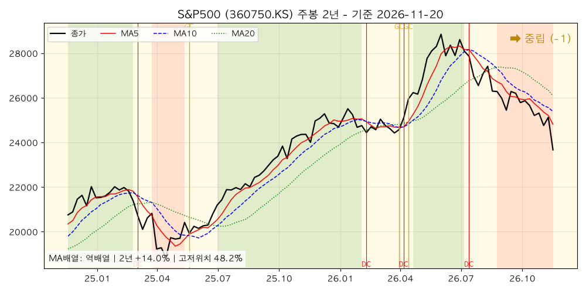

*S&P500(360750.KS) — 주봉 역배열, 2년 +14.0%, 고저위치 48.2%(지난주 62.8%). 1주 -5.8%. 주봉 MA5-MA10 격차 -1.38% → -2.25%로 벌어졌다. 미국 금요일 -3.7%는 아직 일부만 반영.*

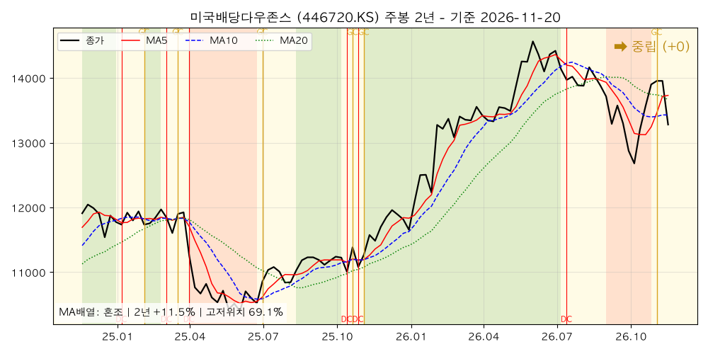

*미국배당다우존스(446720.KS) — 주봉 혼조, 2년 +11.5%, 고저위치 69.1%. 1주 -4.8%. **주봉 GC는 유지(+2.25%)됐지만 가격이 MA20 아래로 내려가 주봉 강세(+3) → 중립(0).** 일봉은 정배열이 풀리고 데드크로스.*

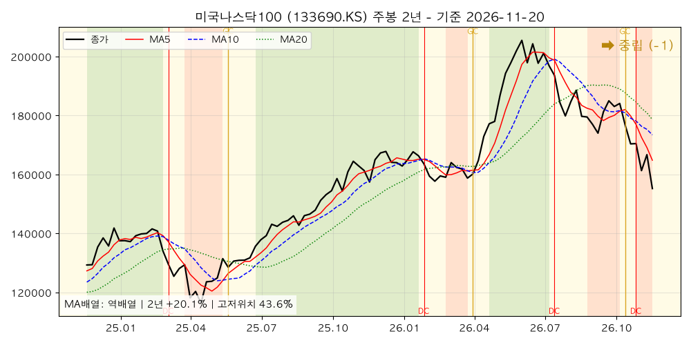

*미국나스닥100(133690.KS) — 주봉 역배열, 2년 +20.1%, 고저위치 43.6%. 1주 -6.9%. 일봉 MA60보다 11.0% 아래(지난주 5.3%에서 다시 벌어짐).*

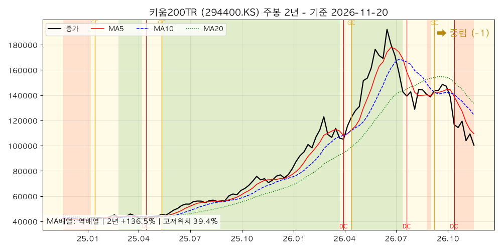

*키움200TR(294400.KS) — 주봉 역배열, 2년 +136.5%, 고저위치 39.4%. 1주 -8.2%로 지난주 +5.2% 반등을 모두 반납. 금요일 하루 -5.3%. 일봉 MA60보다 21.8% 아래.*

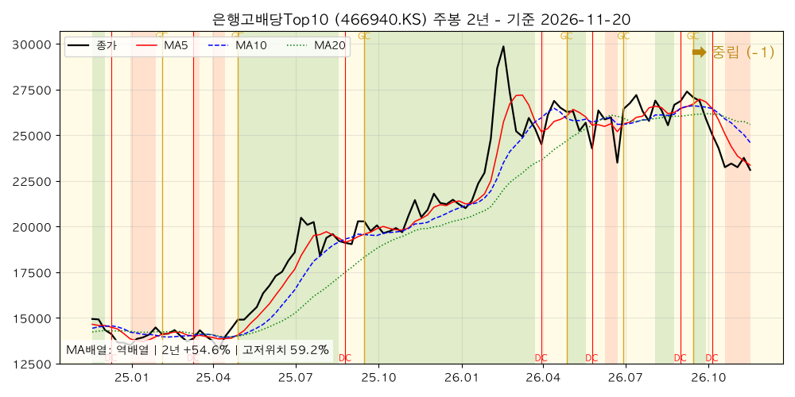

*은행고배당Top10(466940.KS) — 주봉 역배열, 2년 +54.6%, 고저위치 59.2%. 1주 -2.8%로 국내 주식 중 가장 덜 빠졌다. 일봉 GC(4봉 전)가 났지만 MA60 아래, 월봉 DC는 유지.*

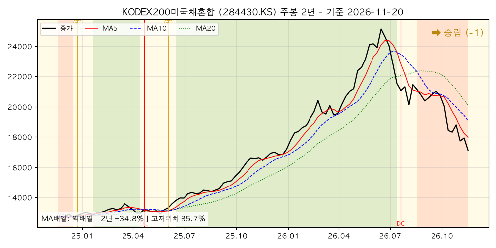

*KODEX200미국채혼합(284430.KS) — 주봉 역배열, 2년 +34.8%, 고저위치 35.7%. 1주 -4.5%. 미국채 +0.8%가 국내 주식 -8%를 거의 막지 못했다. 일봉 3개월 최저.*

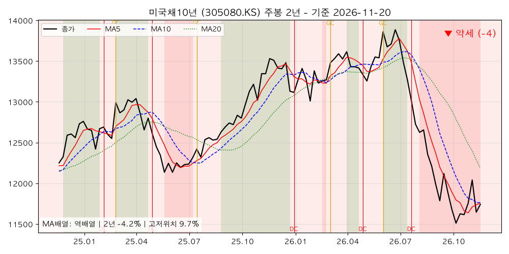

*미국채10년(305080.KS) — 주봉 역배열, 2년 -4.2%, 고저위치 9.7%. 1주 +0.8%로 15종목 중 상승률 1위. **주봉 MA5-MA10 격차 -0.02%** — 다음 주 주봉 GC 재발생 여부가 관건.*

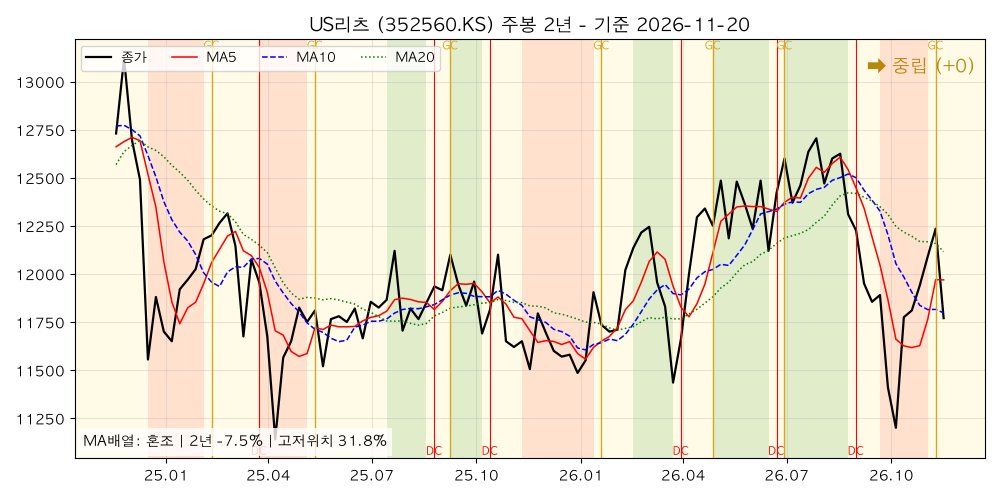

*US리츠(352560.KS) — 주봉 혼조, 2년 -7.5%, 고저위치 31.8%(지난주 55.3%). 1주 -3.8%. **주봉 GC는 유지(+1.45%), 그러나 세 시간축 강세 → 중립.** 이번 봉에 일봉 데드크로스.*

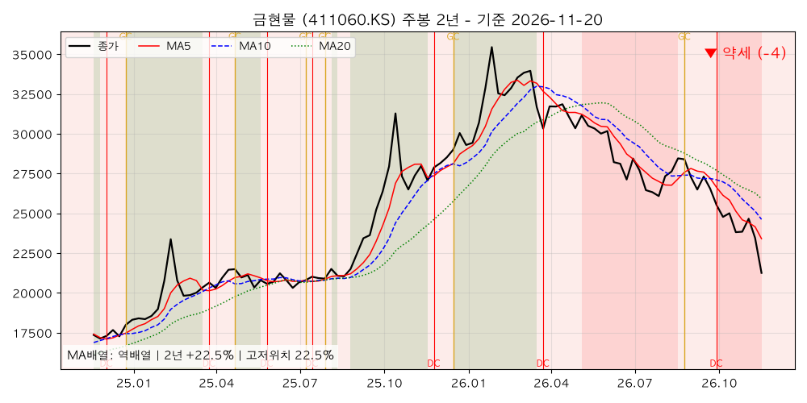

*금현물(411060.KS) — 주봉 역배열, 2년 +22.5%, 고저위치 22.5%. 1주 -9.4%로 2주 연속 급락. 일봉 3개월 최저, 일봉 GC는 한 주 만에 DC로 반전. 주봉 MA20(25,913원)이 현재가보다 21.9% 위.*

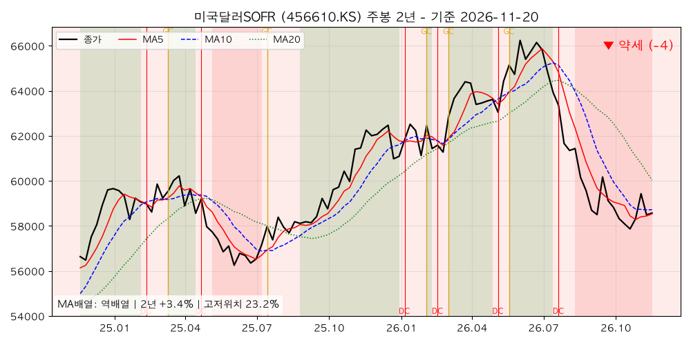

*미국달러SOFR(456610.KS) — 주봉 역배열, 2년 +3.4%, 고저위치 23.2%. 1주 +0.1%. 원/달러가 1,346원으로 올랐지만(원화 약세) 주봉 MA20(60,033원) 아래 구조는 그대로.*

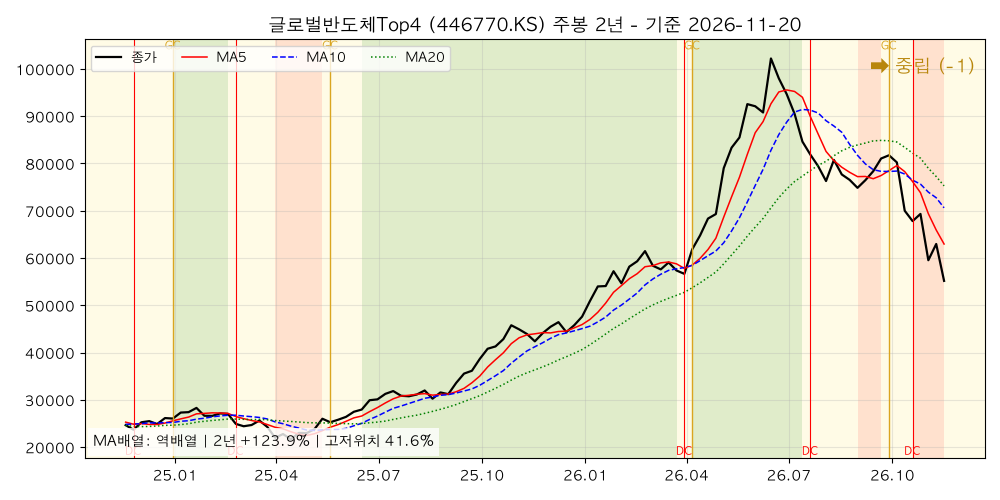

*글로벌반도체Top4(446770.KS) — 주봉 역배열, 2년 +123.9%, 고저위치 41.6%. 1주 -12.4%. 주봉 MA5-MA10 격차 -9.4% → -10.9%. 일봉 3개월 최저.*


*미국AI전력인프라(487230.KS) — 주봉 역배열, 2년 +0.6%(2년 수익이 거의 0으로 수렴), 고저위치 20.2%. 1주 -10.2%. 월봉이 약세(-2)로 돌아가 세 시간축 약세 재진입.*


*미국AI데이터센터(0142D0.KS) — 주봉 역배열, 상장 후 -44.2%, 고저위치 0.0%(상장 후 최저). 1주 -18.4%로 하락률 1위. 주봉 MA5-MA10 격차 -20.1%.*


*바이오헬스케어(462900.KS) — 주봉 역배열, 2년 -11.8%, 고저위치 1.8%. 1주 -2.5%. 주봉 모멘텀 -39.2%로 15종목 중 가장 약하다. 일봉 데드크로스(3봉 전).*


*조선Top3(466920.KS) — 주봉 역배열, 2년 +16.4%, 고저위치 12.8%. 1주 -8.9%. 일·주·월봉 모두 -4, 월봉 MA12보다 45.4% 아래.*

### [5] 추세추종 관점 주목 종목

#### 🚀 멀티타임 강세 (추세 편승 구간)

**이번 주 해당 종목 없음.** 지난 호의 두 종목은 다음과 같이 내려왔다.

| 종목 | 일봉 | 주봉 | 월봉 | 무엇이 바뀌었나 |
|---|---|---|---|---|
| 미국배당다우존스 | 🟢 +4 → 🟡 0 | 🟢 +3 → 🟡 0 | 🟢 +3 → 🟡 +1 | 일봉 정배열 해제·DC(1봉 전), 일봉 MA60·주봉 MA20·월봉 MA12 모두 아래로. 주봉 GC는 유지(+2.25%) |
| US리츠 | 🟢 +3 → 🟡 0 | 🟢 +2 → 🟡 0 | 🟢 +2 → 🟡 -1 | 일봉 DC(이번 봉), 일봉 MA60·주봉 MA20 아래로, 월봉 고저위치 22.2%로 하단권. 주봉 GC는 유지(+1.45%) |

두 종목 모두 **가장 느린 신호(주봉 GC)는 살아 있고, 가장 빠른 신호(일봉)부터 꺾였다.** 추세가 "끝났다"기보다 "멈췄다"에 가깝다. 다만 지난 호에 신규 진입 조건으로 건 "주봉 GC 유지 + 일봉 정배열 유지" 중 **일봉 정배열 조건이 깨졌다.** 추가 매수는 일봉이 다시 정배열(MA5 > MA20 > MA60)로 돌아올 때까지 보류하는 것이 원칙에 맞다.

#### 📌 눌림목 후보 (장기 상승 + 단기 과매도)

선정 기준: 월봉 강도 중립 이상(0 이상) + 월봉 고저위치 50% 이상 + 일봉 고저위치 30% 이하.

| 종목 | 월봉 고저위치 | 일봉 고저위치 | 괴리 | 월봉 강도 | 일봉 강도 |
|---|---|---|---|---|---|
| S&P500 | 70.0% | 0.0% | 70.0%p | 🟡 +1 | 🔴 -4 |
| 미국나스닥100 | 65.5% | 0.0% | 65.5%p | 🟡 0 | 🔴 -4 |
| 은행고배당Top10 | 75.5% | 13.4% | 62.1%p | 🟡 +1 | 🔴 -3 |
| 글로벌반도체Top4 | 50.7% | 0.0% | 50.7%p | 🟡 0 | 🔴 -4 |

명단은 지난주와 같은 4종목이다. 괴리는 S&P500(64.9 → 70.0%p)·미국나스닥100(52.5 → 65.5%p)에서 커졌는데, **월봉이 버틴 것이 아니라 일봉이 바닥(0.0%)으로 떨어져서** 커진 것이다. 괴리가 커졌다고 더 좋은 눌림목이 된 것이 아니다. 미국배당다우존스(월봉 79.2% · 일봉 40.8%)는 일봉 고저위치가 30%를 넘어 이번 주 명단에는 들지 않았지만, 다음 주 일봉이 더 밀리면 새로 들어올 수 있다.

#### 눌림목은 어떻게 판정하나 — S&P500 사례 분해

포트폴리오 최대 비중 종목이고 월봉·일봉 괴리가 가장 크다(지난 호 64.9%p → 이번 호 70.0%p).

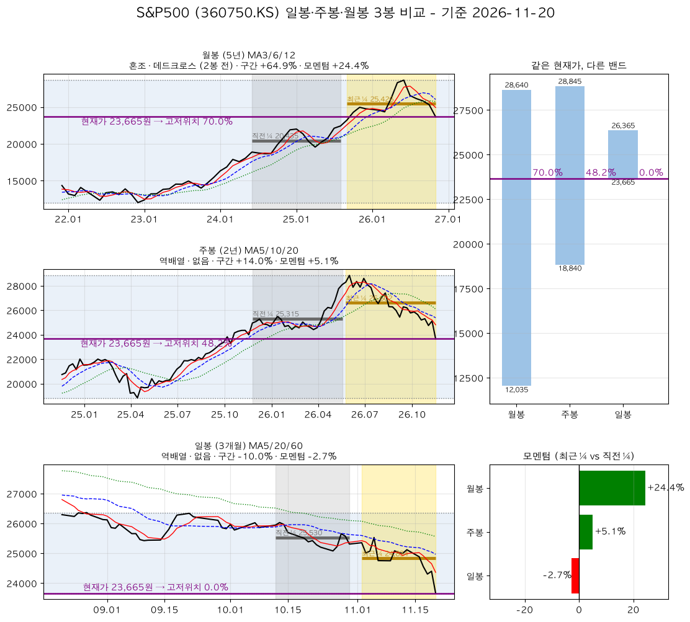

**① 밴드 비교** — 같은 23,665원이 시간축마다 다른 위치다.

| 봉 단위 | 구간 최저 | 구간 최고 | 고저위치 | 지난 호 |
|---|---|---|---|---|
| 월봉 (5년) | 12,035 | 28,640 | 70.0% | 78.8% |
| 주봉 (2년) | 18,840 | 28,845 | 48.2% | 62.8% |
| 일봉 (3개월) | 23,665 | 26,365 | 0.0% | 13.9% |

일봉 3개월 최저가가 **이번 주 금요일 종가 23,665원으로 새로 내려갔다.** 지난 호에 "11/9의 24,750원에서 사실상 바닥을 다졌다"고 적은 가격대가 4.4% 아래로 깨졌다. 주봉으로는 2년 밴드의 중간(48.2%) 아래로 내려왔다. 5년 월봉 기준으로는 여전히 상단 30% 안에 있지만, 그 경계(70.0%)에 붙었다.

**② 모멘텀 비교** — 월봉 +24.4%, 주봉 +5.1%, 일봉 -2.7%.

| 봉 단위 | 직전 ¼ 평균 | 최근 ¼ 평균 | 모멘텀 | 지난 호 |
|---|---|---|---|---|
| 월봉 (15개월씩) | 20,435 | 25,426 | +24.4% | +24.9% |
| 주봉 (26주씩) | 25,315 | 26,602 | +5.1% | +6.4% |
| 일봉 (15일씩) | 25,530 | 24,834 | -2.7% | -2.1% |

긴 시간축은 여전히 플러스지만 **세 시간축 모두 지난 호보다 약해졌다.** 일봉 감속 폭은 -2.1% → -2.7%로 다시 커졌다. 지난 호에 "감속 폭이 줄고 있다"고 적은 흐름이 한 주 만에 꺾였다.

**③ 그래도 후보일 뿐인 이유 (반대 신호)**
- **지난 호 매수 조건(일봉 MA5의 MA20 상향 돌파)은 멀어졌다.** MA5 24,362원 < MA20 24,968원, 격차 -0.9% → -2.4%. 현재가는 MA20보다 5.2%, MA60(25,562원)보다 7.4% 아래로 지난 호(0.4%·2.4%)보다 크게 멀어졌다.
- **월봉 MA3이 MA6 아래인 데드크로스(2봉 전)가 그대로**이고(24,933 < 26,019), 현재가는 월봉 MA12(25,742원)보다 8.1% 아래다. 월봉 +1점은 고저위치 70.0%가 경계선을 소수점 차이로 지켜서 나온 점수다.
- 주봉은 역배열, MA5-MA10 격차 -2.25%. 최근 10주 주봉 골든크로스 0건.
- **미국 금요일 장(-3.7%)이 한국 종가 이후에 나왔다.** 다음 주 첫 거래일에 일봉 신저가가 한 번 더 갱신될 가능성이 높다.
- 결론: **눌림목 "후보" 자격은 유지되지만 매수 조건 충족까지의 거리는 지난주보다 멀어졌다.** 조건은 그대로 둔다 — 일봉 MA5 > MA20 골든크로스와 MA60 회복. 지금 가격에서 MA5가 MA20을 넘으려면 약 2.5%의 MA5 상승이 필요하고, 가격 기준으로는 최소 1~2주의 반등이 선행돼야 한다. 그 전에는 "싸 보인다"는 이유로 미리 들어가지 않는다.

#### ⚠️ 혼조 관망 (신호 불일치)

| 종목 | 상태 | 관망 이유 |
|---|---|---|
| 미국배당다우존스 | 일봉 0·주봉 0·월봉 +1 | 세 시간축 강세 해제. 주봉 GC 유지 vs 일봉 DC. 어느 쪽이 이기는지 1~2주 확인 |
| US리츠 | 일봉 0·주봉 0·월봉 -1 | 같은 구조. 주봉 GC 유지 vs 일봉 DC(이번 봉). 2년 수익률 -7.5%로 회복 초입이 다시 흔들림 |
| 은행고배당Top10 | 일봉 -3·주봉 -1·월봉 +1 | 일봉 GC(MA60 아래)와 월봉 DC(이번 봉, 격차 확대)가 동시에. 11월 말 월봉 확정 대기 |
| 미국달러SOFR | 일봉 -1·주봉 -4·월봉 -1 | 원/달러 1,346원으로 원화 약세 전환. 그러나 일봉 DC(2봉 전), 주봉 MA20 아래 그대로 |
| 금현물 | 일봉 -4·주봉 -4·월봉 -1 | 2주 누적 약 -14%. 일봉 GC가 DC로 반전. 월봉만 중립 — 5년 수익률 +107.6%라 장기 추세는 아직 남아 있다 |

#### 🔻 멀티타임 약세 (회피·축소 구간)

| 종목 | 일·주·월봉 | 핵심 수치 |
|---|---|---|
| 미국AI데이터센터 | -4 · -4 · -2 | 1주 -18.4%, 상장 후 최저, 일봉 MA60 -38.9% |
| 조선Top3 | -4 · -4 · -4 | 3개월 -38.3%, 월봉 MA12 -45.4% |
| 바이오헬스케어 | -4 · -4 · -4 | 주봉 고저위치 1.8%, 주봉 모멘텀 -39.2% |
| 미국AI전력인프라 (재진입) | -4 · -2 · -2 | 1주 -10.2%, 월봉 중립 → 약세. 2년 수익률 +0.6% |
| 미국채10년 (신규) | -2 · -4 · -2 | 1주 +0.8%에도 일봉 역배열 전환. 단, 주봉 GC 직전(-0.02%)이라 가장 먼저 빠져나올 수 있는 후보 |

### [6] 자산군별 추세 비교

추세강도 평균(-4 ~ +4 척도)으로 자산군을 묶어 비교했다. 괄호는 11-13 기준 값.

| 자산군 | 구성 종목 | 일봉 평균 | 주봉 평균 | 월봉 평균 |
|---|---|---|---|---|
| 주식 — 선진국 | S&P500, 나스닥100, 배당다우존스, 반도체, AI전력, AI데이터센터 | -3.3 (-2.7) | -1.5 (-1.0) | -0.3 (+0.3) |
| 주식 — 국내 | 키움200TR, 은행고배당Top10, 조선Top3, 바이오헬스케어 | -3.8 (-4.0) | -2.5 (-2.5) | -1.8 (-1.8) |
| 혼합 | KODEX200미국채혼합 | -4.0 (-4.0) | -1.0 (-1.0) | +0.0 (+0.0) |
| 채권 | 미국채10년 | -2.0 (-1.0) | -4.0 (-4.0) | -2.0 (-2.0) |
| 대안자산 | 금현물, 미국달러SOFR, US리츠 | -1.7 (-0.3) | -2.7 (-1.7) | -1.0 (+0.0) |
| 배당·인컴 | 배당다우존스, 은행고배당Top10, US리츠 | -1.0 (+1.0) | -0.3 (+1.3) | +0.3 (+2.0) |

**자산군 간 관계 해석**

첫째, **이번 주 가장 크게 움직인 것은 배당·인컴이다**(일봉 +1.0 → -1.0, 주봉 +1.3 → -0.3, 월봉 +2.0 → +0.3). 지난 호에 "방향과 상관없이 버티는 자산"이라고 적은 자산군이 이번 주에는 버티지 못했다. 다만 세 종목 중 둘(미국배당다우존스·US리츠)의 주봉 GC가 살아 있어, 다른 자산군보다는 여전히 점수가 높다. **상대적 우위는 남았고 절대적 강세는 사라졌다.**

둘째, **대안자산도 같이 내려왔다**(주봉 -1.7 → -2.7, 월봉 0.0 → -1.0). 금이 2주 연속 급락하면서 "주식이 빠지면 금이 받친다"는 관계가 이번 국면에서는 작동하지 않았다. 주식·금·리츠가 함께 빠지고 미국채와 달러만 버틴 모양은 **위험자산 전반에서 현금화가 일어나는 국면**의 전형이다.

셋째, **국내 주식은 점수 변화가 거의 없다**(일봉 -4.0 → -3.8). 이미 바닥 점수였기 때문이다. 하락폭은 컸지만(키움200TR -8.2%, 조선Top3 -8.9%) 점수로는 더 내려갈 곳이 없었다. 은행고배당Top10의 일봉 GC가 +0.2를 만들었을 뿐이다.

넷째, **채권은 가격이 올랐는데 점수가 내려갔다**(일봉 -1.0 → -2.0). 주 초 금리 상승으로 일봉 데드크로스가 먼저 났고, 금요일 금리 하락(4.91%)은 그 구조를 되돌리기에 부족했다. 그래도 주봉 GC까지의 거리가 15종목 중 가장 짧다는 점에서 **다음 주 가장 먼저 개선될 수 있는 자산군**이다.

### [7] 종합 코멘트

**전체 추세 방향성**

시간축별 강세 비중은 일봉·주봉·월봉 모두 **0%(0개)**다. 지난주 13.3%(2개)에서 사라졌다. 약세 비중은 일봉 80.0%(12개), 주봉 46.7%(7개), 월봉 33.3%(5개)로 모두 늘었다. 지난 호에 "시장은 급락 → 기술적 반등의 한 사이클을 마쳤지만 추세의 주도권은 배당·인컴이 쥐고 있다"고 적었다. 이번 주에는 **반등이 실패해 2차 하락으로 이어졌고, 주도권을 쥐고 있던 자산도 강세 판정을 잃었다.** 현재 15종목 중 추세추종 기준의 "편승 대상"은 없다.

**강세·약세 자산군의 교차 신호**

- 강세 일치 0개, 약세 일치 5개(AI데이터센터·조선·바이오·AI전력·미국채10년), 중립 일치 2개(미국배당다우존스·US리츠).
- 1주 하락 상위 5종목은 지난주 반등 상위 종목과 같다. **급락 → 반등 → 전저점 이탈**의 순서가 그대로 나왔다. 반등의 고점이 MA20에 닿기 전에 꺾였다는 점이 차트로 확인된다.
- **VIX 35.9**로 지난 호에 확인 신호로 둔 "VIX 30 돌파"가 충족됐다. 공포 지표가 높을 때는 하루 변동폭이 커지고 이동평균선 신호가 자주 뒤집힌다. 일봉 신호의 신뢰도가 낮아지는 구간이므로 **주봉 신호 위주로 판단**하는 것이 맞다.
- 지난 호에 제시한 다섯 가지 확인 신호의 결과: ① S&P500 일봉 골든크로스 — **실패**(MA5-MA20 격차 -0.9% → -2.4%) ② 미국배당다우존스·US리츠 주봉 GC 유지 — **유지**(+2.25%·+1.45%), 그러나 일봉 DC로 강세 판정 해제 ③ 은행고배당Top10 월봉 DC 되돌림 — **실패**(MA3-MA6 격차 -2.4% → -2.9%) ④ 반등 종목들의 주봉 MA5-MA10 격차 축소 — **실패**(글로벌반도체Top4 -9.4 → -10.9%, 미국AI전력인프라 -11.6 → -13.5%, 미국AI데이터센터 -17.8 → -20.1%, 조선Top3 -15.8 → -16.3%. 키움200TR만 -12.3 → -11.9%) ⑤ 원/달러 1,330원 아래 원화 강세 지속 — **반대로 전환**(1,346원, 원화 약세). 달러 자산의 원화 환산 낙폭을 줄여준 유일한 완충 장치였다.

**추세추종 대응 방향**

1. **신규 진입 허용 종목은 이번 주 없다.** 미국배당다우존스·US리츠도 일봉 정배열 조건이 깨졌으므로 추가 매수는 일봉 재정배열 확인 뒤로 미룬다. 다만 주봉 GC가 살아 있는 동안은 **보유분을 줄일 근거도 아직 없다** — 주봉 데드크로스가 나오면 그때 줄인다.
2. **S&P500 눌림목의 매수 조건(일봉 MA5 > MA20)은 지난주보다 멀어졌다.** 조건은 바꾸지 않는다. 월봉 고저위치가 70% 아래로 내려가 월봉 점수가 0이 되더라도 월봉 MA3·MA6이 버티는 한 "장기 상승 속 눌림" 해석은 유지되지만, 월봉 MA12(25,742원) 회복 전까지는 분할 매수의 간격을 넓게 잡는다.
3. **약세 일치 종목(AI·조선·바이오)은 반등 시 축소 원칙을 유지한다.** 지난주 반등이 정확히 축소 기회였다는 것이 이번 주에 확인됐다. 다음 반등에서도 같은 원칙을 적용한다.
4. **금은 "많이 빠졌다"로 사지 않는다.** 2주 누적 약 -14%이지만 일봉·주봉 모두 -4다. 월봉 MA6(25,262원) 아래로 내려와 장기 추세도 시험받고 있다. 주봉 MA5가 MA10을 다시 넘을 때까지 기다린다.
5. **다음 주 확인할 신호**: ① 미국 금요일 하락분(S&P500 -3.7%) 반영 후 S&P500 주봉 고저위치가 40%대를 지키는지 ② 미국배당다우존스·US리츠 주봉 GC 유지(격차 +2.25%·+1.45%가 0으로 줄어드는지) ③ 미국채10년 주봉 골든크로스 재발생(격차 -0.02%) ④ VIX 35.9에서 30 아래로 내려오는지(일봉 신호 신뢰도 회복) ⑤ 11월 말 월봉 확정 — 은행고배당Top10 월봉 DC 확정 여부, S&P500 월봉 고저위치 70% 유지 여부.

---

## 5. 내 ETF 평가 & 대응

> 이 섹션은 개인 포트폴리오를 다루므로 **절대금액을 쓰지 않는다.** 모든 수치는 비중(%)·수익률(%)·주당 가격이다.
> 앞의 세 분석(한국은행·거시·차트)을 입력으로 받은 최종 종합이며, 관점은 **안전마진 기반 가치투자자**다.
> 기준: 포트폴리오 시트는 이번 주에도 **갱신되지 않았다**(2주째, 마지막 갱신 11-08). 11-08 시트의 보유 내역을 그대로 두고, 각 종목의 평가 비율에 **11-06 → 11-13 → 11-20 종가 변화율**을 차례로 곱해 추정했다. 2주간의 매매·신규 납입은 반영되지 않았다(매매가 없었다고 가정). 퇴직연금의 타이거 KRX금현물은 ACE KRX금현물(411060)을, TIGER 미국배당다우존스는 458730을 가격 대리로 썼다.
> **시차 주의**: 국내 상장 ETF의 11-20 종가는 미국 금요일 장(S&P500 △3.7%, 나스닥100 △5.6%)보다 먼저 찍혔다. 이번 주 숫자는 그 하락을 일부만 담고 있다(5-1 끝 참조).

### 5-0. 이번 주의 한 줄 — 주식도, 피난처도 같이 팔렸다

지난 호의 결론은 "지난주 계좌를 지킨 자산이 이번 주 계좌를 깎았다"였다. 이번 주는 그 시소마저 멈췄다. **AI·반도체가 10~18% 빠지는 동안 금도 9.4% 빠졌다.** 계좌를 받친 것은 비중 12.6%의 미국채·달러뿐이었고, 그 기여는 합쳐 +0.07%p였다. 계좌 전체는 **△5.81%**다.

| 항목 | 46주차(11-13) | 47주차(11-20) | 내 포트폴리오에의 의미 |
|---|---|---|---|
| S&P500 지수 | 7,562 | 6,910 (△8.6%) | 최대 비중 자산. 고점 대비 △11.6%로 **조정 진입** |
| 나스닥100 지수 | 27,944 | 25,029 (△10.4%) | 2026년 연간 상승분 반납 |
| 엔비디아 | 162.8달러 | 125.53달러 (△22.9%) | 실적 상회에도 CEO 사임·수급 충격. 반도체·AI 테마의 진앙 |
| 코스피 | 5,291 | 4,870 (△7.9%) | 5,000선 붕괴, 11/20 하루 △5.21% |
| VIX | 19.3 | **35.9** | 지난 호 확인 신호 "30 돌파" 충족 |
| 미 10년물 | 5.15%\* | **4.92%** | **△23bp** — 주가 급락에 장기채가 처음으로 방어 |
| 12월 연준 인상 확률 | 100%(25bp 89%) | 25bp **97.5%** | 인상은 그대로, 50bp 기대와 내년 추가 인상 경로가 줄었다 |
| 원/달러 | 1,334원 | 1,346원 (+0.9%) | **원화 약세 전환** — 달러 자산의 원화 환산 낙폭을 줄인 유일한 완충 |
| 국제 금값 | 3,886.3달러 | 3,539.0달러 (△8.9%) | 금리 하락에도 급락 = 증거금 충당형 매도 |
| WTI | 88.6달러 | 83.6달러 (△5.6%) | 지난 호 "긴축 조기 종료" 유가 조건(85달러 미만) 처음 충족 |

\* 이번 호부터 미 재무부 고시 기준으로 통일(3장). 지난 호 표의 5.10%는 11/12 값이다. 엔비디아 11-13 값은 이번 주 변화율에서 역산했다.

**이 표가 말하는 것.** 지난 두 주 동안 이 포트폴리오에서 금과 AI 테마는 서로의 헤지처럼 반대로 움직였다. 이번 주에는 **같은 방향으로 움직였다.** 3장의 진단대로 금리가 내렸는데도 금이 빠진 것은 펀더멘털이 아니라 "현금이 필요한 매도"가 섞였다는 뜻이다. 위기의 초입에는 상관관계가 1로 수렴한다 — 분산은 평소에는 작동하고 정작 필요한 주에 약해진다는 것을, 이번 주 계좌가 숫자로 보여줬다.

### 5-1. 포트폴리오 현황 (비중·수익률만, 추정)

#### 전체

| 항목 | 값 | 직전(11-13) | 변화 |
|---|---|---|---|
| 전체 누적 수익률 | **△8.28%** (추정) | △2.62% | **△5.66%p** |
| 이번 주 계좌 가치 변화 | **△5.81%** | +0.29% | 같은 기간 국내 상장 S&P500 ETF △5.8%, 코스피 △7.9% |
| 미국 주식 비중(배당·헬스케어 포함) | 45.3% | 45.2% | +0.1%p |
| AI·반도체·조선 테마 비중 | 9.6% | 10.4% | △0.8%p (가격 하락) |
| 금 비중 | **12.5%** | 13.0% | △0.5%p (가격 하락) |
| **현금 비중** | **1.1%** | 1.0% | 다른 자산이 빠져 비중만 올랐다 — 시트 미갱신으로 실제 확인 불가 |

**이번 주 계좌는 시장과 거의 같은 폭으로 빠졌다.** 지난 호에 "변동성은 시장보다 훨씬 작았고, 방향은 시장을 따라갔다"고 썼다. 이번 주 계좌 △5.81%는 국내 상장 S&P500 ETF(△5.79%)와 사실상 같다. 3주 누적(10-30 → 11-20)으로 보면 계좌는 약 △8.2%, 같은 기간 S&P500 지수는 △8.8%, 코스피는 △15.0%다. **방어자산 비중이 30%를 넘는 포트폴리오가 미국 지수와 같은 폭으로 빠졌다는 것이 이번 주의 핵심 숫자다.**

#### 계좌별

| 계좌 | 전체 내 비중 | 계좌 수익률 | 직전(11-13) | 주간 가치 변화 |
|---|---|---|---|---|
| 퇴직연금 | 40.7% | **△0.15%** | +5.27% | △5.15% |
| 연금저축펀드 | 26.9% | **△5.58%** | △0.75% | △4.87% |
| 개인IRP | 18.6% | **△1.64%** | +3.20% | △4.69% |
| ISA | 13.8% | **△33.86%** | △25.87% | **△10.77%** |

**네 계좌가 모두 누적 마이너스가 됐다.** 지난주까지 플러스였던 퇴직연금(+5.27%)과 개인IRP(+3.20%)가 한 주 만에 0 아래로 내려왔다. 세 연금 계좌의 주간 낙폭은 △4.7~△5.2%로 거의 같다 — 담은 종목은 달라도 이번 주에는 같은 힘(미국 주식 △5.8%, 금 △9.4%)을 받았다. ISA는 테마 4종(약 69%)이 △9~△18% 빠지며 혼자 두 배 넘게 빠졌다.

#### 자산군별 — 이번 주 무엇이 계좌를 움직였나

| 자산군 | 비중 | 누적 수익률 | 1주 | 계좌 기여(%p) |
|---|---|---|---|---|
| 미국 주식 | 31.8% | +0.27% | △5.94% | **△1.89** |
| AI·반도체·조선 테마 | 9.6% | **△40.55%** | **△13.56%** | **△1.41** |
| 금 | 12.5% | △16.25% | **△9.38%** | **△1.22** |
| 미국 주식(배당) | 13.5% | **+8.37%** | △4.77% | △0.64 |
| 혼합형 | 14.5% | +1.16% | △3.35% | △0.47 |
| 국내 주식 | 5.5% | △8.25% | △4.46% | △0.24 |
| 채권 | 7.5% | △5.55% | **+0.88%** | **+0.06** |
| 달러 단기채·현금 | 5.1% | △7.82% | +0.06% | +0.00 |

**미국 주식이 가장 큰 마이너스(△1.89%p)였지만, 비중 대비로 가장 아팠던 것은 테마와 금이다.** 둘의 비중은 합쳐 22%인데 기여는 △2.63%p로 계좌 하락의 45%를 만들었다. 지난 두 주 "서로의 헤지"였던 두 자산이 이번 주 같이 빠진 결과다. 반대로 지난 호 행동 원칙에서 "저가 매수 대상이 아니다"라고 쓴 **채권이 유일한 플러스**였다. 배당 주식은 △4.77%로 미국 주식(△5.94%)보다 덜 빠져 상대 방어는 했지만, 절대적으로는 지켜주지 못했다.

#### 종목별 통합 (계좌 합산, 상위·특이 종목)

| 종목 | 전체 비중 | 누적 수익률 | 1주 |
|---|---|---|---|
| 타이거 미국 S&P500 | 26.4% | +2.54% | △5.79% |
| SOL 미국배당다우존스 | 9.8% | **+14.04%** | △4.84% |
| ACE KRX 금현물 (3개 계좌) | 8.2% | △17.81% | △9.38% |
| 삼성 KODEX200 미국채혼합 | 8.0% | +1.75% | △4.55% |
| SOL 미국배당미국채혼합50 | 6.5% | +0.45% | △1.84% |
| 타이거 미국채 10년선물 | 5.6% | △6.10% | **+0.82%** |
| 타이거 KRX금현물 | 4.3% | △13.14% | △9.38% |
| 타이거 미국 나스닥100 | 4.3% | △10.76% | △6.90% |
| TIGER 미국달러단기채권액티브 | 4.0% | △9.70% | +0.08% |
| 타이거 은행고배당플러스TOP10 | 3.9% | △5.22% | △2.80% |
| TIGER 미국배당다우존스 | 3.7% | △4.43% | △4.57% |
| ACE 글로벌반도체TOP4 plus | 3.5% | △26.89% | △12.40% |
| 타이거 미국AI데이터센터Top4Plus | 3.1% | **△50.62%** | **△18.45%** |
| ACE 미국30년국채액티브 | 1.9% | △3.94% | +1.07% |
| SOL 조선TOP3플러스 | 1.7% | **△45.85%** | △8.92% |
| KIWOOM 200TR | 1.6% | △14.83% | △8.24% |
| KODEX 미국AI전력핵심인프라 | 1.4% | **△33.61%** | △10.16% |
| KODEX 미국S&P500 헬스케어 | 1.1% | △3.79% | △5.55% |
| 현금 | 1.1% | — | — |

**누적 △30% 이상 종목이 둘에서 셋으로 늘었다**(AI데이터센터 △50.6%, 조선TOP3 △45.9%, AI전력 △33.6%). AI전력은 지난주 반등으로 명단에서 빠졌다가 한 주 만에 돌아왔고, **AI데이터센터는 원금의 절반을 잃었다.** 지난 호 "반등 시 축소" 원칙이 왜 필요했는지가 이 세 줄에 있다. 플러스 종목은 S&P500(+2.5%)·배당다우존스(SOL +14.0%)·KODEX200미국채혼합·배당미국채혼합 네 개로 줄었다.

#### 월요일에 더 반영될 수 있는 하락 (추정)

국내 상장 ETF의 이번 주 변화와, 같은 지수의 미국 상장 ETF 주간 변화에 환율(+0.9%)을 곱한 원화 환산 변화를 비교했다.

| 내 ETF | 국내 ETF 1주 | 미국 대리 ETF 원화 환산 1주 | 미반영 추정 |
|---|---|---|---|
| 타이거 미국 S&P500 | △5.8% | △7.7% (SPY) | **약 △2.0%** |
| 타이거 미국 나스닥100 | △6.9% | △9.7% (QQQ) | 약 △3.0% |
| ACE 글로벌반도체TOP4 | △12.4% | △16.6% (SOXX) | 약 △4.8% (구성 차이 큼) |
| 미국배당다우존스 | △4.8% | △5.2% (SCHD) | 약 △0.4% |

비중을 곱하면 **계좌 전체로 약 △1%p**가 월요일에 추가로 반영될 수 있다(미국 선물·환율이 주말 사이 그대로라는 가정). 그러면 누적 수익률은 약 △9%대가 된다. 다음 호 숫자를 미리 이 정도로 읽어 둔다.

### 5-2. 2단계 — 내 ETF의 펀더멘털 지표

#### 지표를 어떻게 읽나 (쉬운 설명)

| 지표 | 한 줄 정의 | 비유 |
|---|---|---|
| **PER** | 주가 ÷ 1주당 순이익. ETF는 담은 기업들의 시가총액 가중평균 | **"이 가게를 사면 지금 버는 돈으로 원금 회수에 몇 년 걸리나."** PER 20배 = 20년 |
| **이익수익률** | 1 ÷ PER × 100 | **"이 가게의 연 이자율."** PER 20배면 연 5% |
| **PBR** | 주가 ÷ 1주당 순자산 | **"가게 집기·현금을 다 팔면 받는 돈의 몇 배를 내고 사는가."** |
| **ROE** | 순이익 ÷ 자기자본. 여기서는 PBR ÷ PER로 역산 | **"내 돈 100을 맡기면 1년에 몇을 벌어오나."** |
| **배당수익률** | 연간 분배금 ÷ 현재가 | **"매년 통장에 실제로 꽂히는 비율."** |

**안전마진의 기준선**: 한국 예금금리 **3.5%**. 이익수익률이 이보다 낮으면 위험을 더 지고 수익을 덜 받는 거래다. 이번 주부터는 미 3개월물(4.32%)·10년물(4.92%) 기준을 함께 본다(5-3).

#### 보유 ETF 지표 (2026-11-20 추정)

국내 상장 ETF는 Yahoo가 펀더멘털을 제공하지 않아 **동일 지수 미국 상장 ETF를 대리 지표**로 쓴다. 지난 호(11-13)의 PER·PBR에 **11-13 → 11-20 대리 ETF 가격 변화율(달러 기준, 미국 금요일 종가 포함)**을 반영했다. 일주일 사이 이익 추정치는 바뀌지 않았다고 가정한 근사치다. 엔비디아 실적 상회로 반도체·나스닥의 이익 추정치는 오히려 올라갔을 가능성이 커, 그 두 줄의 실제 PER은 표보다 조금 더 낮을 수 있다.

| 내 ETF | 대리 | 대리 가격 1주 | PER (지난 호 → 이번 호) | 이익수익률 | PBR | ROE(역산) | 배당수익률 |
|---|---|---|---|---|---|---|---|
| SOL·TIGER 미국배당다우존스 | SCHD | △6.0% | 18.5 → **17.4배** | **5.8%** | 3.34배 | 19.5% | **약 3.3%** |
| 타이거 미국 S&P500 | SPY | △8.6% | 23.7 → **21.7배** | **4.6%** | 4.80배 | 21.7% | 1.1% |
| 타이거 미국 나스닥100 | QQQ | △10.5% | 26.9 → **24.1배** | 4.2% | 7.97배 | 31.5% | 0.4% |
| KODEX 미국S&P500헬스케어 | XLV | △6.2% | 30.8 → 28.9배 | 3.5% | 4.45배 | 15.8% | 1.6% |
| ACE 글로벌반도체TOP4 | SOXX | **△17.3%** | 29.1 → **24.1배** | **4.2%** | 8.69배 | 31.5% | 0.2% |
| SOL 미국배당미국채혼합50 | 합성 | — | — | 약 5.3%\* | — | — | — |

\* 주식 이익수익률 5.8%와 미 10년물 4.92%의 절반 가중 기대수익률(지난 호와 같은 5.3%지만 구성이 바뀌었다 — 주식 쪽이 올라가고 채권 쪽이 내려갔다).

**PER이 한 주에 1~5배씩 내려간 것은 이 분석을 시작한 뒤 처음이다.** 반도체 대리 ETF는 지난주 반등으로 26.6 → 29.1배로 비싸졌다가 이번 주 24.1배로, 2주 전보다도 싸졌다. 이익(실적)은 그대로인데 가격만 내려간 결과라, **가치투자자 관점에서는 "같은 가게를 더 싼 값에 살 수 있게 된 주"**다. 다만 이 가게의 사장(엔비디아 CEO)이 바뀌었다는 점이 숫자에 담기지 않은 위험이다.

**수집하지 못한 지표**: 은행고배당TOP10·KIWOOM 200TR·조선TOP3의 11월 시점 PER·PBR 확정치, 미국AI데이터센터·AI전력의 대리 ETF(대응 미국 상장 ETF 없음). 채권·금·달러 ETF는 PER 개념이 적용되지 않는다. 지난 호와 동일하다.

#### ETF를 하나의 회사로 보면 — 현금흐름 3분해

| 활동 | 보는 지표 | 이번 주 달라진 점 |
|---|---|---|
| **영업활동** (돈을 잘 버나) | ROE·영업이익률 | **오히려 확인됐다.** 엔비디아 매출 1,158억달러(예상 +6%), 데이터센터 매출 1,076억달러(사상 최대), 4분기 가이던스 1,300억달러. 한국 11월 1~10일 수출의 49.7%가 반도체(3장). 담은 기업들의 "장사"는 이번 주 나빠지지 않았다 |
| **투자활동** (미래에 쓰나) | CAPEX·ROIC | **시장이 의심하는 칸이 여기다.** FOMC 의사록이 AI 투자를 "중대한 물가 위험", AI 관련 부채를 금융안정 우려로 명시했다. 앤트로픽 상장(공모가 83달러 → 시초가 111.50달러, 이튿날 약 △8%)은 AI 자금 수요가 크다는 확인이자, 기존 AI주에서 돈이 빠져나간 통로였다. "벌어서 다시 쏟아붓는 돈이 회수될까"라는 질문이 2주째 가격을 누른다 |
| **재무활동** (주주에게 돌려주나) | 배당수익률·자사주 | 배당다우존스 △4.8%로 미국 주식 중 가장 덜 빠졌고, 배당수익률은 3.1% → 3.3%로 올라갔다. **"현금을 돌려주는 자산"은 추세 판정(강세 → 중립)은 잃었지만 상대 방어는 지켰다** |

### 5-3. 3단계 — 안전마진과 적정가격 범위

#### 무위험 수익률 사다리와 "등가 PER"

| 비교 대상 | 수익률 | 등가 PER | 지난 호 대비 |
|---|---|---|---|
| 한국 기준금리 | 3.00% (11/26 결정) | 33.3배 | — |
| **한국 예금금리 (기준선)** | **3.5%** | **28.6배** | — |
| 미 정책금리 | 3.875% (12월 25bp 인상 확률 97.5%) | 25.8배 | — |
| 미 3개월물 | 4.32% | 23.1배 | 변화 없음 |
| **미 10년물** | **4.92%** | **20.3배** | 19.4배(5.15%) → 20.3배로 **기준이 느슨해졌다** |

#### 내 주식 ETF는 이 사다리의 어디에 있나

| ETF | 이익수익률 | vs 예금 3.5% | vs 3개월물 4.32% | vs 10년물 4.92% | 지난 호 대비 |
|---|---|---|---|---|---|
| **미국배당다우존스** | **5.8%** | **+2.3%p** ✅ | **+1.4%p** ✅ | **+0.8%p** ✅ | 3개 기준 합격 유지. 10년물 여유 0.3%p → **0.8%p로 두 배 이상 넓어졌다** |
| 타이거 미국 S&P500 | 4.6% | +1.1%p ✅ | **+0.3%p ✅** | △0.3%p ❌ | **3개월물 기준 재합격.** 10년물과의 격차 △0.9 → △0.3%p |
| 타이거 미국 나스닥100 | 4.2% | +0.7%p ✅ | △0.2%p ❌ | △0.8%p ❌ | 3개월물 문턱 바로 아래 |
| ACE 글로벌반도체TOP4 | 4.2% | **+0.7%p ✅** | △0.2%p ❌ | △0.8%p ❌ | **예금 기준 재합격** |
| KODEX 미국S&P500헬스케어 | 3.5% | 0.0%p (경계) | △0.9%p ❌ | △1.5%p ❌ | 예금 기준선에 붙었다 |

**지난 호와 정반대로, 안전마진이 양쪽에서 동시에 넓어졌다.** 분자 쪽에서는 주가 급락이 이익수익률을 0.3~0.8%p 올렸고, 분모 쪽에서는 미 10년물이 5.15% → 4.92%로 내려 기준선이 낮아졌다. 지난 호에 "가격이 오르고 금리도 오르면 안전마진은 두 배로 줄어든다"고 썼는데, 이번 주는 그 거울상이다. **예금 기준을 넘는 주식 ETF가 3개에서 4개로 늘었고, 3개월물 기준 합격도 1개에서 2개로 늘었다.** 10년물 기준 합격은 여전히 배당다우존스 하나지만, S&P500이 0.3%p 거리까지 왔다. S&P500 지수가 약 6,480(10년물 등가 PER 20.3배)까지 내려가거나 10년물이 4.6% 아래로 내려가면 두 번째 합격 종목이 된다.

#### S&P500 PER 21.7배는 50년 역사에서 어디쯤인가

| 시점 | S&P500 후행 PER | 현재(21.7배) 대비 |
|---|---|---|
| 50년 장기 평균 | 약 16배 | 현재는 평균의 **1.36배** (지난 호 1.48배) |
| 2007년 금융위기 직전 | 약 20배 | 현재가 **8% 더 비싸다** (지난 호 19%) |
| 2021년 코로나 후 유동성 장세 | 약 37배 | 그 59% 수준 |
| 2000년 3월 닷컴 버블 | 약 44배 | 그 49% 수준 |

**한 주 만에 "금융위기 직전 수준"과의 거리가 19% → 8%로 좁혀졌다.** S&P500 지수가 약 6,380까지 내려가면 PER 20배(강력매수가 기준)가 된다. 3장 리스크케이스의 목표선 6,255(고점 대비 △20%)는 PER 약 19.6배로, **약세장 진입선이 곧 이 리포트의 강력매수 구간**이라는 뜻이다. 그래도 평균(16배)까지는 지수가 26% 더 내려가야 한다. "싸졌다"가 아니라 **"비싼 구간의 아래쪽 끝에 처음 닿았다"**가 정확한 표현이다.

#### 적정가격 범위 (ETF별, 원화 주당 가격)

| ETF | 현재가 | 강력매수가 | 적정매수가 | 매도·경계가 | 현재 위치 |
|---|---|---|---|---|---|
| 타이거 미국 S&P500 | 23,665 | **21,400** (PER 20배) | 21,700 (10년물 등가 20.3배) | 26,700 (PER 25배) | 강력매수가보다 10.6% 위(지난 호 18%). 월요일 미반영분(약 △2%)을 빼면 **약 8% 위.** 10년물 등가 PER이 다시 20배를 넘어 적정매수가가 강력매수가 위로 돌아왔다 |
| SOL 미국배당다우존스 | 13,280 | 이미 PER 17.4배로 20배 이하 | — | 배당수익률 5% 달성가 약 8,800 | **강력매수 구간 안**(PER 기준). 배당 5% 기준으로는 여전히 멀다 |
| 타이거 미국 나스닥100 | 155,220 | 124,900 (PER 20배) | **156,100** (PER 25배) | — | **적정매수가 도달**(0.6% 아래). 월요일 미반영분을 빼면 약 3.5% 아래 |
| ACE 글로벌반도체TOP4 | 55,155 | 43,700 (PER 20배) | **54,600** (PER 25배) | — | 적정매수가보다 1.0% 위(지난 호 16%). 월요일 미반영분을 빼면 **적정매수가 아래**. 이익 지속 가정 시 |
| 금현물 (411060) | 21,250 | — | — | **30,350** (JP모건 목표 5,055달러 환산) | 목표가까지 **+42.8%** 여지(지난 호 +30.0%) |
| 미국채10년 (305080) | 11,740 | — | — | 금리 50bp 하락 시 약 +4%, 상승 시 약 △4% (듀레이션 약 8년, 환율 제외) | 이번 주 +0.8%. 2년 밴드 하단(고저위치 9.7%) |
| 미국달러SOFR·달러단기채 | — | 현재가 = 적정가 | — | — | 원금 보존형. 손익은 환율(이번 주 +0.9% 순풍) |

> 계산: 주식 ETF의 목표가는 지난 호 목표가에 **원/달러 변화(+0.92%)만 반영**했다(이익 추정 불변 가정 → 목표 PER에 해당하는 달러 가격은 그대로, 원화 환산만 바뀐다). 이렇게 구한 강력매수가를 현재가와 대리 ETF PER로 역산한 값과 대조해 1% 안에서 일치하는 것을 확인했다. 금은 현재가 × (목표 금값 5,055달러 ÷ 현재 금값 3,539.0달러). 배당 5% 달성가는 현재가 × (현재 배당수익률 ÷ 5%).

**처음으로 "적정매수가 도달" 줄이 둘 생겼다(나스닥100·반도체).** 그러나 둘 다 이익수익률 4.2%로 미 10년물(4.92%)에 0.8%p 못 미친다. 적정매수가는 "예금보다 낫다"는 뜻이지 "국채보다 낫다"는 뜻이 아니다. 그리고 4장 기준 두 종목 모두 일봉 약세(-4)·3개월 최저 마감이다. **가격 조건은 왔고 추세 조건은 오지 않았다** — 이번 주 대응(5-7)의 출발점이다.

#### 마진데빗 — "감소가 무서운" 국면이 숫자로 확인됐다

지난 호에 "강제 매도가 멈췄다와 빚이 줄었다는 다른 말"이라고 쓰고 10월분을 기다렸다. **FINRA 10월 마진데빗은 약 1조 4,480억달러로 9월보다 2.1% 줄었다**(3장). 사상 최고(6월 1조 5,020억달러) 대비 △3.6%다.

**50년 역사에서 보면** — 마진데빗은 시장과 함께 커지는 숫자라 절대 규모보다 "고점과 고점의 관계"가 중요하다. 2000년 3월 약 2,800억달러, 2007년 7월 약 3,800억달러, 2021년 10월 약 9,400억달러가 각 시대의 고점이었고, 2026년 6월 1조 5,020억달러는 2021년 고점의 약 1.6배, 2000년의 5배를 넘는 **사상 최대 레버리지**다. 그리고 세 번의 과거 고점은 모두 **주가 고점과 거의 같은 시기에 찍혔고, 그 뒤 마진데빗이 줄어드는 구간에서 주가 하락이 가장 빨랐다**(2000~2002년·2008년에 각각 약 절반, 2022년에 약 3분의 1 감소).

**왜 "감소 = 경보"인가.** 빚을 내 주식을 산 사람은 주가가 빠지면 증권사로부터 추가 증거금을 요구받는다(마진콜). 돈이 없으면 증권사가 보유 주식을 강제로 판다(반대매매). 그 매도가 주가를 더 떨어뜨리고, 그것이 다른 사람의 마진콜을 부른다. **마진데빗이 늘 때는 빚이 가격을 밀어 올리지만, 줄어들 때는 빚이 가격을 끌어내린다.** 그래서 "빚이 줄었다"는 건전해졌다는 뜻이 아니라 **청산이 시작됐다는 뜻**이다.

이번 주 그 연쇄의 흔적이 시장 곳곳에 있다 — 금리가 내렸는데 금 △8.9%·은 △16.2%가 빠졌고(돈이 되는 것부터 판다), 하이일드 스프레드가 +29bp, VIX가 86% 뛰었다. 다만 한국은행 자료(2장)는 국내 쪽 레버리지가 이미 식었다고 말한다 — 3분기 기타대출 △4.9조원, 증권사 신용공여 감소. **국내에서는 반대매매 연쇄의 연료가 줄었고, 미국에서는 연쇄가 막 시작됐다.** 사상 최고 대비 △3.6%는 과거 청산 구간(△30~△50%)의 아주 초입이다. 11월분(12월 셋째 주 발표)이 △5% 이상이면 청산이 본격화됐다고 읽는다.

### 5-4. 4단계 — 세 가지 투자자 관점

| 관점 | 판단 기준 | 현재 시장 평가 | 내 포트폴리오에 대한 행동 |
|---|---|---|---|
| **가치투자자 (버핏)** | 이익수익률 > 무위험수익률, 안전마진 | 🟢 **후보가 처음으로 늘었다** — 예금 기준 합격 4종, 3개월물 기준 2종(배당다우·S&P500), 10년물 기준 1종(배당다우, 여유 0.8%p). 나스닥100·반도체는 적정매수가(PER 25배) 도달 | **사는 날이 아니라 가격표를 붙이는 날.** 배당다우 1순위, S&P500은 강력매수가 21,400원, 나스닥100·반도체는 강력매수가(PER 20배) 전까지 늘리지 않는다 |
| **성장주 투자자 (ARK)** | EPS 성장률, 점유율, AI·반도체 테마 | 🟠 **실적은 이겼고 서사는 졌다** — 엔비디아 실적·가이던스 상회에도 △22.9%. CEO 공백, 의사록의 "AI 투자 = 물가 위험", 앤트로픽 상장의 수급 잠식. 2주 연속 "실적과 가격의 분리" | 실적 근거는 더 강해졌지만 **리더십·정책 불확실성은 PER로 계산되지 않는다.** 보유, 추가 없음. 엔비디아 후임 CEO 확정이 첫 확인점 |
| **단기 트레이더 (모멘텀)** | 이동평균, VIX, 마진데빗 추세 | 🔴 **편승 대상 0개** — 강세 판정 일·주·월봉 모두 0, 3개월 최저 마감 9종, VIX 35.9, 마진데빗 감소 전환 | 신규 진입 금지. VIX 30 하회 + 주봉 신호 회복 전에는 일봉 신호를 믿지 않는다. 약세 일치 종목은 반등 시 축소 |

**세 관점이 이 분석을 시작한 뒤 가장 크게 갈라졌다.** 지난 호까지는 세 관점이 모두 비관적이거나 모두 같은 종목(배당다우존스)을 가리켰다. 이번 주 가치는 "싸지기 시작했다", 성장은 "실적은 맞았다", 모멘텀은 "아직 아니다"라고 말한다. 이 리포트는 이렇게 정리한다 — **가치는 무엇을 얼마에 살지를 정하고, 추세는 언제 살지를 정한다.** 이번 주는 첫 번째 질문의 답이 처음 나왔고, 두 번째 질문의 답은 아직 "아니다"다.

### 5-5. 5단계 — 🇰🇷 한국 금리환경 vs 🇺🇸 미국 금리환경 (분리 평가)

#### 🇰🇷 한국 자산 — 인상 사이클의 "쉼표"가 "정점"으로 기우는 중 (보유: 국내 주식 5.5%, 혼합형 8.0%, 조선 1.7%)

| 지표 | 값 | 출처 |
|---|---|---|
| 기준금리 | 3.00% (11/26 결정, 수정 경제전망 동시) | 2장 |
| 3분기 가계신용 | 증가폭 +9.8조원(2분기 +26.4조원의 약 3분의 1), 기타대출 △4.9조원 | 2장 |
| 10월 생산자물가 | 전년비 +7.21%(9월 7.65%), 11월 유가 △13%는 미반영 | 2장 |
| 3분기 순대외금융자산 | 3,448억달러(2분기 640억달러에서 반등) | 2장 |
| 코스피 / 원/달러 | 4,870 (1주 △7.9%, 6월 고점 대비 약 △47%) / 1,346원 | 3장 |

**11/26 금통위의 저울은 이번 주 동결 쪽으로 분명히 기울었다.** 지난 호에는 가계대출 재급증(인상 쪽)과 역자산효과 경고(동결 쪽)가 맞섰다. 이번 주 3분기 가계신용 둔화, PPI 둔화, 유가 급락, 코스피 △7.9%가 모두 동결 쪽에 올라갔다. 이 리포트의 판단은 **"동결 + 긴축 기조 유지 문구"**이고, 지난 호보다 확신이 크다. 동결이 "금리 정점"으로 읽히면 한국 자산의 금리 환경은 "인상 수혜"에서 "정점 이후"로 바뀐다.

- **은행고배당TOP10 (한국 자산)**: 금리 인상 → 순이자마진 확대라는 수혜 논리는 **"더 오르지 않는다"로 약해진다.** 그래도 1주 △2.8%로 국내 주식 중 가장 덜 빠졌고, 배당이 받치는 자산의 상대 방어가 확인됐다. 4장 기준 일봉 GC(MA60 아래)와 월봉 DC가 엇갈린다. **보유, 추가 매수는 11월 말 월봉 확정 후.**
- **KIWOOM 200TR·KODEX200미국채혼합 (한국 자산)**: 200TR △8.2%(금요일 하루 △5.3%), 미국채혼합 △4.5%. 미국채 +0.8%가 국내 주식 △8%를 거의 막지 못했다(4장). 한국은행 자료(2장)는 순대외금융자산 회복으로 "외국인 이탈이 환율 위기로 번질 위험은 낮아졌다"고 말하지만, 11/20 하루 외국인 순매도는 약 1조 1,300억원이었다. **국내 지수의 PER·PBR 확정치가 없어 "싸졌다"고 말할 근거는 여전히 없다.** 보유, 연금저축 지수 추종 규칙 밖에서 추가하지 않는다.
- **조선TOP3 (한국 자산)**: 누적 △45.9%, 세 시간축 약세 일치(-4·-4·-4), 월봉 MA12보다 45% 아래. **반등 시 축소.**

#### 🇺🇸 미국 자산 — 12월 인상은 그대로, 시장은 "그다음"을 지우기 시작했다 (보유 약 68%)

| 지표 | 값 | 출처 |
|---|---|---|
| 연준 정책금리 | 3.75~4.00%, 12월 25bp 인상 97.5%(50bp 기대 축소) | 3장 |
| FOMC 의사록(11/18) | "거의 모든 위원이 추가 인상 예상", AI 투자를 물가 위험으로 명시 | 3장 |
| 10년물 / 2년물 / 실질 10년 | 4.92% / 4.63% / +1.82%p (△0.18%p) | 3장 |
| 마진데빗(10월) / 하이일드 스프레드 | △2.1% / 3.52%p (+29bp) | 3장 |

**지난 호의 "금리 재상승"은 한 주 만에 "주가 급락 → 금리 하락"으로 뒤집혔다.** 의사록은 매파적이었는데 2년물이 25bp 내렸다. 시장은 "연준이 얼마나 올리나"에서 **"주가 급락이 연준을 멈추게 하나"**로 질문을 바꿨다. 금리만 보면 미국 자산의 환경은 좋아졌다(장기채·밸류에이션에 순풍). 그러나 그 이유가 "성장 둔화와 강제 청산"이라는 점에서 **좋은 금리 하락이 아니다.** 3장의 표현대로 불 스티프닝(금리가 내리며 곡선이 가팔라지는 모양)은 긴축 사이클 끝 무렵에 나오고, 그 직후가 주식에 가장 험한 구간인 경우가 많았다.

- **S&P500·나스닥100 (미국 자산)**: 이익수익률 4.6%·4.2%로 둘 다 3개월물 근처까지 올라왔다. 10년물 기준은 아직 미달. **보유. 추가 매수는 강력매수가(S&P500 21,400원) 도달 또는 VIX 30 하회 후 일봉 GC 중 하나가 와야 한다.**
- **미국배당다우존스 (미국 자산)**: 이익수익률 5.8%, 10년물 여유 0.8%p로 **이번 주 오히려 더 매력적이 됐다.** 그러나 4장에서 세 시간축 강세가 해제(일봉 DC)됐다. 주봉 GC는 유지(+2.25%). **보유분은 그대로, 2차 분할은 일봉 재정배열 확인 후.**
- **미국채 10년·30년 (미국 자산)**: 1주 +0.8%·+1.1%로 계좌의 유일한 플러스였다. 3장은 "장기채 비중 중립 → 소폭 확대 검토"로 옮겼다. 그러나 4장 기준 미국채10년은 세 시간축 약세 일치이고, 내 비중(7.5%)은 상한(6%대)을 여전히 넘는다. **보유, 추가 금지 유지 — 주봉 GC(격차 -0.02%)가 나오면 다시 본다.**
- **금 (글로벌 자산, 달러 표시)**: 3장의 금 매력도는 2★ → 3★로 올랐다(실질금리 하락, 지정학·금융불안 순풍). 가격은 반대로 △9.4%. 강제 청산이 끝나면 먼저 반등하는 것이 2008·2020년의 경험이지만, **그 시점은 VIX 정점으로 확인한다.** 비중 12.5%로 이미 크다. 추가하지 않는다.

#### 두 환경을 겹쳐 보면 — 원화가 다시 약해졌고, 그것이 유일한 완충이었다

지난 호에 "원화 강세가 이어지면 달러 자산 80% 구조의 역풍이 커진다"고 쓰고 1,330원을 감시선으로 걸었다. **원화는 반대로 갔다**(1,334 → 1,346원, +0.9%). 3장의 진단대로 원화는 달러가 아니라 **한국 반도체 주가와 외국인 매도에 묶인 통화**이고, 반도체가 빠지자 원화도 약해졌다. 달러 자산 약 80% × 환율 +0.9% ≈ **약 +0.7%p**가 이번 주 계좌의 숨은 플러스였다. 이 구조는 "한국 증시가 나쁠 때 원화 기준으로 덜 아픈" 자연 헤지이고, 지난 호의 걱정(원화 강세)은 한국 증시가 회복할 때의 이야기였다. **헤지는 양방향으로 작동한다는 지난 호의 문장이, 이번 주에는 유리한 방향으로 작동했다.**

### 5-6. 이 포트폴리오의 세 가지 긴장

#### ① 현금 1.1% — 안전마진이 생긴 주에 쓸 돈이 없다

이 리포트가 3주째 현금 8% 목표를 말했고, 2주째 시트가 갱신되지 않아 **현금이 쌓였는지 확인하지 못했다.** 매매가 없었다면 현금은 1.1%(다른 자산이 빠져서 비중만 0.1%p 올랐다)다. 이번 주 처음으로 S&P500이 3개월물 기준을 넘고, 나스닥100·반도체가 적정매수가에 닿았다. **가치투자자에게 가장 비싼 실수는 비싸게 사는 것이 아니라, 싸졌을 때 살 돈이 없는 것이다.** 지난 호 "반등 시 테마 축소 → ISA 현금" 원칙을 실행했다면 테마 △13.6%의 일부를 피했고, 지금 쓸 현금이 있었다. 실행 여부는 다음 시트에서 확인한다.

#### ② ISA — 회복에 필요한 거리가 +35% → +51%로 늘었다

ISA는 한 주 △10.8%로 계좌 수익률이 △25.9% → **△33.9%**가 됐다. 원금 회복에 필요한 수익률은 +34.9%에서 **+51.2%**로 늘었다. 계좌 내 테마 4종(반도체·AI데이터센터·조선·AI전력) 비중은 약 69%다. 4장의 판정은 반도체만 주·월봉 중립이고 나머지 셋은 세 시간축 약세 일치다. **AI데이터센터·AI전력은 대리 ETF가 없어 이익수익률을 계산할 수 없다 — 안전마진을 계산할 수 없는 자산에는 안전마진이 없다.** 반대로 반도체TOP4는 이번 주 적정매수가 근처까지 왔다. ISA 안에서도 "줄일 것(AI데이터센터·AI전력·조선)"과 "기다릴 것(반도체)"이 갈리기 시작했다.

#### ③ 금 — 헤지가 필요한 주에 헤지가 같이 빠졌다

금 4개 라인은 2주 동안 약 △14%(△4.9%, △9.4%)다. 지난 두 주 금은 AI 테마와 반대로 움직이며 "서로의 헤지"였는데, **이번 주에는 같은 방향으로 움직였다.** 3장의 해석은 증거금 충당을 위한 강제 매도이고, 펀더멘털 조건(실질금리 하락, 금융불안)은 오히려 금에 유리해졌다. 그래서 금을 "버릴" 이유는 없다. 그러나 **위기의 첫 국면에서 금이 계좌를 지켜준다는 가정은 이번 주에 틀렸다.** 금은 위기 초기가 아니라 위기 이후(유동성 경색이 풀린 뒤)의 헤지라는 점을 비중 판단에 반영한다. 비중 12.5%를 유지하되 늘리지 않는다.

### 5-7. 종합 대응 원칙

1. **이번 주는 가격표를 만든다. 사는 것은 VIX 30 하회 뒤다.** VIX 35.9에서는 일봉 신호가 자주 뒤집히고(4장), 강제 청산은 가치와 상관없이 가격을 끌어내린다. 아래 가격표에 닿거나 VIX가 30 아래로 내려온 뒤 주봉 신호가 회복될 때 나눠서 쓴다.
   - S&P500: **21,400원**(PER 20배) — 1차 분할
   - 미국배당다우존스: 일봉 재정배열 확인 시 2차 분할(이익수익률 5.8%로 가치 조건은 이미 충족)
   - 나스닥100·반도체: 강력매수가(124,900원·43,700원) 전에는 늘리지 않는다 — 적정매수가는 "국채보다 낫다"가 아니다
2. **현금 8% 목표는 그대로, 재원은 "반등한 약세 일치 종목"에서.** AI데이터센터·AI전력·조선은 지난주 반등에서 줄였어야 했다. 다음 반등에서도 같은 원칙을 쓴다. **VIX 36의 공포 속에서 바닥 가격에 파는 것은 하지 않는다** — 그것은 강제 청산당하는 사람의 가격이다. 퇴직연금·IRP의 신규 납입분은 현금으로 남긴다.
3. **배당다우존스는 "가치 1순위, 추세 대기"다.** 가치 조건(10년물 여유 0.8%p)은 더 좋아졌고 추세 조건(일봉 정배열)은 깨졌다. 보유분을 줄일 이유는 없고(주봉 GC 유지), 추가는 일봉이 다시 정배열로 돌아올 때다.
4. **금·미국채는 늘리지 않는다.** 금은 VIX 정점 확인 + 주봉 MA5의 MA10 회복 전까지 기다린다. 미국채는 이번 주 방어를 했지만 비중이 상한을 넘고 세 시간축 약세다.
5. **월요일 추가 하락(약 △1%p)을 미리 숫자로 받아들인다.** 국내 상장 미국 주식형 ETF는 미국 금요일 △3.7%를 일부만 담았다. 월요일 시가가 낮게 열려도 그것은 새 정보가 아니라 지난주의 정보다.

#### 🔴 경계 vs 🟢 강조

| 🔴 경계 | 이유 |
|---|---|
| 타이거 미국AI데이터센터 | 누적 **△50.6%**, 1주 △18.4%, 상장 후 최저, 일봉 MA60 △38.9%, 대리 ETF 없음(가치 판단 불가) |
| SOL 조선TOP3 | 누적 △45.9%, 일·주·월봉 -4, 월봉 MA12 △45.4% |
| KODEX 미국AI전력핵심인프라 | 누적 △33.6%로 △30% 명단 재진입, 세 시간축 약세 재진입 |
| ACE·타이거 KRX 금현물 (4개 라인) | 2주 약 △14%, 위기 초기에 헤지가 작동하지 않았다. 주봉 MA20이 현재가보다 21.9% 위 |

| 🟢 강조 | 이유 |
|---|---|
| SOL·TIGER 미국배당다우존스 | 이익수익률 5.8%, 10년물 기준 유일 합격(여유 0.8%p), 미국 주식 중 가장 덜 빠짐(△4.8%), 주봉 GC 유지 |
| 타이거 미국 S&P500 | 3개월물 기준 재합격, 강력매수가(21,400원)까지 월요일 반영 후 약 8%. 누적 +2.5%로 포트폴리오의 중심 |
| ACE 글로벌반도체TOP4 (관찰) | PER 29.1 → 24.1배로 적정매수가 도달. 엔비디아 실적은 이익 근거를 강화했다. 단 추세는 약세 — 강조가 아니라 **관찰 목록 1번** |
| 현금 | 1.1% — 이번 주 가장 부족했던 자산 |

#### 다음 주에 확인할 것

1. **시트 갱신 여부와 현금 비중** — 3주째 1순위 확인 항목. 지난주 반등에서 테마를 줄였는지, 현금이 쌓였는지.
2. **월요일 미국 주식형 ETF의 갭과 VIX 30선** — S&P500 ETF가 23,200원 안팎(약 △2%)으로 열리는지, VIX가 30 아래로 내려오는지(1번 원칙의 실행 조건).
3. **11/25 미 10월 PCE·3분기 GDP 잠정치** — 근원 PCE 전월비 0.2% 이하면 "12월이 마지막 인상"이 굳고 10년물이 4.6%대로 내려가며 S&P500이 10년물 기준 합격에 가까워진다. 0.4% 이상이면 주가 급락 중에도 연준이 매파를 유지하는 "정책 실수" 구도(리스크케이스)다.
4. **11/26 금통위 + 수정 경제전망** — 동결 + 성장률 상향·물가 하향이면 한국 금리 정점론, 은행고배당의 "인상 수혜" 논리는 약해진다. 인상이면 원화 강세(내 달러 자산의 역풍)와 국내 증시 추가 부담이 동시에 온다.
5. **엔비디아 후임 CEO와 앤트로픽 상장 후 거래** — AI 테마(ISA 69%)의 서사 회복 여부. 앤트로픽이 공모가(83달러)를 지키는지가 AI 자금 심리의 온도계다.


---

## 6. 종합 코멘트 & 다음 주 관전 포인트

### 네 개의 분석이 이번 주 말한 것

지난 호는 "좋은 반등이 좋은 추세를 보장하지 않는다"는 문장으로 모였다. 이번 주 시장은 그 문장을 가장 거친 방식으로 확인했다 — **반등은 한 주 만에 지워졌고, 그 아래로 내려갔다.**

한국은행 섹션은 가계의 빚투가 이미 식었고 금통위의 저울이 동결 쪽으로 기울었다고 봤다. 거시 섹션은 실물과 연준은 여전히 과열·긴축 쪽인데 금융시장이 먼저 "과열 이후"를 가격에 넣었다고, 그리고 금리가 내렸는데 금이 빠진 것은 강제 청산의 지문이라고 기록했다. 차트 섹션은 15종목 중 강세 판정이 하나도 남지 않았다는 것을 보여줬다. 포트폴리오 섹션은 그 결과 방어자산이 30%를 넘는 계좌가 미국 지수와 같은 폭으로 빠졌다는 것을 확인했다.

이 넷을 겹치면 남는 문장은 이렇다 — **금리가 내려가는 급락은 안전마진을 두 방향에서 늘린다. 그러나 그 안전마진을 쓸 수 있는 것은 현금을 가진 사람뿐이다.** 주가가 내려 이익수익률이 올라갔고, 금리가 내려 기준선이 낮아졌다. 지난 호에 사라졌던 매수 후보가 이번 주 더 크게 돌아왔다(S&P500 3개월물 기준 재합격, 나스닥100·반도체 적정매수가 도달). 그리고 이번 주 추세는 그 후보 중 어느 것에도 진입을 허락하지 않았다. **가치는 "무엇을 얼마에"를, 추세는 "언제"를 답한다. 이번 주는 첫 번째 답만 나왔다.**

### 지난 호의 판단 중 틀린 것과 맞은 것

| 지난 호의 판단 | 이번 주 결과 | 평가 |
|---|---|---|
| 한 줄 선언: "가격 조정의 무대가 주식에서 채권으로 옮겨갔다", 10년물 5.3%를 리스크 선으로 | 무대는 한 주 만에 **주식으로 돌아왔고**, 10년물은 오히려 4.92%로 내렸다. 위험은 금리가 아니라 **AI 서사와 레버리지**에서 왔다 | ❌ 틀렸다. 금리 경로만 리스크로 걸어 두고 주가 경로(디레버리징)를 감시선에 넣지 않았다 |
| 행동 원칙 1: "반등은 현금을 쌓을 기회다" | 반등은 **전부 되돌려졌고** 테마는 △13.6%, AI데이터센터 △18.4%. 현금 1.0% → 1.1%(추정, 비중 효과뿐) | ✅ 판단은 정확히 맞았다. ⚠️ 실행은 시트 미갱신으로 **확인 불가** — 실행하지 않았다면 맞은 판단이 계좌에 남긴 것은 없다 |
| 행동 원칙 4: "금·미국채의 하락을 저가 매수 기회로 보지 않는다" | 금은 **△9.4% 추가 하락**, 미국채10년은 +0.8%·30년 +1.1% | ✅ 금은 맞았다(샀다면 한 주에 9% 손실). ⚠️ 미국채는 작은 반등을 놓쳤지만 4장 기준 세 시간축 약세 — 원칙을 바꿀 정도는 아니다 |
| 행동 원칙 2·3: 배당다우존스 2차 분할은 "일봉 정배열 유지" 조건, S&P500은 "일봉 GC를 기다린다" | 배당다우존스 일봉 정배열 해제(△4.8%), S&P500 일봉 GC 실패(△5.8%, 월요일 추가 하락 예상) | ✅ 조건이 매수를 막았다. 조건 없이 샀다면 두 종목 모두 5% 안팎 손실 |
| "가치와 추세가 같은 종목(배당다우존스)을 가리킨다" | 가치는 더 좋아졌고(이익수익률 5.4 → 5.8%), 추세는 세 시간축 강세에서 **중립으로 내려왔다**. 하락폭은 미국 주식 중 가장 작았다 | ⚠️ 반반. 상대 방어는 맞았고, "추세가 받쳐준다"는 부분은 틀렸다 |
| 원칙 5·관전 포인트 ⑥: "원화 강세가 이어지는지 본다(1,330원)" | 원화는 반대로 **약해졌다**(1,346원). 원화 자산(은행고배당·200TR)도 △2.8%·△8.2%로 헤지가 되지 못했다 | ❌ 방향이 틀렸다. 원화는 한국 반도체 주가에 묶인 통화라는 3장의 진단을 하방에서도 적용했어야 했다 |
| 관전 포인트 ①: "실적이 좋은데 주가가 다시 빠지면, 디레버리징이 끝나지 않았다는 신호" | 엔비디아 실적·가이던스 상회 후 주가 △22.9%, 10월 마진데빗 △2.1% 확인 | ✅ 맞았다. 다만 CEO 사임이라는 예상 밖 변수가 겹쳐, 이 신호를 "순수한 디레버리징"으로만 읽을 수는 없다 |

### 다음 주 관전 포인트

**① 월요일 — 국내 상장 미국 주식형 ETF의 갭과 VIX 30선**
국내 ETF 금요일 종가는 미국 금요일 장(S&P500 △3.7%, 나스닥100 △5.6%)을 일부만 담았다. 원화 환산으로 S&P500 ETF 약 △2%, 나스닥100 약 △3%가 더 반영될 수 있다(5장). 이것은 새 정보가 아니라 지난주의 정보다. 진짜 신호는 **VIX가 35.9에서 30 아래로 내려오는지**다. 4장은 VIX 30 위에서는 일봉 신호를 믿지 말라고, 5장은 VIX 30 하회를 매수 실행의 전제로 걸었다.

**② 11/25 미 10월 PCE + 3분기 GDP 잠정치 → 11/27 추수감사절 휴장**
근원 PCE 전월비 **0.2% 이하**면 "12월이 마지막 인상"이 굳고 10년물이 4.6%대로 내려가며 S&P500이 10년물 기준 안전마진을 통과한다. **0.4% 이상**이면 주가 급락 중에도 연준이 매파를 유지하는 "정책 실수" 구도(3장 리스크케이스)다. 발표 이틀 뒤 미국은 휴장(11/27)이고 11/28은 단축 거래라, **이 숫자에 대한 시장의 반응이 얇은 거래 속에서 과장될 수 있다.**

**③ 11/26 금통위 + 수정 경제전망**
2장·3장 모두 "동결 + 긴축 기조 유지 문구"를 기본으로 본다. 결정보다 **수정 전망의 조합**(성장률 상향·물가 하향이면 금리 정점론)과 **총재의 "추가 인상" 언급 여부**가 재료다. 동결이 정점으로 읽히면 은행고배당의 "인상 수혜" 논리는 약해지고, 인상이 나오면 코스피 추가 부담과 원화 강세가 동시에 온다.

**④ AI 서사 — 엔비디아 후임 CEO, 앤트로픽(ANT) 상장 후 거래**
엔비디아는 실적이 아니라 리더십 공백으로 빠졌다. 후임 확정은 불확실성 하나를 지운다. 앤트로픽이 공모가(83달러)를 지키는지는 AI 투자(CAPEX) 심리의 온도계다. 공모가를 깨면 "AI에 쏟아붓는 돈이 회수될까"라는 질문이 더 커지고, 내 ISA의 테마 69%가 그 질문 위에 있다.

**⑤ 12/1 미 11월 ISM 제조업 — 신규주문 50선**
필라델피아 연은 신규주문이 이미 △0.4로 마이너스다. ISM 신규주문(10월 55.5)이 50 아래로 내려오면 3장의 1단계(긴축 말기·둔화) 전환 조건 첫 번째가 충족된다. 그때부터 이번 하락은 "시장 안의 청산"이 아니라 "실물 둔화의 선반영"이 된다. 같은 날 한국 11월 수출(연간 1조달러 확인)도 나온다.

**⑥ 원/달러 1,346원**
이번 주 원화 약세(+0.9%)는 달러 자산 비중 약 80%인 내 포트폴리오의 유일한 완충이었다(약 +0.7%p). 3장 리스크케이스의 선은 1,380원이다. 원화가 더 약해지면 계좌 낙폭은 줄지만 그것은 한국 증시와 외국인 자금이 더 나빠진다는 뜻이다. **반대로 1,330원 아래로 돌아오면 한국 증시 회복의 신호이자 내 달러 자산의 역풍이다.**

### 이번 주의 행동 원칙

1. **사지 말고 가격표를 붙인다.** S&P500 21,400원(PER 20배), 배당다우존스는 일봉 재정배열, 나스닥100·반도체는 강력매수가(PER 20배) 전까지 추가 없음. 실행 조건은 가격 도달 또는 **VIX 30 하회 뒤 주봉 신호 회복**이다.
2. **공포 속에서 팔지 않고, 반등에서 줄인다.** AI데이터센터·AI전력·조선의 축소 원칙은 그대로다. 다만 VIX 36의 바닥 가격은 강제 청산당하는 사람의 가격이다. 다음 반등이 축소 시점이다.
3. **현금이 이번 주 가장 부족한 자산이었다는 것을 기록한다.** 8% 목표는 그대로다. 퇴직연금·IRP 신규 납입분은 현금으로 남기고, 시트가 갱신되면 지난 2주의 실행 여부부터 확인한다.
4. **금은 위기 이후의 헤지로 다시 분류한다.** 위기 초기에는 주식과 같이 팔린다는 것을 2주 동안 확인했다. 비중 12.5%를 유지하고, VIX 정점과 주봉 MA5의 MA10 회복을 보고 다시 판단한다.
5. **월요일 갭을 새 뉴스로 읽지 않는다.** 계좌 기준 약 △1%p는 이미 금요일 밤에 일어난 일이다. 그 숫자에 반응해 원칙을 바꾸지 않는다.

> 추세추종의 원칙은 이번 주도 같았다 — **가격이 오른 것이 아니라 선의 순서가 바뀐 것을 신호로 본다.** 지난주 "반등했지만 선의 순서는 그대로"였던 종목들이 이번 주 전저점을 깼다. 이번 주 선의 순서가 좋아진 종목은 하나도 없었다.
> 안전마진의 원칙도 같았다 — **가격이 내리고 금리도 내리면 안전마진은 두 배로 늘어난다.** 이번 주가 그런 주였다. 그리고 안전마진은 그것을 쓸 현금이 있을 때만 기회가 된다.

---

## 면책 문구

본 글은 정보 제공 및 개인 기록 목적이며 투자 자문이 아닙니다. 모든 투자 판단과 그 책임은 본인에게 있습니다. 개인 포트폴리오의 비중(%)·수익률(%)만 공개하며, 절대금액은 공개하지 않습니다.
