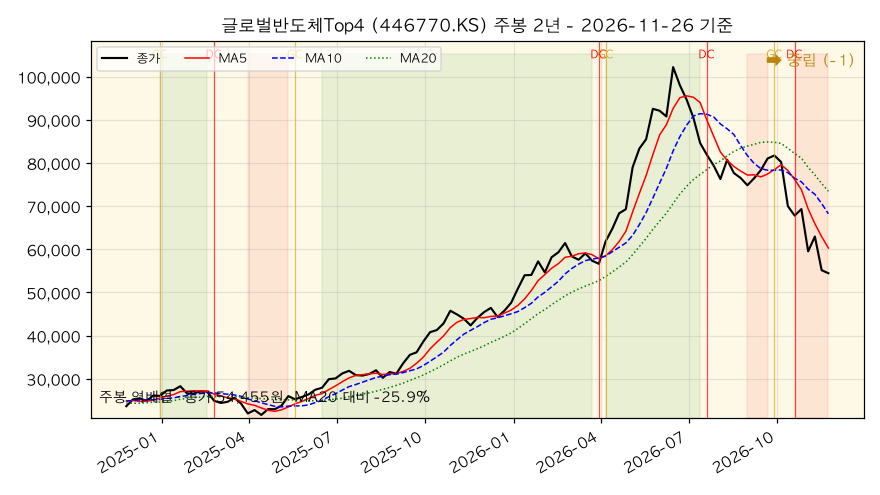
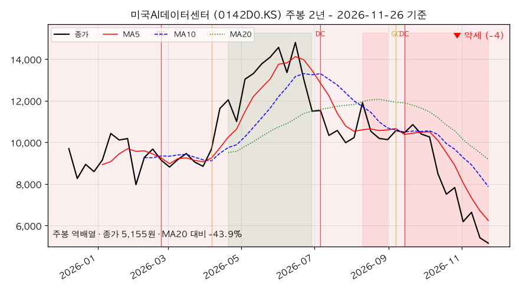
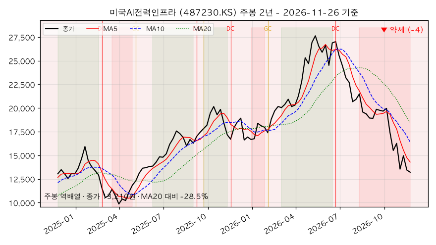
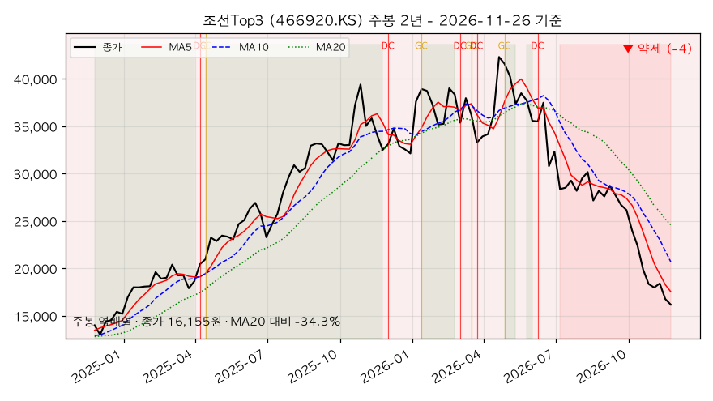
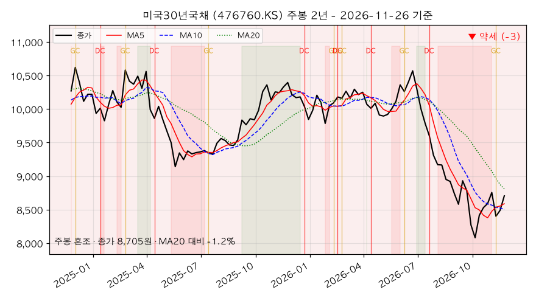
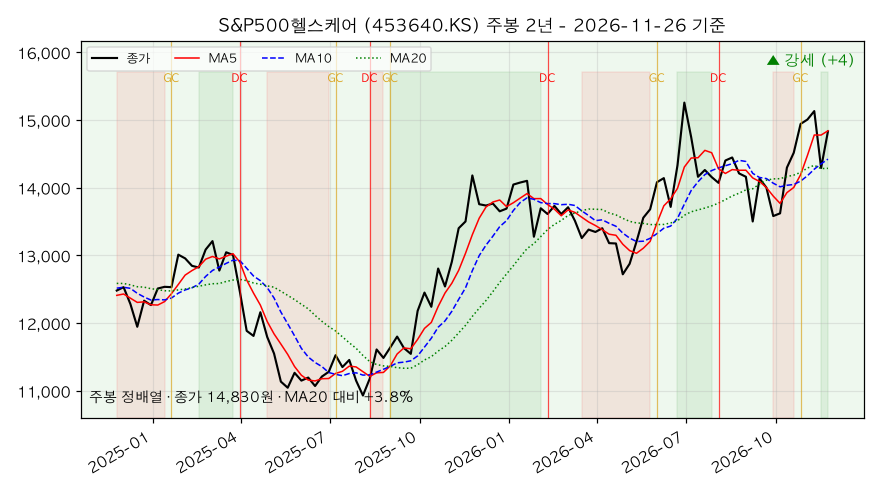
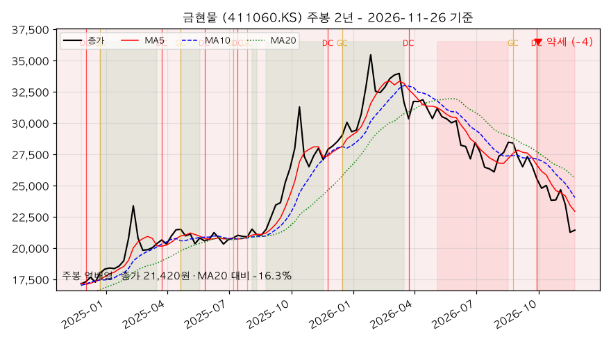
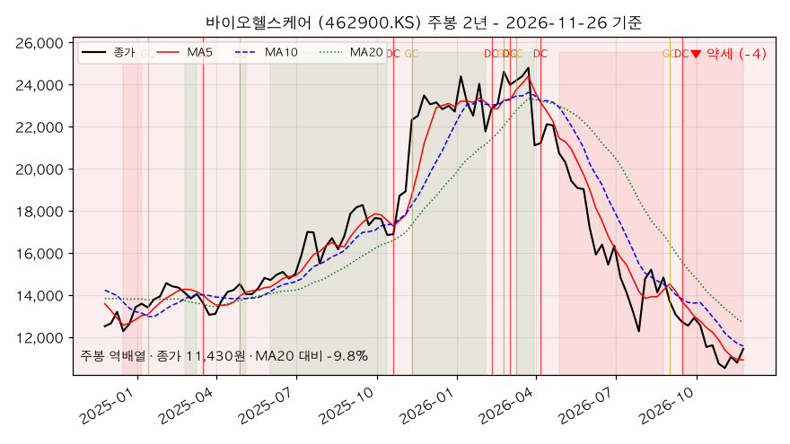

> 데이터 기준 2026-11-20 ~ 11-26(미국은 추수감사절 휴장으로 11/25 종가). 개인 포트폴리오는 비중(%)·수익률(%)만 공개합니다. 포트폴리오 시트는 11/26에 갱신되어 계좌 숫자는 **추정이 아닌 시트 값**입니다.
> 이번 주는 금통위 결과를 반영하려고 주말 대신 목요일에 발행했습니다. 같은 날 나온 [11월 거시 보충](2026-11-26.html)이 한국 펀더멘털을, 이 글은 시장과 내 계좌를 다룹니다.

## 요약 — 이번 주 한눈에

### 이번 주 시장

- **한국은행이 금리를 올렸다.** 11/26 기준금리 3.00% → **3.25%**(찬성 5 : 동결 2). 성장률 전망은 올해 3.9%·내년 4.1%로 크게 올렸다. 지난주 "동결" 예상은 틀렸다.
- **미국은 다시 뜨거워졌다.** 3분기 성장률 4.3%, 근원 PCE(식품·에너지 뺀 소비자물가) 3.3%로 3년 만의 최고. S&P500은 +3.9% 반등했고 VIX(변동성 지수)는 35.9 → 28.3으로 내려왔다.
- **한국 주식은 더 빠졌다.** 코스피 −3.3%(4,711), 11/25 하루 −6.2%. 반등은 미국 자산에만 왔다.

### 내 계좌 — 이번 주 할 일

전체 누적 수익률 −9.71%(이번 주 −1.81%). 시트에 연금 목표 비중이 새로 적혀, 이번 주부터 실제 목표로 판정한다.

| 계좌 | 운용 방식 | 상태 | 이번 주 할 일 |
|---|---|---|---|
| 연금저축펀드 | 자산배분·리밸런싱 | ⚠️ 밴드 밖 (200TR −14.2%p 부족) | 금현물 −7.2%p · 은행고배당 −4.2%p → 200TR +11.4%p. 200TR 매수는 2번에 나눠서 |
| 개인IRP | 자산배분·리밸런싱 | ⚠️ 밴드 밖 (S&P500 +9.9%p 초과) | S&P500 −9.9%p → 초단기국채 +5.8%p · 배당다우존스 +4.2%p. 한 번에 |
| 퇴직연금 | 자산배분·리밸런싱 | ✅ 밴드 안 | 매매 없음. 신규 납입은 나스닥100 → 배당다우존스 |
| ISA | 추세추종 | 🔴 6 · 🟡 1 · 🟢 0 | AI데이터센터·조선·AI전력부터 절반 축소 → 현금. 30년국채는 금요일 종가 보고 결정 |

### 다음 주에 볼 것

1. **12/1 미 11월 ISM(제조업 경기) · 한국 11월 수출** — ISM 신규주문이 50 아래면 미국 경기 둔화 신호가 하나 켜진다.
2. **12/4 미 11월 고용** — 강하면 "내년에도 금리 인상", 약하면 "12월이 마지막" 쪽이다.
3. **ISA 경계선 두 개** — 미국30년국채 주봉 MA20 8,808원, S&P500헬스케어 일봉 MA20 14,962원. 넘으면 신호가 좋아진다.

> **한 줄 결론** — 연금은 새로 적은 목표 비중으로 되돌리는 주다. 가장 많이 빠진 200TR을 채운다. ISA는 반등이 아닌 추세를 본다. 테마는 아직 모두 🔴다.

---

# 상세 설명

## 1. 내 계좌 점검

> **이 섹션 핵심**
> - 연금 3계좌: 퇴직연금은 밴드(허용 범위) 안이다. **연금저축은 200TR이 목표보다 14.2%p 모자라고, IRP는 S&P500이 9.9%p 많다** — 두 계좌가 리밸런싱 대상이다.
> - ISA: 7종목 중 🔴축소 검토 6 · 🟡보유 1(S&P500헬스케어) · 🟢추가 가능 0. 지난주와 신호가 같고, 계좌 누적 수익률은 −36.82%다.
> - 이번 주 할 일: 연금저축은 금·은행고배당을 덜어 200TR을 채우고, IRP는 S&P500을 덜어 초단기국채·배당다우존스를 채운다. ISA는 지난주 계획대로 추세가 가장 약한 테마부터 줄인다.

기준: 포트폴리오 시트가 **오늘(11/26) 갱신됐다.** 이번 주 숫자는 추정이 아니라 시트 값이다. "이번 주" 수익률은 11/19 → 11/26 종가 기준이라, 4장 차트 표(11/20 → 11/26)와 기간이 하루 다르다. 시트에 연금 3계좌의 **목표 비중이 새로 적혔다**(지난주 요청 반영). 그래서 이번 주부터는 입금 비중 대용이 아니라 실제 목표로 판정한다.

### 1-0. 포트폴리오 한눈에 — 한 주 −1.81%, 손실은 대부분 ISA 테마

| 계좌 | 운용 방식 | 전체 비중 | 누적 수익률 | 이번 주 | 전체 기여(%p) |
|---|---|---|---|---|---|
| 연금저축펀드 | 자산배분·리밸런싱 | 26.9% | −5.15% | −1.81% | −0.49 |
| 개인IRP | 자산배분·리밸런싱 | 17.6% | −7.67% | −0.46% | −0.08 |
| 퇴직연금 | 자산배분·리밸런싱 | 41.9% | +0.20% | −0.60% | −0.25 |
| ISA | 추세추종 | 13.6% | −36.82% | −6.95% | −1.00 |
| **전체** | | 100% | **−9.71%** (지난주 −8.04%) | **−1.81%** | |

| 자산군 | 비중 | 이번 주 | 전체 기여(%p) |
|---|---|---|---|
| 미국주식 | 32.9% | −1.91% | −0.63 |
| 미국주식(배당) | 14.6% | +2.49% | +0.35 |
| 금 | 13.0% | −3.54% | −0.47 |
| 초단기국채 등(기타) | 12.7% | +0.00%* | +0.00 |
| 테마(AI·반도체·조선) | 9.3% | −10.25% | −1.04 |
| 미국채권 | 7.6% | +2.60% | +0.19 |
| 한국주식 | 5.4% | −4.71% | −0.26 |
| 달러/현금 | 4.6% | +1.11% | +0.05 |

\* 새로 담은 TIGER 미국초단기(3개월이하)국채는 시세 연결이 안 돼 이번 주 변화를 0%로 계산했다. 만기 3개월 이하 국채라 한 주 변화는 실제로도 0%에 가깝다.

전체 −1.81% 중 −1.04%p가 테마 ETF에서 나왔다. ISA가 전체의 13.6%인데 손실은 절반 넘게 냈다. 배당다우존스(+2.49%)와 미국채(+2.60%)는 올랐다. 주식이 흔들리는 주에 분산이 또 작동했다.

### 1-A. 연금 3계좌 — 자산배분·리밸런싱

밴드는 **5/25 규칙**이다. 목표가 20% 이상이면 ±5%p, 20% 미만이면 목표의 ±25%를 넘을 때 리밸런싱한다. VIX(미국 주식 변동성 지수)는 35.9 → 28.3으로 30 아래로 내려왔다. 미국 자산 쪽 교체는 한 번에 해도 되는 수준이다. 다만 코스피는 11/25 하루 −6.2%처럼 하루 변동이 크다. 그래서 **한국 주식을 채우는 매수는 2번에 나눈다.**

#### 연금저축펀드 — 밴드 밖: 200TR 부족 −14.2%p, 금·은행고배당 초과

| 종목 | 목표 | 현재 | 괴리 | 판정 |
|---|---|---|---|---|
| 타이거 미국 S&P500 | 40.0% | 41.9% | +1.9%p | ✅ 밴드 안 |
| 타이거 미국채 10년선물 | 20.0% | 20.9% | +0.9%p | ✅ 밴드 안 |
| ACE KRX 금현물 | 10.0% | 17.2% | +7.2%p | ⬆️ 초과 |
| 타이거 은행고배당플러스TOP10 | 10.0% | 14.2% | +4.2%p | ⬆️ 초과 |
| KIWOOM 200TR | 20.0% | 5.8% | −14.2%p | ⬇️ 부족 |

- **할 일**: 금현물에서 약 7.2%p, 은행고배당에서 약 4.2%p를 덜어 **200TR에 11.4%p**를 채운다. 연금저축 계좌 안의 교체 매매는 과세가 미뤄진다. 200TR에 남는 부족분(약 2.8%p)은 신규 납입으로 채운다.
- **나눠서**: 200TR 매수는 이번 주와 다음 주 2번에 나눈다. 국내 증시 하루 변동이 커서다(속도 조절일 뿐, 매수 여부를 바꾸지는 않는다).
- **신규 납입분**: 200TR에 먼저 넣는다.
- **이유**: 목표가 새로 생기면서 200TR 목표가 20%로 커졌다. 200TR은 이번 주 −8.80%로 가장 많이 빠졌다. 리밸런싱은 바로 이 자산을 채우는 일이다. 한국은행이 성장률 전망을 올해 3.9%, 내년 4.1%로 올렸다(2장). 한국 주식을 장기로 들고 갈 근거는 오히려 강해졌다. 다만 200TR은 반도체 비중이 크다. 반도체 경기에 흔들리는 자산이라는 점은 알고 담는다.

#### 개인IRP — 밴드 밖: S&P500 +9.9%p 초과, 초단기국채 −5.8%p 부족

| 종목 | 목표 | 현재 | 괴리 | 판정 |
|---|---|---|---|---|
| 타이거 미국 S&P500 | 25.0% | 34.9% | +9.9%p | ⬆️ 초과 |
| TIGER 미국배당다우존스 | 30.0% | 25.8% | −4.2%p | ✅ 밴드 안 |
| TIGER 미국초단기(3개월이하)국채 | 30.0% | 24.2% | −5.8%p | ⬇️ 부족 |
| ACE KRX 금현물 | 15.0% | 15.1% | +0.1%p | ✅ 밴드 안 |
| 현금 | 0.0% | 0.0% | 0.0%p | ✅ 목표대로 |

- **할 일**: S&P500에서 약 9.9%p를 덜어 **초단기국채에 5.8%p, 배당다우존스에 4.2%p**를 채운다. 배당다우존스는 밴드 안이지만, 덜어 낸 돈을 다음으로 모자란 곳에 넣으면 목표에 딱 맞는다. IRP 안의 교체 매매는 세금이 붙지 않는다.
- **한 번에**: 사고파는 것이 모두 미국 자산과 단기채다. VIX 28.3이라 나누지 않아도 된다.
- **신규 납입분**: 초단기국채 → 배당다우존스 순서.
- **이유**: 지난주 IRP의 구성이 바뀌었다(혼합50 대신 초단기국채, 목표 재설정). 새 목표로 보면 S&P500만 크게 많다. 초단기국채는 지금 미국 단기 금리(약 4.3%)를 거의 그대로 받는다. 연준이 12월에 더 올리면 이자도 따라 오른다. 주식이 흔들릴 때 버티는 완충 자산 역할이 분명하다.

#### 퇴직연금 — 밴드 안, 매매할 것 없음

| 종목 | 목표 | 현재 | 괴리 | 판정 |
|---|---|---|---|---|
| SOL 미국배당다우존스 | 25.0% | 23.9% | −1.1%p | ✅ 밴드 안 |
| 타이거 미국 S&P500 | 20.0% | 21.8% | +1.8%p | ✅ 밴드 안 |
| TIGER 미국초단기(3개월이하)국채 | 20.0% | 20.1% | +0.1%p | ✅ 밴드 안 |
| 타이거 미국 나스닥100 | 15.0% | 12.3% | −2.7%p | ✅ 밴드 안 |
| TIGER 미국달러단기채권액티브 | 10.0% | 11.0% | +1.0%p | ✅ 밴드 안 |
| 타이거 KRX금현물 | 10.0% | 10.8% | +0.8%p | ✅ 밴드 안 |

- **할 일**: 팔지 않는다. 신규 납입분은 **나스닥100(+2.7%p) → 배당다우존스(+1.1%p)** 순서로 넣는다(납입 리밸런싱).
- **이유**: 지난주 비어 있던 10%p 칸과 미국 주식 초과가 정리됐다. 목표 합계가 100%가 됐고 모든 종목이 밴드 안이다. 지난주 리밸런싱이 실행된 것으로 보인다. 나스닥100이 이번 주 −4.16%로 가장 많이 빠져 가장 모자라다. 신규 납입으로 채우면 된다.

#### 장기 보유 근거 점검 (가치 지표) — 유지

| 주식 ETF (대리 지표) | PER | 이익수익률 | vs 한국 기준금리 3.25% | vs 미 10년물 4.85% |
|---|---|---|---|---|
| 미국배당다우존스 (SCHD) | 18.1배 | 5.5% | +2.3%p | +0.7%p |
| 미국 S&P500 (SPY) | 22.5배 | 4.4% | +1.2%p | −0.4%p |
| 미국 나스닥100 (QQQ) | 25.1배 | 4.0% | +0.7%p | −0.9%p |

PER(주가가 1년 이익의 몇 배인가)은 지난주 값에 11/20 → 11/25 대리 ETF 가격 변화(SPY +3.9%, QQQ +4.2%, SCHD +4.0%)를 반영한 **추정**이다. 은행고배당·200TR의 PER은 수집하지 못했다. 이익수익률(PER을 뒤집은 값)은 세 종목 모두 한국 기준금리보다 높다. 기준금리가 3.25%로 올라 그 차이는 0.25%p씩 줄었다. 미 10년물보다 높은 것은 배당다우존스뿐이다.

S&P500 PER 22.5배는 50년 평균(약 16배)의 1.4배다. 금융위기 직전(약 20배)보다 13% 높고, 코로나 후(약 37배)·닷컴(약 44배)보다는 한참 낮다. 마진데빗(빚내서 산 주식 규모)은 10월 약 1조 4,480억달러로 9월보다 2.1% 줄었고, 11월분은 아직 나오지 않았다. 미국 3분기 성장률이 4.3%로 올라가 이익 기반은 탄탄하다(3장). **장기 보유 근거는 유지된다.** 비중 조절은 위 리밸런싱 규칙이 한다.

#### 금리 환경 — 한국 vs 미국

- **한국 자산(은행고배당·200TR)**: 한국은행이 11/26 기준금리를 3.00% → 3.25%로 올렸다(2장). 성명은 "추가 인상의 시기"를 언급했고, 위원들의 금리 전망 중간값은 3.50%다. 내년 상반기에 한 번 더 오를 수 있다는 전제로 본다. 은행에는 금리 인상이 이익에 우호적이지만, 신규 대출·예금 금리차는 오히려 좁아졌다(1.02%p). 은행고배당은 배당과 낮은 가격에 기대는 자산이라 목표 비중의 근거는 그대로다.
- **미국 자산(S&P500·배당다우·나스닥100·미국채·초단기국채·달러)**: 미국 정책금리 3.75~4.00%, 12월 25bp 인상이 사실상 확실하다. 근원 PCE(개인소비지출 물가)가 3.3%로 올라 "12월이 마지막"이라는 기대는 약해졌다(3장). 10년물은 4.92 → 4.85%로 소폭 내렸다. 금리가 더 오르면 초단기국채와 달러단기채의 이자가 따라 오른다. 장기채는 경기 둔화 때 방어 역할을 맡는다. 둘을 함께 들고 있어 어느 쪽이든 받쳐 준다.

### 1-B. ISA — 추세추종

**한 줄 판정: 🟢 0 · 🟡 1 · 🔴 6.** 지난주와 같다. 🔴 종목의 합계 비중은 91.3%다. 30%를 넘는 종목은 없다(최대 글로벌반도체Top4 25.1%). 시트의 ISA 구성은 지난주와 같다. 지난주 제안한 축소는 아직 실행되지 않은 것으로 보인다.

규칙(투자자가 바꾸기 전까지 적용): 🟢 **추가 가능** = 주봉 정배열(짧은 평균선이 위에 놓인 상승 구조) 또는 주봉 골든크로스 + 종가가 일봉 MA20(20일 평균선) 위 · 🟡 **보유** = 주봉 중립 · 🔴 **축소 검토** = 주봉 역배열, 또는 종가가 주봉 MA20 아래로 2주 연속.

| 종목 | 비중 | 누적 수익률 | 일·주·월봉 | 신호 | 근거 |
|---|---|---|---|---|---|
| 글로벌반도체Top4 | 25.1% | −27.82% | 🔴 🟡 🟡 | 🔴 축소 검토 | 주봉 MA20 −25.9%, 18주째 아래 |
| 미국AI데이터센터 | 21.3% | −53.00% | 🔴 🔴 🔴 | 🔴 축소 검토 | 역배열, 주봉 MA20 −43.9%, 이번 주 −14.72% |
| 미국30년국채 | 14.6% | −1.51% | 🟢 🔴 🔴 | 🔴 축소 검토 | 주봉 MA20까지 −1.2%, 21주째 아래 |
| 조선Top3 | 11.9% | −47.78% | 🔴 🔴 🔴 | 🔴 축소 검토 | 역배열, 주봉 MA20 −34.3% |
| 미국AI전력인프라 | 9.8% | −34.75% | 🔴 🔴 🔴 | 🔴 축소 검토 | 역배열, 주봉 MA20 −28.5% |
| S&P500헬스케어 | 8.7% | −37.52% | 🟢 🟢 🟢 | 🟡 보유 | 주봉 강세, 종가가 일봉 MA20 −0.9% |
| 금현물 | 8.6% | −25.91% | 🔴 🔴 🟡 | 🔴 축소 검토 | 역배열, 주봉 MA20 −16.3%, 32주째 아래 |

※ S&P500헬스케어의 주봉 판정은 4장의 강도 표 기준이다. 규칙의 🟢 조건(일봉 MA20 위)을 0.9% 차이로 못 채워 🟡로 둔다.

#### 축소 종목 처리 — 지난주 순서 그대로, 줄인 돈은 현금

1. **1차**: 세 시간축(일·주·월봉)이 모두 약세인 **AI데이터센터·조선·AI전력**(합계 43.0%)부터 각 비중의 절반을 줄인다.
2. **2차**: 주봉만 역배열인 **글로벌반도체Top4·금현물**.
3. **마지막**: 미국30년국채. 주봉 MA20(8,808원)까지 1.2%만 남았다. 이번 주 종가가 그 위에서 끝나면 🔴가 풀린다. 그때 일봉 MA20 위라면 최근 주봉 골든크로스 조건으로 🟢까지 간다. 그래서 이 종목은 **이번 주 금요일 종가를 보고** 정한다.

줄이는 폭은 규칙에 없다. 이 리포트는 **각 종목 비중의 절반**을 제안하고, 폭은 투자자가 정한다. 줄인 돈은 현금으로 둔다. "언젠가 회복한다"는 연금 계좌의 논리라 ISA에는 쓰지 않는다. 이번 주 엔비디아 CEO 복귀로 반도체가 하루 +14% 튀었다가 다음 날 −7.9% 빠졌다(3장). 이런 반등은 추세 신호가 아니다.

**투자자가 정할 것(지난주에 이어)**: 지금 규칙은 테마와 완충 자산(채권·금)을 구분하지 않는다. 완충 자산에는 "ISA 내 비중 상한" 같은 별도 규칙을 둘지 정해 주면 반영한다.

#### 다시 담는 조건

축소한 종목은 **주봉 정배열 또는 주봉 골든크로스가 나오고, 종가가 일봉 MA20 위**일 때(🟢) 다시 담는다. S&P500헬스케어는 종가가 일봉 MA20(14,962원) 위로 올라서면 🟢이고, 주봉 MA20(14,285원) 아래로 2주 연속 내려가면 🔴다.

### 1-C. 세 가지 관점

| 관점 | 기준 | 이번 주 시각 | 내 계좌에의 의미 |
|---|---|---|---|
| 가치투자자 | 이익수익률 vs 무위험 수익률 | 배당다우존스 5.5%로 미 10년물보다 0.7%p 높다. 한국 금리 인상으로 국내 금리와의 차이는 0.25%p 줄었다 | 연금 계좌의 장기 보유 근거 유지. 매매 타이밍으로 쓰지 않는다 |
| 성장주 투자자 | 실적·수요 | 미 GDP 4.3%, 한은의 반도체발 성장 상향. AI 수요 이야기는 살아 있다 | ISA 테마의 이야기는 유지. 그러나 ISA는 추세가 먼저다 |
| 모멘텀 트레이더 | 이동평균 배열·크로스 | ISA 7종목 중 강세 0, 테마 4종목 모두 주봉 MA20 −25% 이상 아래 | ISA 축소 신호와 같은 결론. **연금 계좌에는 적용하지 않는다** |

### 1-D. 이번 주 할 일 체크리스트

- [ ] **연금저축**: 금현물 −7.2%p · 은행고배당 −4.2%p → 200TR +11.4%p. 200TR 매수는 2번에 나눠서. 신규 납입은 200TR.
- [ ] **개인IRP**: S&P500 −9.9%p → 초단기국채 +5.8%p · 배당다우존스 +4.2%p. 한 번에.
- [ ] **퇴직연금**: 매매 없음. 신규 납입은 나스닥100 → 배당다우존스.
- [ ] **ISA**: AI데이터센터·조선·AI전력부터 비중 절반 축소 → 현금. 헬스케어 보유. 30년국채는 금요일 종가를 보고 결정.

---

## 2. 시장 배경 ① 한국은행

> **이 섹션 핵심**
> - 한국은행이 11.26 기준금리를 **3.00% → 3.25%** 로 올렸다(찬성 5 : 동결 2). 올해 7·8월에 이은 세 번째 인상이다. 같은 날 성장률 전망을 올해 **3.9%**, 내년 **4.1%** 로 크게 올렸다.
> - 연금 계좌의 한국 자산 목표 비중을 바꿀 이유는 없다. 성장 전망은 오히려 강해졌고, 금리 차가 좁혀지고 경상흑자가 커서 원화에는 지지 요인이다. 다만 금리는 "한 번 더" 오를 수 있다는 전제로 본다.
> - 지난주는 **"동결"을 기본 시나리오로 봤는데 틀렸다.** 가계 빚 둔화·유가 하락보다 반도체發 성장 상향과 근원물가(2.6%)를 한은이 더 무겁게 봤다.

### 이번 주 주요 발표 — 한은은 "성장이 강하니 금리도 올린다"를 택했다

| 발표 | 날짜 | 핵심 숫자 | 한 줄 의미 |
|---|---|---|---|
| 통화정책방향 | 11.26 | 기준금리 3.00 → **3.25%**, 찬성 5 : 동결 2 | 올해 세 번째 인상. "추가 인상의 시기"를 문구로 남겼다 |
| 경제전망(11월) | 11.26 | 성장 26년 **3.9%**·27년 **4.1%**·28년 3.0% / 물가 2.7%·2.4%·2.1% | 성장 전망을 0.6~1.2%p 올렸고, 물가 목표(2%) 복귀는 2028년 |
| 10월 가중평균금리 | 11.25 | 신규 대출 4.64%(+0.07%p), 가계 **5.02%**, 예금 3.62%(+0.17%p) | 예금금리가 더 빨리 올라 신규 예대금리차가 1.02%p로 줄었다 |
| 11월 소비자동향조사 | 11.24 | 소비자심리 **103.1**(−2.3p), 주택가격전망 118(−6p) | 두 달째 하락. 증시 조정이 가계 심리를 눌렀다 |
| 11월 기업경기조사 | 11.25 | 기업심리 103.5(−0.7p), 경제심리지수 99.9(−0.9p) | 기업은 버티는 중. 12월 전망은 102.0으로 소폭 개선 |
| 3분기 차주별 가계부채 | 11.20 | 1인당 신규 가계대출 −11.3%, 그중 주담대 +3.0%(전분기 대비) | 빚투는 줄고 집 대출은 늘었다 — 지난주 가계신용과 같은 그림 |

### 2-1. 기준금리 3.25% — 빚·유가보다 "강한 성장 + 끈적한 물가"를 봤다

결론부터: 한은은 경기가 식어서가 아니라 **너무 강해서** 올렸다. 결정문은 "성장세가 한층 강화된 가운데 물가상승률이 상당기간 목표수준을 상회"하고 "금융안정 측면의 리스크도 지속"된다고 이유를 적었다. 금융안정 리스크는 수도권 집값 상승 기대와 가계대출 증가세 확대를 가리킨다. 7·8월 연속 인상 → 10월 한 차례 쉬어감(동결) → 11월 재인상의 순서다.

동결 소수의견(다수와 다른 의견)은 황건일·이수형 위원 2명이다. 신현송 총재는 기자간담회에서 이를 "전술적 차이"라고 설명했다. 즉 방향(긴축)은 같고 속도에 대한 이견이라는 뜻이다. 한·미 정책금리 차는 미국 상단(4.00%) 기준 0.75%p로 좁혀졌다(언론 보도 기준).

**추가 인상 신호는 분명하다.** 결정문 마지막 문장이 "추가 인상의 시기 등을 결정해 나갈 것"이다. 인상 여부가 아니라 시기를 말한 것이다. 점도표(금통위원 7명이 각자 6개월 뒤 금리를 점 3개씩 찍은 표)의 중간값은 8월 3.25%에서 **3.50%** 로 올라갔다. 언론은 이를 "내년 상반기 한 차례 추가 인상"이 다수 의견이라는 뜻으로 읽었다. 총재는 "물가가 목표에 안정적으로 수렴한다는 확신이 들 때까지" 선제 대응하겠다고 했다.

**지난주 판단 점검:** 지난주 리포트는 가계 빚 증가 둔화(+9.8조원), 생산자물가 둔화(7.21%), 11월 유가 하락을 근거로 "동결 + 긴축 문구"를 기본 시나리오로 잡았다. 틀렸다. 놓친 것은 두 가지다. 첫째, 한은은 지나간 숫자보다 **앞으로의 성장 경로**(반도체)를 더 크게 봤다. 둘째, 10월 동결을 "인상 사이클 종료"가 아니라 "파급효과 점검을 위한 쉼"으로 읽었어야 했다. 다만 "인상이 나와도 견디게 채권을 한 만기로 몰지 않는다"는 대비 원칙은 그대로 유효했다.

### 2-2. 수정 경제전망 — 성장은 크게 올리고, 물가는 "2028년에야 2%대 초반"

결론: 한은이 보는 한국 경제는 **반도체 덕에 이례적으로 강하고, 그만큼 물가도 늦게 내려온다.**

| 항목 | 2025 | 2026 전망 | 2027 전망 | 2028 전망 |
|---|---|---|---|---|
| GDP 성장률 | 1.1% | **3.9%** (8월 대비 +0.6%p) | **4.1%** (+1.2%p) | 3.0% |
| 소비자물가 | 2.1% | 2.7% (변동 없음) | 2.4% (+0.1%p) | 2.1% |
| 근원물가 | 1.9% | 2.6% (+0.1%p) | 2.6% (+0.1%p) | 2.2% |
| 경상수지 | 1,231억달러 | **5,000억달러** (+500) | 5,400억달러 (+1,100) | 3,600억달러 |

- 성장 상향의 대부분은 반도체다. 올해 상향분 +0.6%p 중 반도체 경기 호조가 +0.75%p, 증시 조정이 −0.1%p, 중동 긴장이 −0.05%p로 잡혔다. 내년 상향분 +1.2%p도 반도체 호황과 그 파급이 +1.2%p다.
- 근원물가(식료품·에너지를 뺀 기본 물가)는 2.6%로 올렸다. 유가가 내려도 그동안 쌓인 비용이 서비스·내구재 가격으로 옮겨 가고, 성장이 강해 수요 쪽 압력도 커진다는 판단이다. 금리 인상의 핵심 근거가 이 숫자다.
- 시장 전망과의 차이도 크다. IB(투자은행) 등 시장참가자 성장률 전망 중간값은 26년 3.6%·27년 2.7%다. 한은이 내년을 시장보다 1.4%p 높게 본다.
- 한은 스스로 낙관·비관 시나리오를 함께 냈다. AI 투자가 꺾이고 메모리 가격이 빠르게 떨어지는 비관 시나리오에서는 내년 성장률이 기본 전망보다 **−0.7%p**, 28년은 −0.9%p 낮아진다. 반대로 낙관 시나리오는 +0.5%p·+0.6%p다.
- 4분기 성장률은 전기 대비 1.2%로 예상했다. 다만 "소비가 증시 조정 등으로 더디게 회복"된다고 적었다. 총재도 주식시장 침체가 민간소비에 영향을 줬다고 언급했다.

정리하면, 이번 전망은 한국 경제가 **반도체 한 업종에 크게 기대는 구조**라는 것을 숫자로 보여 준다. 반도체가 좋으면 성장·경상흑자·금리가 함께 오르고, 꺾이면 비관 시나리오처럼 한꺼번에 내려온다.

### 2-3. 가계 체감은 반대 방향 — 대출금리 5%, 소비자심리는 두 달째 하락

결론: **나라 전체 숫자는 좋아지는데 가계가 느끼는 경기는 나빠지고 있다.** 이번 주 통계 세 건이 모두 같은 방향이다.

- **대출금리(10월):** 은행 신규 가계대출 금리 5.02%(+0.06%p), 주택담보대출(주담대) 4.98%(+0.10%p)다. 기준금리가 3.00%로 묶여 있던 10월에도 올랐고, 11월 인상분은 아직 반영 전이다. 숫자 해석은 같은 날 발행한 11월 거시 보충 1장에 자세히 있다.
- **은행 마진(10월):** 예금금리(저축성수신 3.62%, +0.17%p)가 대출금리(+0.07%p)보다 빨리 올랐다. 그래서 신규 취급 기준 예대금리차(대출금리 − 예금금리, 은행의 이자 마진)는 1.12 → **1.02%p** 로 줄었다. 잔액 기준은 2.20%p로 거의 그대로다.
- **소비자심리(11월):** 소비자심리지수 103.1(장기평균 100보다는 아직 높음)로 2.3p 내렸다. 현재경기판단 78(−4p), 취업기회전망 83(−3p), 현재가계저축 89(−4p)가 크게 내렸다. 주택가격전망은 118로 6p 꺾였다. 1년 기대인플레이션(가계가 예상하는 1년 뒤 물가상승률)은 2.6%로 0.1%p 낮아졌다.
- **기업·경제심리(11월):** 기업심리지수 103.5(−0.7p), 소비자·기업을 합친 경제심리지수(ESI) 99.9(−0.9p)다. 계절 요인을 뺀 순환변동치는 100.8로 오히려 0.9p 올랐다. 기업 쪽은 크게 꺾이지 않았다.

한은은 이 둔화를 알면서도 올렸다. 가계 심리보다 물가와 금융안정을 앞에 뒀다는 뜻이다. 이 간극이 12월 이후 소비 지표로 어떻게 나타나는지가 다음 관전 포인트다.

### 내 계좌에 주는 의미 — 목표 비중의 근거는 유지, 금리는 "한 번 더"를 전제로

- **한국 자산(은행고배당·200TR):** 연금 계좌는 목표 비중을 유지하고 리밸런싱 규칙대로 간다. 한은의 성장 전망 상향(3.9%·4.1%)은 한국 주식 장기 보유 근거를 약하게 하지 않는다. 다만 성장의 대부분이 반도체 한 업종에서 나온다는 점은 200TR의 집중 위험으로 기억해 둔다. 은행은 금리 인상이 곧바로 마진 확대로 이어지지 않았다(신규 예대금리차 축소). 은행고배당의 근거는 배당·저평가이지 금리 방향이 아니므로 판단을 바꾸지 않는다.
- **원화·환율:** 한·미 금리 차 축소(0.75%p)와 경상흑자 5,000억달러 전망은 원화를 받치는 요인이다. 한은도 "외국인 주식자금 유출에도 대규모 경상흑자로 환율이 대체로 안정"이라고 적었다. 달러 자산은 환율 예측이 아니라 분산 목적으로 목표 비중을 그대로 둔다.
- **금리:** 점도표 중간값 3.50%는 내년 상반기 한 번 더 오를 수 있다는 뜻이다. 단기 금리는 위로, 장기 금리는 글로벌 흐름(최근 하락)을 따르는 구도가 이어질 수 있다. 채권은 목표 비중 안에서 한 만기로 몰지 않는 원칙을 유지한다. 뉴스로 채권 비중을 늘리거나 줄이지 않는다.

### 수집 불가 항목 · 참고 링크

- **수집 방법:** 한은 보도자료 목록은 이번 주 `listCont.do`(목록 본문을 따로 불러오는 주소)로 직접 수집에 성공했다. 지난주의 "목록 0건" 문제는 목록 화면이 이 주소를 따로 불러오는 구조여서 생긴 것이다. 통화정책방향·경제전망·가중평균금리·소비자동향·기업경기·차주별 가계부채 6건은 한은 원문(본문 + PDF 첨부)에서 숫자를 읽었다. 기자간담회 발언은 언론 보도로만 확인했다.
- **교차 확인:** 기준금리 결정·표결·전망치는 한은 원문과 세계일보 보도가 일치한다. 같은 날 11월 거시 보충(11.26 발행)의 ECOS 일별 기준금리(722Y001) 3.25%와도 맞는다.
- **수집 불가:** 총재 기자간담회 전문(한은 게시 전), 점도표 원자료, 신규 예대금리차 축소의 한은 설명, 소비자동향조사의 금리수준전망 하락(127 → 124) 배경. 차주별 가계부채의 DSR(소득 대비 빚 상환 부담)·취약차주 연체율은 이번 보도자료에 없다.
- **이번 주 기타 발표(중요도 낮음):** 12월 통화안정증권 발행 계획(11.26), 여수신이율 개정(11.26, 기준금리 인상에 따른 후속 조치), 공개시장운영 공지.
- **다음 주 확인:** 11월 금통위 의사록(약 2주 뒤), 10월 국제수지, 11월 소비자물가(통계청), 11월 가계대출 동향.
- 한은 원문: [통화정책방향(2026.11.26)](https://www.bok.or.kr/portal/bbs/P0000559/view.do?nttId=11067084&menuNo=200690) · [경제전망(2026년 11월)](https://www.bok.or.kr/portal/bbs/P0000559/view.do?nttId=11067101&menuNo=200690) · [10월 가중평균금리](https://www.bok.or.kr/portal/bbs/P0000559/view.do?nttId=11066953&menuNo=200690) · [11월 소비자동향조사](https://www.bok.or.kr/portal/bbs/P0000559/view.do?nttId=11066918&menuNo=200690) · [11월 기업경기조사·ESI](https://www.bok.or.kr/portal/bbs/P0000559/view.do?nttId=11066975&menuNo=200690) · [3분기 차주별 가계부채](https://www.bok.or.kr/portal/bbs/P0000559/view.do?nttId=11066824&menuNo=200690) · [보도자료 목록](https://www.bok.or.kr/portal/singl/newsData/list.do?pageIndex=1&menuNo=201150&pageUnit=100)
- 언론(교차 확인·기자간담회): [세계일보 — 기준금리 3.25%, 점도표](https://www.segye.com/newsView/20261126507219) · [헤럴드경제 — 소수의견 "전술적 차이"](https://biz.heraldcorp.com/article/10950210) · [뉴스1 — 추가 인상 시사](https://www.news1.kr/economy/trend/6366989) · [ZDNet — "물가 안정 확신 들 때까지"](https://zdnet.co.kr/view/?no=20261126125222) · [파이낸셜뉴스 — 선제 대응](https://www.fnnews.com/news/202611261117592520)

---

## 3. 시장 배경 ② 거시지표

> **이 섹션 핵심**
> - 미국 실물이 다시 뜨거워졌다. 3분기 GDP가 3.4% → **4.3%**로 올라갔고, 근원 PCE(식품·에너지 뺀 개인소비지출 물가)는 **3.3%**(3년 만의 최고, 전월비 +0.3%)다. 신규 실업수당 청구는 **18.9만건**으로 올해 최저와 같다.
> - 주식은 반등했지만 불안은 남았다. S&P500 +3.9%(7,182.78), VIX(변동성 지수) 35.89 → 28.29, 미 10년물 4.92 → 4.85%. 주식·채권이 함께 오른 한 주라 연금 계좌의 목표 비중을 바꿀 변화는 아니다.
> - 지난주의 "둔화 문턱" 판단은 한발 물러났다. 연속 청구 급증(176만)은 한 주 만에 169.7만으로 되돌아갔고, 11/25 PCE는 "12월이 마지막 인상" 조건(전월비 0.2% 이하)을 채우지 못했다.

### 지표 현황 — 이번 주는 실물 지표가 한꺼번에 나왔다

| 지표 | 최신값 | 이전값 | 변화 | 발표일 |
|---|---|---|---|---|
| **근원 PCE 전년비 / 전월비** | **3.3% / +0.3%** | 3.1% / +0.3% | 예상 3.2% 상회, 3년 만의 최고 | 11/25 |
| 헤드라인 PCE 전년비 | 3.8% | 3.6% | 예상 부합 | 11/25 |
| 개인소득 / 개인소비 / 저축률 | +0.7% / +0.3% / 4.1% | — | 소득 예상(+0.4%) 상회 | 11/25 |
| **3분기 GDP(잠정, 연율)** | **4.3%** | 3.4%(속보) | 예상 3.5% 상회 | 11/25 |
| **신규 실업수당 청구** | **18.9만** | 20.2만(수정) | 예상 20.0만 하회, 4주 평균 19.6만 | 11/25 |
| **연속 실업수당 청구** | **169.7만**(11/14 주) | 179.2만(수정) | △9.5만 | 11/25 |
| **미 소비자신뢰(콘퍼런스보드)** | **103.3**(기대지수 83.6) | 91.9(73.7) | 2025년 1월 이후 최고 | 11/24 |
| 미 10월 내구재 주문 | +0.2% MoM | — | 예상 +0.7% 하회 | 11/25 |
| 미 정책금리 / 12월 25bp 인상 | 3.75~4.00% / 사실상 전부 반영 | 97.5% | 2027년 3번째 인상 확률 약 1/3로 하락 | 11/25 (CME) |
| **미 10년 / 2년 / 3개월** | **4.85 / 4.61 / 4.34%** | 4.92 / 4.63 / 4.32% | △7 / △2 / +2bp | 11/25 |
| **10년-2년 / 10년-3개월** | **+24 / +51bp** | +29 / +60bp | △5 / △9bp | 11/25 |
| 하이일드 스프레드 | 3.72%p | 3.76%p(11/20) | △4bp, 11/19(3.52)보다는 높다 | 11/24 |
| WTI | 83.68달러 | 83.98 | △0.4% | 11/25 |
| 미 관세 제안 | 한국·일본·EU 15%, 최대 20% | — | 반도체·자동차 제외, 1월 이전 미발효 | 11/25 |
| **한국 11월 1~20일 수출** | **774억달러(+101.5%)** | 1~10일 +111.9% | 반도체 비중 49.7% | 11/23 |
| 한국 소비자심리(CSI) | 103.1 | 105.4 | 두 달째 하락 | 11/24 |
| **한국은행 기준금리** | **3.25%** | 3.00% | +25bp, 올해 세 번째 인상 | 11/26 |

신규 발표가 없는 지표(ISM 55.5, NAHB 25, 필라델피아 연은 6.3, 미 LEI 99.6, 마진데빗 등)는 "상세 지표"에 둔다. 한국은행 결정의 배경은 2장, 가계대출 금리 5.02% 등 한국 펀더멘털은 [11월 거시 보충](2026-11-26.html)에서 다룬다.

**주간 시세 (11/20 → 11/25, 한국은 11/26)**: S&P500 +3.9%(7,182.78) · 나스닥 +4.3%(23,585.80) · 반도체지수 +4.4% · 엔비디아 +18.9% · 코스피 △3.3%(4,711.21) · 삼성전자 △6.4% · SK하이닉스 △5.4% · VIX △21%(28.29) · 금 +0.6%(3,535.8달러) · 은 △2.4% · 구리 △2.6% · 달러지수 △0.1%(103.67) · 원/달러 1,343.3원(원화 △0.6%).

### 이번 주 바뀐 지표 4개

#### ① 근원 PCE 3.3% — "12월이 마지막 인상" 조건을 채우지 못했다

지난주 기준은 "근원 PCE 전월비 +0.2% 이하면 마지막 인상, +0.4% 이상이면 리스크 시나리오"였다. 결과는 +0.3%로 딱 중간이다. 전년비는 3.1 → 3.3%로 0.2%p 올라 3년 만의 최고이고, 연준 목표(2%)보다 1.3%p 높다. 헤드라인은 3.8%로 목표의 약 2배다. 소득이 +0.7%로 예상(+0.4%)을 크게 넘어, 수요 쪽에서 물가를 끌어내릴 힘도 약하다. 12월 인상은 사실상 확정됐고, 시장의 관심은 2027년에 몇 번 더 올리느냐로 넘어갔다. 🟠 → 🔴 경계 쪽으로 한 칸.

#### ② GDP 4.3%·청구 18.9만 — 실물은 둔화가 아니라 재가속이다

3분기 GDP는 속보치 3.4%에서 4.3%로 0.9%p 올라갔다. 미국 잠재성장률(약 2%)의 2배를 넘는다. 신규 청구 18.9만건은 침체 경계선(27~30만건)보다 8~11만건 낮고, 1960년대 후반 이후 최저 수준과 같다. 지난주 걱정한 연속 청구는 179.2만(수정) → 169.7만으로 9.5만건 줄어 175만 아래로 돌아왔다. 지난주의 급증이 일시적이었다는 뜻이다. 고용 💚 매우 양호. 다만 10월 내구재 주문은 +0.2%로 예상(+0.7%)에 못 미쳐, 기업 투자 쪽은 확인이 더 필요하다.

#### ③ 소비자신뢰 103.3 — 침체 신호선(기대지수 80)을 올해 처음 넘었다

콘퍼런스보드 지수는 91.9 → 103.3으로 11.4p 뛰어 2025년 1월 이후 최고다. 예상(약 92)보다 11p 높다. 기대지수(6개월 뒤 전망)는 73.7 → 83.6으로, 콘퍼런스보드가 "80 아래면 침체 신호"라고 보는 선을 올해 처음 넘었다. 다만 조사 마감이 11/17이라 11/20 주가 급락은 반영되지 않았다. 같은 기간 미시간대 지수(51.5)와 한국 CSI(103.1, 두 달째 하락)는 반대 방향이라, 다음 달 수치가 낮아질 여지가 있다. 🟢.

#### ④ 금리 곡선 — 10년-3개월 차이가 2주 만에 32bp 좁아졌다

10년물은 4.92 → 4.85%로 7bp 내렸지만, 3개월물은 12월 인상이 확실해져 4.32 → 4.34%로 올랐다. 그래서 10년-3개월 차이는 +60 → +51bp로 좁아졌다. 11/13(+83bp)부터 2주 동안 32bp가 줄었다. 이 속도면 역전(0bp 미만, 경기 침체 선행 신호)까지 거리가 짧아진다. 10년-2년도 +29 → +24bp다. 지난주의 "불 스티프닝(금리가 내리며 곡선이 가팔라짐)" 초입 판단은 이번 주 불 플래트닝(장기금리만 내려 곡선이 평평해짐)으로 바뀌었다. 장기 성장 기대가 꺾이고 있다는 뜻으로 읽힌다. 🟡 → 🟠.

### 경기 온도계 — 실물 칸은 다시 뜨거워지고, 금융 칸은 여전히 불안하다

| 🇺🇸 분야 | 강도 | 핵심 수치 | 🇰🇷 분야 | 강도 | 핵심 수치 |
|---|---|---|---|---|---|
| 성장·선행 | 💚↑ | GDP 3분기 4.3%, LEI 99.6(9월) | 선행지수 | 🟡 | 9월 △0.1p |
| 제조업 | 🟡 | ISM 55.5 / 필라델피아 6.3 / 내구재 +0.2% | 산업생산 | 💚 | 9월 +3.0% |
| 고용 | 💚↑ | 신규 18.9만 / 연속 169.7만 | 수출 | 💚 | 11월 1~20일 +101.5% |
| 물가 | 🔴↑ | 근원 PCE 3.3%(3년 최고) | 물가 | 🟢 | CPI 2.8%, PPI 7.21% |
| 주택·소비 | 🔴 / 🟢↑ | NAHB 25 / 소비자신뢰 103.3 | 소비심리 | 🟡↓ | CSI 103.1 |
| 통화정책 | 🔴 | 12월 인상 전부 반영 | 통화정책 | 🟠↑ | 3.25%(11/26 인상) |
| 금융·레버리지 | 🟠↓ | VIX 28.29, HY 3.72%p | 시장 | 🔴 | 코스피 4,711(주간 △3.3%) |
| 에너지 | 🟡 | WTI 83.68 | 환율 | 🟡 | 원/달러 1,343.3 |

### 경기 사이클 — 과열 국면 후반 유지, 무게중심은 "둔화"에서 "과열 지속"으로 되돌아갔다

| 구분 | 내용 |
|---|---|
| 판정 | 4단계(과열 국면) 후반 유지. 지난주 "1단계 문턱"이라던 판단은 실물 지표로 한발 물러났다 |
| 과열 근거 | GDP 4.3%(잠재성장률 약 2%의 2배), 신규 청구 18.9만(4주 평균 19.6만), 근원 PCE 3.3%, 12월 인상 전부 반영 |
| 둔화 근거 | VIX 28.29(20 위), 하이일드 3.72%p, 10년-3개월 +51bp(2주 △32bp), NAHB 25, 내구재 예상 하회 |
| → 1단계 전환 조건 | 10년-2년 0bp 미만(현재 +24) / 청구 4주 평균 25만 초과(현재 19.6만) / ISM 신규주문 50 미만(12/1 발표) — 0개 충족 |
| → 긴축 조기 종료 | WTI 85달러 미만(충족 유지) + 근원 물가 전월비 0.1%대(**이번 주 +0.3%로 불충족**) |
| → 과열 심화 | 근원 PCE 전월비 +0.4% 이상 + VIX 20 미만 복귀 — 0개 충족, 지난주보다 가까워졌다 |

### 미국 vs 한국 — 미국은 재가속, 한국은 수출 호황 속 금리 인상

미국은 "성장 재가속 + 물가 재상승"이다. 한국은 "수출 초호황 + 가계 둔화 + 금리 인상"이다. 한국은행이 3.25%로 올려 한·미 정책금리 차(미국 중간값 3.875% 기준)는 △0.88%p → △0.63%p로 좁혀졌다. 그런데도 원화는 0.6% 약해졌다. 외국인이 반도체를 팔았고(11/26 약 1,100억원 순매도), 미국이 한국에 15% 관세를 제안한 것도 부담이다. 다만 반도체·자동차는 관세 대상에서 빠졌다. 11월 1~20일 반도체 수출(384.7억달러, +294.4%)과 코스피(△3.3%)의 괴리는 지난주보다 더 벌어졌다.

| 구분 | 미국 | 한국 |
|---|---|---|
| 실물 | GDP 4.3%, 청구 18.9만 | 1~20일 수출 +101.5% |
| 시장 | S&P500 7,183(+3.9%) | 코스피 4,711(△3.3%) |
| 정책 | 3.75~4.00%, 12/8~9 인상 확실시 | 3.25%(11/26 +25bp) |
| 환율 | 달러지수 103.67(△0.1%) | 원/달러 1,343.3원(원화 △0.6%) |

> **자산배분 시사점**: 연금 계좌의 목표 비중을 바꿀 변화는 아니다. 이번 주는 미국 주식과 미국 장기채가 함께 올라 분산 구조가 그대로 작동했다. 미국 성장·한국 둔화 조합은 지난주와 같다. 비중이 밴드를 벗어난 자산이 있을 때만 리밸런싱한다.

### 인플레이션 — 「고착」에서 「재가열」 쪽으로 한 칸 기울었다

근원 PCE가 9월 3.1%에서 10월 3.3%로 다시 올라, "고착(3%대에서 안 내려옴)"이 "재가열(다시 오름)"로 넘어가는 첫 신호가 나왔다. 관세, AI 설비투자, 2월 이란 공습 이후 에너지 비용이 원인으로 꼽힌다. 실질금리(명목금리 − 근원 PCE)는 명목금리 하락과 물가 상승이 겹쳐 10년 기준 1.82 → 1.55%p로 0.27%p 내렸다. 시장 실질금리(TIPS)는 2.77 → 2.79%로 거의 그대로다. 금은 주간 +0.6%로 급락을 멈췄지만, 사상 최고 대비 약 37% 낮다. 실질금리 하락은 순풍, 달러 보합은 중립이라 금 매력도는 🌟🌟🌟(3/5)를 유지한다.

| 구간 | 명목 | 실질(근원 PCE 3.3% 차감) | 지난주 |
|---|---|---|---|
| 10년 | 4.85% | +1.55%p | +1.82%p |
| 2년 | 4.61% | +1.31%p | +1.53%p |
| 3개월 | 4.34% | +1.04%p | +1.22%p |
| 정책금리(중간값) | 3.875% | +0.575%p | +0.775%p |

### 과열 진단 — 중립 유지, 반도체 쪽 변동성은 오히려 커졌다

이번 주 반도체는 하루 단위로 크게 흔들렸다. 11/23 엔비디아 이사회가 젠슨 황 CEO를 복귀시키자 엔비디아는 +31.5%(2003년 이후 최대), 반도체지수는 +14.0% 뛰었다. 다음 날(11/24) 반도체지수는 △7.9%로 그 상승의 약 3분의 2를 반납했다. 11/25에는 나스닥이 장중 △4.6%까지 밀렸다가 △0.6%로 마감했다. 한국은 미국 반도체 급락을 다음 날 받아 11/25 코스피가 △6.2%였다. 과열 3조건(대장주 비중 80% 초과 / 스프레드 역전 / IPO 소멸)은 0개 충족이다. 🟡 중립. 지난주 내건 🟢 조건(VIX 25 아래, 하이일드 3.3%p 아래, 외국인 순매수 재개)은 하나도 채우지 못했다.

| 과열 지표 | 한국 | 미국 | 신호 |
|---|---|---|---|
| 대장주 비중 | 삼전+하이닉스 약 52.8%(9월) | Mag7 34~35%(10월) | 🟡 80% 기준 미달 |
| 레버리지 | 수집 불가 | 마진데빗 △2.1%(10월, 신규 없음) | 🟠 디레버리징 |
| 자금 흐름 | 외국인 11/26 약 1,100억원 순매도 | 수집 불가 | 🟠 유출 지속 |
| 금리 스프레드 | 수집 불가 | 10Y-3M +51 / 10Y-2Y +24bp | 🟠 좁아지는 중, 역전은 아님 |
| IPO 심리 | 수집 불가 | 앤트로픽 82.79달러(공모 83달러 밑) | 🟡 공모가 하회 |

### 리스크 시나리오

**🟡 베이스 — 12월 인상 후 2027년 1~2회 추가, 주식은 높은 변동성 속 횡보** (확률 우위)
- 전제: 신규 청구 18~22만, 근원 PCE 전월비 +0.2~0.3%. 연준은 12/9 4.00~4.25%로 올리고 점도표에 2027년 1~2회를 남긴다.
- 전개: 10년물 4.7~5.0%, S&P500 6,900~7,500, VIX 22~30. 코스피 4,500~5,100, 원/달러 1,320~1,380원. 한국은행은 인상 후 관망.
- 자산 움직임: 현금·단기채 유리, 장기채는 방어 역할 유지, 금은 바닥 다지기.

**🔴 리스크 — 물가 재가열 + AI주 청산이 겹치는 2차 하락**
- 트리거: 12월 초 고용·ISM 가격지수가 강하게 나와 점도표에 2027년 3회 이상 인상, 반도체지수 하루 △7% 이상 급락 반복, 하이일드 4%p 초과.
- 전개: 10년-3개월 역전(0bp 미만), S&P500 고점 대비 △20%(약 6,255), VIX 35 이상 재진입. 원/달러 1,380원 이상, 코스피 4,500 하회.
- 자산 움직임: 주식 약세(AI·반도체), 물가형 충격이라 장기채도 초반엔 약할 수 있다. 달러 강세, 금은 혼조. 한국은 외국인 유출과 관세 부담이 겹친다.

### 발표 일정 — 12/1 ISM과 12/4 고용이 FOMC 전 마지막 관문

| 발표일 | 지표 | 이전값 | 왜 중요한가 |
|---|---|---|---|
| 11/30 전후(날짜 미확인) | 한국 10월 산업활동·선행지수 | 생산 +3.0% / △0.1p | 금리 인상 직후 실물 확인 |
| **12/1(화)** | **미 11월 ISM 제조업 / 한국 11월 수출** | 55.5(신규주문 55.5, 가격 75.2) / 1~20일 +101.5% | 신규주문 50 미만이면 둔화 전환 조건 1개 충족. 가격지수 75 이상이면 물가 재가열 확인 |
| **12/4(금)** | **미 11월 고용** | +16.5만 / 실업률 4.1% | +20만 이상·실업률 4.0% 이하면 2027년 추가 인상 기대가 커진다. 10만 미만이면 "마지막 인상" 논리가 산다 |
| 매주 목요일 | 미 신규·연속 실업수당 청구 | 18.9만 / 169.7만 | 추수감사절 주간 수치는 잡음이 크다 |
| **12/8~9** | **미 FOMC(점도표)** | 3.75~4.00% | 인상 폭보다 2027년 점도표의 인상 횟수 |
| 1/10 | 미·중 무역 휴전 만료 | — | 관세 제안(한국 15%) 확정 여부와 함께 본다 |

체크포인트: 12/1 ISM 신규주문과 12/4 고용이 둘 다 강하면 베이스 시나리오 안에서도 금리 상단(10년 5.0%) 쪽이다. 둘 다 약하면 이번 주 되돌아간 "둔화 문턱" 판단이 다시 살아난다.

### 한 줄 선언

> 지금은 **과열 국면 후반, 「물가 재가열 + 금융 불안 잔존」 구간**이다. 실물(GDP 4.3%, 청구 18.9만, 소비자신뢰 103.3)과 물가(근원 PCE 3.3%)는 다시 과열 쪽을 가리키고, 금융시장(VIX 28.29, 10년-3개월 +51bp)은 아직 불안하다. 핵심 변수는 연준이 2027년에 몇 번 더 올리느냐다. 전환 신호는 ① 12/1 ISM 신규주문 50 미만 + 10년-3개월 역전(→ 둔화 단계) 또는 ② 근원 PCE 전월비 +0.4% 이상 + VIX 20 미만 복귀(→ 과열 심화)다.

### 상세 지표

**신규 발표 없는 지표**: ISM 제조업 55.5(신규주문 55.5 / 가격 75.2 / 고용 52.4, 10월) · 필라델피아 연은 6.3(11월) · NAHB 25(11월) · 미 LEI 99.6(9월, 10월분 수집 불가) · 미시간대 51.5(11월 확정) · 미 재고/매출 1.33(8월) · 마진데빗 약 1조 4,480억달러(10월) · 미 원유 생산 1,403.2만 b/d(11/18 발표분, 이번 주분 수집 불가) · SCFI 3,633.45(11/6, 이후 수집 불가) · 한국 선행지수 △0.1p(9월) · 한국 산업생산 +3.0%(9월) · 리치먼드 연은 11월 수집 불가.

**기타 이번 주 수치**: 미 30년물 5.24%(△7bp) · 10년 BEI 2.12%(△3bp) / TIPS 2.79%(+2bp, 11/24) · 브렌트 약 90.8달러(11/25 보도치) · 한국 11월 1~20일 반도체 수출 384.7억달러(+294.4%), 승용차 △5.6%, 무역수지 271억달러 흑자 · 코스닥 655.71(11/26) · 앤트로픽 82.79달러(11/25).

**과열 지표 축약 시계열** (분기 = 일별 종가 평균, Q4는 10/1~11/25 진행 평균 / 주 = 주간 마지막 거래일 종가, Yahoo 11/26 조회)

| 기간 | 금(USD/oz) | 구리(USD/lb) | WTI | 미10Y-3M(bp) | S&P500 / 코스피 |
|---|---|---|---|---|---|
| 2026-Q2 | 4,420 | 6.16 | 87.31 | +57 | 7,429 / 7,851 |
| 2026-Q3 | 4,258 | 6.53 | 86.95 | +109 | 7,609 / 6,751 |
| 2026-Q4(진행) | 3,989 | 6.28 | 92.27 | 미산출 | 7,579 / 5,618 |
| 11/13 | 3,886.3 | 6.08 | 88.56 | +83 | 7,562 / 5,291 |
| 11/20 | 3,515.4 | 5.48 | 83.98 | +60 | 6,910 / 4,870 |
| **11/25(코스피 11/26)** | **3,535.8** | **5.33** | **83.68** | **+51** | **7,183 / 4,711** |

금 Q4 진행 평균은 Q3보다 6.3% 낮아 3개 분기 연속 하락이다. 코스피 Q4 진행 평균은 Q3보다 16.8% 낮다.

**데이터 주의**: 11/20 금·구리·WTI·원/달러는 Yahoo 재조회 값으로, 지난 호(금 3,539.0, WTI 83.62, 원/달러 1,346.1)와 조금 다르다. 주간 변화율은 재조회 값 기준이다. 브렌트는 Yahoo 연속 계약(BZ=F)이 11/25에 월물이 바뀐 것으로 보여(94.61) 보도치(90.75)를 썼다. 미 국채는 재무부 고시 par yield 기준. 연속 청구는 직전 주가 176.3만 → 179.2만으로 상향 수정됐다. 12월 인상 확률은 "전부 반영"이라는 보도 표현이고 CME 원수치는 수집 불가. 콘퍼런스보드 10월 값은 91.7 → 91.9로 수정됐다. 추수감사절(11/26) 미국 휴장으로 미국 시세는 11/25 종가다.

### 참고문헌

- 물가·성장·고용: [VistaP Global, 11/25 마감·PCE·GDP·청구](https://vistapglobal.com/stocks-close-mixed-on-wednesday-november-25-2026-as-hot-pce-inflation-new-tariff-plans-and-an-ai-sell-off-test-wall-street-amd-eprx-googl-modd-nvda-ser-spcx-vix/) · [Longbridge, 11/26 모닝 브리프(PCE 전월비·내구재)](https://longbridge.com/en/topics/45393942) · [XTB, 11/25 경제 일정](https://www.xtb.com/int/market-analysis/news-and-research/economic-calendar-us-pce-data-in-market-focus-25-11-2026) · [BEA 발표 일정](https://www.bea.gov/news/schedule) · [BEA, 3분기 GDP 속보치](https://www.bea.gov/news/2026/gdp-advance-estimate-3rd-quarter-2026/)
- 실업수당: [StockAnalysis, 청구 18.9만](https://stockanalysis.com/news/jobless-claims-november-25-2026/) · [Kalkine, 연속 청구 170만](https://kalkine.com/news/general-news/us-initial-jobless-claims-fall-to-189000-matching-the-years-low-as-continuing-claims-drop-to-170-million) · [Quartz, 4개월 최저](https://qz.com/us-weekly-jobless-claims-four-month-low-112526) · [DOL 주간 청구 원자료](https://www.dol.gov/ui/data.pdf)
- 소비심리: [Conference Board/PR Newswire, 11월 소비자신뢰](https://www.prnewswire.com/news-releases/us-consumer-confidence-surged-in-november-302949447.html) · [StockAnalysis, 91.9 → 103.3](https://stockanalysis.com/news/consumer-confidence-jumps-november-2026/) · [Advisor Perspectives, 11월 소비자신뢰](https://www.advisorperspectives.com/dshort/updates/2026/11/24/consumer-confidence-conference-board-november-2026)
- 엔비디아·반도체: [Yahoo Finance, 11/23 증시 라이브](https://finance.yahoo.com/markets/live/stock-market-today-monday-november-23-dow-sp-500-nasdaq-surge-after-nvidia-reinstates-jensen-huang-182039397.html) · [NVIDIA 8-K, CEO 복귀](https://www.sec.gov/Archives/edgar/data/0001045810/000104581026000090/nov23pressrelease.htm) · [CNN, 엔비디아 +30%](https://edition.cnn.com/2026/11/23/markets/us-stocks-rebound-intl) · [Startup Fortune, 11/24 반도체지수 △7.9%](https://startupfortune.com/chip-stocks-give-back-the-jensen-huang-rally-as-the-semiconductor-index-drops-79/) · [24/7 Wall St., 반도체 급등락](https://247wallst.com/investing/2026/11/25/chip-stocks-just-pulled-a-whipsaw-last-seen-at-the-april-2025-tariff-pause/)
- 금리: [미 재무부, Daily Treasury Par Yield Curve Rates](https://home.treasury.gov/resource-center/data-chart-center/interest-rates/TextView?type=daily_treasury_yield_curve) · [FRED T10Y2Y·T10Y3M·DFII10·T10YIE·BAMLH0A0HYM2](https://fred.stlouisfed.org/series/T10Y3M) · [CME FedWatch](https://www.cmegroup.com/markets/interest-rates/cme-fedwatch-tool.html) · [연준 FOMC 일정](https://www.federalreserve.gov/monetarypolicy/fomccalendars.htm)
- 한국: [파이낸셜뉴스, 11월 1~20일 수출 774억달러](https://www.fnnews.com/news/202611230923004754) · [아주경제, 반도체 385억달러](https://www.ajunews.com/view/20261123092143955) · [한국경제, 11/26 코스피 4,711.21](https://www.hankyung.com/article/202611262700i) · [뉴스1, 11/26 시황(수급)](https://www.news1.kr/finance/market-exr/6367384) · [글로벌이코노믹, 외국인 매도 전환](https://www.g-enews.com/article/Securities/2026/11/202611261545398813923c501012_1) · [한국은행 통화정책방향](https://www.bok.or.kr/portal/singl/crncyPolicyDrcMtg/listYear.do?mtgSe=A&menuNo=200755) · (내부) 2026년 11월 거시 보충 `content/reports/2026-11-26.md`
- 이전 호 인용(신규 발표 없음): ISM 10월, NAHB·필라델피아 연은 11월, Conference Board 9월 LEI, FINRA 10월 마진데빗, EIA 주간 생산, SCFI, 금융투자협회 9월 시총 비중 — 2026-11-21 호 참고문헌 참조
- 시세: Yahoo Finance (^GSPC, ^IXIC, ^SOX, ^KS11, ^VIX, KRW=X, DX-Y.NYB, ^TNX, ^TYX, ^IRX, GC=F, SI=F, HG=F, CL=F, BZ=F, NVDA, 005930.KS, 000660.KS), 2026-11-26 조회

---

## 4. 시장 배경 ③ 차트·추세

> **이 섹션 핵심**
> - 지난주 급락 뒤 이번 주(4거래일)는 엇갈렸다. 17종목 중 10개가 올랐지만, 국내 주식형(키움200TR -3.7%)은 더 내렸고 반등은 미국 자산 쪽에 몰렸다.
> - ISA 그룹 신호는 🟢추가 가능 0 · 🟡보유 1(S&P500헬스케어) · 🔴축소 검토 6, 관찰 종목(바이오헬스케어)도 🔴다. 30%를 넘는 종목은 없다(최대 글로벌반도체Top4 25.1%).
> - 지난주 대비 바뀐 신호는 없다. 다만 두 종목이 경계선에 붙었다. 미국30년국채는 주봉 MA20까지 1.2%, S&P500헬스케어는 일봉 MA20까지 0.9% 남았다.

기준: 2026-11-26(목) 종가, Yahoo Finance(한국 장 마감 후 조회, 당일 봉 완성). 1주 변화는 지난 리포트 기준일인 11-20(금) 종가 대비라 4거래일 변화다. 주봉 마지막 봉은 11-23~26(4일), 월봉 마지막 봉은 11월 1~26일 미완성 구간이다.

### 4-1. 지수 그룹 — 시장 분위기 (참고용)

연금 계좌의 지수 ETF다. 연금은 목표 비중 리밸런싱으로 운용하므로 여기서는 시장 상태만 읽는다.

| 종목 | 현재가(원) | 1주 | 일봉 · 주봉 · 월봉 |
|---|---|---|---|
| S&P500 | 24,010 | +1.5% | 🔴 · 🟡 · 🟡 |
| 미국나스닥100 | 155,660 | +0.3% | 🔴 · 🟡 · 🟡 |
| 미국배당다우존스 | 13,745 | +3.5% | 🟢 · 🟢 · 🟢 |
| 키움200TR | 96,650 | -3.7% | 🔴 · 🟡 · 🟡 |
| 은행고배당Top10 | 22,630 | -2.0% | 🔴 · 🟡 · 🟡 |
| KODEX200미국채혼합 | 17,015 | -0.5% | 🔴 · 🟡 · 🟡 |
| 미국채10년 | 11,875 | +1.1% | 🟢 · 🔴 · 🔴 |
| US리츠 | 12,065 | +2.5% | 🟢 · 🟡 · 🟢 |
| 미국달러SOFR | 58,855 | +0.5% | 🟢 · 🔴 · 🟡 |

🟢 강세 · 🟡 중립 · 🔴 약세 (배열·평균선 위치·모멘텀·고저위치를 합친 점수, -4~+4)

미국 배당주·리츠·채권처럼 방어적인 자산은 단기(일봉)가 강세로 돌아섰고, 미국배당다우존스는 세 시간축이 모두 강세가 됐다(지난주 모두 중립). 반면 국내 주식형 3종목은 일봉 약세가 이어졌고 키움200TR은 3개월 최저 근처(일봉 고저위치 0.9%)다. VIX(미국 주식 변동성 지수)는 11-20의 35.9에서 11-25 28.3으로 내려왔지만 여전히 20을 크게 넘어, 리밸런싱은 한 번에 하기보다 나눠서 할 만한 환경이다.

### 4-2. ISA 그룹 — 추세 신호 (매매 판단 근거)

신호 규칙(agents/etf-analysis.md): 🟢 **추가 가능** = 주봉 정배열(짧은 평균선이 긴 평균선 위에 차례로 놓인 상승 구조) 또는 주봉 골든크로스(단기선이 중기선을 위로 뚫음) + 종가가 일봉 MA20(20일 평균선) 위 · 🟡 **보유** = 주봉 중립 · 🔴 **축소 검토** = 주봉 역배열(하락 구조), 또는 종가가 주봉 MA20(20주 평균선) 아래로 2주 연속. 한 종목이 ISA의 30%를 넘으면 넘는 만큼 줄인다.

| 종목 (ISA 비중) | 현재가(원) | 1주 | 일·주·월봉 | 주봉 배열 · MA20 대비 | 신호 |
|---|---|---|---|---|---|
| 글로벌반도체Top4 (25.1%) | 54,455 | -1.3% | 🔴 🟡 🟡 | 역배열 · -25.9% (18주째 아래) | 🔴 축소 검토 |
| 미국AI데이터센터 (21.3%) | 5,155 | -4.8% | 🔴 🔴 🔴 | 역배열 · -43.9% (21주째) | 🔴 축소 검토 |
| 미국30년국채 (14.6%) | 8,705 | +2.5% | 🟢 🔴 🔴 | 혼조 · GC 2주 전 · -1.2% (21주째) | 🔴 축소 검토 |
| 조선Top3 (11.9%) | 16,155 | -3.6% | 🔴 🔴 🔴 | 역배열 · -34.3% (23주째) | 🔴 축소 검토 |
| 미국AI전력인프라 (9.8%) | 13,210 | -1.7% | 🔴 🔴 🔴 | 역배열 · -28.5% (20주째) | 🔴 축소 검토 |
| S&P500헬스케어 (8.7%) | 14,830 | +3.8% | 🟢 🟢 🟢 | 정배열 · GC 4주 전 · +3.8% | 🟡 보유 |
| 금현물 (8.6%) | 21,420 | +0.8% | 🔴 🔴 🟡 | 역배열 · -16.3% (32주째) | 🔴 축소 검토 |
| 바이오헬스케어 (관찰) | 11,430 | +6.1% | 🔴 🔴 🔴 | 역배열 · -9.8% (35주째) | 🔴 진입 조건 아님 |

ISA 비중은 이번 주 포트폴리오 집계(portfolio-metrics) 기준이다.

- **S&P500헬스케어는 세 시간축이 모두 강세인데도 🟡다.** 주봉은 정배열이고 주봉 MA20(14,285원)보다 3.8% 위다. 그러나 종가 14,830원이 일봉 MA20(14,962원)보다 0.9% 아래라 추가 조건 하나가 아직 모자란다.
- **미국30년국채는 일봉이 먼저 돌아섰다.** 일봉은 정배열 · 골든크로스(1봉 전)로 강세(+3)이고, 종가가 일봉 MA20(8,558원)보다 1.7% 위다. 하지만 종가가 주봉 MA20(8,808원) 아래가 21주째라 2주 연속 규칙에 걸려 🔴가 유지된다.
- 테마 4종목과 금현물은 주봉 역배열이고 주봉 MA20보다 16~44% 아래다. 지난주처럼 3개월 최저가 마감은 아니지만 일봉 고저위치가 1.7~4.2%로 바닥권에 머물렀다.

#### 종목별 주봉 차트 (2년)

차트 읽기: 검정=종가, 빨강=MA5, 파랑 점선=MA10, 초록 점선=MA20. 초록 음영=정배열, 빨강 음영=역배열 구간. 금색 GC·빨강 DC 세로선=골든·데드크로스. 배경색=주봉 강도(연초록 강세 · 연노랑 중립 · 연빨강 약세).

| 글로벌반도체Top4 | 미국AI데이터센터 |
|---|---|
|  |  |
| 역배열, 고저위치(2년 구간에서의 위치, 0%=최저) 40.7%. 1주 -1.3%로 낙폭은 줄었지만 MA5-MA10 격차는 -11.6%로 더 벌어졌다. | 역배열, 상장 후 최저(고저위치 0.0%). 주봉 MA20보다 43.9% 아래로 그룹에서 가장 멀다. |

| 미국AI전력인프라 | 조선Top3 |
|---|---|
|  |  |
| 역배열, 주봉 모멘텀(최근 ¼ 구간 평균 대 직전 ¼)이 +1.4%에서 -2.5%로 꺾여 주봉 강도가 -2에서 -4로 내려갔다. | 역배열, 일·주·월봉 모두 -4점. 주봉 MA20보다 34.3% 아래, 23주째다. |

| 미국30년국채 | S&P500헬스케어 |
|---|---|
|  |  |
| 주봉 GC(2주 전) 뒤 MA5가 MA10보다 1.0% 위. MA20(8,808원)까지 1.2% 남았다. | 주봉 정배열, 고저위치 90.2%. 1주 +3.8%로 지난주 붙었던 주봉 MA20에서 다시 3.8% 위로 벌어졌다. |

| 금현물 | 바이오헬스케어 (관찰) |
|---|---|
|  |  |
| 역배열, 1주 +0.8%로 2주 급락 뒤 멈췄다. 주봉 MA20 아래 32주째, 거리 -16.3%. | 1주 +6.1%로 그룹 최고. 일봉 골든크로스(이번 봉)가 났지만 주봉은 역배열, MA20 아래 35주째다. |

#### 지난주 대비 바뀐 것

같은 계산을 11-20 데이터에 다시 돌려 지난주 발행 수치와 일치하는지 확인한 뒤 비교했다.

| 종목 | 지난주 → 이번 주 | 이유 |
|---|---|---|
| S&P500헬스케어 | 🟡 → 🟡 | 일봉 강도 0 → +2로 좋아졌고 종가-일봉 MA20 거리가 -4.2%에서 -0.9%로 좁혀졌다. 아직 아래라 🟢 조건 미충족. |
| 미국30년국채 | 🔴 → 🔴 | 일봉이 -1 → +3(정배열)으로 돌아섰고 주봉 MA20까지 거리가 -4.3% → -1.2%로 줄었다. 주봉 MA20 아래 21주째라 규칙상 🔴. |
| 미국AI전력인프라 | 🔴 → 🔴 | 주봉 강도 -2 → -4로 더 약해졌다. |
| 나머지 4종목 + 바이오 | 🔴 → 🔴 | 주봉 역배열 유지. 1주 -4.8~+6.1%. |

다음 주 경계선: 미국30년국채는 주봉 종가가 주봉 MA20(현재 8,808원) 위로 올라서면 2주 연속 규칙에서 벗어난다. 이때 주봉 GC(10봉 안)와 일봉 MA20 위 조건이 함께 유지되면 규칙상 🟢까지 갈 수 있다. S&P500헬스케어는 종가가 일봉 MA20(현재 14,962원) 위로 올라서면 🟢 조건을 채운다.

### 4-3. 상세 지표

강도 점수는 MA 배열(정배열 +1·역배열 -1), 가장 긴 평균선 위/아래(±1), 모멘텀(최근 ¼ 구간 평균이 직전 ¼보다 높으면 +1, 낮으면 -1), 고저위치(70% 초과 +1·30% 미만 -1)를 더한 값이다. +2 이상 🟢, -2 이하 🔴. 크로스는 최근 10봉 안에서 단기선과 중기선이 교차한 것이고, 숫자는 몇 봉 전인지다(0=이번 봉). 상장 기간이 표시 구간보다 짧은 종목은 상장 후 전체로 계산해 "(상장 후)"로 표시했고, 미국AI데이터센터 월봉 MA12는 데이터가 모자라 N/A다.

#### ISA 신호 판정에 쓴 숫자

| 종목 | 종가(원) | 일봉 MA20 (대비) | 주봉 MA20 (대비) | 주봉 MA20 아래 연속 |
|---|---|---|---|---|
| 글로벌반도체Top4 | 54,455 | 60,952 (-10.7%) | 73,451 (-25.9%) | 18주 |
| 미국AI데이터센터 | 5,155 | 6,330 (-18.6%) | 9,184 (-43.9%) | 21주 |
| 미국AI전력인프라 | 13,210 | 14,500 (-8.9%) | 18,469 (-28.5%) | 20주 |
| 조선Top3 | 16,155 | 17,871 (-9.6%) | 24,574 (-34.3%) | 23주 |
| 미국30년국채 | 8,705 | 8,558 (+1.7%) | 8,808 (-1.2%) | 21주 |
| S&P500헬스케어 | 14,830 | 14,962 (-0.9%) | 14,285 (+3.8%) | 0주 |
| 금현물 | 21,420 | 23,216 (-7.7%) | 25,599 (-16.3%) | 32주 |
| 바이오헬스케어 | 11,430 | 10,882 (+5.0%) | 12,677 (-9.8%) | 35주 |

#### 일봉 (3개월, MA5/20/60)

| 종목 | 배열 · 크로스 | 고저위치 | 3개월 수익률 | 모멘텀 | 강도 |
|---|---|---|---|---|---|
| **ISA 그룹** | | | | | |
| 글로벌반도체Top4 | 역배열 · - | 3.4% | -29.8% | -14.3% | 🔴 -4 |
| 미국AI데이터센터 | 역배열 · - | 2.8% | -51.7% | -21.1% | 🔴 -4 |
| 미국AI전력인프라 | 역배열 · - | 4.2% | -33.6% | -13.4% | 🔴 -4 |
| 조선Top3 | 역배열 · - | 1.7% | -43.2% | -12.3% | 🔴 -4 |
| 미국30년국채 | 정배열 · GC1 | 64.8% | -3.8% | +0.2% | 🟢 +3 |
| S&P500헬스케어 | 혼조 · DC4 | 67.6% | +2.5% | +2.1% | 🟢 +2 |
| 금현물 | 역배열 · DC8 | 3.3% | -25.4% | -5.1% | 🔴 -4 |
| 바이오헬스케어 | 혼조 · GC0 | 22.5% | -22.5% | -3.2% | 🔴 -3 |
| **지수 그룹** | | | | | |
| S&P500 | 역배열 · - | 15.3% | -8.9% | -3.5% | 🔴 -4 |
| 미국나스닥100 | 역배열 · - | 6.5% | -13.3% | -6.3% | 🔴 -4 |
| 미국배당다우존스 | 혼조 · DC5 | 74.5% | -2.1% | +0.7% | 🟢 +3 |
| 키움200TR | 역배열 · - | 0.9% | -32.6% | -11.6% | 🔴 -4 |
| 은행고배당Top10 | 역배열 · DC3 | 8.0% | -14.4% | -1.1% | 🔴 -4 |
| KODEX200미국채혼합 | 역배열 · - | 1.7% | -19.2% | -5.6% | 🔴 -4 |
| 미국채10년 | 정배열 · GC1 | 45.7% | -3.6% | +0.8% | 🟢 +3 |
| US리츠 | 혼조 · DC4 | 63.6% | -3.9% | +1.7% | 🟢 +2 |
| 미국달러SOFR | 혼조 · GC3 | 44.5% | -1.8% | +0.8% | 🟢 +2 |

#### 주봉 (2년, MA5/10/20)

| 종목 | 배열 · 크로스 | 고저위치 | 2년 수익률 | 모멘텀 | 강도 |
|---|---|---|---|---|---|
| **ISA 그룹** | | | | | |
| 글로벌반도체Top4 | 역배열 · DC5 | 40.7% | +130.3% | +29.5% | 🟡 -1 |
| 미국AI데이터센터 | 역배열 · - | 0.0% | -46.9% (상장 후) | -26.0% | 🔴 -4 |
| 미국AI전력인프라 | 역배열 · - | 18.9% | +1.2% | -2.5% | 🔴 -4 |
| 조선Top3 | 역배열 · - | 10.8% | +15.5% | -27.2% | 🔴 -4 |
| 미국30년국채 | 혼조 · GC2 | 24.6% | -15.2% | -9.2% | 🔴 -3 |
| S&P500헬스케어 | 정배열 · GC4 | 90.2% | +18.8% | +5.8% | 🟢 +4 |
| 금현물 | 역배열 · DC8 | 23.5% | +25.1% | -16.2% | 🔴 -4 |
| 바이오헬스케어 | 역배열 · - | 6.4% | -8.6% | -40.1% | 🔴 -4 |
| **지수 그룹** | | | | | |
| S&P500 | 역배열 · - | 51.7% | +15.0% | +3.9% | 🟡 -1 |
| 미국나스닥100 | 역배열 · DC4 | 44.1% | +20.3% | +7.5% | 🟡 -1 |
| 미국배당다우존스 | 혼조 · GC3 | 80.3% | +14.1% | +6.1% | 🟢 +3 |
| 키움200TR | 역배열 · DC6 | 36.9% | +132.1% | +26.5% | 🟡 -1 |
| 은행고배당Top10 | 역배열 · DC7 | 56.3% | +51.7% | +3.7% | 🟡 -1 |
| KODEX200미국채혼합 | 역배열 · - | 35.0% | +34.6% | +6.2% | 🟡 -1 |
| 미국채10년 | 혼조 · GC0 | 15.4% | -3.7% | -6.7% | 🔴 -3 |
| US리츠 | 혼조 · GC2 | 46.7% | -8.0% | +1.9% | 🟡 +0 |
| 미국달러SOFR | 혼조 · GC0 | 26.1% | +4.2% | -2.8% | 🔴 -3 |

#### 월봉 (5년, MA3/6/12)

| 종목 | 배열 · 크로스 | 고저위치 | 5년 수익률 | 모멘텀 | 강도 |
|---|---|---|---|---|---|
| **ISA 그룹** | | | | | |
| 글로벌반도체Top4 | 혼조 · DC2 | 49.9% | +512.2% (상장 후) | +127.6% | 🟡 +0 |
| 미국AI데이터센터 | N/A · DC3 | 0.0% | -49.4% (상장 후) | -35.9% | 🔴 -3 |
| 미국AI전력인프라 | 역배열 · DC3 | 21.2% | +39.3% (상장 후) | +3.7% | 🔴 -2 |
| 조선Top3 | 역배열 · DC4 | 22.9% | +69.9% (상장 후) | -14.0% | 🔴 -4 |
| 미국30년국채 | 역배열 · DC4 | 15.3% | -10.7% (상장 후) | -7.0% | 🔴 -4 |
| S&P500헬스케어 | 정배열 · GC5 | 94.2% | +38.0% (상장 후) | +13.6% | 🟢 +4 |
| 금현물 | 역배열 · DC6 | 44.4% | +109.3% (상장 후) | +43.2% | 🟡 -1 |
| 바이오헬스케어 | 역배열 · DC7 | 16.4% | +10.3% (상장 후) | -21.8% | 🔴 -4 |
| **지수 그룹** | | | | | |
| S&P500 | 혼조 · DC2 | 72.1% | +67.3% | +24.5% | 🟡 +1 |
| 미국나스닥100 | 혼조 · DC2 | 65.8% | +77.3% | +32.5% | 🟡 +0 |
| 미국배당다우존스 | 혼조 · DC2 | 87.7% | +45.9% (상장 후) | +19.1% | 🟢 +3 |
| 키움200TR | 혼조 · DC2 | 42.4% | +103.4% | +148.9% | 🟡 +0 |
| 은행고배당Top10 | 혼조 · DC0 | 72.8% | +125.0% (상장 후) | +18.6% | 🟡 +1 |
| KODEX200미국채혼합 | 혼조 · DC2 | 41.9% | +27.7% | +46.7% | 🟡 +0 |
| 미국채10년 | 역배열 · DC4 | 28.6% | -2.3% | +3.9% | 🔴 -2 |
| US리츠 | 혼조 · DC2 | 39.2% | -2.1% (상장 후) | +3.6% | 🟢 +2 |
| 미국달러SOFR | 역배열 · DC3 | 57.3% | +18.4% (상장 후) | +4.8% | 🟡 -1 |

---

## 5. 지난 판단 점검 & 다음 주 관전 포인트

> **이 섹션 핵심**
> - 지난주 판단 7개 중 맞은 것 4, 틀린 것 1, 반반 2다. 가장 큰 실수는 금통위 "동결" 예상이었다. 한은은 가계 빚 둔화보다 성장 상향을 더 무겁게 봤다.
> - 시장 숫자(S&P500·코스피·환율·VIX)는 모두 지난주 베이스 시나리오 범위 안에 들어왔다.
> - 다음 주 분기점은 12/1 ISM과 12/4 미국 고용이다. 둘이 12/8~9 FOMC의 2027년 금리 경로를 정한다.

### 지난 판단 점검

| 지난주(47주차) 판단 | 이번 주 결과 | 평가 |
|---|---|---|
| 11/26 금통위는 "동결 + 긴축 문구"가 기본 | 3.00 → 3.25% 인상(5 : 2), 성장 전망 대폭 상향 | ❌ 틀렸다. 가계 빚·유가 둔화를 크게 보고 반도체발 성장과 근원물가(2.6%)를 작게 봤다 |
| 근원 PCE 전월비 0.2% 이하면 "12월이 마지막", 0.4% 이상이면 리스크 시나리오 | +0.3%(전년비 3.3%) — 어느 쪽도 아님 | ⚠️ 반반. 베이스 시나리오 전제(+0.2~0.3%)와는 맞았다 |
| 베이스: 주식 바닥 다지기, S&P500 6,700~7,300 · 코스피 4,600~5,300 · 원/달러 1,320~1,380원 · VIX 25~30 | S&P500 7,183 · 코스피 4,711 · 1,343원 · VIX 28.3 | ✅ 모두 범위 안 |
| VIX가 30 아래로 오면 연금 리밸런싱 나머지를 앞당긴다 | VIX 28.3 | ✅ 조건 충족. 이번 주 미국 자산 교체는 한 번에 한다 |
| ISA 테마는 추세가 꺾였으니 줄인다 | 테마 이번 주 −10.25%, 엔비디아 +31.5% 날에도 신호 그대로 | ✅ 맞았다. 하루 반등은 추세를 바꾸지 못했다 |
| 연속 실업수당 청구 180만 초과면 둔화 단계 | 169.7만으로 되돌아감 | ✅ 경계로만 두고 판단을 바꾸지 않은 것이 맞았다 |
| 금은 강제 매도가 끝나면 반등 후보 | 달러 기준 +0.6%, 원화 ETF는 −3.54% | ⚠️ 반반. 하락은 멈췄지만 반등이라 부르기엔 이르다 |

### 다음 주 관전 포인트

**① 12/1 미 ISM 제조업 · 한국 11월 수출**
신규주문이 50 아래로 내려오면 미국 경기 둔화 전환 조건 하나가 켜진다. 가격지수가 75 이상이면 물가 재가열 판단이 굳는다. 한국 수출은 1~20일 +101.5%의 반도체 호황이 월 전체로 이어지는지 본다.

**② 12/4 미 11월 고용**
+20만 이상·실업률 4.0% 이하면 2027년 추가 인상 기대가 커지고 장기 금리가 오른다. 10만 미만이면 "12월이 마지막 인상" 논리가 산다. 어느 쪽이든 연금 계좌는 목표 비중 그대로다.

**③ 코스피 변동성과 200TR 2회차**
코스피는 11/25 하루 −6.2%였다. 연금저축의 200TR 매수 2회차는 다음 주에 한다. 지수가 더 빠지면 같은 비율로 더 많은 수량을 사게 될 뿐, 매수를 미룰 이유가 되지 않는다.

**④ ISA 경계선 두 개**
미국30년국채는 주봉 종가가 8,808원 위면 🔴가 풀린다. S&P500헬스케어는 일봉 MA20(14,962원) 위면 🟢, 주봉 MA20(14,285원) 아래로 2주 연속이면 🔴다.

### 계좌별 행동 원칙

**연금저축·IRP·퇴직연금 — 자산배분·리밸런싱**
1. 밴드(5/25 규칙) 밖이면 목표 비중으로 되돌리고, 안이면 신규 납입을 가장 모자란 자산부터 넣는다.
2. 하락이나 약한 추세를 이유로 매수를 미루거나 팔지 않는다. 급락은 리밸런싱 기회다.
3. VIX 30 이상이거나 시장 하루 변동이 클 때만 2~3번에 나눈다. 차트·거시 정보는 이 속도 조절에만 쓴다.
4. 가치 지표는 "장기로 들고 갈 근거가 여전한가"만 점검한다. 목표 비중 변경은 투자자가 정한다.

**ISA — 추세추종**
1. 🟢 추가 가능 · 🟡 보유 · 🔴 축소 검토. 신호대로 움직인다.
2. 한 종목이 ISA의 30%를 넘으면 신호와 관계없이 넘는 만큼 줄인다.
3. 줄인 돈은 추세가 버티는 자산이나 현금으로 둔다.
4. "언젠가 회복한다"는 연금의 논리다. ISA에서는 축소 신호를 그 이유로 무시하지 않는다.

---

## 용어 풀이

이번 글에 나온 용어만 모았다. 본문에서는 처음 나올 때 괄호로 짧게 풀었다.

### 내 계좌 운용

| 용어 | 쉬운 뜻 |
|---|---|
| 자산배분 | 돈을 주식·채권·금·달러처럼 서로 다르게 움직이는 자산에 정해진 비율로 나눠 두는 방식. 하나가 빠져도 다른 것이 버텨 준다. |
| 리밸런싱 | 시간이 지나 비율이 틀어지면 원래 목표 비율로 되돌리는 것. 많이 오른 것을 조금 덜고 덜 오른(많이 빠진) 것을 채운다. |
| 목표 비중 | 각 자산을 계좌에서 몇 %로 가져갈지 미리 정해 둔 값. 시트의 "리밸런싱" 열. |
| 괴리(%p) | 지금 비중에서 목표 비중을 뺀 값. +면 목표보다 많고, −면 모자라다. |
| 밴드(허용 범위) | 이 정도 벗어난 건 그냥 둔다는 범위. 이 리포트는 "5/25 규칙"을 쓴다. |
| 5/25 규칙 | 목표가 20% 이상인 자산은 ±5%p, 20% 미만인 자산은 목표의 ±25%를 넘으면 리밸런싱한다. 예: 목표 10%면 7.5~12.5%는 그대로 둔다. |
| 납입 리밸런싱 | 파는 대신 새로 넣는 돈을 모자란 자산에 먼저 넣어 비율을 맞추는 방법. 세금·수수료가 없다. |
| 분할 매수 | 한 번에 사지 않고 2~3번에 나눠 사는 것. 가격이 크게 흔들릴 때 타이밍 운을 줄인다. |
| 추세추종 | 오르는 추세에 올라타고, 추세가 꺾이면 내리는 방식. 이 리포트에서는 ISA에만 쓴다. |
| 추정치 | 시트가 갱신되지 않아, 마지막 시트 값에 그 뒤 가격 변화를 곱해 계산한 값. |
| 완충 자산 | 주식이 빠질 때 덜 빠지거나 오르는 자산(채권·달러·현금 등). 계좌 전체의 낙폭을 줄이는 역할. |
| 혼합형 ETF | 주식과 채권을 정해진 비율로 함께 담은 ETF. 예: 미국배당주 50% + 미국채 50%. |
| 리츠(REITs) | 건물·물류창고 같은 부동산에 투자해 임대료를 나눠 주는 상품. 주식처럼 사고판다. |
| 초단기국채 ETF | 만기 3개월 이하 국채에 투자하는 ETF. 값이 거의 흔들리지 않고 단기 금리만큼 이자가 쌓인다. 현금 대신 들고 있는 자리. |

### 차트·추세

| 용어 | 쉬운 뜻 |
|---|---|
| 이동평균선(MA) | 최근 N개 봉의 평균 가격을 이은 선. MA20 = 최근 20봉 평균. 가격의 흔들림을 걸러 방향만 보여 준다. |
| 일봉·주봉·월봉 | 하루·일주일·한 달 가격을 막대 하나로 나타낸 것. 일봉은 단기, 월봉은 장기 흐름. |
| 정배열 | 짧은 평균선이 위, 긴 평균선이 아래에 차례로 놓인 상태. 상승 추세. |
| 역배열 | 긴 평균선이 위, 짧은 평균선이 아래. 하락 추세. |
| 혼조 | 평균선 순서가 섞여 있어 방향이 뚜렷하지 않은 상태. |
| 골든크로스(GC) | 짧은 평균선이 긴 평균선을 아래에서 위로 뚫는 것. 상승 전환 신호로 본다. |
| 데드크로스(DC) | 짧은 평균선이 긴 평균선을 위에서 아래로 뚫는 것. 하락 전환 신호로 본다. |
| 고저위치 | 기간 최저가를 0%, 최고가를 100%로 볼 때 지금 가격의 위치. |
| 모멘텀 | 최근 구간 평균이 그 직전 구간보다 높은지 낮은지. 상승 속도가 붙는지 꺾이는지. |
| 조정(국면) | 고점에서 10% 이상 20% 미만 빠진 상태. 20% 넘게 빠지면 약세장이라고 부른다. |

### 가치·안전마진

| 용어 | 쉬운 뜻 |
|---|---|
| PER | 주가가 1년 이익의 몇 배인가. 20배면 지금 이익으로 원금을 버는 데 20년. 낮을수록 싸다. |
| 이익수익률 | PER을 뒤집은 값(1÷PER). PER 20배면 5%. 주식의 "이자율"처럼 예금·국채 금리와 비교한다. |
| 무위험 수익률 | 떼일 걱정 없이 받을 수 있는 수익률. 예금금리나 국채금리. 주식은 이보다 더 벌어야 의미가 있다. |
| 마진데빗 | 투자자들이 증권사에서 빌려 주식을 산 돈의 총액. 너무 많으면 하락 때 강제 매도가 연쇄로 일어난다. |
| 디레버리징 | 빌린 돈을 갚으려고 자산을 파는 것. 좋은 자산까지 함께 팔려 가격이 같이 빠진다. |
| 대리 지표 | 국내 ETF의 PER 등을 직접 구할 수 없을 때, 같은 지수를 따르는 미국 상장 ETF 값을 빌려 쓰는 것. 근사치다. |
| 빚투 | 빚을 내서 투자하는 것. 신용대출·증권사 신용으로 주식을 사는 경우. |
| IPO | 회사가 주식시장에 처음 상장해 주식을 파는 것. 흥행하면 투자 심리가 뜨겁다는 신호. |

### 금리·거시

| 용어 | 쉬운 뜻 |
|---|---|
| 기준금리(정책금리) | 중앙은행이 정하는 기준 금리. 올리면 돈이 귀해지고 내리면 흔해진다. |
| 금통위 | 한국은행 금융통화위원회. 한국 기준금리를 정하는 회의. |
| FOMC | 미국 연준의 금리 결정 회의. |
| 연준(Fed) | 미국 중앙은행. |
| bp(베이시스포인트) | 0.01%p. 25bp = 0.25%p. |
| 국채 10년물 | 정부가 10년 뒤 갚기로 하고 빌린 돈의 금리. 장기 금리의 기준. |
| 장단기 금리차(스프레드) | 10년물 금리 − 2년물(또는 3개월물) 금리. 마이너스(역전)면 경기 침체 신호로 본다. |
| 실질금리 | 명목금리에서 물가상승률을 뺀 금리. 높으면 금처럼 이자가 없는 자산에 불리하다. |
| CPI / PCE | 소비자물가지수 / 개인소비지출 물가. PCE는 연준이 가장 중시하는 물가 지표. |
| 근원(Core) | 가격이 크게 출렁이는 식품·에너지를 뺀 물가. 물가의 바닥 흐름. |
| PPI | 생산자물가지수. 기업 간 거래 가격. 소비자물가에 몇 달 앞서 움직인다. |
| ISM 제조업 PMI | 미국 제조업 구매담당자 설문 지수. 50보다 크면 확장, 작으면 위축. |
| 경기선행지수(LEI·CLI) | 몇 달 뒤 경기를 미리 보여 주는 지표 묶음. |
| 실업수당 청구건수 | 새로 실업수당을 신청한 사람 수. 늘면 고용이 식는 신호. |
| NAHB | 미국 주택건설업체 체감 지수. 50 아래면 비관이 많다. |
| VIX(공포지수) | S&P500의 앞으로 30일 예상 변동성. 20 아래는 평온, 30 위는 공포. |
| 하이일드 스프레드 | 신용이 낮은 회사채 금리 − 국채 금리. 벌어지면 시장이 위험을 꺼린다. |
| 환율(원/달러) | 1달러를 사는 데 드는 원화. 오르면(원화 약세) 달러 자산의 원화 가치가 오른다. |
| 경기 사이클 4단계 | ① 긴축 말기 ② 금리 인하기 ③ 회복·확장기 ④ 과열기. 이 리포트가 지금 위치를 진단하는 틀. |
| 가계신용 | 가계가 금융기관에서 빌린 돈(대출 + 카드 사용액)의 합. |
| 불 스티프닝 | 단기 금리가 장기 금리보다 더 많이 내려 금리 곡선이 가팔라지는 모양. 긴축이 끝나 갈 무렵 자주 나온다. |
| 점도표 | 연준 위원들이 각자 예상하는 앞으로의 금리를 점으로 찍은 표. 금리 경로의 힌트. |
| 기대인플레이션(BEI) | 시장이 예상하는 앞으로의 물가상승률. 일반 국채 금리 − 물가연동국채 금리로 구한다. |
| TIPS | 미국 물가연동국채. 물가만큼 원금이 불어나서, 그 금리가 곧 시장의 실질금리다. |
| 주택담보대출(주담대) | 집을 담보로 빌린 돈. 가계 빚에서 가장 큰 몫이다. |
| 연속 실업수당 청구 | 실업수당을 계속 받고 있는 사람 수. 늘면 실직자가 다시 일자리를 찾기 어려워졌다는 뜻. |
| 필라델피아 연은 제조업지수 | 미국 필라델피아 지역 제조업체 설문 지수. 0보다 크면 확장. 전국 ISM보다 먼저 나온다. |
| 미시간대 소비심리 | 미국 소비자들이 느끼는 경기·살림살이 체감을 설문으로 잰 지수. |
| 수정 경제전망 | 한국은행이 분기마다 고쳐 내놓는 성장률·물가 전망. 금리 방향을 읽는 단서. |
| DSR | 소득 중 빚 갚는 데(원금+이자) 쓰는 비율. 높을수록 빚 부담이 크다. |
| MoM / YoY | MoM은 전월 대비, YoY는 전년 같은 달 대비 변화율. |
| 연율 | 한 분기 성장률이 1년 내내 이어진다고 보고 1년치로 환산한 값. 미국 GDP는 보통 이렇게 발표한다. |
| 내구재 주문 | 자동차·기계처럼 3년 넘게 쓰는 물건의 주문. 기업 설비투자의 앞선 신호다. |
| 소비자신뢰지수(콘퍼런스보드) | 미국 소비자에게 지금 경기와 6개월 뒤 기대를 묻는 지수. 기대지수가 80 아래면 침체 신호로 본다. |
| 소비자심리지수(CSI·CCSI) | 한국은행이 소비자에게 경기·살림살이 체감을 묻는 지수. 100보다 크면 낙관이 많다. |
| 기업심리지수(BSI·CBSI) | 한국은행이 기업에 경기 체감을 묻는 지수. 100보다 크면 좋다고 보는 기업이 많다. |
| 경제심리지수(ESI) | 소비자심리와 기업심리를 합친 지수. 100이 장기 평균이다. |
| 예대금리차 | 은행 대출금리 − 예금금리. 은행이 돈을 빌려주고 남기는 몫이라 클수록 은행 이익이 커진다. |
| 경상수지 | 나라가 수출·서비스·해외 투자 소득으로 번 돈 − 내준 돈. 흑자가 크면 달러가 들어와 원화에 힘이 된다. |

