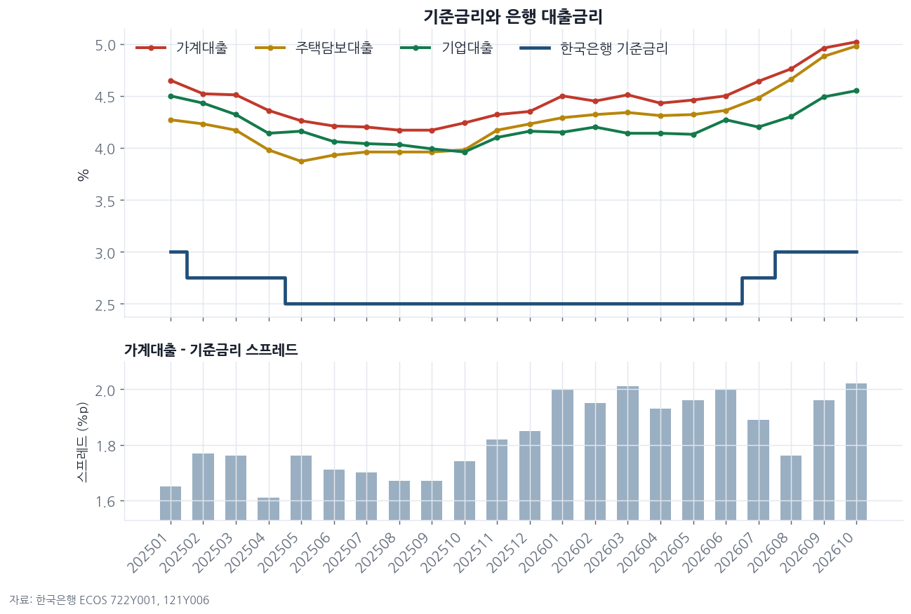
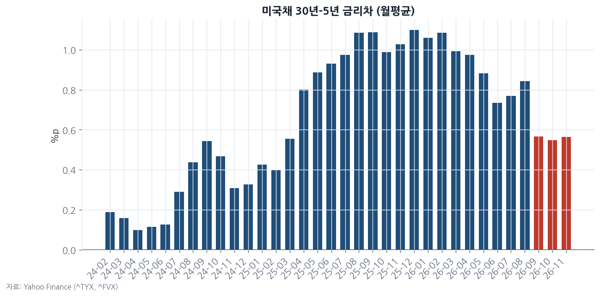
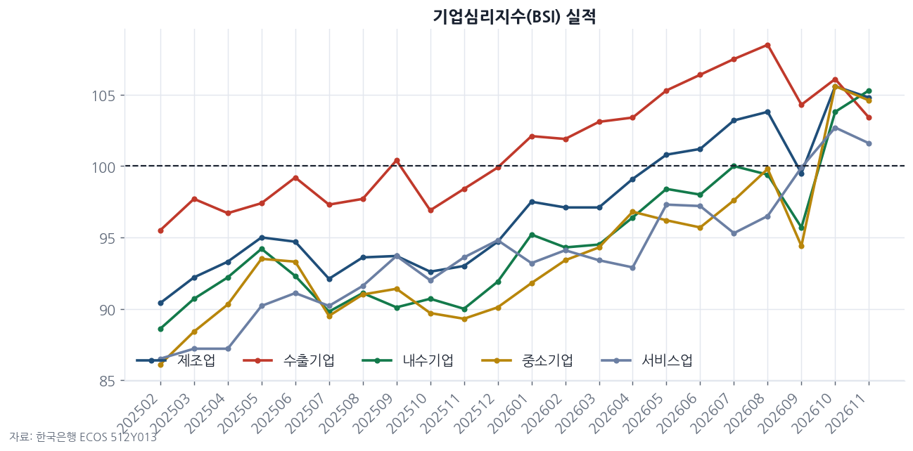
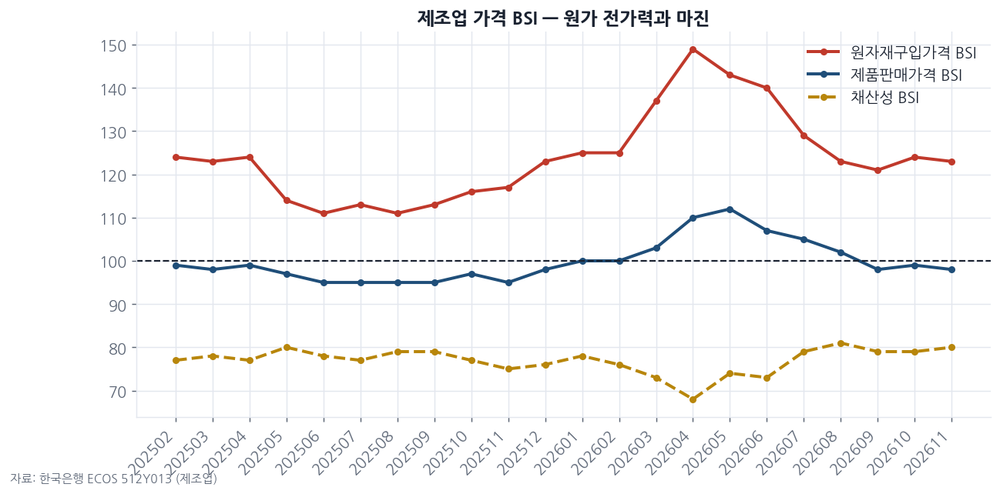
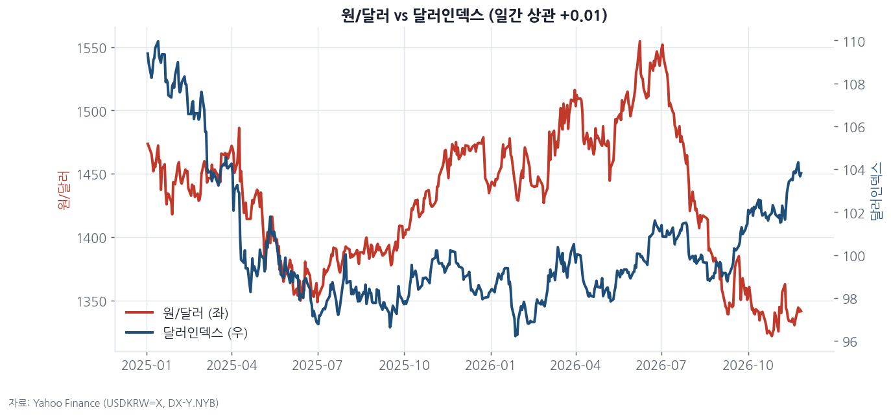

> 11/20 월간 점검 이후 엿새 만에 새로 들어온 계열만 다루는 **보충판**입니다. 정규 점검은 12월 20일에 나갑니다.
> 새 계열: **은행 대출금리 2026.10**, **BSI 실적 2026.11·전망 2026.12**, **CSI 2026.11**, 시장데이터(11/25 종가).
> 갱신되지 않은 계열 — GDP(실질 26Q3·명목 26Q2), 수출입·수출입지수·PPI·CPI(2026.10), 국제투자대조표(26Q3) — 은 [11/20 점검](2026-11-20.html)의 판단을 그대로 둡니다.
> 미국은 11/26 추수감사절 휴장이고 국내 시장은 작성 시점에 장중이라, 시장 수치는 모두 **11/25 종가**로 적었습니다.

## 0. 한 장 요약

| 축 | 11/20 점검 | 이번 보충 | 방향 |
|---|---|---|---|
| 가계대출 금리 | 4.96%(26.9) | **5.02%(26.10)** | **경계선 5.0% 돌파** |
| 가계 스프레드 | 1.96%p | **2.02%p** | 기준금리 동결 속 확대 |
| 제조업 BSI 실적 | 105.6(26.10) | 104.8(26.11) | 소폭 하락 |
| 수출기업 BSI 실적 | 106.1 | **103.4** | 수출 물량 급증과 반대 |
| 소비자심리지수 | 105.4(26.10) | **103.1(26.11)** | 두 달째 하락 |
| 미국채 10년물 | 5.05%(11/19) | **4.85%(11/25)** | 경계(5.13%)에서 멀어짐 |
| 원/달러 | 1,334.9(11/20) | 1,342.7(11/25) | 소폭 약세 |

**핵심 서사:** *지난 점검에서 "4bp 남았다"고 적은 가계대출 금리가 10월에 5.02%로 선을 넘었다. 기준금리는 석 달째 3.00%로 같은데 대출금리만 오르고 있고, 같은 달 소비자는 경기·취업·집값 전망을 모두 낮췄다. 가계 쪽 펀더멘털이 한 단계 더 식었다.*

**직전 체크리스트 점검:** 10개 항목 중 새 값이 나온 것은 3개다. **가계대출 금리가 경계 수준을 넘었다.** 제조업 판매가격 BSI(98)는 경계(<95)에 1포인트 더 다가갔고, 미국채 10년물(4.85%)은 경계에서 멀어졌다. 표는 4장에 있다.

---

## 1. 금리 — 기준금리는 그대로, 대출금리는 5%대

### 1-1. 국내 금리 (%)

| 시점 | 기준금리 | 가계대출 | 주담대 | 기업대출 | 가계 스프레드 | 주담대 스프레드 |
|---|---|---|---|---|---|---|
| 2026.06 | 2.50 | 4.50 | 4.36 | 4.27 | 2.00 | 1.86 |
| 2026.07 | 2.75 | 4.64 | 4.48 | 4.20 | 1.89 | 1.73 |
| 2026.08 | 3.00 | 4.76 | 4.66 | 4.30 | 1.76 | 1.66 |
| 2026.09 | 3.00 | 4.96 | 4.88 | 4.49 | 1.96 | 1.88 |
| **2026.10** | **3.00** | **5.02** | **4.98** | **4.55** | **2.02** | **1.98** |

> **인사이트 ① — 머리기사** 가계대출 금리가 **5.02%** 로 지난 점검이 둔 경계선(5.0%)을 넘었다. 차트가 보여 주는 2025년 1월 이후 22개월 중 가장 높고, 주담대도 4.98%로 5%에 2bp 남았다.
> 핵심은 **오른 이유**다. 기준금리는 8월 3.00% 이후 그대로인데 가계대출 금리는 8월 4.76% → 10월 5.02%로 26bp 더 올랐다. 가계 스프레드는 1.76 → **2.02%p** 로 이 기간 최고가 됐다. 정책금리가 아니라 은행의 가산금리·조달금리 쪽에서 부담이 커지고 있다는 뜻이다. 11/20 점검 기준으로 미 10년물이 10월 월평균 5.13%였으니, 장기 시장금리가 대출금리로 넘어오는 경로와 방향이 맞는다.
> 11/20 점검의 GDP 표에서 26Q3 실질 가계소비는 이미 +0.71%로 멈춰 있었다. 이자 부담이 5%대에 들어선 채로 4분기를 맞는다는 점에서, 체크리스트의 "실질 가계소비 <0%" 항목이 이전보다 가까워졌다고 본다. 이를 확인할 26Q3 잠정치는 12월 초에 나온다.

### 1-2. 미국채 커브

| 지표 | 11/19(지난 점검) | 11/25 | 변화 | 10월 월평균 |
|---|---|---|---|---|
| 5년물 | 4.87% | 4.66% | -0.21%p | 4.93% |
| 10년물 | 5.05% | **4.85%** | **-0.20%p** | 5.13% |
| 30년물 | 5.40% | 5.23% | -0.17%p | 5.48% |
| 30y-5y | 0.53%p | 0.57%p | +0.04%p | 0.55%p |

> **인사이트 ②** 지난 점검은 10년물 5.05%를 보고 "할인율 정점 미통과 쪽으로 기울었다"고 썼다. 엿새 만에 커브 전 구간이 17~21bp 내려와 10년물이 **4.85%** 가 됐다. 경계(10월 월평균 5.13% 돌파)와의 거리는 8bp에서 28bp로 벌어졌다.
> 다만 이것은 엿새치 움직임이다. 11월 월평균(4.96%, 11/26까지)은 여전히 9월(4.98%)과 비슷한 수준이고, 판단을 바꾸기에는 짧다. 국내 대출금리는 시장금리를 한두 달 늦게 따라오므로, 이 하락이 이어진다면 12월 점검의 11월 대출금리에서 먼저 확인될 것이다.

---

## 2. 심리지표 — 기업은 버티고, 가계가 식었다

### 2-1. 기업심리지수(CBSI) 실적·전망

| 시점 | 전산업 | 제조업 | 수출기업 | 내수기업 | 비제조업 | 중소기업 |
|---|---|---|---|---|---|---|
| 2026.09 실적 | 99.1 | 99.5 | 104.3 | 95.7 | 98.9 | 94.4 |
| 2026.10 실적 | 104.2 | 105.6 | 106.1 | 103.8 | 103.2 | 105.6 |
| **2026.11 실적** | **103.5** | **104.8** | **103.4** | **105.3** | 102.5 | 104.6 |
| 2026.12 전망 | 102.0 | 102.8 | 102.8 | 103.1 | 101.4 | 102.4 |

### 2-2. 제조업 가격·채산성 BSI 실적

| 시점 | 원자재구입가격 | 제품판매가격 | 채산성 | 업황 | 수출실적 |
|---|---|---|---|---|---|
| 2026.05 | 143 | 112 | 74 | 80 | 94 |
| 2026.08 | 123 | 102 | 81 | 81 | 95 |
| 2026.10 | 124 | 99 | 79 | 78 | 91 |
| **2026.11** | **123** | **98** | **80** | 79 | 93 |

> **인사이트 ③** 기업심리는 10월의 반등 폭을 대부분 지켰다(전산업 104.2 → 103.5). 눈에 띄는 것은 구성이다. **수출기업이 106.1 → 103.4로 내리고 내수기업이 103.8 → 105.3으로 올라** 데이터가 있는 2025년 12월 이후 처음으로 내수기업이 수출기업보다 높다. 10월 수출 물량이 +43.9%로 뛴 직후라는 점에서, 11/20 점검이 지적한 "숫자로 찍힌 호황을 기업이 체감하지 못하는 괴리"가 한 달 더 이어졌다.
> 가격 쪽에서는 제품판매가격 BSI가 5월 112 → 11월 **98** 로 내려왔고(10월 99에서 다시 하락) 경계(<95)까지 3포인트 남았다. 원자재구입가격(123)이 판매가격보다 25포인트 높은 구도가 그대로라 채산성은 80에 머문다. 원가는 비싸고 판매가는 못 올리는 상태 — 지난 점검의 "마진 압박" 판단을 지지하는 데이터다.

### 2-3. 소비자동향조사(CSI)

| 시점 | 소비자심리 | 현재경기판단 | 향후경기전망 | 취업기회전망 | 주택가격전망 | 금리수준전망 | 물가수준전망 |
|---|---|---|---|---|---|---|---|
| 2026.06 | 106.6 | 86 | 92 | 89 | 120 | 126 | 150 |
| 2026.09 | 106.6 | 83 | 90 | 88 | 125 | 128 | 150 |
| 2026.10 | 105.4 | 82 | 88 | 86 | 124 | 127 | 149 |
| **2026.11** | **103.1** | **78** | **86** | **83** | **118** | 124 | 149 |

CSI 각 항목은 100보다 크면 "좋아짐/오름"이라는 응답이 많다는 뜻이다.

> **인사이트 ④** 소비자심리지수가 106.6 → 105.4 → **103.1** 로 두 달째 내렸다. 하락은 넓게 퍼져 있다. 현재경기판단(78)·향후경기전망(86)·취업기회전망(83)이 모두 4월(각각 68·79·82) 이후 가장 낮다.
> 주택가격전망이 9월 125에서 **118** 로 두 달 사이 7포인트 내린 것도 같은 방향이다. 1장의 주담대 금리 4.98%와 맞물려 읽힌다.
> 금리수준전망은 124로 여전히 "더 오를 것"이라는 응답이 우세하다. 대출금리가 5%를 넘은 상태에서 가계가 금리 하락을 기대하지 않는다는 뜻이고, 이는 지출 계획을 미루는 쪽으로 작용한다. 물가수준전망 149는 꿈쩍하지 않았다.

---

## 3. 환율 — 달러 강세 속 원화는 1,340원대 횡보

| 시점 | USD/KRW | 달러인덱스 | KOSPI |
|---|---|---|---|
| 2026.10(월평균) | 1,336.9 | 102.05 | 6,116.2 |
| 11/19~20(지난 점검) | 1,334.9 | 103.92 | 5,067.4 |
| **11/25** | **1,342.7** | **103.67** | **4,697.5** |

원/달러와 달러인덱스의 일간 변화율 상관계수(최근 250일)는 0.013으로 여전히 무상관이다.

> **인사이트 ⑤** 지난 점검은 "달러 강세 속 원화 안정"을 근거로 외국인 이탈 해석을 약화했다. 엿새 동안 원/달러는 1,335 → 1,343원으로 0.6% 약해졌고 달러인덱스는 거의 제자리다. 방향은 원화 약세지만 폭이 작아 그 판단을 다시 뒤집을 근거는 되지 않는다.
> KOSPI는 같은 기간 5,067 → 4,698로 -7.3% 내려 지난 점검의 "급락 국면이 멈췄다"는 관찰은 유지되지 않았다. 다만 이 글은 시장이 아니라 펀더멘털을 본다. 주가 하락에 대응하는 펀더멘털 변화는 이번 보충에서 금리·심리 두 곳에서만 확인되며, 이 데이터만으로 하락 폭을 설명할 수는 없다.

---

## 4. 종합 판단 — 안전마진 관점

### 11/20 점검 이후 달라진 것
1. **가계대출 금리 5% 돌파** — 5.02%(10월), 기준금리 동결 속 가계 스프레드 2.02%p.
2. **가계 심리 후퇴** — 소비자심리 103.1, 현재경기판단 78·취업기회전망 83·주택가격전망 118.
3. **수출기업 심리 하락** — 106.1 → 103.4, 내수기업(105.3)에 역전됨.
4. **판매가격 BSI 하락 지속** — 98, 경계(<95)에 3포인트 남음.
5. **미 장기금리 후퇴** — 10년물 5.05 → 4.85%.

### 직전 체크리스트 점검 (11/20 점검의 10개 항목)

| 지표 | 11/20 값 | 이번 값 | 경계 수준 | 판정 |
|---|---|---|---|---|
| **가계대출 금리** | 4.96%(9월) | **5.02%(10월)** | >5.0% | **경계 돌파** |
| 제조업 판매가격 BSI | 99(10월) | **98(11월)** | <95 | 미도달, 접근 중 |
| 미국채 10년물 | 5.05%(11/19) | **4.85%(11/25)** | >5.13% | 미도달, 멀어짐 |
| 수출 단가 yoy | +44.3%(10월) | 미갱신 | <+10% | 데이터 대기 |
| 수출 물량 yoy | +43.9%(10월) | 미갱신 | <+10% | 데이터 대기 |
| 순상품교역조건지수 | 117.1(10월) | 미갱신 | <110 | 데이터 대기 |
| 실질 가계소비 yoy | +0.71%(26Q3) | 미갱신 | <0% | 26Q3 잠정치 대기 |
| GDP 디플레이터 yoy | +21.6%(26Q2) | 미갱신 | 하락 전환 | 26Q3 잠정치 대기 |
| PPI-CPI 격차 | 4.39%p(10월) | 미갱신 | <2%p | 데이터 대기 |
| 무역수지 | +430억$(10월) | 미갱신 | <+150억$ | 데이터 대기 |

### 12월 점검까지 지켜볼 것

| 지표 | 현재 | 경계 수준 | 의미 |
|---|---|---|---|
| 주담대 금리 | 4.98%(10월) | >5.0% | 가계 이자 부담이 주택 쪽으로 확산 |
| 가계 스프레드 | 2.02%p(10월) | >2.2%p | 정책금리와 무관한 대출금리 상승 고착 |
| 소비자심리지수 | 103.1(11월) | <100 | 비관 우위 전환 |
| 제조업 판매가격 BSI | 98(11월) | <95 | 디플레 압력 |
| 실질 가계소비 yoy (26Q3 잠정) | +0.71% | <0% | 내수 역성장 진입 |

나머지 항목은 11/20 점검의 체크리스트를 그대로 유지한다.

### 결론
> 지난 점검의 결론은 수출 쪽 걱정 두 가지가 줄고 교역조건이라는 새 걱정이 생겼다는 것이었다. 이번 보충은 그 반대편, **가계** 쪽에서 무게가 더해졌다. 대출금리는 5.02%로 선을 넘었고, 이는 정책금리가 아니라 스프레드가 만든 상승이다. 소비자는 경기·취업·집값 전망을 함께 낮췄다.
> 안전마진 관점에서 이것은 지난 점검의 할인 근거 중 **"가계소비 정지"** 쪽을 강화한다. 내수에 기대는 이익일수록 정상 이익을 더 보수적으로 잡아야 할 근거다. 반면 미 10년물이 4.85%로 내려온 것은 할인율 쪽에서 엿새치 완화다. 정상 이익의 할인 폭을 바꿀 만큼 지속됐는지는 12월 점검의 월평균으로 판단한다.

---

### 데이터 출처와 작성 기준
- 모든 수치는 **한국은행 ECOS OpenAPI** 원데이터와 **Yahoo Finance** 종가를 `scripts/macro/fetch_and_chart.py` 로 조회해 산출했다. 웹 검색 수치는 쓰지 않았다.
- 계열별 최신 시점: 은행 대출금리 2026.10, BSI 실적·CSI 2026.11, BSI 전망 2026.12, 기준금리·주요국 정책금리 2026.10, 시장데이터 2026-11-25 종가. 그 밖의 계열은 11/20 점검과 같다.
- 11/20 점검의 시장 수치는 11/19 종가다(당시 11/20 행이 장중이라 11/19 값으로 채워져 있었음). 이번 비교도 11/19 대비로 했다.
- 가계 스프레드 = 가계대출 금리 − 기준금리. 11월 미국채 월평균은 11/26까지의 평균이다.
- 사용 통계표: 722Y001·121Y006(금리), 512Y013·512Y014(BSI), 511Y002(CSI).
- 이번 보충에는 갱신된 계열의 차트 5종만 실었다. 나머지 차트는 11/20 점검을 참고.
